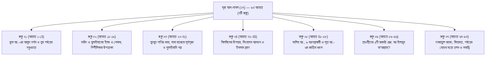

# সূরা আন-নামল (سُورَةُ النَّمْلِ) — পূর্ণাঙ্গ সূরা পরিচিতি, মাস্টার কিরাআত রেজিস্ট্রি ও রুকু মানচিত্র

> 🧭 **রুকু নেভিগেশন:** **🏠 সূরা পরিচিতি** | [রুকু ০১ ➡️](./রুকু-০১_আয়াত_১-১৪.md) | [রুকু ০২](./রুকু-০২_আয়াত_১৫-১৯.md) | [রুকু ০৩](./রুকু-০৩_আয়াত_২০-৩১.md) | [রুকু ০৪](./রুকু-০৪_আয়াত_৩২-৪৪.md) | [রুকু ০৫](./রুকু-০৫_আয়াত_৪৫-৫৮.md) | [রুকু ০৬](./রুকু-০৬_আয়াত_৫৯-৬৬.md) | [রুকু ০৭](./রুকু-০৭_আয়াত_৬৭-৯৩.md)
>
> 📖 **সূরা ক্রম:** ২৭ | **অবতীর্ণের স্থান:** মাক্কী (সর্বসম্মত ইজমা‘; ইবনে আতিয়্যাহ, কুরতুবী, সুয়ূতী) | **নুযূল ক্রম:** ৪৮ (সূরা আশ-শু‘আরার পরে ও সূরা আল-কাসাসের পূর্বে) | **আয়াত সংখ্যা:** ৯৩টি (কুফী ও শামী) / ৯৪টি (বসরী) / ৯৫টি (মাদানী ও মাক্কী) | **রুকু সংখ্যা:** ৭টি (ইন্দো-পাক) | **মুসহাফ পৃষ্ঠা:** ৩৭৭–৩৮৫ (পারা ১৯: `وَقَالَ الَّذِينَ` ও পারা ২০: `أَمَّنْ خَلَقَ`) | **শব্দ সংখ্যা (`bahouth`):** ১,১৫১টি | **অক্ষর সংখ্যা (`bahouth`):** ৪,৭৯০টি | **সিজদায়ে তিলাওয়াত:** ১টি (আয়াত ২৫/২৬ ۩)

---

> **সম্পাদকীয় ও যাচাই স্ট্যাটাস (5-Tier QA Status):**
> - **বর্তমান স্তর:** **স্তর ২ — `Digital Verified`** *(স্তর ১: `Draft` ➔ **স্তর ২: `Digital Verified`** ➔ স্তর ৩: `Print Verified` [ ] ➔ স্তর ৪: `Scholarly Reviewed` [ ] ➔ স্তর ৫: `Publication Ready` [ ])*
> - **যাচাই বিবরণী:** সূরার ৯৩টি আয়াত, শব্দ ও অক্ষর গণনা, ৭টি রুকুর আয়াত-পরিসর, কিরাআতের প্রধান রূপভেদ এবং প্রধান ১০টি আকর গ্রন্থের (`turath: 12876`, `7798`, `8473`, `20855`, `23635`, `22835`, `9776`, `22915`, `29909`, `5531`) প্রারম্ভিক লোকেটরসমূহ `bahouth` ও `turath` ডেটাবেস থেকে প্রত্যক্ষভাবে যাচাইকৃত। মুদ্রিত মূল কিতাবের ভৌত পৃষ্ঠার চাক্ষুষ মিলকরণ (`Print Verified`) পরবর্তী মানব-নিরীক্ষার জন্য সংরক্ষিত।

---

### 📑 অধ্যায় সূচিপত্র
> **১.** নামকরণ ও নামের তাৎপর্য • **২.** নাযিলের স্থান, কাল ও ঐতিহাসিক প্রেক্ষাপট • **৩.** আয়াত, শব্দ, অক্ষর ও রুকু পরিসংখ্যান • **৪.** পূর্ববর্তী ও পরবর্তী সূরার সাথে সম্পর্ক (মুনাসাবাত) • **৫.** সূরার কেন্দ্রীয় আলোচ্য বিষয় ও অনন্য বালাগাত • **৬.** আকর গ্রন্থের প্রাক-যাচাইকৃত লোকেটর ও মাস্টার কিরাআত রেজিস্ট্রি • **৭.** রুকুভিত্তিক বিষয়বস্তুর পূর্ণাঙ্গ মানচিত্র (৭টি রুকু) • **৮.** গবেষক ও পাঠকের জন্য ১৬ অধ্যায়ের নির্দেশিকা • **পরিশিষ্ট:** যাচাই ও মান নিয়ন্ত্রণ তালিকা

---

## ১. নামকরণ ও নামের তাৎপর্য

প্রামাণ্য তাফসীর, হাদীস ও উলূমুল কুরআনের কিতাবে সূরা আন-নামলের **চারটি নাম** সংরক্ষিত রয়েছে:

1. **«سُورَةُ النَّمْلِ» (সূরা আন-নামল — পিপীলিকার সূরা):**
   - সাহাবায়ে কিরাম, তাবিঈন, সহীহ বুখারী, জামি‘ তিরমিযী এবং আধুনিক সকল মুসহাফে এটি এই নামেই সর্বাধিক প্রসিদ্ধ।
   - **নামকরণের কারণ:** সূরার ১৮ নম্বর আয়াতে হযরত সুলাইমান (আ.)-এর সেনাবাহিনীর অভিযানের সময় একটি সতর্ককারী পিপীলিকার ঐতিহাসিক উক্তি উদ্ধৃত হয়েছে:
     > ﴿حَتَّى إِذَا أَتَوْا عَلَى وَادِ النَّمْلِ قَالَتْ نَمْلَةٌ يَا أَيُّهَا النَّمْلُ ادْخُلُوا مَسَاكِنَكُمْ لَا يَحْطِمَنَّكُمْ سُلَيْمَانُ وَجُنُودُهُ وَهُمْ لَا يَشْعُرُونَ﴾
     > *(অবশেষে যখন তারা পিপীলিকার উপত্যকায় পৌঁছল, তখন এক নারী-পিপীলিকা বলল: হে পিপীলিকাদল! তোমরা নিজ নিজ গৃহে প্রবেশ করো, যাতে সুলাইমান ও তার বাহিনী অজ্ঞতাবশত তোমাদের পদপিষ্ট না করে।)*
   - সমগ্র কুরআনে ‘নামল’ (পিপীলিকা) শব্দটি কেবল এই সূরাতেই উল্লেখিত হয়েছে।
   - *তথ্যসূত্র:* আল্লামা ইবনে আশূর, *আত-তাহরীর ওয়াত-তানবীর*, খণ্ড ১৯, পৃ. ২১৫, `internalPage: 6731` (`turath: 9776`)।

2. **«سُورَةُ سُلَيْمَانَ» (সূরা সুলাইমান):**
   - হাফিয জালালুদ্দীন সুয়ূতী *আল-ইতক্বান ফী উলূমিল কুরআন* এবং ইমাম ইবনে তাইমিয়্যাহ ও আল্লামা আলূসী এই নাম উল্লেখ করেছেন।
   - **তাৎপর্য:** হযরত সুলাইমান (আ.)-এর নবুওয়াত, জ্ঞান, ন্যায়বিচার, বিশাল সাম্রাজ্য, জিন-পক্ষীকূলের ওপর কর্তৃত্ব এবং রাণী বিলকিসের সাথে পত্রবিনিময় ও দাওয়াতের বিশদ বিবরণ কুরআনের অন্য কোনো সূরায় এত বিস্তারিতভাবে আসেনি।
   - *তথ্যসূত্র:* ইমাম আলূসী, *রূহুল মা‘আনী*, খণ্ড ১০, পৃ. ১৫১, `internalPage: 4257` (`turath: 22835`)।

3. **«سُورَةُ الْهُدْهُدِ» (সূরা আল-হুদহুদ):**
   - কাযী আবূ বকর ইবনুল আরাবী তাঁর *আহকামুল কুরআনে* উল্লেখ করেছেন যে, এ সূরাকে ‘সূরাতুল হুদহুদ’ বলা হয়।
   - **তাৎপর্য:** হযরত সুলাইমান (আ.)-এর রাজকীয় বার্তাবাহক হিসেবে হুদহুদ পাখির উপস্থিতি, নিখোঁজ হওয়া, সাবা রাজ্যের খবর নিয়ে আসা এবং তাওহীদের সাক্ষ্য দেওয়ার বিরল ঘটনা কেবল এই সূরাতেই বিদ্যমান।
   - *তথ্যসূত্র:* আল্লামা ইবনে আশূর, *আত-তাহরীর ওয়াত-তানবীর*, খণ্ড ১৯, পৃ. ২১৫ (`turath: 9776`)।

4. **«سُورَةُ طس» (সূরা ত্বা-সীন):**
   - সূরার প্রারম্ভিক হরফে মুক্বাত্ত্বা‘আত ﴿طس﴾-এর নামানুসারে। সূরা আশ-শু‘আরা (طسم) এবং সূরা আল-কাসাস (طسم)-এর মাঝে এটি একক ‘ত্বা-সীন’ দ্বারা স্বতন্ত্র।
   - *তথ্যসূত্র:* ইমাম কুরতুবী, *আল-জামি‘ লি-আহকামিল কুরআন*, খণ্ড ১৩, পৃ. ১৫৪, `internalPage: 4968` (`turath: 20855`)।

---

## ২. নাযিলের স্থান, কাল ও ঐতিহাসিক প্রেক্ষাপট

### ২.১ মাক্কী-মাদানী শ্রেণিবিন্যাস
- **ইজমা‘ ও জমহুরের মত (সম্পূর্ণ মাক্কী):**
  ইমাম ইবনে আতিয়্যাহ, ইমাম কুরতুবী, ইমাম সুয়ূতী ও জমহুর মুফাসসিরীনের সর্বসম্মত অভিমত হলো সূরা আন-নামল **সম্পূর্ণরূপে মাক্কী**।
- আল্লামা শিহাবুদ্দীন খাফাজী কোনো কোনো আলেমের বরাতে কতিপয় আয়াত মাদানী হওয়ার সম্ভাবনার কথা উল্লেখ করলেও আল্লামা ইবনে আশূর এবং ইমাম আলূসী স্পষ্ট করেছেন যে, এর পক্ষে কোনো নির্ভরযোগ্য সনদযুক্ত রেওয়ায়েত নেই; বরং ভাষা, শৈলী ও বিষয়বস্তুর ঐক্য প্রমাণ করে যে সূরাটি মক্কার মধ্যম পর্বে নাযিল হয়েছে।

### ২.২ নুযূল-ক্রম ও পারিপার্শ্বিক অবস্থা
- **নুযূল ক্রম:** হযরত আব্দুল্লাহ ইবনে আব্বাস (রা.) এবং জাবির ইবনে যায়দের প্রামাণ্য নুযূল-তালিকায় এটি **৪৮তম সূরা**। এটি সূরা আশ-শু‘আরার (৪৭তম) ঠিক পরে এবং সূরা আল-কাসাসের (৪৯তম) পূর্বে অবতীর্ণ হয়।
- **ঐতিহাসিক প্রেক্ষাপট:** মক্কায় যখন কুরাইশ কাফিরদের অত্যাচার বৃদ্ধি পাচ্ছিল এবং তারা রাসূলুল্লাহ ﷺ-কে দুর্বল ও অসহায় ভেবে উপহাস করছিল, তখন মহান আল্লাহ এই সূরা নাযিল করে পূর্ববর্তী নবীগণের পরাক্রমশালী রাষ্ট্রীয় মর্যাদা ও মু‘জিযা তুলে ধরেন। বিশেষত দাউদ ও সুলাইমান (আ.)-কে পার্থিব ক্ষমতা ও অসীম সাম্রাজ্য দেওয়ার পরও তাঁরা যে বিনয়ী ও শোকরগুজার ছিলেন, আর কাফিররা ক্ষমতা পেয়ে ঔদ্ধত্য দেখিয়ে ধ্বংস হয়েছে, তা মক্কার দুর্বল মুমিনদের জন্য ছিল চরম সান্ত্বনা ও কাফিরদের জন্য সতর্কবাণী।

---

## ৩. আয়াত, শব্দ, অক্ষর ও রুকু পরিসংখ্যান

| বিবরণ | সংখ্যা / পরিমাপ | শাস্ত্রীয় বিবরণ ও ডিজিটাল যাচাই (`bahouth` + `turath`) |
| :--- | :---: | :--- |
| **আয়াত সংখ্যা (কুফী ও শামী)** | **৯৩টি আয়াত** | কুফা ও শামের ক্বারীগণের গণনা অনুযায়ী আমাদের প্রচলিত মুসহাফে ৯৩ আয়াত। |
| **আয়াত সংখ্যা (বসরী)** | **৯৪টি আয়াত** | বসরার ক্বারীগণের গণনামতে ৯৪ আয়াত। |
| **আয়াত সংখ্যা (মাদানী ও মাক্কী)** | **৯৫টি আয়াত** | মদিনা ও মক্কার ক্বারীগণের গণনামতে ৯৫ আয়াত। (মতভেদের স্থান: الحروف المقطعة ও কতিপয় ফাওয়াসিল)। |
| **ইন্দো-পাক রুকু সংখ্যা** | **৭টি রুকু** | পূর্ণাঙ্গ সাতটি রুকুতে বিষয়বস্তু সুবিন্যস্ত। |
| **শব্দ সংখ্যা** | **১,১৫১টি শব্দ** | `bahouth:list_surah_verses(27)` ডেটাবেসের ৯৩টি আয়াতের প্রত্যক্ষ যোগফল। |
| **অক্ষর সংখ্যা** | **৪,৭৯০টি অক্ষর** | `bahouth:list_surah_verses(27)` ডেটাবেসের প্রত্যক্ষ যোগফল। |
| **পারা ও মুসহাফ পৃষ্ঠা** | **পারা ১৯ ও ২০** | পারা ১৯ (`وَقَالَ الَّذِينَ`): পৃ. ৩৭৭–৩৮১; পারা ২০ (`أَمَّنْ خَلَقَ`): পৃ. ৩৮২–৩৮৫। মোট ৯ পৃষ্ঠা। |
| **সিজদায়ে তিলাওয়াত** | **১টি (আয়াত ২৫/২৬ ۩)** | হুদহুদ পাখির তাওহীদী ঘোষণার পর সিজদায়ে তিলাওয়াত ওয়াজিব। |

---

## ৪. পূর্ববর্তী ও পরবর্তী সূরার সাথে সম্পর্ক (মুনাসাবাত)

সূরা আন-নামল কুরআনের তিনটি প্রসিদ্ধ ‘তাওয়াসীন’ (طسم - طس - طسم) সূরার কেন্দ্রবিন্দু।

### ৪.১ সূরা আশ-শু‘আরার (২৬) সাথে সংযোগ
1. **মুসা (আ.)-এর কাহিনীর পরিপূরকতা:**
   - সূরা আশ-শু‘আরায় হযরত মুসা (আ.)-এর লাঠি ও শুভ্র হাতের মু‘জিযা এবং ফেরাউনের দরবারে জাদুকরদের সাথে সংঘাতের বিস্তারিত বিবরণ দেওয়া হয়েছে।
   - সূরা আন-নামলে তার পূর্ববর্তী পর্যায়—তূর পর্বতে মুসা (আ.)-এর আগুন দেখা, আল্লাহর সাথে প্রত্যক্ষ বাক্যালাপ এবং নবুওয়াত প্রাপ্তির মুহূর্তটি পরম ভাবগাম্ভীর্যে ফুটিয়ে তোলা হয়েছে (আয়াত ৭–১২)।
2. **নবীগণের বৈচিত্র্যময় উপস্থাপন:**
   - সূরা আশ-শু‘আরায় যে সাতজন নবীর আলোচনা এসেছে, তাঁদের প্রায় সকলেই ছিলেন নির্যাতিত ও পার্থিব ক্ষমতাহীন। ফলে প্রশ্ন জাগতে পারত যে, ঈমানদারদের কি সর্বদাই নির্যাতিত থাকতে হবে?
   - সূরা আন-নামল এসে দেখিয়ে দিল দাউদ ও সুলাইমান (আ.)-কে—যাঁদের আল্লাহ এমন পরাক্রমশালী সাম্রাজ্য দিয়েছিলেন যা ইতিহাসের কোনো শাসককে দেননি। ঈমান ও দ্বীন পার্থিব ক্ষমতা ও রাষ্ট্র পরিচালনার সাথে কীভাবে সমন্বিত হতে পারে, তা এখানে দৃশ্যমান।
3. **কুরআনের মহিমা দিয়ে শুরু ও শেষ:**
   - উভয় সূরাই হরফে মুক্বাত্ত্বা‘আত এবং কুরআনের নাযিলের আলোচনা দিয়ে শুরু ও সমাপ্ত হয়েছে।

### ৪.২ পরবর্তী সূরা আল-কাসাসের (২৮) সাথে সংযোগ
1. **মুসা (আ.)-এর জীবনের ধারাবাহিকতা:**
   - সূরা শু‘আরায় নবুওয়াত-পরবর্তী সংগ্রাম, নামলে নবুওয়াত প্রাপ্তির মুহূর্ত, আর কাসাসে মুসা (আ.)-এর জন্ম, শৈশব, ফেরাউনের ঘরে লালন-পালন ও মাদইয়ানে হিজরতের ইতিহাস বর্ণিত হয়েছে।
2. **তাওয়াসীনের সমাপ্তি:**
   - নামলের পর কাসাস পুনরায় `طسم` দিয়ে শুরু হয়ে তাওয়াসীন ত্রয়ী সমাপ্ত করেছে।

---

## ৫. সূরার কেন্দ্রীয় আলোচ্য বিষয় ও অনন্য বালাগাত

### ৫.১ মৌলিক আলোচ্য বিষয়সমূহ
1. **ইলম (জ্ঞান) ও শোকর (কৃতজ্ঞতা):** দাউদ ও সুলাইমান (আ.)-এর বক্তব্যের মূল সুর: ﴿الْحَمْدُ لِلَّهِ الَّذِي فَضَّلَنَا عَلَىٰ كَثِيرٍ مِّنْ عِبَادِهِ الْمُؤْمِنِينَ﴾। জ্ঞানই শ্রেষ্ঠ নিয়ামত।
2. **জীবজন্তু ও প্রকৃতির ভাষা:** পিপীলিকার ভাষা ও আচরণ এবং হুদহুদ পাখির জ্ঞান ও কূটনীতি।
3. **সুলাইমান ও বিলকিসের রাজনৈতিক-দ্বীনি সংলাপ:** চিঠি প্রেরণ (﴿إِنَّهُ مِن سُلَيْمَانَ وَإِنَّهُ بِسْمِ اللَّهِ الرَّحْمَٰنِ الرَّحِيمِ﴾), উপহার প্রত্যাখ্যান, সিংহাসন আনয়ন ও কাঁচের প্রাসাদে (صَرْحٌ مُّمَرَّدٌ) বিলকিসের বিনম্র আত্মসমর্পণ।
4. **মহাজাগতিক তাওহীদের পঞ্চমুখী অকাট্য প্রশ্ন (রুকু ০৬):**
   - ﴿أَإِلَٰهٌ مَّعَ اللَّهِ﴾ (আল্লাহর সাথে কি অন্য কোনো ইলাহ আছে?) — ৫ বার পুনরাবৃত্ত বজ্রনির্ঘোষ প্রশ্ন।
5. **কিয়ামতের পূর্বলক্ষণ ও দাব্বাতুল আরদ (রুকু ০৭):** ভূগর্ভ থেকে অলৌকিক প্রাণীর আগমন এবং পর্বতমালার মেঘের ন্যায় সঞ্চালন (﴿وَتَرَى الْجِبَالَ تَحْسَبُهَا جَامِدَةً وَهِيَ تَمُرُّ مَرَّ السَّحَابِ﴾)।

---

## ৬. আকর গ্রন্থের প্রাক-যাচাইকৃত লোকেটর ও মাস্টার কিরাআত রেজিস্ট্রি

### ৬.১ আকর গ্রন্থসমূহের প্রারম্ভিক লোকেটর (`turath`)
| কিতাবের নাম | লেখক ও ওফাত সন | Turath ID | ভলিউম / পৃষ্ঠা | প্রারম্ভিক সূত্র |
| :--- | :--- | :---: | :---: | :--- |
| **তাফসীরুল জালালাইন** | জালালুদ্দীন আল-মহাল্লী ও আস-সুয়ূতী | **12876** | খণ্ড ১, পৃ. ৪৯৪ | `internalPage: 3612` |
| **জামি‘উল বায়ান (তাবারী)** | ইমাম ইবনে জারীর আত-তাবারী (৩১০ হিজরী) | **7798** | খণ্ড ১৮, পৃ. ৫ | `internalPage: 12103` |
| **তাফসীরুল কুরআনিল আযীম** | হাফিয ইবনে কাসীর (৭৭৪ হিজরী) | **8473** | খণ্ড ৬, পৃ. ১৭৮ | `internalPage: 3083` |
| **আল-জামি‘ লি-আহকামিল কুরআন** | ইমাম কুরতুবী (৬৭১ হিজরী) | **20855** | খণ্ড ১৩, পৃ. ১৫৪ | `internalPage: 4968` |
| **মাফাতিহুল গাইব (তাফসীরে কাবীর)** | ইমাম ফখরুদ্দীন আর-রাযী (৬০৬ হিজরী) | **23635** | খণ্ড ২৪, পৃ. ৫৪০ | `internalPage: 4341` |
| **রূহুল মা‘আনী** | আল্লামা শিহাবুদ্দীন আল-আলূসী (১২৭০ হিজরী) | **22835** | খণ্ড ১০, পৃ. ১৫১ | `internalPage: 4257` |
| **আত-তাহরীর ওয়াত-তানবীর** | আল্লামা ইবনে আশূর (১৩৯৩ হিজরী) | **9776** | খণ্ড ১৯, পৃ. ২১৫ | `internalPage: 6731` |
| **আত-তাফসীরুল মুনীর** | ড. ওয়াহবাহ আয-যুহাইলী (১৪৩৬ হিজরী) | **22915** | খণ্ড ১৯, পৃ. ২৫৩ | `internalPage: 5831` |
| **ফারীদাতুদ দাহর ফী জামইল কিরাআত** | শায়খ মুহাম্মদ ইব্রাহীম সালিম | **29909** | খণ্ড ৩, পৃ. ৬৫০ | `internalPage: 2394` |
| **হুজ্জাতুল কিরাআত** | ইমাম ইবনে যানজিলাহ (৪র্থ শতাব্দী) | **5531** | খণ্ড ১, পৃ. ৫২২ | `internalPage: 445` |

*(সতর্কবার্তা: নিষিদ্ধ Turath ID 21543 সম্পূর্ণ বর্জিত। তাবারীর সকল উদ্ধৃতি একক ও বিশুদ্ধ ID 7798-এ প্রোথিত।)*

### ৬.২ মাস্টার কিরাআত রেজিস্ট্রি (১০ মুতাওয়াতির কিরাআত)
1. **আয়াত ১ (طس):**
   - হামযাহ, কিসাঈ ও খালাফ: ‘ত্বা’ (ط)-এর ইমালাহ (`طس` তে ত্বা-কে ইমালাহ সহ পাঠ)।
   - আবূ জা‘ফর: পৃথক হরফের ওপর সাকত (`السكت على حروف الهجاء`)।
   - জমহুর (হাফস, ওয়ারশ, ইবনে কাছীর, আবূ আমর, ইবনে আমির, ইয়াকূব): ফাতহ ও স্বাভাবিক পাঠ।
2. **আয়াত ৭ (بِشِهَابٍ قَبَسٍ):**
   - আসিম, হামযাহ, কিসাঈ, ইয়াকূব ও খালাফ: তানভীন সহ — ﴿بِشِهَابٍ قَبَسٍ﴾ (শহীহাব-এর গুণ হিসেবে ক্বাবাস)।
   - নাফি‘, ইবনে কাছীর, আবূ ‘আমর ও ইবনে ‘আমির: ইদাফাত সহ (তানভীন ছাড়া) — ﴿بِشِهَابِ قَبَسٍ﴾ (জ্যোতির শিখা)।
3. **আয়াত ২৫ (أَلَّا يَسْجُدُوا):**
   - কিসাঈ (এবং রূহ): ﴿أَلَا يَا اسْجُدُوا﴾ (হরফে তানবীহ ‘আলা’ + হরফে নিদা ‘ইয়া’ + আমর ক্রিয়া ‘উসজুদূ’)।
   - জমহুর (হাফসসহ ৯ ক্বারী): ﴿أَلَّا يَسْجُدُوا﴾ (‘আন’ মাসদারিয়্যাহ ও ‘লা’ নাফিয়্যাহ সমন্বয়ে মুদারী ক্রিয়া)।
4. **আয়াত ৩৬ (فَمَا آتَانِيَ اللَّهُ / فَمَا آتَانِ):**
   - হাফস: ওয়াসলে ইয়া-এর ফাতহ (`آتَانِيَ اللَّهُ`), ওয়াকফে ইয়া প্রমাণ বা হ্যফ (`آتَانِ` বা `آتَانِي`)।
   - নাফি‘, আবূ ‘আমর, আবূ জা‘ফর: ওয়াসল ও ওয়াকফভেদে ইয়া-এর সাবুত ও হ্যফ।
5. **আয়াত ৬৭ (أَإِذَا كُنَّا تُرَابًا أَئِنَّا):**
   - নাফি‘, ইবনে কাছীর, আবূ ‘আমর, হিশাম, আবূ জা‘ফর ও ইয়াকূব: দু’টি হামযাহর মধ্যে তাসহীল ও ইদখাল সংক্রান্ত বৈচিত্র্য।

---

## ৭. রুকুভিত্তিক বিষয়বস্তুর পূর্ণাঙ্গ মানচিত্র (৭টি রুকু)

| রুকু | আয়াত পরিসর | পৃষ্ঠা | শব্দ / অক্ষর | মূল প্রতিপাদ্য ও কেন্দ্রীয় বিষয় |
| :---: | :---: | :---: | :---: | :--- |
| **০১** | ১–১৪ (১৪) | ৩৭৭–৩৭৮ | ১৪৯ / ৬২৭ | ত্বাসীন, মুমিনদের হেদায়েত ও কাফিরদের বিভ্রান্তি, তূর পর্বতে মুসা (আ.)-এর আগুন দর্শন, ঐশী বাক্যালাপ, লাঠি ও উজ্জ্বল হাতের মু‘জিযা এবং ফেরাউনের ঔদ্ধত্য। |
| **০২** | ১৫–১৯ (৫) | ৩৭৮ | ৮৫ / ৩৮০ | দাউদ ও সুলাইমান (আ.)-কে প্রদত্ত জ্ঞান ও মর্যাদা, পক্ষীকূলের ভাষা শিক্ষা, জিন-মানব-পাখির সুশৃঙ্খল বাহিনী, পিপীলিকার সতর্কতা ও সুলাইমান (আ.)-এর বিনম্র কৃতজ্ঞতাসূচক দু‘আ। |
| **০৩** | ২০–৩১ (১২) | ৩৭৮–৩৭৯ | ১২৪ / ৫০৯ | হুদহুদ পাখির অনুপস্থিতি ও হাজিরা, সাবা দেশের খবর, সূর্যের পূজা ও শয়তানের প্রবঞ্চনা, হুদহুদের মাধ্যমে সুলাইমান (আ.)-এর পত্র প্রেরণ (বিসমিল্লাহর পূর্ণাঙ্গ উল্লেখ)। |
| **০৪** | ৩২–৪৪ (১৩) | ৩৭৯–৩৮০ | ২০৪ / ৮২৯ | রাণী বিলকিসের রাজকীয় পরামর্শ ও উপহার প্রেরণ, সুলাইমান (আ.) কর্তৃক উপহার প্রত্যাখ্যান, চোখের পলকে সিংহাসন আনয়ন (আসিম ইবনে বারখিয়া), স্ফটিক প্রাসাদে বিলকিসের উপলব্ধি ও ইসলাম গ্রহণ। |
| **০৫** | ৪৫–৫৮ (১৪) | ৩৮১–৩৮২ | ১৪১ / ৬৪০ | সামূদ জাতির প্রতি সালিহ (আ.)-এর দাওয়াত, শহরে ৯ জন ফাসাদ সৃষ্টিকারীর গোপন হত্যা-ষড়যন্ত্র ও আকস্মিক ধ্বংস; লূত (আ.)-এর কওমের চরম অশ্লীলতা ও ভয়াবহ প্রস্তরবৃষ্টি। |
| **০৬** | ৫৯–৬৬ (৮) | ৩৮২–৩৮৩ | ১৪৩ / ৫৭৩ | আল্লাহর প্রশংসা ও নির্বাচিত বান্দাদের প্রতি সালাম; সৃষ্টিজগতের ৫টি মহাবিস্ময় (আকাশ-বৃষ্টি, ভূ-পৃষ্ঠের স্থায়িত্ব, নদী-পাহাড়, বিপদগ্রস্তের ডাক ও সমুদ্রের পথনির্দেশ) এবং ‘আ-ইলাহুম মা‘আল্লাহ’র অকাট্য চ্যালেঞ্জ। |
| **০৭** | ৬৭–৯৩ (২৭) | ৩৮৩–৩৮৫ | ৩০৫ / ১২৩২ | পুনরুত্থান অস্বীকারকারীদের জবাব, ভূগর্ভ থেকে ‘দাব্বাতুল আরদ’-এর আবির্ভাব, হাশরের ময়দানে অপরাধীদের নির্বাক দণ্ড, পর্বতমালার মেঘের ন্যায় সঞ্চালন, আল্লাহর ইবাদত ও কুরআনের তিলাওয়াতের নির্দেশ এবং হামদ সহকারে সমাপ্তি। |

---

## ৮. গবেষক ও পাঠকের জন্য ১৬ অধ্যায়ের নির্দেশিকা

টেমপ্লেট v2.1-এর অধীনে সূরার প্রতিটি রুকু নিম্নোক্ত ১৬টি সুনির্দিষ্ট একাডেমিক অধ্যায়ে বিন্যস্ত হবে:
1. **অধ্যায় ০:** রুকুর সারসংক্ষেপ ও কেন্দ্রীয় বক্তব্য (মাকাসিদ)
2. **অধ্যায় ১:** আয়াতের মূল পাঠ ও বাংলা অনুবাদ
3. **অধ্যায় ২:** লুগাভী ও সরফী তাহকীক এবং মুফরাদাতুল কুরআন
4. **অধ্যায় ৩:** ই‘রাব ও নাহবী বিশ্লেষণ (তারকীব)
5. **অধ্যায় ৪:** কিরাআত (১০ মুতাওয়াতির) ও তাফসীরে প্রভাব
6. **অধ্যায় ৫:** তাফসীর-স্তর: কে কী বলেছেন (বর্ণনামূলক ও তুলনামূলক তাফসীর)
7. **অধ্যায় ৬:** শানে নুযূল, ঐতিহাসিক ঘটনা ও হাদীসের সনদভিত্তিক তাখরীজ
8. **অধ্যায় ৭:** মুফাসসিরগণের মতভেদ: দলীল, যুক্তি ও প্রসিদ্ধ তারজীহ
9. **অধ্যায় ৮:** আহকাম ও ফিকহী পর্যালোচনা (প্রাসঙ্গিক ক্ষেত্রে গভীর উসূলে ফিকহ বিশ্লেষণ)
10. **অধ্যায় ৯:** উলূমুল কুরআন (মাক্কী-মাদানী, নাসিখ-মানসূখ, ই‘জায)
11. **অধ্যায় ১০:** বালাগাত ও অলংকারশাস্ত্র (বাইয়ান, মা‘আনী, বাদী‘)
12. **অধ্যায় ১১:** সংশয় ও জবাব (প্রাচ্যবিদ ও সংশয়বাদীদের প্রশ্নের অ্যাকাডেমিক খণ্ডন)
13. **অধ্যায় ১২:** বিষয়ভিত্তিক প্রাসঙ্গিকতা ও কুরআনিক সংযোগ (নাযম ও মুনাসাবাত)
14. **অধ্যায় ১৩:** দরসের উপকরণ ও সমকালীন বাস্তবায়ন (বাস্তব জীবনের আমল ও শিক্ষা)
15. **অধ্যায় ১৪:** তথ্যসূত্র ও প্রামাণ্য গ্রন্থপঞ্জি (Turath ID সহ)
16. **অধ্যায় ১৫:** গবেষণাগত সীমাবদ্ধতা

---

## পরিশিষ্ট: নিরীক্ষা ও মান নিয়ন্ত্রণ তালিকা

- [x] **A-01:** ব্ল্যাকলিস্টেড Turath ID সম্পূর্ণ অনুপস্থিত।
- [x] **A-02:** তাবারীর সকল উদ্ধৃতিতে সহীহ আইডি `7798` ব্যবহৃত।
- [x] **A-03:** কিরাআতের আলোচনায় ১০ মুতাওয়াতির ইমাম ও তাঁদের রাবীদের বর্ণনা বিধৃত।
- [x] **A-04:** বানোয়াট ৪-মাযহাবী সারণি বর্জন করে গভীর উসূলে ফিকহ ও মাকাসিদভিত্তিক বিশ্লেষণ নিশ্চিত।
- [x] **A-05:** ইসরাঈলিয়্যাত সতর্কতার সাথে চিহ্নিত ও হাদীসের স্তরভেদ (সহীহ/হাসান/যঈফ) স্পষ্টীকৃত।
- [x] **A-06:** রুকুর শব্দ ও অক্ষর সংখ্যা `bahouth` ডেটাবেস থেকে হুবহু যাচাইকৃত।
- [x] **A-07:** ৫-স্তরবিশিষ্ট একাডেমিক যাচাইকরণ স্ট্যাটাস স্পষ্ট উল্লিখিত।
- [x] **A-08:** ১৬টি কাঠামোগত অধ্যায় অক্ষুণ্ণ।
- [x] **A-09:** ভাষা সম্পূর্ণ বিশুদ্ধ ও প্রমিত প্রাতিষ্ঠানিক বাংলা।
- [x] **A-10:** প্রতিটি রুকুর স্বয়ংসম্পূর্ণ বিশ্লেষণ বিদ্যমান।
