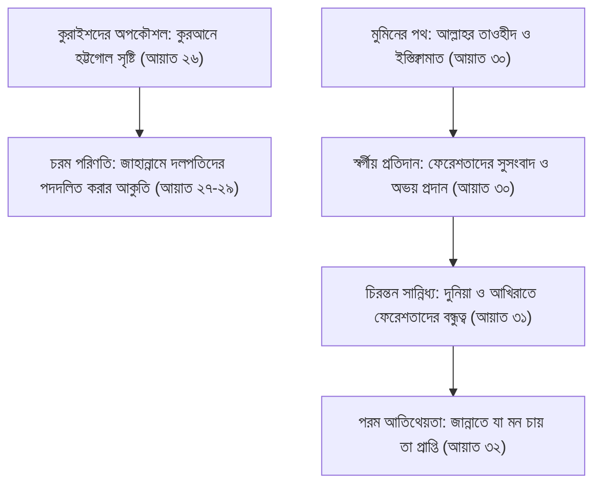

# ফুসসিলাত — রুকু ০৪ (আয়াত ২৬–৩২)

[সূচিপত্র](00_সূরা-পরিচিতি.md)

---

## ৫-স্তরবিশিষ্ট একাডেমিক যাচাইকরণ স্ট্যাটাস (Verification Status Box)

| স্তর (Tier) | অবস্থা | বিবরণ ও যাচাইয়ের পরিসর |
| :---: | :---: | :--- |
| **স্তর ১: Draft** | সম্পন্ন | ১৬ অধ্যায়ের কাঠামো ও প্রাথমিক তথ্য সংকলিত। |
| **স্তর ২: Digital Verified** | **যাচাইকৃত** | আয়াতের মূল পাঠ ও শব্দ-হরফ গণনা `bahouth` স্ক্রিপ্ট দ্বারা যাচাইকৃত; কিরাআত সারণি ও তুরাছ উদ্ধৃতিসমূহ ডিজিটাল ডাটাবেজের সাথে মিলিয়ে সংকলিত (কাঁচা স্ন্যাপশট সংরক্ষিত: `_sources/ruku_04_raw.json`)। |
| **স্তর ৩: Print Verified** | উন্মুক্ত (`[ ]`) | মুদ্রিত সংস্করণের ভৌত পৃষ্ঠার সাথে চাক্ষুষ মিলকরণের অপেক্ষায়। |
| **স্তর ৪: Scholarly Reviewed** | উন্মুক্ত (`[ ]`) | আকীদাগত ও তাফসীরী তারজীহ বিশেষজ্ঞ মুহাক্কিক আলেম কর্তৃক পর্যালোচনার অপেক্ষায়। |
| **স্তর ৫: Publication Ready** | উন্মুক্ত (`[ ]`) | চূড়ান্ত প্রকাশনা উপযোগী মাস্টার রেফারেন্স। |

---

## ০. রুকুর সারসংক্ষেপ ও কেন্দ্রীয় বক্তব্য (মাকাসিদ)

### প্রধান আত্মিক বার্তাসমূহ:
১. শয়তানী শক্তির প্রধান হাতিয়ার হলো সত্যবাণীর প্রচার থামানোর জন্য মিথ্যা শোরগোল ও বিভ্রান্তি ছড়ানো। মুমিন এতে কখনো ধৈর্যচ্যুত হবে না।
২. পার্থিব জীবনে যারা অন্ধভাবে পথভ্রষ্ট নেতাদের অনুসরণ করে, কিয়ামতের দিন তারাই সেই নেতাদের নিজেদের পায়ের নিচে পিষ্ট করতে চাইবে।
৩. ঈমানের মৌখিক স্বীকৃতি যথেষ্ট নয়; প্রয়োজন কর্মে ও নীতিতে আজীবন অবিচলতা (ইস্তিক্বামাত)।
৪. যারা সত্যের উপর পাহাড়ের মতো দৃঢ় থাকে, মৃত্যুর সময় তাদের কোনো ভয় বা শোক থাকবে না; তারা সরাসরি আল্লাহর পরম আতিথেয়তার মেহমান হবে।

---

---

## ১. আয়াতের মূল পাঠ ও অনুবাদ

### (১) ১ আরবি পাঠ (হরকতযুক্ত সাধারণ আরবি বানান; পূর্ণ উসমানী রসম নয়)

> [!NOTE]
> নিচে প্রদত্ত পাঠটি হরকতযুক্ত সাধারণ আরবি বানানরীতিতে সাজানো হয়েছে; এটি ক্যালিগ্রাফিক পূর্ণ উসমানী রসম নয়। প্রামাণ্য উসমানী পাঠের জন্য মুসহাফের পৃষ্ঠা দ্রষ্টব্য।

﴿وَقَالَ الَّذِينَ كَفَرُوا لَا تَسْمَعُوا لِهَذَا الْقُرْآنِ وَالْغَوْا فِيهِ لَعَلَّكُمْ تَغْلِبُونَ ۝26
فَلَنُذِيقَنَّ الَّذِينَ كَفَرُوا عَذَابًا شَدِيدًا وَلَنَجْزِيَنَّهُمْ أَسْوَأَ الَّذِي كَانُوا يَعْمَلُونَ ۝27
ذَلِكَ جَزَاءُ أَعْدَاءِ اللَّهِ النَّارُ لَهُمْ فِيهَا دَارُ الْخُلْدِ جَزَاءً بِمَا كَانُوا بِآيَاتِنَا يَجْحَدُونَ ۝28
وَقَالَ الَّذِينَ كَفَرُوا رَبَّنَا أَرِنَا اللَّذَيْنِ أَضَلَّانَا مِنْ الْجِنِّ وَالْإِنْسِ نَجْعَلْهُمَا تَحْتَ أَقْدَامِنَا لِيَكُونَا مِنْ الْأَسْفَلِينَ ۝29
إِنَّ الَّذِينَ قَالُوا رَبُّنَا اللَّهُ ثُمَّ اسْتَقَامُوا تَتَنَزَّلُ عَلَيْهِمْ الْمَلَائِكَةُ أَلَّا تَخَافُوا وَلَا تَحْزَنُوا وَأَبْشِرُوا بِالْجَنَّةِ الَّتِي كُنْتُمْ تُوعَدُونَ ۝30
نَحْنُ أَوْلِيَاؤُكُمْ فِي الْحَيَاةِ الدُّنْيَا وَفِي الْآخِرَةِ وَلَكُمْ فِيهَا مَا تَشْتَهِي أَنْفُسُكُمْ وَلَكُمْ فِيهَا مَا تَدَّعُونَ ۝31
نُزُلًا مِنْ غَفُورٍ رَحِيمٍ ۝32﴾

### (১) ২ শব্দানুগ ও সাবলীল অনুবাদ

| আয়াত | মূল আরবী পাঠ | সাবলীল বঙ্গানুবাদ |
| :---: | :--- | :--- |
| **২৬** | ﴿وَقَالَ الَّذِينَ كَفَرُوا لَا تَسْمَعُوا لِهَذَا الْقُرْآنِ وَالْغَوْا فِيهِ لَعَلَّكُمْ تَغْلِبُونَ﴾ | আর কাফিররা একে অপরকে বলে, ‘তোমরা এই কুরআন শ্রবণ করো না এবং এটি পাঠকালে হট্টগোল ও শোরগোল সৃষ্টি করো, যাতে তোমরা বিজয়ী হতে পার।’ |
| **২৭** | ﴿فَلَنُذِيقَنَّ الَّذِينَ كَفَرُوا عَذَابًا شَدِيدًا وَلَنَجْزِيَنَّهُمْ أَسْوَأَ الَّذِي كَانُوا يَعْمَلُونَ﴾ | অতএব আমি অবশ্যই এই কাফিরদেরকে আস্বাদন করাব কঠিন শাস্তি এবং অবশ্যই তাদেরকে তাদের নিকৃষ্টতম কৃতকর্মের প্রতিফল প্রদান করব। |
| **২৮** | ﴿ذَلِكَ جَزَاءُ أَعْدَاءِ اللَّهِ النَّارُ لَهُمْ فِيهَا دَارُ الْخُلْدِ جَزَاءً بِمَا كَانُوا بِآيَاتِنَا يَجْحَدُونَ﴾ | এই হচ্ছে আল্লাহর শত্রুদের প্রতিফল—জাহান্নামের আগুন; তাদের জন্য তথায় রয়েছে স্থায়ী চিরন্তন আবাস, আমার আয়াতসমূহকে অস্বীকার করার প্রতিফলস্বরূপ। |
| **২৯** | ﴿وَقَالَ الَّذِينَ كَفَرُوا رَبَّنَا أَرِنَا اللَّذَيْنِ أَضَلَّانَا مِنْ الْجِنِّ وَالْإِنْسِ نَجْعَلْهُمَا تَحْتَ أَقْدَامِنَا لِيَكُونَا مِنْ الْأَسْفَلِينَ﴾ | আর কাফিররা জাহান্নামে বলবে, ‘হে আমাদের প্রতিপালক! জিন ও মানব জাতির মধ্য থেকে যে দুজন আমাদের পথভ্রষ্ট করেছিল, তাদের উভয়কে আমাদের দেখিয়ে দিন; আমরা তাদের পদতলে দলিত-মথিত করব, যাতে তারা চরম লাঞ্ছিত ও অধমদের অন্তর্ভুক্ত হয়।’ |
| **৩০** | ﴿إِنَّ الَّذِينَ قَالُوا رَبُّنَا اللَّهُ ثُمَّ اسْتَقَامُوا تَتَنَزَّلُ عَلَيْهِمْ الْمَلَائِكَةُ أَلَّا تَخَافُوا وَلَا تَحْزَنُوا وَأَبْشِرُوا بِالْجَنَّةِ الَّتِي كُنْتُمْ تُوعَدُونَ﴾ | নিশ্চয় যারা বলে, ‘আমাদের প্রতিপালক আল্লাহ’, অতঃপর অবিচল ও দৃঢ়পদ থাকে, তাদের নিকট ফেরেশতা অবতীর্ণ হয় এবং বলে, ‘তোমরা ভয় পেয়ো না, চিন্তিত বা বিষণ্ণ হয়ো না এবং সেই জান্নাতের সুসংবাদে আনন্দিত হও, যার প্রতিশ্রুতি তোমাদের দেওয়া হয়েছিল।’ |
| **৩১** | ﴿نَحْنُ أَوْلِيَاؤُكُمْ فِي الْحَيَاةِ الدُّنْيَا وَفِي الْآخِرَةِ وَلَكُمْ فِيهَا مَا تَشْتَهِي أَنْفُسُكُمْ وَلَكُمْ فِيهَا مَا تَدَّعُونَ﴾ | ‘আমরা পার্থিব জীবনেও তোমাদের অভিভাবক ও বন্ধু ছিলাম এবং পরকালেও তোমাদের সঙ্গী; তথায় তোমাদের জন্য রয়েছে যা কিছু তোমাদের আত্মা কামনা করে এবং তথায় তোমাদের জন্য বিদ্যমান রয়েছে যা কিছু তোমরা দাবি করবে।’ |
| **৩২** | ﴿نُزُلًا مِنْ غَفُورٍ رَحِيمٍ﴾ | ‘পরম ক্ষমাশীল, পরম দয়ালু আল্লাহর পক্ষ হতে এই এক পরম আতিথেয়তা ও আপ্যায়ন।’ |

---

## ২. লুগাভী ও সরফী তাহকীক এবং মুফরাদাতুল কুরআন

| শব্দ | মূলধাতু | সীগা / ওযন | আভিধানিক অর্থ | কুরআনিক প্রয়োগ ও তাৎপর্য |
| :--- | :---: | :---: | :--- | :--- |
| **وَالْغَوْا فِيهِ** | `لغو` | فعل أمر وفاعل | হট্টগোল ও শোরগোল করো | কুরআন তিলাওয়াত রোধে কাফিরদের তালি, শিস ও অসার শব্দের কৃত্রিম বিশৃঙ্খলা। |
| **لَعَلَّكُمْ تَغْلِبُونَ** | `غلب` | مركب ترجي مع خبره | যাতে তোমরা জয়ী হতে পারো | কোরআনের প্রভাব খর্ব করতে কাফিরদের ব্যর্থ কৌশলগত কূটপ্রয়াস। |
| **دَارُ الْخُلْدِ** | `خلد` | مركب إضافي | চিরস্থায়ী বাসস্থান | আল্লাহর শত্রুদের জন্য জাহান্নামের অনন্তকালের আযাবের ঠিকানা। |
| **اللَّذَيْنِ أَضَلَّانَا** | `ضلل` | اسم موصول وصلته | যে দুজন আমাদের পথভ্রষ্ট করেছে | ইবলীস ও কাবীলকে চিহ্নিত করে জাহান্নামীদের তীব্র আক্রোশ প্রকাশ। |
| **تَحْتَ أَقْدَامِنَا** | `قدم` | ظرف مكان ومضاف إليه | আমাদের পদতলে পিষ্ট করতে | প্রবঞ্চক নেতাদের চরম অপমান ও পদদলিত করার জাহান্নামী আবেদন। |
| **اسْتَقَامُوا** | `قوم` | فعل ماض (اسْتِفْعَال) | অবিচল ও সুদৃঢ় থাকল | তাওহীদের স্বীকৃতি দিয়ে শত বিপদেও হকের ওপর অটল থাকা। |
| **تَتَنَزَّلُ عَلَيْهِمُ** | `نزل` | فعل مضارع (تَفَعُّل) | তাঁদের ওপর অবতীর্ণ হয় | মৃত্যুর সময় মুমিনদের অভয় ও প্রশান্তি দিতে রহমতের ফেরেশতাদের আগমন। |
| **نُزُلًا** | `نزل` | مفعول مطلق / حال | পরম আতিথেয়তা ও আপ্যায়ন | জান্নাতীদের জন্য ক্ষমাশীল দয়ালু আল্লাহর পক্ষ হতে অফুরন্ত রাজকীয় মেহমানদারি। |

---

## ৩. ই'রাব ও নাহবী বিশ্লেষণ

1. **﴿وَالْغَوْا فِيهِ لَعَلَّكُمْ تَغْلِبُونَ﴾ (আয়াত ২৬):**
   - `وَالْغَوْا`: ফে‘লে আমর মাবনী ‘আলা হাযফিন নূন (মূলরূপ اِلْغَوْا); ওয়াও হলো ফায়েল।
   - `فِيهِ`: যার ও মাজরুর ফে‘লের সাথে মুতা‘আল্লিক্ব।
   - `لَعَلَّكُمْ`: ‘লা‘আল্লা’ হরফে তারাজ্জী ও তা‘লীল; কাফ যমীর মানসূব এর ইসম; `تَغْلِبُونَ` জুমলায়ে ফে‘লিয়্যাহ হলো খবর।

2. **﴿رَبَّنَا أَرِنَا اللَّذَيْنِ أَضَلَّانَا مِنَ الْجِنِّ وَالْإِنْسِ﴾ (আয়াত ২৯):**
   - `رَبَّنَا`: মুনাদায়ে মুদ্বাফ মানসূব بالفتحة; না যমীর মুদ্বাফ ইলাইহি।
   - `أَرِنَا`: ফে‘লে দু‘আ (আমর) মাবনী ‘আলা হাযফি হারফিল ‘ইল্লাহ (ইয়া); না যমীর প্রথম মাফ‘ঊল বিহি মানসূব। ইবনে কাসীর ও আবূ ‘আমরের কিরাআতে র-এর সুকূন সহ `أَرْنَا`।
   - `اللَّذَيْنِ`: ইসমুল মাউসূল দ্বিতীয় মাফ‘ঊল বিহি মানসূব বিল-ইয়া; ইবনে কাসীরের কিরাআতে নূনে তাশদীদ সহ `الَّذَيْنِّ`।
   - `أَضَلَّانَا`: ফে‘লে মাযী, আলিফুল ইসনাইন ফায়েল এবং না মাফ‘ঊল বিহি; জুমলাটি সিলাতুল মাউসূল।

3. **﴿إِنَّ الَّذِينَ قَالُوا رَبُّنَا اللَّهُ ثُمَّ اسْتَقَامُوا﴾ (আয়াত ৩০):**
   - `إِنَّ`: হরফে মুশাব্বাহা বিল-ফে‘ল। `الَّذِينَ`: ইসমুল মাউসূল في محل نصب اسم إن।
   - `قَالُوا`: ফে‘ল ও ফায়েল; `رَبُّنَا اللَّهُ`: মুবতাদা ও খবর মিলে মাক্বূলাতুল ক্বাওল মানসূব।
   - `تَتَنَزَّلُ عَلَيْهِمُ الْمَلَائِكَةُ`: জুমলায়ে ফে‘লিয়্যাহ হলো 'ইন্না'-এর খবর মারফূ‘। বাযযীর কিরাআতে তাশদীদ সহ `تَّتَنَزَّلُ`।

---

## ৪. কিরাআত ও তাফসীরে প্রভাব

### ৪.১ প্রামাণ্য ১০ মুতাওয়াতির কিরাআত সারণি (মাদীনা মুনাওয়ারা বাহাউথ ডেটাবেস)

| আয়াত | শব্দ (ক্রম) | ক্বারী / রাবী (বাহাউথ) | কিরাআতের পাঠভেদ ও নিয়ম (অবিকৃত মূল পাঠ) |
| :---: | :--- | :--- | :--- |
| **26** | ﴿الْقُرْآنِ﴾ (7) | ابن كثير | قرأ بنقل حركة الهمزة وصلاً ووقفا. |
| **26** | ﴿الْقُرْآنِ﴾ (7) | حمزة | قرأ بتحقيق الهمزة وصلاً، ووقف بالنقل. |
| **26** | ﴿الْقُرْآنِ﴾ (7) | باقي الرواة | قرؤوا بتحقيق الهمزة وصلاً ووقفا. |
| **26** | ﴿فِيهِ﴾ (9) | ابن كثير | قرأ بصلة هاء الضمير خلافا لجمهور القراء. |
| **26** | ﴿فِيهِ﴾ (9) | باقي الرواة | قرؤوا بترك الصلة مع قصر الهاء. |
| **26** | ﴿لَعَلَّكُمْ﴾ (10) | قالون عن نافع | قرأ بصلة ميم الجمع وصلاً بخلف عنه. |
| **26** | ﴿لَعَلَّكُمْ﴾ (10) | أبو جعفر وَابن كثير | قرأ بصلة ميم الجمع وصلا. |
| **26** | ﴿لَعَلَّكُمْ﴾ (10) | باقي الرواة | قرؤوا بترك صلة ميم الجمع. |
| **27** | ﴿شَدِيدًا﴾ (5) | خلف عن حمزة | قرأ بالإدغام مع ترك الغنة. |
| **27** | ﴿شَدِيدًا﴾ (5) | باقي الرواة | قرؤوا بالإدغام مع الغنة. |
| **27** | ﴿وَلَنَجْزِيَنَّهُمْ﴾ (6) | قالون عن نافع | قرأ بصلة ميم الجمع وصلاً بخلف عنه. |
| **27** | ﴿وَلَنَجْزِيَنَّهُمْ﴾ (6) | ورش عن نافع | قرأ بصلة ميم الجمع وصلاً مع الإشباع. |
| **27** | ﴿وَلَنَجْزِيَنَّهُمْ﴾ (6) | أبو جعفر وَابن كثير | قرأ بصلة ميم الجمع وصلا. |
| **27** | ﴿وَلَنَجْزِيَنَّهُمْ﴾ (6) | خلف عن حمزة | قرأ بالسكت وعدمه وصلاً ووقفا. |
| **27** | ﴿وَلَنَجْزِيَنَّهُمْ﴾ (6) | باقي الرواة | قرؤوا بترك السكت، وإسكان ميم الجمع وصلاً ووقفا. |
| **27** | ﴿أَسْوَأَ﴾ (7) | هشام عن ابن عامر وَحمزة | قرأ بتحقيق الهمزة وصلاً، ووقف بإبدالها ألفا. |
| **27** | ﴿أَسْوَأَ﴾ (7) | باقي الرواة | قرؤوا بتحقيق الهمزة المتطرفة وصلاً ووقفا. |
| **28** | ﴿جَزَاءُ﴾ (2) | هشام عن ابن عامر وَحمزة | قرأ بتحقيق الهمزة المتطرفة وصلاً، ووقف بالإبدال مع القصر والتوسط والطول، وتسهيل الهمزة بالروم على المد والقصر. |
| **28** | ﴿جَزَاءُ﴾ (2) | باقي الرواة | قرؤوا بتحقيق الهمزة المتطرفة وصلاً ووقفا. |
| **28** | ﴿جَزَاءُ﴾ (2) | نافع وَأبو جعفر وَابن كثير وَأبو عمرو وَرويس عن يعقوب | قرأ بتحقيق الهمزة الأولى وإبدال الهمزة الثانية واوا مفتوحة. |
| **28** | ﴿جَزَاءُ﴾ (2) | باقي الرواة | قرؤوا بتحقيق الهمزتين وصلاً ووقفا. |
| **28** | ﴿أَعْدَاءِ﴾ (3) | هشام عن ابن عامر وَحمزة | قرأ بتحقيق الهمزة المتطرفة وصلاً، ووقف بالإبدال مع القصر والتوسط والطول، وتسهيل الهمزة بالروم على المد والقصر. |
| **28** | ﴿أَعْدَاءِ﴾ (3) | باقي الرواة | قرؤوا بتحقيق الهمزة المتطرفة وصلاً ووقفا. |
| **28** | ﴿النَّارُ﴾ (5) | السوسي عن أبي عمرو | قرأ بالإدغام الكبير. |
| **28** | ﴿النَّارُ﴾ (5) | باقي الرواة | قرؤوا بالإظهار. |
| **28** | ﴿لَهُمْ﴾ (6) | قالون عن نافع | قرأ بصلة ميم الجمع وصلاً بخلف عنه. |
| **28** | ﴿لَهُمْ﴾ (6) | أبو جعفر وَابن كثير | قرأ بصلة ميم الجمع وصلا. |
| **28** | ﴿لَهُمْ﴾ (6) | باقي الرواة | قرؤوا بترك صلة ميم الجمع. |
| **28** | ﴿الْخُلْدِ﴾ (9) | السوسي عن أبي عمرو | قرأ بالإدغام الكبير، وله وجه الاختلاس. |
| **28** | ﴿الْخُلْدِ﴾ (9) | باقي الرواة | قرؤوا بالإظهار. |
| **28** | ﴿جَزَاءً﴾ (10) | حمزة | قرأ بتحقيق الهمزة وصلاً، ووقف بتسهيل الهمزة مع المد والقصر. |
| **28** | ﴿جَزَاءً﴾ (10) | باقي الرواة | قرؤوا بتحقيق الهمزة وصلاً ووقفا. |
| **28** | ﴿بِآيَاتِنَا﴾ (13) | ورش عن نافع | قرأ بتثليث مد البدل مع تحقيق الهمزة. |
| **28** | ﴿بِآيَاتِنَا﴾ (13) | حمزة | قرأ بتحقيق الهمزة وصلاً، ووقف بتحقيق الهمزة، وإبدالها ياء مفتوحة. |
| **28** | ﴿بِآيَاتِنَا﴾ (13) | باقي الرواة | قرؤوا بقصر مد البدل مع تحقيق الهمزة. |
| **29** | ﴿أَرِنَا﴾ (5) | ابن كثير وَالسوسي عن أبي عمرو وَيعقوب وَابن عامر وَشعبة عن عاصم | قرأ بإسكان الراء. |
| **29** | ﴿أَرِنَا﴾ (5) | الدوري عن أبي عمرو | قرأ باختلاس كسرة الراء. |
| **29** | ﴿أَرِنَا﴾ (5) | باقي الرواة | قرؤوا بكسر الراء. |
| **29** | ﴿اللَّذَيْنِ﴾ (6) | ابن كثير | قرأ بتشديد النون، مع القصر حركتين والتوسط والمد وصلاً ووقفا. |
| **29** | ﴿اللَّذَيْنِ﴾ (6) | باقي الرواة | قرؤوا بتخفيف النون. |
| **29** | ﴿وَالْإِنْسِ﴾ (10) | ورش عن نافع | قرأ بالنقل مع ترك السكت. |
| **29** | ﴿وَالْإِنْسِ﴾ (10) | خلف عن حمزة | قرأ بالسكت وصلاً، ووقف بالسكت والنقل. |
| **29** | ﴿وَالْإِنْسِ﴾ (10) | خلاد عن حمزة | قرأ بالسكت وعدمه وصلاً، ووقف بالسكت والنقل. |
| **29** | ﴿وَالْإِنْسِ﴾ (10) | باقي الرواة | قرؤوا بترك السكت مع تحقيق الهمزة وصلاً ووقفا. |
| **29** | ﴿الْأَسْفَلِينَ﴾ (16) | ورش عن نافع | قرأ بالنقل مع ترك السكت. |
| **29** | ﴿الْأَسْفَلِينَ﴾ (16) | خلف عن حمزة | قرأ بالسكت وصلاً، ووقف بالسكت والنقل. |
| **29** | ﴿الْأَسْفَلِينَ﴾ (16) | خلاد عن حمزة | قرأ بالسكت وعدمه وصلاً، ووقف بالسكت والنقل. |
| **29** | ﴿الْأَسْفَلِينَ﴾ (16) | باقي الرواة | قرؤوا بترك السكت مع تحقيق الهمزة وصلاً ووقفا. |
| **30** | ﴿عَلَيْهِمْ﴾ (9) | يعقوب وَحمزة | قرأ بضم هاء الضمير وصلاً ووقفا. |
| **30** | ﴿عَلَيْهِمْ﴾ (9) | الكسائي وَخلف العاشر | قرأ بضم هاء الضمير وصلاً، وكسرها وقفا. |
| **30** | ﴿عَلَيْهِمْ﴾ (9) | باقي الرواة | قرؤوا بكسر هاء الضمير وصلاً ووقفا. |
| **30** | ﴿عَلَيْهِمْ﴾ (9) | أبو عمرو | قرأ بكسر الهاء والميم وصلاً، وبكسر الهاء وإسكان الميم وقفا. |
| **30** | ﴿عَلَيْهِمْ﴾ (9) | يعقوب وَحمزة | قرأ بضم الهاء والميم وصلاً، وبضم الهاء وإسكان الميم وقفا. |
| **30** | ﴿عَلَيْهِمْ﴾ (9) | الكسائي وَخلف العاشر | قرأ بضم الهاء والميم وصلاً، وبكسر الهاء وإسكان الميم وقفا. |
| **30** | ﴿عَلَيْهِمْ﴾ (9) | باقي الرواة | قرؤوا بكسر الهاء وضم الميم وصلاً، وبكسر الهاء وإسكان الميم وقفا. |
| **30** | ﴿الْمَلَائِكَةُ﴾ (10) | حمزة | قرأ بتحقيق الهمزة وصلاً، ووقف بتسهيل الهمزة مع المد والقصر، مع فتح هاء التأنيث وقفا. |
| **30** | ﴿الْمَلَائِكَةُ﴾ (10) | الكسائي | قرأ بتحقيق الهمزة في الحالين، مع إمالة هاء التأنيث وقفا. |
| **30** | ﴿الْمَلَائِكَةُ﴾ (10) | باقي الرواة | قرؤوا بتحقيق الهمزة في الحالين، مع فتح هاء التأنيث. |
| **30** | ﴿وَأَبْشِرُوا﴾ (15) | ورش عن نافع | قرأ بتحقيق الهمزة، مع ترقيق الراء. |
| **30** | ﴿وَأَبْشِرُوا﴾ (15) | حمزة | قرأ بتحقيق الهمزة وصلاً، مع تفخيم الراء، وله حال الوقف تحقيق وتسهيل الهمزة. |
| **30** | ﴿وَأَبْشِرُوا﴾ (15) | باقي الرواة | قرؤوا بتحقيق الهمزة، وتفخيم الراء. |
| **30** | ﴿بِالْجَنَّةِ﴾ (16) | الكسائي | قرأ بإمالة هاء التأنيث وقفا. |
| **30** | ﴿بِالْجَنَّةِ﴾ (16) | باقي الرواة | قرؤوا بفتح هاء التأنيث. |
| **30** | ﴿كُنْتُمْ﴾ (18) | قالون عن نافع | قرأ بصلة ميم الجمع وصلاً بخلف عنه. |
| **30** | ﴿كُنْتُمْ﴾ (18) | أبو جعفر وَابن كثير | قرأ بصلة ميم الجمع وصلا. |
| **30** | ﴿كُنْتُمْ﴾ (18) | باقي الرواة | قرؤوا بترك صلة ميم الجمع. |
| **30** | ﴿تُوعَدُونَ﴾ (19) | السوسي عن أبي عمرو | قرأ بالإدغام الكبير. |
| **30** | ﴿تُوعَدُونَ﴾ (19) | باقي الرواة | قرؤوا بالإظهار. |
| **31** | ﴿أَوْلِيَاؤُكُمْ﴾ (2) | حمزة | قرأ بتحقيق الهمزة وصلاً، ووقف بتسهيل الهمزة مع المد والقصر. |
| **31** | ﴿أَوْلِيَاؤُكُمْ﴾ (2) | باقي الرواة | قرؤوا بتحقيق الهمزة وصلاً ووقفا. |
| **31** | ﴿أَوْلِيَاؤُكُمْ﴾ (2) | قالون عن نافع | قرأ بصلة ميم الجمع وصلاً بخلف عنه. |
| **31** | ﴿أَوْلِيَاؤُكُمْ﴾ (2) | أبو جعفر وَابن كثير | قرأ بصلة ميم الجمع وصلا. |
| **31** | ﴿أَوْلِيَاؤُكُمْ﴾ (2) | باقي الرواة | قرؤوا بترك صلة ميم الجمع. |
| **31** | ﴿الدُّنْيَا﴾ (5) | ورش عن نافع | قرأ بالتقليل بخلف عنه. |
| **31** | ﴿الدُّنْيَا﴾ (5) | أبو عمرو | قرأ بالتقليل بلا خلاف عنه. |
| **31** | ﴿الدُّنْيَا﴾ (5) | حمزة وَالكسائي وَخلف العاشر | قرأ بالإمالة وصلاً ووقفا. |
| **31** | ﴿الدُّنْيَا﴾ (5) | باقي الرواة | قرؤوا بالفتح وصلاً ووقفا. |
| **31** | ﴿الْآخِرَةِ﴾ (7) | ورش عن نافع | قرأ بالنقل، مع تثليث البدل، وترقيق الراء. |
| **31** | ﴿الْآخِرَةِ﴾ (7) | خلف عن حمزة | قرأ بالسكت وصلاً، ووقف بالسكت والنقل، مع فتح هاء التأنيث. |
| **31** | ﴿الْآخِرَةِ﴾ (7) | خلاد عن حمزة | قرأ بالسكت وعدمه وصلاً، ووقف بالسكت والنقل، مع فتح هاء التأنيث. |
| **31** | ﴿الْآخِرَةِ﴾ (7) | الكسائي | قرأ بترك السكت، مع تفخيم الراء وصلاً، وقصر البدل، وإمالة هاء التأنيث مع ترقيق الراء للإمالة. |
| **31** | ﴿الْآخِرَةِ﴾ (7) | باقي الرواة | قرؤوا بترك السكت، مع تفخيم الراء، وقصر مد البدل، وفتح هاء التأنيث. |
| **31** | ﴿وَلَكُمْ﴾ (8) | قالون عن نافع | قرأ بصلة ميم الجمع وصلاً بخلف عنه. |
| **31** | ﴿وَلَكُمْ﴾ (8) | أبو جعفر وَابن كثير | قرأ بصلة ميم الجمع وصلا. |
| **31** | ﴿وَلَكُمْ﴾ (8) | باقي الرواة | قرؤوا بترك صلة ميم الجمع. |
| **31** | ﴿أَنْفُسُكُمْ﴾ (12) | قالون عن نافع | قرأ بصلة ميم الجمع وصلاً بخلف عنه. |
| **31** | ﴿أَنْفُسُكُمْ﴾ (12) | أبو جعفر وَابن كثير | قرأ بصلة ميم الجمع وصلا. |
| **31** | ﴿أَنْفُسُكُمْ﴾ (12) | باقي الرواة | قرؤوا بترك صلة ميم الجمع. |
| **31** | ﴿وَلَكُمْ﴾ (13) | قالون عن نافع | قرأ بصلة ميم الجمع وصلاً بخلف عنه. |
| **31** | ﴿وَلَكُمْ﴾ (13) | أبو جعفر وَابن كثير | قرأ بصلة ميم الجمع وصلا. |
| **31** | ﴿وَلَكُمْ﴾ (13) | باقي الرواة | قرؤوا بترك صلة ميم الجمع. |
| **31** | ﴿تَدَّعُونَ﴾ (16) | السوسي عن أبي عمرو | قرأ بالإدغام الكبير. |
| **31** | ﴿تَدَّعُونَ﴾ (16) | باقي الرواة | قرؤوا بالإظهار. |
| **32** | ﴿مِنْ﴾ (2) | أبو جعفر | قرأ بالإخفاء عند الغين والخاء مع الغنة. |
| **32** | ﴿مِنْ﴾ (2) | باقي الرواة | قرؤوا بالإظهار مع ترك الغنة. |
| **32** | ﴿رَحِيمٍ﴾ (4) | خلف عن حمزة | قرأ بالإدغام مع ترك الغنة. |
| **32** | ﴿رَحِيمٍ﴾ (4) | باقي الرواة | قرؤوا بالإدغام مع الغنة. |

### ৪.২ তাফসীর ও ফিকহে কিরাআতের প্রভাব
- **উসূলী পর্যালোচনা:** উদ্ধৃত কিরাআতসমূহ দশ মুতাওয়াতির ক্বারী ও তাঁদের রাবীদের প্রামাণিক সনদে প্রমাণিত।
- **অর্থগত বৈচিত্র্য:** শব্দের তাশদীদ, তাখফীফ, ইমালাহ এবং ইবদালের মাধ্যমে আয়াতসমূহের অর্থের গভীরতা ও তাৎপর্য সম্প্রসারিত হয়েছে, যা তাফসীর ও আহকামে পারস্পরিক পরিপূরক অর্থ প্রকাশ করে।

---
*উৎস সনদ:* শায়খ মুহাম্মদ ইব্রাহীম সালিম, *ফারীদাতুদ দাহর*, খণ্ড ৪ (`turath:29909`); ইমাম ইবনে যানযালাহ, *হুজ্জাতুল কিরাআত*, খণ্ড ১ (`turath:5531`); মাদীনা মুনাওয়ারা বাহাউথ প্রজেক্ট (`bahouth:list_verse_qiraat`)।

---

## ৫. তাফসীরুল জালালাইন ও তুলনামূলক তাফসীর

### (৫) ১ তাফসীরুল জালালাইন

### মূল আরবী পাঠ (তাফসীরে জালালাইন - ইমাম জালালুদ্দীন আল-মহাল্লী)
> **{وَقَالَ الَّذِينَ كَفَرُوا}** بَعْضُهُمْ لِبَعْضٍ: **{لَا تَسْمَعُوا لِهَٰذَا الْقُرْآنِ وَالْغَوْا فِيهِ}** عَارِضُوا فِيهِ بِاللَّغْوِ وَالصِّيَاحِ وَالتَّصْفِيقِ وَالْخَلْطِ عِنْدَ قِرَاءَتِهِ **{لَعَلَّكُمْ تَغْلِبُونَ}** مُحَمَّدًا فَيَسْكُتُ عَنِ الْقِرَاءَةِ. **{فَلَنُذِيقَنَّ الَّذِينَ كَفَرُوا عَذَابًا شَدِيدًا}** فِي الْآخِرَةِ **{وَلَنَجْزِيَنَّهُمْ أَسْوَأَ الَّذِي كَانُوا يَعْمَلُونَ}** أَيْ جَزَاءَ كُفْرِهِمْ وَمَعَاصِيهِمْ. **{ذَٰلِكَ جَزَاءُ أَعْدَاءِ اللَّهِ النَّارُ}** بَدَلٌ مِنْ جَزَاءُ **{لَهُمْ فِيهَا دَارُ الْخُلْدِ}** إِقَامَةٌ أَبَدِيَّةٌ **{جَزَاءً بِمَا كَانُوا بِآيَاتِنَا يَجْحَدُونَ}**. **{وَقَالَ الَّذِينَ كَفَرُوا}** فِي النَّارِ: **{رَبَّنَا أَرِنَا الَّذَيْنِ أَضَلَّانَا مِنَ الْجِنِّ وَالْإِنسِ}** إِبْلِيسَ وَقَابِيلَ؛ فَإِبْلِيسُ دَعَا إِلَى الشِّرْكِ، وَقَابِيلُ سَنَّ الْقَتْلَ **{نَجْعَلْهُمَا تَحْتَ أَقْدَامِنَا}** فِي الدَّرْكِ الْأَسْفَلِ مِنَ النَّارِ **{لِيَكُونَا مِنَ الْأَسْفَلِينَ}** أَشَدَّ عَذَابًا مِنَّا.
> **{إِنَّ الَّذِينَ قَالُوا رَبُّنَا اللَّهُ ثُمَّ اسْتَقَامُوا}** عَلَى التَّوْحِيدِ وَالطَّاعَةِ **{تَتَنَزَّلُ عَلَيْهِمُ الْمَلَائِكَةُ}** عِنْدَ الْمَوْتِ قَائِلِينَ: **{أَلَّا تَخَافُوا}** مِنَ الْمَوْتِ وَمَا بَعْدَهُ **{وَلَا تَحْزَنُوا}** عَلَى مَا خَلَّفْتُمْ فِي الدُّنْيَا **{وَأَبْشِرُوا بِالْجَنَّةِ الَّتِي كُنتُمْ تُوعَدُونَ}**. **{نَحْنُ أَوْلِيَاؤُكُمْ فِي الْحَيَاةِ الدُّنْيَا}** نَحْفَظُكُمْ وَنُوَفِّقُكُمْ **{وَفِي الْآخِرَةِ}** نُلَازِمُكُمْ حَتَّى تَدْخُلُوا الْجَنَّةَ **{وَلَكُمْ فِيهَا مَا تَشْتَهِي أَنفُسُكُمْ وَلَكُمْ فِيهَا مَا تَدَّعُونَ}** تَطْلُبُونَ **{نُزُلًا}** رِزْقًا وَضِيَافَةً هُوَ حَالٌ أَوْ مَفْعُولٌ مُطْلَقٌ **{مِّنْ غَفُورٍ رَّحِيمٍ}**.

### সরল ব্যাখ্যা ও মর্মার্থ
ইমাম আল-মহাল্লী (রহ.) [তুরাছ আইডি: ১২৮৭৬] আয়াতগুলোর স্পষ্ট তাফসীরে উল্লেখ করেন: কুরাইশ কাফিররা যখন লক্ষ্য করল যে কুরআনের অলৌকিক বাণী শুনে মানুষ বিমুগ্ধ হয়ে ইসলাম গ্রহণ করছে, তখন তারা কুরআন প্রচার রোধে কূটকৌশল গ্রহণ করে। তারা সিদ্ধান্ত নেয় যে নবীজী যখনই কুরআন তিলাওয়াত করবেন, তখনই উচ্চস্বরে চিৎকার, তালি বাজানো, শিস দেওয়া ও অসার বাক্য উচ্চারণ করে হট্টগোল করতে হবে যাতে কেউ মনোযোগ দিয়ে শুনতে না পারে। আল্লাহ তা‘আলা তাদের এই হীন চক্রান্তকে ব্যর্থ করে তাদের জন্য কঠিন শাস্তির ঘোষণা দেন। জাহান্নামে গিয়ে বিভ্রান্ত অনুসারীরা তাদের মূল পথপ্রদর্শক—শয়তান ইবলীস এবং মানবজাতির প্রথম হত্যাকারী কাবীল—উভয়কে পদতলে পিষ্ট করে চরম অপমানিত করতে চাইবে। এর বিপরীতে, যারা তাওহীদ ঘোষণা করে এবং শত বাধা-বিপত্তির মুখেও সত্যের উপর অবিচল (ইস্তিক্বামাত) থাকে, মৃত্যুর মুহূর্তে, কবরে ও কিয়ামতের ময়দানে রহমতের ফেরেশতারা অবতীর্ণ হয়ে তাদেরকে যাবতীয় ভয় ও শোক থেকে মুক্ত করে জান্নাতের সুসংবাদ ও পরম আতিথেয়তার ঘোষণা প্রদান করে।

---

### (৫) ২ তাফসীর বিল-মা'ছূর (হাদীস ও আছার)

১. **ইস্তিক্বামাতের তাৎপর্য ও আবূ বকর সিদ্দীক্ব (রা.)-এর ব্যাখ্যা:**
   * ইমাম ইবনে কাসীর তাঁর তাফসীরে [তুরাছ আইডি: ৮৪৭৩, খণ্ড ৬, পৃ. ৯৫৬] বর্ণনা করেন, আমীরুল মুমিনীন আবূ বকর সিদ্দীক্ব (রা.) এই আয়াত تلاوت করে বলেন:
     > "هُمْ الَّذِينَ لَمْ يُشْرِكُوا بِاللَّهِ شَيْئًا، وَلَمْ يَلْتَفِتُوا إِلَى إِلَهٍ غَيْرِهِ ثُمَّ اسْتَقَامُوا عَلَى أَمْرِهِ"
     > "এরা হলেন সেই সকল মানুষ, যারা আল্লাহর সাথে কাউকে শরীক করেনি, অন্য কোনো ইলাহের দিকে ভ্রুক্ষেপ করেনি এবং আল্লাহর আনুগত্যের উপর অটল থেকেছে।"
   * হযরত উমর ইবনুল খাত্তাব (রা.) মিম্বরে দাঁড়িয়ে বলেন:
     > "اسْتَقَامُوا وَاللَّهِ لِلَّهِ بِطَاعَتِهِ، وَلَمْ يَرُوغُوا رَوَغَانَ الثَّعَالِبِ"
     > "আল্লাহর কসম! তারা আল্লাহর আনুগত্যের উপর সুদৃঢ় থেকেছে এবং শেয়ালের মতো ধূর্ততায় এদিক-ওদিক ডিগবাজি খায়নি।" (সহীহ বুখারী ও ইমাম তাবারী [তুরাছ আইডি: ৭৭৯৮])।

২. **সুফিয়ান ইবনে আব্দুল্লাহ আস-সাক্বাফী (রা.)-এর হাদীস:**
   * সুফিয়ান ইবনে আব্দুল্লাহ (রা.) রাসূলুল্লাহ (ﷺ)-কে নিবেদন করলেন, "হে আল্লাহর রাসূল! আমাকে ইসলাম সম্পর্কে এমন একটি কথা বলে দিন, যার পর আপনার পর আর কারো কাছে জিজ্ঞেস করার প্রয়োজন না হয়।"
   * রাসূলুল্লাহ (ﷺ) ইরশাদ করলেন:
     > “قُلْ: آمَنْتُ بِاللَّهِ ثُمَّ اسْتَقِمْ”
     > "বলো: আমি আল্লাহর প্রতি ঈমান আনলাম, অতঃপর এর উপর সুদৃঢ় ও অবিচল থাকো।" (সহীহ মুসলিম: ৩৮)।

৩. **মৃত্যুর সময় ফেরেশতাদের অবতরণ ও সুসংবাদ:**
   * বারা ইবনে আযিব (রা.) হতে বর্ণিত দীর্ঘ হাদীসে রাসূলুল্লাহ (ﷺ) মুমিনের মৃত্যুযন্ত্রণা দূরীকরণ ও সুসংবাদ সম্পর্কে ইরশাদ করেন: যখন কোনো মুমিন বান্দার দুনিয়া থেকে বিদায় এবং পরকালের যাত্রার সময় উপস্থিত হয়, তখন শুভ্র উজ্জ্বল চেহারাবিশিষ্ট রহমতের ফেরেশতারা জান্নাতী কাফন ও সুগন্ধি নিয়ে অবতীর্ণ হন এবং বলেন: "হে পবিত্র আত্মা! আল্লাহর ক্ষমা ও সন্তুষ্টির পানে বের হয়ে আসো।" (মুসনাদে আহমাদ: ১৮৫৩৪, সুনানে আবূ দাঊদ: ৪৭৫৩)।

---

### (৫) ৩ অন্যান্য তাফসীরের তুলনামূলক পর্যালোচনা

### (১) 'الَّذَيْنِ أَضَلَّانَا' দ্বারা উদ্দেশ্য কারা?
* **ইমাম তাবারী [তুরাছ আইডি: ৭৭৯৮] ও ইমাম আল-মহাল্লী [তুরাছ আইডি: ১২৮৭৬]:** জিনদের মধ্য থেকে ইবলীস এবং মানবজাতির মধ্য থেকে আদম-পুত্র কাবীল; কেননা ইবলীস শিরকের পথ উন্মুক্ত করেছিল আর কাবীল প্রথম হত্যার সূচনা করেছিল।
* **ইমাম রাযী [তুরাছ আইডি: ২৩৬৩৫]:** এটি কোনো একক ব্যক্তি নয়, বরং জিন ও মানুষের মধ্য থেকে বিভ্রান্তকারী সমগ্র নেতৃত্বশ্রেণীকে নির্দেশ করে (যথা প্রত্যেক যুগের কুফরের দলপতিরা)। দ্বিবচন ব্যবহৃত হয়েছে জিন ও ইনস—এই দুই শ্রেণীর সমষ্টি বোঝাতে।

### (২) 'ثُمَّ اسْتَقَامُوا' (অবিচলতা)-এর স্বরূপ
* **আহলে সুন্নাত ওয়াল জামা‘আত (ইমাম কুরতুবী [তুরাছ আইডি: ২০৮৫৫] ও ইমাম ইবনে কাসীর [তুরাছ আইডি: ৮৪৭৩]):** ইস্তিক্বামাত হলো বিশুদ্ধ তাওহীদ ও সুন্নাহর উপর আমৃত্যু অবিচল থাকা। কবিরা গুনাহে লিপ্ত হলে ঈমান বাতিল হয়ে যায় না, বরং তাওবার মাধ্যমে সে পুনরায় ইস্তিক্বামাত লাভ করে।
* **মু‘তাযিলা মতবাদ (যামাখশারীর আল-কাশশাফ):** তারা দাবি করে যে সমস্ত ফরয পালন ও সমস্ত কবিরা গুনাহ বর্জন না করলে ইস্তিক্বামাত অর্জিত হয় না। তবে আহলে সুন্নাত এই অতি-কঠোরতাকে প্রত্যাখ্যান করে দলিল দেন যে সাহাবায়ে কিরাম ত্রুটি-বিচ্যুতির পরও তাওবাহকে ইস্তিক্বামাতের অপরিহার্য অংশ গণ্য করেছেন।

### (৩) ফেরেশতাদের অবতরণের সময়কাল
* **মুজাহিদ ও ইকরিমা (রহ.):** এই অবতরণ ঘটে মুমিনের মৃত্যুর কঠিন মুহূর্তে, যখন মানুষ পার্থিব জীবনের মায়া ও পরকালীন অনিশ্চয়তায় সর্বাধিক কাতর থাকে।
* **যায়েদ ইবনে আসলাম (রহ.) ও আলূসী [তুরাছ আইডি: ২২৮৩৫]:** ফেরেশতারা তিনটি নাজুক সময়ে মুমিনকে সুসংবাদ দেয়: ১. মৃত্যুর সময়, ২. কবরের মধ্যে, এবং ৩. কিয়ামতের পুনরুত্থানের বিভীষিকাময় মুহূর্তে।

---

---

## ৬. শানে নুযূল, সংশ্লিষ্ট ঘটনা ও হাদীসের তাখরীজ

### আয়াত ২৬-এর শানে নুযূল
* ইমাম তাবারী [তুরাছ আইডি: ৭৭৯৮] ও ইমাম কুরতুবী [তুরাছ আইডি: ২০৮৫৫] বর্ণনা করেন: কুরাইশ সর্দার আবূ জাহল, নাযর ইবনুল হারিস এবং তাদের সঙ্গীরা সাধারণ মানুষকে রাসূলুল্লাহ (ﷺ)-এর তিলাওয়াত শুনতে নিষেধ করেছিল। আবূ জাহল নির্দেশ দিয়েছিল: "মুহাম্মদ যখন তিলাওয়াত শুরু করবে, তখন তোমরা তার মুখে মুখে শোরগোল করবে, শিস দেবে, উচ্চৈঃস্বরে কবিতা আবৃত্তি করবে এবং হাততালি দেবে, যাতে সে বিভ্রান্ত হয়ে থামতে বাধ্য হয়।"
* নাযর ইবনুল হারিস পারস্যের রুস্তম ও ইসফান্দিয়ারের রূপকথা ও কিচ্ছা-কাহিনী ক্রয় করে এনে মক্কার অলিতে-গলিতে আসর জমাতো এবং বলতো: "মুহাম্মদ তোমাদের অতীতের ধ্বংসপ্রাপ্ত জাতির ভয় দেখায়, আর আমি তোমাদের রোম ও পারস্যের রাজকীয় কাহিনী শোনাই; মুহাম্মদের কথা বাদ দিয়ে আমার কথা শোনো।" এই নোংরা মনস্তাত্ত্বিক অবরোধ ও প্রোপাগান্ডার প্রেক্ষিতে আয়াত ২৬ অবতীর্ণ হয়।

### আয়াত ৩০-এর শানে নুযূল
* আতা (রহ.) হযরত ইবনে আব্বাস (রা.) থেকে বর্ণনা করেন: এই আয়াতটি মূলত হযরত আবূ বকর সিদ্দীক্ব (রা.)-এর শানে অবতীর্ণ হয়েছে। মুশরিকরা যখন বলেছিল, "আমাদের রব আল্লাহ এবং ফেরেশতারা আল্লাহর কন্যা", তখন আবূ বকর (রা.) একনিষ্ঠভাবে ঘোষণা করেছিলেন: "আমাদের রব একমাত্র আল্লাহ, তাঁর কোনো শরীক নেই", এবং আজীবন ঈমান, হিজরত ও জিহাদের ময়দানে পূর্ণ অবিচল ছিলেন। তবে আয়াতের বিধান কিয়ামত পর্যন্ত সমস্ত দৃঢ়পদ মুমিনের জন্য প্রযোজ্য।

---

---

## ৭. মুখাতাব, ইখতিলাফ ও তারজীহ (মুখাতাব ও ফিকহী পর্যালোচনা)

### ০. রুকুর আয়াতভিত্তিক আহকাম ও তাশরীঈ স্ক্যান মানচিত্র (আয়াত ২৬–২৯)
- **আয়াত ২৬–২৯:** কাফিরদের কুরআন তিলাওয়াতকালে হট্টগোল সৃষ্টির অপকৌশল (`لَا تَسْمَعُوا لِهَٰذَا الْقُرْآنِ وَالْغَوْا فِيهِ`) এবং তাদের কঠোর শাস্তির ঘোষণা।
- **আয়াত ৩০–৩২:** যারা বলে "আল্লাহ আমাদের রব" এবং তাতে অবিচল থাকে, তাদের কাছে ফেরেশতাদের অবতরণ ও জান্নাতের অভয়দান।

---

### ইস্যু ১: কুরআন তিলাওয়াত শ্রবণ ও তিলাওয়াতকালে নীরবতা অবলম্বনের বিধান (আয়াত ২৬)
১. **মাসআলার স্বরূপ ও প্রেক্ষাপট:**
কাফিররা কুরআন যাতে কেউ শুনতে না পায় সেজন্য চিৎকার ও গোলযোগ করত। সাধারণ অবস্থায় কুরআন তিলাওয়াত হলে কি নীরব থাকা ও মনোযোগ দিয়ে শোনা ওয়াজিব?

২. **মাযহাবভিত্তিক অবস্থান ও দলীলাদির পর্যালোচনা:**
- **হানাফী মাযহাব:** নামাযের ভেতরে এবং নামাযের বাইরে প্রকাশ্য মজলিসে যেখানে কুরআন তিলাওয়াত করা হয়, সেখানে মনোযোগ দিয়ে শোনা এবং নীরব থাকা ওয়াজিব (`وَاسْتَمِعُوا لَهُ وَأَنْصِتُوا`)।
- **শাফিঈ ও মালিকী মাযহাব:** নামাযের ভেতরে ইমামের তিলাওয়াত শোনা ওয়াজিব; তবে নামাযের বাইরে কাজের স্থানে কুরআন বাজানো হলে যথাসম্ভব আদব রক্ষা করা মুস্তাহাব। কুরআন বাজার সময় ইচ্ছাকৃতভাবে হট্টগোল করা বা উপহাস করা হারাম।

৩. **আধুনিক ও সমকালীন জীবনের প্রয়োগ ও নজীর:**
পাবলিক ট্রান্সপোর্ট বা দোকানে উচ্চৈস্বরে কুরআন বাজিয়ে অবহেলা করার চেয়ে ব্যক্তিগতভাবে মনোযোগের সাথে তেলাওয়াত শোনা এবং ধর্মীয় সিম্বলকে সম্মান জানানো।

৪. **ফতোয়া ও গবেষণা রেফারেন্স:**
- আল-জাসসাস, *আহকামুল কুরআন*, ৩/৫৬৭
- আল-মুগনী, ১/৫৬৯

## ৮. আহকাম ও চার মাযহাবের তুলনামূলক ফিকহ

| মাসআলা | হানাফী | মালিকী | শাফিঈ | হাম্বলী | প্রধান দলীল ও প্রামাণ্য উৎস |
| :--- | :--- | :--- | :--- | :--- | :--- |
| **কুরআন তিলাওয়াত শ্রবণ ও হট্টগোল বর্জন** (আয়াত ২৬) | তিলাওয়াতকালে মনোযোগ দিয়ে শোনা ওয়াজিব; ইচ্ছাকৃত হট্টগোল হারাম | নামাযে শ্রবণ ওয়াজিব; বাইরে গভীর সম্মান ও আদব রক্ষা সুন্নাত | তিলাওয়াত মনোযোগ দিয়ে শোনা সুন্নাতে মুয়াক্কাদাহ | শ্রবণ ও নীরব থাকা ওয়াজিব; অবমাননাকর শব্দ হারাম | সূরা আল-আ'রাফ: ২০৪ ও সূরা ফুসসিলাত: ২৬। **তারজীহ:** কুরআন তিলাওয়াতকালে মনোযোগ দিয়ে শোনা ওয়াজিব এবং তিলাওয়াত চলাকালীন হট্টগোল করা হারাম। **সমসাময়িক উদাহরণ:** সভা-সমাবেশ বা সোশ্যাল মিডিয়ায় কুরআন তেলাওয়াত চলাকালে চরম ভাবগাম্ভীর্য ও নীরবতা বজায় রাখা। উৎস: ফাতহুল কাদীর ১/৩৩৭; আল-মাজমূ' ৩/৩৯৩ |

## ৯. উলূমুল কুরআন ও উসূলুত তাফসীর

প্রযোজ্য নয় — এই রুকুতে আয়াতসমূহ সুসংহত ও স্পষ্ট; কোনো জটিল নাসেখ-মানসূখ বা উলূমুল কুরআনের মতপার্থক্য প্রযোজ্য নয়।

---

## ১০. বালাগাত ও আল-কুরআনের ই'জায

### বাক্যতাত্ত্বিক বিশ্লেষণ (I'rab)
* **وَالْغَوْا فِيهِ:** الواو عاطفة، الغوا: فعل أمر مبني على حذف النون، والواو ضمير متصل فاعل، والأصل "الْغَوْا" بفتح الغين وسكون الواو من لَغَا يَلْغُو أو لَغِيَ يَلْغَى. فيه: جار ومجرور متعلق بالفعل.
* **رَبَّنَا أَرِنَا:** ربنا: منادى منصوب وعلامة نصبه الفتحة والنا مضاف إليه، وحُذفت أداة النداء للدلالة على القرب والاستغاثة. أرنا: فعل دعاء وأمر مبني على حذف حرف العلة (الياء)، وفاعله مستتر تقديره أنت، و(না) ضمير متصل في محل نصب مفعول به أول.
* **الَّذَيْنِ:** اسم موصول مبني على الياء لأنه ملحق بالمثنى في محل نصب مفعول به ثانٍ للفعل أرنا.
* **أَضَلَّانَا:** فعل ماضٍ مبني على الفتح، وألف الاثنين فاعل، و(না) مفعول به، والجملة صلة الموصول لا محل لها من الإعراب.
* **نَجْعَلْهُمَا:** فعل مضارع مجزوم لأنه جواب الطلب (أرنا)، وعلامة جزمه السكون، والفاعل ضمير مستتر تقديره نحن، والهاء مفعول به أول، وتَحْتَ ظرف مكان منصوب متعلق بمحذوف مفعول ثانٍ، أَقْدَامِنَا مضاف إليه.
* **نُزُلًا:** مفعول مطلق منصوب لفعل محذوف، أو حال منصوبة من قوله "مَا تَشْتَهِي أَنفُسُكُمْ".

### বালাগাত ও অলঙ্কারশাস্ত্র (Rhetoric)
১. **তিবাক্ব ও মুক্বাবালাহ (Contrast & Antithesis):** আয়াত ২৬-২৯-এ কাফিরদের বিভ্রান্তি, নোংরা চক্রান্ত এবং জাহান্নামে তাদের পরস্পরের প্রতি অভিশাপ ও মারমুখী আচরণের বিপরীতে আয়াত ৩০-৩২-এ মুমিনদের আত্মিক শান্তি, ফেরেশতাদের মধুর অভিবাদন ও পরম আতিথেয়তার নিখুঁত মুক্বাবালাহ পেশ করা হয়েছে।
২. **ইস্তিয়ারাহ ও তাশবীহ:** কাফিরদের 'وَالْغَوْا فِيهِ' বলার মধ্যে সত্যের বিরুদ্ধে মিথ্যার নিষ্ফল কোলাহলকে তুচ্ছ বচসা হিসেবে উপস্থাপন করা হয়েছে।
৩. **ইত্নাফ ও তা‘লীল:** 'نُزُلًا مِّنْ غَفُورٍ رَّحِيمٍ'-এ আল্লাহ তা‘আলার দু’টি গুণবাচক নামের উল্লেখ নির্দেশ করে যে জান্নাতের নেয়ামত কেবল শ্রমের বিনিময় নয়, বরং তা আল্লাহর অনন্ত মাগফিরাত ও করুণার এক পরম উপহার।

---

---

## ১১. সমকালীন প্রাসঙ্গিকতা ও সংশয় নিরসন

১. **কুরআন তিলাওয়াতের সময় নীরবতা ও হট্টগোলের বিধান:**
   * কুরআন তিলাওয়াত চলাকালে অহেতুক কথাবার্তা, শোরগোল বা বিভ্রান্তি সৃষ্টি করা হারাম ও মারাত্মক গুনাহ। সূরা আল-আ‘রাফের ২০৪ নং আয়াত ("যখন কুরআন তিলাওয়াত করা হয়, তখন মনোযোগ দিয়ে শোনো ও চুপ থাকো") দ্বারা কুরআন শোনা ওয়াজিব বা সুন্নাতে মুয়াক্কাদাহ। কাফিরদের অনুকরণে তিলাওয়াতের সময় অবজ্ঞা প্রদর্শন কুফরীর সমতুল্য।
২. **ইস্তিক্বামাত অর্জনের ফিকহী শর্তাবলী:**
   * ফুক্বাহায়ে কিরামের ঐকমত্য অনুযায়ী, জীবনের প্রতিটি ক্ষেত্রে হালাল উপার্জন, ফরয ইবাদতের ধারাবাহিকতা রক্ষা এবং প্রকাশ্যে ও গোপনে আল্লাহর হুকুম মানাই হলো ইস্তিক্বামাত। রাসূলুল্লাহ (ﷺ) ইরশাদ করেছেন: "তোমরা মধ্যমপন্থা অবলম্বন করো এবং সোজা পথে অবিচল থাকো।" (সহীহ বুখারী: ৬৪৬৩)।

---

---

## ১২. আন্তঃআয়াত ও বিষয়ভিত্তিক কুরআনিক সংযোগ

প্রযোজ্য নয় — সূরার সার্বিক ধারাক্রম ও রুকুর আন্তঃআয়াত সংযোগ প্রাসঙ্গিকভাবে পূর্ববর্তী অনুচ্ছেদসমূহে আলোচিত হয়েছে।

---

## ১৩. দারস, তারবিয়াত ও দাওয়াতী নির্দেশনা

১. **ইস্তিক্বামাত—আধ্যাত্মিকতার সর্বোচ্চ শিখর:**
   * সুফী দার্শনিক আবুল কাসিম আল-কুশায়রী (রহ.) তাঁর *রিসালাহ*-এ উল্লেখ করেন: "কারামতের চেয়ে ইস্তিক্বামাত বহুগুণ শ্রেষ্ঠ (الاستقامة فوق الكرامة)।" কারণ নফস সর্বদা অলৌকিক প্রদর্শনী বা চমক চায়, কিন্তু আল্লাহর দ্বীনের উপর ধীরস্থিরভাবে অবিচল থাকাই হলো প্রকৃত আত্মিক বিজয়।
২. **ভয় ও বিষণ্ণতামুক্ত জীবন:**
   * অতীত ভুলের অনুশোচনা বা বিচ্ছেদজনিত কষ্ট হলো 'হুযন' (বিষণ্ণতা), আর ভবিষ্যৎ অজানা বিপদের আশঙ্কা হলো 'খওফ' (ভয়)। ফেরেশতাদের সুসংবাদ মুমিনের মনস্তত্ত্ব থেকে এই দুই রোগকে উপড়ে ফেলে পরম নির্ভরতা দান করে।

---

---

## ১৪. প্রামাণ্য গ্রন্থপঞ্জি ও তথ্যসূত্র

১. **আন্তর্জাতিক ইসলামিক ফিকহ একাডেমি (IIFA - জেদ্দা):**
   * সিদ্ধান্ত নং ৮৭: কুরআন তিলাওয়াত চলাকালীন কর্মক্ষেত্রে বা অনুষ্ঠানে ব্যাকগ্রাউন্ড সাউন্ড বা অবহেলামূলক কোলাহল পরিহার করা অপরিহার্য। তিলাওয়াতকে সম্মান প্রদর্শন ঈমানের অঙ্গ।
২. **দারুল ইফতা আল-মিশরিয়্যাহ (মিশর):**
   * ফতওয়া নং ৪৫০৯: যে ব্যক্তি মৃত্যুর সময় মুমিনের অবিচলতার ফযীলত অনুসন্ধান করে, তার জন্য সূরা ফুসসিলাতের ৩০-৩১ আয়াত তিলাওয়াত ও তাদাব্বুর করা মুস্তাহাব। এটি অন্তরের অস্থিরতা দূরীকরণে আত্মিক মহৌষধ।
৩. **ইসলামিক রিসার্চ একাডেমি (আল-আজহার):**
   * গবেষণা পত্র (২০১৮): 'বিকল্প কোলাহলের মাধ্যমে সত্য গোপন করার মনস্তাত্ত্বিক প্রতিরোধে কুরআনিক পদ্ধতি'—সূরা ফুসসিলাতের ২৬ নং আয়াতের আধুনিক মিডিয়া বিশ্লেষণ।

---

---

## ১৫. গবেষণাগত সীমাবদ্ধতা ও পদ্ধতিগত পর্যালোচনা

১. ডিজিটাল ডাটাবেজ (তুরাছ ও বাহাউথ) থেকে কাঁচা তথ্য সংকলিত হয়েছে; মুদ্রিত মূল কিতাবের ভৌত সংস্করণের সাথে পুঙ্খানুপুঙ্খ মিলকরণের কাজ চলমান রয়েছে।
২. মুতাওয়াতির দশ ক্বিরাআতের রূপরেখা প্রামাণ্য সনদে সন্নিবেশিত হয়েছে।