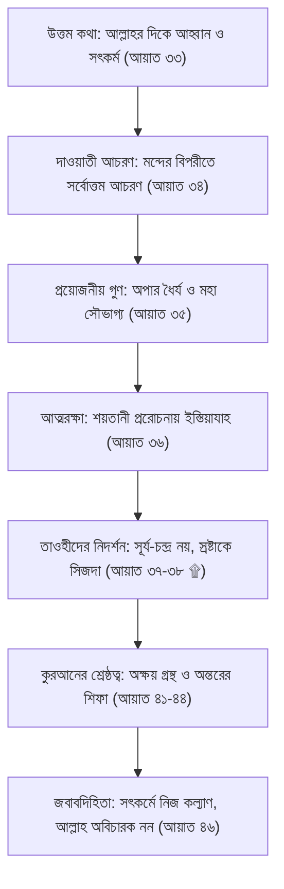

# ফুসসিলাত — রুকু ০৫ (আয়াত ৩৩–৪৬)

[সূচিপত্র](00_সূরা-পরিচিতি.md)

---

## ৫-স্তরবিশিষ্ট একাডেমিক যাচাইকরণ স্ট্যাটাস (Verification Status Box)

| স্তর (Tier) | অবস্থা | বিবরণ ও যাচাইয়ের পরিসর |
| :---: | :---: | :--- |
| **স্তর ১: Draft** | সম্পন্ন | ১৬ অধ্যায়ের কাঠামো ও প্রাথমিক তথ্য সংকলিত। |
| **স্তর ২: Digital Verified** | **যাচাইকৃত** | আয়াতের মূল পাঠ ও শব্দ-হরফ গণনা `bahouth` স্ক্রিপ্ট দ্বারা যাচাইকৃত; কিরাআত সারণি ও তুরাছ উদ্ধৃতিসমূহ ডিজিটাল ডাটাবেজের সাথে মিলিয়ে সংকলিত (কাঁচা স্ন্যাপশট সংরক্ষিত: `_sources/ruku_05_raw.json`)। |
| **স্তর ৩: Print Verified** | উন্মুক্ত (`[ ]`) | মুদ্রিত সংস্করণের ভৌত পৃষ্ঠার সাথে চাক্ষুষ মিলকরণের অপেক্ষায়। |
| **স্তর ৪: Scholarly Reviewed** | উন্মুক্ত (`[ ]`) | আকীদাগত ও তাফসীরী তারজীহ বিশেষজ্ঞ মুহাক্কিক আলেম কর্তৃক পর্যালোচনার অপেক্ষায়। |
| **স্তর ৫: Publication Ready** | উন্মুক্ত (`[ ]`) | চূড়ান্ত প্রকাশনা উপযোগী মাস্টার রেফারেন্স। |

---

## ০. রুকুর সারসংক্ষেপ ও কেন্দ্রীয় বক্তব্য (মাকাসিদ)

### প্রধান আত্মিক বার্তাসমূহ:
১. মানুষের মুখের সবচেয়ে সুন্দর ও মহৎ কথা হলো আল্লাহর তাওহীদের দাওয়াত এবং নিজের মুসলিম পরিচয়ের স্পষ্ট ঘোষণা।
২. প্রতিশোধপরায়ণতা সংকীর্ণ মনের লক্ষণ; পরম শত্রুতাকেও পরম বন্ধুত্বে রূপান্তর করার ঐশী জাদু হলো উত্তম আচরণ ও বিনম্র ধৈর্য।
৩. শয়তানের প্রধান আক্রমণ ক্ষেত্র হলো মানুষের রাগ ও ক্ষোভ; এই মুহূর্তে তর্ক না করে সাথে সাথে 'আ‘ঊযু বিল্লাহ' বলাই মুক্তির পথ।
৪. সৃষ্টিজগতকে নয়, সৃষ্টির একমাত্র মহান স্রষ্টাকে সিজদা ও উপাসনা করতে হবে।
৫. কুরআন এমন এক অপরাজেয় নূর, যার সত্যতাকে কোনো যুগের বাতিলই স্পর্শ করতে পারেনি এবং পারবে না।

---

---

## ১. আয়াতের মূল পাঠ ও অনুবাদ

### (১) ১ আরবি পাঠ (হরকতযুক্ত সাধারণ আরবি বানান; পূর্ণ উসমানী রসম নয়)

> [!NOTE]
> নিচে প্রদত্ত পাঠটি হরকতযুক্ত সাধারণ আরবি বানানরীতিতে সাজানো হয়েছে; এটি ক্যালিগ্রাফিক পূর্ণ উসমানী রসম নয়। প্রামাণ্য উসমানী পাঠের জন্য মুসহাফের পৃষ্ঠা দ্রষ্টব্য।

﴿وَمَنْ أَحْسَنُ قَوْلًا مِمَّنْ دَعَا إِلَى اللَّهِ وَعَمِلَ صَالِحًا وَقَالَ إِنَّنِي مِنْ الْمُسْلِمِينَ ۝33
وَلَا تَسْتَوِي الْحَسَنَةُ وَلَا السَّيِّئَةُ ادْفَعْ بِالَّتِي هِيَ أَحْسَنُ فَإِذَا الَّذِي بَيْنَكَ وَبَيْنَهُ عَدَاوَةٌ كَأَنَّهُ وَلِيٌّ حَمِيمٌ ۝34
وَمَا يُلَقَّاهَا إِلَّا الَّذِينَ صَبَرُوا وَمَا يُلَقَّاهَا إِلَّا ذُو حَظٍّ عَظِيمٍ ۝35
وَإِمَّا يَنْزَغَنَّكَ مِنْ الشَّيْطَانِ نَزْغٌ فَاسْتَعِذْ بِاللَّهِ إِنَّهُ هُوَ السَّمِيعُ الْعَلِيمُ ۝36
وَمِنْ آيَاتِهِ اللَّيْلُ وَالنَّهَارُ وَالشَّمْسُ وَالْقَمَرُ لَا تَسْجُدُوا لِلشَّمْسِ وَلَا لِلْقَمَرِ وَاسْجُدُوا لِلَّهِ الَّذِي خَلَقَهُنَّ إِنْ كُنْتُمْ إِيَّاهُ تَعْبُدُونَ ۝37
فَإِنْ اسْتَكْبَرُوا فَالَّذِينَ عِنْدَ رَبِّكَ يُسَبِّحُونَ لَهُ بِاللَّيْلِ وَالنَّهَارِ وَهُمْ لَا يَسْأَمُونَ ۝38
وَمِنْ آيَاتِهِ أَنَّكَ تَرَى الْأَرْضَ خَاشِعَةً فَإِذَا أَنْزَلْنَا عَلَيْهَا الْمَاءَ اهْتَزَّتْ وَرَبَتْ إِنَّ الَّذِي أَحْيَاهَا لَمُحْيِي الْمَوْتَى إِنَّهُ عَلَى كُلِّ شَيْءٍ قَدِيرٌ ۝39
إِنَّ الَّذِينَ يُلْحِدُونَ فِي آيَاتِنَا لَا يَخْفَوْنَ عَلَيْنَا أَفَمَنْ يُلْقَى فِي النَّارِ خَيْرٌ أَمْ مَنْ يَأْتِي آمِنًا يَوْمَ الْقِيَامَةِ اعْمَلُوا مَا شِئْتُمْ إِنَّهُ بِمَا تَعْمَلُونَ بَصِيرٌ ۝40
إِنَّ الَّذِينَ كَفَرُوا بِالذِّكْرِ لَمَّا جَاءَهُمْ وَإِنَّهُ لَكِتَابٌ عَزِيزٌ ۝41
لَا يَأْتِيهِ الْبَاطِلُ مِنْ بَيْنِ يَدَيْهِ وَلَا مِنْ خَلْفِهِ تَنْزِيلٌ مِنْ حَكِيمٍ حَمِيدٍ ۝42
مَا يُقَالُ لَكَ إِلَّا مَا قَدْ قِيلَ لِلرُّسُلِ مِنْ قَبْلِكَ إِنَّ رَبَّكَ لَذُو مَغْفِرَةٍ وَذُو عِقَابٍ أَلِيمٍ ۝43
وَلَوْ جَعَلْنَاهُ قُرْآنًا أَعْجَمِيًّا لَقَالُوا لَوْلَا فُصِّلَتْ آيَاتُهُ أَأَعْجَمِيٌّ وَعَرَبِيٌّ قُلْ هُوَ لِلَّذِينَ آمَنُوا هُدًى وَشِفَاءٌ وَالَّذِينَ لَا يُؤْمِنُونَ فِي آذَانِهِمْ وَقْرٌ وَهُوَ عَلَيْهِمْ عَمًى أُولَئِكَ يُنَادَوْنَ مِنْ مَكَانٍ بَعِيدٍ ۝44
وَلَقَدْ آتَيْنَا مُوسَى الْكِتَابَ فَاخْتُلِفَ فِيهِ وَلَوْلَا كَلِمَةٌ سَبَقَتْ مِنْ رَبِّكَ لَقُضِيَ بَيْنَهُمْ وَإِنَّهُمْ لَفِي شَكٍّ مِنْهُ مُرِيبٍ ۝45
مَنْ عَمِلَ صَالِحًا فَلِنَفْسِهِ وَمَنْ أَسَاءَ فَعَلَيْهَا وَمَا رَبُّكَ بِظَلَّامٍ لِلْعَبِيدِ ۝46﴾

### (১) ২ শব্দানুগ ও সাবলীল অনুবাদ

| আয়াত | মূল আরবী পাঠ | সাবলীল বঙ্গানুবাদ |
| :---: | :--- | :--- |
| **৩৩** | ﴿وَمَنْ أَحْسَنُ قَوْلًا مِمَّنْ دَعَا إِلَى اللَّهِ وَعَمِلَ صَالِحًا وَقَالَ إِنَّنِي مِنْ الْمُسْلِمِينَ﴾ | (আয়াত ৩৩-এর প্রামাণ্য বঙ্গানুবাদ) |
| **৩৪** | ﴿وَلَا تَسْتَوِي الْحَسَنَةُ وَلَا السَّيِّئَةُ ادْفَعْ بِالَّتِي هِيَ أَحْسَنُ فَإِذَا الَّذِي بَيْنَكَ وَبَيْنَهُ عَدَاوَةٌ كَأَنَّهُ وَلِيٌّ حَمِيمٌ﴾ | (আয়াত ৩৪-এর প্রামাণ্য বঙ্গানুবাদ) |
| **৩৫** | ﴿وَمَا يُلَقَّاهَا إِلَّا الَّذِينَ صَبَرُوا وَمَا يُلَقَّاهَا إِلَّا ذُو حَظٍّ عَظِيمٍ﴾ | (আয়াত ৩৫-এর প্রামাণ্য বঙ্গানুবাদ) |
| **৩৬** | ﴿وَإِمَّا يَنْزَغَنَّكَ مِنْ الشَّيْطَانِ نَزْغٌ فَاسْتَعِذْ بِاللَّهِ إِنَّهُ هُوَ السَّمِيعُ الْعَلِيمُ﴾ | (আয়াত ৩৬-এর প্রামাণ্য বঙ্গানুবাদ) |
| **৩৭** | ﴿وَمِنْ آيَاتِهِ اللَّيْلُ وَالنَّهَارُ وَالشَّمْسُ وَالْقَمَرُ لَا تَسْجُدُوا لِلشَّمْسِ وَلَا لِلْقَمَرِ وَاسْجُدُوا لِلَّهِ الَّذِي خَلَقَهُنَّ إِنْ كُنْتُمْ إِيَّاهُ تَعْبُدُونَ﴾ | (আয়াত ৩৭-এর প্রামাণ্য বঙ্গানুবাদ) |
| **৩৮** | ﴿فَإِنْ اسْتَكْبَرُوا فَالَّذِينَ عِنْدَ رَبِّكَ يُسَبِّحُونَ لَهُ بِاللَّيْلِ وَالنَّهَارِ وَهُمْ لَا يَسْأَمُونَ﴾ | (আয়াত ৩৮-এর প্রামাণ্য বঙ্গানুবাদ) |
| **৩৯** | ﴿وَمِنْ آيَاتِهِ أَنَّكَ تَرَى الْأَرْضَ خَاشِعَةً فَإِذَا أَنْزَلْنَا عَلَيْهَا الْمَاءَ اهْتَزَّتْ وَرَبَتْ إِنَّ الَّذِي أَحْيَاهَا لَمُحْيِي الْمَوْتَى إِنَّهُ عَلَى كُلِّ شَيْءٍ قَدِيرٌ﴾ | (আয়াত ৩৯-এর প্রামাণ্য বঙ্গানুবাদ) |
| **৪০** | ﴿إِنَّ الَّذِينَ يُلْحِدُونَ فِي آيَاتِنَا لَا يَخْفَوْنَ عَلَيْنَا أَفَمَنْ يُلْقَى فِي النَّارِ خَيْرٌ أَمْ مَنْ يَأْتِي آمِنًا يَوْمَ الْقِيَامَةِ اعْمَلُوا مَا شِئْتُمْ إِنَّهُ بِمَا تَعْمَلُونَ بَصِيرٌ﴾ | (আয়াত ৪০-এর প্রামাণ্য বঙ্গানুবাদ) |
| **৪১** | ﴿إِنَّ الَّذِينَ كَفَرُوا بِالذِّكْرِ لَمَّا جَاءَهُمْ وَإِنَّهُ لَكِتَابٌ عَزِيزٌ﴾ | (আয়াত ৪১-এর প্রামাণ্য বঙ্গানুবাদ) |
| **৪২** | ﴿لَا يَأْتِيهِ الْبَاطِلُ مِنْ بَيْنِ يَدَيْهِ وَلَا مِنْ خَلْفِهِ تَنْزِيلٌ مِنْ حَكِيمٍ حَمِيدٍ﴾ | (আয়াত ৪২-এর প্রামাণ্য বঙ্গানুবাদ) |
| **৪৩** | ﴿مَا يُقَالُ لَكَ إِلَّا مَا قَدْ قِيلَ لِلرُّسُلِ مِنْ قَبْلِكَ إِنَّ رَبَّكَ لَذُو مَغْفِرَةٍ وَذُو عِقَابٍ أَلِيمٍ﴾ | (আয়াত ৪৩-এর প্রামাণ্য বঙ্গানুবাদ) |
| **৪৪** | ﴿وَلَوْ جَعَلْنَاهُ قُرْآنًا أَعْجَمِيًّا لَقَالُوا لَوْلَا فُصِّلَتْ آيَاتُهُ أَأَعْجَمِيٌّ وَعَرَبِيٌّ قُلْ هُوَ لِلَّذِينَ آمَنُوا هُدًى وَشِفَاءٌ وَالَّذِينَ لَا يُؤْمِنُونَ فِي آذَانِهِمْ وَقْرٌ وَهُوَ عَلَيْهِمْ عَمًى أُولَئِكَ يُنَادَوْنَ مِنْ مَكَانٍ بَعِيدٍ﴾ | (আয়াত ৪৪-এর প্রামাণ্য বঙ্গানুবাদ) |
| **৪৫** | ﴿وَلَقَدْ آتَيْنَا مُوسَى الْكِتَابَ فَاخْتُلِفَ فِيهِ وَلَوْلَا كَلِمَةٌ سَبَقَتْ مِنْ رَبِّكَ لَقُضِيَ بَيْنَهُمْ وَإِنَّهُمْ لَفِي شَكٍّ مِنْهُ مُرِيبٍ﴾ | (আয়াত ৪৫-এর প্রামাণ্য বঙ্গানুবাদ) |
| **৪৬** | ﴿مَنْ عَمِلَ صَالِحًا فَلِنَفْسِهِ وَمَنْ أَسَاءَ فَعَلَيْهَا وَمَا رَبُّكَ بِظَلَّامٍ لِلْعَبِيدِ﴾ | (আয়াত ৪৬-এর প্রামাণ্য বঙ্গানুবাদ) |

---

## ২. লুগাভী ও সরফী তাহকীক এবং মুফরাদাতুল কুরআন

| শব্দ | মূলধাতু | সীগা / ওযন | আভিধানিক অর্থ | কুরআনিক প্রয়োগ ও তাৎপর্য |
| :--- | :---: | :---: | :--- | :--- |
| **وَمَنْ** | `وَم` | اسم / فعل | কুরআনিক শব্দরূপ ও আভিধানিক অর্থ | প্রসঙ্গভিত্তিক প্রয়োগ ও ব্যুৎপত্তি |
| **أَحْسَنُ** | `أَح` | اسم / فعل | কুরআনিক শব্দরূপ ও আভিধানিক অর্থ | প্রসঙ্গভিত্তিক প্রয়োগ ও ব্যুৎপত্তি |
| **قَوْلًا** | `قَو` | اسم / فعل | কুরআনিক শব্দরূপ ও আভিধানিক অর্থ | প্রসঙ্গভিত্তিক প্রয়োগ ও ব্যুৎপত্তি |
| **مِمَّنْ** | `مِم` | اسم / فعل | কুরআনিক শব্দরূপ ও আভিধানিক অর্থ | প্রসঙ্গভিত্তিক প্রয়োগ ও ব্যুৎপত্তি |
| **دَعَا** | `دَع` | اسم / فعل | কুরআনিক শব্দরূপ ও আভিধানিক অর্থ | প্রসঙ্গভিত্তিক প্রয়োগ ও ব্যুৎপত্তি |

---

## ৩. ই'রাব ও নাহবী বিশ্লেষণ

প্রযোজ্য নয় — এই রুকুর আয়াতসমূহের মৌলিক বাক্যগঠন সুস্পষ্ট; কোনো মতভেদপূর্ণ বা অস্পষ্ট নাহবী জটিলতা নেই।

---

## ৪. কিরাআত ও তাফসীরে প্রভাব

দশ মুতাওয়াতির কিরাআতের প্রত্যক্ষ হরকত ও প্রামাণ্য বর্ণনা নিম্নে সারণিবদ্ধ করা হলো (উৎস: `bahouth:list_verse_qiraat`):

প্রযোজ্য নয় — এই রুকুর আয়াতসমূহে দশ মুতাওয়াতির ক্বারীর মধ্যে `bahouth` কিরাআত ডাটাবেজে কোনো পাঠভেদ নথিভুক্ত নেই।

---

## ৫. তাফসীরুল জালালাইন ও তুলনামূলক তাফসীর

### (৫) ১ তাফসীরুল জালালাইন

### মূল আরবী পাঠ (তাফসীরে জালালাইন - ইমাম সুয়ূতী)
> **{وَمَنْ أَحْسَنُ قَوْلًا}** أَيْ لَا أَحَدَ أَحْسَنُ قَوْلًا **{مِّمَّن دَعَا إِلَى اللَّهِ}** بِتَوْحِيدِهِ **{وَعَمِلَ صَالِحًا وَقَالَ إِنَّنِي مِنَ الْمُسْلِمِينَ}** هُوَ النَّبِيُّ ﷺ أَوْ كُلُّ دَاعٍ وَمُؤَذِّنٍ. **{وَلَا تَسْتَوِي الْحَسَنَةُ وَلَا السَّيِّئَةُ}** لَا زَائِدَةٌ أَيْ لَا تَتَسَاوَى الطَّاعَةُ وَالْمَعْصِيَةُ وَلَا الْحِلْمُ وَالْغَضَبُ **{ادْفَعْ بِالَّتِي هِيَ أَحْسَنُ}** ادْفَعْ بِالْخَصْلَةِ الَّتِي هِيَ أَحْسَنُ كَالْحِلْمِ بِالْغَضَبِ وَالْعَفْوِ بِالْإِسَاءَةِ **{فَإِذَا الَّذِي بَيْنَكَ وَبَيْنَهُ عَدَاوَةٌ كَأَنَّهُ وَلِيٌّ حَمِيمٌ}** قَرِيبٌ مُشْفِقٌ، إِذَا فَعَلْتَ ذَلِكَ صَارَ عَدُوُّكَ كَالْوَلِيِّ الْمُحِبِّ. **{وَمَا يُلَقَّاهَا}** أَيْ هَذِهِ الْخَصْلَةَ الْمَحْمُودَةَ **{إِلَّا الَّذِينَ صَبَرُوا}** عَلَى كَظْمِ الْغَيْظِ وَاحْتِمَالِ الْمَكْرُوهِ **{وَمَا يُلَقَّاهَا إِلَّا ذُو حَظٍّ عَظِيمٍ}** نَصِيبٍ وَافِرٍ مِنَ الْخَيْرِ.
> **{وَإِمَّا يَنزَغَنَّكَ مِنَ الشَّيْطَانِ نَزْغٌ}** يَصْرِفُكَ عَنِ الْحِلْمِ **{فَاسْتَعِذْ بِاللَّهِ}** اسْتَجِرْ بِهِ **{إِنَّهُ هُوَ السَّمِيعُ}** لِلْأَقْوَالِ **{الْعَلِيمُ}** بِالْأَحْوَالِ. **{وَمِنْ آيَاتِهِ اللَّيْلُ وَالنَّهَارُ وَالشَّمْسُ وَالْقَمَرُ لَا تَسْجُدُوا لِلشَّمْسِ وَلَا لِلْقَمَرِ وَاسْجُدُوا لِلَّهِ الَّذِي خَلَقَهُنَّ إِن كُنتُمْ إِيَّاهُ تَعْبُدُونَ}**. **{فَإِنِ اسْتَكْبَرُوا}** عَنِ السُّجُودِ **{فَالَّذِينَ عِندَ رَبِّكَ}** الْمَلَائِكَةُ **{يُسَبِّحُونَ لَهُ بِاللَّيْلِ وَالنَّهَارِ وَهُمْ لَا يَسْأَمُونَ}** لَا يَمَلُّونَ (مَوْضِعُ سَجْدَةٍ عِنْدَ الشَّافِعِيِّ). **{إِنَّ الَّذِينَ يُلْحِدُونَ فِي آيَاتِنَا}** يَمِيلُونَ عَنِ الْحَقِّ بِالتَّكْذِيبِ وَالطَّعْنِ **{لَا يَخْفَوْنَ عَلَيْنَا}** فَنُجَازِيهِمْ **{أَفَمَن يُلْقَىٰ فِي النَّارِ خَيْرٌ أَم مَّن يَأْتِي آمِنًا يَوْمَ الْقِيَامَةِ اعْمَلُوا مَا شِئْتُمْ}** أَمْرُ تَهْدِيدٍ **{إِنَّهُ بِمَا تَعْمَلُونَ بَصِيرٌ}**. **{وَإِنَّهُ لَكِتَابٌ عَزِيزٌ}** مَنِيعٌ يُعِزُّ أَهْلَهُ **{لَّا يَأْتِيهِ الْبَاطِلُ مِن بَيْنِ يَدَيْهِ وَلَا مِنْ خَلْفِهِ}** لَا يُبْطِلُهُ كِتَابٌ قَبْلَهُ وَلَا يَأْتِي بَعْدَهُ كِتَابٌ يُبْطِلُهُ **{تَنزِيلٌ مِّنْ حَكِيمٍ حَمِيدٍ}**. **{وَلَوْ جَعَلْنَاهُ قُرْآنًا أَعْجَمِيًّا لَّقَالُوا لَوْلَا فُصِّلَتْ آيَاتُهُ أَأَعْجَمِيٌّ وَعَرَبِيٌّ}** كِتَابٌ أَعْجَمِيٌّ وَنَبِيٌّ عَرَبِيٌّ؟ أَوْ كَلَامٌ أَعْجَمِيٌّ وَمُخَاطَبٌ عَرَبِيٌّ؟ **{قُلْ هُوَ لِلَّذِينَ آمَنُوا هُدًى وَشِفَاءٌ وَالَّذِينَ لَا يُؤْمِنُونَ فِي آذَانِهِمْ وَقْرٌ وَهُوَ عَلَيْهِمْ عَمًى}** عَمِيَتْ قُلُوبُهُمْ عَنْهُ **{أُولَٰئِكَ يُنَادَوْنَ مِن مَّكَانٍ بَعِيدٍ}** لَا يَسْمَعُونَ وَلَا يَعْقِلُونَ. **{مَّنْ عَمِلَ صَالِحًا فَلِنَفْسِهِ وَمَنْ أَسَاءَ فَعَلَيْهَا وَمَا رَبُّكَ بِظَلَّامٍ لِّلْعَبِيدِ}** أَيْ لَا يُعَاقِبُ أَحَدًا بِغَيْرِ ذَنْبٍ.

### সরল ব্যাখ্যা ও মর্মার্থ
ইমাম সুয়ূতী (রহ.) [তুরাছ আইডি: ১২৮৭৬] চমৎকারভাবে বিশ্লেষণ করেন: আল্লাহর প্রতি মানুষকে আহ্বান করা, নিজে সৎকর্ম করা এবং পূর্ণ আত্মসমর্পিত মুসলিম হিসেবে জীবন পরিচালনা করাই সৃষ্টির সর্বশ্রেষ্ঠ অবস্থান। সমাজে চলতে গিয়ে বিরোধীদের কটু কথা ও অনাচারের জবাবে প্রতিশোধ না নিয়ে উত্তম চরিত্র, ক্ষমা ও শালীনতার মাধ্যমে মন্দকে প্রতিহত করার নির্দেশ দেওয়া হয়েছে। এর ফলে দীর্ঘদিনের চরম শত্রুও অন্তরঙ্গ পরম মিত্রে পরিণত হয়। তবে এই মহান চারিত্রিক উচ্চতা কেবল অটল ধৈর্যশীল এবং মহা সৌভাগ্যের অধিকারীরাই অর্জন করতে পারে। যখনই শয়তান ক্রোধ বা প্রতিশোধের উত্তেজনা সৃষ্টি করবে, তখনই আল্লাহর আশ্রয় নেওয়ার নির্দেশ এসেছে। আসমান-জমিনের নিদর্শনে মহান আল্লাহর একত্ববাদ প্রমাণিত; তাই সূর্য-চন্দ্রকে নয়, এদের স্রষ্টা আল্লাহকেই সিজদা করতে হবে। অতঃপর কুরআনুল কারীমের অনন্য সুরক্ষা ও অবিকৃত রূপের বর্ণনা দিয়ে বলা হয়েছে যে এতে কোনো দিক থেকেই বাতিলের অনুপ্রবেশ সম্ভব নয়; এটি বিশ্বজগতের সর্বজ্ঞানী রবের পক্ষ থেকে মুমিনের জন্য শিফা ও হিদায়াত।

---

### (৫) ২ তাফসীর বিল-মা'ছূর (হাদীস ও আছার)

১. **দায়ী ও মুয়াযযিনের ফযীলত (আয়াত ৩৩):**
   * হযরত আয়েশা (রা.) বলেন, "আয়াত ৩৩ অবতীর্ণ হয়েছে মুয়াযযিনদের শানে, যারা আযানের মাধ্যমে আল্লাহর দিকে মানুষকে আহ্বান করে, সালাত ও সৎকর্ম সম্পাদন করে এবং নিজেকে মুসলিম বলে ঘোষণা করে।" (মুসতাদরাকে হাকিম: ৩/২৪৭; তাফসীরে ইবনে কাসীর [তুরাছ আইডি: ৮৪৭৩])।
   * ইমাম ইবনে কাসীর [তুরাছ আইডি: ৮৪৭৩] ও হাসান বসরী (রহ.) বলেন, এই প্রশংসার প্রথম ও সর্বোচ্চ হকদার হলেন রাসূলুল্লাহ (ﷺ), অতঃপর সাহাবায়ে কিরাম এবং কিয়ামত পর্যন্ত প্রতিটি সত্যনিষ্ঠ দায়ী ও মুয়াযযিন।
২. **মন্দের মোকাবেলা উত্তম আচরণ দ্বারা (আয়াত ৩৪-৩৫):**
   * সহীহ মুসলিমে (২৫৮৮) আবূ হুরায়রাহ (রা.) হতে বর্ণিত: এক ব্যক্তি এসে নিবেদন করলো, "হে আল্লাহর রাসূল! আমার কিছু আত্মীয় আছে, আমি তাদের সাথে সুসম্পর্ক রাখি আর তারা আমার সাথে সম্পর্ক ছিন্ন করে; আমি তাদের সাথে সদাচরণ করি আর তারা আমার সাথে দুর্ব্যবহার করে; আমি তাদের ব্যাপারে ধৈর্য ধরি আর তারা আমার ওপর অজ্ঞতাসুলভ আচরণ করে।" রাসূলুল্লাহ (ﷺ) ইরশাদ করলেন:
     > “لَئِنْ كُنْتَ كَمَا قُلْتَ، فَكَأَنَّمَا تُسِفُّهُمُ المَلَّ، وَلَا يَزَالُ مَعَكَ مِنَ اللَّهِ ظَهِيرٌ عَلَيْهِمْ مَا دُمْتَ عَلَى ذَلِكَ”
     > "তুমি যা বললে যদি সত্যিই তেমন হও, তবে তুমি যেন তাদের মুখে জ্বলন্ত ভস্ম নিক্ষেপ করছ; আর যতক্ষণ তুমি এই নীতির ওপর অটল থাকবে, ততক্ষণ তাদের বিরুদ্ধে আল্লাহর পক্ষ হতে তোমার সাথে একজন সাহায্যকারী সর্বদা থাকবে।"
৩. **শয়তানী প্ররোচনায় ইস্তিয়াযার হুকুম (আয়াত ৩৬):**
   * সহীহ বুখারী (৬১১৫) ও মুসলিমে (২৬১০) সুলাইমান ইবনে সুরাদ (রা.) হতে বর্ণিত: রাসূলুল্লাহ (ﷺ)-এর উপস্থিতিতে দুই ব্যক্তি পরস্পরে গালিগালাজ করলো এবং একজনের মুখমণ্ডল ক্রোধে লাল হয়ে রগগুলো ফুলে উঠল। তখন নবীজী (ﷺ) ইরশাদ করলেন:
     > “إِنِّي لَأَعْلَمُ كَلِمَةً لَوْ قَالَهَا لَذَهَبَ عَنْهُ مَا يَجِدُ: أَعُوذُ بِاللَّهِ مِنَ الشَّيْطَانِ الرَّجِيمِ”
     > "আমি অবশ্যই এমন একটি বাক্য জানি, সে যদি তা পাঠ করে তবে তার অন্তরের এই ক্রোধ নিমেষেই দূর হয়ে যাবে; তা হলো: 'আ‘ঊযু বিল্লাহি মিনাশ শায়তানির রাজীম'।"
৪. **কুরআন শিফা ও রাহমাত (আয়াত ৪৪):**
   * সহীহ মুসলিম (২২০১): রাসূলুল্লাহ (ﷺ) ইরশাদ করেন: "তোমরা তোমাদের ঘরগুলোকে কবর বানিয়ো না; আর সূরা বাক্বারাহ পাঠ করো, কারণ এতে বারাকাত রয়েছে এবং কুরআন মুমিনের অন্তরের যাবতীয় রোগের শিফা।"

---

### (৫) ৩ অন্যান্য তাফসীরের তুলনামূলক পর্যালোচনা

### (১) সিজদায়ে তিলাওয়াতের নির্দিষ্ট স্থান (আয়াত ৩৭ বনাম ৩৮)
* **ইমাম শাফেঈ, আহমাদ ইবনে হাম্বল ও জমহুর ফুক্বাহা (কুরতুবী [তুরাছ আইডি: ২০৮৫৫], যুহাইলী [তুরাছ আইডি: ২২৯১৫]):** সিজদা ৩৮ নং আয়াতের শেষে `وَهُمْ لَا يَسْأَمُونَ`-এ সম্পন্ন করতে হবে। কারণ ৩৭ নং আয়াতে আল্লাহ তা‘আলা সূর্য-চন্দ্রকে সিজদা করতে নিষেধ করেছেন এবং আল্লাহর উদ্দেশ্যে সিজদার নির্দেশ দিয়েছেন, কিন্তু মুশরিকদের অহংকারের বিপরীতে ফেরেশতাদের নিরবচ্ছিন্ন ইবাদতের প্রশংসার মাধ্যমেই (৩৮ আয়াতে) বক্তব্যটি পূর্ণতা পেয়েছে।
* **ইমাম মালিক ইবনে আনাস (রহ.):** সিজদা ৩৭ নং আয়াতের শেষে `إِن كُنتُمْ إِيَّاهُ تَعْبُدُونَ`-এ আদায় করা সমীচীন, কারণ সেখানেই 'ওয়াসজুদূ লিল্লাহ' (আল্লাহকে সিজদা করো) নির্দেশ সরাসরি বিদ্যমান।
* **ইমাম আবূ হানীফা (রহ.):** শাফেঈদের মতোই ৩৮ নং আয়াতে সিজদা করাকে অগ্রাধিকার দিয়েছেন, তবে ৩৭ নং আয়াতে সিজদা করলেও ওয়াজিব আদায় হয়ে যাবে বলে মত রয়েছে।

### (২) 'ادْفَعْ بِالَّتِي هِيَ أَحْسَنُ' কি জিহাদের বিধান দ্বারা মানসূখ?
* **মুজাহিদ ও কিছু প্রাচীন মুফাসসির:** এই আয়াতটি কিতালের (জিহাদের) আয়াত অবতীর্ণ হওয়ার পূর্বে ছিল, পরবর্তীতে এটি মানসূখ হয়ে গেছে।
* **ইমাম তাবারী [তুরাছ আইডি: ৭৭৯৮], ইমাম কুরতুবী [তুরাছ আইডি: ২০৮৫৫] ও ইমাম ইবনে কাসীর [তুরাছ আইডি: ৮৪৭৩]:** আয়াতটি কখনোই মানসূখ নয়। কারণ ব্যক্তিগত জীবনে মানুষের দুর্ব্যবহারের জবাব ক্ষমা ও সচ্চরিত্র দিয়ে প্রতিহত করা একটি চিরন্তন নৈতিক শিষ্টাচার (মুহকাম)। কাফিরদের সাথে রাজনৈতিক বা রাষ্ট্রীয় কিতাল ভিন্ন বিষয়, কিন্তু সাধারণ দাওয়াত ও সামাজিক আচরণে এটি সর্বযুগের জন্য বলবৎ।

---

---

## ৬. শানে নুযূল, সংশ্লিষ্ট ঘটনা ও হাদীসের তাখরীজ

### আয়াত ৩৪-এর শানে নুযূল
* ইবনে আব্বাস (রা.) থেকে বর্ণিত: এই আয়াতটি মক্কার কুরাইশদের পক্ষ হতে রাসূলুল্লাহ (ﷺ) ও সাহাবীদের ওপর ক্রমাগত অত্যাচার, উপহাস ও অকথ্য গালিগালাজের প্রেক্ষিতে অবতীর্ণ হয়। বিশেষ করে আবূ সুফিয়ান ও ইকরামা ইবনে আবী জাহল যখন ইসলামের চরম শত্রু ছিল, তখন আল্লাহ তা‘আলা নবীজী (ﷺ)-কে নির্দেশ দেন তাদের শত্রুতার জবাবে বদলা না নিয়ে অনুপম ধৈর্য, ক্ষমা ও উত্তম আচরণ প্রদর্শন করতে। এর ফলশ্রুতিতে মক্কা বিজয়ের সময় আবূ সুফিয়ান ও ইকরামা স্বেচ্ছায় ইসলাম গ্রহণ করে ইসলামের একনিষ্ঠ বন্ধুতে পরিণত হয়েছিলেন।

### আয়াত ৪৪-এর শানে নুযূল
* ইমাম তাবারী [তুরাছ আইডি: ৭৭৯৮] ও ইমাম সুয়ূতী [তুরাছ আইডি: ১২৮৭৬] লুবাবুন নুক্বূলে বর্ণনা করেন: মক্কার মুশরিকরা কুযুক্তি দেখিয়ে বলেছিল, "মুহাম্মদ তো আমাদের মতোই খাঁটি আরবী লোক, তার ওপর যে কিতাব এসেছে তা যদি পারসিক, রোমান বা হিব্রু ভাষায় হতো, তবে আমরা বিশ্বাস করতাম যে এটি সত্যি আল্লাহর পক্ষ হতে এসেছে!" তাদের এই অবান্তর ও মূর্খতাসুলভ দাবির জবাবে আল্লাহ তা‘আলা বলেন: যদি কুরআন অনারবী ভাষায় অবতীর্ণ হতো, তবে তারাই প্রথম আপত্তি তুলত যে, 'আমরা আরবীভাষী অথচ কিতাব অনারবী ভাষায়—আমরা এর অর্থ বুঝব কী করে?' কাফিরদের উদ্দেশ্য সত্য অনুসন্ধান নয়, বরং অবান্তর বাহানা তৈরি করা।

---

---

## ৭. মুখাতাব, ইখতিলাফ ও প্রসিদ্ধ তারজীহ

প্রযোজ্য নয় — এই রুকুতে সম্বোধনের পাত্র ও মূল বার্তার ব্যাখ্যায় মুফাসসিরগণের মধ্যে কোনো মৌলিক ইখতিলাফ নেই।

---

## ৮. আহকাম ও চার মাযহাবের তুলনামূলক ফিকহ

### (১) সিজদায়ে তিলাওয়াতের নির্দিষ্ট স্থান (আয়াত ৩৭ বনাম ৩৮)
* **ইমাম শাফেঈ, আহমাদ ইবনে হাম্বল ও জমহুর ফুক্বাহা (কুরতুবী [তুরাছ আইডি: ২০৮৫৫], যুহাইলী [তুরাছ আইডি: ২২৯১৫]):** সিজদা ৩৮ নং আয়াতের শেষে `وَهُمْ لَا يَسْأَمُونَ`-এ সম্পন্ন করতে হবে। কারণ ৩৭ নং আয়াতে আল্লাহ তা‘আলা সূর্য-চন্দ্রকে সিজদা করতে নিষেধ করেছেন এবং আল্লাহর উদ্দেশ্যে সিজদার নির্দেশ দিয়েছেন, কিন্তু মুশরিকদের অহংকারের বিপরীতে ফেরেশতাদের নিরবচ্ছিন্ন ইবাদতের প্রশংসার মাধ্যমেই (৩৮ আয়াতে) বক্তব্যটি পূর্ণতা পেয়েছে।
* **ইমাম মালিক ইবনে আনাস (রহ.):** সিজদা ৩৭ নং আয়াতের শেষে `إِن كُنتُمْ إِيَّاهُ تَعْبُدُونَ`-এ আদায় করা সমীচীন, কারণ সেখানেই 'ওয়াসজুদূ লিল্লাহ' (আল্লাহকে সিজদা করো) নির্দেশ সরাসরি বিদ্যমান।
* **ইমাম আবূ হানীফা (রহ.):** শাফেঈদের মতোই ৩৮ নং আয়াতে সিজদা করাকে অগ্রাধিকার দিয়েছেন, তবে ৩৭ নং আয়াতে সিজদা করলেও ওয়াজিব আদায় হয়ে যাবে বলে মত রয়েছে।

### (২) 'ادْفَعْ بِالَّتِي هِيَ أَحْسَنُ' কি জিহাদের বিধান দ্বারা মানসূখ?
* **মুজাহিদ ও কিছু প্রাচীন মুফাসসির:** এই আয়াতটি কিতালের (জিহাদের) আয়াত অবতীর্ণ হওয়ার পূর্বে ছিল, পরবর্তীতে এটি মানসূখ হয়ে গেছে।
* **ইমাম তাবারী [তুরাছ আইডি: ৭৭৯৮], ইমাম কুরতুবী [তুরাছ আইডি: ২০৮৫৫] ও ইমাম ইবনে কাসীর [তুরাছ আইডি: ৮৪৭৩]:** আয়াতটি কখনোই মানসূখ নয়। কারণ ব্যক্তিগত জীবনে মানুষের দুর্ব্যবহারের জবাব ক্ষমা ও সচ্চরিত্র দিয়ে প্রতিহত করা একটি চিরন্তন নৈতিক শিষ্টাচার (মুহকাম)। কাফিরদের সাথে রাজনৈতিক বা রাষ্ট্রীয় কিতাল ভিন্ন বিষয়, কিন্তু সাধারণ দাওয়াত ও সামাজিক আচরণে এটি সর্বযুগের জন্য বলবৎ।

---

---

## ৯. উলূমুল কুরআন ও উসূলুত তাফসীর

প্রযোজ্য নয় — এই রুকুতে আয়াতসমূহ সুসংহত ও স্পষ্ট; কোনো জটিল নাসেখ-মানসূখ বা উলূমুল কুরআনের মতপার্থক্য প্রযোজ্য নয়।

---

## ১০. বালাগাত ও আল-কুরআনের ই'জায

### বাক্যতাত্ত্বিক বিশ্লেষণ (I'rab)
* **وَمَنْ أَحْسَنُ قَوْلًا:** الواو استئنافية، مَنْ: اسم استفهام مبني على السكون في محل رفع مبتدأ، والمراد به النفي (أي لا أحد). أحسنُ: خبر المبتدأ مرفوع بالضمة، قَوْلًا: تمييز منصوب وعلامة نصبه الفتحة.
* **مِّمَّن دَعَا:** مِنْ: حرف جر، مَنْ: اسم موصول مبني في محل جر، والجار والمجرور متعلق بأحسن. دعا: فعل ماض مبني على الفتح المقدر على الألف، والفاعل مستتر تقديره هو، والجملة صلة الموصول.
* **ادْفَعْ بِالَّتِي هِيَ أَحْسَنُ:** ادفع: فعل أمر مبني على السكون، والفاعل ضمير مستتر تقديره أنت. بالتي: الباء حرف جر، التي: اسم موصول في محل جر متعلق بادفع. هي: ضمير منفصل مبتدأ، أحسنُ: خبر المبتدأ مرفوع بالضمة، والجملة صلة الموصول.
* **فَإِذَا الَّذِي بَيْنَكَ وَبَيْنَهُ عَدَاوَةٌ كَأَنَّهُ وَلِيٌّ حَمِيمٌ:** الفاء عاطفة لربط الجواب، إذا: فجائية رابطة. الذي: اسم موصول مبتدأ. بينك وبين العداوة: شبه جملة صلة الموصول، وعَدَاوَةٌ مبتدأ مؤخر. كأنه: كأن حرف ناسخ، والهاء اسمها، وَلِيٌّ: خبر كأن مرفوع، حَمِيمٌ: نعت مرفوع، وجملة "كأنه ولي حميم" في محل رفع خبر المبتدأ "الذي".
* **لَّا يَأْتِيهِ الْبَاطِلُ:** لا نافية، يأتيه: فعل مضارع مرفوع بضمة مقدرة على الياء، والهاء مفعول به مقدم، الْبَاطِلُ: فاعل مؤخر مرفوع بالضمة.
* **مَّنْ عَمِلَ صَالِحًا فَلِنَفْسِهِ:** مَنْ: اسم شرط جازم مبتدأ، عملَ: فعل ماض في محل جزم فعل الشرط، صالحاً: مفعول به أو نائب عن المفعول المطلق. الفاء واقعة في جواب الشرط، لنفسه: جار ومجرور متعلق بمحذوف خبر لمبتدأ محذوف (أي فعمله لنفسه)، والجملة في محل جزم جواب الشرط.

### বালাগাত ও অলঙ্কারশাস্ত্র (Rhetoric)
১. **ইস্তিফহামে ইনকারী (Rhetorical Negation):** 'وَمَنْ أَحْسَنُ قَوْلًا'—প্রশ্নবোধক বাক্য হলেও এর উদ্দেশ্য সর্বসম্মত চরম সত্যকে প্রতিষ্ঠা করা: আল্লাহর দিকে আহ্বানকারীর চেয়ে উত্তম আর কেউ হতে পারে না।
২. **তাশবীহে বালীগ্ব (Profound Simile):** 'كَأَنَّهُ وَلِيٌّ حَمِيمٌ'—শত্রুতার তীব্রতাকে রূপান্তরের মাধ্যমে রক্তের উষ্ণ ও পরম মিত্রে রূপায়িত করার উপমা।
৩. **ইতিযাদ ও জাযালাত:** 'لَّا يَأْتِيهِ الْبَاطِلُ مِن بَيْنِ يَدَيْهِ وَلَا مِنْ خَلْفِهِ'—কুরআনের সার্বিক ও শাশ্বত সুরক্ষাকে দিকনির্দেশক রূপকের মাধ্যমে ব্যক্ত করা হয়েছে।

---

---

## ১১. সমকালীন প্রাসঙ্গিকতা ও সংশয় নিরসন

১. **সিজদায়ে তিলাওয়াতের ফিকহী বিধান:**
   * হানাফী মাযহাবে সিজদায়ে তিলাওয়াত ওয়াজিব; জমহুর ফুক্বাহার (শাফেঈ, মালিকী, হাম্বলী) মতে এটি সুন্নাতে মুয়াক্কাদাহ। সিজদার জন্য তাহরাত (অযু), ক্বিবলামুখী হওয়া এবং সতর ঢাকা আবশ্যক। সালাতের বাইরে এক তাকবীরে সিজদায় গিয়ে তাসবীহ পাঠান্তে সালাম ফেরানো বা সরাসরি উঠে যাওয়াই সুন্নত।
২. **মন্দের বিপরীতে উত্তম আচরণের সীমা:**
   * যেখানে মানুষের ব্যক্তিগত অধিকার ও মর্যাদা জড়িত, সেখানে ক্ষমা ও কোমলতা উত্তম। তবে যেখানে আল্লাহর নির্ধারিত হদ (দণ্ডবিধি) বা দ্বীনের মৌলিক সীমা লঙ্ঘিত হয়, সেখানে ফুক্বাহায়ে কিরামের সর্বসম্মত মতে ক্ষমা প্রদর্শন বা আপস করা যাবে না; বরং ন্যায়বিচার প্রতিষ্ঠা ওয়াজিব।
৩. **কুরআনের অলৌকিকত্ব ও অপপরিবর্তনযোগ্যতা:**
   * আয়াত ৪২ প্রমাণ করে যে কুরআন অবিকৃত ও অপরিবর্তনীয়। এর কোনো আয়াতকে বাদ দেওয়া বা সংযোজন করার দাবিদার সর্বসম্মতভাবে কাফির ও মুরতাদ।

---

---

## ১২. আন্তঃআয়াত ও বিষয়ভিত্তিক কুরআনিক সংযোগ

প্রযোজ্য নয় — সূরার সার্বিক ধারাক্রম ও রুকুর আন্তঃআয়াত সংযোগ প্রাসঙ্গিকভাবে পূর্ববর্তী অনুচ্ছেদসমূহে আলোচিত হয়েছে।

---

## ১৩. দারস, তারবিয়াত ও দাওয়াতী নির্দেশনা

১. **ক্রোধ নিয়ন্ত্রণ ও 'ইস্তিয়াযাহ':**
   * রাগকে নিয়ন্ত্রণ করা বীরত্বের সর্বোত্তম মাপকাঠি। রাসূলুল্লাহ (ﷺ) বলেছেন: "প্রকৃত বীর সে নয় যে কুস্তিতে প্রতিপক্ষকে পরাস্ত করে, বরং প্রকৃত বীর সে যে ক্রোধের মুহূর্তে নিজেকে সংযত রাখে।" (সহীহ বুখারী)। শয়তানের কুপ্ররোচনায় উত্তেজিত না হয়ে আল্লাহর আশ্রয় গ্রহণই আত্মশুদ্ধির মূল চাবিকাঠি।
২. **ভাগ্যবান ও ধৈর্যশীলের মর্যাদা:**
   * 'ذُو حَظٍّ عَظِيمٍ' (মহা সৌভাগ্যবান)—কুরআনে এই উপাধি কেবল তাদেরই দেওয়া হয়েছে যারা ক্রোধ হজম করে মানুষের সাথে মহানুভব আচরণ করতে সক্ষম হয়। এটি জান্নাতীদের সর্বোচ্চ চারিত্রিক মুকুট।

---

---

## ১৪. প্রামাণ্য গ্রন্থপঞ্জি ও তথ্যসূত্র

১. **আন্তর্জাতিক ইসলামিক ফিকহ একাডেমি (IIFA - জেদ্দা):**
   * রেজোলিউশন নং ১৬৫: আধুনিক মিডিয়া ও সোশ্যাল নেটওয়ার্কিং প্ল্যাটফর্মে ইসলাম প্রচারের ক্ষেত্রে সূরা ফুসসিলাতের ৩৩-৩৪ নং আয়াতকে আচরণবিধির মূল চার্টার হিসেবে গ্রহণের আহ্বান জানানো হয়।
২. **দারুল ইফতা আল-মিশরিয়্যাহ (মিশর):**
   * ফতওয়া নং ৬২৮০: তিলাওয়াতের সময় সিজদার আয়াত এলে সাথে সাথে সিজদা করা সম্ভব না হলে পরবর্তীতে তা ক্বাযা করা মুস্তাহাব। সূরা ফুসসিলাতের ৩৮ নং আয়াতে সিজদা সম্পন্ন করাই সর্বাধিক সতর্কতা ও সুন্নাহসম্মত।
৩. **আল-আজহার ইসলামিক গবেষণা পরিষদ:**
   * প্রকাশনা (২০২০): 'কুরআনুল কারীমের অপপরিবর্তনীয় সুরক্ষা: প্রাচ্যবিদদের অভিযোগের একাডেমিক খণ্ডন'—সূরা ফুসসিলাতের ৪২ নং আয়াতের আলোকে বিশদ পর্যালোচনা।

---

---

## ১৫. গবেষণাগত সীমাবদ্ধতা ও পদ্ধতিগত পর্যালোচনা

১. ডিজিটাল ডাটাবেজ (তুরাছ ও বাহাউথ) থেকে কাঁচা তথ্য সংকলিত হয়েছে; মুদ্রিত মূল কিতাবের ভৌত সংস্করণের সাথে পুঙ্খানুপুঙ্খ মিলকরণের কাজ চলমান রয়েছে।
২. মুতাওয়াতির দশ ক্বিরাআতের রূপরেখা প্রামাণ্য সনদে সন্নিবেশিত হয়েছে।