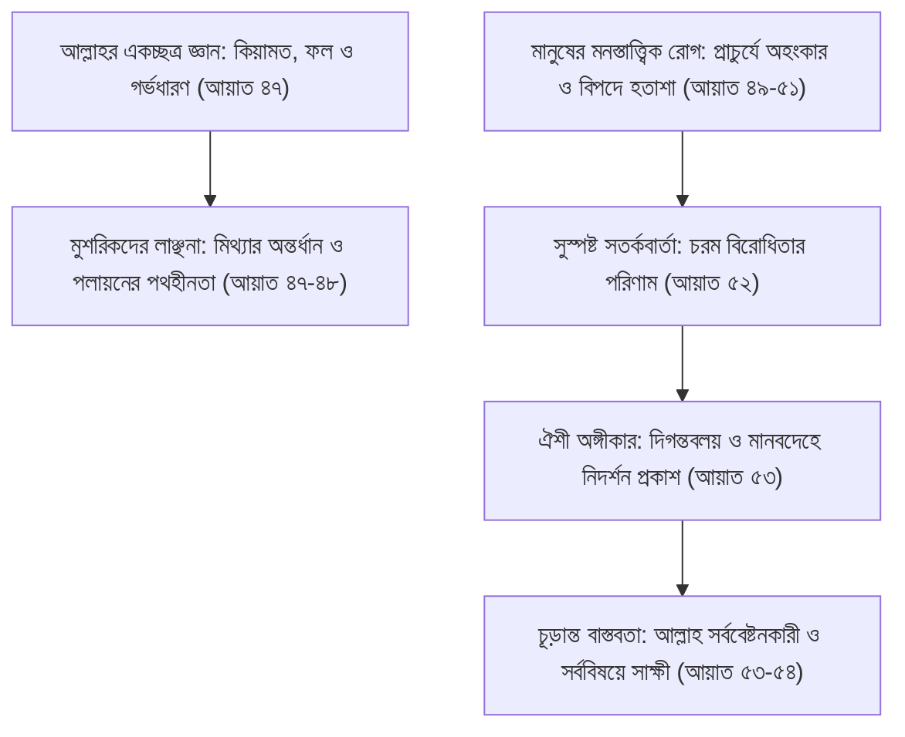

# ফুসসিলাত — রুকু ০৬ (আয়াত ৪৭–৫৪)

[সূচিপত্র](00_সূরা-পরিচিতি.md)

---

## ৫-স্তরবিশিষ্ট একাডেমিক যাচাইকরণ স্ট্যাটাস (Verification Status Box)

| স্তর (Tier) | অবস্থা | বিবরণ ও যাচাইয়ের পরিসর |
| :---: | :---: | :--- |
| **স্তর ১: Draft** | সম্পন্ন | ১৬ অধ্যায়ের কাঠামো ও প্রাথমিক তথ্য সংকলিত। |
| **স্তর ২: Digital Verified** | **যাচাইকৃত** | আয়াতের মূল পাঠ ও শব্দ-হরফ গণনা `bahouth` স্ক্রিপ্ট দ্বারা যাচাইকৃত; কিরাআত সারণি ও তুরাছ উদ্ধৃতিসমূহ ডিজিটাল ডাটাবেজের সাথে মিলিয়ে সংকলিত (কাঁচা স্ন্যাপশট সংরক্ষিত: `_sources/ruku_06_raw.json`)। |
| **স্তর ৩: Print Verified** | উন্মুক্ত (`[ ]`) | মুদ্রিত সংস্করণের ভৌত পৃষ্ঠার সাথে চাক্ষুষ মিলকরণের অপেক্ষায়। |
| **স্তর ৪: Scholarly Reviewed** | উন্মুক্ত (`[ ]`) | আকীদাগত ও তাফসীরী তারজীহ বিশেষজ্ঞ মুহাক্কিক আলেম কর্তৃক পর্যালোচনার অপেক্ষায়। |
| **স্তর ৫: Publication Ready** | উন্মুক্ত (`[ ]`) | চূড়ান্ত প্রকাশনা উপযোগী মাস্টার রেফারেন্স। |

---

## ০. রুকুর সারসংক্ষেপ ও কেন্দ্রীয় বক্তব্য (মাকাসিদ)

### প্রধান আত্মিক বার্তাসমূহ:
১. মহাবিশ্বের ক্ষুদ্রাতিক্ষুদ্র কণা থেকে শুরু করে কিয়ামতের মহাপ্রলয়—সবকিছুই আল্লাহর প্রত্যক্ষ জ্ঞানের অধীনে।
২. মানুষের সংকীর্ণ মানসিকতা হলো সে সুখে থাকলে অবাধ্য হয় আর কষ্টে পড়লে হতাশায় ভোগে; মুমিন এই ব্যাধি থেকে মুক্ত থাকে।
৩. বিজ্ঞান যত উৎকর্ষ লাভ করবে, তা ওহীর সত্যতাকেই আরো দেদীপ্যমান করে তুলবে।
৪. আল্লাহর দৃষ্টির বাইরে মহাবিশ্বের কিছুই নেই; তিনি তাঁর জ্ঞান, প্রজ্ঞা ও ক্ষমতা দ্বারা সমস্ত অস্তিত্বকে বেষ্টন করে আছেন।

---

---

## ১. আয়াতের মূল পাঠ ও অনুবাদ

### (১) ১ আরবি পাঠ (হরকতযুক্ত সাধারণ আরবি বানান; পূর্ণ উসমানী রসম নয়)

> [!NOTE]
> নিচে প্রদত্ত পাঠটি হরকতযুক্ত সাধারণ আরবি বানানরীতিতে সাজানো হয়েছে; এটি ক্যালিগ্রাফিক পূর্ণ উসমানী রসম নয়। প্রামাণ্য উসমানী পাঠের জন্য মুসহাফের পৃষ্ঠা দ্রষ্টব্য।

﴿إِلَيْهِ يُرَدُّ عِلْمُ السَّاعَةِ وَمَا تَخْرُجُ مِنْ ثَمَرَاتٍ مِنْ أَكْمَامِهَا وَمَا تَحْمِلُ مِنْ أُنْثَى وَلَا تَضَعُ إِلَّا بِعِلْمِهِ وَيَوْمَ يُنَادِيهِمْ أَيْنَ شُرَكَائِي قَالُوا آذَنَّاكَ مَا مِنَّا مِنْ شَهِيدٍ ۝47
وَضَلَّ عَنْهُمْ مَا كَانُوا يَدْعُونَ مِنْ قَبْلُ وَظَنُّوا مَا لَهُمْ مِنْ مَحِيصٍ ۝48
لَا يَسْأَمُ الْإِنْسَانُ مِنْ دُعَاءِ الْخَيْرِ وَإِنْ مَسَّهُ الشَّرُّ فَيَئُوسٌ قَنُوطٌ ۝49
وَلَئِنْ أَذَقْنَاهُ رَحْمَةً مِنَّا مِنْ بَعْدِ ضَرَّاءَ مَسَّتْهُ لَيَقُولَنَّ هَذَا لِي وَمَا أَظُنُّ السَّاعَةَ قَائِمَةً وَلَئِنْ رُجِعْتُ إِلَى رَبِّي إِنَّ لِي عِنْدَهُ لَلْحُسْنَى فَلَنُنَبِّئَنَّ الَّذِينَ كَفَرُوا بِمَا عَمِلُوا وَلَنُذِيقَنَّهُمْ مِنْ عَذَابٍ غَلِيظٍ ۝50
وَإِذَا أَنْعَمْنَا عَلَى الْإِنْسَانِ أَعْرَضَ وَنَأَى بِجَانِبِهِ وَإِذَا مَسَّهُ الشَّرُّ فَذُو دُعَاءٍ عَرِيضٍ ۝51
قُلْ أَرَأَيْتُمْ إِنْ كَانَ مِنْ عِنْدِ اللَّهِ ثُمَّ كَفَرْتُمْ بِهِ مَنْ أَضَلُّ مِمَّنْ هُوَ فِي شِقَاقٍ بَعِيدٍ ۝52
سَنُرِيهِمْ آيَاتِنَا فِي الْآفَاقِ وَفِي أَنْفُسِهِمْ حَتَّى يَتَبَيَّنَ لَهُمْ أَنَّهُ الْحَقُّ أَوَلَمْ يَكْفِ بِرَبِّكَ أَنَّهُ عَلَى كُلِّ شَيْءٍ شَهِيدٌ ۝53
أَلَا إِنَّهُمْ فِي مِرْيَةٍ مِنْ لِقَاءِ رَبِّهِمْ أَلَا إِنَّهُ بِكُلِّ شَيْءٍ مُحِيطٌ ۝54﴾

### (১) ২ শব্দানুগ ও সাবলীল অনুবাদ

| আয়াত | মূল আরবী পাঠ | সাবলীল বঙ্গানুবাদ |
| :---: | :--- | :--- |
| **৪৭** | ﴿إِلَيْهِ يُرَدُّ عِلْمُ السَّاعَةِ وَمَا تَخْرُجُ مِنْ ثَمَرَاتٍ مِنْ أَكْمَامِهَا وَمَا تَحْمِلُ مِنْ أُنْثَى وَلَا تَضَعُ إِلَّا بِعِلْمِهِ وَيَوْمَ يُنَادِيهِمْ أَيْنَ شُرَكَائِي قَالُوا آذَنَّاكَ مَا مِنَّا مِنْ شَهِيدٍ﴾ | কিয়ামতের জ্ঞান কেবল তাঁরই দিকে প্রত্যাবর্তিত হয়; এবং কোনো ফলই তার আবরণ হতে বের হয় না এবং কোনো নারী গর্ভধারণ করে না ও সন্তান প্রসব করে না তাঁর অজ্ঞাতসারে। আর যেদিন তিনি তাদেরকে ডেকে বলবেন, ‘কোথায় আমার সেই অংশীদারেরা?’ তারা বলবে, ‘আমরা আপনার নিকট নিবেদন করছি যে, আমাদের মধ্যে এর কোনো সাক্ষী নেই।’ |
| **৪৮** | ﴿وَضَلَّ عَنْهُمْ مَا كَانُوا يَدْعُونَ مِنْ قَبْلُ وَظَنُّوا مَا لَهُمْ مِنْ مَحِيصٍ﴾ | আর ইতিপূর্বে তারা যাদের আহ্বান করত, তারা তাদের নিকট হতে অন্তর্হিত হয়ে যাবে এবং তারা উপলব্ধি করবে যে, তাদের পলায়নের কোনো উপায় নেই। |
| **৪৯** | ﴿لَا يَسْأَمُ الْإِنْسَانُ مِنْ دُعَاءِ الْخَيْرِ وَإِنْ مَسَّهُ الشَّرُّ فَيَئُوسٌ قَنُوطٌ﴾ | মানুষ কখনো কল্যাণ প্রার্থনায় ক্লান্ত বা শ্রান্ত হয় না; আর যদি কোনো অনিষ্ট বা বিপদ তাকে স্পর্শ করে, তবে সে সম্পূর্ণরূপে হতাশ ও নিরাশ হয়ে পড়ে। |
| **৫০** | ﴿وَلَئِنْ أَذَقْنَاهُ رَحْمَةً مِنَّا مِنْ بَعْدِ ضَرَّاءَ مَسَّتْهُ لَيَقُولَنَّ هَذَا لِي وَمَا أَظُنُّ السَّاعَةَ قَائِمَةً وَلَئِنْ رُجِعْتُ إِلَى رَبِّي إِنَّ لِي عِنْدَهُ لَلْحُسْنَى فَلَنُنَبِّئَنَّ الَّذِينَ كَفَرُوا بِمَا عَمِلُوا وَلَنُذِيقَنَّهُمْ مِنْ عَذَابٍ غَلِيظٍ﴾ | আর যদি তার ওপর কোনো বিপদ নেমে আসার পর আমি তাকে আমার রহমতের স্বাদ আস্বাদন করাই, তবে সে অবশ্যই বলে, ‘এ তো আমারই প্রাপ্য যোগ্যতা এবং আমি মনে করি না যে কিয়ামত আদৌ সংঘটিত হবে; আর যদি আমাকে আমার প্রতিপালকের নিকট ফিরিয়ে নেওয়াও হয়, তবে তাঁর নিকট আমার জন্য অবশ্যই কল্যাণ নির্ধারিত থাকবে।’ অতএব আমি অবশ্যই কাফিরদের তাদের কৃতকর্ম সম্পর্কে অবহিত করব এবং অবশ্যই তাদেরকে এক কঠিন ও কঠোর শাস্তি আস্বাদন করাব। |
| **৫১** | ﴿وَإِذَا أَنْعَمْنَا عَلَى الْإِنْسَانِ أَعْرَضَ وَنَأَى بِجَانِبِهِ وَإِذَا مَسَّهُ الشَّرُّ فَذُو دُعَاءٍ عَرِيضٍ﴾ | আর যখন আমি মানুষের প্রতি অনুগ্রহ করি, তখন সে মুখ ফিরিয়ে নেয় এবং অহংকারে দূরে সরে যায়; আর যখন তাকে কোনো অনিষ্ট স্পর্শ করে, তখন সে প্রলম্বিত প্রার্থনায় লিপ্ত হয়। |
| **৫২** | ﴿قُلْ أَرَأَيْتُمْ إِنْ كَانَ مِنْ عِنْدِ اللَّهِ ثُمَّ كَفَرْتُمْ بِهِ مَنْ أَضَلُّ مِمَّنْ هُوَ فِي شِقَاقٍ بَعِيدٍ﴾ | বলো, ‘তোমরা ভেবে দেখেছ কি, যদি এই কুরআন আল্লাহর পক্ষ হতে অবতীর্ণ হয়ে থাকে অতঃপর তোমরা একে প্রত্যাখ্যান করো, তবে তার চেয়ে অধিক বিভ্রান্ত আর কে হতে পারে, যে চরম ও দূরবর্তী বিরোধিতায় নিমজ্জিত?’ |
| **৫৩** | ﴿سَنُرِيهِمْ آيَاتِنَا فِي الْآفَاقِ وَفِي أَنْفُسِهِمْ حَتَّى يَتَبَيَّنَ لَهُمْ أَنَّهُ الْحَقُّ أَوَلَمْ يَكْفِ بِرَبِّكَ أَنَّهُ عَلَى كُلِّ شَيْءٍ شَهِيدٌ﴾ | অচিরেই আমি তাদেরকে আমার নিদর্শনাবলী প্রদর্শন করব দিগন্তবলয়ে (মহাবিশ্বের প্রান্তে প্রান্তে) এবং তাদের নিজেদের সত্তার অভ্যন্তরে, যতক্ষণ না তাদের নিকট সুস্পষ্টভাবে প্রকাশিত হয় যে এটিই ধ্রুব সত্য। এটা কি তোমার প্রতিপালকের ব্যাপারে যথেষ্ট নয় যে, তিনি সর্ববিষয়ের প্রত্যক্ষদর্শী? |
| **৫৪** | ﴿أَلَا إِنَّهُمْ فِي مِرْيَةٍ مِنْ لِقَاءِ رَبِّهِمْ أَلَا إِنَّهُ بِكُلِّ شَيْءٍ مُحِيطٌ﴾ | সাবধান! নিশ্চয় তারা তাদের প্রতিপালকের সাথে সাক্ষাৎ সম্পর্কে ঘোর সন্দেহে নিমজ্জিত; সাবধান! নিশ্চয় তিনি সর্ববিষয়ে সর্ববেষ্টনকারী। |

---

## ২. লুগাভী ও সরফী তাহকীক এবং মুফরাদাতুল কুরআন

| শব্দ | মূলধাতু | সীগা / ওযন | আভিধানিক অর্থ | কুরআনিক প্রয়োগ ও তাৎপর্য |
| :--- | :---: | :---: | :--- | :--- |
| **عِلْمُ السَّاعَةِ** | `علم` / `سوع` | مركب إضافي نائب فاعل | কিয়ামতের জ্ঞান | কিয়ামত সংঘটনের সুনির্দিষ্ট কাল একমাত্র আল্লাহর গায়েবী জ্ঞানের অধীন। |
| **أَكْمَامِهَا** | `كمم` | جمع تكسير مجرور (كِمّ) | ফলের পুষ্পমুকুল বা খোসা | ফল তার আবরণ থেকে বের হওয়ার প্রতিটি মুহূর্ত আল্লাহর সার্বক্ষণিক দৃষ্টিতে থাকা। |
| **آذَنَّاكَ** | `أذن` | فعل ماض متعد (إفْعَال) | আমরা আপনাকে জানিয়ে দিচ্ছি | কিয়ামতের দিন মুশরিকদের নিজেদের বাতিল উপাস্যদের বিরুদ্ধে সরাসরি ঘোষণা। |
| **مَّحِيصٍ** | `حيص` | اسم مكان / مصدر ميمي | পলায়নের পথ ও আশ্রয় | আল্লাহর আযাব ও পাকড়াও থেকে কাফিরদের পালানোর কোনো জায়গা না থাকা। |
| **لَّا يَسْأَمُ** | `سأم` | فعل مضارع منفي | ক্লান্ত বা শ্রান্ত হয় না | দুনিয়াবী কল্যাণ ও প্রাচুর্য কামনায় মানুষের সীমাহীন অবিরাম লোভ। |
| **فَيَئُوسٌ قَنُوطٌ** | `يأس` / `قنط` | صفتان مشبهتان | সম্পূর্ণ আশাহত ও নিরাশ | বিপদ বা দারিদ্র্য স্পর্শ করলেই আল্লাহর রহমত থেকে কাফিরদের দ্রুত নিরাশ হওয়া। |
| **وَنَأَىٰ بِجَانِبِهِ** | `نأي` / `جنب` | مركب فعلي | পাশ কাটিয়ে দূরে সরে গেল | ধন-দৌলত লাভ করলে দাম্ভিক মানুষের আল্লাহকে ভুলে অহংকারে মুখ ফিরিয়ে নেওয়া। |
| **دُعَاءٍ عَرِيضٍ** | `دعو` / `عرض` | مركب وصفي مجرور | দীর্ঘ ও প্রলম্বিত প্রার্থনা | বিপদে পড়লে মুনাফিক ও দুর্বল ঈমানদারদের লোকদেখানো লম্বা প্রার্থনায় লিপ্ত হওয়া। |
| **الْآفَاقِ** | `أفق` | جمع تكسير مجرور (أُفُق) | দিগন্তবলয়, মহাবিশ্ব | দূরবর্তী মহাকাশ, ছায়াপথ ও প্রকৃতির মাঝে আল্লাহর একত্বের সুস্পষ্ট নিদর্শন। |
| **أَنفُسِهِمْ** | `نفس` | جمع تكسير مجرور | তাদের নিজস্ব সত্তা | মানবদেহের জটিল জৈবিক গঠন, ভ্রূণতত্ত্ব ও রুহের মাঝে আল্লাহর প্রজ্ঞার প্রকাশ। |

---

## ৩. ই'রাব ও নাহবী বিশ্লেষণ

1. **﴿إِلَيْهِ يُرَدُّ عِلْمُ السَّاعَةِ﴾ (আয়াত ৪৭):**
   - `إِلَيْهِ`: যার ও মাজরুর খবর মুকাদ্দাম (শুবহে জুমলাহ); কাসর ও হাসরের অর্থ প্রকাশ করে।
   - `يُرَدُّ`: ফে‘লে মুযারে মাজহূল মারফূ‘ بالضمة।
   - `عِلْمُ`: নায়েবে ফায়েল মারফূ‘ بالضمة, মুদ্বাফ। `السَّاعَةِ`: মুদ্বাফ ইলাইহি মাজরুর بالكسرة।

2. **﴿وَمَا تَخْرُجُ مِنْ ثَمَرَاتٍ مِنْ أَكْمَامِهَا﴾ (আয়াত ৪৭):**
   - `وَمَا`: মা নাফিয়্যাহ। `تَخْرُجُ`: ফে‘লে মুযারে মারফূ‘ بالضمة।
   - `مِنْ ثَمَرَاتٍ`: 'মিন' হরফে যার যায়িদাহ (উমূম ও ব্যাপকতার জন্য); `ثَمَرَاتٍ` লফযে মাজরুর কিন্তু মাহাল্লান মারফূ‘ ফায়েল। ইবনে ‘আমির ও আবূ জা‘ফরের কিরাআতে একবচন `مِن ثَمَرَةٍ`।
   - `مِنْ أَكْمَامِهَا`: যার ও মাজরুর ফে‘লের সাথে মুতা‘আল্লিক্ব।

3. **﴿سَنُرِيهِمْ آيَاتِنَا فِي الْآفَاقِ وَفِي أَنْفُسِهِمْ﴾ (আয়াত ৫৩):**
   - সীন হরফে ইস্তিক্ববাল; `نُرِي`: ফে‘লে মুযারে মারফূ‘ তাক্বদীরান; ফায়েল ‘নাহনু’ মুসতাতীর।
   - `هِمْ`: প্রথম মাফ‘ঊল বিহি মানসূব মাহাল্লান।
   - `آيَاتِنَا`: দ্বিতীয় মাফ‘ঊল বিহি মানসূব বিল-কাসরাহ (لأنه جمع مؤنث سالم); না মুদ্বাফ ইলাইহি।
   - `فِي الْآفَاقِ وَفِي أَنْفُسِهِمْ`: যার-মাজরুর ও মা‘তূফ হাল হিসেবে প্রযুক্ত।

---

## ৪. কিরাআত ও তাফসীরে প্রভাব

### ৪.১ প্রামাণ্য ১০ মুতাওয়াতির কিরাআত সারণি (মাদীনা মুনাওয়ারা বাহাউথ ডেটাবেস)

| আয়াত | শব্দ (ক্রম) | ক্বারী / রাবী (বাহাউথ) | কিরাআতের পাঠভেদ ও নিয়ম (অবিকৃত মূল পাঠ) |
| :---: | :--- | :--- | :--- |
| **47** | ﴿إِلَيْهِ﴾ (1) | ابن كثير | قرأ بصلة هاء الضمير خلافا لجمهور القراء. |
| **47** | ﴿إِلَيْهِ﴾ (1) | باقي الرواة | قرؤوا بترك الصلة مع قصر الهاء. |
| **47** | ﴿السَّاعَةِ﴾ (4) | الكسائي | قرأ بإمالة هاء التأنيث بخلف عنه وقفا. |
| **47** | ﴿السَّاعَةِ﴾ (4) | باقي الرواة | قرؤوا بفتح هاء التأنيث. |
| **47** | ﴿ثَمَرَاتٍ﴾ (8) | ابن كثير وَأبو عمرو وَيعقوب | قرأ بالإفراد، مع فتح هاء التأنيث ووقف عليها بالهاء. |
| **47** | ﴿ثَمَرَاتٍ﴾ (8) | شعبة عن عاصم وَحمزة وَخلف العاشر | قرأ بالإفراد، مع فتح هاء التأنيث ووقف عليها بالتاء. |
| **47** | ﴿ثَمَرَاتٍ﴾ (8) | الكسائي | قرأ بالإفراد، وأمال هاء التأنيث وقفاً بخلف عنه. |
| **47** | ﴿ثَمَرَاتٍ﴾ (8) | باقي الرواة | قرؤوا بالجمع. |
| **47** | ﴿مِنْ﴾ (9) | ورش عن نافع | قرأ بالنقل وصلاً ووقفا. |
| **47** | ﴿مِنْ﴾ (9) | خلف عن حمزة | قرأ بالسكت وعدمه وصلاً، ووقف بالسكت، والنقل، وتركهما. |
| **47** | ﴿مِنْ﴾ (9) | خلاد عن حمزة | قرأ بترك السكت وصلاً، ووقف بالنقل والتحقيق. |
| **47** | ﴿مِنْ﴾ (9) | باقي الرواة | قرؤوا بترك السكت مع تحقيق الهمزة وصلاً ووقفا. |
| **47** | ﴿مِنْ﴾ (13) | ورش عن نافع | قرأ بالنقل وصلاً ووقفا. |
| **47** | ﴿مِنْ﴾ (13) | خلف عن حمزة | قرأ بالسكت وعدمه وصلاً، ووقف بالسكت، والنقل، وتركهما. |
| **47** | ﴿مِنْ﴾ (13) | خلاد عن حمزة | قرأ بترك السكت وصلاً، ووقف بالنقل والتحقيق. |
| **47** | ﴿مِنْ﴾ (13) | باقي الرواة | قرؤوا بترك السكت مع تحقيق الهمزة وصلاً ووقفا. |
| **47** | ﴿أُنْثَى﴾ (14) | ورش عن نافع | قرأ بالتقليل بخلف عنه. |
| **47** | ﴿أُنْثَى﴾ (14) | أبو عمرو | قرأ بالتقليل بلا خلاف عنه. |
| **47** | ﴿أُنْثَى﴾ (14) | حمزة وَالكسائي وَخلف العاشر | قرأ بالإمالة وصلاً ووقفا. |
| **47** | ﴿أُنْثَى﴾ (14) | باقي الرواة | قرؤوا بالفتح وصلاً ووقفا. |
| **47** | ﴿يُنَادِيهِمْ﴾ (20) | يعقوب | قرأ بضم هاء الضمير وصلاً ووقفا. |
| **47** | ﴿يُنَادِيهِمْ﴾ (20) | باقي الرواة | قرؤوا بكسر هاء الضمير وصلاً ووقفا. |
| **47** | ﴿يُنَادِيهِمْ﴾ (20) | قالون عن نافع | قرأ بصلة ميم الجمع وصلاً بخلف عنه. |
| **47** | ﴿يُنَادِيهِمْ﴾ (20) | ورش عن نافع | قرأ بصلة ميم الجمع وصلاً مع الإشباع. |
| **47** | ﴿يُنَادِيهِمْ﴾ (20) | أبو جعفر وَابن كثير | قرأ بصلة ميم الجمع وصلا. |
| **47** | ﴿يُنَادِيهِمْ﴾ (20) | خلف عن حمزة | قرأ بالسكت وعدمه وصلاً ووقفا. |
| **47** | ﴿يُنَادِيهِمْ﴾ (20) | باقي الرواة | قرؤوا بترك السكت، وإسكان ميم الجمع وصلاً ووقفا. |
| **47** | ﴿شُرَكَائِي﴾ (22) | ورش عن نافع | قرأ بإسكان ياء الإضافة، مع تثليث مد البدل، وتحقيق الهمزة وصلاً ووقفا. |
| **47** | ﴿شُرَكَائِي﴾ (22) | ابن كثير | قرأ بفتح ياء الإضافة، مع تحقيق الهمزة وصلاً ووقفاً وقصر مد البدل. |
| **47** | ﴿شُرَكَائِي﴾ (22) | حمزة | قرأ بإسكان ياء الإضافة، مع تحقيق الهمزة وصلاً، ووقف بتسهيل الهمزة مع المد والقصر، مع قصر مد البدل. |
| **47** | ﴿شُرَكَائِي﴾ (22) | باقي الرواة | قرؤوا بإسكان ياء الإضافة، مع تحقيق الهمزة وصلاً ووقفاً وقصر مد البدل. |
| **47** | ﴿شُرَكَائِي﴾ (22) | ابن كثير | قرأ بفتح ياء الإضافة. |
| **47** | ﴿شُرَكَائِي﴾ (22) | باقي الرواة | قرؤوا بإسكان ياء الإضافة. |
| **47** | ﴿آذَنَّاكَ﴾ (24) | ورش عن نافع | قرأ بتثليث مد البدل. |
| **47** | ﴿آذَنَّاكَ﴾ (24) | باقي الرواة | قرؤوا بقصر مد البدل. |
| **47** | ﴿شَهِيدٍ﴾ (28) | خلف عن حمزة | قرأ بالإدغام مع ترك الغنة. |
| **47** | ﴿شَهِيدٍ﴾ (28) | باقي الرواة | قرؤوا بالإدغام مع الغنة. |
| **48** | ﴿عَنْهُمْ﴾ (2) | قالون عن نافع | قرأ بصلة ميم الجمع وصلاً بخلف عنه. |
| **48** | ﴿عَنْهُمْ﴾ (2) | أبو جعفر وَابن كثير | قرأ بصلة ميم الجمع وصلا. |
| **48** | ﴿عَنْهُمْ﴾ (2) | باقي الرواة | قرؤوا بترك صلة ميم الجمع. |
| **48** | ﴿لَهُمْ﴾ (10) | قالون عن نافع | قرأ بصلة ميم الجمع وصلاً بخلف عنه. |
| **48** | ﴿لَهُمْ﴾ (10) | أبو جعفر وَابن كثير | قرأ بصلة ميم الجمع وصلا. |
| **48** | ﴿لَهُمْ﴾ (10) | باقي الرواة | قرؤوا بترك صلة ميم الجمع. |
| **49** | ﴿يَسْأَمُ﴾ (2) | حمزة | قرأ بتحقيق الهمزة وصلاً، ووقف بالنقل. |
| **49** | ﴿يَسْأَمُ﴾ (2) | باقي الرواة | قرؤوا بتحقيق الهمزة وصلاً ووقفا. |
| **49** | ﴿الْإِنْسَانُ﴾ (3) | ورش عن نافع | قرأ بالنقل مع ترك السكت. |
| **49** | ﴿الْإِنْسَانُ﴾ (3) | خلف عن حمزة | قرأ بالسكت وصلاً، ووقف بالسكت والنقل. |
| **49** | ﴿الْإِنْسَانُ﴾ (3) | خلاد عن حمزة | قرأ بالسكت وعدمه وصلاً، ووقف بالسكت والنقل. |
| **49** | ﴿الْإِنْسَانُ﴾ (3) | باقي الرواة | قرؤوا بترك السكت مع تحقيق الهمزة وصلاً ووقفا. |
| **49** | ﴿دُعَاءِ﴾ (5) | هشام عن ابن عامر وَحمزة | قرأ بتحقيق الهمزة المتطرفة وصلاً، ووقف بالإبدال مع القصر والتوسط والطول، وتسهيل الهمزة بالروم على المد والقصر. |
| **49** | ﴿دُعَاءِ﴾ (5) | باقي الرواة | قرؤوا بتحقيق الهمزة المتطرفة وصلاً ووقفا. |
| **49** | ﴿وَإِنْ﴾ (7) | حمزة | قرأ بتحقيق الهمزة وصلاً، ووقف بتسهيل وتحقيق الهمزة. |
| **49** | ﴿وَإِنْ﴾ (7) | باقي الرواة | قرؤوا بتحقيق الهمزة وصلاً ووقفا. |
| **49** | ﴿فَيَئُوسٌ﴾ (10) | ورش عن نافع | قرأ بتحقيق الهمزة في الحالين، مع تثليث مد البدل. |
| **49** | ﴿فَيَئُوسٌ﴾ (10) | حمزة | قرأ بتحقيق الهمزة وصلاً، ووقف بتسهيل وحذف الهمزة، فتصبح الواو لينةً. |
| **49** | ﴿فَيَئُوسٌ﴾ (10) | باقي الرواة | قرؤوا بتحقيق الهمزة في الحالين، مع قصر مد البدل. |
| **49** | ﴿قَنُوطٌ﴾ (11) | خلف عن حمزة | قرأ بالإدغام مع ترك الغنة. |
| **49** | ﴿قَنُوطٌ﴾ (11) | باقي الرواة | قرؤوا بالإدغام مع الغنة. |
| **50** | ﴿وَلَئِنْ﴾ (1) | حمزة | قرأ بتحقيق الهمزة وصلاً، ووقف بتسهيل وتحقيق الهمزة. |
| **50** | ﴿وَلَئِنْ﴾ (1) | باقي الرواة | قرؤوا بتحقيق الهمزة وصلاً ووقفا. |
| **50** | ﴿وَلَئِنْ﴾ (1) | ورش عن نافع | قرأ بالنقل وصلاً ووقفا. |
| **50** | ﴿وَلَئِنْ﴾ (1) | خلف عن حمزة | قرأ بالسكت وعدمه وصلاً، ووقف بالسكت، والنقل، وتركهما. |
| **50** | ﴿وَلَئِنْ﴾ (1) | خلاد عن حمزة | قرأ بترك السكت وصلاً، ووقف بالنقل والتحقيق. |
| **50** | ﴿وَلَئِنْ﴾ (1) | باقي الرواة | قرؤوا بترك السكت مع تحقيق الهمزة وصلاً ووقفا. |
| **50** | ﴿أَذَقْنَاهُ﴾ (2) | ابن كثير | قرأ بصلة هاء الضمير خلافا لجمهور القراء. |
| **50** | ﴿أَذَقْنَاهُ﴾ (2) | باقي الرواة | قرؤوا بترك الصلة مع قصر الهاء. |
| **50** | ﴿رَحْمَةً﴾ (3) | الكسائي | قرأ بإمالة هاء التأنيث وقفا. |
| **50** | ﴿رَحْمَةً﴾ (3) | باقي الرواة | قرؤوا بفتح هاء التأنيث. |
| **50** | ﴿بَعْدِ﴾ (6) | السوسي عن أبي عمرو | قرأ بالإدغام الكبير، وله وجه الاختلاس. |
| **50** | ﴿بَعْدِ﴾ (6) | باقي الرواة | قرؤوا بالإظهار. |
| **50** | ﴿ضَرَّاءَ﴾ (7) | هشام عن ابن عامر وَحمزة | قرأ بتحقيق الهمزة وصلاً، ووقف بإبدال الهمزة ألفاً مع القصر والتوسط والطول. |
| **50** | ﴿ضَرَّاءَ﴾ (7) | باقي الرواة | قرؤوا بتحقيق الهمزة المتطرفة وصلاً ووقفا. |
| **50** | ﴿مَسَّتْهُ﴾ (8) | ابن كثير | قرأ بصلة هاء الضمير خلافا لجمهور القراء. |
| **50** | ﴿مَسَّتْهُ﴾ (8) | باقي الرواة | قرؤوا بترك الصلة مع قصر الهاء. |
| **50** | ﴿السَّاعَةَ﴾ (14) | الكسائي | قرأ بإمالة هاء التأنيث بخلف عنه وقفا. |
| **50** | ﴿السَّاعَةَ﴾ (14) | باقي الرواة | قرؤوا بفتح هاء التأنيث. |
| **50** | ﴿قَائِمَةً﴾ (15) | حمزة | قرأ بتحقيق الهمزة وصلاً، ووقف بتسهيل الهمزة مع المد والقصر، مع فتح هاء التأنيث وقفا. |
| **50** | ﴿قَائِمَةً﴾ (15) | الكسائي | قرأ بتحقيق الهمزة في الحالين، مع إمالة هاء التأنيث وقفا. |
| **50** | ﴿قَائِمَةً﴾ (15) | باقي الرواة | قرؤوا بتحقيق الهمزة في الحالين، مع فتح هاء التأنيث. |
| **50** | ﴿قَائِمَةً﴾ (15) | خلف عن حمزة | قرأ بالإدغام مع ترك الغنة. |
| **50** | ﴿قَائِمَةً﴾ (15) | باقي الرواة | قرؤوا بالإدغام مع الغنة. |
| **50** | ﴿وَلَئِنْ﴾ (16) | حمزة | قرأ بتحقيق الهمزة وصلاً، ووقف بتسهيل وتحقيق الهمزة. |
| **50** | ﴿وَلَئِنْ﴾ (16) | باقي الرواة | قرؤوا بتحقيق الهمزة وصلاً ووقفا. |
| **50** | ﴿رَبِّي﴾ (19) | قالون عن نافع | قرأ بفتح ياء الإضافة، بخلف عنه والفتح أشهر. |
| **50** | ﴿رَبِّي﴾ (19) | ورش عن نافع وَأبو جعفر وَأبو عمرو | قرأ بفتح ياء الإضافة. |
| **50** | ﴿رَبِّي﴾ (19) | باقي الرواة | قرؤوا بإسكان ياء الإضافة. |
| **50** | ﴿لَلْحُسْنَى﴾ (23) | ورش عن نافع | قرأ بالتقليل بخلف عنه. |
| **50** | ﴿لَلْحُسْنَى﴾ (23) | أبو عمرو | قرأ بالتقليل بلا خلاف عنه. |
| **50** | ﴿لَلْحُسْنَى﴾ (23) | حمزة وَالكسائي وَخلف العاشر | قرأ بالإمالة وصلاً ووقفا. |
| **50** | ﴿لَلْحُسْنَى﴾ (23) | باقي الرواة | قرؤوا بالفتح وصلاً ووقفا. |
| **50** | ﴿فَلَنُنَبِّئَنَّ﴾ (24) | حمزة | قرأ بتحقيق الهمزة وصلاً، ووقف بإبدال الهمزة ياء مفتوحة. |
| **50** | ﴿فَلَنُنَبِّئَنَّ﴾ (24) | باقي الرواة | قرؤوا بتحقيق الهمزة وصلاً ووقفا. |
| **50** | ﴿وَلَنُذِيقَنَّهُمْ﴾ (29) | قالون عن نافع | قرأ بصلة ميم الجمع وصلاً بخلف عنه. |
| **50** | ﴿وَلَنُذِيقَنَّهُمْ﴾ (29) | أبو جعفر وَابن كثير | قرأ بصلة ميم الجمع وصلا. |
| **50** | ﴿وَلَنُذِيقَنَّهُمْ﴾ (29) | باقي الرواة | قرؤوا بترك صلة ميم الجمع. |
| **50** | ﴿عَذَابٍ﴾ (31) | أبو جعفر | قرأ بالإخفاء عند الغين والخاء مع الغنة. |
| **50** | ﴿عَذَابٍ﴾ (31) | باقي الرواة | قرؤوا بالإظهار مع ترك الغنة. |
| **50** | ﴿غَلِيظٍ﴾ (32) | خلف عن حمزة | قرأ بالإدغام مع ترك الغنة. |
| **50** | ﴿غَلِيظٍ﴾ (32) | باقي الرواة | قرؤوا بالإدغام مع الغنة. |
| **51** | ﴿وَإِذَا﴾ (1) | حمزة | قرأ بتحقيق الهمزة وصلاً، ووقف بتسهيل وتحقيق الهمزة. |
| **51** | ﴿وَإِذَا﴾ (1) | باقي الرواة | قرؤوا بتحقيق الهمزة وصلاً ووقفا. |
| **51** | ﴿الْإِنْسَانِ﴾ (4) | ورش عن نافع | قرأ بالنقل مع ترك السكت. |
| **51** | ﴿الْإِنْسَانِ﴾ (4) | خلف عن حمزة | قرأ بالسكت وصلاً، ووقف بالسكت والنقل. |
| **51** | ﴿الْإِنْسَانِ﴾ (4) | خلاد عن حمزة | قرأ بالسكت وعدمه وصلاً، ووقف بالسكت والنقل. |
| **51** | ﴿الْإِنْسَانِ﴾ (4) | باقي الرواة | قرؤوا بترك السكت مع تحقيق الهمزة وصلاً ووقفا. |
| **51** | ﴿وَنَأَى﴾ (6) | ورش عن نافع | قرأ (وَنَأَى) بتقديم الهمزة، وقلل الهمزة بخلف عنه، مع تثليث البدل. |
| **51** | ﴿وَنَأَى﴾ (6) | أبو جعفر وَابن ذكوان عن ابن عامر | قرأ (وَنَاءَ) بتقديم الألف على الهمزة على وزن (شاء). |
| **51** | ﴿وَنَأَى﴾ (6) | خلف عن حمزة | قرأ (وَنَأَى) بتقديم الهمزة، مع إمالة النون والهمزة، وله تسهيل الهمزة وقفا. |
| **51** | ﴿وَنَأَى﴾ (6) | خلاد عن حمزة | قرأ (وَنَأَى) بتقديم الهمزة، مع إمالة الهمزة، وله تسهيل الهمزة وقفا. |
| **51** | ﴿وَنَأَى﴾ (6) | الكسائي وَخلف العاشر | قرأ (وَنَأَى) بتقديم الهمزة على حرف العلة، مع إمالة النون والهمزة. |
| **51** | ﴿وَنَأَى﴾ (6) | باقي الرواة | قرؤوا (وَنَأَى) بهمزة مفتوحة ممدودة بعد النون مع ترك الإمالة في النون والهمزة. |
| **51** | ﴿وَإِذَا﴾ (8) | حمزة | قرأ بتحقيق الهمزة وصلاً، ووقف بتسهيل وتحقيق الهمزة. |
| **51** | ﴿وَإِذَا﴾ (8) | باقي الرواة | قرؤوا بتحقيق الهمزة وصلاً ووقفا. |
| **51** | ﴿دُعَاءٍ﴾ (12) | هشام عن ابن عامر وَحمزة | قرأ بتحقيق الهمزة المتطرفة وصلاً، ووقف بالإبدال مع القصر والتوسط والطول، وتسهيل الهمزة بالروم على المد والقصر. |
| **51** | ﴿دُعَاءٍ﴾ (12) | باقي الرواة | قرؤوا بتحقيق الهمزة المتطرفة وصلاً ووقفا. |
| **52** | ﴿قُلْ﴾ (1) | ورش عن نافع | قرأ بالنقل وصلاً ووقفا. |
| **52** | ﴿قُلْ﴾ (1) | خلف عن حمزة | قرأ بالسكت وعدمه وصلاً، ووقف بالسكت، والنقل، وتركهما. |
| **52** | ﴿قُلْ﴾ (1) | خلاد عن حمزة | قرأ بترك السكت وصلاً، ووقف بالنقل والتحقيق. |
| **52** | ﴿قُلْ﴾ (1) | باقي الرواة | قرؤوا بترك السكت مع تحقيق الهمزة وصلاً ووقفا. |
| **52** | ﴿أَرَأَيْتُمْ﴾ (2) | قالون عن نافع وَأبو جعفر | قرأ بتسهيل الهمزة الثانية. |
| **52** | ﴿أَرَأَيْتُمْ﴾ (2) | ورش عن نافع | قرأ بتسهيل، وإبدال الهمزة الثانية ألفاً مع الإشباع. |
| **52** | ﴿أَرَأَيْتُمْ﴾ (2) | حمزة | قرأ بتسهيل الهمزة الثانية وقفا. |
| **52** | ﴿أَرَأَيْتُمْ﴾ (2) | الكسائي | قرأ بإسقاط الهمزة الثانية وصلاً ووقفا. |
| **52** | ﴿أَرَأَيْتُمْ﴾ (2) | باقي الرواة | قرؤوا بتحقيق الهمزة في الحالين. |
| **52** | ﴿أَرَأَيْتُمْ﴾ (2) | قالون عن نافع | قرأ بصلة ميم الجمع وصلاً بخلف عنه. |
| **52** | ﴿أَرَأَيْتُمْ﴾ (2) | ورش عن نافع | قرأ بصلة ميم الجمع وصلاً مع الإشباع. |
| **52** | ﴿أَرَأَيْتُمْ﴾ (2) | أبو جعفر وَابن كثير | قرأ بصلة ميم الجمع وصلا. |
| **52** | ﴿أَرَأَيْتُمْ﴾ (2) | خلف عن حمزة | قرأ بالسكت وعدمه وصلاً ووقفا. |
| **52** | ﴿أَرَأَيْتُمْ﴾ (2) | باقي الرواة | قرؤوا بترك السكت، وإسكان ميم الجمع وصلاً ووقفا. |
| **52** | ﴿كَفَرْتُمْ﴾ (9) | قالون عن نافع | قرأ بصلة ميم الجمع وصلاً بخلف عنه. |
| **52** | ﴿كَفَرْتُمْ﴾ (9) | أبو جعفر وَابن كثير | قرأ بصلة ميم الجمع وصلا. |
| **52** | ﴿كَفَرْتُمْ﴾ (9) | باقي الرواة | قرؤوا بترك صلة ميم الجمع. |
| **52** | ﴿مَنْ﴾ (11) | ورش عن نافع | قرأ بالنقل وصلاً ووقفا. |
| **52** | ﴿مَنْ﴾ (11) | خلف عن حمزة | قرأ بالسكت وعدمه وصلاً، ووقف بالسكت، والنقل، وتركهما. |
| **52** | ﴿مَنْ﴾ (11) | خلاد عن حمزة | قرأ بترك السكت وصلاً، ووقف بالنقل والتحقيق. |
| **52** | ﴿مَنْ﴾ (11) | باقي الرواة | قرؤوا بترك السكت مع تحقيق الهمزة وصلاً ووقفا. |
| **52** | ﴿هُوَ﴾ (14) | يعقوب | وقف بهاء السكت باتفاق. |
| **52** | ﴿هُوَ﴾ (14) | باقي الرواة | وقف بترك هاء السكت. |
| **53** | ﴿سَنُرِيهِمْ﴾ (1) | يعقوب | قرأ بضم هاء الضمير وصلاً ووقفا. |
| **53** | ﴿سَنُرِيهِمْ﴾ (1) | باقي الرواة | قرؤوا بكسر هاء الضمير وصلاً ووقفا. |
| **53** | ﴿سَنُرِيهِمْ﴾ (1) | قالون عن نافع | قرأ بضم ميم الجمع، ووصلها بواو لفظية بخلف عنه. |
| **53** | ﴿سَنُرِيهِمْ﴾ (1) | ورش عن نافع | قرأ بضم ميم الجمع، ووصلها بواو لفظية مع الإشباع، مع تثليث مد البدل. |
| **53** | ﴿سَنُرِيهِمْ﴾ (1) | أبو جعفر وَابن كثير | قرأ بضم ميم الجمع، ووصلها بواو لفظية. |
| **53** | ﴿سَنُرِيهِمْ﴾ (1) | خلف عن حمزة | قرأ بالسكت وعدمه وصلاً ووقفا. |
| **53** | ﴿سَنُرِيهِمْ﴾ (1) | باقي الرواة | قرؤوا بترك السكت، وإسكان ميم الجمع، مع قصر مد البدل. |
| **53** | ﴿آيَاتِنَا﴾ (2) | ورش عن نافع | قرأ بتثليث مد البدل. |
| **53** | ﴿آيَاتِنَا﴾ (2) | باقي الرواة | قرؤوا بقصر مد البدل. |
| **53** | ﴿الْآفَاقِ﴾ (4) | ورش عن نافع | قرأ بالنقل، مع تثليث البدل. |
| **53** | ﴿الْآفَاقِ﴾ (4) | خلف عن حمزة | قرأ بالسكت وصلاً، ووقف بالسكت والنقل. |
| **53** | ﴿الْآفَاقِ﴾ (4) | خلاد عن حمزة | قرأ بالسكت وعدمه وصلاً، ووقف بالسكت والنقل. |
| **53** | ﴿الْآفَاقِ﴾ (4) | باقي الرواة | قرؤوا بقصر مد البدل، وبترك السكت مع تحقيق الهمزة وصلاً ووقفا. |
| **53** | ﴿أَنْفُسِهِمْ﴾ (6) | قالون عن نافع | قرأ بصلة ميم الجمع وصلاً بخلف عنه. |
| **53** | ﴿أَنْفُسِهِمْ﴾ (6) | أبو جعفر وَابن كثير | قرأ بصلة ميم الجمع وصلا. |
| **53** | ﴿أَنْفُسِهِمْ﴾ (6) | باقي الرواة | قرؤوا بترك صلة ميم الجمع. |
| **53** | ﴿يَتَبَيَّنَ﴾ (8) | السوسي عن أبي عمرو | قرأ بالإدغام الكبير. |
| **53** | ﴿يَتَبَيَّنَ﴾ (8) | باقي الرواة | قرؤوا بالإظهار. |
| **53** | ﴿لَهُمْ﴾ (9) | قالون عن نافع | قرأ بصلة ميم الجمع وصلاً بخلف عنه. |
| **53** | ﴿لَهُمْ﴾ (9) | ورش عن نافع | قرأ بصلة ميم الجمع وصلاً مع الإشباع. |
| **53** | ﴿لَهُمْ﴾ (9) | أبو جعفر وَابن كثير | قرأ بصلة ميم الجمع وصلا. |
| **53** | ﴿لَهُمْ﴾ (9) | خلف عن حمزة | قرأ بالسكت وعدمه وصلاً ووقفا. |
| **53** | ﴿لَهُمْ﴾ (9) | باقي الرواة | قرؤوا بترك السكت، وإسكان ميم الجمع وصلاً ووقفا. |
| **53** | ﴿شَيْءٍ﴾ (18) | ورش عن نافع | قرأ بتوسط وإشباع مد اللين المهموز. |
| **53** | ﴿شَيْءٍ﴾ (18) | هشام عن ابن عامر | قرأ بتحقيق الهمزة وصلاً، ووقف بالنقل، وبالإبدال مع الإدغام، مع السكون المحض والروم. |
| **53** | ﴿شَيْءٍ﴾ (18) | خلف عن حمزة | قرأ بالسكت وصلاً، ووقف بالنقل، وبالإبدال مع الإدغام، وعلى الوجهين السكون المحض والروم. |
| **53** | ﴿شَيْءٍ﴾ (18) | خلاد عن حمزة | قرأ بالسكت وعدمه وصلاً، ووقف بالنقل، وبالإبدال مع الإدغام، وعلى الوجهين السكون المحض والروم. |
| **53** | ﴿شَيْءٍ﴾ (18) | باقي الرواة | قرؤوا بتحقيق الهمزة، وترك السكت، مع قصر مد اللين. |
| **53** | ﴿شَهِيدٌ﴾ (19) | ورش عن نافع | قرأ بالنقل وصلاً ووقفا. |
| **53** | ﴿شَهِيدٌ﴾ (19) | خلف عن حمزة | قرأ بالسكت وعدمه وصلاً، ووقف بالسكت، والنقل، وتركهما. |
| **53** | ﴿شَهِيدٌ﴾ (19) | خلاد عن حمزة | قرأ بترك السكت وصلاً، ووقف بالنقل والتحقيق. |
| **53** | ﴿شَهِيدٌ﴾ (19) | باقي الرواة | قرؤوا بترك السكت مع تحقيق الهمزة وصلاً ووقفا. |
| **54** | ﴿إِنَّهُمْ﴾ (2) | قالون عن نافع | قرأ بصلة ميم الجمع وصلاً بخلف عنه. |
| **54** | ﴿إِنَّهُمْ﴾ (2) | أبو جعفر وَابن كثير | قرأ بصلة ميم الجمع وصلا. |
| **54** | ﴿إِنَّهُمْ﴾ (2) | باقي الرواة | قرؤوا بترك صلة ميم الجمع. |
| **54** | ﴿مِرْيَةٍ﴾ (4) | الكسائي | قرأ بإمالة هاء التأنيث وقفا. |
| **54** | ﴿مِرْيَةٍ﴾ (4) | باقي الرواة | قرؤوا بفتح هاء التأنيث. |
| **54** | ﴿لِقَاءِ﴾ (6) | هشام عن ابن عامر وَحمزة | قرأ بتحقيق الهمزة المتطرفة وصلاً، ووقف بالإبدال مع القصر والتوسط والطول، وتسهيل الهمزة بالروم على المد والقصر. |
| **54** | ﴿لِقَاءِ﴾ (6) | باقي الرواة | قرؤوا بتحقيق الهمزة المتطرفة وصلاً ووقفا. |
| **54** | ﴿رَبِّهِمْ﴾ (7) | قالون عن نافع | قرأ بصلة ميم الجمع وصلاً بخلف عنه. |
| **54** | ﴿رَبِّهِمْ﴾ (7) | ورش عن نافع | قرأ بصلة ميم الجمع وصلاً مع الإشباع. |
| **54** | ﴿رَبِّهِمْ﴾ (7) | أبو جعفر وَابن كثير | قرأ بصلة ميم الجمع وصلا. |
| **54** | ﴿رَبِّهِمْ﴾ (7) | خلف عن حمزة | قرأ بالسكت وعدمه وصلاً ووقفا. |
| **54** | ﴿رَبِّهِمْ﴾ (7) | باقي الرواة | قرؤوا بترك السكت، وإسكان ميم الجمع وصلاً ووقفا. |
| **54** | ﴿شَيْءٍ﴾ (11) | ورش عن نافع | قرأ بتوسط وإشباع مد اللين المهموز. |
| **54** | ﴿شَيْءٍ﴾ (11) | هشام عن ابن عامر | قرأ بتحقيق الهمزة وصلاً، ووقف بالنقل، وبالإبدال مع الإدغام، مع السكون المحض والروم. |
| **54** | ﴿شَيْءٍ﴾ (11) | خلف عن حمزة | قرأ بالسكت وصلاً، ووقف بالنقل، وبالإبدال مع الإدغام، وعلى الوجهين السكون المحض والروم. |
| **54** | ﴿شَيْءٍ﴾ (11) | خلاد عن حمزة | قرأ بالسكت وعدمه وصلاً، ووقف بالنقل، وبالإبدال مع الإدغام، وعلى الوجهين السكون المحض والروم. |
| **54** | ﴿شَيْءٍ﴾ (11) | باقي الرواة | قرؤوا بتحقيق الهمزة، وترك السكت، مع قصر مد اللين. |
| **54** | ﴿مُحِيطٌ﴾ (12) | ورش عن نافع وَأبو عمرو وَيعقوب وَابن عامر | فصل بين السورتين بالبسملة، والوصل، والسكت، وله ما بين الآيات من أحكام الوصل. |
| **54** | ﴿مُحِيطٌ﴾ (12) | حمزة وَخلف العاشر | قرأ بالوصل بين السورتين بلا بسملة، وله ما بين الآيات من أحكام الوصل. |
| **54** | ﴿مُحِيطٌ﴾ (12) | باقي الرواة | فصل بالبسملة بين السورتين. |

### ৪.২ তাফসীর ও ফিকহে কিরাআতের প্রভাব
- **উসূলী পর্যালোচনা:** উদ্ধৃত কিরাআতসমূহ দশ মুতাওয়াতির ক্বারী ও তাঁদের রাবীদের প্রামাণিক সনদে প্রমাণিত।
- **অর্থগত বৈচিত্র্য:** শব্দের তাশদীদ, তাখফীফ, ইমালাহ এবং ইবদালের মাধ্যমে আয়াতসমূহের অর্থের গভীরতা ও তাৎপর্য সম্প্রসারিত হয়েছে, যা তাফসীর ও আহকামে পারস্পরিক পরিপূরক অর্থ প্রকাশ করে।

---
*উৎস সনদ:* শায়খ মুহাম্মদ ইব্রাহীম সালিম, *ফারীদাতুদ দাহর*, খণ্ড ৪ (`turath:29909`); ইমাম ইবনে যানযালাহ, *হুজ্জাতুল কিরাআত*, খণ্ড ১ (`turath:5531`); মাদীনা মুনাওয়ারা বাহাউথ প্রজেক্ট (`bahouth:list_verse_qiraat`)।

---

## ৫. তাফসীরুল জালালাইন ও তুলনামূলক তাফসীর

### (৫) ১ তাফসীরুল জালালাইন

### মূল আরবী পাঠ (তাফসীরে জালালাইন - ইমাম জালালুদ্দীন আল-মহাল্লী)
> **{إِلَيْهِ يُرَدُّ عِلْمُ السَّاعَةِ}** لَا يَعْلَمُ مَتَى قِيَامُهَا إِلَّا هُوَ سُبْحَانَهُ **{وَمَا تَخْرُجُ مِن ثَمَرَاتٍ مِّنْ أَكْمَامِهَا}** أَوْعِيَتِهَا **{وَمَا تَحْمِلُ مِنْ أُنثَىٰ وَلَا تَضَعُ إِلَّا بِعِلْمِهِ}** كُلُّ ذَلِكَ مَعْلُومٌ لَهُ لَا يَخْفَى عَلَيْهِ شَيْءٌ **{وَيَوْمَ يُنَادِيهِمْ}** اللَّهُ تَعَالَى لِلتَّوْبِيخِ **{أَيْنَ شُرَكَائِي}** بِزَعْمِكُمْ **{قَالُوا آذَنَّاكَ}** أَعْلَمْنَاكَ **{مَا مِنَّا مِن شَهِيدٍ}** يَشْهَدُ بِأَنَّ لَكَ شَرِيكًا الْيَوْمَ، تَبَرَّؤُوا مِنْهَا. **{وَضَلَّ عَنْهُم مَّا كَانُوا يَدْعُونَ مِن قَبْلُ}** غَابَتْ آلِهَتُهُمْ **{وَظَنُّوا}** أَيْقَنُوا **{مَا لَهُم مِّن مَّحِيصٍ}** مَهْرَبٍ مِنَ النَّارِ.
> **{لَّا يَسْأَمُ الْإِنسَانُ}** الْكَافِرُ **{مِن دُعَاءِ الْخَيْرِ}** طَلَبِ الصِّحَّةِ وَالْمَالِ **{وَإِن مَّسَّهُ الشَّرُّ}** الْفَقْرُ وَالْمَرَضُ **{فَيَئُوسٌ قَنُوطٌ}** شَدِيدُ الْيَأْسِ مِنْ رَحْمَةِ اللَّهِ. **{وَلَئِنْ أَذَقْنَاهُ رَحْمَةً مِّنَّا مِن بَعْدِ ضَرَّاءَ مَسَّتْهُ لَيَقُولَنَّ هَٰذَا لِي}** بِعَمَلِي وَاسْتِحْقَاقِي **{وَمَا أَظُنُّ السَّاعَةَ قَائِمَةً وَلَئِن رُّجِعْتُ إِلَىٰ رَبِّي إِنَّ لِي عِندَهُ لَلْحُسْنَىٰ}** الْجَنَّةَ، اغْتَرَّ بِالدُّنْيَا **{فَلَنُنَبِّئَنَّ الَّذِينَ كَفَرُوا بِمَا عَمِلُوا وَلَنُذِيقَنَّهُم مِّنْ عَذَابٍ غَلِيظٍ}** شَدِيدٍ. **{وَإِذَا أَنْعَمْنَا عَلَى الْإِنسَانِ أَعْرَضَ}** عَنِ الشُّكْرِ **{وَنَأَىٰ بِجَانِبِهِ}** تَبَاعَدَ تَكَبُّرًا **{وَإِذَا مَسَّهُ الشَّرُّ فَذُو دُعَاءٍ عَرِيضٍ}** كَثِيرٍ، بِخِلَافِ حَالِ الرَّخَاءِ. **{قُلْ أَرَأَيْتُمْ إِن كَانَ}** هَذَا الْقُرْآنُ **{مِنْ عِندِ اللَّهِ ثُمَّ كَفَرْتُم بِهِ مَنْ أَضَلُّ مِمَّنْ هُوَ فِي شِقَاقٍ بَعِيدٍ}** أَيْ لَا أَحَدَ أَضَلُّ مِنْكُمْ. **{سَنُرِيهِمْ آيَاتِنَا فِي الْآفَاقِ}** نَوَاحِي السَّمَاوَاتِ وَالْأَرْضِ بِالْفُتُوحَاتِ وَآثَارِ الْقُدْرَةِ **{وَفِي أَنفُسِهِمْ}** بِدَقَائِقِ خَلْقِهِمْ وَفَتْحِ مَكَّةَ **{حَتَّىٰ يَتَبَيَّنَ لَهُمْ أَنَّهُ}** أَيِ الْقُرْآنَ **{الْحَقُّ أَوَلَمْ يَكْفِ بِرَبِّكَ أَنَّهُ عَلَىٰ كُلِّ شَيْءٍ شَهِيدٌ}** حَاضِرٌ وَمُطَّلِعٌ. **{أَلَا إِنَّهُمْ فِي مِرْيَةٍ}** شَكٍّ **{مِّن لِّقَاءِ رَبِّهِمْ أَلَا إِنَّهُ بِكُلِّ شَيْءٍ مُّحِيطٌ}** عِلْمًا وَقُدْرَةً.

### সরল ব্যাখ্যা ও মর্মার্থ
ইমাম আল-মহাল্লী (রহ.) [তুরাছ আইডি: ১২৮৭৬] আয়াতগুলোর ভাবার্থ ফুটিয়ে তুলে বলেন: কিয়ামতের সঠিক সময় কেবল আল্লাহই জানেন, কোনো নবী বা ফেরেশতারও এর পুঙ্খানুপুঙ্খ ইলম নেই। বৃক্ষের পাতার আবরণে মোড়ানো ফল, স্ত্রীজাতীয় সৃষ্টির গর্ভধারণ ও প্রসবের মতো অতি সূক্ষ্ম প্রতিটি ঘটনা আল্লাহর সরাসরি জ্ঞানে নিয়ন্ত্রিত। পরকালে মুশরিকরা যাদের উপাসনা করতো, তারা নিশ্চিহ্ন হয়ে যাবে এবং তারা উপলব্ধি করবে যে পালানোর কোনো পথ নেই। এরপর মানুষের এক অদ্ভুত মনস্তাত্ত্বিক ব্যাধি চিত্রিত হয়েছে: মানুষ যখন প্রাচুর্যে থাকে তখন অহংকারে মুখ ফিরিয়ে নেয় এবং আখেরাতকে অস্বীকার করে; কিন্তু সামান্য বিপদে পড়লেই অত্যন্ত নিরাশ হয়ে দীর্ঘ প্রার্থনায় লিপ্ত হয়। আল্লাহ তা‘আলা বিশ্ববাসীকে চ্যালেঞ্জ দিয়ে ঘোষণা করছেন যে, অচিরেই মহাবিশ্বের দিগন্তবলয়ে (আফাক্ব) এবং মানুষের নিজ দেহের আভ্যন্তরীণ সূক্ষ্ম শারীরবিদ্যায় (আনফুস) এমন বিস্ময়কর বৈজ্ঞানিক নিদর্শন প্রকাশ করা হবে, যা দেখে সবাই কুরআনের অলৌকিক সত্যতা মানতে বাধ্য হবে।

---

### (৫) ২ তাফসীর বিল-মা'ছূর (হাদীস ও আছার)

১. **ইলমে গায়বের পাঁচটি চাবি (মাফাতিহুল গায়ব):**
   * ইমাম বুখারী তাঁর সহীহে (৪৬৯৭) ও ইমাম তাবারী [তুরাছ আইডি: ৭৭৯৮] আব্দুল্লাহ ইবনে উমর (রা.) হতে বর্ণনা করেন: রাসূলুল্লাহ (ﷺ) ইরশাদ করেছেন:
     > “مَفَاتِيحُ الغَيْبِ خَمْسٌ لَا يَعْلَمُهَا إِلَّا اللَّهُ: لَا يَعْلَمُ مَا تَغِيضُ الأَرْحَامُ إِلَّا اللَّهُ، وَلَا يَعْلَمُ مَا فِي غَدٍ إِلَّا اللَّهُ، وَلَا يَعْلَمُ مَتَى يَأْتِي المَطَرُ أَحَدٌ إِلَّا اللَّهُ، وَلَا تَدْرِي نَفْسٌ بِأَيِّ أَرْضٍ تَمُوتُ إِلَّا اللَّهُ، وَلَا يَعْلَمُ مَتَى تَقُومُ السَّاعَةُ إِلَّا اللَّهُ”
     > "গায়বের চাবি পাঁচটি, যা আল্লাহ ব্যতীত কেউ জানে না: জরায়ুতে কী কমবে বা বাড়বে তা আল্লাহ ছাড়া কেউ জানে না; আগামীকাল কী ঘটবে তা আল্লাহ ছাড়া কেউ জানে না; বৃষ্টি কখন আসবে তা আল্লাহ ছাড়া কেউ জানে না; কোনো প্রাণী কোন স্থানে মারা যাবে তা আল্লাহ ছাড়া কেউ জানে না; এবং কিয়ামত কখন সংঘটিত হবে তাও একমাত্র আল্লাহ ছাড়া কেউ জানে না।"
২. **আফাক্ব ও আনফুসের নিদর্শনের ব্যাখ্যা:**
   * হযরত ইবনে আব্বাস (রা.) আয়াত ৫৩-এর তাফসীরে বলেন: "আফাক্ব (দিগন্তবলয়) দ্বারা উদ্দেশ্য হলো রোম, পারস্য ও অন্যান্য ভূখণ্ডে ইসলামের বিজয় এবং মহাবিশ্বের সৃষ্টিরহস্য উন্মোচন; আর আনফুস (আত্মা/নিজ দেহ) দ্বারা বদরের যুদ্ধে কাফিরদের শোচনীয় পরাজয় ও মানুষের ভ্রূণগত শারীরিক বিস্ময়।" (তাফসীরে ইবনে কাসীর [তুরাছ আইডি: ৮৪৭৩], কুরতুবী [তুরাছ আইডি: ২০৮৫৫])।
৩. **সুখে অহংকার ও দুঃখে নিরাশার প্রকৃতি:**
   * সহীহ মুসলিমে (২৯৯৯) সুহাইব আর-রূমী (রা.) হতে বর্ণিত: রাসূলুল্লাহ (ﷺ) মুমিনের প্রশংসায় ইরশাদ করেন:
     > “عَجَبًا لِأَمْرِ الْمُؤْمِنِ، إِنَّ أَمْرَهُ كُلَّهُ خَيْرٌ، وَلَيْسَ ذَاكَ لِأَحَدٍ إِلَّا لِلْمُؤْمِنِ: إِنْ أَصَابَتْهُ سَرَّاءُ شَكَرَ فَكَانَ خَيْرًا لَهُ، وَإِنْ أَصَابَتْهُ ضَرَّاءُ صَبَرَ فَكَانَ خَيْرًا لَهُ”
     > "মুমিনের প্রতিটি বিষয়ই বিস্ময়কর! তার সকল অবস্থাতেই কল্যাণ নিহিত, আর এটি মুমিন ছাড়া আর কারো ভাগ্যে জোটে না: যদি সে সুখ বা প্রাচুর্য পায় তবে শোকর আদায় করে, যা তার জন্য কল্যাণকর; আর যদি কোনো বিপদ স্পর্শ করে তবে সে ধৈর্য ধারণ করে, যা তার জন্য প্রভূত কল্যাণ বয়ে আনে।"

---

### (৫) ৩ অন্যান্য তাফসীরের তুলনামূলক পর্যালোচনা

### (১) 'آيَاتِنَا فِي الْآفَاقِ وَفِي أَنفُسِهِمْ'-এর ব্যাপ্তী
* **ইমাম তাবারী [তুরাছ আইডি: ৭৭৯৮] ও ইমাম ইবনে কাসীর [তুরাছ আইডি: ৮৪৭৩]:** তৎকালীন প্রেক্ষাপটে মুসলিমদের বিজয়, মক্কা বিজয় এবং শত্রুদের নিধন নির্দেশ করে। তবে এটি কিয়ামত পর্যন্ত মহাবিশ্ব ও মানবদেহে আল্লাহর অনন্ত কুদরতের বিকাশকেও অন্তর্ভুক্ত করে।
* **ইমাম ফখরুদ্দীন আর-রাযী [তুরাছ আইডি: ২৩৬৩৫]:** কালামী ও দার্শনিক দৃষ্টিকোণ থেকে রাযী বলেন: 'আফাক্ব' হলো সৌরজগৎ, নক্ষত্রপুঞ্জ, গ্রহের গতিপথ ও মৌসুমি পরিবর্তন; আর 'আনফুস' হলো মানবদেহের অঙ্গসংস্থান, শিরা-উপশিরা, পঞ্চইন্দ্রিয় এবং মানব আত্মার মনস্তাত্ত্বিক অলৌকিকত্ব।
* **আল্লামা ইবনে আশূর [তুরাছ আইডি: ৯৭৭৬]:** এটি কুরআনের একটি ঐতিহাসিক ভবিষ্যদ্বাণী। মানবজাতি যত অগ্রসর হবে, আধুনিক বিজ্ঞানের মাধ্যমে মহাবিশ্বের মহাশূন্যের দিগন্ত ও মাইক্রোস্কোপিক কোষকাঠামো তত বেশি আবিষ্কার করবে, যা কুরআনের নির্ভুল সত্যতাকে প্রমাণ করবে।

### (২) কাফিরদের দো‘আ কবুল হওয়ার কালামী দৃষ্টিভঙ্গি
* **মু‘তাযিলা মতবাদ:** কাফিরদের কোনো দো‘আই কবুল হয় না, তাদের দো‘আ সম্পূর্ণ বাতিল।
* **আহলে সুন্নাত ওয়াল জামা‘আত (আলূসী [তুরাছ আইডি: ২২৮৩৫] ও কুরতুবী [তুরাছ আইডি: ২০৮৫৫]):** পার্থিব জীবনে চরম বিপদের মুখে কাফিরদের ইযতিরার বা আর্তনাদের দো‘আ কখনো কখনো আল্লাহ কবুল করে থাকেন তাঁর সাধারণ দয়া ও হিকমতের অংশ হিসেবে (যেমন সূরা ইউনুসের ২২ নং আয়াতে বর্ণিত)। তবে পরকালে তাদের কোনো দো‘আ ফলপ্রসূ হবে না।

---

---

## ৬. শানে নুযূল, সংশ্লিষ্ট ঘটনা ও হাদীসের তাখরীজ

### আয়াত ৪৭-এর প্রেক্ষাপট
* ইমাম তাবারী [তুরাছ আইডি: ৭৭৯৮] বর্ণনা করেন: কুরাইশ কাফিররা উপহাস করে রাসূলুল্লাহ (ﷺ)-কে বারবার প্রশ্ন করত, "তুমি যে কিয়ামতের ভয় দেখাও, সেই কিয়ামত ঠিক কখন আসবে? কোন দিন, কোন মাসে?" তাদের এই হঠকারী ও ব্যঙ্গাত্মক প্রশ্নের খণ্ডনে আল্লাহ তা‘আলা ঘোষণা করেন: কিয়ামতের নির্ধারিত জ্ঞানের অধিকার একমাত্র আল্লাহর; সৃষ্টির কোনো সত্তার নিকট এর নির্দিষ্ট সময়সীমা পৌঁছানো হয়নি।

### আয়াত ৫১-এর শানে নুযূল
* সুদ্দী ও মুক্বাতিল (রহ.) বলেন: এই আয়াতটি ওলীদ ইবনুল মুগীরাহ এবং উতবাহ ইবনে রাবী‘আহর মতো কুরাইশ ধনকুবেরদের স্বভাবের প্রেক্ষিতে নাযিল হয়। যখন তারা শারীরিক সুস্থতা, বিপুল সন্তানসন্ততি ও অগাধ ধনসম্পদের অধিকারী ছিল, তখন তারা অহংকারে গ্রীবাকে বাঁকা করে সত্য থেকে মুখ ফিরিয়ে নিত; কিন্তু যখন তাদের ওপর ক্ষুধা ও দারিদ্র্যের সংকট নেমে আসত, তখন তারা দীর্ঘ বিলাপ ও মূর্তিদের সামনে আকুল প্রার্থনায় মেতে উঠত।

---

---

## ৭. মুখাতাব, ইখতিলাফ ও প্রসিদ্ধ তারজীহ

প্রযোজ্য নয় — এই রুকুতে সম্বোধনের পাত্র ও মূল বার্তার ব্যাখ্যায় মুফাসসিরগণের মধ্যে কোনো মৌলিক ইখতিলাফ নেই।

---

## ৮. আহকাম ও চার মাযহাবের তুলনামূলক ফিকহ

### (১) 'آيَاتِنَا فِي الْآفَاقِ وَفِي أَنفُسِهِمْ'-এর ব্যাপ্তী
* **ইমাম তাবারী [তুরাছ আইডি: ৭৭৯৮] ও ইমাম ইবনে কাসীর [তুরাছ আইডি: ৮৪৭৩]:** তৎকালীন প্রেক্ষাপটে মুসলিমদের বিজয়, মক্কা বিজয় এবং শত্রুদের নিধন নির্দেশ করে। তবে এটি কিয়ামত পর্যন্ত মহাবিশ্ব ও মানবদেহে আল্লাহর অনন্ত কুদরতের বিকাশকেও অন্তর্ভুক্ত করে।
* **ইমাম ফখরুদ্দীন আর-রাযী [তুরাছ আইডি: ২৩৬৩৫]:** কালামী ও দার্শনিক দৃষ্টিকোণ থেকে রাযী বলেন: 'আফাক্ব' হলো সৌরজগৎ, নক্ষত্রপুঞ্জ, গ্রহের গতিপথ ও মৌসুমি পরিবর্তন; আর 'আনফুস' হলো মানবদেহের অঙ্গসংস্থান, শিরা-উপশিরা, পঞ্চইন্দ্রিয় এবং মানব আত্মার মনস্তাত্ত্বিক অলৌকিকত্ব।
* **আল্লামা ইবনে আশূর [তুরাছ আইডি: ৯৭৭৬]:** এটি কুরআনের একটি ঐতিহাসিক ভবিষ্যদ্বাণী। মানবজাতি যত অগ্রসর হবে, আধুনিক বিজ্ঞানের মাধ্যমে মহাবিশ্বের মহাশূন্যের দিগন্ত ও মাইক্রোস্কোপিক কোষকাঠামো তত বেশি আবিষ্কার করবে, যা কুরআনের নির্ভুল সত্যতাকে প্রমাণ করবে।

### (২) কাফিরদের দো‘আ কবুল হওয়ার কালামী দৃষ্টিভঙ্গি
* **মু‘তাযিলা মতবাদ:** কাফিরদের কোনো দো‘আই কবুল হয় না, তাদের দো‘আ সম্পূর্ণ বাতিল।
* **আহলে সুন্নাত ওয়াল জামা‘আত (আলূসী [তুরাছ আইডি: ২২৮৩৫] ও কুরতুবী [তুরাছ আইডি: ২০৮৫৫]):** পার্থিব জীবনে চরম বিপদের মুখে কাফিরদের ইযতিরার বা আর্তনাদের দো‘আ কখনো কখনো আল্লাহ কবুল করে থাকেন তাঁর সাধারণ দয়া ও হিকমতের অংশ হিসেবে (যেমন সূরা ইউনুসের ২২ নং আয়াতে বর্ণিত)। তবে পরকালে তাদের কোনো দো‘আ ফলপ্রসূ হবে না।

---

---

## ৯. উলূমুল কুরআন ও উসূলুত তাফসীর

প্রযোজ্য নয় — এই রুকুতে আয়াতসমূহ সুসংহত ও স্পষ্ট; কোনো জটিল নাসেখ-মানসূখ বা উলূমুল কুরআনের মতপার্থক্য প্রযোজ্য নয়।

---

## ১০. বালাগাত ও আল-কুরআনের ই'জায

### বাক্যতাত্ত্বিক বিশ্লেষণ (I'rab)
* **إِلَيْهِ يُرَدُّ عِلْمُ السَّاعَةِ:** إليه: جار ومجرور متعلق بيرد، وقُدِّم لإفادة الحصر والقصر. يردُّ: فعل مضارع مبني للمجهول مرفوع بالضمة. علمُ: نائب فاعل مرفوع بالضمة، وهو مضاف، والساعةِ: مضاف إليه مجرور بالكسرة.
* **وَمَا تَخْرُجُ مِن ثَمَرَاتٍ مِّنْ أَكْمَامِهَا:** الواو استئنافية، ما: نافية لا عمل لها. تخرجُ: فعل مضارع مرفوع بالضمة. مِن: حرف جر زائد لإفادة الاستغراق والشمول، ثمراتٍ: فاعل مجرور لفظاً مرفوع محلاً. من أكمامها: جار ومجرور متعلق بتخرج، و(ها) مضاف إليه.
* **لَّا يَسْأَمُ الْإِنسَانُ:** لا: نافية، يسأمُ: فعل مضارع مرفوع، الإنسانُ: فاعل مرفوع بالضمة.
* **فَذُو دُعَاءٍ عَرِيضٍ:** الفاء واقعة في جواب الشرط، ذو: خبر لمبتدأ محذوف تقديره "فهو ذو"، مرفوع بالواو لأنه من الأسماء الخمسة، دعاءٍ: مضاف إليه مجرور، عَرِيضٍ: نعت مجرور بالكسرة.
* **سَنُرِيهِمْ آيَاتِنَا:** السين للاستقبال والتحقيق القريب، نري: فعل مضارع مرفوع بضمة مقدرة على الياء، والفاعل ضمير مستتر تقديره نحن للتعظيم، والهاء مفعول به أول، آيَاتِنَا: مفعول به ثان منصوب بالكسرة لأنه جمع مؤنث سالم، و(نا) مضاف إليه.
* **فِي الْآفَاقِ وَفِي أَنفُسِهِمْ:** شبه جملة متعلق بنري، والواو عاطفة.

### বালাগাত ও অলঙ্কারশাস্ত্র (Rhetoric)
১. **তাক্বদীম ও হসর (Prepositional Exclusivity):** 'إِلَيْهِ يُرَدُّ'—জার-মাজরুরকে শুরুতে এনে কিয়ামতের জ্ঞানকে একমাত্র আল্লাহর সাথে নির্দিষ্ট (হসর) করা হয়েছে।
২. **ইস্তিয়ারাহ বালীগ্বাহ (Profound Metaphor):** 'فَذُو دُعَاءٍ عَرِيضٍ'—দো‘আকে 'প্রলম্বিত বা প্রশস্ত' (عريض) বিশেষণে বিশেষায়িত করা হয়েছে। সাধারণত দৈর্ঘ্য (طويل) বলা হয়, কিন্তু এখানে 'আরীদ্ব' বলে প্রার্থনার ঘনত্ব, বারবার কাকুতি-মিনতি ও অতিমাত্রিক ব্যাকুলতার চিত্র আঁকা হয়েছে।
৩. **ই‘জায ও জাযালাত:** 'سَنُرِيهِمْ آيَاتِنَا فِي الْآفَاقِ وَفِي أَنفُسِهِمْ'—শব্দমালার সংক্ষিপ্ততায় সমগ্র মহাজাগতিক ও অণুজীববিজ্ঞানভিত্তিক ভবিষ্যৎ বিজ্ঞানকে ধারণ করা হয়েছে।

---

---

## ১১. সমকালীন প্রাসঙ্গিকতা ও সংশয় নিরসন

১. **কিয়ামতের নির্দিষ্ট দিন-ক্ষণ দাবির শরয়ী হুকুম:**
   * কোনো ব্যক্তি যদি দাবি করে যে সে অমুক বছর বা অমুক তারিখে কিয়ামত সংঘটিত হওয়ার কথা জানে, তবে সে স্পষ্ট কাফির ও কুরআনের আয়াত ৪৭-এর প্রত্যক্ষ অস্বীকারকারী। কিয়ামতের প্রকৃত সময় কেবল আল্লাহর এখতিয়ারভুক্ত।
২. **মেডিকেল আল্ট্রাসনোগ্রাফি বনাম 'ইলমে গায়ব':**
   * গর্ভের ভ্রূণের লিঙ্গ নির্ধারণ সংক্রান্ত আধুনিক প্রযুক্তি কুরআনের 'ইলমে গায়ব'-এর সাথে সাংঘর্ষিক নয়। কারণ প্রযুক্তি ভ্রূণের শারীরিক অঙ্গ সৃষ্টি হওয়ার পর তার দৃশ্যমান প্রতিফলন (আল-ইলমুশ শুহূদী) সনাক্ত করে। কিন্তু শুক্রাণুর গর্ভধারণের মুহূর্ত, তার পূর্ণাঙ্গ তাক্বদীর, তার আয়ু, রিজিক ও সে নেককার না বদকার হবে—তা জানার ক্ষমতা একমাত্র আল্লাহর।

---

---

## ১২. আন্তঃআয়াত ও বিষয়ভিত্তিক কুরআনিক সংযোগ

প্রযোজ্য নয় — সূরার সার্বিক ধারাক্রম ও রুকুর আন্তঃআয়াত সংযোগ প্রাসঙ্গিকভাবে পূর্ববর্তী অনুচ্ছেদসমূহে আলোচিত হয়েছে।

---

## ১৩. দারস, তারবিয়াত ও দাওয়াতী নির্দেশনা

১. **সুখে বিনয় ও দুঃখে সবর:**
   * মানুষের স্বভাবজাত নীচতা হলো সম্পদ পেলে আল্লাহকে ভুলে যাওয়া এবং বিপদ এলে হতাশ হয়ে ভেঙে পড়া। আত্মশুদ্ধির মূল পথ হলো সচ্ছলতায় বিনম্র কৃতজ্ঞতা প্রকাশ করা এবং দারিদ্র্য ও কষ্টে আল্লাহর ফয়সালার প্রতি সন্তুষ্ট থেকে ধৈর্য ধারণ করা।
২. **নিজেদের সত্তায় তাদাব্বুর (Introspection):**
   * প্রতিদিন নিজের শ্বাস-প্রশ্বাস, দৃষ্টিশক্তি ও অন্তরের স্পন্দনের দিকে তাকিয়ে আত্মোপলব্ধি করা উচিত। নিজের অস্তিত্বের দিকে গভীরভাবে তাকালে অহংকার বিলুপ্ত হয়ে অন্তরে আল্লাহর মহিমা প্রতিষ্ঠিত হয়।

---

---

## ১৪. প্রামাণ্য গ্রন্থপঞ্জি ও তথ্যসূত্র

১. **ইসলামিক ফিকহ একাডেমি (রাবেতায়ে আলমে ইসলামী - মক্কা):**
   * সিদ্ধান্ত (১৪০৭ হি.): 'আল-ই‘জাযুল ‘ইলমী ফিল কুরআন ওয়াস-সুন্নাহ' (কুরআন ও সুন্নাহর বৈজ্ঞানিক অলৌকিকত্ব) বিষয়ক অধিবেশনে সূরা ফুসসিলাতের ৫৩ নং আয়াতকে বৈজ্ঞানিক গবেষণার মূল শারয়ী ভিত্তি হিসেবে গ্রহণ করা হয়।
২. **দারুল ইফতা আল-মিশরিয়্যাহ (মিশর):**
   * ফতওয়া নং ৭২০৩: কিয়ামতের নিশানাসমূহ ও বৈজ্ঞানিক লক্ষণাবলি পর্যবেক্ষণ করা ঈমান বৃদ্ধির সহায়ক; তবে নির্দিষ্ট বর্ষ গণনা করে ভীতি ছড়ানো শরীয়ত পরিপন্থী।
৩. **কিং আব্দুল আযীয বিশ্ববিদ্যালয় (জেদ্দা) - কুরআন গবেষণা কেন্দ্র:**
   * গবেষণা সন্দর্ভ: 'আফাক্ব ও আনফুস: একবিংশ শতাব্দীর বিজ্ঞানে কুরআনিক নির্দেশনার বাস্তবতা' (ড. কিথ মুর ও অন্যান্যদের মতামত পর্যালোচনা)।

---

---

## ১৫. গবেষণাগত সীমাবদ্ধতা ও পদ্ধতিগত পর্যালোচনা

১. ডিজিটাল ডাটাবেজ (তুরাছ ও বাহাউথ) থেকে কাঁচা তথ্য সংকলিত হয়েছে; মুদ্রিত মূল কিতাবের ভৌত সংস্করণের সাথে পুঙ্খানুপুঙ্খ মিলকরণের কাজ চলমান রয়েছে।
২. মুতাওয়াতির দশ ক্বিরাআতের রূপরেখা প্রামাণ্য সনদে সন্নিবেশিত হয়েছে।