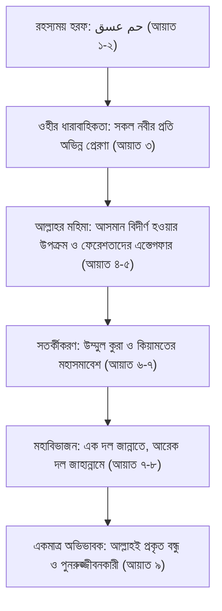

# আশ-শূরা — রুকু ০১ (আয়াত ১–৯)

[সূচিপত্র](00_সূরা-পরিচিতি.md)

---

## ৫-স্তরবিশিষ্ট একাডেমিক যাচাইকরণ স্ট্যাটাস (Verification Status Box)

| স্তর (Tier) | অবস্থা | বিবরণ ও যাচাইয়ের পরিসর |
| :---: | :---: | :--- |
| **স্তর ১: Draft** | সম্পন্ন | ১৬ অধ্যায়ের কাঠামো ও প্রাথমিক তথ্য সংকলিত। |
| **স্তর ২: Digital Verified** | **যাচাইকৃত** | আয়াতের মূল পাঠ ও শব্দ-হরফ গণনা `bahouth` স্ক্রিপ্ট দ্বারা যাচাইকৃত; কিরাআত সারণি ও তুরাছ উদ্ধৃতিসমূহ ডিজিটাল ডাটাবেজের সাথে মিলিয়ে সংকলিত (কাঁচা স্ন্যাপশট সংরক্ষিত: `_sources/ruku_01_raw.json`)। |
| **স্তর ৩: Print Verified** | উন্মুক্ত (`[ ]`) | মুদ্রিত সংস্করণের ভৌত পৃষ্ঠার সাথে চাক্ষুষ মিলকরণের অপেক্ষায়। |
| **স্তর ৪: Scholarly Reviewed** | উন্মুক্ত (`[ ]`) | আকীদাগত ও তাফসীরী তারজীহ বিশেষজ্ঞ মুহাক্কিক আলেম কর্তৃক পর্যালোচনার অপেক্ষায়। |
| **স্তর ৫: Publication Ready** | উন্মুক্ত (`[ ]`) | চূড়ান্ত প্রকাশনা উপযোগী মাস্টার রেফারেন্স। |

---

## ০. রুকুর সারসংক্ষেপ ও কেন্দ্রীয় বক্তব্য (মাকাসিদ)

### প্রধান আত্মিক বার্তাসমূহ:
১. যুগে যুগে আগত সমস্ত ওহীর মূল শিকড় এক: এক আল্লাহর ইবাদত ও পরকালীন জবাবদিহিতা।
২. আসমান ও পৃথিবীর বিশালতা আল্লাহর মহত্ত্বের সামনে অত্যন্ত তুচ্ছ; তাঁর ভয়ে আসমানসমূহ ফেটে পড়ার উপক্রম হয়।
৩. ফেরেশতারা মুমিন বান্দাদের জন্য প্রতিনিয়ত আল্লাহর দরবারে ক্ষমা প্রার্থনা করতে থাকে।
৪. কিয়ামতের দিন মানুষের পার্থিব দল ও পরিচয় বিলুপ্ত হয়ে মানুষ কেবল জান্নাতী ও জাহান্নামী—এই দুই দলে বিভক্ত হবে।
৫. আল্লাহ ছাড়া আর কোনো অভিভাবক বা রক্ষাকর্তা নেই; তাই একমাত্র তাঁরই ওপর ভরসা করা মুমিনের কর্তব্য।

---

---

## ১. আয়াতের মূল পাঠ ও অনুবাদ

### (১) ১ আরবি পাঠ (হরকতযুক্ত সাধারণ আরবি বানান; পূর্ণ উসমানী রসম নয়)

> [!NOTE]
> নিচে প্রদত্ত পাঠটি হরকতযুক্ত সাধারণ আরবি বানানরীতিতে সাজানো হয়েছে; এটি ক্যালিগ্রাফিক পূর্ণ উসমানী রসম নয়। প্রামাণ্য উসমানী পাঠের জন্য মুসহাফের পৃষ্ঠা দ্রষ্টব্য।

﴿حم ۝1
عسق ۝2
كَذَلِكَ يُوحِي إِلَيْكَ وَإِلَى الَّذِينَ مِنْ قَبْلِكَ اللَّهُ الْعَزِيزُ الْحَكِيمُ ۝3
لَهُ مَا فِي السَّمَاوَاتِ وَمَا فِي الْأَرْضِ وَهُوَ الْعَلِيُّ الْعَظِيمُ ۝4
تَكَادُ السَّمَاوَاتُ يَتَفَطَّرْنَ مِنْ فَوْقِهِنَّ وَالْمَلَائِكَةُ يُسَبِّحُونَ بِحَمْدِ رَبِّهِمْ وَيَسْتَغْفِرُونَ لِمَنْ فِي الْأَرْضِ أَلَا إِنَّ اللَّهَ هُوَ الْغَفُورُ الرَّحِيمُ ۝5
وَالَّذِينَ اتَّخَذُوا مِنْ دُونِهِ أَوْلِيَاءَ اللَّهُ حَفِيظٌ عَلَيْهِمْ وَمَا أَنْتَ عَلَيْهِمْ بِوَكِيلٍ ۝6
وَكَذَلِكَ أَوْحَيْنَا إِلَيْكَ قُرْآنًا عَرَبِيًّا لِتُنْذِرَ أُمَّ الْقُرَى وَمَنْ حَوْلَهَا وَتُنْذِرَ يَوْمَ الْجَمْعِ لَا رَيْبَ فِيهِ فَرِيقٌ فِي الْجَنَّةِ وَفَرِيقٌ فِي السَّعِيرِ ۝7
وَلَوْ شَاءَ اللَّهُ لَجَعَلَهُمْ أُمَّةً وَاحِدَةً وَلَكِنْ يُدْخِلُ مَنْ يَشَاءُ فِي رَحْمَتِهِ وَالظَّالِمُونَ مَا لَهُمْ مِنْ وَلِيٍّ وَلَا نَصِيرٍ ۝8
أَمْ اتَّخَذُوا مِنْ دُونِهِ أَوْلِيَاءَ فَاللَّهُ هُوَ الْوَلِيُّ وَهُوَ يُحْيِي الْمَوْتَى وَهُوَ عَلَى كُلِّ شَيْءٍ قَدِيرٌ ۝9﴾

### (১) ২ শব্দানুগ ও সাবলীল অনুবাদ

| আয়াত | মূল আরবী পাঠ | সাবলীল বঙ্গানুবাদ |
| :---: | :--- | :--- |
| **১** | ﴿حم﴾ | হা-মীম। |
| **২** | ﴿عسق﴾ | ‘আইন-সীন-ক্বাফ। |
| **৩** | ﴿كَذَلِكَ يُوحِي إِلَيْكَ وَإِلَى الَّذِينَ مِنْ قَبْلِكَ اللَّهُ الْعَزِيزُ الْحَكِيمُ﴾ | এভাবেই পরাক্রমশালী, প্রজ্ঞাময় আল্লাহ আপনার প্রতি এবং আপনার পূর্ববর্তীদের প্রতি ওহী প্রেরণ করেন। |
| **৪** | ﴿لَهُ مَا فِي السَّمَاوَاتِ وَمَا فِي الْأَرْضِ وَهُوَ الْعَلِيُّ الْعَظِيمُ﴾ | আকাশমণ্ডলী ও পৃথিবীতে যা কিছু রয়েছে তা কেবল তাঁরই; এবং তিনিই তো সুউচ্চ, মহামহিম। |
| **৫** | ﴿تَكَادُ السَّمَاوَاتُ يَتَفَطَّرْنَ مِنْ فَوْقِهِنَّ وَالْمَلَائِكَةُ يُسَبِّحُونَ بِحَمْدِ رَبِّهِمْ وَيَسْتَغْفِرُونَ لِمَنْ فِي الْأَرْضِ أَلَا إِنَّ اللَّهَ هُوَ الْغَفُورُ الرَّحِيمُ﴾ | তাঁর মহিমা ও ভয়ে আসমানসমূহ যেন তাদের উপরিভাগ হতে বিদীর্ণ হয়ে পড়ার উপক্রম হয়; এবং ফেরেশতাগণ তাদের প্রতিপালকের সপ্রশংস পবিত্রতা মহিমা ঘোষণা করে এবং পৃথিবীতে যারা রয়েছে তাদের জন্য ক্ষমা প্রার্থনা করে। জেনে রেখো! নিশ্চয় আল্লাহ, তিনিই তো পরম ক্ষমাশীল, পরম দয়ালু। |
| **৬** | ﴿وَالَّذِينَ اتَّخَذُوا مِنْ دُونِهِ أَوْلِيَاءَ اللَّهُ حَفِيظٌ عَلَيْهِمْ وَمَا أَنْتَ عَلَيْهِمْ بِوَكِيلٍ﴾ | আর যারা আল্লাহ ব্যতীত অন্যদের অভিভাবকরূপে গ্রহণ করে, আল্লাহ তাদের প্রত্যক্ষ পর্যবেক্ষক; এবং আপনি তাদের কর্মবিধায়ক বা দায়িত্বশীল নন। |
| **৭** | ﴿وَكَذَلِكَ أَوْحَيْنَا إِلَيْكَ قُرْآنًا عَرَبِيًّا لِتُنْذِرَ أُمَّ الْقُرَى وَمَنْ حَوْلَهَا وَتُنْذِرَ يَوْمَ الْجَمْعِ لَا رَيْبَ فِيهِ فَرِيقٌ فِي الْجَنَّةِ وَفَرِيقٌ فِي السَّعِيرِ﴾ | আর এভাবেই আমি আপনার প্রতি আরবী ভাষায় কুরআন ওহী করেছি, যাতে আপনি সতর্ক করতে পারেন উম্মুল কুরাকে (মক্কাবাসীকে) এবং এর চতুষ্পার্শ্বের মানবজাতিকে; এবং সতর্ক করতে পারেন একত্রিত হওয়ার দিন (কিয়ামত) সম্পর্কে, যাতে কোনো সন্দেহ নেই। সেদিন এক দল থাকবে জান্নাতে এবং আরেক দল প্রজ্বলিত জাহান্নামের আগুনে। |
| **৮** | ﴿وَلَوْ شَاءَ اللَّهُ لَجَعَلَهُمْ أُمَّةً وَاحِدَةً وَلَكِنْ يُدْخِلُ مَنْ يَشَاءُ فِي رَحْمَتِهِ وَالظَّالِمُونَ مَا لَهُمْ مِنْ وَلِيٍّ وَلَا نَصِيرٍ﴾ | আর আল্লাহ ইচ্ছা করলে তাদের সকলকে এক উম্মতে পরিণত করতে পারতেন; কিন্তু তিনি যাকে ইচ্ছা স্বীয় রহমতে দাখিল করেন; আর জালিমদের কোনো অভিভাবক নেই এবং কোনো সাহায্যকারীও নেই। |
| **৯** | ﴿أَمْ اتَّخَذُوا مِنْ دُونِهِ أَوْلِيَاءَ فَاللَّهُ هُوَ الْوَلِيُّ وَهُوَ يُحْيِي الْمَوْتَى وَهُوَ عَلَى كُلِّ شَيْءٍ قَدِيرٌ﴾ | তবে কি তারা আল্লাহকে বাদ দিয়ে অন্যদের অভিভাবকরূপে গ্রহণ করেছে? বস্তুত আল্লাহই তো একমাত্র প্রকৃত অভিভাবক; এবং তিনিই তো মৃতদের পুনরুজ্জীবিত করেন এবং তিনি সর্ববিষয়ে সর্বশক্তিমান। |

---

## ২. লুগাভী ও সরফী তাহকীক এবং মুফরাদাতুল কুরআন

| শব্দ | মূলধাতু | সীগা / ওযন | আভিধানিক অর্থ | কুরআনিক প্রয়োগ ও তাৎপর্য |
| :--- | :---: | :---: | :--- | :--- |
| **حم عسق** | `حوم` / `عسق` | حروف مقطعة | হা-মীম, ‘আইন-সীন-ক্বাফ | কালামুল্লাহর অতুলনীয় অলৌকিকতা ও ঐশী সূচনার গূঢ় সংকেত। |
| **يُوحِي** | `وحي` | فعل مضارع (إفْعَال) | ওহী অবতীর্ণ করেন | মানবজাতির হেদায়েতের জন্য ধারাবাহিকভাবে নবীগণের প্রতি প্রত্যাদেশ পাঠানো। |
| **يَتَفَطَّرْنَ** | `فطر` | فعل مضارع (تَفَعُّل) | ফেটে বিদীর্ণ হওয়ার উপক্রম হওয়া | মহান আল্লাহর মহিমা ও পরাক্রমের ভয়ে আসমানসমূহের কেঁপে ওঠার দৃশ্য। |
| **حَفِيظٌ عَلَيْهِمْ** | `حفظ` | صفة مشبهة | তাদের প্রত্যক্ষ তত্ত্বাবধায়ক | শিরককারীদের যাবতীয় অপকর্ম ও বিচ্যুতির ওপর আল্লাহর সতর্ক দৃষ্টি। |
| **أُمَّ الْقُرَىٰ** | `أمم` / `قري` | مركب إضافي مفعول به | জনপদসমূহের মূল কেন্দ্র | পবিত্র মক্কা মুকাররামা এবং তার চারপাশের বিশ্বমানবতাকে সতর্কীকরণ। |
| **يَوْمَ الْجَمْعِ** | `جمع` | مركب إضافي مفعول به | মহাসম্মেলনের দিন | কিয়ামতের দিন প্রথম থেকে শেষ পর্যন্ত সকল মানুষের সমবেত হওয়ার দিবস। |
| **السَّعِيرِ** | `سعر` | اسم علم للنار (فَعِيل) | প্রজ্বলিত লেলিহান অগ্নি | জাহান্নামের উত্তপ্ত আগুনের সীমাহীন ভয়াবহতা ও কাফিরদের ঠিকানা। |
| **الْوَلِيُّ** | `ولي` | صفة مشبهة (فَعِيل) | প্রকৃত একক অভিভাবক | আসমান ও জমিনের সার্বভৌম একমাত্র রক্ষক ও সাহায্যকারী সত্তা। |

---

## ৩. ই'রাব ও নাহবী বিশ্লেষণ

1. **﴿كَذَلِكَ يُوحِي إِلَيْكَ وَإِلَى الَّذِينَ مِنْ قَبْلِكَ اللَّهُ الْعَزِيزُ الْحَكِيمُ﴾ (আয়াত ৩):**
   - `كَذَلِكَ`: কাফ তাশবীহ যার; মুবতাদা বা মাফ‘ঊল মুতলাক্ব মাহযূফের সাথে মুতা‘আল্লিক্ব (إيحاءً مثلَ ذلك الإيحاء)।
   - `يُوحِي`: ফে‘লে মুযারে মারফূ‘ তাক্বদীরান; `اللَّهُ`: ফায়েল মারফূ‘ بالضمة; `الْعَزِيزُ الْحَكِيمُ` দুটি সিফাত। (ইবনে কাসীরের কিরাআতে `يُوحَى` মাজহূল ও `اللَّهَ` মাফ‘ঊল বিহি মানসূব)।

2. **﴿تَكَادُ السَّمَاوَاتُ يَتَفَطَّرْنَ مِنْ فَوْقِهِنَّ﴾ (আয়াত ৫):**
   - `تَكَادُ`: ফে‘লে মুক্বারাবাহ নাক্বিস মারফূ‘; `السَّمَاوَاتُ` ইসমু তাকাদু মারফূ‘; `يَتَفَطَّرْنَ` জুমলায়ে ফে‘লিয়্যাহ হলো খবর মানসূব। নাফে‘ ও হামযাহর কিরাআতে মুযাক্কার `يَكَادُ`।
   - `مِنْ فَوْقِهِنَّ`: যার ও মাজরুর ফে‘লের সাথে মুতা‘আল্লিক্ব।

3. **﴿فَرِيقٌ فِي الْجَنَّةِ وَفَرِيقٌ فِي السَّعِيرِ﴾ (আয়াত ৭):**
   - `فَرِيقٌ`: মুবতাদা মারফূ‘ بالضمة; বিভাজন ও পার্থক্যের কারণে নাকেরা দ্বারা সূচনা বৈধ হয়েছে।
   - `فِي الْجَنَّةِ`: যার ও মাজরুর খবর মাহযূফের সাথে মুতা‘আল্লিক্ব; পরবর্তী বাক্য মা‘তূফ।

---

## ৪. কিরাআত ও তাফসীরে প্রভাব

### ৪.১ প্রামাণ্য ১০ মুতাওয়াতির কিরাআত সারণি (মাদীনা মুনাওয়ারা বাহাউথ ডেটাবেস)

| আয়াত | শব্দ (ক্রম) | ক্বারী / রাবী (বাহাউথ) | কিরাআতের পাঠভেদ ও নিয়ম (অবিকৃত মূল পাঠ) |
| :---: | :--- | :--- | :--- |
| **1** | ﴿حم﴾ (1) | قالون عن نافع وَابن كثير وَيعقوب وَهشام عن ابن عامر وَحفص عن عاصم | قرأ بفتح الحاء. |
| **1** | ﴿حم﴾ (1) | ورش عن نافع وَأبو عمرو | قرأ بتقليل الحاء. |
| **1** | ﴿حم﴾ (1) | أبو جعفر | قرأ بفتح الحاء، مع السكت على الحاء والميم. |
| **1** | ﴿حم﴾ (1) | باقي الرواة | قرؤوا بإمالة الحاء. |
| **2** | ﴿عسق﴾ (1) | أبو جعفر | قرأ بالسكت على حروف الهجاء. |
| **2** | ﴿عسق﴾ (1) | باقي الرواة | قرؤوا بترك السكت على حروف الهجاء. |
| **3** | ﴿يُوحِي﴾ (2) | ابن كثير | قرأ بفتح الحاء وألف بعدها. |
| **3** | ﴿يُوحِي﴾ (2) | باقي الرواة | قرؤوا بكسر الحاء وياء بعدها. |
| **3** | ﴿وَإِلَى﴾ (4) | حمزة | قرأ بتحقيق الهمزة وصلاً، ووقف بتسهيل وتحقيق الهمزة. |
| **3** | ﴿وَإِلَى﴾ (4) | باقي الرواة | قرؤوا بتحقيق الهمزة وصلاً ووقفا. |
| **4** | ﴿الْأَرْضِ﴾ (7) | ورش عن نافع | قرأ بالنقل مع ترك السكت. |
| **4** | ﴿الْأَرْضِ﴾ (7) | خلف عن حمزة | قرأ بالسكت وصلاً، ووقف بالسكت والنقل. |
| **4** | ﴿الْأَرْضِ﴾ (7) | خلاد عن حمزة | قرأ بالسكت وعدمه وصلاً، ووقف بالسكت والنقل. |
| **4** | ﴿الْأَرْضِ﴾ (7) | باقي الرواة | قرؤوا بترك السكت مع تحقيق الهمزة وصلاً ووقفا. |
| **4** | ﴿وَهُوَ﴾ (8) | قالون عن نافع وَأبو جعفر وَأبو عمرو وَالكسائي | قرأ بإسكان الهاء، مع ترك الوقف بهاء السكت. |
| **4** | ﴿وَهُوَ﴾ (8) | يعقوب | قرأ بضم الهاء مع الوقف بهاء السكت باتفاق. |
| **4** | ﴿وَهُوَ﴾ (8) | باقي الرواة | قرؤوا بضم الهاء وصلاً ووقفا. |
| **5** | ﴿تَكَادُ﴾ (1) | نافع وَالكسائي | قرأ بالياء على التذكير. |
| **5** | ﴿تَكَادُ﴾ (1) | باقي الرواة | قرؤوا بتاء التأنيث. |
| **5** | ﴿يَتَفَطَّرْنَ﴾ (3) | أبو عمرو وَيعقوب وَشعبة عن عاصم | قرأ بفتح الياء، ونون ساكنة، وكسر الطاء مخففة. |
| **5** | ﴿يَتَفَطَّرْنَ﴾ (3) | باقي الرواة | قرؤوا بفتح الياء والتاء، وفتح الطاء مشددة. |
| **5** | ﴿فَوْقِهِنَّ﴾ (5) | يعقوب | قرأ بهاء السكت وقفا. |
| **5** | ﴿فَوْقِهِنَّ﴾ (5) | باقي الرواة | قرؤوا بترك هاء السكت وقفا. |
| **5** | ﴿وَالْمَلَائِكَةُ﴾ (6) | حمزة | قرأ بتحقيق الهمزة وصلاً، ووقف بتسهيل الهمزة مع المد والقصر، مع فتح هاء التأنيث وقفا. |
| **5** | ﴿وَالْمَلَائِكَةُ﴾ (6) | الكسائي | قرأ بتحقيق الهمزة في الحالين، مع إمالة هاء التأنيث وقفا. |
| **5** | ﴿وَالْمَلَائِكَةُ﴾ (6) | باقي الرواة | قرؤوا بتحقيق الهمزة في الحالين، مع فتح هاء التأنيث. |
| **5** | ﴿رَبِّهِمْ﴾ (9) | قالون عن نافع | قرأ بصلة ميم الجمع وصلاً بخلف عنه. |
| **5** | ﴿رَبِّهِمْ﴾ (9) | أبو جعفر وَابن كثير | قرأ بصلة ميم الجمع وصلا. |
| **5** | ﴿رَبِّهِمْ﴾ (9) | باقي الرواة | قرؤوا بترك صلة ميم الجمع. |
| **5** | ﴿وَيَسْتَغْفِرُونَ﴾ (10) | ورش عن نافع | قرأ بترقيق الراء في الحالين. |
| **5** | ﴿وَيَسْتَغْفِرُونَ﴾ (10) | باقي الرواة | قرؤوا بتفخيم الراء. |
| **5** | ﴿الْأَرْضِ﴾ (13) | ورش عن نافع | قرأ بالنقل مع ترك السكت. |
| **5** | ﴿الْأَرْضِ﴾ (13) | خلف عن حمزة | قرأ بالسكت وصلاً، ووقف بالسكت والنقل. |
| **5** | ﴿الْأَرْضِ﴾ (13) | خلاد عن حمزة | قرأ بالسكت وعدمه وصلاً، ووقف بالسكت والنقل. |
| **5** | ﴿الْأَرْضِ﴾ (13) | باقي الرواة | قرؤوا بترك السكت مع تحقيق الهمزة وصلاً ووقفا. |
| **5** | ﴿اللَّهَ﴾ (16) | السوسي عن أبي عمرو | قرأ بالإدغام الكبير. |
| **5** | ﴿اللَّهَ﴾ (16) | باقي الرواة | قرؤوا بالإظهار. |
| **5** | ﴿هُوَ﴾ (17) | يعقوب | وقف بهاء السكت باتفاق. |
| **5** | ﴿هُوَ﴾ (17) | باقي الرواة | وقف بترك هاء السكت. |
| **6** | ﴿أَوْلِيَاءَ﴾ (5) | هشام عن ابن عامر وَحمزة | قرأ بتحقيق الهمزة وصلاً، ووقف بإبدال الهمزة ألفاً مع القصر والتوسط والطول. |
| **6** | ﴿أَوْلِيَاءَ﴾ (5) | باقي الرواة | قرؤوا بتحقيق الهمزة المتطرفة وصلاً ووقفا. |
| **6** | ﴿عَلَيْهِمْ﴾ (8) | يعقوب وَحمزة | قرأ بضم هاء الضمير وصلاً ووقفا. |
| **6** | ﴿عَلَيْهِمْ﴾ (8) | باقي الرواة | قرؤوا بكسر هاء الضمير وصلاً ووقفا. |
| **6** | ﴿عَلَيْهِمْ﴾ (8) | قالون عن نافع | قرأ بصلة ميم الجمع وصلاً بخلف عنه. |
| **6** | ﴿عَلَيْهِمْ﴾ (8) | أبو جعفر وَابن كثير | قرأ بصلة ميم الجمع وصلا. |
| **6** | ﴿عَلَيْهِمْ﴾ (8) | باقي الرواة | قرؤوا بترك صلة ميم الجمع. |
| **6** | ﴿عَلَيْهِمْ﴾ (11) | يعقوب وَحمزة | قرأ بضم هاء الضمير وصلاً ووقفا. |
| **6** | ﴿عَلَيْهِمْ﴾ (11) | باقي الرواة | قرؤوا بكسر هاء الضمير وصلاً ووقفا. |
| **6** | ﴿عَلَيْهِمْ﴾ (11) | قالون عن نافع | قرأ بصلة ميم الجمع وصلاً بخلف عنه. |
| **6** | ﴿عَلَيْهِمْ﴾ (11) | أبو جعفر وَابن كثير | قرأ بصلة ميم الجمع وصلا. |
| **6** | ﴿عَلَيْهِمْ﴾ (11) | باقي الرواة | قرؤوا بترك صلة ميم الجمع. |
| **6** | ﴿بِوَكِيلٍ﴾ (12) | خلف عن حمزة | قرأ بالإدغام مع ترك الغنة. |
| **6** | ﴿بِوَكِيلٍ﴾ (12) | باقي الرواة | قرؤوا بالإدغام مع الغنة. |
| **7** | ﴿قُرْآنًا﴾ (4) | ابن كثير | قرأ بنقل حركة الهمزة وصلاً ووقفا. |
| **7** | ﴿قُرْآنًا﴾ (4) | حمزة | قرأ بتحقيق الهمزة وصلاً، ووقف بالنقل. |
| **7** | ﴿قُرْآنًا﴾ (4) | باقي الرواة | قرؤوا بتحقيق الهمزة وصلاً ووقفا. |
| **7** | ﴿لِتُنْذِرَ﴾ (6) | ورش عن نافع | قرأ بترقيق الراء في الحالين. |
| **7** | ﴿لِتُنْذِرَ﴾ (6) | باقي الرواة | قرؤوا بتفخيم الراء. |
| **7** | ﴿الْقُرَى﴾ (8) | ورش عن نافع | قرأ بالتقليل بلا خلاف عنه. |
| **7** | ﴿الْقُرَى﴾ (8) | أبو عمرو وَحمزة وَالكسائي وَخلف العاشر | قرأ بالإمالة بلا خلاف عنه. |
| **7** | ﴿الْقُرَى﴾ (8) | باقي الرواة | قرؤوا بالفتح بلا خلاف عنه. |
| **7** | ﴿وَتُنْذِرَ﴾ (11) | ورش عن نافع | قرأ بترقيق الراء في الحالين. |
| **7** | ﴿وَتُنْذِرَ﴾ (11) | باقي الرواة | قرؤوا بتفخيم الراء. |
| **7** | ﴿فِيهِ﴾ (16) | ابن كثير | قرأ بصلة هاء الضمير خلافا لجمهور القراء. |
| **7** | ﴿فِيهِ﴾ (16) | باقي الرواة | قرؤوا بترك الصلة مع قصر الهاء. |
| **7** | ﴿الْجَنَّةِ﴾ (19) | الكسائي | قرأ بإمالة هاء التأنيث وقفا. |
| **7** | ﴿الْجَنَّةِ﴾ (19) | باقي الرواة | قرؤوا بفتح هاء التأنيث. |
| **8** | ﴿شَاءَ﴾ (2) | هشام عن ابن عامر | قرأ بتحقيق الهمزة وصلاً، ووقف بإبدال الهمزة ألفاً مع القصر والتوسط والطول. |
| **8** | ﴿شَاءَ﴾ (2) | ابن ذكوان عن ابن عامر وَخلف العاشر | قرأ بالإمالة، مع تحقيق الهمزة. |
| **8** | ﴿شَاءَ﴾ (2) | حمزة | قرأ بالإمالة مع تحقيق الهمزة وصلاً، ووقف بإبدال الهمزة ألفاً مع القصر والتوسط والطول. |
| **8** | ﴿شَاءَ﴾ (2) | باقي الرواة | قرؤوا بالفتح مع تحقيق الهمزة وصلاً ووقفا. |
| **8** | ﴿لَجَعَلَهُمْ﴾ (4) | قالون عن نافع | قرأ بصلة ميم الجمع وصلاً بخلف عنه. |
| **8** | ﴿لَجَعَلَهُمْ﴾ (4) | ورش عن نافع | قرأ بصلة ميم الجمع وصلاً مع الإشباع. |
| **8** | ﴿لَجَعَلَهُمْ﴾ (4) | أبو جعفر وَابن كثير | قرأ بصلة ميم الجمع وصلا. |
| **8** | ﴿لَجَعَلَهُمْ﴾ (4) | خلف عن حمزة | قرأ بالسكت وعدمه وصلاً ووقفا. |
| **8** | ﴿لَجَعَلَهُمْ﴾ (4) | باقي الرواة | قرؤوا بترك السكت، وإسكان ميم الجمع وصلاً ووقفا. |
| **8** | ﴿أُمَّةً﴾ (5) | الكسائي | قرأ بإمالة هاء التأنيث وقفا. |
| **8** | ﴿أُمَّةً﴾ (5) | باقي الرواة | قرؤوا بفتح هاء التأنيث. |
| **8** | ﴿أُمَّةً﴾ (5) | خلف عن حمزة | قرأ بالإدغام مع ترك الغنة. |
| **8** | ﴿أُمَّةً﴾ (5) | باقي الرواة | قرؤوا بالإدغام مع الغنة. |
| **8** | ﴿وَاحِدَةً﴾ (6) | الكسائي | قرأ بإمالة هاء التأنيث وقفا. |
| **8** | ﴿وَاحِدَةً﴾ (6) | باقي الرواة | قرؤوا بفتح هاء التأنيث. |
| **8** | ﴿وَاحِدَةً﴾ (6) | خلف عن حمزة | قرأ بالإدغام مع ترك الغنة. |
| **8** | ﴿وَاحِدَةً﴾ (6) | باقي الرواة | قرؤوا بالإدغام مع الغنة. |
| **8** | ﴿وَلَكِنْ﴾ (7) | خلف عن حمزة | قرأ بالإدغام مع ترك الغنة. |
| **8** | ﴿وَلَكِنْ﴾ (7) | باقي الرواة | قرؤوا بالإدغام مع الغنة. |
| **8** | ﴿مَنْ﴾ (9) | خلف عن حمزة | قرأ بالإدغام مع ترك الغنة. |
| **8** | ﴿مَنْ﴾ (9) | باقي الرواة | قرؤوا بالإدغام مع الغنة. |
| **8** | ﴿يَشَاءُ﴾ (10) | هشام عن ابن عامر وَحمزة | قرأ بتحقيق الهمزة المتطرفة وصلاً، ووقف بالإبدال مع القصر والتوسط والطول، وتسهيل الهمزة بالروم على المد والقصر. |
| **8** | ﴿يَشَاءُ﴾ (10) | باقي الرواة | قرؤوا بتحقيق الهمزة المتطرفة وصلاً ووقفا. |
| **8** | ﴿لَهُمْ﴾ (15) | قالون عن نافع | قرأ بصلة ميم الجمع وصلاً بخلف عنه. |
| **8** | ﴿لَهُمْ﴾ (15) | أبو جعفر وَابن كثير | قرأ بصلة ميم الجمع وصلا. |
| **8** | ﴿لَهُمْ﴾ (15) | باقي الرواة | قرؤوا بترك صلة ميم الجمع. |
| **8** | ﴿مِنْ﴾ (16) | خلف عن حمزة | قرأ بالإدغام مع ترك الغنة. |
| **8** | ﴿مِنْ﴾ (16) | باقي الرواة | قرؤوا بالإدغام مع الغنة. |
| **8** | ﴿وَلِيٍّ﴾ (17) | خلف عن حمزة | قرأ بالإدغام مع ترك الغنة. |
| **8** | ﴿وَلِيٍّ﴾ (17) | باقي الرواة | قرؤوا بالإدغام مع الغنة. |
| **8** | ﴿نَصِيرٍ﴾ (19) | ورش عن نافع | قرأ بالنقل وصلاً ووقفا. |
| **8** | ﴿نَصِيرٍ﴾ (19) | خلف عن حمزة | قرأ بالسكت وعدمه وصلاً، ووقف بالسكت، والنقل، وتركهما. |
| **8** | ﴿نَصِيرٍ﴾ (19) | خلاد عن حمزة | قرأ بترك السكت وصلاً، ووقف بالنقل والتحقيق. |
| **8** | ﴿نَصِيرٍ﴾ (19) | باقي الرواة | قرؤوا بترك السكت مع تحقيق الهمزة وصلاً ووقفا. |
| **9** | ﴿أَوْلِيَاءَ﴾ (5) | هشام عن ابن عامر وَحمزة | قرأ بتحقيق الهمزة وصلاً، ووقف بإبدال الهمزة ألفاً مع القصر والتوسط والطول. |
| **9** | ﴿أَوْلِيَاءَ﴾ (5) | باقي الرواة | قرؤوا بتحقيق الهمزة المتطرفة وصلاً ووقفا. |
| **9** | ﴿فَاللَّهُ﴾ (6) | السوسي عن أبي عمرو | قرأ بالإدغام الكبير. |
| **9** | ﴿فَاللَّهُ﴾ (6) | باقي الرواة | قرؤوا بالإظهار. |
| **9** | ﴿هُوَ﴾ (7) | يعقوب | وقف بهاء السكت باتفاق. |
| **9** | ﴿هُوَ﴾ (7) | باقي الرواة | وقف بترك هاء السكت. |
| **9** | ﴿وَهُوَ﴾ (9) | قالون عن نافع وَأبو جعفر وَأبو عمرو وَالكسائي | قرأ بإسكان الهاء، مع ترك الوقف بهاء السكت. |
| **9** | ﴿وَهُوَ﴾ (9) | يعقوب | قرأ بضم الهاء مع الوقف بهاء السكت باتفاق. |
| **9** | ﴿وَهُوَ﴾ (9) | باقي الرواة | قرؤوا بضم الهاء وصلاً ووقفا. |
| **9** | ﴿الْمَوْتَى﴾ (11) | ورش عن نافع | قرأ بالتقليل بخلف عنه. |
| **9** | ﴿الْمَوْتَى﴾ (11) | أبو عمرو | قرأ بالتقليل بلا خلاف عنه. |
| **9** | ﴿الْمَوْتَى﴾ (11) | حمزة وَالكسائي وَخلف العاشر | قرأ بالإمالة وصلاً ووقفا. |
| **9** | ﴿الْمَوْتَى﴾ (11) | باقي الرواة | قرؤوا بالفتح وصلاً ووقفا. |
| **9** | ﴿وَهُوَ﴾ (12) | قالون عن نافع وَأبو جعفر وَأبو عمرو وَالكسائي | قرأ بإسكان الهاء، مع ترك الوقف بهاء السكت. |
| **9** | ﴿وَهُوَ﴾ (12) | يعقوب | قرأ بضم الهاء مع الوقف بهاء السكت باتفاق. |
| **9** | ﴿وَهُوَ﴾ (12) | باقي الرواة | قرؤوا بضم الهاء وصلاً ووقفا. |
| **9** | ﴿شَيْءٍ﴾ (15) | ورش عن نافع | قرأ بتوسط وإشباع مد اللين المهموز. |
| **9** | ﴿شَيْءٍ﴾ (15) | هشام عن ابن عامر | قرأ بتحقيق الهمزة وصلاً، ووقف بالنقل، وبالإبدال مع الإدغام، مع السكون المحض والروم. |
| **9** | ﴿شَيْءٍ﴾ (15) | خلف عن حمزة | قرأ بالسكت وصلاً، ووقف بالنقل، وبالإبدال مع الإدغام، وعلى الوجهين السكون المحض والروم. |
| **9** | ﴿شَيْءٍ﴾ (15) | خلاد عن حمزة | قرأ بالسكت وعدمه وصلاً، ووقف بالنقل، وبالإبدال مع الإدغام، وعلى الوجهين السكون المحض والروم. |
| **9** | ﴿شَيْءٍ﴾ (15) | باقي الرواة | قرؤوا بتحقيق الهمزة، وترك السكت، مع قصر مد اللين. |
| **9** | ﴿قَدِيرٌ﴾ (16) | ورش عن نافع | قرأ بترقيق الراء في الحالين. |
| **9** | ﴿قَدِيرٌ﴾ (16) | باقي الرواة | قرؤوا بتفخيم الراء. |
| **9** | ﴿قَدِيرٌ﴾ (16) | خلف عن حمزة | قرأ بالإدغام مع ترك الغنة. |
| **9** | ﴿قَدِيرٌ﴾ (16) | باقي الرواة | قرؤوا بالإدغام مع الغنة. |

### ৪.২ তাফসীর ও ফিকহে কিরাআতের প্রভাব
- **উসূলী পর্যালোচনা:** উদ্ধৃত কিরাআতসমূহ দশ মুতাওয়াতির ক্বারী ও তাঁদের রাবীদের প্রামাণিক সনদে প্রমাণিত।
- **অর্থগত বৈচিত্র্য:** শব্দের তাশদীদ, তাখফীফ, ইমালাহ এবং ইবদালের মাধ্যমে আয়াতসমূহের অর্থের গভীরতা ও তাৎপর্য সম্প্রসারিত হয়েছে, যা তাফসীর ও আহকামে পারস্পরিক পরিপূরক অর্থ প্রকাশ করে।

---
*উৎস সনদ:* শায়খ মুহাম্মদ ইব্রাহীম সালিম, *ফারীদাতুদ দাহর*, খণ্ড ৪ (`turath:29909`); ইমাম ইবনে যানযালাহ, *হুজ্জাতুল কিরাআত*, খণ্ড ১ (`turath:5531`); মাদীনা মুনাওয়ারা বাহাউথ প্রজেক্ট (`bahouth:list_verse_qiraat`)।

---

## ৫. তাফসীরুল জালালাইন ও তুলনামূলক তাফসীর

### (৫) ১ তাফসীরুল জালালাইন

### মূল আরবী পাঠ (তাফসীরে জালালাইন - ইমাম জালালুদ্দীন আল-মহাল্লী)
> **{حم عسق}** اللَّهُ أَعْلَمُ بِمُرَادِهِ بِذَلِكَ. **{كَذَٰلِكَ}** الْإِيحَاءَ **{يُوحِي}** بِالْيَاءِ، وَقُرِئَ بِالْفَتْحِ مَبْنِيًّا لِلْمَفْعُولِ **{إِلَيْكَ وَإِلَى الَّذِينَ مِن قَبْلِكَ اللَّهُ}** الْفَاعِلُ **{الْعَزِيزُ}** فِي مُلْكِهِ **{الْحَكِيمُ}** فِي صُنْعِهِ. **{لَهُ مَا فِي السَّمَاوَاتِ وَمَا فِي الْأَرْضِ}** خَلْقًا وَمُلْكًا **{وَهُوَ الْعَلِيُّ}** فَوْقَ خَلْقِهِ **{الْعَظِيمُ}** الْكَبِيرُ. **{تَكَادُ}** بِالتَّاءِ وَالْيَاءِ **{السَّمَاوَاتُ يَتَفَطَّرْنَ}** يَتَشَقَّقْنَ، وَقُرِئَ يَنْفَطِرْنَ **{مِن فَوْقِهِنَّ}** أَيْ يَنْشَقُّ كُلُّ وَاحِدٍ مِنْهَا فَوْقَ الَّذِي يَلِيهِ مِنْ هَيْبَةِ اللَّهِ وَعَظَمَتِهِ **{وَالْمَلَائِكَةُ يُسَبِّحُونَ بِحَمْدِ رَبِّهِمْ}** مُلَابِسِينَ لِلْحَمْدِ **{وَيَسْتَغْفِرُونَ لِمَن فِي الْأَرْضِ}** مِنَ الْمُؤْمِنِينَ **{أَلَا إِنَّ اللَّهَ هُوَ الْغَفُورُ الرَّحِيمُ}**.
> **{وَالَّذِينَ اتَّخَذُوا مِن دُونِهِ}** مِنَ الْأَصْنَامِ **{أَوْلِيَاءَ اللَّهُ حَفِيظٌ عَلَيْهِمْ}** يُحْصِي أَعْمَالَهُمْ لِيُجَازِيَهُمْ **{وَمَا أَنتَ عَلَيْهِم بِوَكِيلٍ}** فَتُجْبِرَهُمْ عَلَى الْإِيمَانِ. **{وَكَذَٰلِكَ}** كَمَا أَوْحَيْنَا إِلَى غَيْرِكَ **{أَوْحَيْنَا إِلَيْكَ قُرْآنًا عَرَبِيًّا لِّتُنذِرَ أُمَّ الْقُرَىٰ}** أَهْلَ مَكَّةَ **{وَمَنْ حَوْلَهَا}** سَائِرَ النَّاسِ **{وَتُنذِرَ}** النَّاسَ **{يَوْمَ الْجَمْعِ}** يَوْمَ الْقِيَامَةِ **{لَا رَيْبَ فِيهِ فَرِيقٌ فِي الْجَنَّةِ}** وَهُمُ الْمُؤْمِنُونَ **{وَفَرِيقٌ فِي السَّعِيرِ}** وَهُمُ الْكُفَّارُ. **{وَلَوْ شَاءَ اللَّهُ لَجَعَلَهُمْ أُمَّةً وَاحِدَةً}** عَلَى دِينٍ وَاحِدٍ وَهُوَ الْإِسْلَامُ **{وَلَٰكِن يُدْخِلُ مَن يَشَاءُ فِي رَحْمَتِهِ}** وَهُمُ الْمُؤْمِنُونَ **{وَالظَّالِمُونَ}** الْكَافِرُونَ **{مَا لَهُم مِّن وَلِيٍّ}** يَلِيهِمْ **{وَلَا نَصِيرٍ}** يَدْفَعُ الْعَذَابَ عَنْهُمْ. **{أَمِ اتَّخَذُوا}** بَلِ اتَّخَذُوا **{مِن دُونِهِ أَوْلِيَاءَ فَاللَّهُ هُوَ الْوَلِيُّ}** لَا وَلِيَّ سِوَاهُ **{وَهُوَ يُحْيِي الْمَوْتَىٰ وَهُوَ عَلَىٰ كُلِّ شَيْءٍ قَدِيرٌ}**.

### সরল ব্যাখ্যা ও মর্মার্থ
ইমাম আল-মহাল্লী (রহ.) [তুরাছ আইডি: ১২৮৭৬] চমৎকারভাবে বর্ণনা করেন: আল্লাহ তা‘আলা মুহাম্মদ (ﷺ)-এর নিকট যে ওহী অবতীর্ণ করেছেন, তা কোনো নতুন বা অভূতপূর্ব বিষয় নয়; বরং অতীতে যত নবী-রাসূল এসেছিলেন, তাঁদের নিকটও এই একই মহাক্রমশীল ও প্রজ্ঞাময় আল্লাহ ওহী প্রেরণ করেছিলেন। আসমান-জমিনের একচ্ছত্র মালিকানা ও সার্বভৌমিকতা একমাত্র আল্লাহর। আল্লাহর অনন্ত মহিমা ও ভয়ে আসমানসমূহ ওপর থেকে ফেটে পড়ার উপক্রম হয়; আর নিষ্পাপ ফেরেশতারা অনুক্ষণ আল্লাহর প্রশংসায় তাসবীহ পাঠ করে এবং পৃথিবীতে বসবাসকারী মুমিনদের গুনাহ মাফের জন্য বিনম্র প্রার্থনা করতে থাকে। কুরাইশরা মূর্তিদের অভিভাবক বানালেও আল্লাহ তাদের প্রতিটি কর্ম লিপিবদ্ধ করছেন এবং রাসূলকে তাদের দারোগা নিযুক্ত করেননি। আরবী ভাষায় কুরআন নাযিল করা হয়েছে মক্কাবাসী ও সমগ্র বিশ্ববাসীকে কিয়ামতের মহাসমাবেশ সম্পর্কে সতর্ক করার জন্য, যেদিন এক দল পরম শান্তিতে জান্নাতে যাবে আর আরেক দল জ্বলন্ত জাহান্নামে নিক্ষিপ্ত হবে।

---

### (৫) ২ তাফসীর বিল-মা'ছূর (হাদীস ও আছার)

১. **হরূফে মুকাত্তা‘আতের গভীরতা ও তাৎপর্য:**
   * ইমাম ইবনে কাসীর তাঁর তাফসীরে [তুরাছ আইডি: ৮৪৭৩, খণ্ড ৬, পৃ. ৯৭৮] বর্ণনা করেন, ইবনে আব্বাস (রা.) হরূফে মুকাত্তা‘আত প্রসঙ্গে বলেন: এগুলো আল্লাহ তা‘আলার এক একটি নাম বা গুণের প্রতীক এবং কুরআনের অলৌকিকত্বের স্মারক। কাফিরদের চেনা বর্ণমালা দিয়েই এই কুরআন গঠিত, অথচ তারা এর মতো একটি ছোট সূরা রচনা করতেও সম্পূর্ণ অক্ষম।
২. **আসমান বিদীর্ণ হওয়ার উপক্রম ও আল্লাহর ভয়:**
   * হযরত আব্দুল্লাহ ইবনে উমর (রা.) বলেন, রাসূলুল্লাহ (ﷺ) ইরশাদ করেছেন: আল্লাহ তা‘আলা যখন আসমানে কোনো হুকুম বা ওহী ঘোষণা করেন, তখন আসমানের ফেরেশতারা ভয়ে প্রকম্পিত হয় এবং পাথরের ওপর লোহার শিকল পড়ার মতো প্রচণ্ড প্রতিধ্বনি শুনতে পায়; ভয়ে আসমানসমূহ বিদীর্ণ হওয়ার উপক্রম হয়। (সহীহ বুখারী: ৪৭০১; তাফসীরে তাবারী [তুরাছ আইডি: ৭৭৯৮])।
৩. **ফেরেশতাদের এস্তেগফারের পরিধি:**
   * মুতাফাচ্ছিরগণ উল্লেখ করেন, সূরা গাফিরের ৭ নং আয়াতে বলা হয়েছে ফেরেশতারা মুমিনদের জন্য এস্তেগফার করে ("وَيَسْتَغْفِرُونَ لِلَّذِينَ آمَنُوا")। আর এই সূরার ৫ নং আয়াতে বলা হয়েছে "وَيَسْتَغْفِرُونَ لِمَن فِي الْأَرْضِ" (জমিনে যারা আছে তাদের জন্য)। মুফাসসিরদের ঐকমত্য হলো: এই সাধারণ আয়াতটি পূর্ববর্তী আয়াত দ্বারা বিশেষায়িত (মুখ্যাস্সাস), অর্থাৎ জমিনে বসবাসকারী মুমিনদের জন্যই ফেরেশতারা ক্ষমা প্রার্থনা করে। তবে কাফিরদের ক্ষেত্রে ক্ষমা প্রার্থনার অর্থ হলো তাদের ওপর থেকে এককালীন ধ্বংসের আযাব বিলম্বিত করে হিদায়াতের সুযোগ দেওয়া। (তাফসীরে কুরতুবী [তুরাছ আইডি: ২০৮৫৫])।
৪. **জান্নাত ও জাহান্নামের দুই দলের বণ্টন:**
   * সুনানে তিরমিযীতে (২১৪১, হাসান সহীহ) আব্দুল্লাহ ইবনে আমর (রা.) হতে বর্ণিত: রাসূলুল্লাহ (ﷺ) দুটি কিতাব হাতে নিয়ে বের হলেন এবং বললেন: "এটি হলো জান্নাতীদের তালিকা যাতে তাদের ও তাদের পিতৃপুরুষের নাম লিপিবদ্ধ রয়েছে; আর এটি জাহান্নামীদের তালিকা যাতে তাদের নাম নির্ভুলভাবে নথিভুক্ত রয়েছে। আল্লাহ তা‘আলা বান্দাদের ফয়সালা সমাপ্ত করেছেন: এক দল জান্নাতে এবং আরেক দল প্রজ্বলিত জাহান্নামে।"

---

### (৫) ৩ অন্যান্য তাফসীরের তুলনামূলক পর্যালোচনা

### (১) 'كَذَٰلِكَ يُوحِي'—পূর্ববর্তী ওহীর সাথে কুরআনের সম্পর্ক
* **ইমাম তাবারী [তুরাছ আইডি: ৭৭৯৮] ও ইমাম আল-মহাল্লী [তুরাছ আইডি: ১২৮৭৬]:** এই আয়াত স্পষ্ট দলিল যে দ্বীনের মূল আক্বীদা—তাওহীদ, আখেরাত ও রিসালাত—সকল নবীর ক্ষেত্রে অভিন্ন ছিল। শাখা-প্রশাখাগত শরীয়তে কিছু বিধানের ভিন্নতা থাকলেও ওহীর মূল উৎস ও উদ্দেশ্য একই।
* **ইমাম ফখরুদ্দীন আর-রাযী [তুরাছ আইডি: ২৩৬৩৫]:** কালামী দৃষ্টিকোণ থেকে রাযী বলেন: ওহী কোনো মানবীয় মেধার ফসল নয়। দার্শনিকরা একে বুদ্ধিবৃত্তিক বিকাশ বলতে চাইলেও কুরআন প্রমাণ করে এটি সরাসরি আল্লাহর পক্ষ থেকে প্রেরিত নির্দেশ।

### (২) মূর্তিপূজকদের অভিভাবকত্ব দাবি ও কুফরীর স্বরূপ
* **ইমাম কুরতুবী [তুরাছ আইডি: ২০৮৫৫] ও ইমাম ইবনে কাসীর [তুরাছ আইডি: ৮৪৭৩]:** মুশরিকরা মূর্তিদেরকে নিজেদের সাহায্যকারী ও সুপারিশকারী (আওলিয়া) মনে করতো। কুরআন দ্ব্যর্থহীন ভাষায় ঘোষণা করেছে যে সাহায্য ও সুপারিশের একমাত্র মালিক আল্লাহ। আল্লাহ ছাড়া অন্য কাউকে স্বাধীন অভিভাবক মনে করাই মূল শিরক।

---

---

## ৬. শানে নুযূল, সংশ্লিষ্ট ঘটনা ও হাদীসের তাখরীজ

### আয়াত ৩-এর শানে নুযূল
* ইমাম তাবারী [তুরাছ আইডি: ৭৭৯৮] ও আলূসী [তুরাছ আইডি: ২২৮৩৫] বর্ণনা করেন: কুরাইশ মুশরিকরা যখন বিস্ময় প্রকাশ করে বলল, "আল্লাহ কি এই মক্কার এক এতিম মানুষকে নবী বানিয়ে কিতাব দিলেন? এমন ঘটনা তো কখনো শুনিনি!" তাদের এই অজ্ঞতাপূর্ণ বিস্ময় দূর করতে আল্লাহ তা‘আলা বলেন: মুহাম্মদ (ﷺ) কোনো অভিনব পথ তৈরি করেননি; অতীতে নূহ, ইবরাহীম, মূসা ও ঈসা (আ.)-এর প্রতি যেভাবে ওহী পাঠানো হয়েছিল, ঠিক সেভাবেই তাঁর প্রতিও ওহী অবতীর্ণ হচ্ছে।

### আয়াত ৭-এর প্রেক্ষাপট
* মক্কাকে 'উম্মুল কুরা' (জনপদের কেন্দ্রস্থল) বলার তাৎপর্য হলো, কাবা ঘরের মর্যাদার কারণে এটি আরব উপদ্বীপের ভৌগোলিক ও আধ্যাত্মিক রাজধানী ছিল। রাসূলুল্লাহ (ﷺ)-কে নির্দেশ দেওয়া হয়েছে প্রথমে এই কেন্দ্রস্থলকে এবং অতঃপর সমগ্র বিশ্বমানবতাকে সতর্ক করতে।

---

---

## ৭. মুখাতাব, ইখতিলাফ ও প্রসিদ্ধ তারজীহ

প্রযোজ্য নয় — এই রুকুতে সম্বোধনের পাত্র ও মূল বার্তার ব্যাখ্যায় মুফাসসিরগণের মধ্যে কোনো মৌলিক ইখতিলাফ নেই।

---

## ৮. আহকাম ও চার মাযহাবের তুলনামূলক ফিকহ

### (১) 'كَذَٰلِكَ يُوحِي'—পূর্ববর্তী ওহীর সাথে কুরআনের সম্পর্ক
* **ইমাম তাবারী [তুরাছ আইডি: ৭৭৯৮] ও ইমাম সুয়ূতী [তুরাছ আইডি: ১২৮৭৬]:** এই আয়াত স্পষ্ট দলিল যে দ্বীনের মূল আক্বীদা—তাওহীদ, আখেরাত ও রিসালাত—সকল নবীর ক্ষেত্রে অভিন্ন ছিল। শাখা-প্রশাখাগত শরীয়তে কিছু বিধানের ভিন্নতা থাকলেও ওহীর মূল উৎস ও উদ্দেশ্য একই।
* **ইমাম ফখরুদ্দীন আর-রাযী [তুরাছ আইডি: ২৩৬৩৫]:** কালামী দৃষ্টিকোণ থেকে রাযী বলেন: ওহী কোনো মানবীয় মেধার ফসল নয়। দার্শনিকরা একে বুদ্ধিবৃত্তিক বিকাশ বলতে চাইলেও কুরআন প্রমাণ করে এটি সরাসরি আল্লাহর পক্ষ থেকে প্রেরিত নির্দেশ।

### (২) মূর্তিপূজকদের অভিভাবকত্ব দাবি ও কুফরীর স্বরূপ
* **ইমাম কুরতুবী [তুরাছ আইডি: ২০৮৫৫] ও ইমাম ইবনে কাসীর [তুরাছ আইডি: ৮৪৭৩]:** মুশরিকরা মূর্তিদেরকে নিজেদের সাহায্যকারী ও সুপারিশকারী (আওলিয়া) মনে করতো। কুরআন দ্ব্যর্থহীন ভাষায় ঘোষণা করেছে যে সাহায্য ও সুপারিশের একমাত্র মালিক আল্লাহ। আল্লাহ ছাড়া অন্য কাউকে স্বাধীন অভিভাবক মনে করাই মূল শিরক।

---

---

## ৯. উলূমুল কুরআন ও উসূলুত তাফসীর

প্রযোজ্য নয় — এই রুকুতে আয়াতসমূহ সুসংহত ও স্পষ্ট; কোনো জটিল নাসেখ-মানসূখ বা উলূমুল কুরআনের মতপার্থক্য প্রযোজ্য নয়।

---

## ১০. বালাগাত ও আল-কুরআনের ই'জায

### বাক্যতাত্ত্বিক বিশ্লেষণ (I'rab)
* **كَذَٰلِكَ يُوحِي إِلَيْكَ:** كذلك: الكاف حرف تشبيه وجر، ذا: اسم إشارة مبني في محل جر، واللام للبعد والكاف للخطاب، والجار والمجرور متعلق بمحذوف مفعول مطلق (أي إيحاءً مثلَ ذلك الإيحاء يوحي). يوحي: فعل مضارع مرفوع بضمة مقدرة على الياء.
* **اللَّهُ الْعَزِيزُ الْحَكِيمُ:** اللَّهُ: فاعل مرفوع وعلامة رفعه الضمة الظاهرة، الْعَزِيزُ: نعت أول مرفوع بالضمة، الْحَكِيمُ: نعت ثانٍ مرفوع بالضمة. (وعلى قراءة ابن كثير "يُوحَى"، فالإيحاء نائب الفاعل مستتر أو الجار والمجرور، واللَّهَ مفعول به منصوب).
* **تَكَادُ السَّمَاوَاتُ يَتَفَطَّرْنَ:** تكادُ: فعل مضارع ناقص ناسخ من أفعال المقاربة يرفع الاسم وينصب الخبر. السَّمَاوَاتُ: اسم تكاد مرفوع بالضمة. يتفطرنَ: فعل مضارع مبني على السكون لاتصاله بنون النسوة، ونون النسوة فاعل، وجملة "يتفطرن" في محل نصب خبر تكاد.
* **فَرِيقٌ فِي الْجَنَّةِ وَفَرِيقٌ فِي السَّعِيرِ:** فريقٌ: مبتدأ مرفوع بالضمة وسوّغ الابتداء بالنكرة التفصيل والتقسيم. في الجنةِ: جار ومجرور شبه جملة متعلق بمحذوف خبر المبتدأ. وفريقٌ في السعيرِ: معطوف عليه بنفس الإعراب.

### বালাগাত ও অলঙ্কারশাস্ত্র (Rhetoric)
১. **তাশবীহে বালাগাত ও উম্মুল কুরা রূপক:** মক্কাকে 'উম্মুল কুরা' (জনপদের জননী/মূল কেন্দ্র) বলা বালাগাতের দৃষ্টিতে এক অনন্য الاستعارة بالكناية। কারণ যেভাবে সন্তান মায়ের চারপাশ ঘিরে থাকে, তেমনি মক্কার কাবা শরীফকে কেন্দ্র করে সমগ্র বিশ্বের মানবসমাজ আবর্তিত হয়।
২. **হায়বাত ও তাজসীমের অলঙ্কার (Visual Imagery):** আসমান ফেটে পড়ার উপক্রম হওয়া আল্লাহর অসীম পরাক্রম ও মহিমার এক জীবন্ত রূপায়ন (التجسيم والتخييل)।
৩. **ইত্নাফ ও তাকিদ:** 'فَاللَّهُ هُوَ الْوَلِيُّ'—যমীরে ফাসল (هُوَ) এবং হরফে তা‘রীফ (الـ) ব্যবহার করে আসমান-জমিনে একমাত্র আল্লাহরই একক অভিভাবকত্ব (حصر وقصر) সুনিশ্চিত করা হয়েছে।

---

---

## ১১. সমকালীন প্রাসঙ্গিকতা ও সংশয় নিরসন

১. **তাওহীদের দাওয়াত প্রচারের কৌশল:**
   * আয়াত ৭ প্রমাণ করে যে দাওয়াতের সূচনা হতে হবে নিজের কেন্দ্রস্থল বা নিকটবর্তীদের থেকে ("উম্মুল কুরা ও তার আশপাশ")। ফিকহী উসূল অনুযায়ী: "الأقربون أولى بالمعروف" (নিকটাত্মীয় ও স্থানীয় সমাজ সর্বাধিক অগ্রাধিকারযোগ্য)।
২. **কুফরীর কারণে কোনো অভিভাবকত্ব কার্যকর না হওয়া:**
   * ইসলামী শারীয়াহ অনুযায়ী, কাফিরদের কোনো অলীক অভিভাবক কিয়ামতের দিন কাজে আসবে না। মুসলিম উম্মাহর রাজনৈতিক ও আইনগত অভিভাবকত্ব অমুসলিমদের হাতে ন্যস্ত করা জায়েয নেই।

---

---

## ১২. আন্তঃআয়াত ও বিষয়ভিত্তিক কুরআনিক সংযোগ

প্রযোজ্য নয় — সূরার সার্বিক ধারাক্রম ও রুকুর আন্তঃআয়াত সংযোগ প্রাসঙ্গিকভাবে পূর্ববর্তী অনুচ্ছেদসমূহে আলোচিত হয়েছে।

---

## ১৩. দারস, তারবিয়াত ও দাওয়াতী নির্দেশনা

১. **ফেরেশতাদের অনুকরণে সার্বক্ষণিক যিকির ও এস্তেগফার:**
   * নিষ্পাপ ফেরেশতারা যদি দিন-রাত আল্লাহর প্রশংসায় মগ্ন থাকে এবং মানবজাতির জন্য ক্ষমা প্রার্থনা করে, তবে গুনাহগার মানুষের উচিত আরো বেশি করে তাওবাহ ও এস্তেগফারে আত্মনিয়োগ করা।
২. **দলের সংকীর্ণতা ত্যাগ করে জান্নাতের দলভুক্ত হওয়ার সাধনা:**
   * কিয়ামতের দিন পৃথিবীতে কোনো জাতীয় বা দলীয় বিভাজন থাকবে না; মানুষ বিভক্ত হবে কেবল দুই দলে: জান্নাতী অথবা জাহান্নামী। এই সত্য অন্তরে লালন করলে পার্থিব অহংকার ও অন্ধ দলপ্রীতি বিলুপ্ত হয়।

---

---

## ১৪. প্রামাণ্য গ্রন্থপঞ্জি ও তথ্যসূত্র

১. **ইসলামিক ফিকহ একাডেমি (রাবেতায়ে আলমে ইসলামী - মক্কা):**
   * গবেষণা পত্র: 'মক্কা মুকাররমার ভৌগোলিক ও আধ্যাত্মিক কেন্দ্রিকতা: কুরআনিক বিশ্লেষণ'—সূরা আশ-শূরার ৭ নং আয়াতের আলোকে।
২. **দারুল ইফতা আল-মিশরিয়্যাহ (মিশর):**
   * ফতওয়া নং ৮১০২: মুসলিমদের জন্য অন্য মুসলিমদের গুনাহ মাফের উদ্দেশ্যে গোপনে দো‘আ ও এস্তেগফার করা সুন্নাত, যা সরাসরি ফেরেশতাদের আচরণের অনুরূপ।
৩. **আল-আজহার বিশ্ববিদ্যালয় তাফসীর অনুষদ:**
   * জার্নাল (২০১৯): 'হাওয়া-মীম সূরাসমূহের সূচনালগ্নে হরূফে মুকাত্তা‘আতের বালাগাত ও আধুনিক মনস্তাত্ত্বিক প্রতিক্রিয়া'।

---

---

## ১৫. গবেষণাগত সীমাবদ্ধতা ও পদ্ধতিগত পর্যালোচনা

১. ডিজিটাল ডাটাবেজ (তুরাছ ও বাহাউথ) থেকে কাঁচা তথ্য সংকলিত হয়েছে; মুদ্রিত মূল কিতাবের ভৌত সংস্করণের সাথে পুঙ্খানুপুঙ্খ মিলকরণের কাজ চলমান রয়েছে।
২. মুতাওয়াতির দশ ক্বিরাআতের রূপরেখা প্রামাণ্য সনদে সন্নিবেশিত হয়েছে।