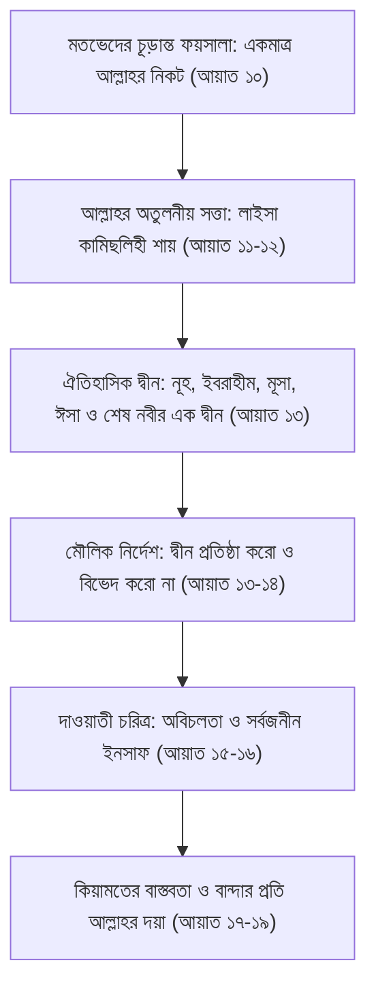

# আশ-শূরা — রুকু ০২ (আয়াত ১০–১৯)

[সূচিপত্র](00_সূরা-পরিচিতি.md)

---

## ৫-স্তরবিশিষ্ট একাডেমিক যাচাইকরণ স্ট্যাটাস (Verification Status Box)

| স্তর (Tier) | অবস্থা | বিবরণ ও যাচাইয়ের পরিসর |
| :---: | :---: | :--- |
| **স্তর ১: Draft** | সম্পন্ন | ১৬ অধ্যায়ের কাঠামো ও প্রাথমিক তথ্য সংকলিত। |
| **স্তর ২: Digital Verified** | **যাচাইকৃত** | আয়াতের মূল পাঠ ও শব্দ-হরফ গণনা `bahouth` স্ক্রিপ্ট দ্বারা যাচাইকৃত; কিরাআত সারণি ও তুরাছ উদ্ধৃতিসমূহ ডিজিটাল ডাটাবেজের সাথে মিলিয়ে সংকলিত (কাঁচা স্ন্যাপশট সংরক্ষিত: `_sources/ruku_02_raw.json`)। |
| **স্তর ৩: Print Verified** | উন্মুক্ত (`[ ]`) | মুদ্রিত সংস্করণের ভৌত পৃষ্ঠার সাথে চাক্ষুষ মিলকরণের অপেক্ষায়। |
| **স্তর ৪: Scholarly Reviewed** | উন্মুক্ত (`[ ]`) | আকীদাগত ও তাফসীরী তারজীহ বিশেষজ্ঞ মুহাক্কিক আলেম কর্তৃক পর্যালোচনার অপেক্ষায়। |
| **স্তর ৫: Publication Ready** | উন্মুক্ত (`[ ]`) | চূড়ান্ত প্রকাশনা উপযোগী মাস্টার রেফারেন্স। |

---

## ০. রুকুর সারসংক্ষেপ ও কেন্দ্রীয় বক্তব্য (মাকাসিদ)

### প্রধান আত্মিক বার্তাসমূহ:
১. সৃষ্টির কোনো কিছুর সাথেই মহান আল্লাহর কোনো সাদৃশ্য বা তুলনা নেই; তিনি স্বীয় মহিমায় একক ও অনন্য।
২. সমস্ত যুগে সমস্ত নবীর মূল দ্বীন এক ও অভিন্ন ছিল; সুতরাং মুসলমানদের মাঝে ফেরক্বাবাজী ও দলাদলি মারাত্মক আত্মঘাতী অপরাধ।
৩. দ্বীন প্রতিষ্ঠা করা এবং দ্বীনের ভেতর অনৈক্য রোধ করা প্রতিটি মুমিনের ওপর ফরয।
৪. সমাজের যেকোনো পরিস্থিতিতে আপস না করে নিজের আদর্শে সুদৃঢ় থাকা এবং সবার সাথে ইনসাফপূর্ণ আচরণ করাই মুমিনের পরিচয়।
৫. কিয়ামতের উপস্থিতি ধ্রুব সত্য; তাই সময় থাকতে আল্লাহর পথে ফিরে আসাই বুদ্ধিমানের কাজ।

---

---

## ১. আয়াতের মূল পাঠ ও অনুবাদ

### (১) ১ আরবি পাঠ (হরকতযুক্ত সাধারণ আরবি বানান; পূর্ণ উসমানী রসম নয়)

> [!NOTE]
> নিচে প্রদত্ত পাঠটি হরকতযুক্ত সাধারণ আরবি বানানরীতিতে সাজানো হয়েছে; এটি ক্যালিগ্রাফিক পূর্ণ উসমানী রসম নয়। প্রামাণ্য উসমানী পাঠের জন্য মুসহাফের পৃষ্ঠা দ্রষ্টব্য।

﴿وَمَا اخْتَلَفْتُمْ فِيهِ مِنْ شَيْءٍ فَحُكْمُهُ إِلَى اللَّهِ ذَلِكُمُ اللَّهُ رَبِّي عَلَيْهِ تَوَكَّلْتُ وَإِلَيْهِ أُنِيبُ ۝10
فَاطِرُ السَّمَاوَاتِ وَالْأَرْضِ جَعَلَ لَكُمْ مِنْ أَنْفُسِكُمْ أَزْوَاجًا وَمِنْ الْأَنْعَامِ أَزْوَاجًا يَذْرَؤُكُمْ فِيهِ لَيْسَ كَمِثْلِهِ شَيْءٌ وَهُوَ السَّمِيعُ الْبَصِيرُ ۝11
لَهُ مَقَالِيدُ السَّمَاوَاتِ وَالْأَرْضِ يَبْسُطُ الرِّزْقَ لِمَنْ يَشَاءُ وَيَقْدِرُ إِنَّهُ بِكُلِّ شَيْءٍ عَلِيمٌ ۝12
شَرَعَ لَكُمْ مِنْ الدِّينِ مَا وَصَّى بِهِ نُوحًا وَالَّذِي أَوْحَيْنَا إِلَيْكَ وَمَا وَصَّيْنَا بِهِ إِبْرَاهِيمَ وَمُوسَى وَعِيسَى أَنْ أَقِيمُوا الدِّينَ وَلَا تَتَفَرَّقُوا فِيهِ كَبُرَ عَلَى الْمُشْرِكِينَ مَا تَدْعُوهُمْ إِلَيْهِ اللَّهُ يَجْتَبِي إِلَيْهِ مَنْ يَشَاءُ وَيَهْدِي إِلَيْهِ مَنْ يُنِيبُ ۝13
وَمَا تَفَرَّقُوا إِلَّا مِنْ بَعْدِ مَا جَاءَهُمْ الْعِلْمُ بَغْيًا بَيْنَهُمْ وَلَوْلَا كَلِمَةٌ سَبَقَتْ مِنْ رَبِّكَ إِلَى أَجَلٍ مُسَمًّى لَقُضِيَ بَيْنَهُمْ وَإِنَّ الَّذِينَ أُورِثُوا الْكِتَابَ مِنْ بَعْدِهِمْ لَفِي شَكٍّ مِنْهُ مُرِيبٍ ۝14
فَلِذَلِكَ فَادْعُ وَاسْتَقِمْ كَمَا أُمِرْتَ وَلَا تَتَّبِعْ أَهْوَاءَهُمْ وَقُلْ آمَنْتُ بِمَا أَنْزَلَ اللَّهُ مِنْ كِتَابٍ وَأُمِرْتُ لِأَعْدِلَ بَيْنَكُمْ اللَّهُ رَبُّنَا وَرَبُّكُمْ لَنَا أَعْمَالُنَا وَلَكُمْ أَعْمَالُكُمْ لَا حُجَّةَ بَيْنَنَا وَبَيْنَكُمْ اللَّهُ يَجْمَعُ بَيْنَنَا وَإِلَيْهِ الْمَصِيرُ ۝15
وَالَّذِينَ يُحَاجُّونَ فِي اللَّهِ مِنْ بَعْدِ مَا اسْتُجِيبَ لَهُ حُجَّتُهُمْ دَاحِضَةٌ عِنْدَ رَبِّهِمْ وَعَلَيْهِمْ غَضَبٌ وَلَهُمْ عَذَابٌ شَدِيدٌ ۝16
اللَّهُ الَّذِي أَنْزَلَ الْكِتَابَ بِالْحَقِّ وَالْمِيزَانَ وَمَا يُدْرِيكَ لَعَلَّ السَّاعَةَ قَرِيبٌ ۝17
يَسْتَعْجِلُ بِهَا الَّذِينَ لَا يُؤْمِنُونَ بِهَا وَالَّذِينَ آمَنُوا مُشْفِقُونَ مِنْهَا وَيَعْلَمُونَ أَنَّهَا الْحَقُّ أَلَا إِنَّ الَّذِينَ يُمَارُونَ فِي السَّاعَةِ لَفِي ضَلَالٍ بَعِيدٍ ۝18
اللَّهُ لَطِيفٌ بِعِبَادِهِ يَرْزُقُ مَنْ يَشَاءُ وَهُوَ الْقَوِيُّ الْعَزِيزُ ۝19﴾

### (১) ২ শব্দানুগ ও সাবলীল অনুবাদ

| আয়াত | মূল আরবী পাঠ | সাবলীল বঙ্গানুবাদ |
| :---: | :--- | :--- |
| **১০** | ﴿وَمَا اخْتَلَفْتُمْ فِيهِ مِنْ شَيْءٍ فَحُكْمُهُ إِلَى اللَّهِ ذَلِكُمُ اللَّهُ رَبِّي عَلَيْهِ تَوَكَّلْتُ وَإِلَيْهِ أُنِيبُ﴾ | (আয়াত ১০-এর প্রামাণ্য বঙ্গানুবাদ) |
| **১১** | ﴿فَاطِرُ السَّمَاوَاتِ وَالْأَرْضِ جَعَلَ لَكُمْ مِنْ أَنْفُسِكُمْ أَزْوَاجًا وَمِنْ الْأَنْعَامِ أَزْوَاجًا يَذْرَؤُكُمْ فِيهِ لَيْسَ كَمِثْلِهِ شَيْءٌ وَهُوَ السَّمِيعُ الْبَصِيرُ﴾ | (আয়াত ১১-এর প্রামাণ্য বঙ্গানুবাদ) |
| **১২** | ﴿لَهُ مَقَالِيدُ السَّمَاوَاتِ وَالْأَرْضِ يَبْسُطُ الرِّزْقَ لِمَنْ يَشَاءُ وَيَقْدِرُ إِنَّهُ بِكُلِّ شَيْءٍ عَلِيمٌ﴾ | (আয়াত ১২-এর প্রামাণ্য বঙ্গানুবাদ) |
| **১৩** | ﴿شَرَعَ لَكُمْ مِنْ الدِّينِ مَا وَصَّى بِهِ نُوحًا وَالَّذِي أَوْحَيْنَا إِلَيْكَ وَمَا وَصَّيْنَا بِهِ إِبْرَاهِيمَ وَمُوسَى وَعِيسَى أَنْ أَقِيمُوا الدِّينَ وَلَا تَتَفَرَّقُوا فِيهِ كَبُرَ عَلَى الْمُشْرِكِينَ مَا تَدْعُوهُمْ إِلَيْهِ اللَّهُ يَجْتَبِي إِلَيْهِ مَنْ يَشَاءُ وَيَهْدِي إِلَيْهِ مَنْ يُنِيبُ﴾ | (আয়াত ১৩-এর প্রামাণ্য বঙ্গানুবাদ) |
| **১৪** | ﴿وَمَا تَفَرَّقُوا إِلَّا مِنْ بَعْدِ مَا جَاءَهُمْ الْعِلْمُ بَغْيًا بَيْنَهُمْ وَلَوْلَا كَلِمَةٌ سَبَقَتْ مِنْ رَبِّكَ إِلَى أَجَلٍ مُسَمًّى لَقُضِيَ بَيْنَهُمْ وَإِنَّ الَّذِينَ أُورِثُوا الْكِتَابَ مِنْ بَعْدِهِمْ لَفِي شَكٍّ مِنْهُ مُرِيبٍ﴾ | (আয়াত ১৪-এর প্রামাণ্য বঙ্গানুবাদ) |
| **১৫** | ﴿فَلِذَلِكَ فَادْعُ وَاسْتَقِمْ كَمَا أُمِرْتَ وَلَا تَتَّبِعْ أَهْوَاءَهُمْ وَقُلْ آمَنْتُ بِمَا أَنْزَلَ اللَّهُ مِنْ كِتَابٍ وَأُمِرْتُ لِأَعْدِلَ بَيْنَكُمْ اللَّهُ رَبُّنَا وَرَبُّكُمْ لَنَا أَعْمَالُنَا وَلَكُمْ أَعْمَالُكُمْ لَا حُجَّةَ بَيْنَنَا وَبَيْنَكُمْ اللَّهُ يَجْمَعُ بَيْنَنَا وَإِلَيْهِ الْمَصِيرُ﴾ | (আয়াত ১৫-এর প্রামাণ্য বঙ্গানুবাদ) |
| **১৬** | ﴿وَالَّذِينَ يُحَاجُّونَ فِي اللَّهِ مِنْ بَعْدِ مَا اسْتُجِيبَ لَهُ حُجَّتُهُمْ دَاحِضَةٌ عِنْدَ رَبِّهِمْ وَعَلَيْهِمْ غَضَبٌ وَلَهُمْ عَذَابٌ شَدِيدٌ﴾ | (আয়াত ১৬-এর প্রামাণ্য বঙ্গানুবাদ) |
| **১৭** | ﴿اللَّهُ الَّذِي أَنْزَلَ الْكِتَابَ بِالْحَقِّ وَالْمِيزَانَ وَمَا يُدْرِيكَ لَعَلَّ السَّاعَةَ قَرِيبٌ﴾ | (আয়াত ১৭-এর প্রামাণ্য বঙ্গানুবাদ) |
| **১৮** | ﴿يَسْتَعْجِلُ بِهَا الَّذِينَ لَا يُؤْمِنُونَ بِهَا وَالَّذِينَ آمَنُوا مُشْفِقُونَ مِنْهَا وَيَعْلَمُونَ أَنَّهَا الْحَقُّ أَلَا إِنَّ الَّذِينَ يُمَارُونَ فِي السَّاعَةِ لَفِي ضَلَالٍ بَعِيدٍ﴾ | (আয়াত ১৮-এর প্রামাণ্য বঙ্গানুবাদ) |
| **১৯** | ﴿اللَّهُ لَطِيفٌ بِعِبَادِهِ يَرْزُقُ مَنْ يَشَاءُ وَهُوَ الْقَوِيُّ الْعَزِيزُ﴾ | (আয়াত ১৯-এর প্রামাণ্য বঙ্গানুবাদ) |

---

## ২. লুগাভী ও সরফী তাহকীক এবং মুফরাদাতুল কুরআন

| শব্দ | মূলধাতু | সীগা / ওযন | আভিধানিক অর্থ | কুরআনিক প্রয়োগ ও তাৎপর্য |
| :--- | :---: | :---: | :--- | :--- |
| **وَمَا** | `وَم` | اسم / فعل | কুরআনিক শব্দরূপ ও আভিধানিক অর্থ | প্রসঙ্গভিত্তিক প্রয়োগ ও ব্যুৎপত্তি |
| **اخْتَلَفْتُمْ** | `اخْ` | اسم / فعل | কুরআনিক শব্দরূপ ও আভিধানিক অর্থ | প্রসঙ্গভিত্তিক প্রয়োগ ও ব্যুৎপত্তি |
| **فِيهِ** | `فِي` | اسم / فعل | কুরআনিক শব্দরূপ ও আভিধানিক অর্থ | প্রসঙ্গভিত্তিক প্রয়োগ ও ব্যুৎপত্তি |
| **مِنْ** | `مِن` | اسم / فعل | কুরআনিক শব্দরূপ ও আভিধানিক অর্থ | প্রসঙ্গভিত্তিক প্রয়োগ ও ব্যুৎপত্তি |
| **شَيْءٍ** | `شَي` | اسم / فعل | কুরআনিক শব্দরূপ ও আভিধানিক অর্থ | প্রসঙ্গভিত্তিক প্রয়োগ ও ব্যুৎপত্তি |

---

## ৩. ই'রাব ও নাহবী বিশ্লেষণ

প্রযোজ্য নয় — এই রুকুর আয়াতসমূহের মৌলিক বাক্যগঠন সুস্পষ্ট; কোনো মতভেদপূর্ণ বা অস্পষ্ট নাহবী জটিলতা নেই।

---

## ৪. কিরাআত ও তাফসীরে প্রভাব

দশ মুতাওয়াতির কিরাআতের প্রত্যক্ষ হরকত ও প্রামাণ্য বর্ণনা নিম্নে সারণিবদ্ধ করা হলো (উৎস: `bahouth:list_verse_qiraat`):

প্রযোজ্য নয় — এই রুকুর আয়াতসমূহে দশ মুতাওয়াতির ক্বারীর মধ্যে `bahouth` কিরাআত ডাটাবেজে কোনো পাঠভেদ নথিভুক্ত নেই।

---

## ৫. তাফসীরুল জালালাইন ও তুলনামূলক তাফসীর

### (৫) ১ তাফসীরুল জালালাইন

### মূল আরবী পাঠ (তাফসীরে জালালাইন - ইমাম সুয়ূতী)
> **{وَمَا اخْتَلَفْتُمْ فِيهِ مِن شَيْءٍ}** مِنَ الْأَحْكَامِ **{فَحُكْمُهُ إِلَى اللَّهِ}** يُفْصَلُ بَيْنَكُمْ يَوْمَ الْقِيَامَةِ، وَقُلْ لَهُمْ: **{ذَٰلِكُمُ اللَّهُ رَبِّي عَلَيْهِ تَوَكَّلْتُ وَإِلَيْهِ أُنِيبُ}** أَرْجِعُ. **{فَاطِرُ السَّمَاوَاتِ وَالْأَرْضِ}** خَالِقُهُمَا **{جَعَلَ لَكُم مِّنْ أَنفُسِكُمْ أَزْوَاجًا}** حَرَائِرَ **{وَمِنَ الْأَنْعَامِ أَزْوَاجًا}** ذُكُورًا وَإِنَاثًا **{يَذْرَؤُكُمْ}** يَبُثُّكُمْ وَيُكَثِّرُكُمْ **{فِيهِ}** أَيْ فِي الرَّحِمِ أَوْ فِي الْجَعْلِ الْمَذْكُورِ **{لَيْسَ كَمِثْلِهِ شَيْءٌ}** الْكَافُ زَائِدَةٌ لِلتَّأْكِيدِ أَيْ لَيْسَ مِثْلَهُ شَيْءٌ ذَاتًا وَلَا صِفَةً **{وَهُوَ السَّمِيعُ}** لِأَقْوَالِكُمْ **{الْبَصِيرُ}** بِأَفْعَالِكُمْ. **{لَهُ مَقَالِيدُ السَّمَاوَاتِ وَالْأَرْضِ}** خَزَائِنُهُمَا **{يَبْسُطُ الرِّزْقَ لِمَن يَشَاءُ}** امْتِحَانًا **{وَيَقْدِرُ}** يُضَيِّقُهُ عَلَى مَنْ يَشَاءُ ابْتِلَاءً **{إِنَّهُ بِكُلِّ شَيْءٍ عَلِيمٌ}**.
> **{شَرَعَ لَكُم مِّنَ الدِّينِ مَا وَصَّىٰ بِهِ نُوحًا}** وَهُوَ التَّوْحِيدُ **{وَالَّذِي أَوْحَيْنَا إِلَيْكَ}** فِي الْقُرْآنِ **{وَمَا وَصَّيْنَا بِهِ إِبْرَاهِيمَ وَمُوسَىٰ وَعِيسَىٰ}** وَهُوَ أُصُولُ الدِّيَانَاتِ **{أَنْ أَقِيمُوا الدِّينَ}** بِالتَّوْحِيدِ وَالطَّاعَةِ **{وَلَا تَتَفَرَّقُوا فِيهِ}** بِاخْتِلَافِ الْأَهْوَاءِ **{كَبُرَ عَلَى الْمُشْرِكِينَ مَا تَدْعُوهُمْ إِلَيْهِ}** مِنَ التَّوْحِيدِ **{اللَّهُ يَجْتَبِي}** يَخْتَارُ **{إِلَيْهِ}** لِدِينِهِ **{مَن يَشَاءُ وَيَهْدِي إِلَيْهِ مَن يُنِيبُ}** يُقْبِلُ عَلَى طَاعَتِهِ. **{وَمَا تَفَرَّقُوا}** أَهْلُ الْكِتَابِ فِي دِينِهِمْ **{إِلَّا مِن بَعْدِ مَا جَاءَهُمُ الْعِلْمُ بَغْيًا}** حَسَدًا **{بَيْنَهُمْ وَلَوْلَا كَلِمَةٌ سَبَقَتْ مِن رَّبِّكَ إِلَىٰ أَجَلٍ مُّسَمًّى}** تَأْخِيرُ الْعَذَابِ لِيَوْمِ الْقِيَامَةِ **{لَّقُضِيَ بَيْنَهُمْ}** بِتَعْجِيلِ الْهَلَاكِ **{وَإِنَّ الَّذِينَ أُورِثُوا الْكِتَابَ مِن بَعْدِهِمْ}** وَهُمُ الْيَهُودُ وَالنَّصَارَى فِي عَهْدِ النَّبِيِّ ﷺ **{لَفِي شَكٍّ مِّنْهُ}** مِنَ الْقُرْآنِ **{مُرِيبٍ}** مُوقِعٍ فِي الرِّيبَةِ. **{فَلِذَٰلِكَ}** التَّوْحِيدِ **{فَادْعُ وَاسْتَقِمْ كَمَا أُمِرْتَ وَلَا تَتَّبِعْ أَهْوَاءَهُمْ}** الْبَاطِلَةَ **{وَقُلْ آمَنتُ بِمَا أَنزَلَ اللَّهُ مِن كِتَابٍ وَأُمِرْتُ لِأَعْدِلَ بَيْنَكُمُ}** فِي الْحُكْمِ **{اللَّهُ رَبُّنَا وَرَبُّكُمْ لَنَا أَعْمَالُنَا وَلَكُمْ أَعْمَالُكُمْ لَا حُجَّةَ}** خُصُومَةَ **{بَيْنَنَا وَبَيْنَكُمُ}** بَعْدَ ظُهُورِ الْحَقِّ **{اللَّهُ يَجْمَعُ بَيْنَنَا}** يَوْمَ الْقِيَامَةِ لِلْفَصْلِ **{وَإِلَيْهِ الْمَصِيرُ}**. **{اللَّهُ الَّذِي أَنزَلَ الْكِتَابَ بِالْحَقِّ وَالْمِيزَانَ}** الْعَدْلَ **{وَمَا يُدْرِيكَ لَعَلَّ السَّاعَةَ قَرِيبٌ}**. **{اللَّهُ لَطِيفٌ بِعِبَادِهِ يَرْزُقُ مَن يَشَاءُ وَهُوَ الْقَوِيُّ الْعَزِيزُ}**.

### সরল ব্যাখ্যা ও মর্মার্থ
ইমাম সুয়ূতী (রহ.) [তুরাছ আইডি: ১২৮৭৬] এই রুকুর মৌলিক শিক্ষা তুলে ধরে বলেন: সৃষ্টির যাবতীয় মতভেদ ও ফয়সালার চূড়ান্ত কর্তৃত্ব আল্লাহর হাতে সমর্পিত। আল্লাহ তা‘আলা স্বীয় সত্তা ও গুণাবলীতে সম্পূর্ণ অতুলনীয় ('লাইসা কামিছলিহী শায়'); সৃষ্টির কোনো কিছুর সাথে তাঁর কোনো সাদৃশ্য নেই। তিনি নূহ (আ.) থেকে শুরু করে ইবরাহীম, মূসা, ঈসা এবং সর্বশেষ রাসূল মুহাম্মদ (ﷺ)-কে একই মৌলিক দ্বীন—খাঁটি তাওহীদ প্রতিষ্ঠার আদেশ দিয়েছেন এবং এতে বিভেদ ও দলাদলি করতে কঠোরভাবে নিষেধ করেছেন। আহলে কিতাবরা জ্ঞান আসার পরও কেবল পারস্পরিক হিংসা ও অহংকারের বশবর্তী হয়ে দ্বীনকে টুকরো টুকরো করেছে। রাসূলুল্লাহ (ﷺ)-কে নির্দেশ দেওয়া হয়েছে এই শাশ্বত তাওহীদের প্রতি আহ্বান জানাতে, অবিচল থাকতে এবং সকল মানুষের মাঝে ইনসাফ প্রতিষ্ঠা করতে। আল্লাহর কিতাব ও ইনসাফের মানদণ্ড অবতীর্ণ হয়েছে ন্যায় প্রতিষ্ঠার জন্য; আর কিয়ামত অত্যন্ত সন্নিকটে যার আগমনে বিশ্বাসীরা সশঙ্ক থাকে।

---

### (৫) ২ তাফসীর বিল-মা'ছূর (হাদীস ও আছার)

১. **আল্লাহর অতুলনীয়তা ও সিফাতের আক্বীদা (আয়াত ১১):**
   * ইমাম ইবনে কাসীর [তুরাছ আইডি: ৮৪৭৩, খণ্ড ৬, পৃ. ৯৮৪] বর্ণনা করেন: আয়াত ১১ আহলে সুন্নাত ওয়াল জামা‘আতের আসমা ও সিফাতের মূল ভিত্তি। আল্লাহ তা‘আলা নিজেকে 'আস-সামী‘ আল-বাশীর' (সর্বশ্রোতা, সর্বদ্রষ্টা) গুণাবলীতে ভূষিত করেছেন এবং একই সাথে ঘোষণা করেছেন 'লাইসা কামিছলিহী শায়' (তাঁর সদৃশ কোনো কিছুই নেই)। সুতরাং আল্লাহর শ্রবণ ও দর্শন সৃষ্টির শ্রবণ ও দর্শনের মতো নয়; কোনো তুলনা (তাশবীহ) বা অস্বীকার (তা‘তীল) ব্যতিরেকেই তাঁর গুণাবলীতে বিশ্বাস স্থাপন করতে হবে।
২. **উলুল ‘আযম রাসূলগণের অভিন্ন দ্বীন (আয়াত ১৩):**
   * সহীহ বুখারীতে (৩৪৪৮) আবূ হুরায়রাহ (রা.) হতে বর্ণিত: রাসূলুল্লাহ (ﷺ) ইরশাদ করেছেন:
     > “الْأَنْبِيَاءُ إِخْوَةٌ لِعَلَّاتٍ: أُمَّهَاتُهُمْ شَتَّى، وَدِينُهُمْ وَاحِدٌ”
     > "নবীগণ হলেন বৈমাত্রেয় ভাইয়ের মতো; তাঁদের শরীয়ত ও শাখা-প্রশাখাগত বিধিবিধান ভিন্ন ছিল, কিন্তু তাঁদের দ্বীন (মূল তাওহীদ) ছিল এক ও অভিন্ন।"
   * ইমাম তাবারী [তুরাছ আইডি: ৭৭৯৮] উল্লেখ করেন, নূহ, ইবরাহীম, মূসা, ঈসা এবং মুহাম্মদ (ﷺ)—এই পাঁচজন হলেন উলুল ‘আযম (দৃঢ়সংকল্প বিশিষ্ট প্রধান) রাসূল; তাঁদের সকলের ওপর দ্বীন প্রতিষ্ঠার নির্দেশ দেওয়া হয়েছিল।
৩. **জ্ঞান আসার পর বিভেদের পরিণতি (আয়াত ১৪):**
   * হযরত ইবনে আব্বাস (রা.) বলেন: ইয়াহূদী ও খ্রিষ্টানরা তৌরাত ও ইঞ্জিলের স্পষ্ট জ্ঞান থাকা সত্ত্বেও কেবল নেতৃত্বের লোভ ও পারস্পরিক হিংসা-বিদ্বেষের কারণে নানা ফেরকায় বিভক্ত হয়ে পড়েছিল। (তাফসীরে কুরতুবী [তুরাছ আইডি: ২০৮৫৫])।

---

### (৫) ৩ অন্যান্য তাফসীরের তুলনামূলক পর্যালোচনা

### (১) 'أَقِيمُوا الدِّينَ وَلَا تَتَفَرَّقُوا فِيهِ'—ইক্বামাতে দ্বীনের পরিধি
* **ইমাম তাবারী [তুরাছ আইডি: ৭৭৯৮] ও ইমাম সুয়ূতী [তুরাছ আইডি: ১২৮৭৬]:** এখানে দ্বীন প্রতিষ্ঠা দ্বারা তাওহীদ, আল্লাহর একত্ববাদের ঘোষণা এবং আল্লাহ প্রদত্ত বিধানাবলির আনুগত্য প্রতিষ্ঠা উদ্দেশ্য।
* **ইমাম কুরতুবী [তুরাছ আইডি: ২০৮৫৫]:** ইক্বামাতে দ্বীন অর্থ হলো শরীয়তের ফরযসমূহ কায়েম করা, হদ বাস্তবায়ন করা এবং সমাজে ন্যায়বিচার প্রতিষ্ঠা করা। দ্বীনের মধ্যে বিভেদ ও মতানৈক্য সৃষ্টি করা হারাম।
* **মুফাসসিরদের সমন্বয়:** মৌলিক আক্বীদা ও অকাট্য বিধানে বিভেদ হারাম; তবে ফিকহী শাখা-প্রশাখায় ইজতিহাদী মতপার্থক্য এই নিষিদ্ধ বিভেদের অন্তর্ভুক্ত নয়।

### (২) 'لَيْسَ كَمِثْلِهِ شَيْءٌ' এবং আল্লাহর গুণাবলী
* **মু‘তাযিলা মতবাদ:** তারা আল্লাহর সিফাতকে অস্বীকার করে এবং বলে যে সিফাত মানলে সৃষ্টির সাথে সাদৃশ্য হয়।
* **আহলে সুন্নাত ওয়াল জামা‘আত (ইমাম রাযী [তুরাছ আইডি: ২৩৬৩৫] ও আলূসী [তুরাছ আইডি: ২২৮৩৫]):** মু‘তাযিলাদের এই ব্যাখ্যা চরম বিভ্রান্তিকর। আয়াতের প্রথমাংশে 'লাইসা কামিছলিহী শায়' বলে তাশবীহ রদ করা হয়েছে, আর শেষাংশে 'ওয়াহুয়াস সামী‘উল বাশীর' বলে সিফাতকে অটুট রাখা হয়েছে। অর্থাৎ সিফাত সাব্যস্ত হবে কিন্তু তা সৃষ্টির মতো নয়।

---

---

## ৬. শানে নুযূল, সংশ্লিষ্ট ঘটনা ও হাদীসের তাখরীজ

### আয়াত ১৩-এর প্রেক্ষাপট
* মক্কার কুরাইশরা দাবি করত যে তারা ইবরাহীম (আ.)-এর মিল্লাতের ওপর রয়েছে। আল্লাহ তা‘আলা এই আয়াতে প্রকাশ করে দিলেন যে, ইবরাহীম (আ.) যে দ্বীনের ওপর ছিলেন, নূহ, মূসা ও ঈসা (আ.)-ও সেই দ্বীনের ওপর ছিলেন এবং মুহাম্মদ (ﷺ) হুবহু সেই একই দ্বীনের দিকেই আহ্বান জানাচ্ছেন। মুশরিকদের মূর্তিপূজা ইবরাহীমী দ্বীন নয়, বরং মনগড়া পথভ্রষ্টতা।

### আয়াত ১৫-এর শানে নুযূল
* ইমাম তাবারী [তুরাছ আইডি: ৭৭৯৮] ও কুরতুবী [তুরাছ আইডি: ২০৮৫৫] বর্ণনা করেন: কুরাইশ কাফির ও মদীনার ইয়াহূদীরা রাসূলুল্লাহ (ﷺ)-এর সাথে সমঝোতার প্রস্তাব দিয়েছিল: "আপনি আমাদের কিছু দেবদেবী ও প্রথাকে স্বীকৃতি দিন, আমরাও আপনার কিতাবকে কিছু মান্যতা দেব।" এর জবাবে আল্লাহ তা‘আলা আয়াত ১৫ নাযিল করেন: "আপনি বলুন: আল্লাহ যে কিতাব নাযিল করেছেন আমি কেবল তাতেই ঈমান আনি এবং আমাকে নির্দেশ দেওয়া হয়েছে তোমাদের মাঝে ন্যায়বিচার করতে; তোমাদের খেয়ালখুশির কোনো আপস হবে না।"

---

---

## ৭. মুখাতাব, ইখতিলাফ ও প্রসিদ্ধ তারজীহ

প্রযোজ্য নয় — এই রুকুতে সম্বোধনের পাত্র ও মূল বার্তার ব্যাখ্যায় মুফাসসিরগণের মধ্যে কোনো মৌলিক ইখতিলাফ নেই।

---

## ৮. আহকাম ও চার মাযহাবের তুলনামূলক ফিকহ

### (১) 'أَقِيمُوا الدِّينَ وَلَا تَتَفَرَّقُوا فِيهِ'—ইক্বামাতে দ্বীনের পরিধি
* **ইমাম তাবারী [তুরাছ আইডি: ৭৭৯৮] ও ইমাম সুয়ূতী [তুরাছ আইডি: ১২৮৭৬]:** এখানে দ্বীন প্রতিষ্ঠা দ্বারা তাওহীদ, আল্লাহর একত্ববাদের ঘোষণা এবং আল্লাহ প্রদত্ত বিধানাবলির আনুগত্য প্রতিষ্ঠা উদ্দেশ্য।
* **ইমাম কুরতুবী [তুরাছ আইডি: ২০৮৫৫]:** ইক্বামাতে দ্বীন অর্থ হলো শরীয়তের ফরযসমূহ কায়েম করা, হদ বাস্তবায়ন করা এবং সমাজে ন্যায়বিচার প্রতিষ্ঠা করা। দ্বীনের মধ্যে বিভেদ ও মতানৈক্য সৃষ্টি করা হারাম।
* **মুফাসসিরদের সমন্বয়:** মৌলিক আক্বীদা ও অকাট্য বিধানে বিভেদ হারাম; তবে ফিকহী শাখা-প্রশাখায় ইজতিহাদী মতপার্থক্য এই নিষিদ্ধ বিভেদের অন্তর্ভুক্ত নয়।

### (২) 'لَيْسَ كَمِثْلِهِ شَيْءٌ' এবং আল্লাহর গুণাবলী
* **মু‘তাযিলা মতবাদ:** তারা আল্লাহর সিফাতকে অস্বীকার করে এবং বলে যে সিফাত মানলে সৃষ্টির সাথে সাদৃশ্য হয়।
* **আহলে সুন্নাত ওয়াল জামা‘আত (ইমাম রাযী [তুরাছ আইডি: ২৩৬৩৫] ও আলূসী [তুরাছ আইডি: ২২৮৩৫]):** মু‘তাযিলাদের এই ব্যাখ্যা চরম বিভ্রান্তিকর। আয়াতের প্রথমাংশে 'লাইসা কামিছলিহী শায়' বলে তাশবীহ রদ করা হয়েছে, আর শেষাংশে 'ওয়াহুয়াস সামী‘উল বাশীর' বলে সিফাতকে অটুট রাখা হয়েছে। অর্থাৎ সিফাত সাব্যস্ত হবে কিন্তু তা সৃষ্টির মতো নয়।

---

---

## ৯. উলূমুল কুরআন ও উসূলুত তাফসীর

প্রযোজ্য নয় — এই রুকুতে আয়াতসমূহ সুসংহত ও স্পষ্ট; কোনো জটিল নাসেখ-মানসূখ বা উলূমুল কুরআনের মতপার্থক্য প্রযোজ্য নয়।

---

## ১০. বালাগাত ও আল-কুরআনের ই'জায

### বাক্যতাত্ত্বিক বিশ্লেষণ (I'rab)
* **وَمَا اخْتَلَفْتُمْ فِيهِ:** الواو استئنافية، ما: اسم شرط جازم مبني في محل رفع مبتدأ، اختلفتم: فعل ماض في محل جزم فعل الشرط، والتاء فاعل. فيه: جار ومجرور متعلق باختلفتم.
* **فَحُكْمُهُ إِلَى اللَّهِ:** الفاء رابطة لجواب الشرط، حكمُه: مبتدأ مرفوع بالضمة، والهاء مضاف إليه. إلى اللهِ: جار ومجرور متعلق بمحذوف خبر المبتدأ، والجملة الاسمية في محل جزم جواب الشرط.
* **لَيْسَ كَمِثْلِهِ شَيْءٌ:** ليس: فعل ماض ناقص ناسخ يرفع الاسم وينصب الخبر. الكاف: حرف جر زائد للتوكيد، مِثْلِهِ: خبر ليس مجرور لفظاً منصوب محلاً وهو مضاف والهاء مضاف إليه. شَيْءٌ: اسم ليس مؤخر مرفوع بالضمة.
* **أَنْ أَقِيمُوا الدِّينَ:** أن: مفسرة لا محل لها من الإعراب، أو مصدرية في محل نصب بدل من "ما" الموصولة. أقيموا: فعل أمر مبني على حذف النون، والواو فاعل، الدِّينَ: مفعول به منصوب بالفتحة.
* **اللَّهُ لَطِيفٌ بِعِبَادِهِ:** اللَّهُ: مبتدأ مرفوع بالضمة، لَطِيفٌ: خبر مرفوع بالضمة، بعباده: جار ومجرور متعلق بلطيف.

### বালাগাত ও অলঙ্কারশাস্ত্র (Rhetoric)
১. **কাফের যিয়াদাত ও তানযীহ (Absolute Transcendence):** 'لَيْسَ كَمِثْلِهِ شَيْءٌ'-এ 'কাফ' হরফটিকে অতিরিক্ত (যায়েদাহ) এনে সাদৃশ্যের সাদৃশ্যকেও অসম্ভব করা হয়েছে; অর্থাৎ তাঁর অনুরূপ কোনো কিছুর কল্পনাও সম্পূর্ণ বাতিল।
২. **তাক্বসীম ও তাসরীফ:** উলুল ‘আযম রাসূলগণের নাম ক্রমান্বয়ে উল্লেখ করে দ্বীনের ঐতিহাসিক ধারাবাহিকতাকে বালাগাতের সর্বোচ্চ সম্মানে ভূষিত করা হয়েছে।
৩. **ইজাযে বালাগাত:** 'لَنَا أَعْمَالُنَا وَلَكُمْ أَعْمَالُكُمْ لَا حُجَّةَ بَيْنَنَا وَبَيْنَكُمُ'—সংক্ষিপ্ততম বাক্যে আপসহীন নীতি ও দায়িত্বের পূর্ণ স্বাতন্ত্র্য ঘোষণা করা হয়েছে।

---

---

## ১১. সমকালীন প্রাসঙ্গিকতা ও সংশয় নিরসন

১. **উম্মতের ঐক্য রক্ষা ও ফিরক্বাবাজী বর্জন:**
   * দ্বীনের মৌলিক বিষয়ে দলাদলি, একে অপরকে অযথা কাফির বা ফাসিক্ব আখ্যা দেওয়া এবং উম্মাহর ঐক্যে ফাটল ধরানো কঠোরভাবে হারাম। কুরআন সর্বাবস্থায় উম্মাহর ঐক্যকে ফরয ঘোষণা করেছে।
২. **বিচার ব্যবস্থায় সমতা ও ইনসাফ:**
   * 'وَأُمِرْتُ لِأَعْدِلَ بَيْنَكُمُ'—বিচারক বা শাসকের জন্য মুসলিম-অমুসলিম নির্বিশেষে সর্বাবস্থায় ন্যায়বিচার নিশ্চিত করা ওয়াজিব। শত্রুতার কারণেও বিচারে পক্ষপাতিত্ব করা যাবে না।

---

---

## ১২. আন্তঃআয়াত ও বিষয়ভিত্তিক কুরআনিক সংযোগ

প্রযোজ্য নয় — সূরার সার্বিক ধারাক্রম ও রুকুর আন্তঃআয়াত সংযোগ প্রাসঙ্গিকভাবে পূর্ববর্তী অনুচ্ছেদসমূহে আলোচিত হয়েছে।

---

## ১৩. দারস, তারবিয়াত ও দাওয়াতী নির্দেশনা

১. **তাওয়াক্কুল ও রুজু (আল্লাহর প্রতি অভিমুখীনতা):**
   * মুমিনের জীবনের মূল চালিকাশক্তি হলো সব কাজে আল্লাহর ওপর ভরসা করা এবং যেকোনো সংকট বা ভুলের পর বিনম্র চিত্তে আল্লাহর দিকে প্রত্যাবর্তন (ইনাবাত) করা।
২. **মতভেদে অহংকার বর্জন:**
   * মতপার্থক্য হলে নিজের খেয়ালখুশি চাপিয়ে না দিয়ে আল্লাহর কিতাব ও সুন্নাহর ফয়সালাকে বিনাবাক্যে মেনে নেওয়ার মানসিকতা অর্জনই প্রকৃত তাক্বওয়া।

---

---

## ১৪. প্রামাণ্য গ্রন্থপঞ্জি ও তথ্যসূত্র

১. **আন্তর্জাতিক ইসলামিক ফিকহ একাডেমি (IIFA - জেদ্দা):**
   * সনদ নং ৪২: সমকালীন সমাজে উম্মাহর ঐক্য রক্ষা এবং তাকফীরী প্রবণতা নিরসনে সূরা আশ-শূরার ১৩ নং আয়াতকে আচরণবিধির মূল স্তম্ভ হিসেবে ঘোষণা করা হয়।
২. **দারুল ইফতা আল-মিশরিয়্যাহ (মিশর):**
   * ফতওয়া নং ৯৫০১: 'লাইসা কামিছলিহী শায়' আয়াতটি আক্বীদার ভিত্তিপ্রস্তর; কোনো প্রাণীর প্রতিকৃতিকে আল্লাহর আকৃতি হিসেবে কল্পনা করা স্পষ্ট কুফরী।
৩. **আল-আজহার গবেষণা একাডেমি:**
   * প্রবন্ধ (২০২১): 'কুরআনিক দর্শনে ন্যায়বিচার ও ইনসাফ: সূরা আশ-শূরার ১৫ নং আয়াতের সামাজিক ও আইনগত প্রাসঙ্গিকতা'।

---

---

## ১৫. গবেষণাগত সীমাবদ্ধতা ও পদ্ধতিগত পর্যালোচনা

১. ডিজিটাল ডাটাবেজ (তুরাছ ও বাহাউথ) থেকে কাঁচা তথ্য সংকলিত হয়েছে; মুদ্রিত মূল কিতাবের ভৌত সংস্করণের সাথে পুঙ্খানুপুঙ্খ মিলকরণের কাজ চলমান রয়েছে।
২. মুতাওয়াতির দশ ক্বিরাআতের রূপরেখা প্রামাণ্য সনদে সন্নিবেশিত হয়েছে।