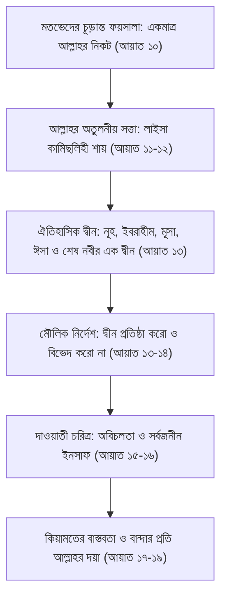

# আশ-শূরা — রুকু ০২ (আয়াত ১০–১৯)

[সূচিপত্র](00_সূরা-পরিচিতি.md)

---

## ৫-স্তরবিশিষ্ট একাডেমিক যাচাইকরণ স্ট্যাটাস (Verification Status Box)

| স্তর (Tier) | অবস্থা | বিবরণ ও যাচাইয়ের পরিসর |
| :---: | :---: | :--- |
| **স্তর ১: Draft** | সম্পন্ন | ১৬ অধ্যায়ের কাঠামো ও প্রাথমিক তথ্য সংকলিত। |
| **স্তর ২: Digital Verified** | **যাচাইকৃত** | আয়াতের মূল পাঠ ও শব্দ-হরফ গণনা `bahouth` স্ক্রিপ্ট দ্বারা যাচাইকৃত; কিরাআত সারণি ও তুরাছ উদ্ধৃতিসমূহ ডিজিটাল ডাটাবেজের সাথে মিলিয়ে সংকলিত (কাঁচা স্ন্যাপশট সংরক্ষিত: `_sources/ruku_02_raw.json`)। |
| **স্তর ৩: Print Verified** | উন্মুক্ত (`[ ]`) | মুদ্রিত সংস্করণের ভৌত পৃষ্ঠার সাথে চাক্ষুষ মিলকরণের অপেক্ষায়। |
| **স্তর ৪: Scholarly Reviewed** | উন্মুক্ত (`[ ]`) | আকীদাগত ও তাফসীরী তারজীহ বিশেষজ্ঞ মুহাক্কিক আলেম কর্তৃক পর্যালোচনার অপেক্ষায়। |
| **স্তর ৫: Publication Ready** | উন্মুক্ত (`[ ]`) | চূড়ান্ত প্রকাশনা উপযোগী মাস্টার রেফারেন্স। |

---

## ০. রুকুর সারসংক্ষেপ ও কেন্দ্রীয় বক্তব্য (মাকাসিদ)

### প্রধান আত্মিক বার্তাসমূহ:
১. সৃষ্টির কোনো কিছুর সাথেই মহান আল্লাহর কোনো সাদৃশ্য বা তুলনা নেই; তিনি স্বীয় মহিমায় একক ও অনন্য।
২. সমস্ত যুগে সমস্ত নবীর মূল দ্বীন এক ও অভিন্ন ছিল; সুতরাং মুসলমানদের মাঝে ফেরক্বাবাজী ও দলাদলি মারাত্মক আত্মঘাতী অপরাধ।
৩. দ্বীন প্রতিষ্ঠা করা এবং দ্বীনের ভেতর অনৈক্য রোধ করা প্রতিটি মুমিনের ওপর ফরয।
৪. সমাজের যেকোনো পরিস্থিতিতে আপস না করে নিজের আদর্শে সুদৃঢ় থাকা এবং সবার সাথে ইনসাফপূর্ণ আচরণ করাই মুমিনের পরিচয়।
৫. কিয়ামতের উপস্থিতি ধ্রুব সত্য; তাই সময় থাকতে আল্লাহর পথে ফিরে আসাই বুদ্ধিমানের কাজ।

---

---

## ১. আয়াতের মূল পাঠ ও অনুবাদ

### (১) ১ আরবি পাঠ (হরকতযুক্ত সাধারণ আরবি বানান; পূর্ণ উসমানী রসম নয়)

> [!NOTE]
> নিচে প্রদত্ত পাঠটি হরকতযুক্ত সাধারণ আরবি বানানরীতিতে সাজানো হয়েছে; এটি ক্যালিগ্রাফিক পূর্ণ উসমানী রসম নয়। প্রামাণ্য উসমানী পাঠের জন্য মুসহাফের পৃষ্ঠা দ্রষ্টব্য।

﴿وَمَا اخْتَلَفْتُمْ فِيهِ مِنْ شَيْءٍ فَحُكْمُهُ إِلَى اللَّهِ ذَلِكُمُ اللَّهُ رَبِّي عَلَيْهِ تَوَكَّلْتُ وَإِلَيْهِ أُنِيبُ ۝10
فَاطِرُ السَّمَاوَاتِ وَالْأَرْضِ جَعَلَ لَكُمْ مِنْ أَنْفُسِكُمْ أَزْوَاجًا وَمِنْ الْأَنْعَامِ أَزْوَاجًا يَذْرَؤُكُمْ فِيهِ لَيْسَ كَمِثْلِهِ شَيْءٌ وَهُوَ السَّمِيعُ الْبَصِيرُ ۝11
لَهُ مَقَالِيدُ السَّمَاوَاتِ وَالْأَرْضِ يَبْسُطُ الرِّزْقَ لِمَنْ يَشَاءُ وَيَقْدِرُ إِنَّهُ بِكُلِّ شَيْءٍ عَلِيمٌ ۝12
شَرَعَ لَكُمْ مِنْ الدِّينِ مَا وَصَّى بِهِ نُوحًا وَالَّذِي أَوْحَيْنَا إِلَيْكَ وَمَا وَصَّيْنَا بِهِ إِبْرَاهِيمَ وَمُوسَى وَعِيسَى أَنْ أَقِيمُوا الدِّينَ وَلَا تَتَفَرَّقُوا فِيهِ كَبُرَ عَلَى الْمُشْرِكِينَ مَا تَدْعُوهُمْ إِلَيْهِ اللَّهُ يَجْتَبِي إِلَيْهِ مَنْ يَشَاءُ وَيَهْدِي إِلَيْهِ مَنْ يُنِيبُ ۝13
وَمَا تَفَرَّقُوا إِلَّا مِنْ بَعْدِ مَا جَاءَهُمْ الْعِلْمُ بَغْيًا بَيْنَهُمْ وَلَوْلَا كَلِمَةٌ سَبَقَتْ مِنْ رَبِّكَ إِلَى أَجَلٍ مُسَمًّى لَقُضِيَ بَيْنَهُمْ وَإِنَّ الَّذِينَ أُورِثُوا الْكِتَابَ مِنْ بَعْدِهِمْ لَفِي شَكٍّ مِنْهُ مُرِيبٍ ۝14
فَلِذَلِكَ فَادْعُ وَاسْتَقِمْ كَمَا أُمِرْتَ وَلَا تَتَّبِعْ أَهْوَاءَهُمْ وَقُلْ آمَنْتُ بِمَا أَنْزَلَ اللَّهُ مِنْ كِتَابٍ وَأُمِرْتُ لِأَعْدِلَ بَيْنَكُمْ اللَّهُ رَبُّنَا وَرَبُّكُمْ لَنَا أَعْمَالُنَا وَلَكُمْ أَعْمَالُكُمْ لَا حُجَّةَ بَيْنَنَا وَبَيْنَكُمْ اللَّهُ يَجْمَعُ بَيْنَنَا وَإِلَيْهِ الْمَصِيرُ ۝15
وَالَّذِينَ يُحَاجُّونَ فِي اللَّهِ مِنْ بَعْدِ مَا اسْتُجِيبَ لَهُ حُجَّتُهُمْ دَاحِضَةٌ عِنْدَ رَبِّهِمْ وَعَلَيْهِمْ غَضَبٌ وَلَهُمْ عَذَابٌ شَدِيدٌ ۝16
اللَّهُ الَّذِي أَنْزَلَ الْكِتَابَ بِالْحَقِّ وَالْمِيزَانَ وَمَا يُدْرِيكَ لَعَلَّ السَّاعَةَ قَرِيبٌ ۝17
يَسْتَعْجِلُ بِهَا الَّذِينَ لَا يُؤْمِنُونَ بِهَا وَالَّذِينَ آمَنُوا مُشْفِقُونَ مِنْهَا وَيَعْلَمُونَ أَنَّهَا الْحَقُّ أَلَا إِنَّ الَّذِينَ يُمَارُونَ فِي السَّاعَةِ لَفِي ضَلَالٍ بَعِيدٍ ۝18
اللَّهُ لَطِيفٌ بِعِبَادِهِ يَرْزُقُ مَنْ يَشَاءُ وَهُوَ الْقَوِيُّ الْعَزِيزُ ۝19﴾

### (১) ২ শব্দানুগ ও সাবলীল অনুবাদ

| আয়াত | মূল আরবী পাঠ | সাবলীল বঙ্গানুবাদ |
| :---: | :--- | :--- |
| **১০** | ﴿وَمَا اخْتَلَفْتُمْ فِيهِ مِنْ شَيْءٍ فَحُكْمُهُ إِلَى اللَّهِ ذَلِكُمُ اللَّهُ رَبِّي عَلَيْهِ تَوَكَّلْتُ وَإِلَيْهِ أُنِيبُ﴾ | আর তোমরা যে বিষয়েই মতভেদ করো না কেন, তার চূড়ান্ত ফয়সালা তো আল্লাহরই নিকট। ইনিই আল্লাহ, আমার প্রতিপালক; তাঁরই ওপর আমি ভরসা করেছি এবং তাঁরই অভিমুখী হই। |
| **১১** | ﴿فَاطِرُ السَّمَاوَاتِ وَالْأَرْضِ جَعَلَ لَكُمْ مِنْ أَنْفُسِكُمْ أَزْوَاجًا وَمِنْ الْأَنْعَامِ أَزْوَاجًا يَذْرَؤُكُمْ فِيهِ لَيْسَ كَمِثْلِهِ شَيْءٌ وَهُوَ السَّمِيعُ الْبَصِيرُ﴾ | তিনি আকাশমণ্ডলী ও পৃথিবীর স্রষ্টা; তিনি তোমাদের মধ্য হতে তোমাদের জোড়া সৃষ্টি করেছেন এবং চতুষ্পদ জন্তুর মধ্য হতেও জোড়া বানিয়েছেন; এভাবেই তিনি তোমাদের বংশ বিস্তার করেন। কোনো কিছুই তাঁর সদৃশ বা তুলনীয় নয়; এবং তিনিই সর্বশ্রোতা, সর্বদ্রষ্টা। |
| **১২** | ﴿لَهُ مَقَالِيدُ السَّمَاوَاتِ وَالْأَرْضِ يَبْسُطُ الرِّزْقَ لِمَنْ يَشَاءُ وَيَقْدِرُ إِنَّهُ بِكُلِّ شَيْءٍ عَلِيمٌ﴾ | আকাশমণ্ডলী ও পৃথিবীর চাবিকাঠি কেবল তাঁরই করায়ত্ত; তিনি যার জন্য ইচ্ছা রিজিক প্রশস্ত করেন এবং যার জন্য ইচ্ছা সীমিত করেন; নিশ্চয় তিনি সর্ববিষয়ে সম্যক অবগত। |
| **১৩** | ﴿شَرَعَ لَكُمْ مِنْ الدِّينِ مَا وَصَّى بِهِ نُوحًا وَالَّذِي أَوْحَيْنَا إِلَيْكَ وَمَا وَصَّيْنَا بِهِ إِبْرَاهِيمَ وَمُوسَى وَعِيسَى أَنْ أَقِيمُوا الدِّينَ وَلَا تَتَفَرَّقُوا فِيهِ كَبُرَ عَلَى الْمُشْرِكِينَ مَا تَدْعُوهُمْ إِلَيْهِ اللَّهُ يَجْتَبِي إِلَيْهِ مَنْ يَشَاءُ وَيَهْدِي إِلَيْهِ مَنْ يُنِيبُ﴾ | তিনি তোমাদের জন্য দ্বীনের সেই বিধানই প্রবর্তন করেছেন যার নির্দেশ তিনি নূহকে দিয়েছিলেন এবং যা আমি আপনার প্রতি ওহী করেছি এবং যার নির্দেশ আমি ইবরাহীম, মূসা ও ঈসাকে দিয়েছিলাম—এই মর্মে যে, তোমরা দ্বীনকে প্রতিষ্ঠিত রাখো এবং এতে কোনো অনৈক্য বা বিভেদ সৃষ্টি করো না। আপনি মুশরিকদের যে বিষয়ের প্রতি আহ্বান জানাচ্ছেন, তা তাদের নিকট অত্যন্ত কঠিন মনে হয়; আল্লাহ যাকে ইচ্ছা তাঁর নিজের দিকে মনোনীত করেন এবং যে তাঁর অভিমুখী হয় তাকে নিজের পথ প্রদর্শন করেন। |
| **১৪** | ﴿وَمَا تَفَرَّقُوا إِلَّا مِنْ بَعْدِ مَا جَاءَهُمْ الْعِلْمُ بَغْيًا بَيْنَهُمْ وَلَوْلَا كَلِمَةٌ سَبَقَتْ مِنْ رَبِّكَ إِلَى أَجَلٍ مُسَمًّى لَقُضِيَ بَيْنَهُمْ وَإِنَّ الَّذِينَ أُورِثُوا الْكِتَابَ مِنْ بَعْدِهِمْ لَفِي شَكٍّ مِنْهُ مُرِيبٍ﴾ | আর তাদের নিকট স্পষ্ট জ্ঞান আসার পরই কেবল তারা পরস্পরের মধ্যকার বিদ্বেষ ও হঠকারিতাবশত মতভেদ ও বিভেদে লিপ্ত হয়েছে। আর যদি একটি নির্দিষ্ট কাল পর্যন্ত অবকাশ সম্পর্কে আপনার প্রতিপালকের পূর্বসিদ্ধান্ত না থাকত, তবে তাদের মাঝে তাৎক্ষণিক ফয়সালা হয়ে যেত। আর তাদের পর যাদেরকে কিতাবের উত্তরাধিকারী করা হয়েছে, তারা তো এই বিষয়ে বিভ্রান্তিকর সংশয়ে নিমজ্জিত। |
| **১৫** | ﴿فَلِذَلِكَ فَادْعُ وَاسْتَقِمْ كَمَا أُمِرْتَ وَلَا تَتَّبِعْ أَهْوَاءَهُمْ وَقُلْ آمَنْتُ بِمَا أَنْزَلَ اللَّهُ مِنْ كِتَابٍ وَأُمِرْتُ لِأَعْدِلَ بَيْنَكُمْ اللَّهُ رَبُّنَا وَرَبُّكُمْ لَنَا أَعْمَالُنَا وَلَكُمْ أَعْمَالُكُمْ لَا حُجَّةَ بَيْنَنَا وَبَيْنَكُمْ اللَّهُ يَجْمَعُ بَيْنَنَا وَإِلَيْهِ الْمَصِيرُ﴾ | সুতরাং এই দ্বীনের প্রতিই আপনি মানুষকে আহ্বান জানান এবং যেভাবে আদিষ্ট হয়েছেন সেভাবে সুদৃঢ় ও অবিচল থাকুন; আর তাদের খেয়ালখুশির অনুসরণ করবেন না; এবং বলুন, ‘আল্লাহ যে কিতাবই অবতীর্ণ করেছেন আমি তাতে ঈমান এনেছি এবং আমাকে আদেশ করা হয়েছে তোমাদের মাঝে সুবিচার ও ইনসাফ প্রতিষ্ঠা করতে; আল্লাহ আমাদের প্রতিপালক এবং তোমাদেরও প্রতিপালক; আমাদের কর্ম আমাদের জন্য এবং তোমাদের কর্ম তোমাদের জন্য; আমাদের ও তোমাদের মাঝে কোনো বিতর্ক নেই; আল্লাহ আমাদের সকলকে একত্রিত করবেন এবং তাঁরই নিকট সকলের প্রত্যাবর্তন।’ |
| **১৬** | ﴿وَالَّذِينَ يُحَاجُّونَ فِي اللَّهِ مِنْ بَعْدِ مَا اسْتُجِيبَ لَهُ حُجَّتُهُمْ دَاحِضَةٌ عِنْدَ رَبِّهِمْ وَعَلَيْهِمْ غَضَبٌ وَلَهُمْ عَذَابٌ شَدِيدٌ﴾ | আর আল্লাহর দ্বীন গৃহীত ও প্রসারিত হওয়ার পর যারা তাঁর দ্বীন সম্পর্কে অনর্থক বিতর্কে লিপ্ত হয়, তাদের যুক্তি-প্রমাণ তাদের প্রতিপালকের নিকট সম্পূর্ণ অসার ও বাতিল; এবং তাদের ওপর রয়েছে আল্লাহর ক্রোধ এবং তাদের জন্য রয়েছে কঠোর শাস্তি। |
| **১৭** | ﴿اللَّهُ الَّذِي أَنْزَلَ الْكِتَابَ بِالْحَقِّ وَالْمِيزَانَ وَمَا يُدْرِيكَ لَعَلَّ السَّاعَةَ قَرِيبٌ﴾ | আল্লাহই সত্যসহ কিতাব অবতীর্ণ করেছেন এবং ইনসাফের মানদণ্ড নাযিল করেছেন। আর কিসে আপনাকে জানাবে, হয়তো কিয়ামত অতি নিকটবর্তী! |
| **১৮** | ﴿يَسْتَعْجِلُ بِهَا الَّذِينَ لَا يُؤْمِنُونَ بِهَا وَالَّذِينَ آمَنُوا مُشْفِقُونَ مِنْهَا وَيَعْلَمُونَ أَنَّهَا الْحَقُّ أَلَا إِنَّ الَّذِينَ يُمَارُونَ فِي السَّاعَةِ لَفِي ضَلَالٍ بَعِيدٍ﴾ | যারা কিয়ামতে বিশ্বাস করে না তারাই তা দ্রুত আনতে চায়; আর যারা ঈমান এনেছে তারা একে ভয় পায় এবং জানে যে নিশ্চয় এটি ধ্রুব সত্য। জেনে রেখো! নিশ্চয় যারা কিয়ামত সম্পর্কে সংশয় ও বিতর্কে লিপ্ত, তারা সুদূর বিভ্রান্তিতে নিমজ্জিত। |
| **১৯** | ﴿اللَّهُ لَطِيفٌ بِعِبَادِهِ يَرْزُقُ مَنْ يَشَاءُ وَهُوَ الْقَوِيُّ الْعَزِيزُ﴾ | আল্লাহ তাঁর বান্দাদের প্রতি পরম করুণাময় ও সূক্ষ্মদর্শী; তিনি যাকে ইচ্ছা রিজিক দান করেন; এবং তিনিই তো মহাশক্তিমান, পরাক্রমশালী। |

---

## ২. লুগাভী ও সরফী তাহকীক এবং মুফরাদাতুল কুরআন

| শব্দ | মূলধাতু | সীগা / ওযন | আভিধানিক অর্থ | কুরআনিক প্রয়োগ ও তাৎপর্য |
| :--- | :---: | :---: | :--- | :--- |
| **فَاطِرُ** | `فطر` | اسم فاعل مضاف (فَاعِل) | আদি স্রষ্টা ও উদ্ভাবক | আসমান ও জমিনকে অনস্তিত্ব থেকে প্রথম অস্তিত্ব দানকারী পরাক্রমশালী প্রভু। |
| **يَذْرَؤُكُمْ** | `ذرأ` | فعل مضارع متعد | তোমাদের বিস্তার ঘটান | পৃথিবীতে মানুষ ও চতুষ্পদ জন্তুর জোড়া সৃষ্টির মাধ্যমে বংশবিস্তারের ঐশী নিয়ম। |
| **لَيْسَ كَمِثْلِهِ شَيْءٌ** | `مثل` | تركيب نفي وتنزيه | কোনো কিছুই তাঁর সদৃশ নয় | স্রষ্টার সত্তা ও সিফাতে কোনো সৃষ্টির তুলনা না হওয়ার চূড়ান্ত তাওহীদী আকীদাহ। |
| **مَقَالِيدُ** | `قلد` | اسم جمع (مِقْلَاد) | চাবিকাঠি ও একচ্ছত্র ভাণ্ডার | মহাবিশ্বের যাবতীয় রিযিক ও ভাগ্যের চাবিকাঠি আল্লাহর হাতে সংরক্ষিত। |
| **شَرَعَ لَكُم** | `شرع` | فعل ماض متعد | জীবনবিধান প্রবর্তন করেছেন | নূহ, ইবরাহীম, মূসা ও ঈসা (আ.)-এর একই মৌলিক তাওহীদী শরীয়তের নির্দেশ। |
| **أَقِيمُوا الدِّينَ** | `قوم` | فعل أمر وفاعل ومفعول | দ্বীন প্রতিষ্ঠিত রাখো | আল্লাহর দ্বীনকে জীবনে ও সমাজে পূর্ণাঙ্গ কায়েম রাখা এবং দলীয় বিভেদ বর্জন। |
| **بَغْيًا بَيْنَهُمْ** | `بغي` | مفعول لأجله / حال | পারস্পরিক বিদ্বেষ ও অহংকার | দলীল স্পষ্ট হওয়ার পরও অন্ধ স্বার্থপরতা ও হিংসার কারণে বিভেদে জড়ানো। |
| **لَطِيفٌ بِعِبَادِهِ** | `لطف` | مركب وصفي خبر | স্বীয় বান্দাদের প্রতি অতি সূক্ষ্মদর্শী | বান্দার প্রয়োজন নীরবে পূরণকারী এবং তাদের প্রতি অসীম স্নেহের আধার। |

---

## ৩. ই'রাব ও নাহবী বিশ্লেষণ

1. **﴿وَمَا اخْتَلَفْتُمْ فِيهِ مِنْ شَيْءٍ فَحُكْمُهُ إِلَى اللَّهِ﴾ (আয়াত ১০):**
   - `وَمَا`: শার্তিয়্যাহ বা মাওসূলাহ মুবতাদা (في محل رفع)؛ `اخْتَلَفْتُمْ`: ফে‘ল ও ফায়েল সিলাতুল মাউসূল।
   - `فَحُكْمُهُ`: ফা জাযা; `حُكْمُهُ` মুবতাদা; `إِلَى اللَّهِ` যার-মাজরুর খবর; জুমলাটি জাওয়াবে শার্ত।

2. **﴿لَيْسَ كَمِثْلِهِ شَيْءٌ وَهُوَ السَّمِيعُ الْبَصِيرُ﴾ (আয়াত ১১):**
   - `لَيْسَ`: ফে‘লে মাযী নাক্বিস।
   - কাফ হরফে যার যায়িদাহ (তাকীদের জন্য); `مِثْلِهِ` খবরু লাইসা লফযে মাজরুর মাহাল্লান মানসূব।
   - `شَيْءٌ`: ইসমু লাইসা মুয়াখখার মারফূ‘ بالضمة।

3. **﴿شَرَعَ لَكُمْ مِنَ الدِّينِ مَا وَصَّى بِهِ نُوحًا﴾ (আয়াত ১৩):**
   - `شَرَعَ`: ফে‘লে মাযী; ফায়েল যমীরে মুসতাতীর ‘হুওয়া’।
   - `مَا`: ইসমুল মাউসূল মাফ‘ঊল বিহি মানসূব মাহাল্লান; `وَصَّى بِهِ نُوحًا` সিলাতুল মাউসূল।

---

## ৪. কিরাআত ও তাফসীরে প্রভাব

### ৪.১ প্রামাণ্য ১০ মুতাওয়াতির কিরাআত সারণি (মাদীনা মুনাওয়ারা বাহাউথ ডেটাবেস)

| আয়াত | শব্দ (ক্রম) | ক্বারী / রাবী (বাহাউথ) | কিরাআতের পাঠভেদ ও নিয়ম (অবিকৃত মূল পাঠ) |
| :---: | :--- | :--- | :--- |
| **10** | ﴿اخْتَلَفْتُمْ﴾ (2) | قالون عن نافع | قرأ بصلة ميم الجمع وصلاً بخلف عنه. |
| **10** | ﴿اخْتَلَفْتُمْ﴾ (2) | أبو جعفر وَابن كثير | قرأ بصلة ميم الجمع وصلا. |
| **10** | ﴿اخْتَلَفْتُمْ﴾ (2) | باقي الرواة | قرؤوا بترك صلة ميم الجمع. |
| **10** | ﴿فِيهِ﴾ (3) | ابن كثير | قرأ بصلة هاء الضمير خلافا لجمهور القراء. |
| **10** | ﴿فِيهِ﴾ (3) | باقي الرواة | قرؤوا بترك الصلة مع قصر الهاء. |
| **10** | ﴿شَيْءٍ﴾ (5) | ورش عن نافع | قرأ بتوسط وإشباع مد اللين المهموز. |
| **10** | ﴿شَيْءٍ﴾ (5) | هشام عن ابن عامر | قرأ بتحقيق الهمزة وصلاً، ووقف بالنقل، وبالإبدال مع الإدغام، مع السكون المحض والروم. |
| **10** | ﴿شَيْءٍ﴾ (5) | خلف عن حمزة | قرأ بالسكت وصلاً، ووقف بالنقل، وبالإبدال مع الإدغام، وعلى الوجهين السكون المحض والروم. |
| **10** | ﴿شَيْءٍ﴾ (5) | خلاد عن حمزة | قرأ بالسكت وعدمه وصلاً، ووقف بالنقل، وبالإبدال مع الإدغام، وعلى الوجهين السكون المحض والروم. |
| **10** | ﴿شَيْءٍ﴾ (5) | باقي الرواة | قرؤوا بتحقيق الهمزة، وترك السكت، مع قصر مد اللين. |
| **10** | ﴿عَلَيْهِ﴾ (12) | ابن كثير | قرأ بصلة هاء الضمير خلافا لجمهور القراء. |
| **10** | ﴿عَلَيْهِ﴾ (12) | باقي الرواة | قرؤوا بترك الصلة مع قصر الهاء. |
| **10** | ﴿وَإِلَيْهِ﴾ (14) | حمزة | قرأ بتحقيق الهمزة وصلاً، ووقف بتسهيل وتحقيق الهمزة. |
| **10** | ﴿وَإِلَيْهِ﴾ (14) | باقي الرواة | قرؤوا بتحقيق الهمزة وصلاً ووقفا. |
| **10** | ﴿وَإِلَيْهِ﴾ (14) | ابن كثير | قرأ بصلة هاء الضمير خلافا لجمهور القراء. |
| **10** | ﴿وَإِلَيْهِ﴾ (14) | باقي الرواة | قرؤوا بترك الصلة مع قصر الهاء. |
| **11** | ﴿فَاطِرُ﴾ (1) | ورش عن نافع | قرأ بترقيق الراء في الحالين. |
| **11** | ﴿فَاطِرُ﴾ (1) | باقي الرواة | قرؤوا بتفخيم الراء. |
| **11** | ﴿وَالْأَرْضِ﴾ (3) | ورش عن نافع | قرأ بالنقل مع ترك السكت. |
| **11** | ﴿وَالْأَرْضِ﴾ (3) | خلف عن حمزة | قرأ بالسكت وصلاً، ووقف بالسكت والنقل. |
| **11** | ﴿وَالْأَرْضِ﴾ (3) | خلاد عن حمزة | قرأ بالسكت وعدمه وصلاً، ووقف بالسكت والنقل. |
| **11** | ﴿وَالْأَرْضِ﴾ (3) | باقي الرواة | قرؤوا بترك السكت مع تحقيق الهمزة وصلاً ووقفا. |
| **11** | ﴿جَعَلَ﴾ (4) | السوسي عن أبي عمرو | قرأ بالإدغام الكبير. |
| **11** | ﴿جَعَلَ﴾ (4) | باقي الرواة | قرؤوا بالإظهار. |
| **11** | ﴿لَكُمْ﴾ (5) | قالون عن نافع | قرأ بصلة ميم الجمع وصلاً بخلف عنه. |
| **11** | ﴿لَكُمْ﴾ (5) | أبو جعفر وَابن كثير | قرأ بصلة ميم الجمع وصلا. |
| **11** | ﴿لَكُمْ﴾ (5) | باقي الرواة | قرؤوا بترك صلة ميم الجمع. |
| **11** | ﴿مِنْ﴾ (6) | ورش عن نافع | قرأ بالنقل وصلاً ووقفا. |
| **11** | ﴿مِنْ﴾ (6) | خلف عن حمزة | قرأ بالسكت وعدمه وصلاً، ووقف بالسكت، والنقل، وتركهما. |
| **11** | ﴿مِنْ﴾ (6) | خلاد عن حمزة | قرأ بترك السكت وصلاً، ووقف بالنقل والتحقيق. |
| **11** | ﴿مِنْ﴾ (6) | باقي الرواة | قرؤوا بترك السكت مع تحقيق الهمزة وصلاً ووقفا. |
| **11** | ﴿أَنْفُسِكُمْ﴾ (7) | قالون عن نافع | قرأ بصلة ميم الجمع وصلاً بخلف عنه. |
| **11** | ﴿أَنْفُسِكُمْ﴾ (7) | ورش عن نافع | قرأ بصلة ميم الجمع وصلاً مع الإشباع. |
| **11** | ﴿أَنْفُسِكُمْ﴾ (7) | أبو جعفر وَابن كثير | قرأ بصلة ميم الجمع وصلا. |
| **11** | ﴿أَنْفُسِكُمْ﴾ (7) | خلف عن حمزة | قرأ بالسكت وعدمه وصلاً ووقفا. |
| **11** | ﴿أَنْفُسِكُمْ﴾ (7) | باقي الرواة | قرؤوا بترك السكت، وإسكان ميم الجمع وصلاً ووقفا. |
| **11** | ﴿أَزْوَاجًا﴾ (8) | خلف عن حمزة | قرأ بالإدغام مع ترك الغنة. |
| **11** | ﴿أَزْوَاجًا﴾ (8) | باقي الرواة | قرؤوا بالإدغام مع الغنة. |
| **11** | ﴿الْأَنْعَامِ﴾ (10) | ورش عن نافع | قرأ بالنقل مع ترك السكت. |
| **11** | ﴿الْأَنْعَامِ﴾ (10) | خلف عن حمزة | قرأ بالسكت وصلاً، ووقف بالسكت والنقل. |
| **11** | ﴿الْأَنْعَامِ﴾ (10) | خلاد عن حمزة | قرأ بالسكت وعدمه وصلاً، ووقف بالسكت والنقل. |
| **11** | ﴿الْأَنْعَامِ﴾ (10) | باقي الرواة | قرؤوا بترك السكت مع تحقيق الهمزة وصلاً ووقفا. |
| **11** | ﴿أَزْوَاجًا﴾ (11) | خلف عن حمزة | قرأ بالإدغام مع ترك الغنة. |
| **11** | ﴿أَزْوَاجًا﴾ (11) | باقي الرواة | قرؤوا بالإدغام مع الغنة. |
| **11** | ﴿يَذْرَؤُكُمْ﴾ (12) | حمزة | قرأ بتحقيق الهمزة وصلاً، ووقف بتسهيل الهمزة. |
| **11** | ﴿يَذْرَؤُكُمْ﴾ (12) | باقي الرواة | قرؤوا بتحقيق الهمزة وصلاً ووقفا. |
| **11** | ﴿يَذْرَؤُكُمْ﴾ (12) | قالون عن نافع | قرأ بصلة ميم الجمع وصلاً بخلف عنه. |
| **11** | ﴿يَذْرَؤُكُمْ﴾ (12) | أبو جعفر وَابن كثير | قرأ بصلة ميم الجمع وصلا. |
| **11** | ﴿يَذْرَؤُكُمْ﴾ (12) | باقي الرواة | قرؤوا بترك صلة ميم الجمع. |
| **11** | ﴿فِيهِ﴾ (13) | ابن كثير | قرأ بصلة هاء الضمير خلافا لجمهور القراء. |
| **11** | ﴿فِيهِ﴾ (13) | باقي الرواة | قرؤوا بترك الصلة مع قصر الهاء. |
| **11** | ﴿شَيْءٌ﴾ (16) | ورش عن نافع | قرأ بتوسط وإشباع مد اللين المهموز. |
| **11** | ﴿شَيْءٌ﴾ (16) | هشام عن ابن عامر | قرأ بتحقيق الهمزة وصلاً، ووقف بالنقل، وبالإبدال مع الإدغام، مع السكون المحض والروم والإشمام. |
| **11** | ﴿شَيْءٌ﴾ (16) | خلف عن حمزة | قرأ بالسكت وصلاً، ووقف بالنقل، وبالإبدال مع الإدغام، وله فيهما السكون المحض والروم والإشمام. |
| **11** | ﴿شَيْءٌ﴾ (16) | خلاد عن حمزة | قرأ بالسكت وعدمه وصلاً، ووقف بالنقل، وبالإبدال مع الإدغام، وله فيهما السكون المحض والروم والإشمام. |
| **11** | ﴿شَيْءٌ﴾ (16) | باقي الرواة | قرؤوا بتحقيق الهمزة، وترك السكت، مع قصر مد اللين. |
| **11** | ﴿شَيْءٌ﴾ (16) | خلف عن حمزة | قرأ بالإدغام مع ترك الغنة. |
| **11** | ﴿شَيْءٌ﴾ (16) | باقي الرواة | قرؤوا بالإدغام مع الغنة. |
| **11** | ﴿وَهُوَ﴾ (17) | قالون عن نافع وَأبو جعفر وَأبو عمرو وَالكسائي | قرأ بإسكان الهاء، مع ترك الوقف بهاء السكت. |
| **11** | ﴿وَهُوَ﴾ (17) | يعقوب | قرأ بضم الهاء مع الوقف بهاء السكت باتفاق. |
| **11** | ﴿وَهُوَ﴾ (17) | باقي الرواة | قرؤوا بضم الهاء وصلاً ووقفا. |
| **11** | ﴿الْبَصِيرُ﴾ (19) | ورش عن نافع | قرأ بترقيق الراء في الحالين. |
| **11** | ﴿الْبَصِيرُ﴾ (19) | باقي الرواة | قرؤوا بتفخيم الراء. |
| **11** | ﴿الْبَصِيرُ﴾ (19) | السوسي عن أبي عمرو | قرأ بالإدغام الكبير. |
| **11** | ﴿الْبَصِيرُ﴾ (19) | باقي الرواة | قرؤوا بالإظهار. |
| **12** | ﴿وَالْأَرْضِ﴾ (4) | ورش عن نافع | قرأ بالنقل مع ترك السكت. |
| **12** | ﴿وَالْأَرْضِ﴾ (4) | خلف عن حمزة | قرأ بالسكت وصلاً، ووقف بالسكت والنقل. |
| **12** | ﴿وَالْأَرْضِ﴾ (4) | خلاد عن حمزة | قرأ بالسكت وعدمه وصلاً، ووقف بالسكت والنقل. |
| **12** | ﴿وَالْأَرْضِ﴾ (4) | باقي الرواة | قرؤوا بترك السكت مع تحقيق الهمزة وصلاً ووقفا. |
| **12** | ﴿لِمَنْ﴾ (7) | خلف عن حمزة | قرأ بالإدغام مع ترك الغنة. |
| **12** | ﴿لِمَنْ﴾ (7) | باقي الرواة | قرؤوا بالإدغام مع الغنة. |
| **12** | ﴿يَشَاءُ﴾ (8) | هشام عن ابن عامر وَحمزة | قرأ بتحقيق الهمزة المتطرفة وصلاً، ووقف بالإبدال مع القصر والتوسط والطول، وتسهيل الهمزة بالروم على المد والقصر. |
| **12** | ﴿يَشَاءُ﴾ (8) | باقي الرواة | قرؤوا بتحقيق الهمزة المتطرفة وصلاً ووقفا. |
| **12** | ﴿وَيَقْدِرُ﴾ (9) | ورش عن نافع | قرأ بترقيق الراء في الحالين. |
| **12** | ﴿وَيَقْدِرُ﴾ (9) | باقي الرواة | قرؤوا بتفخيم الراء. |
| **12** | ﴿شَيْءٍ﴾ (12) | ورش عن نافع | قرأ بتوسط وإشباع مد اللين المهموز. |
| **12** | ﴿شَيْءٍ﴾ (12) | هشام عن ابن عامر | قرأ بتحقيق الهمزة وصلاً، ووقف بالنقل، وبالإبدال مع الإدغام، مع السكون المحض والروم. |
| **12** | ﴿شَيْءٍ﴾ (12) | خلف عن حمزة | قرأ بالسكت وصلاً، ووقف بالنقل، وبالإبدال مع الإدغام، وعلى الوجهين السكون المحض والروم. |
| **12** | ﴿شَيْءٍ﴾ (12) | خلاد عن حمزة | قرأ بالسكت وعدمه وصلاً، ووقف بالنقل، وبالإبدال مع الإدغام، وعلى الوجهين السكون المحض والروم. |
| **12** | ﴿شَيْءٍ﴾ (12) | باقي الرواة | قرؤوا بتحقيق الهمزة، وترك السكت، مع قصر مد اللين. |
| **13** | ﴿لَكُمْ﴾ (2) | قالون عن نافع | قرأ بصلة ميم الجمع وصلاً بخلف عنه. |
| **13** | ﴿لَكُمْ﴾ (2) | أبو جعفر وَابن كثير | قرأ بصلة ميم الجمع وصلا. |
| **13** | ﴿لَكُمْ﴾ (2) | باقي الرواة | قرؤوا بترك صلة ميم الجمع. |
| **13** | ﴿وَصَّى﴾ (6) | ورش عن نافع | قرأ بالتقليل بخلف عنه. |
| **13** | ﴿وَصَّى﴾ (6) | حمزة وَالكسائي وَخلف العاشر | قرأ بالإمالة بلا خلاف عنه. |
| **13** | ﴿وَصَّى﴾ (6) | باقي الرواة | قرؤوا بترك الإمالة وصلاً ووقفا. |
| **13** | ﴿نُوحًا﴾ (8) | خلف عن حمزة | قرأ بالإدغام مع ترك الغنة. |
| **13** | ﴿نُوحًا﴾ (8) | باقي الرواة | قرؤوا بالإدغام مع الغنة. |
| **13** | ﴿إِبْرَاهِيمَ﴾ (15) | هشام عن ابن عامر | قرأ بفتح الهاء وألف بعدها. |
| **13** | ﴿إِبْرَاهِيمَ﴾ (15) | باقي الرواة | قرؤوا بكسر الهاء، وياء ساكنة بعدها. |
| **13** | ﴿وَمُوسَى﴾ (16) | ورش عن نافع | قرأ بالتقليل بخلف عنه. |
| **13** | ﴿وَمُوسَى﴾ (16) | أبو عمرو | قرأ بالتقليل بلا خلاف عنه. |
| **13** | ﴿وَمُوسَى﴾ (16) | حمزة وَالكسائي وَخلف العاشر | قرأ بالإمالة وصلاً ووقفا. |
| **13** | ﴿وَمُوسَى﴾ (16) | باقي الرواة | قرؤوا بالفتح وصلاً ووقفا. |
| **13** | ﴿وَعِيسَى﴾ (17) | ورش عن نافع | قرأ بالتقليل بخلف عنه. |
| **13** | ﴿وَعِيسَى﴾ (17) | أبو عمرو | قرأ بالتقليل بلا خلاف عنه. |
| **13** | ﴿وَعِيسَى﴾ (17) | حمزة وَالكسائي وَخلف العاشر | قرأ بالإمالة وصلاً ووقفا. |
| **13** | ﴿وَعِيسَى﴾ (17) | باقي الرواة | قرؤوا بالفتح وصلاً ووقفا. |
| **13** | ﴿أَنْ﴾ (18) | ورش عن نافع | قرأ بالنقل وصلاً ووقفا. |
| **13** | ﴿أَنْ﴾ (18) | خلف عن حمزة | قرأ بالسكت وعدمه وصلاً، ووقف بالسكت، والنقل، وتركهما. |
| **13** | ﴿أَنْ﴾ (18) | خلاد عن حمزة | قرأ بترك السكت وصلاً، ووقف بالنقل والتحقيق. |
| **13** | ﴿أَنْ﴾ (18) | باقي الرواة | قرؤوا بترك السكت مع تحقيق الهمزة وصلاً ووقفا. |
| **13** | ﴿فِيهِ﴾ (23) | ابن كثير | قرأ بصلة هاء الضمير خلافا لجمهور القراء. |
| **13** | ﴿فِيهِ﴾ (23) | باقي الرواة | قرؤوا بترك الصلة مع قصر الهاء. |
| **13** | ﴿تَدْعُوهُمْ﴾ (28) | قالون عن نافع | قرأ بصلة ميم الجمع وصلاً بخلف عنه. |
| **13** | ﴿تَدْعُوهُمْ﴾ (28) | ورش عن نافع | قرأ بصلة ميم الجمع وصلاً مع الإشباع. |
| **13** | ﴿تَدْعُوهُمْ﴾ (28) | أبو جعفر وَابن كثير | قرأ بصلة ميم الجمع وصلا. |
| **13** | ﴿تَدْعُوهُمْ﴾ (28) | خلف عن حمزة | قرأ بالسكت وعدمه وصلاً ووقفا. |
| **13** | ﴿تَدْعُوهُمْ﴾ (28) | باقي الرواة | قرؤوا بترك السكت، وإسكان ميم الجمع وصلاً ووقفا. |
| **13** | ﴿إِلَيْهِ﴾ (32) | ابن كثير | قرأ بصلة هاء الضمير خلافا لجمهور القراء. |
| **13** | ﴿إِلَيْهِ﴾ (32) | باقي الرواة | قرؤوا بترك الصلة مع قصر الهاء. |
| **13** | ﴿مَنْ﴾ (33) | خلف عن حمزة | قرأ بالإدغام مع ترك الغنة. |
| **13** | ﴿مَنْ﴾ (33) | باقي الرواة | قرؤوا بالإدغام مع الغنة. |
| **13** | ﴿يَشَاءُ﴾ (34) | هشام عن ابن عامر وَحمزة | قرأ بتحقيق الهمزة المتطرفة وصلاً، ووقف بالإبدال مع القصر والتوسط والطول، وتسهيل الهمزة بالروم على المد والقصر. |
| **13** | ﴿يَشَاءُ﴾ (34) | باقي الرواة | قرؤوا بتحقيق الهمزة المتطرفة وصلاً ووقفا. |
| **13** | ﴿إِلَيْهِ﴾ (36) | ابن كثير | قرأ بصلة هاء الضمير خلافا لجمهور القراء. |
| **13** | ﴿إِلَيْهِ﴾ (36) | باقي الرواة | قرؤوا بترك الصلة مع قصر الهاء. |
| **13** | ﴿مَنْ﴾ (37) | خلف عن حمزة | قرأ بالإدغام مع ترك الغنة. |
| **13** | ﴿مَنْ﴾ (37) | باقي الرواة | قرؤوا بالإدغام مع الغنة. |
| **14** | ﴿جَاءَهُمْ﴾ (7) | ابن ذكوان عن ابن عامر وَخلف العاشر | قرأ بالإمالة، مع تحقيق الهمزة. |
| **14** | ﴿جَاءَهُمْ﴾ (7) | حمزة | قرأ بالإمالة، مع تحقيق الهمزة وصلاً، ووقف بتسهيل الهمزة مع المد والقصر. |
| **14** | ﴿جَاءَهُمْ﴾ (7) | باقي الرواة | قرؤوا بالفتح، مع تحقيق الهمزة وصلاً ووقفا. |
| **14** | ﴿بَيْنَهُمْ﴾ (10) | قالون عن نافع | قرأ بصلة ميم الجمع وصلاً بخلف عنه. |
| **14** | ﴿بَيْنَهُمْ﴾ (10) | أبو جعفر وَابن كثير | قرأ بصلة ميم الجمع وصلا. |
| **14** | ﴿بَيْنَهُمْ﴾ (10) | باقي الرواة | قرؤوا بترك صلة ميم الجمع. |
| **14** | ﴿كَلِمَةٌ﴾ (12) | الكسائي | قرأ بإمالة هاء التأنيث وقفا. |
| **14** | ﴿كَلِمَةٌ﴾ (12) | باقي الرواة | قرؤوا بفتح هاء التأنيث. |
| **14** | ﴿مُسَمًّى﴾ (18) | ورش عن نافع | قرأ بالتقليل بخلف عنه وقفا. |
| **14** | ﴿مُسَمًّى﴾ (18) | حمزة وَالكسائي وَخلف العاشر | قرأ بالإمالة بلا خلاف عنه وقفا. |
| **14** | ﴿مُسَمًّى﴾ (18) | باقي الرواة | قرؤوا بالفتح بلا خلاف عنهم وقفا. |
| **14** | ﴿بَيْنَهُمْ﴾ (20) | قالون عن نافع | قرأ بصلة ميم الجمع وصلاً بخلف عنه. |
| **14** | ﴿بَيْنَهُمْ﴾ (20) | أبو جعفر وَابن كثير | قرأ بصلة ميم الجمع وصلا. |
| **14** | ﴿بَيْنَهُمْ﴾ (20) | باقي الرواة | قرؤوا بترك صلة ميم الجمع. |
| **14** | ﴿وَإِنَّ﴾ (21) | حمزة | قرأ بتحقيق الهمزة وصلاً، ووقف بتسهيل وتحقيق الهمزة. |
| **14** | ﴿وَإِنَّ﴾ (21) | باقي الرواة | قرؤوا بتحقيق الهمزة وصلاً ووقفا. |
| **14** | ﴿أُورِثُوا﴾ (23) | ورش عن نافع | قرأ بتثليث مد البدل. |
| **14** | ﴿أُورِثُوا﴾ (23) | باقي الرواة | قرؤوا بقصر مد البدل. |
| **14** | ﴿بَعْدِهِمْ﴾ (26) | قالون عن نافع | قرأ بصلة ميم الجمع وصلاً بخلف عنه. |
| **14** | ﴿بَعْدِهِمْ﴾ (26) | أبو جعفر وَابن كثير | قرأ بصلة ميم الجمع وصلا. |
| **14** | ﴿بَعْدِهِمْ﴾ (26) | باقي الرواة | قرؤوا بترك صلة ميم الجمع. |
| **14** | ﴿مِنْهُ﴾ (29) | ابن كثير | قرأ بصلة هاء الضمير خلافا لجمهور القراء. |
| **14** | ﴿مِنْهُ﴾ (29) | باقي الرواة | قرؤوا بترك الصلة مع قصر الهاء. |
| **15** | ﴿تَتَّبِعْ﴾ (7) | ورش عن نافع | قرأ بالنقل وصلاً ووقفا. |
| **15** | ﴿تَتَّبِعْ﴾ (7) | خلف عن حمزة | قرأ بالسكت وعدمه وصلاً، ووقف بالسكت، والنقل، وتركهما. |
| **15** | ﴿تَتَّبِعْ﴾ (7) | خلاد عن حمزة | قرأ بترك السكت وصلاً، ووقف بالنقل والتحقيق. |
| **15** | ﴿تَتَّبِعْ﴾ (7) | باقي الرواة | قرؤوا بترك السكت مع تحقيق الهمزة وصلاً ووقفا. |
| **15** | ﴿أَهْوَاءَهُمْ﴾ (8) | حمزة | قرأ بتحقيق الهمزة وصلاً، ووقف بتسهيل الهمزة مع المد والقصر. |
| **15** | ﴿أَهْوَاءَهُمْ﴾ (8) | باقي الرواة | قرؤوا بتحقيق الهمزة وصلاً ووقفا. |
| **15** | ﴿أَهْوَاءَهُمْ﴾ (8) | قالون عن نافع | قرأ بصلة ميم الجمع وصلاً بخلف عنه. |
| **15** | ﴿أَهْوَاءَهُمْ﴾ (8) | أبو جعفر وَابن كثير | قرأ بصلة ميم الجمع وصلا. |
| **15** | ﴿أَهْوَاءَهُمْ﴾ (8) | باقي الرواة | قرؤوا بترك صلة ميم الجمع. |
| **15** | ﴿وَقُلْ﴾ (9) | ورش عن نافع | قرأ بالنقل، مع تثليث مد البدل وصلاً ووقفا. |
| **15** | ﴿وَقُلْ﴾ (9) | خلف عن حمزة | قرأ بالسكت وعدمه وصلاً، ووقف بالسكت، والنقل، وتركهما. |
| **15** | ﴿وَقُلْ﴾ (9) | خلاد عن حمزة | قرأ بترك السكت وصلاً، ووقف بالنقل والتحقيق. |
| **15** | ﴿وَقُلْ﴾ (9) | باقي الرواة | قرؤوا بقصر مد البدل، وترك السكت مع تحقيق الهمزة وصلاً ووقفا. |
| **15** | ﴿آمَنْتُ﴾ (10) | ورش عن نافع | قرأ بتثليث مد البدل. |
| **15** | ﴿آمَنْتُ﴾ (10) | باقي الرواة | قرؤوا بقصر مد البدل. |
| **15** | ﴿كِتَابٍ﴾ (15) | خلف عن حمزة | قرأ بالإدغام مع ترك الغنة. |
| **15** | ﴿كِتَابٍ﴾ (15) | باقي الرواة | قرؤوا بالإدغام مع الغنة. |
| **15** | ﴿وَأُمِرْتُ﴾ (16) | حمزة | قرأ بتحقيق الهمزة وصلاً، ووقف بتسهيل وتحقيق الهمزة. |
| **15** | ﴿وَأُمِرْتُ﴾ (16) | باقي الرواة | قرؤوا بتحقيق الهمزة وصلاً ووقفا. |
| **15** | ﴿لِأَعْدِلَ﴾ (17) | حمزة | قرأ بتحقيق الهمزة وصلاً، ووقف بتحقيق وإبدال الهمزة ياء مفتوحة. |
| **15** | ﴿لِأَعْدِلَ﴾ (17) | باقي الرواة | قرؤوا بتحقيق الهمزة وصلاً ووقفا. |
| **15** | ﴿وَرَبُّكُمْ﴾ (21) | قالون عن نافع | قرأ بصلة ميم الجمع وصلاً بخلف عنه. |
| **15** | ﴿وَرَبُّكُمْ﴾ (21) | أبو جعفر وَابن كثير | قرأ بصلة ميم الجمع وصلا. |
| **15** | ﴿وَرَبُّكُمْ﴾ (21) | باقي الرواة | قرؤوا بترك صلة ميم الجمع. |
| **15** | ﴿وَلَكُمْ﴾ (24) | قالون عن نافع | قرأ بصلة ميم الجمع وصلاً بخلف عنه. |
| **15** | ﴿وَلَكُمْ﴾ (24) | ورش عن نافع | قرأ بصلة ميم الجمع وصلاً مع الإشباع. |
| **15** | ﴿وَلَكُمْ﴾ (24) | أبو جعفر وَابن كثير | قرأ بصلة ميم الجمع وصلا. |
| **15** | ﴿وَلَكُمْ﴾ (24) | خلف عن حمزة | قرأ بالسكت وعدمه وصلاً ووقفا. |
| **15** | ﴿وَلَكُمْ﴾ (24) | باقي الرواة | قرؤوا بترك السكت، وإسكان ميم الجمع وصلاً ووقفا. |
| **15** | ﴿أَعْمَالُكُمْ﴾ (25) | قالون عن نافع | قرأ بصلة ميم الجمع وصلاً بخلف عنه. |
| **15** | ﴿أَعْمَالُكُمْ﴾ (25) | أبو جعفر وَابن كثير | قرأ بصلة ميم الجمع وصلا. |
| **15** | ﴿أَعْمَالُكُمْ﴾ (25) | باقي الرواة | قرؤوا بترك صلة ميم الجمع. |
| **15** | ﴿حُجَّةَ﴾ (27) | الكسائي | قرأ بإمالة هاء التأنيث وقفا. |
| **15** | ﴿حُجَّةَ﴾ (27) | باقي الرواة | قرؤوا بفتح هاء التأنيث. |
| **15** | ﴿وَإِلَيْهِ﴾ (33) | حمزة | قرأ بتحقيق الهمزة وصلاً، ووقف بتسهيل وتحقيق الهمزة. |
| **15** | ﴿وَإِلَيْهِ﴾ (33) | باقي الرواة | قرؤوا بتحقيق الهمزة وصلاً ووقفا. |
| **15** | ﴿الْمَصِيرُ﴾ (34) | ورش عن نافع | قرأ بترقيق الراء في الحالين. |
| **15** | ﴿الْمَصِيرُ﴾ (34) | باقي الرواة | قرؤوا بتفخيم الراء. |
| **16** | ﴿حُجَّتُهُمْ﴾ (10) | قالون عن نافع | قرأ بصلة ميم الجمع وصلاً بخلف عنه. |
| **16** | ﴿حُجَّتُهُمْ﴾ (10) | أبو جعفر وَابن كثير | قرأ بصلة ميم الجمع وصلا. |
| **16** | ﴿حُجَّتُهُمْ﴾ (10) | باقي الرواة | قرؤوا بترك صلة ميم الجمع. |
| **16** | ﴿دَاحِضَةٌ﴾ (11) | الكسائي | قرأ بإمالة هاء التأنيث بخلف عنه وقفا. |
| **16** | ﴿دَاحِضَةٌ﴾ (11) | باقي الرواة | قرؤوا بفتح هاء التأنيث. |
| **16** | ﴿رَبِّهِمْ﴾ (13) | قالون عن نافع | قرأ بصلة ميم الجمع وصلاً بخلف عنه. |
| **16** | ﴿رَبِّهِمْ﴾ (13) | أبو جعفر وَابن كثير | قرأ بصلة ميم الجمع وصلا. |
| **16** | ﴿رَبِّهِمْ﴾ (13) | باقي الرواة | قرؤوا بترك صلة ميم الجمع. |
| **16** | ﴿وَعَلَيْهِمْ﴾ (14) | يعقوب وَحمزة | قرأ بضم هاء الضمير وصلاً ووقفا. |
| **16** | ﴿وَعَلَيْهِمْ﴾ (14) | باقي الرواة | قرؤوا بكسر هاء الضمير وصلاً ووقفا. |
| **16** | ﴿وَعَلَيْهِمْ﴾ (14) | قالون عن نافع | قرأ بصلة ميم الجمع وصلاً بخلف عنه. |
| **16** | ﴿وَعَلَيْهِمْ﴾ (14) | أبو جعفر وَابن كثير | قرأ بصلة ميم الجمع وصلا. |
| **16** | ﴿وَعَلَيْهِمْ﴾ (14) | باقي الرواة | قرؤوا بترك صلة ميم الجمع. |
| **16** | ﴿غَضَبٌ﴾ (15) | خلف عن حمزة | قرأ بالإدغام مع ترك الغنة. |
| **16** | ﴿غَضَبٌ﴾ (15) | باقي الرواة | قرؤوا بالإدغام مع الغنة. |
| **16** | ﴿وَلَهُمْ﴾ (16) | قالون عن نافع | قرأ بصلة ميم الجمع وصلاً بخلف عنه. |
| **16** | ﴿وَلَهُمْ﴾ (16) | أبو جعفر وَابن كثير | قرأ بصلة ميم الجمع وصلا. |
| **16** | ﴿وَلَهُمْ﴾ (16) | باقي الرواة | قرؤوا بترك صلة ميم الجمع. |
| **17** | ﴿الْكِتَابَ﴾ (4) | السوسي عن أبي عمرو | قرأ بالإدغام الكبير. |
| **17** | ﴿الْكِتَابَ﴾ (4) | باقي الرواة | قرؤوا بالإظهار. |
| **17** | ﴿السَّاعَةَ﴾ (10) | الكسائي | قرأ بإمالة هاء التأنيث بخلف عنه وقفا. |
| **17** | ﴿السَّاعَةَ﴾ (10) | باقي الرواة | قرؤوا بفتح هاء التأنيث. |
| **17** | ﴿قَرِيبٌ﴾ (11) | خلف عن حمزة | قرأ بالإدغام مع ترك الغنة. |
| **17** | ﴿قَرِيبٌ﴾ (11) | باقي الرواة | قرؤوا بالإدغام مع الغنة. |
| **18** | ﴿يُؤْمِنُونَ﴾ (5) | ورش عن نافع وَأبو جعفر وَالسوسي عن أبي عمرو | قرأ بإبدال الهمزة الساكنة حرفا مديا من جنس حركة ما قبلها. |
| **18** | ﴿يُؤْمِنُونَ﴾ (5) | حمزة | قرأ بتحقيق الهمزة وصلاً، ووقف بإبدالها حرفا مديا. |
| **18** | ﴿يُؤْمِنُونَ﴾ (5) | باقي الرواة | قرؤوا بتحقيق الهمزة الساكنة وصلاً ووقفا. |
| **18** | ﴿آمَنُوا﴾ (8) | ورش عن نافع | قرأ بتثليث مد البدل. |
| **18** | ﴿آمَنُوا﴾ (8) | باقي الرواة | قرؤوا بقصر مد البدل. |
| **18** | ﴿السَّاعَةِ﴾ (19) | الكسائي | قرأ بإمالة هاء التأنيث بخلف عنه وقفا. |
| **18** | ﴿السَّاعَةِ﴾ (19) | باقي الرواة | قرؤوا بفتح هاء التأنيث. |
| **19** | ﴿مَنْ﴾ (5) | خلف عن حمزة | قرأ بالإدغام مع ترك الغنة. |
| **19** | ﴿مَنْ﴾ (5) | باقي الرواة | قرؤوا بالإدغام مع الغنة. |
| **19** | ﴿يَشَاءُ﴾ (6) | هشام عن ابن عامر وَحمزة | قرأ بتحقيق الهمزة المتطرفة وصلاً، ووقف بالإبدال مع القصر والتوسط والطول، وتسهيل الهمزة بالروم على المد والقصر. |
| **19** | ﴿يَشَاءُ﴾ (6) | باقي الرواة | قرؤوا بتحقيق الهمزة المتطرفة وصلاً ووقفا. |
| **19** | ﴿وَهُوَ﴾ (7) | قالون عن نافع وَأبو جعفر وَأبو عمرو وَالكسائي | قرأ بإسكان الهاء، مع ترك الوقف بهاء السكت. |
| **19** | ﴿وَهُوَ﴾ (7) | يعقوب | قرأ بضم الهاء مع الوقف بهاء السكت باتفاق. |
| **19** | ﴿وَهُوَ﴾ (7) | باقي الرواة | قرؤوا بضم الهاء وصلاً ووقفا. |

### ৪.২ তাফসীর ও ফিকহে কিরাআতের প্রভাব
- **উসূলী পর্যালোচনা:** উদ্ধৃত কিরাআতসমূহ দশ মুতাওয়াতির ক্বারী ও তাঁদের রাবীদের প্রামাণিক সনদে প্রমাণিত।
- **অর্থগত বৈচিত্র্য:** শব্দের তাশদীদ, তাখফীফ, ইমালাহ এবং ইবদালের মাধ্যমে আয়াতসমূহের অর্থের গভীরতা ও তাৎপর্য সম্প্রসারিত হয়েছে, যা তাফসীর ও আহকামে পারস্পরিক পরিপূরক অর্থ প্রকাশ করে।

---
*উৎস সনদ:* শায়খ মুহাম্মদ ইব্রাহীম সালিম, *ফারীদাতুদ দাহর*, খণ্ড ৪ (`turath:29909`); ইমাম ইবনে যানযালাহ, *হুজ্জাতুল কিরাআত*, খণ্ড ১ (`turath:5531`); মাদীনা মুনাওয়ারা বাহাউথ প্রজেক্ট (`bahouth:list_verse_qiraat`)।

---

## ৫. তাফসীরুল জালালাইন ও তুলনামূলক তাফসীর

### (৫) ১ তাফসীরুল জালালাইন

### মূল আরবী পাঠ (তাফসীরে জালালাইন - ইমাম জালালুদ্দীন আল-মহাল্লী)
> **{وَمَا اخْتَلَفْتُمْ فِيهِ مِن شَيْءٍ}** مِنَ الْأَحْكَامِ **{فَحُكْمُهُ إِلَى اللَّهِ}** يُفْصَلُ بَيْنَكُمْ يَوْمَ الْقِيَامَةِ، وَقُلْ لَهُمْ: **{ذَٰلِكُمُ اللَّهُ رَبِّي عَلَيْهِ تَوَكَّلْتُ وَإِلَيْهِ أُنِيبُ}** أَرْجِعُ. **{فَاطِرُ السَّمَاوَاتِ وَالْأَرْضِ}** خَالِقُهُمَا **{جَعَلَ لَكُم مِّنْ أَنفُسِكُمْ أَزْوَاجًا}** حَرَائِرَ **{وَمِنَ الْأَنْعَامِ أَزْوَاجًا}** ذُكُورًا وَإِنَاثًا **{يَذْرَؤُكُمْ}** يَبُثُّكُمْ وَيُكَثِّرُكُمْ **{فِيهِ}** أَيْ فِي الرَّحِمِ أَوْ فِي الْجَعْلِ الْمَذْكُورِ **{لَيْسَ كَمِثْلِهِ شَيْءٌ}** الْكَافُ زَائِدَةٌ لِلتَّأْكِيدِ أَيْ لَيْسَ مِثْلَهُ شَيْءٌ ذَاتًا وَلَا صِفَةً **{وَهُوَ السَّمِيعُ}** لِأَقْوَالِكُمْ **{الْبَصِيرُ}** بِأَفْعَالِكُمْ. **{لَهُ مَقَالِيدُ السَّمَاوَاتِ وَالْأَرْضِ}** خَزَائِنُهُمَا **{يَبْسُطُ الرِّزْقَ لِمَن يَشَاءُ}** امْتِحَانًا **{وَيَقْدِرُ}** يُضَيِّقُهُ عَلَى مَنْ يَشَاءُ ابْتِلَاءً **{إِنَّهُ بِكُلِّ شَيْءٍ عَلِيمٌ}**.
> **{شَرَعَ لَكُم مِّنَ الدِّينِ مَا وَصَّىٰ بِهِ نُوحًا}** وَهُوَ التَّوْحِيدُ **{وَالَّذِي أَوْحَيْنَا إِلَيْكَ}** فِي الْقُرْآنِ **{وَمَا وَصَّيْنَا بِهِ إِبْرَاهِيمَ وَمُوسَىٰ وَعِيسَىٰ}** وَهُوَ أُصُولُ الدِّيَانَاتِ **{أَنْ أَقِيمُوا الدِّينَ}** بِالتَّوْحِيدِ وَالطَّاعَةِ **{وَلَا تَتَفَرَّقُوا فِيهِ}** بِاخْتِلَافِ الْأَهْوَاءِ **{كَبُرَ عَلَى الْمُشْرِكِينَ مَا تَدْعُوهُمْ إِلَيْهِ}** مِنَ التَّوْحِيدِ **{اللَّهُ يَجْتَبِي}** يَخْتَارُ **{إِلَيْهِ}** لِدِينِهِ **{مَن يَشَاءُ وَيَهْدِي إِلَيْهِ مَن يُنِيبُ}** يُقْبِلُ عَلَى طَاعَتِهِ. **{وَمَا تَفَرَّقُوا}** أَهْلُ الْكِتَابِ فِي دِينِهِمْ **{إِلَّا مِن بَعْدِ مَا جَاءَهُمُ الْعِلْمُ بَغْيًا}** حَسَدًا **{بَيْنَهُمْ وَلَوْلَا كَلِمَةٌ سَبَقَتْ مِن رَّبِّكَ إِلَىٰ أَجَلٍ مُّسَمًّى}** تَأْخِيرُ الْعَذَابِ لِيَوْمِ الْقِيَامَةِ **{لَّقُضِيَ بَيْنَهُمْ}** بِتَعْجِيلِ الْهَلَاكِ **{وَإِنَّ الَّذِينَ أُورِثُوا الْكِتَابَ مِن بَعْدِهِمْ}** وَهُمُ الْيَهُودُ وَالنَّصَارَى فِي عَهْدِ النَّبِيِّ ﷺ **{لَفِي شَكٍّ مِّنْهُ}** مِنَ الْقُرْآنِ **{مُرِيبٍ}** مُوقِعٍ فِي الرِّيبَةِ. **{فَلِذَٰلِكَ}** التَّوْحِيدِ **{فَادْعُ وَاسْتَقِمْ كَمَا أُمِرْتَ وَلَا تَتَّبِعْ أَهْوَاءَهُمْ}** الْبَاطِلَةَ **{وَقُلْ آمَنتُ بِمَا أَنزَلَ اللَّهُ مِن كِتَابٍ وَأُمِرْتُ لِأَعْدِلَ بَيْنَكُمُ}** فِي الْحُكْمِ **{اللَّهُ رَبُّنَا وَرَبُّكُمْ لَنَا أَعْمَالُنَا وَلَكُمْ أَعْمَالُكُمْ لَا حُجَّةَ}** خُصُومَةَ **{بَيْنَنَا وَبَيْنَكُمُ}** بَعْدَ ظُهُورِ الْحَقِّ **{اللَّهُ يَجْمَعُ بَيْنَنَا}** يَوْمَ الْقِيَامَةِ لِلْفَصْلِ **{وَإِلَيْهِ الْمَصِيرُ}**. **{اللَّهُ الَّذِي أَنزَلَ الْكِتَابَ بِالْحَقِّ وَالْمِيزَانَ}** الْعَدْلَ **{وَمَا يُدْرِيكَ لَعَلَّ السَّاعَةَ قَرِيبٌ}**. **{اللَّهُ لَطِيفٌ بِعِبَادِهِ يَرْزُقُ مَن يَشَاءُ وَهُوَ الْقَوِيُّ الْعَزِيزُ}**.

### সরল ব্যাখ্যা ও মর্মার্থ
ইমাম আল-মহাল্লী (রহ.) [তুরাছ আইডি: ১২৮৭৬] এই রুকুর মৌলিক শিক্ষা তুলে ধরে বলেন: সৃষ্টির যাবতীয় মতভেদ ও ফয়সালার চূড়ান্ত কর্তৃত্ব আল্লাহর হাতে সমর্পিত। আল্লাহ তা‘আলা স্বীয় সত্তা ও গুণাবলীতে সম্পূর্ণ অতুলনীয় ('লাইসা কামিছলিহী শায়'); সৃষ্টির কোনো কিছুর সাথে তাঁর কোনো সাদৃশ্য নেই। তিনি নূহ (আ.) থেকে শুরু করে ইবরাহীম, মূসা, ঈসা এবং সর্বশেষ রাসূল মুহাম্মদ (ﷺ)-কে একই মৌলিক দ্বীন—খাঁটি তাওহীদ প্রতিষ্ঠার আদেশ দিয়েছেন এবং এতে বিভেদ ও দলাদলি করতে কঠোরভাবে নিষেধ করেছেন। আহলে কিতাবরা জ্ঞান আসার পরও কেবল পারস্পরিক হিংসা ও অহংকারের বশবর্তী হয়ে দ্বীনকে টুকরো টুকরো করেছে। রাসূলুল্লাহ (ﷺ)-কে নির্দেশ দেওয়া হয়েছে এই শাশ্বত তাওহীদের প্রতি আহ্বান জানাতে, অবিচল থাকতে এবং সকল মানুষের মাঝে ইনসাফ প্রতিষ্ঠা করতে। আল্লাহর কিতাব ও ইনসাফের মানদণ্ড অবতীর্ণ হয়েছে ন্যায় প্রতিষ্ঠার জন্য; আর কিয়ামত অত্যন্ত সন্নিকটে যার আগমনে বিশ্বাসীরা সশঙ্ক থাকে।

---

### (৫) ২ তাফসীর বিল-মা'ছূর (হাদীস ও আছার)

১. **আল্লাহর অতুলনীয়তা ও সিফাতের আক্বীদা (আয়াত ১১):**
   * ইমাম ইবনে কাসীর [তুরাছ আইডি: ৮৪৭৩, খণ্ড ৬, পৃ. ৯৮৪] বর্ণনা করেন: আয়াত ১১ আহলে সুন্নাত ওয়াল জামা‘আতের আসমা ও সিফাতের মূল ভিত্তি। আল্লাহ তা‘আলা নিজেকে 'আস-সামী‘ আল-বাশীর' (সর্বশ্রোতা, সর্বদ্রষ্টা) গুণাবলীতে ভূষিত করেছেন এবং একই সাথে ঘোষণা করেছেন 'লাইসা কামিছলিহী শায়' (তাঁর সদৃশ কোনো কিছুই নেই)। সুতরাং আল্লাহর শ্রবণ ও দর্শন সৃষ্টির শ্রবণ ও দর্শনের মতো নয়; কোনো তুলনা (তাশবীহ) বা অস্বীকার (তা‘তীল) ব্যতিরেকেই তাঁর গুণাবলীতে বিশ্বাস স্থাপন করতে হবে।
২. **উলুল ‘আযম রাসূলগণের অভিন্ন দ্বীন (আয়াত ১৩):**
   * সহীহ বুখারীতে (৩৪৪৮) আবূ হুরায়রাহ (রা.) হতে বর্ণিত: রাসূলুল্লাহ (ﷺ) ইরশাদ করেছেন:
     > “الْأَنْبِيَاءُ إِخْوَةٌ لِعَلَّاتٍ: أُمَّهَاتُهُمْ شَتَّى، وَدِينُهُمْ وَاحِدٌ”
     > "নবীগণ হলেন বৈমাত্রেয় ভাইয়ের মতো; তাঁদের শরীয়ত ও শাখা-প্রশাখাগত বিধিবিধান ভিন্ন ছিল, কিন্তু তাঁদের দ্বীন (মূল তাওহীদ) ছিল এক ও অভিন্ন।"
   * ইমাম তাবারী [তুরাছ আইডি: ৭৭৯৮] উল্লেখ করেন, নূহ, ইবরাহীম, মূসা, ঈসা এবং মুহাম্মদ (ﷺ)—এই পাঁচজন হলেন উলুল ‘আযম (দৃঢ়সংকল্প বিশিষ্ট প্রধান) রাসূল; তাঁদের সকলের ওপর দ্বীন প্রতিষ্ঠার নির্দেশ দেওয়া হয়েছিল।
৩. **জ্ঞান আসার পর বিভেদের পরিণতি (আয়াত ১৪):**
   * হযরত ইবনে আব্বাস (রা.) বলেন: ইয়াহূদী ও খ্রিষ্টানরা তৌরাত ও ইঞ্জিলের স্পষ্ট জ্ঞান থাকা সত্ত্বেও কেবল নেতৃত্বের লোভ ও পারস্পরিক হিংসা-বিদ্বেষের কারণে নানা ফেরকায় বিভক্ত হয়ে পড়েছিল। (তাফসীরে কুরতুবী [তুরাছ আইডি: ২০৮৫৫])।

---

### (৫) ৩ অন্যান্য তাফসীরের তুলনামূলক পর্যালোচনা

### (১) 'أَقِيمُوا الدِّينَ وَلَا تَتَفَرَّقُوا فِيهِ'—ইক্বামাতে দ্বীনের পরিধি
* **ইমাম তাবারী [তুরাছ আইডি: ৭৭৯৮] ও ইমাম আল-মহাল্লী [তুরাছ আইডি: ১২৮৭৬]:** এখানে দ্বীন প্রতিষ্ঠা দ্বারা তাওহীদ, আল্লাহর একত্ববাদের ঘোষণা এবং আল্লাহ প্রদত্ত বিধানাবলির আনুগত্য প্রতিষ্ঠা উদ্দেশ্য।
* **ইমাম কুরতুবী [তুরাছ আইডি: ২০৮৫৫]:** ইক্বামাতে দ্বীন অর্থ হলো শরীয়তের ফরযসমূহ কায়েম করা, হদ বাস্তবায়ন করা এবং সমাজে ন্যায়বিচার প্রতিষ্ঠা করা। দ্বীনের মধ্যে বিভেদ ও মতানৈক্য সৃষ্টি করা হারাম।
* **মুফাসসিরদের সমন্বয়:** মৌলিক আক্বীদা ও অকাট্য বিধানে বিভেদ হারাম; তবে ফিকহী শাখা-প্রশাখায় ইজতিহাদী মতপার্থক্য এই নিষিদ্ধ বিভেদের অন্তর্ভুক্ত নয়।

### (২) 'لَيْسَ كَمِثْلِهِ شَيْءٌ' এবং আল্লাহর গুণাবলী
* **মু‘তাযিলা মতবাদ:** তারা আল্লাহর সিফাতকে অস্বীকার করে এবং বলে যে সিফাত মানলে সৃষ্টির সাথে সাদৃশ্য হয়।
* **আহলে সুন্নাত ওয়াল জামা‘আত (ইমাম রাযী [তুরাছ আইডি: ২৩৬৩৫] ও আলূসী [তুরাছ আইডি: ২২৮৩৫]):** মু‘তাযিলাদের এই ব্যাখ্যা চরম বিভ্রান্তিকর। আয়াতের প্রথমাংশে 'লাইসা কামিছলিহী শায়' বলে তাশবীহ রদ করা হয়েছে, আর শেষাংশে 'ওয়াহুয়াস সামী‘উল বাশীর' বলে সিফাতকে অটুট রাখা হয়েছে। অর্থাৎ সিফাত সাব্যস্ত হবে কিন্তু তা সৃষ্টির মতো নয়।

---

---

## ৬. শানে নুযূল, সংশ্লিষ্ট ঘটনা ও হাদীসের তাখরীজ

### আয়াত ১৩-এর প্রেক্ষাপট
* মক্কার কুরাইশরা দাবি করত যে তারা ইবরাহীম (আ.)-এর মিল্লাতের ওপর রয়েছে। আল্লাহ তা‘আলা এই আয়াতে প্রকাশ করে দিলেন যে, ইবরাহীম (আ.) যে দ্বীনের ওপর ছিলেন, নূহ, মূসা ও ঈসা (আ.)-ও সেই দ্বীনের ওপর ছিলেন এবং মুহাম্মদ (ﷺ) হুবহু সেই একই দ্বীনের দিকেই আহ্বান জানাচ্ছেন। মুশরিকদের মূর্তিপূজা ইবরাহীমী দ্বীন নয়, বরং মনগড়া পথভ্রষ্টতা।

### আয়াত ১৫-এর শানে নুযূল
* ইমাম তাবারী [তুরাছ আইডি: ৭৭৯৮] ও কুরতুবী [তুরাছ আইডি: ২০৮৫৫] বর্ণনা করেন: কুরাইশ কাফির ও মদীনার ইয়াহূদীরা রাসূলুল্লাহ (ﷺ)-এর সাথে সমঝোতার প্রস্তাব দিয়েছিল: "আপনি আমাদের কিছু দেবদেবী ও প্রথাকে স্বীকৃতি দিন, আমরাও আপনার কিতাবকে কিছু মান্যতা দেব।" এর জবাবে আল্লাহ তা‘আলা আয়াত ১৫ নাযিল করেন: "আপনি বলুন: আল্লাহ যে কিতাব নাযিল করেছেন আমি কেবল তাতেই ঈমান আনি এবং আমাকে নির্দেশ দেওয়া হয়েছে তোমাদের মাঝে ন্যায়বিচার করতে; তোমাদের খেয়ালখুশির কোনো আপস হবে না।"

---

---

## ৭. মুখাতাব, ইখতিলাফ ও প্রসিদ্ধ তারজীহ

প্রযোজ্য নয় — এই রুকুতে সম্বোধনের পাত্র ও মূল বার্তার ব্যাখ্যায় মুফাসসিরগণের মধ্যে কোনো মৌলিক ইখতিলাফ নেই।

---

## ৮. আহকাম ও চার মাযহাবের তুলনামূলক ফিকহ

### (১) 'أَقِيمُوا الدِّينَ وَلَا تَتَفَرَّقُوا فِيهِ'—ইক্বামাতে দ্বীনের পরিধি
* **ইমাম তাবারী [তুরাছ আইডি: ৭৭৯৮] ও ইমাম সুয়ূতী [তুরাছ আইডি: ১২৮৭৬]:** এখানে দ্বীন প্রতিষ্ঠা দ্বারা তাওহীদ, আল্লাহর একত্ববাদের ঘোষণা এবং আল্লাহ প্রদত্ত বিধানাবলির আনুগত্য প্রতিষ্ঠা উদ্দেশ্য।
* **ইমাম কুরতুবী [তুরাছ আইডি: ২০৮৫৫]:** ইক্বামাতে দ্বীন অর্থ হলো শরীয়তের ফরযসমূহ কায়েম করা, হদ বাস্তবায়ন করা এবং সমাজে ন্যায়বিচার প্রতিষ্ঠা করা। দ্বীনের মধ্যে বিভেদ ও মতানৈক্য সৃষ্টি করা হারাম।
* **মুফাসসিরদের সমন্বয়:** মৌলিক আক্বীদা ও অকাট্য বিধানে বিভেদ হারাম; তবে ফিকহী শাখা-প্রশাখায় ইজতিহাদী মতপার্থক্য এই নিষিদ্ধ বিভেদের অন্তর্ভুক্ত নয়।

### (২) 'لَيْسَ كَمِثْلِهِ شَيْءٌ' এবং আল্লাহর গুণাবলী
* **মু‘তাযিলা মতবাদ:** তারা আল্লাহর সিফাতকে অস্বীকার করে এবং বলে যে সিফাত মানলে সৃষ্টির সাথে সাদৃশ্য হয়।
* **আহলে সুন্নাত ওয়াল জামা‘আত (ইমাম রাযী [তুরাছ আইডি: ২৩৬৩৫] ও আলূসী [তুরাছ আইডি: ২২৮৩৫]):** মু‘তাযিলাদের এই ব্যাখ্যা চরম বিভ্রান্তিকর। আয়াতের প্রথমাংশে 'লাইসা কামিছলিহী শায়' বলে তাশবীহ রদ করা হয়েছে, আর শেষাংশে 'ওয়াহুয়াস সামী‘উল বাশীর' বলে সিফাতকে অটুট রাখা হয়েছে। অর্থাৎ সিফাত সাব্যস্ত হবে কিন্তু তা সৃষ্টির মতো নয়।

---

---

## ৯. উলূমুল কুরআন ও উসূলুত তাফসীর

প্রযোজ্য নয় — এই রুকুতে আয়াতসমূহ সুসংহত ও স্পষ্ট; কোনো জটিল নাসেখ-মানসূখ বা উলূমুল কুরআনের মতপার্থক্য প্রযোজ্য নয়।

---

## ১০. বালাগাত ও আল-কুরআনের ই'জায

### বাক্যতাত্ত্বিক বিশ্লেষণ (I'rab)
* **وَمَا اخْتَلَفْتُمْ فِيهِ:** الواو استئنافية، ما: اسم شرط جازم مبني في محل رفع مبتدأ، اختلفتم: فعل ماض في محل جزم فعل الشرط، والتاء فاعل. فيه: جار ومجرور متعلق باختلفتم.
* **فَحُكْمُهُ إِلَى اللَّهِ:** الفاء رابطة لجواب الشرط، حكمُه: مبتدأ مرفوع بالضمة، والهاء مضاف إليه. إلى اللهِ: جار ومجرور متعلق بمحذوف خبر المبتدأ، والجملة الاسمية في محل جزم جواب الشرط.
* **لَيْسَ كَمِثْلِهِ شَيْءٌ:** ليس: فعل ماض ناقص ناسخ يرفع الاسم وينصب الخبر. الكاف: حرف جر زائد للتوكيد، مِثْلِهِ: خبر ليس مجرور لفظاً منصوب محلاً وهو مضاف والهاء مضاف إليه. شَيْءٌ: اسم ليس مؤخر مرفوع بالضمة.
* **أَنْ أَقِيمُوا الدِّينَ:** أن: مفسرة لا محل لها من الإعراب، أو مصدرية في محل نصب بدل من "ما" الموصولة. أقيموا: فعل أمر مبني على حذف النون، والواو فاعل، الدِّينَ: مفعول به منصوب بالفتحة.
* **اللَّهُ لَطِيفٌ بِعِبَادِهِ:** اللَّهُ: مبتدأ مرفوع بالضمة، لَطِيفٌ: خبر مرفوع بالضمة، بعباده: جار ومجرور متعلق بلطيف.

### বালাগাত ও অলঙ্কারশাস্ত্র (Rhetoric)
১. **কাফের যিয়াদাত ও তানযীহ (Absolute Transcendence):** 'لَيْسَ كَمِثْلِهِ شَيْءٌ'-এ 'কাফ' হরফটিকে অতিরিক্ত (যায়েদাহ) এনে সাদৃশ্যের সাদৃশ্যকেও অসম্ভব করা হয়েছে; অর্থাৎ তাঁর অনুরূপ কোনো কিছুর কল্পনাও সম্পূর্ণ বাতিল।
২. **তাক্বসীম ও তাসরীফ:** উলুল ‘আযম রাসূলগণের নাম ক্রমান্বয়ে উল্লেখ করে দ্বীনের ঐতিহাসিক ধারাবাহিকতাকে বালাগাতের সর্বোচ্চ সম্মানে ভূষিত করা হয়েছে।
৩. **ইজাযে বালাগাত:** 'لَنَا أَعْمَالُنَا وَلَكُمْ أَعْمَالُكُمْ لَا حُجَّةَ بَيْنَنَا وَبَيْنَكُمُ'—সংক্ষিপ্ততম বাক্যে আপসহীন নীতি ও দায়িত্বের পূর্ণ স্বাতন্ত্র্য ঘোষণা করা হয়েছে।

---

---

## ১১. সমকালীন প্রাসঙ্গিকতা ও সংশয় নিরসন

১. **উম্মতের ঐক্য রক্ষা ও ফিরক্বাবাজী বর্জন:**
   * দ্বীনের মৌলিক বিষয়ে দলাদলি, একে অপরকে অযথা কাফির বা ফাসিক্ব আখ্যা দেওয়া এবং উম্মাহর ঐক্যে ফাটল ধরানো কঠোরভাবে হারাম। কুরআন সর্বাবস্থায় উম্মাহর ঐক্যকে ফরয ঘোষণা করেছে।
২. **বিচার ব্যবস্থায় সমতা ও ইনসাফ:**
   * 'وَأُمِرْتُ لِأَعْدِلَ بَيْنَكُمُ'—বিচারক বা শাসকের জন্য মুসলিম-অমুসলিম নির্বিশেষে সর্বাবস্থায় ন্যায়বিচার নিশ্চিত করা ওয়াজিব। শত্রুতার কারণেও বিচারে পক্ষপাতিত্ব করা যাবে না।

---

---

## ১২. আন্তঃআয়াত ও বিষয়ভিত্তিক কুরআনিক সংযোগ

প্রযোজ্য নয় — সূরার সার্বিক ধারাক্রম ও রুকুর আন্তঃআয়াত সংযোগ প্রাসঙ্গিকভাবে পূর্ববর্তী অনুচ্ছেদসমূহে আলোচিত হয়েছে।

---

## ১৩. দারস, তারবিয়াত ও দাওয়াতী নির্দেশনা

১. **তাওয়াক্কুল ও রুজু (আল্লাহর প্রতি অভিমুখীনতা):**
   * মুমিনের জীবনের মূল চালিকাশক্তি হলো সব কাজে আল্লাহর ওপর ভরসা করা এবং যেকোনো সংকট বা ভুলের পর বিনম্র চিত্তে আল্লাহর দিকে প্রত্যাবর্তন (ইনাবাত) করা।
২. **মতভেদে অহংকার বর্জন:**
   * মতপার্থক্য হলে নিজের খেয়ালখুশি চাপিয়ে না দিয়ে আল্লাহর কিতাব ও সুন্নাহর ফয়সালাকে বিনাবাক্যে মেনে নেওয়ার মানসিকতা অর্জনই প্রকৃত তাক্বওয়া।

---

---

## ১৪. প্রামাণ্য গ্রন্থপঞ্জি ও তথ্যসূত্র

১. **আন্তর্জাতিক ইসলামিক ফিকহ একাডেমি (IIFA - জেদ্দা):**
   * সনদ নং ৪২: সমকালীন সমাজে উম্মাহর ঐক্য রক্ষা এবং তাকফীরী প্রবণতা নিরসনে সূরা আশ-শূরার ১৩ নং আয়াতকে আচরণবিধির মূল স্তম্ভ হিসেবে ঘোষণা করা হয়।
২. **দারুল ইফতা আল-মিশরিয়্যাহ (মিশর):**
   * ফতওয়া নং ৯৫০১: 'লাইসা কামিছলিহী শায়' আয়াতটি আক্বীদার ভিত্তিপ্রস্তর; কোনো প্রাণীর প্রতিকৃতিকে আল্লাহর আকৃতি হিসেবে কল্পনা করা স্পষ্ট কুফরী।
৩. **আল-আজহার গবেষণা একাডেমি:**
   * প্রবন্ধ (২০২১): 'কুরআনিক দর্শনে ন্যায়বিচার ও ইনসাফ: সূরা আশ-শূরার ১৫ নং আয়াতের সামাজিক ও আইনগত প্রাসঙ্গিকতা'।

---

---

## ১৫. গবেষণাগত সীমাবদ্ধতা ও পদ্ধতিগত পর্যালোচনা

১. ডিজিটাল ডাটাবেজ (তুরাছ ও বাহাউথ) থেকে কাঁচা তথ্য সংকলিত হয়েছে; মুদ্রিত মূল কিতাবের ভৌত সংস্করণের সাথে পুঙ্খানুপুঙ্খ মিলকরণের কাজ চলমান রয়েছে।
২. মুতাওয়াতির দশ ক্বিরাআতের রূপরেখা প্রামাণ্য সনদে সন্নিবেশিত হয়েছে।