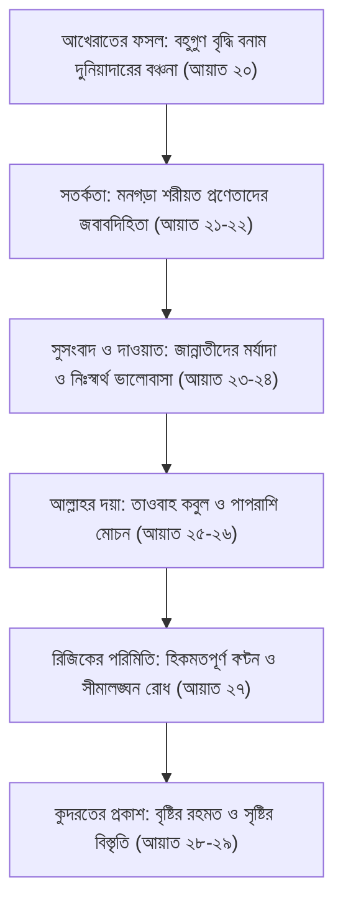

# আশ-শূরা — রুকু ০৩ (আয়াত ২০–২৯)

[সূচিপত্র](00_সূরা-পরিচিতি.md)

---

## ৫-স্তরবিশিষ্ট একাডেমিক যাচাইকরণ স্ট্যাটাস (Verification Status Box)

| স্তর (Tier) | অবস্থা | বিবরণ ও যাচাইয়ের পরিসর |
| :---: | :---: | :--- |
| **স্তর ১: Draft** | সম্পন্ন | ১৬ অধ্যায়ের কাঠামো ও প্রাথমিক তথ্য সংকলিত। |
| **স্তর ২: Digital Verified** | **যাচাইকৃত** | আয়াতের মূল পাঠ ও শব্দ-হরফ গণনা `bahouth` স্ক্রিপ্ট দ্বারা যাচাইকৃত; কিরাআত সারণি ও তুরাছ উদ্ধৃতিসমূহ ডিজিটাল ডাটাবেজের সাথে মিলিয়ে সংকলিত (কাঁচা স্ন্যাপশট সংরক্ষিত: `_sources/ruku_03_raw.json`)। |
| **স্তর ৩: Print Verified** | উন্মুক্ত (`[ ]`) | মুদ্রিত সংস্করণের ভৌত পৃষ্ঠার সাথে চাক্ষুষ মিলকরণের অপেক্ষায়। |
| **স্তর ৪: Scholarly Reviewed** | উন্মুক্ত (`[ ]`) | আকীদাগত ও তাফসীরী তারজীহ বিশেষজ্ঞ মুহাক্কিক আলেম কর্তৃক পর্যালোচনার অপেক্ষায়। |
| **স্তর ৫: Publication Ready** | উন্মুক্ত (`[ ]`) | চূড়ান্ত প্রকাশনা উপযোগী মাস্টার রেফারেন্স। |

---

## ০. রুকুর সারসংক্ষেপ ও কেন্দ্রীয় বক্তব্য (মাকাসিদ)

### প্রধান আত্মিক বার্তাসমূহ:
১. মানুষের সমস্ত আমল ও শ্রমের লক্ষ্য হতে হবে আখেরাতের ফসল অর্জন করা।
২. আল্লাহ ছাড়া কাউকে আইনদাতা বা শরীয়তের প্রণেতা মনে করা স্পষ্ট শিরক।
৩. রাসূলুল্লাহ (ﷺ) তাঁর দাওয়াতের কোনো বিনিময় চাননি; খাঁটি দায়ী কখনো বৈষয়িক স্বার্থের পেছনে ছোটে না।
৪. যত বড় পাপই হোক না কেন, আল্লাহর দরবারে খাঁটি তাওবাহ করলে তিনি ক্ষমা করে দেন।
৫. আল্লাহ প্রত্যেক বান্দাকে তার ধারণক্ষমতা অনুযায়ী রিজিক দেন, কারণ সীমাহীন সম্পদ মানুষের নৈতিক বিনাশ ডেকে আনে।

---

---

## ১. আয়াতের মূল পাঠ ও অনুবাদ

### (১) ১ আরবি পাঠ (হরকতযুক্ত সাধারণ আরবি বানান; পূর্ণ উসমানী রসম নয়)

> [!NOTE]
> নিচে প্রদত্ত পাঠটি হরকতযুক্ত সাধারণ আরবি বানানরীতিতে সাজানো হয়েছে; এটি ক্যালিগ্রাফিক পূর্ণ উসমানী রসম নয়। প্রামাণ্য উসমানী পাঠের জন্য মুসহাফের পৃষ্ঠা দ্রষ্টব্য।

﴿مَنْ كَانَ يُرِيدُ حَرْثَ الْآخِرَةِ نَزِدْ لَهُ فِي حَرْثِهِ وَمَنْ كَانَ يُرِيدُ حَرْثَ الدُّنْيَا نُؤْتِهِ مِنْهَا وَمَا لَهُ فِي الْآخِرَةِ مِنْ نَصِيبٍ ۝20
أَمْ لَهُمْ شُرَكَاءُ شَرَعُوا لَهُمْ مِنْ الدِّينِ مَا لَمْ يَأْذَنْ بِهِ اللَّهُ وَلَوْلَا كَلِمَةُ الْفَصْلِ لَقُضِيَ بَيْنَهُمْ وَإِنَّ الظَّالِمِينَ لَهُمْ عَذَابٌ أَلِيمٌ ۝21
تَرَى الظَّالِمِينَ مُشْفِقِينَ مِمَّا كَسَبُوا وَهُوَ وَاقِعٌ بِهِمْ وَالَّذِينَ آمَنُوا وَعَمِلُوا الصَّالِحَاتِ فِي رَوْضَاتِ الْجَنَّاتِ لَهُمْ مَا يَشَاءُونَ عِنْدَ رَبِّهِمْ ذَلِكَ هُوَ الْفَضْلُ الْكَبِيرُ ۝22
ذَلِكَ الَّذِي يُبَشِّرُ اللَّهُ عِبَادَهُ الَّذِينَ آمَنُوا وَعَمِلُوا الصَّالِحَاتِ قُلْ لَا أَسْأَلُكُمْ عَلَيْهِ أَجْرًا إِلَّا الْمَوَدَّةَ فِي الْقُرْبَى وَمَنْ يَقْتَرِفْ حَسَنَةً نَزِدْ لَهُ فِيهَا حُسْنًا إِنَّ اللَّهَ غَفُورٌ شَكُورٌ ۝23
أَمْ يَقُولُونَ افْتَرَى عَلَى اللَّهِ كَذِبًا فَإِنْ يَشَإْ اللَّهُ يَخْتِمْ عَلَى قَلْبِكَ وَيَمْحُ اللَّهُ الْبَاطِلَ وَيُحِقُّ الْحَقَّ بِكَلِمَاتِهِ إِنَّهُ عَلِيمٌ بِذَاتِ الصُّدُورِ ۝24
وَهُوَ الَّذِي يَقْبَلُ التَّوْبَةَ عَنْ عِبَادِهِ وَيَعْفُو عَنْ السَّيِّئَاتِ وَيَعْلَمُ مَا تَفْعَلُونَ ۝25
وَيَسْتَجِيبُ الَّذِينَ آمَنُوا وَعَمِلُوا الصَّالِحَاتِ وَيَزِيدُهُمْ مِنْ فَضْلِهِ وَالْكَافِرُونَ لَهُمْ عَذَابٌ شَدِيدٌ ۝26
وَلَوْ بَسَطَ اللَّهُ الرِّزْقَ لِعِبَادِهِ لَبَغَوْا فِي الْأَرْضِ وَلَكِنْ يُنَزِّلُ بِقَدَرٍ مَا يَشَاءُ إِنَّهُ بِعِبَادِهِ خَبِيرٌ بَصِيرٌ ۝27
وَهُوَ الَّذِي يُنَزِّلُ الْغَيْثَ مِنْ بَعْدِ مَا قَنَطُوا وَيَنْشُرُ رَحْمَتَهُ وَهُوَ الْوَلِيُّ الْحَمِيدُ ۝28
وَمِنْ آيَاتِهِ خَلْقُ السَّمَاوَاتِ وَالْأَرْضِ وَمَا بَثَّ فِيهِمَا مِنْ دَابَّةٍ وَهُوَ عَلَى جَمْعِهِمْ إِذَا يَشَاءُ قَدِيرٌ ۝29﴾

### (১) ২ শব্দানুগ ও সাবলীল অনুবাদ

| আয়াত | মূল আরবী পাঠ | সাবলীল বঙ্গানুবাদ |
| :---: | :--- | :--- |
| **২০** | ﴿مَنْ كَانَ يُرِيدُ حَرْثَ الْآخِرَةِ نَزِدْ لَهُ فِي حَرْثِهِ وَمَنْ كَانَ يُرِيدُ حَرْثَ الدُّنْيَا نُؤْتِهِ مِنْهَا وَمَا لَهُ فِي الْآخِرَةِ مِنْ نَصِيبٍ﴾ | যে ব্যক্তি আখেরাতের ফসল কামনা করে, আমি তার জন্য তার ফসলে প্রাচুর্য দান করি; আর যে ব্যক্তি কেবল পার্থিব জীবনের ফসল চায়, আমি তাকে তা হতে কিছু প্রদান করি কিন্তু পরকালে তার কোনো অংশ থাকবে না। |
| **২১** | ﴿أَمْ لَهُمْ شُرَكَاءُ شَرَعُوا لَهُمْ مِنْ الدِّينِ مَا لَمْ يَأْذَنْ بِهِ اللَّهُ وَلَوْلَا كَلِمَةُ الْفَصْلِ لَقُضِيَ بَيْنَهُمْ وَإِنَّ الظَّالِمِينَ لَهُمْ عَذَابٌ أَلِيمٌ﴾ | তবে কি তাদের এমন কোনো শরীক আছে যারা তাদের জন্য দ্বীনের এমন বিধান নির্ধারণ করেছে যার অনুমতি আল্লাহ দেননি? আর ফয়সালার চূড়ান্ত সিদ্ধান্ত না থাকলে তাদের মাঝে বিচার নিষ্পন্ন হয়ে যেত; এবং নিশ্চয় জালিমদের জন্য রয়েছে যন্ত্রণাদায়ক শাস্তি। |
| **২২** | ﴿تَرَى الظَّالِمِينَ مُشْفِقِينَ مِمَّا كَسَبُوا وَهُوَ وَاقِعٌ بِهِمْ وَالَّذِينَ آمَنُوا وَعَمِلُوا الصَّالِحَاتِ فِي رَوْضَاتِ الْجَنَّاتِ لَهُمْ مَا يَشَاءُونَ عِنْدَ رَبِّهِمْ ذَلِكَ هُوَ الْفَضْلُ الْكَبِيرُ﴾ | আপনি জালিমদের তাদের কৃতকর্মের জন্য সশঙ্কিত দেখতে পাবেন, অথচ তা তাদের ওপর আপতিত হবেই; আর যারা ঈমান এনেছে এবং সৎকর্ম করেছে তারা থাকবে জান্নাতের মনোরম পুষ্পোদ্যানসমূহে; তাদের প্রতিপালকের নিকট তাদের জন্য থাকবে যা কিছু তারা চাইবে; এই তো সেই মহা অনুগ্রহ। |
| **২৩** | ﴿ذَلِكَ الَّذِي يُبَشِّرُ اللَّهُ عِبَادَهُ الَّذِينَ آمَنُوا وَعَمِلُوا الصَّالِحَاتِ قُلْ لَا أَسْأَلُكُمْ عَلَيْهِ أَجْرًا إِلَّا الْمَوَدَّةَ فِي الْقُرْبَى وَمَنْ يَقْتَرِفْ حَسَنَةً نَزِدْ لَهُ فِيهَا حُسْنًا إِنَّ اللَّهَ غَفُورٌ شَكُورٌ﴾ | এই তো তা, যার সুসংবাদ আল্লাহ তাঁর সেই বান্দাদের দেন যারা ঈমান আনে এবং সৎকর্ম করে। বলুন, ‘আমি এর বিনিময়ে তোমাদের নিকট হতে কোনো প্রতিদান চাই না, কেবল আত্মীয়তার সৌহার্দ্য ও ভালোবাসা ছাড়া।’ আর যে ব্যক্তি কোনো পুণ্য অর্জন করে, আমি তার জন্য তাতে কল্যাণ বৃদ্ধি করে দিই; নিশ্চয় আল্লাহ পরম ক্ষমাশীল, গুণগ্রাহী। |
| **২৪** | ﴿أَمْ يَقُولُونَ افْتَرَى عَلَى اللَّهِ كَذِبًا فَإِنْ يَشَإْ اللَّهُ يَخْتِمْ عَلَى قَلْبِكَ وَيَمْحُ اللَّهُ الْبَاطِلَ وَيُحِقُّ الْحَقَّ بِكَلِمَاتِهِ إِنَّهُ عَلِيمٌ بِذَاتِ الصُّدُورِ﴾ | তবে কি তারা বলে যে সে আল্লাহর ওপর মিথ্যা রচনা করেছে? বস্তুত আল্লাহ ইচ্ছা করলে আপনার অন্তরে মোহর এঁটে দিতেন; আর আল্লাহ বাতিলকে বিলুপ্ত করেন এবং নিজ বাণী দ্বারা সত্যকে প্রতিষ্ঠিত করেন; নিশ্চয় তিনি অন্তরের গোপন রহস্য সম্পর্কে সম্যক অবগত। |
| **২৫** | ﴿وَهُوَ الَّذِي يَقْبَلُ التَّوْبَةَ عَنْ عِبَادِهِ وَيَعْفُو عَنْ السَّيِّئَاتِ وَيَعْلَمُ مَا تَفْعَلُونَ﴾ | এবং তিনিই তাঁর বান্দাদের তাওবাহ কবুল করেন এবং পাপরাশি মোচন করেন; এবং তোমরা যা কিছু করো তিনি তা অবগত আছেন। |
| **২৬** | ﴿وَيَسْتَجِيبُ الَّذِينَ آمَنُوا وَعَمِلُوا الصَّالِحَاتِ وَيَزِيدُهُمْ مِنْ فَضْلِهِ وَالْكَافِرُونَ لَهُمْ عَذَابٌ شَدِيدٌ﴾ | এবং যারা ঈমান এনেছে ও সৎকর্ম করেছে তিনি তাদের দো‘আ কবুল করেন এবং তাঁর অনুগ্রহ হতে তাদের আরও বৃদ্ধি করে দেন; আর কাফিরদের জন্য রয়েছে কঠিন শাস্তি। |
| **২৭** | ﴿وَلَوْ بَسَطَ اللَّهُ الرِّزْقَ لِعِبَادِهِ لَبَغَوْا فِي الْأَرْضِ وَلَكِنْ يُنَزِّلُ بِقَدَرٍ مَا يَشَاءُ إِنَّهُ بِعِبَادِهِ خَبِيرٌ بَصِيرٌ﴾ | আর আল্লাহ যদি তাঁর সমস্ত বান্দার জন্য রিজিক প্রশস্ত করে দিতেন, তবে তারা পৃথিবীতে অবশ্যই সীমালঙ্ঘন ও বিদ্রোহ করত; কিন্তু তিনি যা ইচ্ছা পরিমিত পরিমাণে অবতীর্ণ করেন; নিশ্চয় তিনি তাঁর বান্দাদের বিষয়ে সম্যক অবহিত, সর্বদ্রষ্টা। |
| **২৮** | ﴿وَهُوَ الَّذِي يُنَزِّلُ الْغَيْثَ مِنْ بَعْدِ مَا قَنَطُوا وَيَنْشُرُ رَحْمَتَهُ وَهُوَ الْوَلِيُّ الْحَمِيدُ﴾ | এবং তিনিই মানুষের চরম হতাশার পর বৃষ্টি বর্ষণ করেন এবং তাঁর রহমত বিস্তার করেন; এবং তিনিই তো প্রকৃত অভিভাবক, পরম প্রশংসিত। |
| **২৯** | ﴿وَمِنْ آيَاتِهِ خَلْقُ السَّمَاوَاتِ وَالْأَرْضِ وَمَا بَثَّ فِيهِمَا مِنْ دَابَّةٍ وَهُوَ عَلَى جَمْعِهِمْ إِذَا يَشَاءُ قَدِيرٌ﴾ | আর তাঁর অন্যতম নিদর্শন হলো আকাশমণ্ডলী ও পৃথিবীর সৃষ্টি এবং এই উভয়ের মধ্যে তিনি যে সমস্ত জীবজন্তু ও প্রাণীকুল ছড়িয়ে দিয়েছেন সেগুলি; এবং তিনি যখন ইচ্ছা তখন তাদের সকলকে একত্রিত করতে পূর্ণ সক্ষম। |

---

## ২. লুগাভী ও সরফী তাহকীক এবং মুফরাদাতুল কুরআন

| শব্দ | মূলধাতু | সীগা / ওযন | আভিধানিক অর্থ | কুরআনিক প্রয়োগ ও তাৎপর্য |
| :--- | :---: | :---: | :--- | :--- |
| **حَرْثَ الْآخِرَةِ** | `حرث` | مركب إضافي مفعول به | পরকালের ফসল ও প্রতিদান | আখেরাতের চিরন্তন নাজাতের উদ্দেশ্যে নেক আমল ও আত্মত্যাগের সাধনা। |
| **حَرْثَ الدُّنْيَا** | `حرث` | مركب إضافي مفعول به | পার্থিব ক্ষণস্থায়ী প্রাপ্তি | পরকাল ভুলে কেবল পার্থিব স্বার্থ ও ভোগবিলাসে মেতে ওঠার সংকীর্ণতা। |
| **مُشْفِقِينَ** | `شفق` | اسم فاعل جمع حال | ভয়ে প্রকম্পিত ও শঙ্কিত | কিয়ামতের দিন নিজের কৃতকর্মের প্রতিফল প্রত্যক্ষ করে জালিমদের চরম আতঙ্ক। |
| **رَوْضَاتِ الْجَنَّاتِ** | `روض` | مركب إضافي مجرور | জান্নাতের সুশোভিত পুষ্পোদ্যান | মুমিনদের জন্য পরকালে জান্নাতের সুরম্য ও চিরশান্তির সুরভিত বাগানসমূহ। |
| **الْمَوَدَّةَ فِي الْقُرْبَىٰ** | `ودد` / `قرب` | مركب إضافي مع شبه جملة | আত্মীয়তার ভালোবাসা ও হক | দাওয়াতের বিনিময়ে কোনো অর্থ নয়, বরং আত্মীয়তার পারস্পরিক সম্মান ও প্রীতি রক্ষা। |
| **يَقْتَرِفْ حَسَنَةً** | `قرف` / `حسن` | مركب فعلي شرطي | উত্তম আমল অর্জন করে | যে ব্যক্তি কোনো সওয়াবের কাজ করে আল্লাহ তার জন্য কল্যাণ ও বরকত বৃদ্ধি করেন। |
| **شَكُورٌ** | `شكر` | صيغة مبالغة (فَعُول) | অতীব গুণগ্রাহী ও ক্বদরদান | বান্দার সামান্য আমলের বিনিময়ে বিপুল প্রতিদান ও মর্যাদা প্রদানকারী। |
| **الْغَيْثَ** | `غيث` | اسم مفرد مفعول به | সঞ্জীবনী প্রবল বৃষ্টিধারা | বান্দা যখন হতাশায় নিমজ্জিত হয় তখন আকাশ থেকে পরম রহমতের বৃষ্টিবর্ষণ। |

---

## ৩. ই'রাব ও নাহবী বিশ্লেষণ

1. **﴿مَنْ كَانَ يُرِيدُ حَرْثَ الْآخِرَةِ نَزِدْ لَهُ فِي حَرْثِهِ﴾ (আয়াত ২০):**
   - `مَنْ`: ইসমু শার্ত জাযিম মুবতাদা; `كَانَ`: ফে‘লে মাযী নাক্বিস শার্তের মাহাল্লে মাজযূম।
   - `نَزِدْ`: জাওয়াবে শার্ত ফে‘লে মুযারে মাজযূম بالسكون; ফায়েল নাহনু মুসতাতীর।

2. **﴿قُلْ لَا أَسْأَلُكُمْ عَلَيْهِ أَجْرًا إِلَّا الْمَوَدَّةَ فِي الْقُرْبَى﴾ (আয়াত ২৩):**
   - `أَجْرًا`: মাফ‘ঊল বিহি সান মানসূব بالفتحة।
   - `إِلَّا`: ইস্তিসনা মুনক্বাতি‘ (حرف استثناء)؛ `الْمَوَدَّةَ`: মুসতাসনা মানসূব بالفتحة।
   - `فِي الْقُرْبَى`: যার ও মাজরুর আল-মাওয়াদ্দাহর সাথে মুতা‘আল্লিক্ব।

3. **﴿وَهُوَ الَّذِي يُنَزِّلُ الْغَيْثَ مِنْ بَعْدِ مَا قَنَطُوا﴾ (আয়াত ২৮):**
   - `وَهُوَ`: মুবতাদা (في محل رفع)؛ `الَّذِي`: খবর মারফূ‘ মাহাল্লান।
   - `يُنَزِّلُ الْغَيْثَ`: ফে‘ল, ফায়েল ও মাফ‘ঊল বিহি সিলাতুল মাউসূল।

---

## ৪. কিরাআত ও তাফসীরে প্রভাব

দশ মুতাওয়াতির কিরাআতের প্রত্যক্ষ হরকত ও প্রামাণ্য বর্ণনা নিম্নে সারণিবদ্ধ করা হলো (উৎস: `bahouth:list_verse_qiraat`):

প্রযোজ্য নয় — এই রুকুর আয়াতসমূহে দশ মুতাওয়াতির ক্বারীর মধ্যে `bahouth` কিরাআত ডাটাবেজে কোনো পাঠভেদ নথিভুক্ত নেই।

---

## ৫. তাফসীরুল জালালাইন ও তুলনামূলক তাফসীর

### (৫) ১ তাফসীরুল জালালাইন

### মূল আরবী পাঠ (তাফসীরে জালালাইন - ইমাম সুয়ূতী)
> **{مَن كَانَ يُرِيدُ}** بِعَمَلِهِ **{حَرْثَ الْآخِرَةِ}** ثَوَابَهَا **{نَزِدْ لَهُ فِي حَرْثِهِ}** نُضَاعِفْ لَهُ الْحَسَنَةَ الْوَاحِدَةَ إِلَى عَشْرٍ إِلَى سَبْعِمِائَةِ ضِعْفٍ وَأَكْثَرَ **{وَمَن كَانَ يُرِيدُ حَرْثَ الدُّنْيَا}** نَعِيمَهَا **{نُؤْتِهِ مِنْهَا}** مَا قَسَمْنَاهُ لَهُ **{وَمَا لَهُ فِي الْآخِرَةِ مِن نَّصِيبٍ}** حَظٍّ مِنَ الْجَنَّةِ. **{أَمْ}** بَلْ **{لَهُمْ شُرَكَاءُ}** شَيَاطِينُ **{شَرَعُوا لَهُم مِّنَ الدِّينِ مَا لَمْ يَأْذَن بِهِ اللَّهُ}** مِنَ الشِّرْكِ وَتَحْرِيمِ الْبَحِيرَةِ وَالسَّائِبَةِ **{وَلَوْلَا كَلِمَةُ الْفَصْلِ}** أَيْ قَضَاؤُهُ تَعَالَى بِتَأْخِيرِ الْحِسَابِ لِيَوْمِ الْقِيَامَةِ **{لَّقُضِيَ بَيْنَهُمْ}** بِتَعْجِيلِ الْعَذَابِ فِي الدُّنْيَا **{وَإِنَّ الظَّالِمِينَ}** الْكَافِرِينَ **{لَهُمْ عَذَابٌ أَلِيمٌ}**.
> **{تَرَى الظَّالِمِينَ}** يَوْمَ الْقِيَامَةِ **{مُشْفِقِينَ}** خَائِفِينَ **{مِمَّا كَسَبُوا}** مِنْ سَيِّئَاتِهِمْ **{وَهُوَ وَاقِعٌ بِهِمْ}** نَازِلٌ عَلَيْهِمْ لَا مَحَالَةَ **{وَالَّذِينَ آمَنُوا وَعَمِلُوا الصَّالِحَاتِ فِي رَوْضَاتِ الْجَنَّاتِ}** بَسَاتِينِهَا **{لَهُم مَّا يَشَاءُونَ عِندَ رَبِّهِمْ ذَٰلِكَ هُوَ الْفَضْلُ الْكَبِيرُ}**. **{ذَٰلِكَ الَّذِي يُبَشِّرُ}** بِالتَّخْفِيفِ وَالتَّشْدِيدِ **{اللَّهُ عِبَادَهُ الَّذِينَ آمَنُوا وَعَمِلُوا الصَّالِحَاتِ قُل لَّا أَسْأَلُكُمْ عَلَيْهِ}** عَلَى تَبْلِيغِ الرِّسَالَةِ **{أَجْرًا إِلَّا الْمَوَدَّةَ فِي الْقُرْبَىٰ}** أَنْ تَوَدُّونِي لِقَرَابَتِي فِيكُمْ، فَإِنَّ لَهُ فِي كُلِّ بَطْنٍ مِنْ قُرَيْشٍ قَرَابَةً **{وَمَن يَقْتَرِفْ}** يَكْتَسِبْ **{حَسَنَةً نَّزِدْ لَهُ فِيهَا حُسْنًا}** بِالتَّضْعِيفِ **{إِنَّ اللَّهَ غَفُورٌ}** لِلذُّنُوبِ **{شَكُورٌ}** لِلْقَلِيلِ مِنَ الْعَمَلِ فَيُثِيبُ عَلَيْهِ الْكَثِيرَ.
> **{وَهُوَ الَّذِي يَقْبَلُ التَّوْبَةَ عَنْ عِبَادِهِ وَيَعْفُو عَنِ السَّيِّئَاتِ وَيَعْلَمُ مَا تَفْعَلُونَ}** بِالتَّاءِ وَالْيَاءِ. **{وَلَوْ بَسَطَ اللَّهُ الرِّزْقَ لِعِبَادِهِ}** جَمِيعًا **{لَبَغَوْا فِي الْأَرْضِ}** طَغَوْا فِيهَا **{وَلَٰكِن يُنَزِّلُ}** بِالتَّخْفِيفِ وَالتَّشْدِيدِ **{بِقَدَرٍ مَّا يَشَاءُ}** فَيُغْنِي بَعْضًا وَيُفْقِرُ بَعْضًا بِحَسَبِ مَصْلَحَتِهِمْ. **{وَهُوَ الَّذِي يُنَزِّلُ الْغَيْثَ}** الْمَطَرَ **{مِن بَعْدِ مَا قَنَطُوا}** يَئِسُوا **{وَيَنشُرُ رَحْمَتَهُ}** بَرَكَتَهُ وَرِزْقَهُ **{وَهُوَ الْوَلِيُّ}** الْمُتَوَلِّي لِعِبَادِهِ **{الْحَمِيدُ}** الْمَحْمُودُ فِي صُنْعِهِ.

### সরল ব্যাখ্যা ও মর্মার্থ
ইমাম সুয়ূতী (রহ.) [তুরাছ আইডি: ১২৮৭৬] চমৎকারভাবে আয়াতগুলোর তাফসীর করেন: কর্ম ও ফলপ্রাপ্তিকে আল্লাহ তা‘আলা কৃষিকাজ বা ফসলের (হারছ) রূপকে উপস্থাপন করেছেন। যে ব্যক্তি আখেরাতের পুণ্য ও জান্নাতের উদ্দেশ্যে নেক আমল করে, আল্লাহ তার সওয়াব বহুগুণ বৃদ্ধি করে দেন; আর যে ব্যক্তি কেবল দুনিয়ার ধনদৌলতের জন্য কাজ করে, তাকে দুনিয়াতে সামান্য দেওয়া হলেও আখেরাতে সে চিরবঞ্চিত হবে। আল্লাহ ব্যতীত মনগড়া শরীয়ত ও কুসংস্কার তৈরি করার কোনো অধিকার কারো নেই। রাসূলুল্লাহ (ﷺ) তাঁর দাওয়াতের বিনিময়ে কোনো পার্থিব পারিশ্রমিক চাননি, কেবল চেয়েছেন কুরাইশরা যেন রক্তের আত্মীয়তার মর্যাদা রক্ষা করে তাঁর ওপর নিপীড়ন বন্ধ করে। আল্লাহ তা‘আলা অত্যন্ত ক্ষমাশীল; তিনি বান্দার তাওবাহ কবুল করেন। মানুষের স্বভাবগত দুর্বলতা হলো অতিরিক্ত প্রাচুর্য পেলে সে অহংকারী ও বিদ্রোহী হয়ে ওঠে, তাই আল্লাহ হিকমতের সাথে পরিমিত রিজিক দান করেন। দীর্ঘ অনাবৃষ্টির পর মানুষের চরম নিরাশার মুহূর্তে রহমতের বারিধারা বর্ষণ আল্লাহর পরম অভিভাবকত্ব ও দয়ার বাস্তব নিদর্শন।

---

### (৫) ২ তাফসীর বিল-মা'ছূর (হাদীস ও আছার)

১. **দুনিয়া ও আখেরাতের ফসলের তাৎপর্য (আয়াত ২০):**
   * ইমাম ইবনে কাসীর [তুরাছ আইডি: ৮৪৭৩, খণ্ড ৬, পৃ. ৯৯২] আনাস ইবনে মালিক (রা.) হতে রাসূলুল্লাহ (ﷺ)-এর সুপ্রসিদ্ধ হাদীস উদ্ধৃত করেন:
     > “مَنْ كَانَتِ الآخِرَةُ هَمَّهُ جَعَلَ اللَّهُ غِنَاهُ فِي قَلْبِهِ وَجَمَعَ لَهُ شَمْلَهُ، وَأَتَتْهُ الدُّنْيَا وَهِيَ رَاغِمَةٌ، وَمَنْ كَانَتِ الدُّنْيَا هَمَّهُ جَعَلَ اللَّهُ فَقْرَهُ بَيْنَ عَيْنَيْهِ، وَفَرَّقَ عَلَيْهِ شَمْلَهُ، وَلَمْ يَأْتِهِ مِنَ الدُّنْيَا إِلَّا مَا قُدِّرَ لَهُ”
     > "যার মূল চিন্তা হবে আখেরাত, আল্লাহ তার অন্তরে প্রাচুর্য দান করবেন, তার যাবতীয় বিচ্ছিন্ন বিষয় একত্রিত করে দেবেন এবং দুনিয়া তার নিকট অপদস্থ হয়ে পদানত হবে। আর যার মূল চিন্তা হবে দুনিয়া, আল্লাহ দারিদ্র্যকে তার দুই চোখের সামনে ঝুলিয়ে দেবেন, তার বিষয়াদিকে ছত্রভঙ্গ করে দেবেন এবং দুনিয়া থেকে সে কেবল তা-ই পাবে যা তার তাক্বদীরে নির্ধারিত ছিল।" (জামে‘ তিরমিযী: ২৪৬৫)।
২. **'আল-মাওয়াদ্দাতু ফিল ক্বুরবা'-এর সঠিক তাফসীর (আয়াত ২৩):**
   * সহীহ বুখারীতে (৪৮১৮) হযরত ইবনে আব্বাস (রা.)-এর শাগরেদ তাউস (রহ.) থেকে বর্ণিত: যখন এক ব্যক্তি বলল, এর অর্থ হলো আল-মুহাম্মদ (নবীজীর পরিবারবর্গ), তখন ইবনে আব্বাস (রা.) বললেন: "তুমি তাড়াহুড়ো করে ভুল ব্যাখ্যা করেছ! কুরাইশের এমন কোনো গোত্র বা শাখা ছিল না যার সাথে রাসূলুল্লাহ (ﷺ)-এর রক্তের আত্মীয়তার সম্পর্ক ছিল না। তাই নবীজী কুরাইশদের বলেছিলেন: তোমরা যদি আমার প্রতি ঈমান না-ও আনো, তবে আমার ও তোমাদের মধ্যকার রক্তের আত্মীয়তার খাতিরে অন্তত আমাকে কষ্ট দেওয়া বন্ধ করো এবং ভালোবাসা বজায় রাখো।"
   * ইমাম তাবারী [তুরাছ আইডি: ৭৭৯৮] ও কুরতুবী [তুরাছ আইডি: ২০৮৫৫] বলেন: নবী পরিবারের প্রতি ভালোবাসা রাখা প্রতিটি মুমিনের ঈমানী দায়িত্ব, তবে মক্কী সূরায় কুরাইশদের উদ্দেশ্যে এই আয়াতের প্রাথমিক অর্থ ছিল আত্মীয়তার সম্পর্ক রক্ষা করা।
৩. **অনাবৃষ্টির পর রহমতের বৃষ্টি (আয়াত ২৮):**
   * হযরত উমর ইবনুল খাত্তাব (রা.)-এর খেলাফতকালে যখন আরবে প্রচণ্ড দুর্ভিক্ষ ও খরা দেখা দেয় ('আমুর রামাদাহ), তখন তিনি এই আয়াত তিলাওয়াত করে ইস্তিসক্বার নামায আদায় করেছিলেন এবং আল্লাহর রহমত হিসেবে অবিরাম বৃষ্টি বর্ষিত হয়েছিল।

---

### (৫) ৩ অন্যান্য তাফসীরের তুলনামূলক পর্যালোচনা

### (১) 'إِلَّا الْمَوَدَّةَ فِي الْقُرْبَىٰ'-এর শিয়া ও সুন্নী দৃষ্টিভঙ্গি
* **শিয়া তাফসীরকারকগণ:** তাঁরা দাবি করেন যে এই আয়াত দ্বারা কেবল আলী, ফাতিমা, হাসান ও হুসাইন (রা.)-এর ভালোবাসা ও তাঁদের রাজনৈতিক আনুগত্যকে ফরয করা হয়েছে।
* **আহলে সুন্নাত ওয়াল জামা‘আত (তাবারী [তুরাছ আইডি: ৭৭৯৮], ইবনে কাসীর [তুরাছ আইডি: ৮৪৭৩], কুরতুবী [তুরাছ আইডি: ২০৮৫৫]):** আহলে সুন্নাতের ঐকমত্য হলো: নবী পরিবারের প্রতি মুহাব্বত ঈমানের অবিচ্ছেদ্য অংশ। কিন্তু আয়াতটি মক্কায় অবতীর্ণ হওয়ার কারণে এর ঐতিহাসিক অর্থ হলো কুরাইশদের সাথে আত্মীয়তার রক্তের সম্পর্ক বজায় রাখা। দ্বিতীয়ত, সৎকাজের মাধ্যমে আল্লাহর নৈকট্য (কুরবাত) অর্জন করাও এর গভীর আধ্যাত্মিক অর্থ।

### (২) মনগড়া বিধান (তাশরী‘) প্রণয়নের বিধান
* **ইমাম কুরতুবী [তুরাছ আইডি: ২০৮৫৫] ও শায়খুল ইসলাম ইবনে তাইমিয়্যাহ:** যে ব্যক্তি আল্লাহর শরীয়তের সুস্পষ্ট হালালকে হারাম করে বা হারামকে হালাল করে আইন বানায়, সে এই আয়াত (২১) অনুযায়ী শিরকে আকবারে লিপ্ত হয়। সার্বভৌম হালাল-হারামের আইন প্রণয়নের নিরঙ্কুশ অধিকার কেবল আল্লাহর।

---

---

## ৬. শানে নুযূল, সংশ্লিষ্ট ঘটনা ও হাদীসের তাখরীজ

### আয়াত ২৩-এর শানে নুযূল
* ইমাম আহমাদ ও তাবারী [তুরাছ আইডি: ৭৭৯৮] বর্ণনা করেন: আনসার সাহাবীগণ রাসূলুল্লাহ (ﷺ)-এর খিদমতে প্রচুর সম্পদ ও নজরানা নিয়ে এসে নিবেদন করলেন, "হে আল্লাহর রাসূল! আপনি আল্লাহর দ্বীনের দাওয়াত দিতে গিয়ে নানা সংকটে পড়েন; আপনি এই সম্পদ গ্রহণ করে আপনার ইচ্ছামতো ব্যয় করুন।" তখন আল্লাহ তা‘আলা আয়াত ২৩ নাযিল করে ঘোষণা করেন যে, নবীজী কোনো বৈষয়িক পারিশ্রমিক বা বিনিময় গ্রহণ করার জন্য প্রেরিত হননি; তিনি সম্পূর্ণ নিঃস্বার্থভাবে মানুষকে মুক্তির পথ প্রদর্শন করেন।

### আয়াত ২৭-এর শানে নুযূল
* খুব্বাব ইবনুল আরাত (রা.) ও আহলুস সুফফার সাহাবীগণ হতে বর্ণিত: আমরা যখন অত্যন্ত দরিদ্র ছিলাম এবং মক্কার কাফিরদের অগাধ ধনদৌলত দেখতাম, তখন আমাদের মনে হতো আমাদেরও যদি এমন প্রাচুর্য থাকত তবে আমরা অনেক ভালো কাজ করতে পারতাম! তখন আল্লাহ তা‘আলা আয়াত ২৭ নাযিল করে সতর্ক করেন যে, সকলকে অতিরিক্ত সম্পদ দিলে সমাজে অহংকার, বিদ্রোহ ও ফ্যাসাদ ছড়িয়ে পড়ত; তাই আল্লাহ যার জন্য যা উপযুক্ত সেই পরিমাণেই রিজিক নির্ধারণ করেন।

---

---

## ৭. মুখাতাব, ইখতিলাফ ও প্রসিদ্ধ তারজীহ

প্রযোজ্য নয় — এই রুকুতে সম্বোধনের পাত্র ও মূল বার্তার ব্যাখ্যায় মুফাসসিরগণের মধ্যে কোনো মৌলিক ইখতিলাফ নেই।

---

## ৮. আহকাম ও চার মাযহাবের তুলনামূলক ফিকহ

### (১) 'إِلَّا الْمَوَدَّةَ فِي الْقُرْبَىٰ'-এর শিয়া ও সুন্নী দৃষ্টিভঙ্গি
* **শিয়া তাফসীরকারকগণ:** তাঁরা দাবি করেন যে এই আয়াত দ্বারা কেবল আলী, ফাতিমা, হাসান ও হুসাইন (রা.)-এর ভালোবাসা ও তাঁদের রাজনৈতিক আনুগত্যকে ফরয করা হয়েছে।
* **আহলে সুন্নাত ওয়াল জামা‘আত (তাবারী [তুরাছ আইডি: ৭৭৯৮], ইবনে কাসীর [তুরাছ আইডি: ৮৪৭৩], কুরতুবী [তুরাছ আইডি: ২০৮৫৫]):** আহলে সুন্নাতের ঐকমত্য হলো: নবী পরিবারের প্রতি মুহাব্বত ঈমানের অবিচ্ছেদ্য অংশ। কিন্তু আয়াতটি মক্কায় অবতীর্ণ হওয়ার কারণে এর ঐতিহাসিক অর্থ হলো কুরাইশদের সাথে আত্মীয়তার রক্তের সম্পর্ক বজায় রাখা। দ্বিতীয়ত, সৎকাজের মাধ্যমে আল্লাহর নৈকট্য (কুরবাত) অর্জন করাও এর গভীর আধ্যাত্মিক অর্থ।

### (২) মনগড়া বিধান (তাশরী‘) প্রণয়নের বিধান
* **ইমাম কুরতুবী [তুরাছ আইডি: ২০৮৫৫] ও শায়খুল ইসলাম ইবনে তাইমিয়্যাহ:** যে ব্যক্তি আল্লাহর শরীয়তের সুস্পষ্ট হালালকে হারাম করে বা হারামকে হালাল করে আইন বানায়, সে এই আয়াত (২১) অনুযায়ী শিরকে আকবারে লিপ্ত হয়। সার্বভৌম হালাল-হারামের আইন প্রণয়নের নিরঙ্কুশ অধিকার কেবল আল্লাহর।

---

---

## ৯. উলূমুল কুরআন ও উসূলুত তাফসীর

প্রযোজ্য নয় — এই রুকুতে আয়াতসমূহ সুসংহত ও স্পষ্ট; কোনো জটিল নাসেখ-মানসূখ বা উলূমুল কুরআনের মতপার্থক্য প্রযোজ্য নয়।

---

## ১০. বালাগাত ও আল-কুরআনের ই'জায

### বাক্যতাত্ত্বিক বিশ্লেষণ (I'rab)
* **مَن كَانَ يُرِيدُ حَرْثَ الْآخِرَةِ:** مَنْ: اسم شرط جازم مبتدأ، كان: فعل ماض ناقص في محل جزم فعل الشرط، واسمها مستتر تقديره هو، يريدُ: فعل مضارع مرفوع، وفاعله مستتر، حَرْثَ: مفعول به منصوب، وهو مضاف، والآخرةِ: مضاف إليه، وجملة يريد في محل نصب خبر كان.
* **نَزِدْ لَهُ فِي حَرْثِهِ:** نَزِدْ: فعل مضارع مجزوم لأنه جواب الشرط وعلامة جزمه السكون، والفاعل مستتر تقديره نحن للتعظيم، له: جار ومجرور، في حرثه: جار ومجرور متعلق بنزد، والجملة في محل جزم جواب الشرط.
* **قُل لَّا أَسْأَلُكُمْ عَلَيْهِ أَجْرًا:** قل: فعل أمر مبني على السكون، لا: نافية، أسألُكم: فعل مضارع مرفوع، والفاعل مستتر تقديره أنا، والكاف مفعول به أول، عليه: جار ومجرور متعلق بأسأل، أَجْرًا: مفعول به ثانٍ منصوب بالفتحة.
* **إِلَّا الْمَوَدَّةَ فِي الْقُرْبَىٰ:** إلا: أداة استثناء، المودّةَ: منصوب على الاستثناء المنقطع أو المتصل وعلامة نصبه الفتحة، في القربى: جار ومجرور متعلق بمحذوف حال من المودة.
* **وَهُوَ عَلَىٰ جَمْعِهِمْ إِذَا يَشَاءُ قَدِيرٌ:** الواو استئنافية، هو: ضمير منفصل مبتدأ، على جمعهم: جار ومجرور متعلق بقدير، وهو مضاف والهاء مضاف إليه، إذا: ظرف لما يستقبل من الزمان خافض لشرطه منصوب بجوابه، يشاءُ: فعل مضارع والفاعل مستتر، قَدِيرٌ: خبر المبتدأ مرفوع بالضمة.

### বালাগাত ও অলঙ্কারশাস্ত্র (Rhetoric)
১. **ইস্তিয়ারাহ তামছীলিয়্যাহ (Allegorical Metaphor):** 'حَرْثَ الْآخِرَةِ'—মানুষের আমল ও আখেরাতের প্রতিদানকে বীজ বপন ও ফসল তোলার সাথে উপমিত করা হয়েছে। কৃষক যেমন যত্ন নিয়ে বীজ বোনে এবং ফসল তোলে, মুমিনও তেমনি নেক আমলের বীজ বুনে জান্নাতের অফুরন্ত ফসল আহরণ করে।
২. **তিবাক্ব ও মুক্বাবালাহ:** দুনিয়ার তুচ্ছ ফসলকামী ও আখেরাতের চিরন্তন ফসলকামীর মধ্যে চমৎকার বৈপরীত্য ফুটিয়ে তোলা হয়েছে।
৩. **ইফাদাতুল হিকমাহ:** 'وَلَوْ بَسَطَ اللَّهُ الرِّزْقَ لِعِبَادِهِ لَبَغَوْا فِي الْأَرْضِ'—সামাজিক ও অর্থনৈতিক ভারসাম্যের ঐশী দর্শনকে অপরূপ বালাগাতপূর্ণ বাক্যে সংক্ষেপিত করা হয়েছে।

---

---

## ১১. সমকালীন প্রাসঙ্গিকতা ও সংশয় নিরসন

১. **দ্বীনী কাজের বিনিময়ে পারিশ্রমিক গ্রহণের বিধান:**
   * ইমাম আবূ হানীফা ও প্রাচীন ফুক্বাহার মতে দাওয়াত, ইমামতি ও আযানের জন্য কোনো বিনিময় নেওয়া জায়েয নেই। তবে মুতাআখখিরীন ফুক্বাহায়ে কিরাম (পরবর্তী যুগের আলেমগণ) দ্বীনের হিফাযতের স্বার্থে ইমাম, মুয়াযযিন ও শিক্ষকদের জন্য রাষ্ট্রীয় বা সামাজিক ভাতা গ্রহণকে বৈধ ও মুস্তাহাব সাব্যস্ত করেছেন।
২. **তাওবাহ কবুলের শর্তাবলী:**
   * আয়াত ২৫ প্রমাণ করে খাঁটি তাওবাহর মাধ্যমে অতীতের সমস্ত কবিরা গুনাহ মাফ হয়ে যায়। তাওবাহর ফিকহী শর্ত হলো: গুনাহ অবিলম্বে ত্যাগ করা, লজ্জিত হওয়া, ভবিষ্যতে না করার দৃঢ় সংকল্প করা এবং বান্দার হক থাকলে তা ফিরিয়ে দেওয়া।

---

---

## ১২. আন্তঃআয়াত ও বিষয়ভিত্তিক কুরআনিক সংযোগ

প্রযোজ্য নয় — সূরার সার্বিক ধারাক্রম ও রুকুর আন্তঃআয়াত সংযোগ প্রাসঙ্গিকভাবে পূর্ববর্তী অনুচ্ছেদসমূহে আলোচিত হয়েছে।

---

## ১৩. দারস, তারবিয়াত ও দাওয়াতী নির্দেশনা

১. **আমলের নিয়তের বিশুদ্ধতা (ইখলাস):**
   * মুমিন যাই করবে তার লক্ষ্য থাকবে 'হারছুল আখেরাহ' (পরকালীন ফসল)। লোকদেখানো বা দুনিয়াবী স্বার্থে কৃত আমল পরকালে ছাইয়ের মতো উড়ে যাবে।
২. **হতাশামুক্ত মনস্তত্ত্ব:**
   * চরম সংকটেও মুমিন কখনো নিরাশ হয় না। অনাবৃষ্টির পর যেমন আল্লাহর রহমতে বৃষ্টি নামে, জীবনের যেকোনো কঠিন পরীক্ষার পরই আল্লাহর সাহায্য নেমে আসে।

---

---

## ১৪. প্রামাণ্য গ্রন্থপঞ্জি ও তথ্যসূত্র

১. **আন্তর্জাতিক ইসলামিক ফিকহ একাডেমি (IIFA - জেদ্দা):**
   * সিদ্ধান্ত নং ৫৪: আধুনিক রাষ্ট্রে আইন প্রণয়নের ক্ষেত্রে কুরআন ও সুন্নাহর সার্বভৌমত্ব অপরিহার্য; আল্লাহর অনুমোদিত শারয়ী নীতিমালার বাইরে কোনো আইন প্রণয়ন বৈধ নয় (আয়াত ২১-এর আলোকে)।
২. **দারুল ইফতা আল-মিশরিয়্যাহ (মিশর):**
   * ফতওয়া নং ৮৭২০: তাওবাহ কবুলের নিশ্চয়তা ও বান্দার প্রতি আল্লাহর দয়া সম্পর্কিত সূরা আশ-শূরার ২৫ নং আয়াতের ফিকহী তাৎপর্য।
৩. **আল-আজহার ইসলামিক গবেষণা পত্রিকা:**
   * গবেষণা প্রবন্ধ (২০২০): 'অর্থনৈতিক সাম্য ও সম্পদের ভারসাম্যপূর্ণ বণ্টন: সূরা আশ-শূরার ২৭ নং আয়াতের সমাজতাত্ত্বিক পাঠ'।

---

---

## ১৫. গবেষণাগত সীমাবদ্ধতা ও পদ্ধতিগত পর্যালোচনা

১. ডিজিটাল ডাটাবেজ (তুরাছ ও বাহাউথ) থেকে কাঁচা তথ্য সংকলিত হয়েছে; মুদ্রিত মূল কিতাবের ভৌত সংস্করণের সাথে পুঙ্খানুপুঙ্খ মিলকরণের কাজ চলমান রয়েছে।
২. মুতাওয়াতির দশ ক্বিরাআতের রূপরেখা প্রামাণ্য সনদে সন্নিবেশিত হয়েছে।