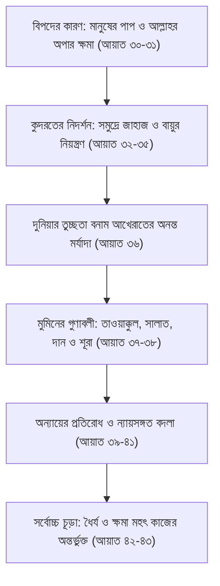

# আশ-শূরা — রুকু ০৪ (আয়াত ৩০–৪৩)

[সূচিপত্র](00_সূরা-পরিচিতি.md)

---

## ৫-স্তরবিশিষ্ট একাডেমিক যাচাইকরণ স্ট্যাটাস (Verification Status Box)

| স্তর (Tier) | অবস্থা | বিবরণ ও যাচাইয়ের পরিসর |
| :---: | :---: | :--- |
| **স্তর ১: Draft** | সম্পন্ন | ১৬ অধ্যায়ের কাঠামো ও প্রাথমিক তথ্য সংকলিত। |
| **স্তর ২: Digital Verified** | **যাচাইকৃত** | আয়াতের মূল পাঠ ও শব্দ-হরফ গণনা `bahouth` স্ক্রিপ্ট দ্বারা যাচাইকৃত; কিরাআত সারণি ও তুরাছ উদ্ধৃতিসমূহ ডিজিটাল ডাটাবেজের সাথে মিলিয়ে সংকলিত (কাঁচা স্ন্যাপশট সংরক্ষিত: `_sources/ruku_04_raw.json`)। |
| **স্তর ৩: Print Verified** | উন্মুক্ত (`[ ]`) | মুদ্রিত সংস্করণের ভৌত পৃষ্ঠার সাথে চাক্ষুষ মিলকরণের অপেক্ষায়। |
| **স্তর ৪: Scholarly Reviewed** | উন্মুক্ত (`[ ]`) | আকীদাগত ও তাফসীরী তারজীহ বিশেষজ্ঞ মুহাক্কিক আলেম কর্তৃক পর্যালোচনার অপেক্ষায়। |
| **স্তর ৫: Publication Ready** | উন্মুক্ত (`[ ]`) | চূড়ান্ত প্রকাশনা উপযোগী মাস্টার রেফারেন্স। |

---

## ০. রুকুর সারসংক্ষেপ ও কেন্দ্রীয় বক্তব্য (মাকাসিদ)

### প্রধান আত্মিক বার্তাসমূহ:
১. জীবনে আসা বিপদাপদ মানুষের আত্মসংশোধন ও গুনাহ মাফের অন্যতম মাধ্যম।
২. পারস্পরিক পরামর্শ (শূরা) মুমিনের পারিবারিক, সামাজিক ও রাষ্ট্রীয় জীবনের অপরিহার্য বৈশিষ্ট্য।
৩. অন্যায়ের প্রতিবাদ ও প্রতিরোধ করা আত্মমর্যাদার দাবি; কাপুরুষতা বা অন্যায়ের কাছে নতি স্বীকার ইসলাম সমর্থন করে না।
৪. প্রতিরোধের অধিকার থাকা সত্ত্বেও সংশোধন ও শান্তির উদ্দেশ্যে ক্ষমা প্রদর্শন করাই আল্লাহর নিকট সর্বাধিক প্রিয়।

---

---

## ১. আয়াতের মূল পাঠ ও অনুবাদ

### (১) ১ আরবি পাঠ (হরকতযুক্ত সাধারণ আরবি বানান; পূর্ণ উসমানী রসম নয়)

> [!NOTE]
> নিচে প্রদত্ত পাঠটি হরকতযুক্ত সাধারণ আরবি বানানরীতিতে সাজানো হয়েছে; এটি ক্যালিগ্রাফিক পূর্ণ উসমানী রসম নয়। প্রামাণ্য উসমানী পাঠের জন্য মুসহাফের পৃষ্ঠা দ্রষ্টব্য।

﴿وَمَا أَصَابَكُمْ مِنْ مُصِيبَةٍ فَبِمَا كَسَبَتْ أَيْدِيكُمْ وَيَعْفُو عَنْ كَثِيرٍ ۝30
وَمَا أَنْتُمْ بِمُعْجِزِينَ فِي الْأَرْضِ وَمَا لَكُمْ مِنْ دُونِ اللَّهِ مِنْ وَلِيٍّ وَلَا نَصِيرٍ ۝31
وَمِنْ آيَاتِهِ الْجَوَارِ فِي الْبَحْرِ كَالْأَعْلَامِ ۝32
إِنْ يَشَأْ يُسْكِنْ الرِّيحَ فَيَظْلَلْنَ رَوَاكِدَ عَلَى ظَهْرِهِ إِنَّ فِي ذَلِكَ لَآيَاتٍ لِكُلِّ صَبَّارٍ شَكُورٍ ۝33
أَوْ يُوبِقْهُنَّ بِمَا كَسَبُوا وَيَعْفُ عَنْ كَثِيرٍ ۝34
وَيَعْلَمَ الَّذِينَ يُجَادِلُونَ فِي آيَاتِنَا مَا لَهُمْ مِنْ مَحِيصٍ ۝35
فَمَا أُوتِيتُمْ مِنْ شَيْءٍ فَمَتَاعُ الْحَيَاةِ الدُّنْيَا وَمَا عِنْدَ اللَّهِ خَيْرٌ وَأَبْقَى لِلَّذِينَ آمَنُوا وَعَلَى رَبِّهِمْ يَتَوَكَّلُونَ ۝36
وَالَّذِينَ يَجْتَنِبُونَ كَبَائِرَ الْإِثْمِ وَالْفَوَاحِشَ وَإِذَا مَا غَضِبُوا هُمْ يَغْفِرُونَ ۝37
وَالَّذِينَ اسْتَجَابُوا لِرَبِّهِمْ وَأَقَامُوا الصَّلَاةَ وَأَمْرُهُمْ شُورَى بَيْنَهُمْ وَمِمَّا رَزَقْنَاهُمْ يُنْفِقُونَ ۝38
وَالَّذِينَ إِذَا أَصَابَهُمْ الْبَغْيُ هُمْ يَنْتَصِرُونَ ۝39
وَجَزَاءُ سَيِّئَةٍ سَيِّئَةٌ مِثْلُهَا فَمَنْ عَفَا وَأَصْلَحَ فَأَجْرُهُ عَلَى اللَّهِ إِنَّهُ لَا يُحِبُّ الظَّالِمِينَ ۝40
وَلَمَنْ انْتَصَرَ بَعْدَ ظُلْمِهِ فَأُولَئِكَ مَا عَلَيْهِمْ مِنْ سَبِيلٍ ۝41
إِنَّمَا السَّبِيلُ عَلَى الَّذِينَ يَظْلِمُونَ النَّاسَ وَيَبْغُونَ فِي الْأَرْضِ بِغَيْرِ الْحَقِّ أُولَئِكَ لَهُمْ عَذَابٌ أَلِيمٌ ۝42
وَلَمَنْ صَبَرَ وَغَفَرَ إِنَّ ذَلِكَ لَمِنْ عَزْمِ الْأُمُورِ ۝43﴾

### (১) ২ শব্দানুগ ও সাবলীল অনুবাদ

| আয়াত | মূল আরবী পাঠ | সাবলীল বঙ্গানুবাদ |
| :---: | :--- | :--- |
| **৩০** | ﴿وَمَا أَصَابَكُمْ مِنْ مُصِيبَةٍ فَبِمَا كَسَبَتْ أَيْدِيكُمْ وَيَعْفُو عَنْ كَثِيرٍ﴾ | আর তোমাদের ওপর যেসব বিপদাপদ আপতিত হয়, তা তোমাদেরই হাতের উপার্জনের ফল; এবং তিনি অনেক অপরাধ এমনিতেই ক্ষমা করে দেন। |
| **৩১** | ﴿وَمَا أَنْتُمْ بِمُعْجِزِينَ فِي الْأَرْضِ وَمَا لَكُمْ مِنْ دُونِ اللَّهِ مِنْ وَلِيٍّ وَلَا نَصِيرٍ﴾ | আর তোমরা পৃথিবীতে আল্লাহকে পরাস্ত করতে পারো না; এবং আল্লাহ ব্যতীত তোমাদের কোনো অভিভাবক নেই এবং কোনো সাহায্যকারীও নেই। |
| **৩২** | ﴿وَمِنْ آيَاتِهِ الْجَوَارِ فِي الْبَحْرِ كَالْأَعْلَامِ﴾ | আর তাঁর অন্যতম নিদর্শন হলো সমুদ্রে বিচরণশীল পাহাড়তুল্য সুউচ্চ বিশাল জাহাজসমূহ। |
| **৩৩** | ﴿إِنْ يَشَأْ يُسْكِنْ الرِّيحَ فَيَظْلَلْنَ رَوَاكِدَ عَلَى ظَهْرِهِ إِنَّ فِي ذَلِكَ لَآيَاتٍ لِكُلِّ صَبَّارٍ شَكُورٍ﴾ | তিনি ইচ্ছা করলে বাতাসকে স্তব্ধ করে দিতে পারেন, ফলে জাহাজগুলো সমুদ্রপৃষ্ঠে গতিহীন নিশ্চল হয়ে পড়ে থাকবে; নিশ্চয় এতে প্রত্যেক পরম ধৈর্যশীল ও পরম কৃতজ্ঞ ব্যক্তির জন্য বহু নিদর্শন রয়েছে। |
| **৩৪** | ﴿أَوْ يُوبِقْهُنَّ بِمَا كَسَبُوا وَيَعْفُ عَنْ كَثِيرٍ﴾ | অথবা তিনি তাদের কৃতকর্মের কারণে সেগুলিকে নিমজ্জিত করে ধ্বংস করে দিতে পারেন; এবং তিনি অনেককেই ক্ষমা করে দেন। |
| **৩৫** | ﴿وَيَعْلَمَ الَّذِينَ يُجَادِلُونَ فِي آيَاتِنَا مَا لَهُمْ مِنْ مَحِيصٍ﴾ | এবং যাতে আমার নিদর্শনাবলী সম্পর্কে বিতর্ককারীরা জানতে পারে যে, তাদের পলায়নের কোনো আশ্রয় নেই। |
| **৩৬** | ﴿فَمَا أُوتِيتُمْ مِنْ شَيْءٍ فَمَتَاعُ الْحَيَاةِ الدُّنْيَا وَمَا عِنْدَ اللَّهِ خَيْرٌ وَأَبْقَى لِلَّذِينَ آمَنُوا وَعَلَى رَبِّهِمْ يَتَوَكَّلُونَ﴾ | সুতরাং তোমাদের যা কিছু দেওয়া হয়েছে তা তো কেবল পার্থিব জীবনের ক্ষণস্থায়ী ভোগসামগ্রী; আর যা আল্লাহর নিকট রয়েছে তা অতি উৎকৃষ্ট ও চিরস্থায়ী—তাদের জন্য যারা ঈমান এনেছে এবং তাদের প্রতিপালকের ওপর ভরসা করে; |
| **৩৭** | ﴿وَالَّذِينَ يَجْتَنِبُونَ كَبَائِرَ الْإِثْمِ وَالْفَوَاحِشَ وَإِذَا مَا غَضِبُوا هُمْ يَغْفِرُونَ﴾ | এবং যারা কবিরা গুনাহ ও অশ্লীল কাজকর্ম হতে বিরত থাকে এবং যখন ক্রুদ্ধ হয় তখন ক্ষমা করে দেয়; |
| **৩৮** | ﴿وَالَّذِينَ اسْتَجَابُوا لِرَبِّهِمْ وَأَقَامُوا الصَّلَاةَ وَأَمْرُهُمْ شُورَى بَيْنَهُمْ وَمِمَّا رَزَقْنَاهُمْ يُنْفِقُونَ﴾ | এবং যারা তাদের প্রতিপালকের আহ্বানে সাড়া দেয়, সালাত কায়েম করে, **তাদের পারস্পরিক কার্যক্রম পরিচালিত হয় পারস্পরিক পরামর্শের (শূরা) ভিত্তিতে**, এবং আমি তাদেরকে যে রিজিক দিয়েছি তা হতে ব্যয় করে; |
| **৩৯** | ﴿وَالَّذِينَ إِذَا أَصَابَهُمْ الْبَغْيُ هُمْ يَنْتَصِرُونَ﴾ | এবং যখন তাদের ওপর জুলুম বা সীমালঙ্ঘন নেমে আসে, তখন তারা যথাযথ প্রতিরোধ গড়ে তোলে। |
| **৪০** | ﴿وَجَزَاءُ سَيِّئَةٍ سَيِّئَةٌ مِثْلُهَا فَمَنْ عَفَا وَأَصْلَحَ فَأَجْرُهُ عَلَى اللَّهِ إِنَّهُ لَا يُحِبُّ الظَّالِمِينَ﴾ | আর মন্দের প্রতিফল হলো অনুরূপ মন্দ; অতঃপর যে ক্ষমা করে দেয় এবং সংশোধন করে, তার পুরস্কার তো আল্লাহর নিকট সংরক্ষিত; নিশ্চয় তিনি জালিমদের পছন্দ করেন না। |
| **৪১** | ﴿وَلَمَنْ انْتَصَرَ بَعْدَ ظُلْمِهِ فَأُولَئِكَ مَا عَلَيْهِمْ مِنْ سَبِيلٍ﴾ | আর যে ব্যক্তি অত্যাচারিত হওয়ার পর তার প্রতিবিধান গ্রহণ করে, তাদের বিরুদ্ধে কোনো ব্যবস্থা গ্রহণের পথ নেই। |
| **৪২** | ﴿إِنَّمَا السَّبِيلُ عَلَى الَّذِينَ يَظْلِمُونَ النَّاسَ وَيَبْغُونَ فِي الْأَرْضِ بِغَيْرِ الْحَقِّ أُولَئِكَ لَهُمْ عَذَابٌ أَلِيمٌ﴾ | অভিযোগের পথ কেবল তাদের বিরুদ্ধেই যারা মানুষের ওপর জুলুম করে এবং পৃথিবীতে অন্যায়ভাবে বিদ্রোহ ও সীমালঙ্ঘন করে বেড়ায়; তাদের জন্য রয়েছে যন্ত্রণাদায়ক শাস্তি। |
| **৪৩** | ﴿وَلَمَنْ صَبَرَ وَغَفَرَ إِنَّ ذَلِكَ لَمِنْ عَزْمِ الْأُمُورِ﴾ | আর যে ব্যক্তি ধৈর্য ধারণ করে এবং ক্ষমা করে দেয়, নিশ্চয় তা অত্যন্ত দৃঢ়সংকল্পের কাজের অন্তর্ভুক্ত। |

---

## ২. লুগাভী ও সরফী তাহকীক এবং মুফরাদাতুল কুরআন

| শব্দ | মূলধাতু | সীগা / ওযন | আভিধানিক অর্থ | কুরআনিক প্রয়োগ ও তাৎপর্য |
| :--- | :---: | :---: | :--- | :--- |
| **كَسَبَتْ أَيْدِيكُمْ** | `كسب` / `يدي` | مركب فعلي | তোমাদের হাত যা অর্জন করেছে | মানুষের পাপাচার ও অবাধ্যতার কারণেই পৃথিবীতে বহু প্রাকৃতিক দুর্যোগ নেমে আসা। |
| **الْجَوَارِ** | `جري` | اسم فاعل جمع (جَارِيَة) | চলমান পালতোলা জাহাজ | গভীর সমুদ্রের বুক চিরে মানুষের ভারী মালামাল পরিবহনকারী সামুদ্রিক জাহাজ। |
| **كَالْأَعْلَامِ** | `علم` | جار ومجرور جمع (عَلَم) | সুবিশাল পর্বতের মতো | সাগরের বুকে ভাসমান সুবিশাল পর্বত সদৃশ দৃশ্যমান জাহাজের উপমা। |
| **رَوَاكِدَ** | `ركد` | اسم فاعل جمع حال | নিশ্চল নিথর হয়ে থাকা | বাতাস থামিয়ে দিলে জাহাজসমূহের সাগরের বুকে স্থবির হয়ে আটকা পড়ার রূপ। |
| **يُوبِقْهُنَّ** | `وبق` | فعل مضارع مجزوم متعد | জাহাজগুলোকে ধ্বংস বা ডুবিয়ে দেন | মানুষের অপরাধের দরুন প্রচণ্ড ঝড়ে জলযান নিমজ্জিত করার ঐশী ক্ষমতা। |
| **كَبَائِرَ الْإِثْمِ** | `كبر` / `أثم` | مركب إضافي مفعول به | মারাত্মক মহাপাপসমূহ | কবিরা গুনাহ ও নির্লজ্জ অশ্লীলতা থেকে বেঁচে থাকা মুমিনের অপরিহার্য বৈশিষ্ট্য। |
| **أَمْرُهُمْ شُورَىٰ بَيْنَهُمْ** | `شور` | مركب إسنادي مبتدأ وخبر | পারস্পরিক পরামর্শভিত্তিক কাজ | সমাজ ও রাষ্ট্র পরিচালনায় পারস্পরিক সৌহার্দ্যপূর্ণ শুরা বা পরামর্শের ঐশী মূলনীতি। |
| **عَزْمِ الْأُمُورِ** | `عزم` | مركب إضافي مجرور | সুদৃঢ় প্রত্যয় ও সাহসিকতা | আঘাত পেয়েও ক্ষমা করা ও প্রতিশোধ না নেওয়া পরম ধৈর্যশীল উচ্চ চরিত্রের পরিচায়ক। |

---

## ৩. ই'রাব ও নাহবী বিশ্লেষণ

1. **﴿وَمَا أَصَابَكُمْ مِنْ مُصِيبَةٍ فَبِمَا كَسَبَتْ أَيْدِيكُمْ﴾ (আয়াত ৩০):**
   - `وَمَا`: শার্তিয়্যাহ বা মাউসূলাহ মুবতাদা; `أَصَابَكُمْ`: ফে‘ল ও মাফ‘ঊল বিহি।
   - `مِنْ مُصِيبَةٍ`: বায়ানিয়্যাহ যার ও মাজরুর।
   - `فَبِمَا كَسَبَتْ`: ফা জাযা; বা হরফে জার ও ‘মা’ মাসদারিয়্যাহ মিলে খবর।

2. **﴿وَالَّذِينَ اسْتَجَابُوا لِرَبِّهِمْ وَأَقَامُوا الصَّلَاةَ وَأَمْرُهُمْ شُورَى بَيْنَهُمْ﴾ (আয়াত ৩৮):**
   - `وَالَّذِينَ`: মা‘তূফ মুবতাদা; `اسْتَجَابُوا لِرَبِّهِمْ` সিলাতুল মাউসূল।
   - `وَأَمْرُهُمْ`: মুবতাদা মুদ্বাফ; `شُورَى`: খবর মারফূ‘ তাক্বদীরান; `بَيْنَهُمْ` যরফ।

3. **﴿وَجَزَاءُ سَيِّئَةٍ سَيِّئَةٌ مِثْلُهَا﴾ (আয়াত ৪০):**
   - `جَزَاءُ`: মুবতাদা মারফূ‘ بالضمة، মুদ্বাফ; `سَيِّئَةٍ`: মুদ্বাফ ইলাইহি মাজরুর।
   - `سَيِّئَةٌ`: খবর মারফূ‘ بالضمة; `مِثْلُهَا`: সিফাত মারফূ‘ بالضمة، মুদ্বাফ।

---

## ৪. কিরাআত ও তাফসীরে প্রভাব

### ৪.১ প্রামাণ্য ১০ মুতাওয়াতির কিরাআত সারণি (মাদীনা মুনাওয়ারা বাহাউথ ডেটাবেস)

| আয়াত | শব্দ (ক্রম) | ক্বারী / রাবী (বাহাউথ) | কিরাআতের পাঠভেদ ও নিয়ম (অবিকৃত মূল পাঠ) |
| :---: | :--- | :--- | :--- |
| **30** | ﴿أَصَابَكُمْ﴾ (2) | قالون عن نافع | قرأ بصلة ميم الجمع وصلاً بخلف عنه. |
| **30** | ﴿أَصَابَكُمْ﴾ (2) | أبو جعفر وَابن كثير | قرأ بصلة ميم الجمع وصلا. |
| **30** | ﴿أَصَابَكُمْ﴾ (2) | باقي الرواة | قرؤوا بترك صلة ميم الجمع. |
| **30** | ﴿مُصِيبَةٍ﴾ (4) | الكسائي | قرأ بإمالة هاء التأنيث وقفا. |
| **30** | ﴿مُصِيبَةٍ﴾ (4) | باقي الرواة | قرؤوا بفتح هاء التأنيث. |
| **30** | ﴿فَبِمَا﴾ (5) | نافع وَأبو جعفر وَابن عامر | قرأ بغير الفاء، وهي كذلك في المصاحف عندهم. |
| **30** | ﴿فَبِمَا﴾ (5) | باقي الرواة | قرؤوا بإثبات الفاء، وهي كذلك في مصاحفهم مرسومة. |
| **30** | ﴿كَسَبَتْ﴾ (6) | ورش عن نافع | قرأ بالنقل وصلاً ووقفا. |
| **30** | ﴿كَسَبَتْ﴾ (6) | خلف عن حمزة | قرأ بالسكت وعدمه وصلاً، ووقف بالسكت، والنقل، وتركهما. |
| **30** | ﴿كَسَبَتْ﴾ (6) | خلاد عن حمزة | قرأ بترك السكت وصلاً، ووقف بالنقل والتحقيق. |
| **30** | ﴿كَسَبَتْ﴾ (6) | باقي الرواة | قرؤوا بترك السكت مع تحقيق الهمزة وصلاً ووقفا. |
| **30** | ﴿أَيْدِيكُمْ﴾ (7) | قالون عن نافع | قرأ بصلة ميم الجمع وصلاً بخلف عنه. |
| **30** | ﴿أَيْدِيكُمْ﴾ (7) | أبو جعفر وَابن كثير | قرأ بصلة ميم الجمع وصلا. |
| **30** | ﴿أَيْدِيكُمْ﴾ (7) | باقي الرواة | قرؤوا بترك صلة ميم الجمع. |
| **30** | ﴿كَثِيرٍ﴾ (10) | خلف عن حمزة | قرأ بالإدغام مع ترك الغنة. |
| **30** | ﴿كَثِيرٍ﴾ (10) | باقي الرواة | قرؤوا بالإدغام مع الغنة. |
| **31** | ﴿أَنْتُمْ﴾ (2) | قالون عن نافع | قرأ بصلة ميم الجمع وصلاً بخلف عنه. |
| **31** | ﴿أَنْتُمْ﴾ (2) | أبو جعفر وَابن كثير | قرأ بصلة ميم الجمع وصلا. |
| **31** | ﴿أَنْتُمْ﴾ (2) | باقي الرواة | قرؤوا بترك صلة ميم الجمع. |
| **31** | ﴿الْأَرْضِ﴾ (5) | ورش عن نافع | قرأ بالنقل مع ترك السكت. |
| **31** | ﴿الْأَرْضِ﴾ (5) | خلف عن حمزة | قرأ بالسكت وصلاً، ووقف بالسكت والنقل. |
| **31** | ﴿الْأَرْضِ﴾ (5) | خلاد عن حمزة | قرأ بالسكت وعدمه وصلاً، ووقف بالسكت والنقل. |
| **31** | ﴿الْأَرْضِ﴾ (5) | باقي الرواة | قرؤوا بترك السكت مع تحقيق الهمزة وصلاً ووقفا. |
| **31** | ﴿لَكُمْ﴾ (7) | قالون عن نافع | قرأ بصلة ميم الجمع وصلاً بخلف عنه. |
| **31** | ﴿لَكُمْ﴾ (7) | أبو جعفر وَابن كثير | قرأ بصلة ميم الجمع وصلا. |
| **31** | ﴿لَكُمْ﴾ (7) | باقي الرواة | قرؤوا بترك صلة ميم الجمع. |
| **31** | ﴿مِنْ﴾ (11) | خلف عن حمزة | قرأ بالإدغام مع ترك الغنة. |
| **31** | ﴿مِنْ﴾ (11) | باقي الرواة | قرؤوا بالإدغام مع الغنة. |
| **31** | ﴿وَلِيٍّ﴾ (12) | خلف عن حمزة | قرأ بالإدغام مع ترك الغنة. |
| **31** | ﴿وَلِيٍّ﴾ (12) | باقي الرواة | قرؤوا بالإدغام مع الغنة. |
| **31** | ﴿نَصِيرٍ﴾ (14) | خلف عن حمزة | قرأ بالإدغام مع ترك الغنة. |
| **31** | ﴿نَصِيرٍ﴾ (14) | باقي الرواة | قرؤوا بالإدغام مع الغنة. |
| **32** | ﴿وَمِنْ﴾ (1) | ورش عن نافع | قرأ بالنقل، مع تثليث مد البدل وصلاً ووقفا. |
| **32** | ﴿وَمِنْ﴾ (1) | خلف عن حمزة | قرأ بالسكت وعدمه وصلاً، ووقف بالسكت، والنقل، وتركهما. |
| **32** | ﴿وَمِنْ﴾ (1) | خلاد عن حمزة | قرأ بترك السكت وصلاً، ووقف بالنقل والتحقيق. |
| **32** | ﴿وَمِنْ﴾ (1) | باقي الرواة | قرؤوا بقصر مد البدل، وترك السكت مع تحقيق الهمزة وصلاً ووقفا. |
| **32** | ﴿آيَاتِهِ﴾ (2) | ورش عن نافع | قرأ بتثليث مد البدل. |
| **32** | ﴿آيَاتِهِ﴾ (2) | باقي الرواة | قرؤوا بقصر مد البدل. |
| **32** | ﴿الْجَوَارِ﴾ (3) | نافع وَأبو جعفر وَأبو عمرو | قرأ بترك الإمالة في الحالين، مع إثبات الياء وصلا. |
| **32** | ﴿الْجَوَارِ﴾ (3) | ابن كثير وَيعقوب | قرأ بإثبات الياء الزائدة في الحالين، مع ترك الإمالة. |
| **32** | ﴿الْجَوَارِ﴾ (3) | الدوري عن الكسائي | قرأ بالإمالة بلا خلاف عنه، مع حذف الياء في الحالين. |
| **32** | ﴿الْجَوَارِ﴾ (3) | باقي الرواة | قرؤوا بترك الإمالة في الحالين، مع حذف الياء. |
| **32** | ﴿الْجَوَارِ﴾ (3) | نافع وَأبو جعفر وَأبو عمرو | قرأ بإثبات الياء الزائدة وصلاً وحذفها وقفا. |
| **32** | ﴿الْجَوَارِ﴾ (3) | ابن كثير وَيعقوب | قرأ بإثبات الياء الزائدة في الحالين. |
| **32** | ﴿الْجَوَارِ﴾ (3) | باقي الرواة | قرؤوا بحذف الياء الزائدة في الحالين. |
| **32** | ﴿كَالْأَعْلَامِ﴾ (6) | ورش عن نافع | قرأ بالنقل مع ترك السكت. |
| **32** | ﴿كَالْأَعْلَامِ﴾ (6) | خلف عن حمزة | قرأ بالسكت وصلاً، ووقف بالسكت والنقل. |
| **32** | ﴿كَالْأَعْلَامِ﴾ (6) | خلاد عن حمزة | قرأ بالسكت وعدمه وصلاً، ووقف بالسكت والنقل. |
| **32** | ﴿كَالْأَعْلَامِ﴾ (6) | باقي الرواة | قرؤوا بترك السكت مع تحقيق الهمزة وصلاً ووقفا. |
| **33** | ﴿إِنْ﴾ (1) | خلف عن حمزة | قرأ بالإدغام مع ترك الغنة. |
| **33** | ﴿إِنْ﴾ (1) | باقي الرواة | قرؤوا بالإدغام مع الغنة. |
| **33** | ﴿يَشَأْ﴾ (2) | أبو جعفر | قرأ بإبدال الهمزة الساكنة حرفا مديا من جنس حركة ما قبلها. |
| **33** | ﴿يَشَأْ﴾ (2) | هشام عن ابن عامر وَحمزة | قرأ بتحقيق الهمزة وصلاً، ووقف بإبدالها حرفا مديا. |
| **33** | ﴿يَشَأْ﴾ (2) | باقي الرواة | قرؤوا بتحقيق الهمزة المتطرفة وصلاً ووقفا. |
| **33** | ﴿الرِّيحَ﴾ (4) | نافع وَأبو جعفر | قرأ (الرِّيَاح) بألف بعد الياء المفتوحة على الجمع. |
| **33** | ﴿الرِّيحَ﴾ (4) | باقي الرواة | قرؤوا (الرِّيح) بلا ألف بعد الياء على الإفراد. |
| **33** | ﴿فَيَظْلَلْنَ﴾ (5) | ورش عن نافع | قرأ بتغليظ اللام. |
| **33** | ﴿فَيَظْلَلْنَ﴾ (5) | باقي الرواة | قرؤوا بترقيق اللام. |
| **33** | ﴿لَآيَاتٍ﴾ (12) | ورش عن نافع | قرأ بتثليث مد البدل مع تحقيق الهمزة. |
| **33** | ﴿لَآيَاتٍ﴾ (12) | حمزة | قرأ بتحقيق الهمزة وصلاً، ووقف بتحقيق وتسهيل الهمزة. |
| **33** | ﴿لَآيَاتٍ﴾ (12) | باقي الرواة | قرؤوا بقصر مد البدل مع تحقيق الهمزة. |
| **33** | ﴿صَبَّارٍ﴾ (14) | ورش عن نافع | قرأ بالتقليل بلا خلاف عنه. |
| **33** | ﴿صَبَّارٍ﴾ (14) | أبو عمرو وَالدوري عن الكسائي | قرأ بالإمالة وصلاً ووقفا. |
| **33** | ﴿صَبَّارٍ﴾ (14) | باقي الرواة | قرؤوا بالفتح بلا خلاف. |
| **33** | ﴿شَكُورٍ﴾ (15) | ورش عن نافع | قرأ بالنقل وصلاً ووقفا. |
| **33** | ﴿شَكُورٍ﴾ (15) | خلف عن حمزة | قرأ بالسكت وعدمه وصلاً، ووقف بالسكت، والنقل، وتركهما. |
| **33** | ﴿شَكُورٍ﴾ (15) | خلاد عن حمزة | قرأ بترك السكت وصلاً، ووقف بالنقل والتحقيق. |
| **33** | ﴿شَكُورٍ﴾ (15) | باقي الرواة | قرؤوا بترك السكت مع تحقيق الهمزة وصلاً ووقفا. |
| **34** | ﴿يُوبِقْهُنَّ﴾ (2) | يعقوب | قرأ بهاء السكت وقفا. |
| **34** | ﴿يُوبِقْهُنَّ﴾ (2) | باقي الرواة | قرؤوا بترك هاء السكت وقفا. |
| **34** | ﴿كَثِيرٍ﴾ (7) | خلف عن حمزة | قرأ بالإدغام مع ترك الغنة. |
| **34** | ﴿كَثِيرٍ﴾ (7) | باقي الرواة | قرؤوا بالإدغام مع الغنة. |
| **35** | ﴿وَيَعْلَمَ﴾ (1) | نافع وَأبو جعفر وَابن عامر | قرأ بالرفع. |
| **35** | ﴿وَيَعْلَمَ﴾ (1) | باقي الرواة | قرؤوا بالنصب. |
| **35** | ﴿آيَاتِنَا﴾ (5) | ورش عن نافع | قرأ بتثليث مد البدل. |
| **35** | ﴿آيَاتِنَا﴾ (5) | باقي الرواة | قرؤوا بقصر مد البدل. |
| **35** | ﴿لَهُمْ﴾ (7) | قالون عن نافع | قرأ بصلة ميم الجمع وصلاً بخلف عنه. |
| **35** | ﴿لَهُمْ﴾ (7) | أبو جعفر وَابن كثير | قرأ بصلة ميم الجمع وصلا. |
| **35** | ﴿لَهُمْ﴾ (7) | باقي الرواة | قرؤوا بترك صلة ميم الجمع. |
| **36** | ﴿أُوتِيتُمْ﴾ (2) | ورش عن نافع | قرأ بتثليث مد البدل. |
| **36** | ﴿أُوتِيتُمْ﴾ (2) | باقي الرواة | قرؤوا بقصر مد البدل. |
| **36** | ﴿أُوتِيتُمْ﴾ (2) | قالون عن نافع | قرأ بصلة ميم الجمع وصلاً بخلف عنه. |
| **36** | ﴿أُوتِيتُمْ﴾ (2) | أبو جعفر وَابن كثير | قرأ بصلة ميم الجمع وصلا. |
| **36** | ﴿أُوتِيتُمْ﴾ (2) | باقي الرواة | قرؤوا بترك صلة ميم الجمع. |
| **36** | ﴿شَيْءٍ﴾ (4) | ورش عن نافع | قرأ بتوسط وإشباع مد اللين المهموز. |
| **36** | ﴿شَيْءٍ﴾ (4) | هشام عن ابن عامر | قرأ بتحقيق الهمزة وصلاً، ووقف بالنقل، وبالإبدال مع الإدغام، مع السكون المحض والروم. |
| **36** | ﴿شَيْءٍ﴾ (4) | خلف عن حمزة | قرأ بالسكت وصلاً، ووقف بالنقل، وبالإبدال مع الإدغام، وعلى الوجهين السكون المحض والروم. |
| **36** | ﴿شَيْءٍ﴾ (4) | خلاد عن حمزة | قرأ بالسكت وعدمه وصلاً، ووقف بالنقل، وبالإبدال مع الإدغام، وعلى الوجهين السكون المحض والروم. |
| **36** | ﴿شَيْءٍ﴾ (4) | باقي الرواة | قرؤوا بتحقيق الهمزة، وترك السكت، مع قصر مد اللين. |
| **36** | ﴿الدُّنْيَا﴾ (7) | ورش عن نافع | قرأ بالتقليل بخلف عنه. |
| **36** | ﴿الدُّنْيَا﴾ (7) | أبو عمرو | قرأ بالتقليل بلا خلاف عنه. |
| **36** | ﴿الدُّنْيَا﴾ (7) | حمزة وَالكسائي وَخلف العاشر | قرأ بالإمالة وصلاً ووقفا. |
| **36** | ﴿الدُّنْيَا﴾ (7) | باقي الرواة | قرؤوا بالفتح وصلاً ووقفا. |
| **36** | ﴿خَيْرٌ﴾ (11) | ورش عن نافع | قرأ بترقيق الراء في الحالين. |
| **36** | ﴿خَيْرٌ﴾ (11) | باقي الرواة | قرؤوا بتفخيم الراء. |
| **36** | ﴿خَيْرٌ﴾ (11) | خلف عن حمزة | قرأ بالإدغام مع ترك الغنة. |
| **36** | ﴿خَيْرٌ﴾ (11) | باقي الرواة | قرؤوا بالإدغام مع الغنة. |
| **36** | ﴿وَأَبْقَى﴾ (12) | ورش عن نافع | قرأ بالتقليل بخلف عنه، مع تحقيق الهمزة وصلاً ووقفا. |
| **36** | ﴿وَأَبْقَى﴾ (12) | حمزة | قرأ بالإمالة في الحالين مع تحقيق الهمزة وصلاً، ووقف بتسهيل وتحقيق الهمزة. |
| **36** | ﴿وَأَبْقَى﴾ (12) | الكسائي وَخلف العاشر | قرأ بالإمالة بلا خلاف عنه، مع تحقيق الهمزة وصلاً ووقفا. |
| **36** | ﴿وَأَبْقَى﴾ (12) | باقي الرواة | قرؤوا بالفتح، مع تحقيق الهمزة وصلاً ووقفا. |
| **36** | ﴿آمَنُوا﴾ (14) | ورش عن نافع | قرأ بتثليث مد البدل. |
| **36** | ﴿آمَنُوا﴾ (14) | باقي الرواة | قرؤوا بقصر مد البدل. |
| **36** | ﴿رَبِّهِمْ﴾ (16) | قالون عن نافع | قرأ بصلة ميم الجمع وصلاً بخلف عنه. |
| **36** | ﴿رَبِّهِمْ﴾ (16) | أبو جعفر وَابن كثير | قرأ بصلة ميم الجمع وصلا. |
| **36** | ﴿رَبِّهِمْ﴾ (16) | باقي الرواة | قرؤوا بترك صلة ميم الجمع. |
| **37** | ﴿كَبَائِرَ﴾ (3) | ورش عن نافع | قرأ بفتح الباء، وألف بعدها، ثم همزة مكسورة، مع ترقيق الراء. |
| **37** | ﴿كَبَائِرَ﴾ (3) | حمزة وَالكسائي وَخلف العاشر | قرأ بكسر الباء وياء ساكنة بعدها، بلا همزة، على وزن (قدير) على التوحيد، مع تفخيم الراء. |
| **37** | ﴿كَبَائِرَ﴾ (3) | باقي الرواة | قرؤوا بفتح الباء، وألف بعدها، ثم همزة مكسورة، مع تفخيم الراء. |
| **37** | ﴿الْإِثْمِ﴾ (4) | ورش عن نافع | قرأ بالنقل مع ترك السكت. |
| **37** | ﴿الْإِثْمِ﴾ (4) | خلف عن حمزة | قرأ بالسكت وصلاً، ووقف بالسكت والنقل. |
| **37** | ﴿الْإِثْمِ﴾ (4) | خلاد عن حمزة | قرأ بالسكت وعدمه وصلاً، ووقف بالسكت والنقل. |
| **37** | ﴿الْإِثْمِ﴾ (4) | باقي الرواة | قرؤوا بترك السكت مع تحقيق الهمزة وصلاً ووقفا. |
| **37** | ﴿وَإِذَا﴾ (6) | حمزة | قرأ بتحقيق الهمزة وصلاً، ووقف بتسهيل وتحقيق الهمزة. |
| **37** | ﴿وَإِذَا﴾ (6) | باقي الرواة | قرؤوا بتحقيق الهمزة وصلاً ووقفا. |
| **37** | ﴿هُمْ﴾ (9) | قالون عن نافع | قرأ بصلة ميم الجمع وصلاً بخلف عنه. |
| **37** | ﴿هُمْ﴾ (9) | أبو جعفر وَابن كثير | قرأ بصلة ميم الجمع وصلا. |
| **37** | ﴿هُمْ﴾ (9) | باقي الرواة | قرؤوا بترك صلة ميم الجمع. |
| **37** | ﴿يَغْفِرُونَ﴾ (10) | ورش عن نافع | قرأ بترقيق الراء في الحالين. |
| **37** | ﴿يَغْفِرُونَ﴾ (10) | باقي الرواة | قرؤوا بتفخيم الراء. |
| **38** | ﴿لِرَبِّهِمْ﴾ (3) | قالون عن نافع | قرأ بصلة ميم الجمع وصلاً بخلف عنه. |
| **38** | ﴿لِرَبِّهِمْ﴾ (3) | أبو جعفر وَابن كثير | قرأ بصلة ميم الجمع وصلا. |
| **38** | ﴿لِرَبِّهِمْ﴾ (3) | باقي الرواة | قرؤوا بترك صلة ميم الجمع. |
| **38** | ﴿وَأَقَامُوا﴾ (4) | حمزة | قرأ بتحقيق الهمزة وصلاً، ووقف بتسهيل وتحقيق الهمزة. |
| **38** | ﴿وَأَقَامُوا﴾ (4) | باقي الرواة | قرؤوا بتحقيق الهمزة وصلاً ووقفا. |
| **38** | ﴿الصَّلَاةَ﴾ (5) | ورش عن نافع | قرأ بتغليظ اللام. |
| **38** | ﴿الصَّلَاةَ﴾ (5) | باقي الرواة | قرؤوا بترقيق اللام. |
| **38** | ﴿وَأَمْرُهُمْ﴾ (6) | حمزة | قرأ بتحقيق الهمزة وصلاً، ووقف بتسهيل وتحقيق الهمزة. |
| **38** | ﴿وَأَمْرُهُمْ﴾ (6) | باقي الرواة | قرؤوا بتحقيق الهمزة وصلاً ووقفا. |
| **38** | ﴿وَأَمْرُهُمْ﴾ (6) | قالون عن نافع | قرأ بصلة ميم الجمع وصلاً بخلف عنه. |
| **38** | ﴿وَأَمْرُهُمْ﴾ (6) | أبو جعفر وَابن كثير | قرأ بصلة ميم الجمع وصلا. |
| **38** | ﴿وَأَمْرُهُمْ﴾ (6) | باقي الرواة | قرؤوا بترك صلة ميم الجمع. |
| **38** | ﴿شُورَى﴾ (7) | ورش عن نافع | قرأ بالتقليل بلا خلاف عنه. |
| **38** | ﴿شُورَى﴾ (7) | أبو عمرو وَحمزة وَالكسائي وَخلف العاشر | قرأ بالإمالة بلا خلاف عنه. |
| **38** | ﴿شُورَى﴾ (7) | باقي الرواة | قرؤوا بالفتح بلا خلاف عنه. |
| **38** | ﴿بَيْنَهُمْ﴾ (8) | قالون عن نافع | قرأ بصلة ميم الجمع وصلاً بخلف عنه. |
| **38** | ﴿بَيْنَهُمْ﴾ (8) | أبو جعفر وَابن كثير | قرأ بصلة ميم الجمع وصلا. |
| **38** | ﴿بَيْنَهُمْ﴾ (8) | باقي الرواة | قرؤوا بترك صلة ميم الجمع. |
| **38** | ﴿رَزَقْنَاهُمْ﴾ (10) | قالون عن نافع | قرأ بصلة ميم الجمع وصلاً بخلف عنه. |
| **38** | ﴿رَزَقْنَاهُمْ﴾ (10) | أبو جعفر وَابن كثير | قرأ بصلة ميم الجمع وصلا. |
| **38** | ﴿رَزَقْنَاهُمْ﴾ (10) | باقي الرواة | قرؤوا بترك صلة ميم الجمع. |
| **39** | ﴿هُمْ﴾ (5) | قالون عن نافع | قرأ بصلة ميم الجمع وصلاً بخلف عنه. |
| **39** | ﴿هُمْ﴾ (5) | أبو جعفر وَابن كثير | قرأ بصلة ميم الجمع وصلا. |
| **39** | ﴿هُمْ﴾ (5) | باقي الرواة | قرؤوا بترك صلة ميم الجمع. |
| **39** | ﴿يَنْتَصِرُونَ﴾ (6) | ورش عن نافع | قرأ بترقيق الراء في الحالين. |
| **39** | ﴿يَنْتَصِرُونَ﴾ (6) | باقي الرواة | قرؤوا بتفخيم الراء. |
| **40** | ﴿وَجَزَاءُ﴾ (1) | هشام عن ابن عامر وَحمزة | قرأ بتحقيق الهمزة وصلاً، ووقف بتخفيف الهمزة باثني عشر وجها: خمسة القياس:- إبدال الهمزة ألفاً، مع القصر والتوسط والمد، - التسهيل بالروم، مع المد والقصر، - وسبعة على الرسم؛ لأن الهمزة فيه مرسومة على واو؛ فتبدل واوا مضمومة ثم تسكن للوقف ويجري فيها الأوجه الثلاثة: القصر والتوسط والمد، مع السكون المحض، - القصر والتوسط والمد، مع الإشمام فتصير الأوجه ستة، - والسابع: روم حركتها مع القصر. |
| **40** | ﴿وَجَزَاءُ﴾ (1) | باقي الرواة | قرؤوا بتحقيق الهمزة المتطرفة وصلاً ووقفا. |
| **40** | ﴿سَيِّئَةٍ﴾ (2) | حمزة | قرأ بتحقيق الهمزة وصلاً، ووقف بإبدال الهمزة ياء مفتوحة، مع فتح هاء التأنيث. |
| **40** | ﴿سَيِّئَةٍ﴾ (2) | الكسائي | قرأ بتحقيق الهمزة، مع إمالة هاء التأنيث وقفا. |
| **40** | ﴿سَيِّئَةٍ﴾ (2) | باقي الرواة | قرؤوا بتحقيق الهمزة، مع فتح هاء التأنيث وقفا. |
| **40** | ﴿سَيِّئَةٌ﴾ (3) | حمزة | قرأ بتحقيق الهمزة وصلاً، ووقف بإبدال الهمزة ياء مفتوحة، مع فتح هاء التأنيث. |
| **40** | ﴿سَيِّئَةٌ﴾ (3) | الكسائي | قرأ بتحقيق الهمزة، مع إمالة هاء التأنيث وقفا. |
| **40** | ﴿سَيِّئَةٌ﴾ (3) | باقي الرواة | قرؤوا بتحقيق الهمزة، مع فتح هاء التأنيث وقفا. |
| **40** | ﴿وَأَصْلَحَ﴾ (7) | ورش عن نافع | قرأ بتغليظ اللام، مع تحقيق الهمزة. |
| **40** | ﴿وَأَصْلَحَ﴾ (7) | حمزة | قرأ بتحقيق الهمزة وصلاً، ووقف بالتسهيل، والتحقيق، مع ترقيق اللام في الحالين. |
| **40** | ﴿وَأَصْلَحَ﴾ (7) | باقي الرواة | قرؤوا بترقيق اللام، مع تحقيق الهمزة. |
| **40** | ﴿فَأَجْرُهُ﴾ (8) | حمزة | قرأ بتحقيق الهمزة وصلاً، ووقف بتسهيل وتحقيق الهمزة. |
| **40** | ﴿فَأَجْرُهُ﴾ (8) | باقي الرواة | قرؤوا بتحقيق الهمزة وصلاً ووقفا. |
| **41** | ﴿فَأُولَئِكَ﴾ (5) | حمزة | قرأ بتحقيق الهمزتين وصلاً، ووقف بتحقيق وتسهيل الهمزة الأولى، مع تسهيل الثانية مع المد والقصر فتكون أربعة أوجه. |
| **41** | ﴿فَأُولَئِكَ﴾ (5) | باقي الرواة | قرؤوا بتحقيق الهمزتين وصلاً ووقفا. |
| **41** | ﴿عَلَيْهِمْ﴾ (7) | يعقوب وَحمزة | قرأ بضم هاء الضمير وصلاً ووقفا. |
| **41** | ﴿عَلَيْهِمْ﴾ (7) | باقي الرواة | قرؤوا بكسر هاء الضمير وصلاً ووقفا. |
| **41** | ﴿عَلَيْهِمْ﴾ (7) | قالون عن نافع | قرأ بصلة ميم الجمع وصلاً بخلف عنه. |
| **41** | ﴿عَلَيْهِمْ﴾ (7) | أبو جعفر وَابن كثير | قرأ بصلة ميم الجمع وصلا. |
| **41** | ﴿عَلَيْهِمْ﴾ (7) | باقي الرواة | قرؤوا بترك صلة ميم الجمع. |
| **41** | ﴿سَبِيلٍ﴾ (9) | ورش عن نافع | قرأ بالنقل وصلاً ووقفا. |
| **41** | ﴿سَبِيلٍ﴾ (9) | خلف عن حمزة | قرأ بالسكت وعدمه وصلاً، ووقف بالسكت، والنقل، وتركهما. |
| **41** | ﴿سَبِيلٍ﴾ (9) | خلاد عن حمزة | قرأ بترك السكت وصلاً، ووقف بالنقل والتحقيق. |
| **41** | ﴿سَبِيلٍ﴾ (9) | باقي الرواة | قرؤوا بترك السكت مع تحقيق الهمزة وصلاً ووقفا. |
| **42** | ﴿الْأَرْضِ﴾ (9) | ورش عن نافع | قرأ بالنقل مع ترك السكت. |
| **42** | ﴿الْأَرْضِ﴾ (9) | خلف عن حمزة | قرأ بالسكت وصلاً، ووقف بالسكت والنقل. |
| **42** | ﴿الْأَرْضِ﴾ (9) | خلاد عن حمزة | قرأ بالسكت وعدمه وصلاً، ووقف بالسكت والنقل. |
| **42** | ﴿الْأَرْضِ﴾ (9) | باقي الرواة | قرؤوا بترك السكت مع تحقيق الهمزة وصلاً ووقفا. |
| **42** | ﴿أُولَئِكَ﴾ (12) | حمزة | قرأ بتحقيق الهمزة وصلاً، ووقف بتسهيل الهمزة مع المد والقصر. |
| **42** | ﴿أُولَئِكَ﴾ (12) | باقي الرواة | قرؤوا بتحقيق الهمزة وصلاً ووقفا. |
| **42** | ﴿لَهُمْ﴾ (13) | قالون عن نافع | قرأ بصلة ميم الجمع وصلاً بخلف عنه. |
| **42** | ﴿لَهُمْ﴾ (13) | أبو جعفر وَابن كثير | قرأ بصلة ميم الجمع وصلا. |
| **42** | ﴿لَهُمْ﴾ (13) | باقي الرواة | قرؤوا بترك صلة ميم الجمع. |
| **42** | ﴿عَذَابٌ﴾ (14) | ورش عن نافع | قرأ بالنقل وصلاً ووقفا. |
| **42** | ﴿عَذَابٌ﴾ (14) | خلف عن حمزة | قرأ بالسكت وعدمه وصلاً، ووقف بالسكت، والنقل، وتركهما. |
| **42** | ﴿عَذَابٌ﴾ (14) | خلاد عن حمزة | قرأ بترك السكت وصلاً، ووقف بالنقل والتحقيق. |
| **42** | ﴿عَذَابٌ﴾ (14) | باقي الرواة | قرؤوا بترك السكت مع تحقيق الهمزة وصلاً ووقفا. |
| **42** | ﴿أَلِيمٌ﴾ (15) | خلف عن حمزة | قرأ بالإدغام مع ترك الغنة. |
| **42** | ﴿أَلِيمٌ﴾ (15) | باقي الرواة | قرؤوا بالإدغام مع الغنة. |
| **43** | ﴿الْأُمُورِ﴾ (8) | ورش عن نافع | قرأ بالنقل مع ترك السكت. |
| **43** | ﴿الْأُمُورِ﴾ (8) | خلف عن حمزة | قرأ بالسكت وصلاً، ووقف بالسكت والنقل. |
| **43** | ﴿الْأُمُورِ﴾ (8) | خلاد عن حمزة | قرأ بالسكت وعدمه وصلاً، ووقف بالسكت والنقل. |
| **43** | ﴿الْأُمُورِ﴾ (8) | باقي الرواة | قرؤوا بترك السكت مع تحقيق الهمزة وصلاً ووقفا. |

### ৪.২ তাফসীর ও ফিকহে কিরাআতের প্রভাব
- **উসূলী পর্যালোচনা:** উদ্ধৃত কিরাআতসমূহ দশ মুতাওয়াতির ক্বারী ও তাঁদের রাবীদের প্রামাণিক সনদে প্রমাণিত।
- **অর্থগত বৈচিত্র্য:** শব্দের তাশদীদ, তাখফীফ, ইমালাহ এবং ইবদালের মাধ্যমে আয়াতসমূহের অর্থের গভীরতা ও তাৎপর্য সম্প্রসারিত হয়েছে, যা তাফসীর ও আহকামে পারস্পরিক পরিপূরক অর্থ প্রকাশ করে।

---
*উৎস সনদ:* শায়খ মুহাম্মদ ইব্রাহীম সালিম, *ফারীদাতুদ দাহর*, খণ্ড ৪ (`turath:29909`); ইমাম ইবনে যানযালাহ, *হুজ্জাতুল কিরাআত*, খণ্ড ১ (`turath:5531`); মাদীনা মুনাওয়ারা বাহাউথ প্রজেক্ট (`bahouth:list_verse_qiraat`)।

---

## ৫. তাফসীরুল জালালাইন ও তুলনামূলক তাফসীর

### (৫) ১ তাফসীরুল জালালাইন

### মূল আরবী পাঠ (তাফসীরে জালালাইন - ইমাম জালালুদ্দীন আল-মহাল্লী)
> **{وَمَا أَصَابَكُم مِّن مُّصِيبَةٍ}** بَلِيَّةٍ **{فَبِمَا كَسَبَتْ أَيْدِيكُمْ}** جَزَاءُ ذُنُوبِكُمْ، وَبِغَيْرِ فَاءٍ قِرَاءَةٌ **{وَيَعْفُو عَن كَثِيرٍ}** مِنْهَا فَلَا يُعَاقِبُ عَلَيْهِ. **{وَمَا أَنتُم بِمُعْجِزِينَ فِي الْأَرْضِ}** فَائِتِينَ اللَّهَ **{وَمَا لَكُم مِّن دُونِ اللَّهِ مِن وَلِيٍّ}** يَحْفَظُكُمْ **{وَلَا نَصِيرٍ}** يَمْنَعُكُمْ مِنْهُ. **{وَمِنْ آيَاتِهِ الْجَوَارِ}** السُّفُنُ **{فِي الْبَحْرِ كَالْأَعْلَامِ}** كَالْجِبَالِ الطِّوَالِ. **{إِن يَشَأْ يُسْكِنِ الرِّيحَ فَيَظْلَلْنَ}** فَيَصِرْنَ **{رَوَاكِدَ}** ثَوَابِتَ لَا تَجْرِي **{عَلَىٰ ظَهْرِهِ إِنَّ فِي ذَٰلِكَ لَآيَاتٍ لِّكُلِّ صَبَّارٍ}** عَنِ الْمَعَاصِي **{شَكُورٍ}** عَلَى النِّعَمِ. **{أَوْ يُوبِقْهُنَّ}** يُهْلِكُهُنَّ بِالْغَرَقِ **{بِمَا كَسَبُوا}** أَهْلُهَا مِنَ الذُّنُوبِ **{وَيَعْفُ عَن كَثِيرٍ}** مِنْهُمْ فَلَا يُغْرِقُهُمْ. **{وَيَعْلَمَ}** بِالنَّصْبِ وَالرَّفْعِ **{الَّذِينَ يُجَادِلُونَ فِي آيَاتِنَا مَا لَهُم مِّن مَّحِيصٍ}** مَهْرَبٍ مِنَ الْعَذَابِ.
> **{فَمَا أُوتِيتُم مِّن شَيْءٍ فَمَتَاعُ الْحَيَاةِ الدُّنْيَا}** يَفْنَى عَنْ قَرِيبٍ **{وَمَا عِندَ اللَّهِ}** مِنَ الثَّوَابِ **{خَيْرٌ وَأَبْقَىٰ لِلَّذِينَ آمَنُوا وَعَلَىٰ رَبِّهِمْ يَتَوَكَّلُونَ}**. **{وَالَّذِينَ يَجْتَنِبُونَ كَبَائِرَ الْإِثْمِ وَالْفَوَاحِشَ}** مَا يَشْتَدُّ قُبْحُهُ **{وَإِذَا مَا غَضِبُوا هُمْ يَغْفِرُونَ}** يَحْلُمُونَ. **{وَالَّذِينَ اسْتَجَابُوا لِرَبِّهِمْ}** أَجَابُوا دَعْوَتَهُ **{وَأَقَامُوا الصَّلَاةَ وَأَمْرُهُمْ شُورَىٰ بَيْنَهُمْ}** يَتَشَاوَرُونَ فِيمَا بَيْنَهُمْ لَا يَعْجَلُونَ **{وَمِمَّا رَزَقْنَاهُمْ يُنفِقُونَ}**. **{وَالَّذِينَ إِذَا أَصَابَهُمُ الْبَغْيُ}** الظُّلْمُ **{هُمْ يَنتَصِرُونَ}** يَنْتَقِمُونَ مِنَ الظَّالِمِ بِمِثْلِهِ مِنْ غَيْرِ اعْتِدَاءٍ. **{وَجَزَاءُ سَيِّئَةٍ سَيِّئَةٌ مِّثْلُهَا}** سُمِّيَتِ الثَّانِيَةُ سَيِّئَةً لِمُشَاكَلَتِهَا فِي الصُّورَةِ **{فَمَنْ عَفَا}** عَنْ ظَالِمِهِ **{وَأَصْلَحَ}** بَيْنَهُ وَبَيْنَهُ **{فَأَجْرُهُ عَلَى اللَّهِ إِنَّهُ لَا يُحِبُّ الظَّالِمِينَ}** الْمُبْتَدِئِينَ بِالظُّلْمِ. **{وَلَمَنِ انتَصَرَ بَعْدَ ظُلْمِهِ فَأُولَٰئِكَ مَا عَلَيْهِم مِّن سَبِيلٍ}** مُؤَاخَذَةٍ. **{إِنَّمَا السَّبِيلُ عَلَى الَّذِينَ يَظْلِمُونَ النَّاسَ وَيَبْغُونَ فِي الْأَرْضِ بِغَيْرِ الْحَقِّ أُولَٰئِكَ لَهُمْ عَذَابٌ أَلِيمٌ}**. **{وَلَمَن صَبَرَ}** عَلَى الْأَذَى **{وَغَفَرَ}** وَتَجَاوَزَ **{إِنَّ ذَٰلِكَ لَمِنْ عَزْمِ الْأُمُورِ}** مَعْزُومَاتِهَا الْمَحْمُودَةِ.

### সরল ব্যাখ্যা ও মর্মার্থ
ইমাম আল-মহাল্লী (রহ.) [তুরাছ আইডি: ১২৮৭৬] এই ঐতিহাসিক রুকুর মর্ম বিশ্লেষণ করেন: মানুষের ব্যক্তিগত ও সমষ্টিগত জীবনে যত বিপর্যয় বা বিপদ আসে, তা মূলত তাদের নিজেদের পাপের পরিণতি; অথচ আল্লাহ তা‘আলা বহু পাপ এমনিতেই মাফ করে দেন, নচেৎ মানুষ নিমিষেই ধ্বংস হয়ে যেত। সমুদ্রে জাহাজের নির্বিঘ্ন চলাচল আল্লাহর অনুগ্রহের ওপর নির্ভরশীল। এরপর কুরআন মুমিনদের আটটি সুমহান বৈপ্লবিক বৈশিষ্ট্যের তালিকা পেশ করে: ১. আল্লাহর ওপর অবিচল তাওয়াক্কুল, ২. কবিরা গুনাহ ও অশ্লীলতা বর্জন, ৩. রাগের মুহূর্তে ক্ষমা প্রদর্শন, ৪. আল্লাহর আহ্বানে সাড়া দান, ৫. সালাত কায়েম, ৬. **পারস্পরিক পরামর্শের (শূরা) ভিত্তিতে সিদ্ধান্ত গ্রহণ**, ৭. আল্লাহর পথে মুক্তহস্তে ব্যয় এবং ৮. অন্যায়ের বিরুদ্ধে আত্মমর্যাদাপূর্ণ ও ন্যায়সঙ্গত প্রতিরোধ। কুরআন সুস্পষ্ট নীতি নির্ধারণ করে দেয় যে, অন্যায়ের বিরুদ্ধে সমপরিমাণ বদলা নেওয়ার অধিকার মানুষের আছে, কিন্তু প্রতিশোধ না নিয়ে ক্ষমা করে দেওয়া এবং শত্রুতা দূর করে সংশোধন করাই হলো আত্মিক ও চারিত্রিক শ্রেষ্ঠত্বের সর্বোচ্চ শিখর।

---

### (৫) ২ তাফসীর বিল-মা'ছূর (হাদীস ও আছার)

১. **বিপদাপদ ও গুনাহের কাফফারা (আয়াত ৩০):**
   * সহীহ বুখারী (৫৬৪১) ও মুসলিমে (২৫৭৩) হযরত আবূ সা‘ঈদ খুদরী ও আবূ হুরায়রাহ (রা.) হতে বর্ণিত: রাসূলুল্লাহ (ﷺ) ইরশাদ করেছেন:
     > “مَا يُصِيبُ الْمُسْلِمَ مِنْ نَصَبٍ وَلَا وَصَبٍ وَلَا هَمٍّ وَلَا حُزْنٍ وَلَا أَذًى وَلَا غَمٍّ، حَتَّى الشَّوْكَةِ يُشَاكُهَا، إِلَّا كَفَّرَ اللَّهُ بِهَا مِنْ خَطَايَاهُ”
     > "কোনো মুসলিমের ওপর যে ক্লান্তি, রোগ, উদ্বেগ, বিষণ্ণতা, কষ্ট বা দুশ্চিন্তা আপতিত হয়, এমনকি তার পায়ে যে একটি কাঁটাও ফোটে—তার বিনিময়ে আল্লাহ তার গুনাহসমূহ ক্ষমা করে দেন।"
   * হযরত আলী (রা.) বলেন: "কুরআনের মধ্যে সর্বাধিক আশাব্যঞ্জক আয়াত হলো এটি (আয়াত ৩০)। কারণ যে পাপের কারণে দুনিয়ায় কোনো বিপদ দিয়ে আল্লাহ শাস্তি দিলেন, আখেরাতে আল্লাহ সেই অপরাধের দ্বিতীয়বার শাস্তি দেবেন না; আর যা তিনি ক্ষমা করে দিলেন, আল্লাহ তা‘আলা তাঁর মর্যাদার কারণে মাফ করা পাপের হিসাব পুনরায় গ্রহণ করবেন না।" (মুসনাদে আহমাদ: ৬৪৮; তাফসীরে তাবারী [তুরাছ আইডি: ৭৭৯৮])।
২. **শূরার বিধান ও সাহাবায়ে কিরামের আমল (আয়াত ৩৮):**
   * হাসান বসরী (রহ.) বলেন: "যে জাতিই পারস্পরিক পরামর্শের মাধ্যমে সিদ্ধান্ত গ্রহণ করেছে, আল্লাহ অবশ্যই তাদের সর্বোত্তম সিদ্ধান্তের সন্ধান দিয়েছেন।" অতঃপর তিনি এই আয়াত তিলাওয়াত করেন। (আদাবুল মুফরাদ: ২৫৮; তাফসীরে ইবনে কাসীর [তুরাছ আইডি: ৮৪৭৩])।
   * ইমাম ইবনে কাসীর [তুরাছ আইডি: ৮৪৭৩, খণ্ড ৬, পৃ. ৯৯৮] উল্লেখ করেন: রাসূলুল্লাহ (ﷺ) ওহীর সরাসরি সাহায্যপ্রাপ্ত হওয়া সত্ত্বেও বদর, উহুদ এবং খন্দকের যুদ্ধে সাহাবীদের সাথে বিশদ পরামর্শ করেছেন, যাতে উম্মাহর জন্য শূরার বিধান বাধ্যতামূলক সুন্নাত হিসেবে প্রতিষ্ঠিত হয়।
৩. **অন্যায় প্রতিরোধের পর ক্ষমার মাহাত্ম্য (আয়াত ৪০-৪৩):**
   * সহীহ মুসলিমে (২৫৮৮) আবূ হুরায়রাহ (রা.) হতে বর্ণিত: রাসূলুল্লাহ (ﷺ) ইরশাদ করেন: "ক্ষমা প্রদর্শনের কারণে আল্লাহ বান্দার সম্মান কেবল বৃদ্ধিই করেন; আর যে ব্যক্তি আল্লাহর জন্য বিনয়ী হয়, আল্লাহ তাকে মর্যাদার উচ্চাসনে আসীন করেন।"

---

### (৫) ৩ অন্যান্য তাফসীরের তুলনামূলক পর্যালোচনা

### (১) ইসলামী রাষ্ট্রব্যবস্থায় 'শূরা'-র বাধ্যবাধকতা (Is Shura Binding or Advisory?)
* **ইমাম শাফেঈ ও কিছু ফুক্বাহা:** শূরা শাসক বা আমীরের জন্য মুস্তাহাব ও পরামর্শমূলক (মু‘লিমাহ), সিদ্ধান্ত গ্রহণের চূড়ান্ত কর্তৃত্ব আমীরের হাতে।
* **ইমাম তাবারী [তুরাছ আইডি: ৭৭৯৮], ইমাম কুরতুবী [তুরাছ আইডি: ২০৮৫৫] ও সমকালীন ফুক্বাহা (ড. যুহাইলী [তুরাছ আইডি: ২২৯১৫]):** শূরা হলো ইসলামী শাসনব্যবস্থার অন্যতম অপরিহার্য রুকন ও ফরয বিধান (মুলযিমাহ)। কোনো শাসক পরামর্শহীনভাবে একনায়কতান্ত্রিক স্বেচ্ছাচারিতা (স্বৈরতন্ত্র) চালালে তা শরীয়তের সুস্পষ্ট বরখেলাপ। রাষ্ট্রীয় গুরুত্বপূর্ণ ফয়সালা উম্মাহর যোগ্য ও নির্ভরযোগ্য প্রতিনিধিদের (আহলুল হাল্লি ওয়াল ‘আক্বদ) মতামতের ভিত্তিতেই হতে হবে।

### (২) অন্যায়ের প্রতিশোধ বনাম ক্ষমা
* **চার মাযহাবের ঐকমত্য:** অত্যাচারিত ব্যক্তির জন্য সমপরিমাণ প্রতিশোধ নেওয়া বা আইনের আশ্রয় নেওয়া সম্পূর্ণ বৈধ। তবে ব্যক্তিগত প্রতিশোধের ক্ষেত্রে সীমা লঙ্ঘন করা যাবে না। আর যদি অপরাধী সংশোধনযোগ্য হয়, তবে ক্ষমা করাই সর্বসম্মতভাবে উত্তম ও অধিক সওয়াবের কারণ।

---

---

## ৬. শানে নুযূল, সংশ্লিষ্ট ঘটনা ও হাদীসের তাখরীজ

### আয়াত ৩৮-এর শানে নুযূল
* ইমাম তাবারী [তুরাছ আইডি: ৭৭৯৮] ও কুরতুবী [তুরাছ আইডি: ২০৮৫৫] বর্ণনা করেন: এই আয়াতটি মদীনার আনসার সাহাবীদের (আউস ও খাযরাজ গোত্রের) শানে অবতীর্ণ হয়। ইসলামের পূর্বে দীর্ঘ ১২০ বছর ধরে তাদের মধ্যে গৃহযুদ্ধ ও চরম রক্তক্ষয়ী সংঘাত চলেছিল। ইসলাম গ্রহণের পর বায়‘আতে আক্বাবার মাধ্যমে তারা সমস্ত দ্বন্দ্ব মিটিয়ে একে অপরের সাথে পরামর্শের ভিত্তিতে মদীনায় ইসলামী সমাজ গঠনের ঐতিহাসিক সিদ্ধান্ত গ্রহণ করেছিলেন। তাঁদের এই পরামর্শের প্রশংসায় আল্লাহ আয়াত ৩৮ নাযিল করেন।

### আয়াত ৪১-৪৩-এর প্রেক্ষাপট
* মক্কার কাফিররা যখন সাহাবীদের ওপর চরম নির্যাতন চালাত, তখন কোনো কোনো দুর্বল মুসলিম প্রতিকার না পেয়ে ধৈর্য ধরতেন, আবার সামর্থ্যবানরা প্রতিরোধ করতেন। আল্লাহ তা‘আলা জানিয়ে দিলেন: আত্মরক্ষা ও প্রতিবিধান গ্রহণ বৈধ, কিন্তু ধৈর্য ও ক্ষমা হলো আত্মিক বীরত্ব।

---

---

## ৭. মুখাতাব, ইখতিলাফ ও তারজীহ (মুখাতাব ও ফিকহী পর্যালোচনা)

### ০. রুকুর আয়াতভিত্তিক আহকাম ও তাশরীঈ স্ক্যান মানচিত্র (আয়াত ৩০–৩৩)
- **আয়াত ৩০–৩৩:** বিপদাপদ মানুষের হাতের কামাই এবং সমুদ্রের পর্বতের মতো চলাচলকারী জাহাজের নিয়ামত।
- **আয়াত ৩৬–৩৯:** মুমিনদের চরিত্র: কবিরা গুনাহ ও অশ্লীলতা বর্জন, নামায কায়েম এবং পারস্পরিক পরামর্শের ভিত্তিতে শাসনকার্য পরিচালনা (`وَأَمْرُهُمْ شُورَىٰ بَيْنَهُمْ`) — রাষ্ট্রীয় শুরা ব্যবস্থা।
- **আয়াত ৪০–৪৩:** আঘাতের সমপরিমাণ কিসাস ও ক্ষমা করার সর্বোচ্চ ফযীলত (`وَجَزَاءُ سَيِّئَةٍ سَيِّئَةٌ مِثْلُهَا ۖ فَمَنْ عَفَا وَأَصْلَحَ فَأَجْرُهُ عَلَى اللَّهِ`)।

---

### ইস্যু ১: শুরা (পরামর্শভিত্তিক শাসনব্যবস্থা) ও রাষ্ট্রীয় সিদ্ধান্তের শারঈ মর্যাদা (আয়াত ৩৮)
১. **মাসআলার স্বরূপ ও প্রেক্ষাপট:**
`وَأَمْرُهُمْ شُورَىٰ بَيْنَهُمْ` — তাদের শাসন ও কাজকর্ম পারস্পরিক পরামর্শের ভিত্তিতে পরিচালিত হয়। রাষ্ট্রে শুরা বা পরামর্শ গ্রহণ কি শাসকের ওপর বাধ্যতামূলক (মুলযিম) নাকি ঐচ্ছিক (মু'লিম)?

২. **মাযহাবভিত্তিক অবস্থান ও দলীলাদির পর্যালোচনা:**
- **জমহুর ফুকাহা ও আধুনিক গবেষকগণ:** জাতীয় গুরুত্বপূর্ণ সিদ্ধান্ত ও আইন প্রণয়নে যোগ্য আহলুল হাল্লি ওয়াল আকদ (বিশেষজ্ঞ পর্ষদ)-এর সাথে পরামর্শ করা শাসকের ওপর ওয়াজিব। একনায়কতন্ত্র ও স্বৈরতন্ত্র ইসলামে সম্পূর্ণ নিষিদ্ধ।
- পরামর্শের অধিকাংশের সিদ্ধান্ত মেনে নেওয়া শাসকের জন্য বাধ্যতামূলক হওয়া আধুনিক ইসলামি সাংবিধানিক আইনের রাজেহ অভিমত।

৩. **আধুনিক ও সমকালীন জীবনের প্রয়োগ ও নজীর:**
সংসদীয় গণতন্ত্র, জনগণের ভোটাধিকার, স্বচ্ছ জবাবদিহিতা ও স্বৈরাচারী একনায়কতন্ত্রের বিলোপসাধন।

৪. **ফতোয়া ও গবেষণা রেফারেন্স:**
- আল-জাসসাস, *আহকামুল কুরআন*, ৩/৫৭৫
- আল-কুরতুবী, *আল-জামি' লি-আহকামিল কুরআন*, ১৬/৩৬
- ইবনে তাইমিয়্যাহ, *আস-সিয়াসাতুশ শারইয়্যাহ*, ১/১৬০

## ৮. আহকাম ও চার মাযহাবের তুলনামূলক ফিকহ

| মাসআলা | হানাফী | মালিকী | শাফিঈ | হাম্বলী | প্রধান দলীল ও প্রামাণ্য উৎস |
| :--- | :--- | :--- | :--- | :--- | :--- |
| **রাষ্ট্র পরিচালনায় শুরা (পরামর্শ) গ্রহণ** (আয়াত ৩৮) | গুরুত্বপূর্ণ বিষয়ে পরামর্শ করা ওয়াজিব; স্বৈরাচারী সিদ্ধান্ত হারাম | শুরা শাসকের ওপর ওয়াজিব; পরামর্শ না নিলে বরখাস্তযোগ্য | শাসন ও ইনসাফে বিশেষজ্ঞদের সাথে পরামর্শ করা ওয়াজিব | শুরা একটি অপরিহার্য শারঈ মূলনীতি ও বাধ্যতামূলক | সূরা আশ-শূরা: ৩৮ ও সূরা আলে ইমরান: ১৫৯। **তারজীহ:** রাষ্ট্রে শুরা বা বিশেষজ্ঞ পরামর্শ গ্রহণ ওয়াজিব এবং একনায়কতন্ত্র সম্পূর্ণ হারাম। **সমসাময়িক উদাহরণ:** অবাধ ও নিরপেক্ষ নির্বাচনের মাধ্যমে জনমতের প্রতিফলন এবং স্বৈরাচারমুক্ত সংসদীয় সুশাসন। উৎস: আহকামুল কুরআন ৩/৫৭৫; আস-সিয়াসাতুশ শারইয়্যাহ ১/১৬০ |
| **অন্যায় আঘাতের সমান প্রতিশোধ ও ক্ষমা** (আয়াত ৪০) | সমপরিমাণ কিসাস বা বদলা নেওয়া জায়েয; তবে ক্ষমা ও সংশোধন করা আফযাল | সমপরিমাণে প্রতিশোধ বৈধ; ক্ষমা করা অধিক উত্তম | ন্যায়ের ভিত্তিতে সমপরিমাণ শাস্তি বৈধ; মাফ করা প্রশংসনীয় | প্রতিশোধের সীমা লঙ্ঘন হারাম; ক্ষমা সর্বোচ্চ মর্যাদাপূর্ণ | সূরা আশ-শূরা: ৪০ ও সূরা আন-নাহল: ১২৬। **তারজীহ:** সমান প্রতিশোধ নেওয়া আইনি অধিকার; কিন্তু ক্ষমা করা আধ্যাত্মিক ও সামাজিকভাবে শ্রেষ্ঠতম। **সমসাময়িক উদাহরণ:** ফৌজদারি মামলায় আদালতের মাধ্যমে ন্যায়বিচার নিশ্চিত করা এবং দেওয়ানি বিরোধে শালিসের মাধ্যমে ক্ষমা ও নিষ্পত্তি। উৎস: বাদায়েউস সানায়ে' ৭/২৪০; আল-মুগনী ৯/৩৪০ |

## ৯. উলূমুল কুরআন ও উসূলুত তাফসীর

প্রযোজ্য নয় — এই রুকুতে আয়াতসমূহ সুসংহত ও স্পষ্ট; কোনো জটিল নাসেখ-মানসূখ বা উলূমুল কুরআনের মতপার্থক্য প্রযোজ্য নয়।

---

## ১০. বালাগাত ও আল-কুরআনের ই'জায

### বাক্যতাত্ত্বিক বিশ্লেষণ (I'rab)
* **وَمَا أَصَابَكُم مِّن مُّصِيبَةٍ:** الواو استئنافية، ما: اسم شرط جازم مبني في محل رفع مبتدأ، أصابَكم: فعل ماض في محل جزم فعل الشرط، والكاف مفعول به، والفاعل مستتر تقديره هو، مِن: حرف جر زائد لبيان الجنس والشمول، مصيبةٍ: تمييز أو فاعل مجرور لفظاً.
* **فَبِمَا كَسَبَتْ أَيْدِيكُمْ:** الفاء رابطة لجواب الشرط، الباء حرف جر سببية، ما: مصدرية أو موصولة في محل جر، كسبتْ: فعل ماض والتاء للتأنيث، أيديكم: فاعل مرفوع بضمة مقدرة على الياء وهو مضاف، والجار والمجرور متعلق بمحذوف خبر لمبتدأ محذوف (أي فذلك كائن بسبب ما كسبت أيديكم).
* **وَأَمْرُهُمْ شُورَىٰ بَيْنَهُمْ:** الواو عاطفة، أمرُهم: مبتدأ مرفوع بالضمة، والهاء مضاف إليه، شُورَىٰ: خبر المبتدأ مرفوع بضمة مقدرة على الألف للتعذر، بينَهم: ظرف مكان متعلق بشورى أو بمحذوف نعت.
* **وَجَزَاءُ سَيِّئَةٍ سَيِّئَةٌ مِّثْلُهَا:** جزاءُ: مبتدأ مرفوع، وهو مضاف، سيئةٍ: مضاف إليه مجرور، سيئةٌ: خبر المبتدأ مرفوع بالضمة، مِثْلُهَا: نعت مرفوع، وهو مضاف والهاء مضاف إليه.
* **فَمَنْ عَفَا وَأَصْلَحَ فَأَجْرُهُ عَلَى اللَّهِ:** مَنْ: اسم شرط جازم مبتدأ، عفا: فعل ماض في محل جزم، وأصلحَ: معطوف، الفاء رابطة، أجرُه: مبتدأ، على اللهِ: جار ومجرور خبر، والجملة الاسمية في محل جزم جواب الشرط.

### বালাগাত ও অলঙ্কারশাস্ত্র (Rhetoric)
১. **মুশাকালাহ (Lexical Concordance):** 'وَجَزَاءُ سَيِّئَةٍ سَيِّئَةٌ مِّثْلُهَا'—অন্যায় প্রতিহত করা মূলত কোনো মন্দ (সাইয়্যিআহ) নয়, বরং ন্যায়বিচার। কিন্তু পূর্ববর্তী অন্যায়ের প্রতিবিম্ব হিসেবে একই শব্দ 'সাইয়্যিআহ' ব্যবহার করা বালাগাতের সুউচ্চ অলঙ্কার (المشاكلة التعبيرية)।
২. **হাসর ও তাশবীহে বালীগ্ব:** 'وَأَمْرُهُمْ شُورَىٰ بَيْنَهُمْ'—মুমিনের সমস্ত বিষয় যেন স্বয়ং 'পরামর্শে' পরিণত হয়েছে (مصدر الإخبار بالمصدر للمبالغة)। অর্থাৎ পরামর্শ ছাড়া তাদের কোনো সিদ্ধান্তই হতে পারে না।
৩. **ইজায ও তাকিদ:** 'إِنَّ ذَٰلِكَ لَمِنْ عَزْمِ الْأُمُورِ'—'লা' (لام التوكيد) এবং 'মিন' দ্বারা ক্ষমার মাহাত্ম্যকে মানবীয় চরিত্রের সর্বোচ্চ চূড়া হিসেবে প্রতিষ্ঠা করা হয়েছে।

---

---

## ১১. সমকালীন প্রাসঙ্গিকতা ও সংশয় নিরসন

১. **পারিবারিক ও সামাজিক জীবনে শূরার প্রয়োগ:**
   * শূরা কেবল রাষ্ট্রীয় বিষয়ে সীমাবদ্ধ নয়; স্বামী-স্ত্রীর পারিবারিক সিদ্ধান্ত (যেমন সূরা বাক্বারাহর ২৩৩ নং আয়াতে দুধ ছাড়ানোর বিষয়ে পরামর্শ), ব্যবসায়িক অংশীদারিত্ব এবং প্রাতিষ্ঠানিক ব্যবস্থাপনায় পারস্পরিক পরামর্শ সুন্নাত।
২. **ক্ষমা ও আপসের শারয়ী সীমারেখা:**
   * ক্ষমা কেবল সেখানেই প্রশংসনীয় যেখানে ক্ষমা করলে অপরাধীর সংশোধনের আশা থাকে। কিন্তু কোনো পেশাদার খুনি, ধর্ষক বা রাষ্ট্রদ্রোহী সন্ত্রাসীকে ক্ষমা করে ছেড়ে দেওয়া জায়েয নেই, কারণ এতে সমাজে নৈরাজ্য ও ফাসাদ বৃদ্ধি পায়।

---

---

## ১২. আন্তঃআয়াত ও বিষয়ভিত্তিক কুরআনিক সংযোগ

প্রযোজ্য নয় — সূরার সার্বিক ধারাক্রম ও রুকুর আন্তঃআয়াত সংযোগ প্রাসঙ্গিকভাবে পূর্ববর্তী অনুচ্ছেদসমূহে আলোচিত হয়েছে।

---

## ১৩. দারস, তারবিয়াত ও দাওয়াতী নির্দেশনা

১. **রাগ নিয়ন্ত্রণ ও ক্ষমার সৌন্দর্য:**
   * 'وَإِذَا مَا غَضِبُوا هُمْ يَغْفِرُونَ'—ক্রোধের চরম মুহূর্তে প্রতিশোধের ক্ষমতা থাকা সত্ত্বেও নিজেকে শান্ত করে ক্ষমা করে দেওয়া আধ্যাত্মিক সাধনার সর্বোচ্চ স্তর।
২. **বিপদে নিজের আত্মপর্যালোচনা:**
   * কোনো বালা-মুসিবত এলে অন্যের ওপর দোষ না চাপিয়ে নিজের বিগত কর্ম ও ত্রুটি-বিচ্যুতির হিসাব নেওয়া এবং তওবা করা মুমিনের আত্মশুদ্ধির পথ।

---

---

## ১৪. প্রামাণ্য গ্রন্থপঞ্জি ও তথ্যসূত্র

১. **আন্তর্জাতিক ইসলামিক ফিকহ একাডেমি (IIFA - জেদ্দা):**
   * রেজোলিউশন নং ৯৮: 'ইসলামী রাষ্ট্রকাঠামোয় পরামর্শ ব্যবস্থার রূপরেখা'—সূরা আশ-শূরার ৩৮ নং আয়াতের আলোকে বিশদ নীতিমালা অনুমোদন।
২. **দারুল ইফতা আল-মিশরিয়্যাহ (মিশর):**
   * ফতওয়া নং ৪৩৯১: ক্ষমার ফজিলত এবং কোন ক্ষেত্রে আইনি প্রতিরোধ অপরিহার্য—আয়াত ৪০-৪৩ এর আলোকে ফিকহী ফায়সালা।
৩. **আল-আজহার ইসলামিক গবেষণা কমপ্লেক্স:**
   * গ্রন্থ (২০১৮): 'ফিকহুশ শূরা ফিল ইসলাম: সমকালীন রাজনীতি ও সমাজ বিনির্মাণের রূপরেখা'।

---

---

## ১৫. গবেষণাগত সীমাবদ্ধতা ও পদ্ধতিগত পর্যালোচনা

১. ডিজিটাল ডাটাবেজ (তুরাছ ও বাহাউথ) থেকে কাঁচা তথ্য সংকলিত হয়েছে; মুদ্রিত মূল কিতাবের ভৌত সংস্করণের সাথে পুঙ্খানুপুঙ্খ মিলকরণের কাজ চলমান রয়েছে।
২. মুতাওয়াতির দশ ক্বিরাআতের রূপরেখা প্রামাণ্য সনদে সন্নিবেশিত হয়েছে।