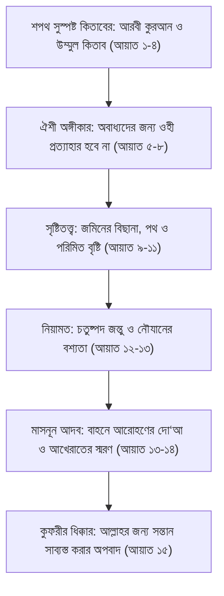

# আয-যুখরুফ — রুকু ০১ (আয়াত ১–১৫)

[সূচিপত্র](00_সূরা-পরিচিতি.md)

---

## ৫-স্তরবিশিষ্ট একাডেমিক যাচাইকরণ স্ট্যাটাস (Verification Status Box)

| স্তর (Tier) | অবস্থা | বিবরণ ও যাচাইয়ের পরিসর |
| :---: | :---: | :--- |
| **স্তর ১: Draft** | সম্পন্ন | ১৬ অধ্যায়ের কাঠামো ও প্রাথমিক তথ্য সংকলিত। |
| **স্তর ২: Digital Verified** | **যাচাইকৃত** | আয়াতের মূল পাঠ ও শব্দ-হরফ গণনা `bahouth` স্ক্রিপ্ট দ্বারা যাচাইকৃত; কিরাআত সারণি ও তুরাছ উদ্ধৃতিসমূহ ডিজিটাল ডাটাবেজের সাথে মিলিয়ে সংকলিত (কাঁচা স্ন্যাপশট সংরক্ষিত: `_sources/ruku_01_raw.json`)। |
| **স্তর ৩: Print Verified** | উন্মুক্ত (`[ ]`) | মুদ্রিত সংস্করণের ভৌত পৃষ্ঠার সাথে চাক্ষুষ মিলকরণের অপেক্ষায়। |
| **স্তর ৪: Scholarly Reviewed** | উন্মুক্ত (`[ ]`) | আকীদাগত ও তাফসীরী তারজীহ বিশেষজ্ঞ মুহাক্কিক আলেম কর্তৃক পর্যালোচনার অপেক্ষায়। |
| **স্তর ৫: Publication Ready** | উন্মুক্ত (`[ ]`) | চূড়ান্ত প্রকাশনা উপযোগী মাস্টার রেফারেন্স। |

---

## ০. রুকুর সারসংক্ষেপ ও কেন্দ্রীয় বক্তব্য (মাকাসিদ)

### প্রধান আত্মিক বার্তাসমূহ:
১. কুরআন বিশ্বজগতের মূল কিতাব লওহে মাহফূযে চিরসুরক্ষিত এক পরম প্রজ্ঞাময় গ্রন্থ।
২. আল্লাহ আকাশ ও পৃথিবীর সবকিছুকে মানুষের কল্যাণে বশীভূত করেছেন; এর বিনিময়ে মানুষের একমাত্র দায়িত্ব হলো আল্লাহর শোকর আদায় করা।
৩. যানবাহনে ওঠার সময় নিজের অক্ষমতা ও আল্লাহর পরাক্রম স্মরণ করে সুন্নাত দো‘আ পাঠ করা উচিত।
৪. প্রত্যেক ভ্রমণের সমাপ্তি মানুষকে স্মরণ করিয়ে দেয় যে আমাদের জীবনের চূড়ান্ত গন্তব্য হলো আল্লাহর আদালত।

---

---

## ১. আয়াতের মূল পাঠ ও অনুবাদ

### (১) ১ আরবি পাঠ (হরকতযুক্ত সাধারণ আরবি বানান; পূর্ণ উসমানী রসম নয়)

> [!NOTE]
> নিচে প্রদত্ত পাঠটি হরকতযুক্ত সাধারণ আরবি বানানরীতিতে সাজানো হয়েছে; এটি ক্যালিগ্রাফিক পূর্ণ উসমানী রসম নয়। প্রামাণ্য উসমানী পাঠের জন্য মুসহাফের পৃষ্ঠা দ্রষ্টব্য।

﴿حم ۝1
وَالْكِتَابِ الْمُبِينِ ۝2
إِنَّا جَعَلْنَاهُ قُرْآنًا عَرَبِيًّا لَعَلَّكُمْ تَعْقِلُونَ ۝3
وَإِنَّهُ فِي أُمِّ الْكِتَابِ لَدَيْنَا لَعَلِيٌّ حَكِيمٌ ۝4
أَفَنَضْرِبُ عَنْكُمْ الذِّكْرَ صَفْحًا أَنْ كُنْتُمْ قَوْمًا مُسْرِفِينَ ۝5
وَكَمْ أَرْسَلْنَا مِنْ نَبِيٍّ فِي الْأَوَّلِينَ ۝6
وَمَا يَأْتِيهِمْ مِنْ نَبِيٍّ إِلَّا كَانُوا بِهِ يَسْتَهْزِئُونَ ۝7
فَأَهْلَكْنَا أَشَدَّ مِنْهُمْ بَطْشًا وَمَضَى مَثَلُ الْأَوَّلِينَ ۝8
وَلَئِنْ سَأَلْتَهُمْ مَنْ خَلَقَ السَّمَاوَاتِ وَالْأَرْضَ لَيَقُولُنَّ خَلَقَهُنَّ الْعَزِيزُ الْعَلِيمُ ۝9
الَّذِي جَعَلَ لَكُمْ الْأَرْضَ مَهْدًا وَجَعَلَ لَكُمْ فِيهَا سُبُلًا لَعَلَّكُمْ تَهْتَدُونَ ۝10
وَالَّذِي نَزَّلَ مِنْ السَّمَاءِ مَاءً بِقَدَرٍ فَأَنْشَرْنَا بِهِ بَلْدَةً مَيْتًا كَذَلِكَ تُخْرَجُونَ ۝11
وَالَّذِي خَلَقَ الْأَزْوَاجَ كُلَّهَا وَجَعَلَ لَكُمْ مِنْ الْفُلْكِ وَالْأَنْعَامِ مَا تَرْكَبُونَ ۝12
لِتَسْتَوُوا عَلَى ظُهُورِهِ ثُمَّ تَذْكُرُوا نِعْمَةَ رَبِّكُمْ إِذَا اسْتَوَيْتُمْ عَلَيْهِ وَتَقُولُوا سُبْحَانَ الَّذِي سَخَّرَ لَنَا هَذَا وَمَا كُنَّا لَهُ مُقْرِنِينَ ۝13
وَإِنَّا إِلَى رَبِّنَا لَمُنْقَلِبُونَ ۝14
وَجَعَلُوا لَهُ مِنْ عِبَادِهِ جُزْءًا إِنَّ الْإِنْسَانَ لَكَفُورٌ مُبِينٌ ۝15﴾

### (১) ২ শব্দানুগ ও সাবলীল অনুবাদ

| আয়াত | মূল আরবী পাঠ | সাবলীল বঙ্গানুবাদ |
| :---: | :--- | :--- |
| **১** | ﴿حم﴾ | হা-মীম। |
| **২** | ﴿وَالْكِتَابِ الْمُبِينِ﴾ | শপথ সুস্পষ্ট ও জ্যোতির্ময় কিতাবের (কুরআনের)! |
| **৩** | ﴿إِنَّا جَعَلْنَاهُ قُرْآنًا عَرَبِيًّا لَعَلَّكُمْ تَعْقِلُونَ﴾ | নিশ্চয় আমি একে অবতীর্ণ করেছি আরবী ভাষায় কুরআনরূপে, যাতে তোমরা তা অনুধাবন ও উপলব্ধি করতে পারো। |
| **৪** | ﴿وَإِنَّهُ فِي أُمِّ الْكِتَابِ لَدَيْنَا لَعَلِيٌّ حَكِيمٌ﴾ | আর নিশ্চয় এটি আমার নিকট মূল কিতাবে (লওহে মাহফূযে) সংরক্ষিত, অত্যন্ত সুউচ্চ ও প্রজ্ঞাময়। |
| **৫** | ﴿أَفَنَضْرِبُ عَنْكُمْ الذِّكْرَ صَفْحًا أَنْ كُنْتُمْ قَوْمًا مُسْرِفِينَ﴾ | তবে কি আমি তোমাদের নিকট হতে এই উপদেশবাণী সম্পূর্ণরূপে প্রত্যাহার করে নেব এই কারণে যে, তোমরা এক সীমালঙ্ঘনকারী সম্প্রদায়? |
| **৬** | ﴿وَكَمْ أَرْسَلْنَا مِنْ نَبِيٍّ فِي الْأَوَّلِينَ﴾ | আর আমি পূর্ববর্তীদের নিকট কত নবীই না প্রেরণ করেছিলাম! |
| **৭** | ﴿وَمَا يَأْتِيهِمْ مِنْ نَبِيٍّ إِلَّا كَانُوا بِهِ يَسْتَهْزِئُونَ﴾ | কিন্তু তাদের নিকট যখনই কোনো নবী আগমন করেছেন, তারা তাঁকে নিয়ে উপহাস ও বিদ্রূপ করেছে। |
| **৮** | ﴿فَأَهْلَكْنَا أَشَدَّ مِنْهُمْ بَطْشًا وَمَضَى مَثَلُ الْأَوَّلِينَ﴾ | অতঃপর আমি এদের অপেক্ষা অধিকতর শক্তিশালী ও পরাক্রমশালীদের ধ্বংস করে দিয়েছি; এবং পূর্ববর্তীদের এমন বহু দৃষ্টান্ত গত হয়ে গিয়েছে। |
| **৯** | ﴿وَلَئِنْ سَأَلْتَهُمْ مَنْ خَلَقَ السَّمَاوَاتِ وَالْأَرْضَ لَيَقُولُنَّ خَلَقَهُنَّ الْعَزِيزُ الْعَلِيمُ﴾ | আর আপনি যদি তাদের জিজ্ঞেস করেন, ‘কে আকাশমণ্ডলী ও পৃথিবী সৃষ্টি করেছে?’ তারা অবশ্যই বলবে, ‘এগুলি সৃষ্টি করেছেন সেই পরাক্রমশালী, সর্বজ্ঞ আল্লাহ।’ |
| **১০** | ﴿الَّذِي جَعَلَ لَكُمْ الْأَرْضَ مَهْدًا وَجَعَلَ لَكُمْ فِيهَا سُبُلًا لَعَلَّكُمْ تَهْتَدُونَ﴾ | তিনিই তোমাদের জন্য এই পৃথিবীকে করেছেন সুবিন্যস্ত শয্যাতুল্য এবং এতে তোমাদের চলাচলের জন্য তৈরি করেছেন বহু পথ, যাতে তোমরা সঠিক গন্তব্যে পৌঁছতে পারো; |
| **১১** | ﴿وَالَّذِي نَزَّلَ مِنْ السَّمَاءِ مَاءً بِقَدَرٍ فَأَنْشَرْنَا بِهِ بَلْدَةً مَيْتًا كَذَلِكَ تُخْرَجُونَ﴾ | এবং যিনি আকাশ হতে পরিমিত পরিমাণে পানি বর্ষণ করেন; অতঃপর তা দিয়ে আমি মৃত নিথর জনপদকে পুনরুজ্জীবিত করি; এভাবেই তোমাদেরকে কবর হতে বের করা হবে। |
| **১২** | ﴿وَالَّذِي خَلَقَ الْأَزْوَاجَ كُلَّهَا وَجَعَلَ لَكُمْ مِنْ الْفُلْكِ وَالْأَنْعَامِ مَا تَرْكَبُونَ﴾ | এবং যিনি সমস্ত প্রকারের জোড়া সৃষ্টি করেছেন এবং তোমাদের জন্য তৈরি করেছেন এমন সব নৌযান ও চতুষ্পদ জন্তু, যার ওপর তোমরা আরোহণ করো; |
| **১৩** | ﴿لِتَسْتَوُوا عَلَى ظُهُورِهِ ثُمَّ تَذْكُرُوا نِعْمَةَ رَبِّكُمْ إِذَا اسْتَوَيْتُمْ عَلَيْهِ وَتَقُولُوا سُبْحَانَ الَّذِي سَخَّرَ لَنَا هَذَا وَمَا كُنَّا لَهُ مُقْرِنِينَ﴾ | যাতে তোমরা এগুলির পিঠে স্থির হয়ে বসতে পারো, অতঃপর যখন তোমরা এর ওপর আরোহণ সম্পন্ন করো তখন তোমাদের প্রতিপালকের অনুগ্রহ স্মরণ করো এবং বলো: ‘পবিত্র ও মহান সেই সত্তা, যিনি এদেরকে আমাদের বশীভূত করে দিয়েছেন; অথচ আমরা এদের বশীভূত করতে সক্ষম ছিলাম না;’ |
| **১৪** | ﴿وَإِنَّا إِلَى رَبِّنَا لَمُنْقَلِبُونَ﴾ | ‘এবং নিশ্চয় আমরা আমাদের প্রতিপালকের নিকটেই প্রত্যাবর্তনকারী।’ |
| **১৫** | ﴿وَجَعَلُوا لَهُ مِنْ عِبَادِهِ جُزْءًا إِنَّ الْإِنْسَانَ لَكَفُورٌ مُبِينٌ﴾ | অথচ তারা তাঁর বান্দাদের মধ্য হতে তাঁর জন্য অংশ (সন্তান) সাব্যস্ত করেছে; নিশ্চয় মানুষ এক স্পষ্ট অকৃতজ্ঞ। |

---

## ২. লুগাভী ও সরফী তাহকীক এবং মুফরাদাতুল কুরআন

| শব্দ | মূলধাতু | সীগা / ওযন | আভিধানিক অর্থ | কুরআনিক প্রয়োগ ও তাৎপর্য |
| :--- | :---: | :---: | :--- | :--- |
| **أُمِّ الْكِتَابِ** | `أمم` / `كتب` | مركب إضافي مجرور | লওহে মাহফূয, মূল কিতাব | সকল ওহী ও আসমানী কিতাবের সুসংরক্ষিত চিরন্তন আদি মহাফেজখানা। |
| **عَلِيٌّ حَكِيمٌ** | `علو` / `حكم` | صفتان مشبهتان | সুউচ্চ মর্যাদাবান ও প্রজ্ঞাময় | কুরআনুল কারীমের অনন্য অলৌকিক মর্যাদা ও চিরন্তন ঐশী হিকমত। |
| **صَفْحًا** | `صفح` | مفعول مطلق / حال | উপেক্ষা করে মুখ ফিরিয়ে নেওয়া | কাফিরদের অবিরাম পাপাচারের অজুহাতে হেদায়েতের দাওয়াত বন্ধ না করা। |
| **مَهْدًا** | `مهد` | اسم مفعول / مصدر (مَفْعَل) | আরামদায়ক দোলনা ও বিছানা | মানুষের বসবাস ও জীবিকার অনুকূলে পৃথিবীকে সুষম ও স্থির সমতল করা। |
| **سُبُلًا** | `سبل` | جمع تكسير مفعول به (سَبِيل) | পথ ও প্রশস্ত রাস্তাঘাট | ব্যবসা ও যোগাযোগের সুবিধার্থে পাহাড়-পর্বতের বুক চিরে পথ তৈরি করা। |
| **سَخَّرَ لَنَا هَذَا** | `سخر` | مركب فعلي متعد | আমাদের বশীভূত ও অনুগত করেছেন | উট, ঘোড়া ও জলযানকে মানুষের নিয়ন্ত্রণে দিয়ে মহান আল্লাহর অপরিসীম কৃপা। |
| **مُقْرِنِينَ** | `قرن` | اسم فاعل جمع (إفْعَال) | নিজ শক্তিতে বশীভূত করতে সক্ষম | আল্লাহর সাহায্য ছাড়া পশুপাখি বা যানবাহন নিয়ন্ত্রণে সৃষ্টির অপারগতার স্বীকারোক্তি। |
| **مُنقَلِبُونَ** | `قلب` | اسم فاعل جمع خبر (انْفِعَال) | প্রত্যাবর্তনকারী বান্দা | যানবাহনে চড়ে সফরের সময় আখেরাতের অন্তিম যাত্রার বাস্তব স্মৃতিচারণ। |

---

## ৩. ই'রাব ও নাহবী বিশ্লেষণ

1. **﴿وَإِنَّهُ فِي أُمِّ الْكِتَابِ لَدَيْنَا لَعَلِيٌّ حَكِيمٌ﴾ (আয়াত ৪):**
   - `وَإِنَّهُ`: হরফে মুশাব্বাহা বিল-ফে‘ল ও হা যমীর ইসমু ইন্না।
   - `لَعَلِيٌّ`: লামে মুযাহলাক্বাহ সহ 'ইন্না'-এর খবর মারফূ‘ بالضمة; `حَكِيمٌ`: দ্বিতীয় খবর।
   - `فِي أُمِّ الْكِتَابِ`: যার ও মাজরুর হাল হিসেবে প্রযুক্ত।

2. **﴿سُبْحَانَ الَّذِي سَخَّرَ لَنَا هَذَا وَمَا كُنَّا لَهُ مُقْرِنِينَ﴾ (আয়াত ১৩):**
   - `سُبْحَانَ`: মাফ‘ঊল মুতলাক্ব মানসূব بالفتحة; ফে‘লে মাহযূফ (أسبح) মুদ্বাফ।
   - `الَّذِي`: মুদ্বাফ ইলাইহি মাহাল্লান মাজরুর; `سَخَّرَ لَنَا هَذَا` সিলাতুল মাউসূল।
   - `مُقْرِنِينَ`: খবরু কুন্না মানসূব বিল-ইয়া।

3. **﴿وَإِنَّا إِلَى رَبِّنَا لَمُنْقَلِبُونَ﴾ (আয়াত ১৪):**
   - `وَإِنَّا`: ‘ইন্না’ ও ‘না’ যমীর মানসূব ইসম।
   - `لَمُنْقَلِبُونَ`: লামে মুযাহলাক্বাহ সহ খবর মারফূ‘ বিল-ওয়াও; `إِلَى رَبِّنَا` যার-মাজরুর।

---

## ৪. কিরাআত ও তাফসীরে প্রভাব

### ৪.১ প্রামাণ্য ১০ মুতাওয়াতির কিরাআত সারণি (মাদীনা মুনাওয়ারা বাহাউথ ডেটাবেস)

| আয়াত | শব্দ (ক্রম) | ক্বারী / রাবী (বাহাউথ) | কিরাআতের পাঠভেদ ও নিয়ম (অবিকৃত মূল পাঠ) |
| :---: | :--- | :--- | :--- |
| **1** | ﴿حم﴾ (1) | قالون عن نافع وَابن كثير وَيعقوب وَهشام عن ابن عامر وَحفص عن عاصم | قرأ بفتح الحاء. |
| **1** | ﴿حم﴾ (1) | ورش عن نافع وَأبو عمرو | قرأ بتقليل الحاء. |
| **1** | ﴿حم﴾ (1) | أبو جعفر | قرأ بفتح الحاء، مع السكت على الحاء والميم. |
| **1** | ﴿حم﴾ (1) | باقي الرواة | قرؤوا بإمالة الحاء. |
| **3** | ﴿جَعَلْنَاهُ﴾ (2) | ابن كثير | قرأ بصلة هاء الضمير خلافا لجمهور القراء. |
| **3** | ﴿جَعَلْنَاهُ﴾ (2) | باقي الرواة | قرؤوا بترك الصلة مع قصر الهاء. |
| **3** | ﴿قُرْآنًا﴾ (3) | ابن كثير | قرأ بنقل حركة الهمزة وصلاً ووقفا. |
| **3** | ﴿قُرْآنًا﴾ (3) | حمزة | قرأ بتحقيق الهمزة وصلاً، ووقف بالنقل. |
| **3** | ﴿قُرْآنًا﴾ (3) | باقي الرواة | قرؤوا بتحقيق الهمزة وصلاً ووقفا. |
| **3** | ﴿لَعَلَّكُمْ﴾ (5) | قالون عن نافع | قرأ بصلة ميم الجمع وصلاً بخلف عنه. |
| **3** | ﴿لَعَلَّكُمْ﴾ (5) | أبو جعفر وَابن كثير | قرأ بصلة ميم الجمع وصلا. |
| **3** | ﴿لَعَلَّكُمْ﴾ (5) | باقي الرواة | قرؤوا بترك صلة ميم الجمع. |
| **4** | ﴿وَإِنَّهُ﴾ (1) | حمزة | قرأ بتحقيق الهمزة وصلاً، ووقف بتسهيل وتحقيق الهمزة. |
| **4** | ﴿وَإِنَّهُ﴾ (1) | باقي الرواة | قرؤوا بتحقيق الهمزة وصلاً ووقفا. |
| **4** | ﴿أُمِّ﴾ (3) | حمزة وَالكسائي | قرأ بكسر الهمزة وصلاً، ويبدأ بهمزة مضمومة كالجمهور. |
| **4** | ﴿أُمِّ﴾ (3) | باقي الرواة | قرؤوا بضم الهمزة وصلاً وابتداء. |
| **4** | ﴿حَكِيمٌ﴾ (7) | ورش عن نافع | قرأ بالنقل وصلاً ووقفا. |
| **4** | ﴿حَكِيمٌ﴾ (7) | خلف عن حمزة | قرأ بالسكت وعدمه وصلاً، ووقف بالسكت، والنقل، وتركهما. |
| **4** | ﴿حَكِيمٌ﴾ (7) | خلاد عن حمزة | قرأ بترك السكت وصلاً، ووقف بالنقل والتحقيق. |
| **4** | ﴿حَكِيمٌ﴾ (7) | باقي الرواة | قرؤوا بترك السكت مع تحقيق الهمزة وصلاً ووقفا. |
| **5** | ﴿الذِّكْرَ﴾ (3) | ورش عن نافع | قرأ بترقيق الراء في الحالين. |
| **5** | ﴿الذِّكْرَ﴾ (3) | باقي الرواة | قرؤوا بتفخيم الراء. |
| **5** | ﴿صَفْحًا﴾ (4) | ورش عن نافع | قرأ بالنقل وصلاً ووقفا. |
| **5** | ﴿صَفْحًا﴾ (4) | خلف عن حمزة | قرأ بالسكت وعدمه وصلاً، ووقف بالسكت، والنقل، وتركهما. |
| **5** | ﴿صَفْحًا﴾ (4) | خلاد عن حمزة | قرأ بترك السكت وصلاً، ووقف بالنقل والتحقيق. |
| **5** | ﴿صَفْحًا﴾ (4) | باقي الرواة | قرؤوا بترك السكت مع تحقيق الهمزة وصلاً ووقفا. |
| **5** | ﴿أَنْ﴾ (5) | ابن كثير وَأبو عمرو وَيعقوب وَابن عامر وَعاصم | قرأ بفتح الهمزة. |
| **5** | ﴿أَنْ﴾ (5) | باقي الرواة | قرؤوا بكسر الهمزة. |
| **5** | ﴿كُنْتُمْ﴾ (6) | قالون عن نافع | قرأ بصلة ميم الجمع وصلاً بخلف عنه. |
| **5** | ﴿كُنْتُمْ﴾ (6) | أبو جعفر وَابن كثير | قرأ بصلة ميم الجمع وصلا. |
| **5** | ﴿كُنْتُمْ﴾ (6) | باقي الرواة | قرؤوا بترك صلة ميم الجمع. |
| **6** | ﴿وَكَمْ﴾ (1) | ورش عن نافع | قرأ بالنقل وصلاً ووقفا. |
| **6** | ﴿وَكَمْ﴾ (1) | خلف عن حمزة | قرأ بالسكت وعدمه وصلاً، ووقف بالسكت، والنقل، وتركهما. |
| **6** | ﴿وَكَمْ﴾ (1) | خلاد عن حمزة | قرأ بترك السكت وصلاً، ووقف بالنقل والتحقيق. |
| **6** | ﴿وَكَمْ﴾ (1) | باقي الرواة | قرؤوا بترك السكت مع تحقيق الهمزة وصلاً ووقفا. |
| **6** | ﴿نَبِيٍّ﴾ (4) | نافع | قرأ بالهمزة بعد الياء مع المد. |
| **6** | ﴿نَبِيٍّ﴾ (4) | باقي الرواة | قرؤوا بإبدال الهمزة ياء مع التشديد. |
| **6** | ﴿الْأَوَّلِينَ﴾ (6) | ورش عن نافع | قرأ بالنقل مع ترك السكت. |
| **6** | ﴿الْأَوَّلِينَ﴾ (6) | خلف عن حمزة | قرأ بالسكت وصلاً، ووقف بالسكت والنقل. |
| **6** | ﴿الْأَوَّلِينَ﴾ (6) | خلاد عن حمزة | قرأ بالسكت وعدمه وصلاً، ووقف بالسكت والنقل. |
| **6** | ﴿الْأَوَّلِينَ﴾ (6) | باقي الرواة | قرؤوا بترك السكت مع تحقيق الهمزة وصلاً ووقفا. |
| **7** | ﴿يَأْتِيهِمْ﴾ (2) | ورش عن نافع وَأبو جعفر وَالسوسي عن أبي عمرو | قرأ بإبدال الهمزة الساكنة ألفاً، مع كسر الهاء. |
| **7** | ﴿يَأْتِيهِمْ﴾ (2) | يعقوب | قرأ بتحقيق الهمزة الساكنة، مع ضم الهاء. |
| **7** | ﴿يَأْتِيهِمْ﴾ (2) | حمزة | قرأ بتحقيق الهمزة وصلاً، ووقف بإبدالها ألفاً، مع كسر الهاء. |
| **7** | ﴿يَأْتِيهِمْ﴾ (2) | باقي الرواة | قرؤوا بتحقيق الهمزة الساكنة، مع كسر الهاء. |
| **7** | ﴿يَأْتِيهِمْ﴾ (2) | قالون عن نافع | قرأ بصلة ميم الجمع وصلاً بخلف عنه. |
| **7** | ﴿يَأْتِيهِمْ﴾ (2) | أبو جعفر وَابن كثير | قرأ بصلة ميم الجمع وصلا. |
| **7** | ﴿يَأْتِيهِمْ﴾ (2) | باقي الرواة | قرؤوا بترك صلة ميم الجمع. |
| **7** | ﴿نَبِيٍّ﴾ (4) | نافع | قرأ بالهمزة بعد الياء مع المد. |
| **7** | ﴿نَبِيٍّ﴾ (4) | باقي الرواة | قرؤوا بإبدال الهمزة ياء مع التشديد. |
| **7** | ﴿نَبِيٍّ﴾ (4) | ورش عن نافع | قرأ بالنقل وصلاً ووقفا. |
| **7** | ﴿نَبِيٍّ﴾ (4) | خلف عن حمزة | قرأ بالسكت وعدمه وصلاً، ووقف بالسكت، والنقل، وتركهما. |
| **7** | ﴿نَبِيٍّ﴾ (4) | خلاد عن حمزة | قرأ بترك السكت وصلاً، ووقف بالنقل والتحقيق. |
| **7** | ﴿نَبِيٍّ﴾ (4) | باقي الرواة | قرؤوا بترك السكت مع تحقيق الهمزة وصلاً ووقفا. |
| **7** | ﴿يَسْتَهْزِئُونَ﴾ (8) | ورش عن نافع | قرأ بتثليث مد البدل. |
| **7** | ﴿يَسْتَهْزِئُونَ﴾ (8) | أبو جعفر | قرأ بحذف الهمزة مع ضم ما قبلها في الحالين. |
| **7** | ﴿يَسْتَهْزِئُونَ﴾ (8) | حمزة | قرأ بتحقيق الهمزة وصلاً، ووقف بثلاثة أوجه:- حذف الهمزة، مع ضم ما قبلها، - تسهيل الهمزة بين بين، - إبدال الهمزة ياء مضمومة. |
| **7** | ﴿يَسْتَهْزِئُونَ﴾ (8) | باقي الرواة | قرؤوا بقصر مد البدل مع تحقيق الهمزة وصلاً ووقفا. |
| **8** | ﴿فَأَهْلَكْنَا﴾ (1) | حمزة | قرأ بتحقيق الهمزة وصلاً، ووقف بتسهيل وتحقيق الهمزة. |
| **8** | ﴿فَأَهْلَكْنَا﴾ (1) | باقي الرواة | قرؤوا بتحقيق الهمزة وصلاً ووقفا. |
| **8** | ﴿مِنْهُمْ﴾ (3) | قالون عن نافع | قرأ بصلة ميم الجمع وصلاً بخلف عنه. |
| **8** | ﴿مِنْهُمْ﴾ (3) | أبو جعفر وَابن كثير | قرأ بصلة ميم الجمع وصلا. |
| **8** | ﴿مِنْهُمْ﴾ (3) | باقي الرواة | قرؤوا بترك صلة ميم الجمع. |
| **8** | ﴿بَطْشًا﴾ (4) | خلف عن حمزة | قرأ بالإدغام مع ترك الغنة. |
| **8** | ﴿بَطْشًا﴾ (4) | باقي الرواة | قرؤوا بالإدغام مع الغنة. |
| **8** | ﴿وَمَضَى﴾ (5) | ورش عن نافع | قرأ بالتقليل بخلف عنه. |
| **8** | ﴿وَمَضَى﴾ (5) | حمزة وَالكسائي وَخلف العاشر | قرأ بالإمالة بلا خلاف عنه. |
| **8** | ﴿وَمَضَى﴾ (5) | باقي الرواة | قرؤوا بترك الإمالة وصلاً ووقفا. |
| **8** | ﴿الْأَوَّلِينَ﴾ (7) | ورش عن نافع | قرأ بالنقل مع ترك السكت. |
| **8** | ﴿الْأَوَّلِينَ﴾ (7) | خلف عن حمزة | قرأ بالسكت وصلاً، ووقف بالسكت والنقل. |
| **8** | ﴿الْأَوَّلِينَ﴾ (7) | خلاد عن حمزة | قرأ بالسكت وعدمه وصلاً، ووقف بالسكت والنقل. |
| **8** | ﴿الْأَوَّلِينَ﴾ (7) | باقي الرواة | قرؤوا بترك السكت مع تحقيق الهمزة وصلاً ووقفا. |
| **9** | ﴿وَلَئِنْ﴾ (1) | حمزة | قرأ بتحقيق الهمزة وصلاً، ووقف بتسهيل وتحقيق الهمزة. |
| **9** | ﴿وَلَئِنْ﴾ (1) | باقي الرواة | قرؤوا بتحقيق الهمزة وصلاً ووقفا. |
| **9** | ﴿سَأَلْتَهُمْ﴾ (2) | حمزة | قرأ بتحقيق الهمزة وصلاً، ووقف بتسهيل الهمزة. |
| **9** | ﴿سَأَلْتَهُمْ﴾ (2) | باقي الرواة | قرؤوا بتحقيق الهمزة وصلاً ووقفا. |
| **9** | ﴿سَأَلْتَهُمْ﴾ (2) | قالون عن نافع | قرأ بصلة ميم الجمع وصلاً بخلف عنه. |
| **9** | ﴿سَأَلْتَهُمْ﴾ (2) | أبو جعفر وَابن كثير | قرأ بصلة ميم الجمع وصلا. |
| **9** | ﴿سَأَلْتَهُمْ﴾ (2) | باقي الرواة | قرؤوا بترك صلة ميم الجمع. |
| **9** | ﴿مَنْ﴾ (3) | أبو جعفر | قرأ بالإخفاء عند الغين والخاء مع الغنة. |
| **9** | ﴿مَنْ﴾ (3) | باقي الرواة | قرؤوا بالإظهار مع ترك الغنة. |
| **9** | ﴿وَالْأَرْضَ﴾ (6) | ورش عن نافع | قرأ بالنقل مع ترك السكت. |
| **9** | ﴿وَالْأَرْضَ﴾ (6) | خلف عن حمزة | قرأ بالسكت وصلاً، ووقف بالسكت والنقل. |
| **9** | ﴿وَالْأَرْضَ﴾ (6) | خلاد عن حمزة | قرأ بالسكت وعدمه وصلاً، ووقف بالسكت والنقل. |
| **9** | ﴿وَالْأَرْضَ﴾ (6) | باقي الرواة | قرؤوا بترك السكت مع تحقيق الهمزة وصلاً ووقفا. |
| **9** | ﴿خَلَقَهُنَّ﴾ (8) | يعقوب | قرأ بهاء السكت وقفا. |
| **9** | ﴿خَلَقَهُنَّ﴾ (8) | باقي الرواة | قرؤوا بترك هاء السكت وقفا. |
| **10** | ﴿جَعَلَ﴾ (2) | السوسي عن أبي عمرو | قرأ بالإدغام الكبير. |
| **10** | ﴿جَعَلَ﴾ (2) | باقي الرواة | قرؤوا بالإظهار. |
| **10** | ﴿الْأَرْضَ﴾ (4) | ورش عن نافع | قرأ بالنقل مع ترك السكت. |
| **10** | ﴿الْأَرْضَ﴾ (4) | خلف عن حمزة | قرأ بالسكت وصلاً، ووقف بالسكت والنقل. |
| **10** | ﴿الْأَرْضَ﴾ (4) | خلاد عن حمزة | قرأ بالسكت وعدمه وصلاً، ووقف بالسكت والنقل. |
| **10** | ﴿الْأَرْضَ﴾ (4) | باقي الرواة | قرؤوا بترك السكت مع تحقيق الهمزة وصلاً ووقفا. |
| **10** | ﴿مَهْدًا﴾ (5) | عاصم وَحمزة وَالكسائي وَخلف العاشر | قرأ بفتح الميم، وإسكان الهاء، وحذف الألف. |
| **10** | ﴿مَهْدًا﴾ (5) | باقي الرواة | قرؤوا بكسر الميم، وفتح الهاء، وألف بعدها. |
| **10** | ﴿مَهْدًا﴾ (5) | خلف عن حمزة | قرأ بالإدغام مع ترك الغنة. |
| **10** | ﴿مَهْدًا﴾ (5) | باقي الرواة | قرؤوا بالإدغام مع الغنة. |
| **10** | ﴿وَجَعَلَ﴾ (6) | السوسي عن أبي عمرو | قرأ بالإدغام الكبير. |
| **10** | ﴿وَجَعَلَ﴾ (6) | باقي الرواة | قرؤوا بالإظهار. |
| **10** | ﴿لَكُمْ﴾ (7) | قالون عن نافع | قرأ بصلة ميم الجمع وصلاً بخلف عنه. |
| **10** | ﴿لَكُمْ﴾ (7) | أبو جعفر وَابن كثير | قرأ بصلة ميم الجمع وصلا. |
| **10** | ﴿لَكُمْ﴾ (7) | باقي الرواة | قرؤوا بترك صلة ميم الجمع. |
| **10** | ﴿لَعَلَّكُمْ﴾ (10) | قالون عن نافع | قرأ بصلة ميم الجمع وصلاً بخلف عنه. |
| **10** | ﴿لَعَلَّكُمْ﴾ (10) | أبو جعفر وَابن كثير | قرأ بصلة ميم الجمع وصلا. |
| **10** | ﴿لَعَلَّكُمْ﴾ (10) | باقي الرواة | قرؤوا بترك صلة ميم الجمع. |
| **11** | ﴿السَّمَاءِ﴾ (4) | هشام عن ابن عامر وَحمزة | قرأ بتحقيق الهمزة المتطرفة وصلاً، ووقف بالإبدال مع القصر والتوسط والطول، وتسهيل الهمزة بالروم على المد والقصر. |
| **11** | ﴿السَّمَاءِ﴾ (4) | باقي الرواة | قرؤوا بتحقيق الهمزة المتطرفة وصلاً ووقفا. |
| **11** | ﴿مَاءً﴾ (5) | حمزة | قرأ بتحقيق الهمزة وصلاً، ووقف بتسهيل الهمزة مع المد والقصر. |
| **11** | ﴿مَاءً﴾ (5) | باقي الرواة | قرؤوا بتحقيق الهمزة وصلاً ووقفا. |
| **11** | ﴿فَأَنْشَرْنَا﴾ (7) | حمزة | قرأ بتحقيق الهمزة وصلاً، ووقف بتسهيل وتحقيق الهمزة. |
| **11** | ﴿فَأَنْشَرْنَا﴾ (7) | باقي الرواة | قرؤوا بتحقيق الهمزة وصلاً ووقفا. |
| **11** | ﴿بَلْدَةً﴾ (9) | الكسائي | قرأ بإمالة هاء التأنيث وقفا. |
| **11** | ﴿بَلْدَةً﴾ (9) | باقي الرواة | قرؤوا بفتح هاء التأنيث. |
| **11** | ﴿مَيْتًا﴾ (10) | أبو جعفر | قرأ بتشديد الياء. |
| **11** | ﴿مَيْتًا﴾ (10) | باقي الرواة | قرؤوا بتخفيف الياء. |
| **11** | ﴿تُخْرَجُونَ﴾ (12) | ابن ذكوان عن ابن عامر وَحمزة وَالكسائي وَخلف العاشر | قرأ بفتح التاء، وضم الراء، بالبناء للفاعل. |
| **11** | ﴿تُخْرَجُونَ﴾ (12) | باقي الرواة | قرؤوا بضم التاء، وفتح الراء، بالبناء لما لم يسم فاعله. |
| **12** | ﴿الْأَزْوَاجَ﴾ (3) | ورش عن نافع | قرأ بالنقل مع ترك السكت. |
| **12** | ﴿الْأَزْوَاجَ﴾ (3) | خلف عن حمزة | قرأ بالسكت وصلاً، ووقف بالسكت والنقل. |
| **12** | ﴿الْأَزْوَاجَ﴾ (3) | خلاد عن حمزة | قرأ بالسكت وعدمه وصلاً، ووقف بالسكت والنقل. |
| **12** | ﴿الْأَزْوَاجَ﴾ (3) | باقي الرواة | قرؤوا بترك السكت مع تحقيق الهمزة وصلاً ووقفا. |
| **12** | ﴿وَجَعَلَ﴾ (5) | السوسي عن أبي عمرو | قرأ بالإدغام الكبير. |
| **12** | ﴿وَجَعَلَ﴾ (5) | باقي الرواة | قرؤوا بالإظهار. |
| **12** | ﴿لَكُمْ﴾ (6) | قالون عن نافع | قرأ بصلة ميم الجمع وصلاً بخلف عنه. |
| **12** | ﴿لَكُمْ﴾ (6) | أبو جعفر وَابن كثير | قرأ بصلة ميم الجمع وصلا. |
| **12** | ﴿لَكُمْ﴾ (6) | باقي الرواة | قرؤوا بترك صلة ميم الجمع. |
| **12** | ﴿وَالْأَنْعَامِ﴾ (9) | ورش عن نافع | قرأ بالنقل مع ترك السكت. |
| **12** | ﴿وَالْأَنْعَامِ﴾ (9) | خلف عن حمزة | قرأ بالسكت وصلاً، ووقف بالسكت والنقل. |
| **12** | ﴿وَالْأَنْعَامِ﴾ (9) | خلاد عن حمزة | قرأ بالسكت وعدمه وصلاً، ووقف بالسكت والنقل. |
| **12** | ﴿وَالْأَنْعَامِ﴾ (9) | باقي الرواة | قرؤوا بترك السكت مع تحقيق الهمزة وصلاً ووقفا. |
| **12** | ﴿وَالْأَنْعَامِ﴾ (9) | السوسي عن أبي عمرو | قرأ بالإدغام الكبير. |
| **12** | ﴿وَالْأَنْعَامِ﴾ (9) | باقي الرواة | قرؤوا بالإظهار. |
| **13** | ﴿نِعْمَةَ﴾ (6) | الكسائي | قرأ بإمالة هاء التأنيث وقفا. |
| **13** | ﴿نِعْمَةَ﴾ (6) | باقي الرواة | قرؤوا بفتح هاء التأنيث. |
| **13** | ﴿رَبِّكُمْ﴾ (7) | قالون عن نافع | قرأ بصلة ميم الجمع وصلاً بخلف عنه. |
| **13** | ﴿رَبِّكُمْ﴾ (7) | ورش عن نافع | قرأ بصلة ميم الجمع وصلاً مع الإشباع. |
| **13** | ﴿رَبِّكُمْ﴾ (7) | أبو جعفر وَابن كثير | قرأ بصلة ميم الجمع وصلا. |
| **13** | ﴿رَبِّكُمْ﴾ (7) | خلف عن حمزة | قرأ بالسكت وعدمه وصلاً ووقفا. |
| **13** | ﴿رَبِّكُمْ﴾ (7) | باقي الرواة | قرؤوا بترك السكت، وإسكان ميم الجمع وصلاً ووقفا. |
| **13** | ﴿اسْتَوَيْتُمْ﴾ (9) | قالون عن نافع | قرأ بصلة ميم الجمع وصلاً بخلف عنه. |
| **13** | ﴿اسْتَوَيْتُمْ﴾ (9) | أبو جعفر وَابن كثير | قرأ بصلة ميم الجمع وصلا. |
| **13** | ﴿اسْتَوَيْتُمْ﴾ (9) | باقي الرواة | قرؤوا بترك صلة ميم الجمع. |
| **13** | ﴿عَلَيْهِ﴾ (10) | ابن كثير | قرأ بصلة هاء الضمير خلافا لجمهور القراء. |
| **13** | ﴿عَلَيْهِ﴾ (10) | باقي الرواة | قرؤوا بترك الصلة مع قصر الهاء. |
| **13** | ﴿سَخَّرَ﴾ (14) | السوسي عن أبي عمرو | قرأ بالإدغام الكبير. |
| **13** | ﴿سَخَّرَ﴾ (14) | باقي الرواة | قرؤوا بالإظهار. |
| **14** | ﴿وَإِنَّا﴾ (1) | حمزة | قرأ بتحقيق الهمزة وصلاً، ووقف بتسهيل وتحقيق الهمزة. |
| **14** | ﴿وَإِنَّا﴾ (1) | باقي الرواة | قرؤوا بتحقيق الهمزة وصلاً ووقفا. |
| **15** | ﴿جُزْءًا﴾ (5) | أبو جعفر | قرأ بزاي مشددة بلا همزة. |
| **15** | ﴿جُزْءًا﴾ (5) | شعبة عن عاصم | قرأ بضم الزاي. |
| **15** | ﴿جُزْءًا﴾ (5) | حمزة | قرأ بالهمزة مع إسكان الزاي وصلاً، ويقف بالنقل. |
| **15** | ﴿جُزْءًا﴾ (5) | باقي الرواة | قرؤوا بإسكان الزاي، مع تحقيق الهمزة وصلاً ووقفا. |
| **15** | ﴿جُزْءًا﴾ (5) | ورش عن نافع | قرأ بالنقل وصلاً ووقفا. |
| **15** | ﴿جُزْءًا﴾ (5) | خلف عن حمزة | قرأ بالسكت وعدمه وصلاً، ووقف بالسكت، والنقل، وتركهما. |
| **15** | ﴿جُزْءًا﴾ (5) | خلاد عن حمزة | قرأ بترك السكت وصلاً، ووقف بالنقل والتحقيق. |
| **15** | ﴿جُزْءًا﴾ (5) | باقي الرواة | قرؤوا بترك السكت مع تحقيق الهمزة وصلاً ووقفا. |
| **15** | ﴿الْإِنْسَانَ﴾ (7) | ورش عن نافع | قرأ بالنقل مع ترك السكت. |
| **15** | ﴿الْإِنْسَانَ﴾ (7) | خلف عن حمزة | قرأ بالسكت وصلاً، ووقف بالسكت والنقل. |
| **15** | ﴿الْإِنْسَانَ﴾ (7) | خلاد عن حمزة | قرأ بالسكت وعدمه وصلاً، ووقف بالسكت والنقل. |
| **15** | ﴿الْإِنْسَانَ﴾ (7) | باقي الرواة | قرؤوا بترك السكت مع تحقيق الهمزة وصلاً ووقفا. |
| **15** | ﴿مُبِينٌ﴾ (9) | ورش عن نافع | قرأ بالنقل وصلاً ووقفا. |
| **15** | ﴿مُبِينٌ﴾ (9) | خلف عن حمزة | قرأ بالسكت وعدمه وصلاً، ووقف بالسكت، والنقل، وتركهما. |
| **15** | ﴿مُبِينٌ﴾ (9) | خلاد عن حمزة | قرأ بترك السكت وصلاً، ووقف بالنقل والتحقيق. |
| **15** | ﴿مُبِينٌ﴾ (9) | باقي الرواة | قرؤوا بترك السكت مع تحقيق الهمزة وصلاً ووقفا. |

### ৪.২ তাফসীর ও ফিকহে কিরাআতের প্রভাব
- **উসূলী পর্যালোচনা:** উদ্ধৃত কিরাআতসমূহ দশ মুতাওয়াতির ক্বারী ও তাঁদের রাবীদের প্রামাণিক সনদে প্রমাণিত।
- **অর্থগত বৈচিত্র্য:** শব্দের তাশদীদ, তাখফীফ, ইমালাহ এবং ইবদালের মাধ্যমে আয়াতসমূহের অর্থের গভীরতা ও তাৎপর্য সম্প্রসারিত হয়েছে, যা তাফসীর ও আহকামে পারস্পরিক পরিপূরক অর্থ প্রকাশ করে।

---
*উৎস সনদ:* শায়খ মুহাম্মদ ইব্রাহীম সালিম, *ফারীদাতুদ দাহর*, খণ্ড ৪ (`turath:29909`); ইমাম ইবনে যানযালাহ, *হুজ্জাতুল কিরাআত*, খণ্ড ১ (`turath:5531`); মাদীনা মুনাওয়ারা বাহাউথ প্রজেক্ট (`bahouth:list_verse_qiraat`)।

---

## ৫. তাফসীরুল জালালাইন ও তুলনামূলক তাফসীর

### (৫) ১ তাফসীরুল জালালাইন

### মূল আরবী পাঠ (তাফসীরে জালালাইন - ইমাম জালালুদ্দীন আল-মহাল্লী)
> **{حم}** اللَّهُ أَعْلَمُ بِمُرَادِهِ بِهِ. **{وَالْكِتَابِ الْمُبِينِ}** الْمُظْهِرِ لِلْحَقِّ وَالشَّرَائِعِ، أَقْسَمَ بِهِ **{إِنَّا جَعَلْنَاهُ}** أَوْجَدْنَاهُ **{قُرْآنًا عَرَبِيًّا لَّعَلَّكُمْ}** يَا أَهْلَ مَكَّةَ **{تَعْقِلُونَ}** تَفْهَمُونَ مَعَانِيَهُ. **{وَإِنَّهُ فِي أُمِّ الْكِتَابِ}** أَصْلِهِ وَهُوَ اللَّوْحُ الْمَحْفُوظُ **{لَدَيْنَا}** عِنْدَنَا **{لَعَلِيٌّ}** رَفِيعُ الْقَدْرِ **{حَكِيمٌ}** مُحْكَمٌ لَا يَتَطَرَّقُ إِلَيْهِ تَبْدِيلٌ. **{أَفَنَضْرِبُ عَنكُمُ الذِّكْرَ صَفْحًا}** نُمْسِكُ عَنْ إِنْزَالِ الْقُرْآنِ وَتَذْكِيرِكُمْ إِعْرَاضًا عَنْكُمْ **{أَن كُنتُمْ}** لِأَنْ كُنْتُمْ، وَبِالْكَسْرِ شَرْطِيَّةٌ **{قَوْمًا مُّسْرِفِينَ}** مُشْرِكِينَ؟ لَا نَفْعَلُ ذَلِكَ بَلْ نُنْزِلُهُ حُجَّةً عَلَيْكُمْ. **{وَكَمْ أَرْسَلْنَا مِن نَّبِيٍّ فِي الْأَوَّلِينَ وَمَا يَأْتِيهِم مِّن نَّبِيٍّ إِلَّا كَانُوا بِهِ يَسْتَهْزِئُونَ فَأَهْلَكْنَا أَشَدَّ مِنْهُم}** مِنْ قُرَيْشٍ **{بَطْشًا}** قُوَّةً **{وَمَضَىٰ مَثَلُ الْأَوَّلِينَ}** صِفَتُهُمْ وَعُقُوبَتُهُمْ لِيَعْتَبِرَ هَؤُلَاءِ.
> **{الَّذِي جَعَلَ لَكُمُ الْأَرْضَ مَهْدًا}** فِرَاشًا كَالْمَهْدِ، وَقُرِئَ مِهَادًا **{وَجَعَلَ لَكُمْ فِيهَا سُبُلًا لَّعَلَّكُمْ تَهْتَدُونَ}** إِلَى مَقَاصِدِكُمْ. **{وَالَّذِي نَزَّلَ مِنَ السَّمَاءِ مَاءً بِقَدَرٍ}** بِحَسَبِ الْحَاجَةِ **{فَأَنشَرْنَا}** أَحْيَيْنَا **{بِهِ بَلْدَةً مَّيْتًا كَذَٰلِكَ تُخْرَجُونَ}** مِنَ الْقُبُورِ، وَقُرِئَ بِفَتْحِ التَّاءِ. **{وَالَّذِي خَلَقَ الْأَزْوَاجَ كُلَّهَا}** الْأَصْنَافَ **{وَجَعَلَ لَكُم مِّنَ الْفُلْكِ}** السُّفُنِ **{وَالْأَنْعَامِ مَا تَرْكَبُونَ لِتَسْتَوُوا}** تَسْتَقِرُّوا **{عَلَىٰ ظُهُورِهِ}** ذُكِّرَ لَفْظُ مَا **{ثُمَّ تَذْكُرُوا نِعْمَةَ رَبِّكُمْ إِذَا اسْتَوَيْتُمْ عَلَيْهِ وَتَقُولُوا سُبْحَانَ الَّذِي سَخَّرَ لَنَا هَٰذَا وَمَا كُنَّا لَهُ مُقْرِنِينَ}** مُطِيقِينَ لَوْلَا تَسْخِيرُهُ **{وَإِنَّا إِلَىٰ رَبِّنَا لَمُنقَلِبُونَ}** رَاجِعُونَ. **{وَجَعَلُوا لَهُ مِنْ عِبَادِهِ جُزْءًا}** بَنَاتٍ بِقَوْلِهِمُ الْمَلَائِكَةُ بَنَاتُ اللَّهِ **{إِنَّ الْإِنسَانَ لَكَفُورٌ مُّبِينٌ}** ظَاهِرُ الْكُفْرِ.

### সরল ব্যাখ্যা ও মর্মার্থ
ইমাম আল-মহাল্লী (রহ.) [তুরাছ আইডি: ১২৮৭৬] চমৎকারভাবে আয়াতগুলোর তাফসীর করেন: আল্লাহ তা‘আলা সুস্পষ্ট আরবী কিতাবের শপথ করে ঘোষণা করছেন যে, কুরআন মূলত আল্লাহর নিকট রক্ষিত মূল ফলক 'উম্মুল কিতাব' (লওহে মাহফূয)-এ সুউচ্চ মর্যাদায় সমাসীন। কাফিররা সীমা লঙ্ঘন করেছে বলেই আল্লাহ কুরআন নাযিল বন্ধ করে দেবেন না; বরং কিয়ামত পর্যন্ত সত্যের সাক্ষ্য হিসেবে তা জারী থাকবে। অতীতের উম্মতদের ধ্বংসাবশেষই প্রমাণ করে যে সত্যকে উপহাসকারীদের পরিণতি কত ভয়াবহ। আল্লাহ আকাশ-পৃথিবী সৃষ্টি করেছেন, জমিনকে আরামদায়ক দোলনার মতো বিছিয়ে দিয়েছেন এবং পরিমিত বৃষ্টি বর্ষণ করে মৃত জমিকে যেভাবে জীবন দান করেন, ঠিক সেভাবেই কিয়ামতের দিন মানুষদের কবর থেকে পুনরুজ্জীবিত করা হবে। নৌযান ও চতুষ্পদ জন্তুর মতো বিশাল সৃষ্টিকে মানুষের বশীভূত করে দেওয়া আল্লাহর এক পরম নিয়ামত; তাই বাহনে আরোহণের সময় মানুষের অহংকার করা উচিত নয়, বরং 'সুবহানাল্লাযী সাখখারা লানা হাযা' বলে আল্লাহর পবিত্রতা স্মরণ করা এবং আখেরাতের পরম সফরের কথা স্মরণ রাখা মুমিনের সুন্নাত।

---

### (৫) ২ তাফসীর বিল-মা'ছূর (হাদীস ও আছার)

১. **যানবাহনে আরোহণের সুন্নাত দো‘আ (আয়াত ১৩-১৪):**
   * সহীহ মুসলিমে (১৩৪২) হযরত আব্দুল্লাহ ইবনে উমর (রা.) হতে বর্ণিত: রাসূলুল্লাহ (ﷺ) যখন কোনো সফরে বের হয়ে স্বীয় উটের পিঠে পা রাখতেন, তখন তিনবার 'আল্লাহু আকবার' বলতেন, অতঃপর পাঠ করতেন:
     > “سُبْحَانَ الَّذِي سَخَّرَ لَنَا هَٰذَا وَمَا كُنَّا لَهُ مُقْرِنِينَ، وَإِنَّا إِلَىٰ رَبِّنَا لَمُنْقَلِبُونَ، اللَّهُمَّ إِنَّا نَسْأَلُكَ فِي سَفَرِنَا هَٰذَا البِرَّ وَالتَّقْوَىٰ، وَمِنَ العَمَلِ مَا تَرْضَىٰ...”
     > "পবিত্র সেই মহান সত্তা, যিনি এটিকে আমাদের বশীভূত করে দিয়েছেন; অথচ আমরা একে নিয়ন্ত্রণ করতে সক্ষম ছিলাম না। আর নিশ্চয় আমরা আমাদের প্রতিপালকের দিকেই প্রত্যাবর্তনকারী। হে আল্লাহ! আমরা আমাদের এই সফরে আপনার নিকট পুণ্য, তাক্বওয়া এবং এমন আমলের তাওফীক্ব প্রার্থনা করি যা আপনি পছন্দ করেন..."
   * হযরত আলী (রা.) বাহনে আরোহণের সময় মুচকি হাসলেন। তাঁকে জিজ্ঞেস করা হলো, "আমীরুল মুমিনীন! আপনি হাসলেন কেন?" তিনি বললেন: "আমি রাসূলুল্লাহ (ﷺ)-কে ঠিক এভাবেই বাহনে উঠে এই আয়াত পড়তে এবং হাসতে দেখেছি। আমি জিজ্ঞেস করেছিলাম, 'হে আল্লাহর রাসূল! আপনি হাসলেন কেন?' নবীজী (ﷺ) বলেছিলেন: 'তোমার রব স্বীয় বান্দার ওপর অত্যন্ত আনন্দিত ও সন্তুষ্ট হন, যখন সে বলে: হে আমার রব! আমার গুনাহসমূহ মাফ করে দিন, নিশ্চয় আপনি ছাড়া গুনাহ মাফ করার আর কেউ নেই'।" (জামে‘ তিরমিযী: ৩৪৪৬; আবূ দাঊদ: ২৬০২; তাফসীরে ইবনে কাসীর [তুরাছ আইডি: ৮৪৭৩])।
২. **উম্মুল কিতাবের তাৎপর্য (আয়াত ৪):**
   * ইমাম ইবনে কাসীর [তুরাছ আইডি: ৮৪৭৩, খণ্ড ৬, পৃ. ১০১২] ইবনে আব্বাস (রা.) হতে বর্ণনা করেন: 'উম্মুল কিতাব' হলো লওহে মাহফূয, যেখানে সৃষ্টির সমস্ত ফয়সালা এবং সমগ্র কুরআনের অবিকৃত মূল পাণ্ডুলিপি সংরক্ষিত রয়েছে। সেখান থেকে শবে ক্বদরে কুরআনকে প্রথম আসমানের বায়তুল ইযযাহতে এককালীন অবতীর্ণ করা হয়, অতঃপর ২৩ বছরে ধাপে ধাপে রাসূলুল্লাহ (ﷺ)-এর ওপর নাযিল করা হয়।
৩. **বিমাতা সন্তান ও কন্যা সাব্যস্ত করার অপবাদ (আয়াত ১৫):**
   * কাফিররা যখন বলল, "ফেরেশতারা আল্লাহর কন্যা", তখন ইমাম তাবারী [তুরাছ আইডি: ৭৭৯৮] আছার উদ্ধৃত করে বলেন: এটি চরম কুফরী ও নির্বুদ্ধিতা, কারণ সন্তান মূলত পিতার অংশবিশেষ (জুয); আল্লাহর কোনো সন্তান বা অংশ থাকতে পারে না, তিনি সন্তানহীন ও চিরমুখাপেক্ষীহীন।

---

### (৫) ৩ অন্যান্য তাফসীরের তুলনামূলক পর্যালোচনা

### (১) বাহনে আরোহণের দো‘আ কি কেবল সফরে প্রযোজ্য?
* **ইমাম শাফেঈ ও মালিক (তুরাছ আইডি: ২০৮৫৫, ২২৯১৫):** যেকোনো বাহনে—তা উট, ঘোড়া, নৌকা হোক কিংবা আধুনিক গাড়ি, ট্রেন বা বিমান—আরোহণ করলেই এই দো‘আ পাঠ করা সুন্নাত, তা সফর হোক বা স্থানীয় যাতায়াত হোক।
* **ইমাম আহমাদ ইবনে হাম্বল (রহ.):** সফরে এই দো‘আ পড়া সর্বাধিক গুরুত্বপূর্ণ সুন্নাতে মুয়াক্কাদাহ; তবে সাধারণ চলাচলেও তা মুস্তাহাব।

### (২) 'وَجَعَلُوا لَهُ مِنْ عِبَادِهِ جُزْءًا'—অংশ সাব্যস্ত করার কালামী অর্থ
* **ইমাম ফখরুদ্দীন আর-রাযী [তুরাছ আইডি: ২৩৬৩৫]:** সন্তান পিতার অংশ (فالولد بضعة من والده)। সুতরাং যে ব্যক্তি ফেরেশতা বা কাউকে আল্লাহর সন্তান বলে, সে মূলত আল্লাহকে বিভাজ্য ও যৌগিক (মুরাক্কাব) সত্তা বানিয়ে ফেলে, যা আল্লাহর ওয়াহদানিয়্যাত ও সিফাতে সমাদিয়্যাতের সরাসরি পরিপন্থী।

---

---

## ৬. শানে নুযূল, সংশ্লিষ্ট ঘটনা ও হাদীসের তাখরীজ

### আয়াত ৫-এর শানে নুযূল
* ইমাম তাবারী [তুরাছ আইডি: ৭৭৯৮] ও সুয়ূতী বর্ণনা করেন: কুরাইশ কাফিররা যখন কুরআনের বিরোধিতা করে অবাধ্যতায় চরমে পৌঁছাল, তখন সাহাবীদের কেউ কেউ ধারণা করেছিলেন হয়তো আল্লাহ তাদের ওপর ক্ষুব্ধ হয়ে ওহী অবতীর্ণ করা চিরতরে বন্ধ করে দেবেন। তখন আল্লাহ তা‘আলা সান্ত্বনা দিয়ে এই আয়াত নাযিল করেন: "তোমরা অবাধ্য বলেই কি আমি উপদেশ দেওয়া বন্ধ করে দেব? কখনোই নয়; বরং এটি তোমাদের ওপর আল্লাহর প্রমাণ হিসেবে অটুট থাকবে।"

### আয়াত ১৫-এর প্রেক্ষাপট
* আরবের বনু মুদলাজ, বনু খুযা‘আহ ও কুরাইশদের একটি দল বিশ্বাস করত যে আল্লাহ ফেরেশতাদের জিনদের সাথে বিবাহসূত্রে জন্ম দিয়েছেন এবং ফেরেশতারা হলো আল্লাহর কন্যা (না‘উযুবিল্লাহ)। তাদের এই বিকৃত বিশ্বাসের খণ্ডনে আয়াত ১৫ অবতীর্ণ হয়।

---

---

## ৭. মুখাতাব, ইখতিলাফ ও প্রসিদ্ধ তারজীহ

প্রযোজ্য নয় — এই রুকুতে সম্বোধনের পাত্র ও মূল বার্তার ব্যাখ্যায় মুফাসসিরগণের মধ্যে কোনো মৌলিক ইখতিলাফ নেই।

---

## ৮. আহকাম ও চার মাযহাবের তুলনামূলক ফিকহ

### (১) বাহনে আরোহণের দো‘আ কি কেবল সফরে প্রযোজ্য?
* **ইমাম শাফেঈ ও মালিক (তুরাছ আইডি: ২০৮৫৫, ২২৯১৫):** যেকোনো বাহনে—তা উট, ঘোড়া, নৌকা হোক কিংবা আধুনিক গাড়ি, ট্রেন বা বিমান—আরোহণ করলেই এই দো‘আ পাঠ করা সুন্নাত, তা সফর হোক বা স্থানীয় যাতায়াত হোক।
* **ইমাম আহমাদ ইবনে হাম্বল (রহ.):** সফরে এই দো‘আ পড়া সর্বাধিক গুরুত্বপূর্ণ সুন্নাতে মুয়াক্কাদাহ; তবে সাধারণ চলাচলেও তা মুস্তাহাব।

### (২) 'وَجَعَلُوا لَهُ مِنْ عِبَادِهِ جُزْءًا'—অংশ সাব্যস্ত করার কালামী অর্থ
* **ইমাম ফখরুদ্দীন আর-রাযী [তুরাছ আইডি: ২৩৬৩৫]:** সন্তান পিতার অংশ (فالولد بضعة من والده)। সুতরাং যে ব্যক্তি ফেরেশতা বা কাউকে আল্লাহর সন্তান বলে, সে মূলত আল্লাহকে বিভাজ্য ও যৌগিক (মুরাক্কাব) সত্তা বানিয়ে ফেলে, যা আল্লাহর ওয়াহদানিয়্যাত ও সিফাতে সমাদিয়্যাতের সরাসরি পরিপন্থী।

---

---

## ৯. উলূমুল কুরআন ও উসূলুত তাফসীর

প্রযোজ্য নয় — এই রুকুতে আয়াতসমূহ সুসংহত ও স্পষ্ট; কোনো জটিল নাসেখ-মানসূখ বা উলূমুল কুরআনের মতপার্থক্য প্রযোজ্য নয়।

---

## ১০. বালাগাত ও আল-কুরআনের ই'জায

### বাক্যতাত্ত্বিক বিশ্লেষণ (I'rab)
* **وَالْكِتَابِ الْمُبِينِ:** الواو واو القسم حرف جر، الكتابِ: اسم مجرور بواو القسم وعلامة جره الكسرة، والجار والمجرور متعلق بفعل قسم محذوف تقديره أقسمُ. المبينِ: نعت مجرور بالكسرة.
* **إِنَّا جَعَلْنَاهُ قُرْآنًا عَرَبِيًّا:** إنَّ: حرف ناسخ، و(نا) اسمها، جعلناه: فعل ماض مبني على السكون و(نا) فاعل والهاء مفعول به أول، قرآناً: مفعول به ثان منصوب، عربياً: نعت منصوب بالفتحة.
* **أَفَنَضْرِبُ عَنكُمُ الذِّكْرَ صَفْحًا:** الهمزة للاستفهام الإنكاري، الفاء عاطفة، نضربُ: فعل مضارع مرفوع والفاعل مستتر تقديره نحن، عنكم: متعلق بنضرب، الذكرَ: مفعول به منصوب، صَفْحًا: مفعول مطلق لفعل محذوف، أو حال منصوبة بمعنى معرضين.
* **سُبْحَانَ الَّذِي سَخَّرَ لَنَا هَٰذَا:** سبحانَ: مفعول مطلق منصوب لفعل محذوف تقديره أسبّح سبحان، وهو مضاف، الذي: اسم موصول مضاف إليه، سخرَ: فعل ماض والفاعل مستتر، لنا: متعلق بسخر، هذا: اسم إشارة مفعول به.
* **وَمَا كُنَّا لَهُ مُقْرِنِينَ:** الواو حالية، ما: نافية، كنا: فعل ماض ناقص و(نا) اسمها، له: متعلق بمقرنين، مُقْرِنِينَ: خبر كان منصوب بالياء لأنه جمع مذكر سالم (أي مطيقين وقادرين).

### বালাগাত ও অলঙ্কারশাস্ত্র (Rhetoric)
১. **ইস্তিফহামে ইনকারী ও তিরস্কার:** 'أَفَنَضْرِبُ عَنكُمُ الذِّكْرَ صَفْحًا'—আল্লাহর দয়া ও হিকমত তুলে ধরে কাফিরদের দাবিকে তীব্রভাবে প্রত্যাখ্যান করা হয়েছে।
২. **তাজনীস ও ইত্তিসাল:** 'لِتَسْتَوُوا عَلَىٰ ظُهُورِهِ ثُمَّ تَذْكُرُوا نِعْمَةَ رَبِّكُمْ إِذَا اسْتَوَيْتُمْ عَلَيْهِ'—বাহনে ওঠার পার্থিব স্থিতির সাথে অন্তরে আল্লাহর শোকরের আত্মিক স্থিতির চমৎকার অলঙ্কারপূর্ণ সংমিশ্রণ।
৩. **ইস্তিয়ারাহ তামছীলিয়্যাহ:** মৃত ভূমিতে বৃষ্টির পানি দিয়ে শস্য জন্মানোকে মানুষের পুনরুত্থানের (Ba'th) সাথে উপমিত করা হয়েছে ('كَذَٰلِكَ تُخْرَجُونَ')।

---

---

## ১১. সমকালীন প্রাসঙ্গিকতা ও সংশয় নিরসন

১. **আধুনিক যানবাহনে আরোহণের আদব:**
   * গাড়ি, উড়োজাহাজ, জাহাজ বা মেট্রোলে ওঠার সময় 'বিসমিল্লাহ' বলে আরোহণ করা এবং আয়াত ১৩-১৪-এর দো‘আ তিলাওয়াত করা প্রত্যেক মুসলিমের জন্য সুন্নাত। এটি দুর্ঘটনার ভয় দূর করে এবং অন্তরে আল্লাহর ওপর নির্ভরতা সৃষ্টি করে।
২. **কুসংস্কার ও অন্ধ ভক্তি বর্জন:**
   * বাহন বা যন্ত্রকে নিজের শক্তি মনে করা অহংকার; বরং তা যে স্রষ্টার পদার্থবৈজ্ঞানিক নিয়মের বশ্যতায় চলছে তা স্বীকার করাই তাওহীদের দাবি।

---

---

## ১২. আন্তঃআয়াত ও বিষয়ভিত্তিক কুরআনিক সংযোগ

প্রযোজ্য নয় — সূরার সার্বিক ধারাক্রম ও রুকুর আন্তঃআয়াত সংযোগ প্রাসঙ্গিকভাবে পূর্ববর্তী অনুচ্ছেদসমূহে আলোচিত হয়েছে।

---

## ১৩. দারস, তারবিয়াত ও দাওয়াতী নির্দেশনা

১. **নিয়ামত পেয়ে অহংকার নয়, শোকর:**
   * উন্নত গাড়ি বা বাহনে চড়ে মানুষের মধ্যে প্রায়শই অহংকার আসে। কুরআন শিক্ষা দেয় বাহনে চড়ে মাথা নত করে আল্লাহর কুদরতের সামনে নিজের অক্ষমতা স্বীকার করতে।
২. **মৃত্যুর স্মরণ ও পরম সফর:**
   * বাহনে চড়ার সময়ই মনে করা উচিত যে একদিন আমার খাটিয়া বা জানাযার বাহনে চড়ে শেষ সফরে আল্লাহর দরবারে ফিরে যেতে হবে ('وَإِنَّا إِلَىٰ رَبِّنَا لَمُنقَلِبُونَ')।

---

---

## ১৪. প্রামাণ্য গ্রন্থপঞ্জি ও তথ্যসূত্র

১. **আন্তর্জাতিক ইসলামিক ফিকহ একাডেমি (IIFA - জেদ্দা):**
   * ফতওয়া গাইড: আধুনিক যোগাযোগ ও বিমান ভ্রমণের শারয়ী আদব এবং সফরের নামায ও দো‘আর বিধিবিধান।
২. **দারুল ইফতা আল-মিশরিয়্যাহ (মিশর):**
   * ফতওয়া নং ৯৮২০: যানবাহনে আরোহণের দো‘আ পাঠের সুন্নাত মর্যাদা ও এর আধ্যাত্মিক সুফল।
৩. **আল-আজহার গবেষণা একাডেমি:**
   * গবেষণা প্রবন্ধ (২০২১): 'উম্মুল কিতাব ও লওহে মাহফূয: ওহীর চিরন্তন সংরক্ষণ ও বিশুদ্ধতার কালামী পর্যালোচনা'।

---

---

## ১৫. গবেষণাগত সীমাবদ্ধতা ও পদ্ধতিগত পর্যালোচনা

১. ডিজিটাল ডাটাবেজ (তুরাছ ও বাহাউথ) থেকে কাঁচা তথ্য সংকলিত হয়েছে; মুদ্রিত মূল কিতাবের ভৌত সংস্করণের সাথে পুঙ্খানুপুঙ্খ মিলকরণের কাজ চলমান রয়েছে।
২. মুতাওয়াতির দশ ক্বিরাআতের রূপরেখা প্রামাণ্য সনদে সন্নিবেশিত হয়েছে।