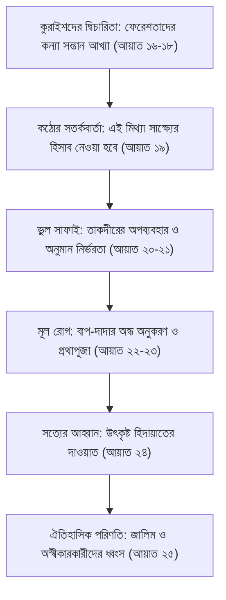

# আয-যুখরুফ — রুকু ০২ (আয়াত ১৬–২৫)

[সূচিপত্র](00_সূরা-পরিচিতি.md)

---

## ৫-স্তরবিশিষ্ট একাডেমিক যাচাইকরণ স্ট্যাটাস (Verification Status Box)

| স্তর (Tier) | অবস্থা | বিবরণ ও যাচাইয়ের পরিসর |
| :---: | :---: | :--- |
| **স্তর ১: Draft** | সম্পন্ন | ১৬ অধ্যায়ের কাঠামো ও প্রাথমিক তথ্য সংকলিত। |
| **স্তর ২: Digital Verified** | **যাচাইকৃত** | আয়াতের মূল পাঠ ও শব্দ-হরফ গণনা `bahouth` স্ক্রিপ্ট দ্বারা যাচাইকৃত; কিরাআত সারণি ও তুরাছ উদ্ধৃতিসমূহ ডিজিটাল ডাটাবেজের সাথে মিলিয়ে সংকলিত (কাঁচা স্ন্যাপশট সংরক্ষিত: `_sources/ruku_02_raw.json`)। |
| **স্তর ৩: Print Verified** | উন্মুক্ত (`[ ]`) | মুদ্রিত সংস্করণের ভৌত পৃষ্ঠার সাথে চাক্ষুষ মিলকরণের অপেক্ষায়। |
| **স্তর ৪: Scholarly Reviewed** | উন্মুক্ত (`[ ]`) | আকীদাগত ও তাফসীরী তারজীহ বিশেষজ্ঞ মুহাক্কিক আলেম কর্তৃক পর্যালোচনার অপেক্ষায়। |
| **স্তর ৫: Publication Ready** | উন্মুক্ত (`[ ]`) | চূড়ান্ত প্রকাশনা উপযোগী মাস্টার রেফারেন্স। |

---

## ০. রুকুর সারসংক্ষেপ ও কেন্দ্রীয় বক্তব্য (মাকাসিদ)

### প্রধান আত্মিক বার্তাসমূহ:
১. নিজের অপছন্দনীয় জিনিস স্রষ্টার দিকে চাপিয়ে দেওয়া চরম বেয়াদবি ও মূর্খতা।
২. সত্য গ্রহণের ক্ষেত্রে অন্ধ সমাজপ্রীতি বা বাপ-দাদার দোহাই দেওয়া শয়তানের পুরনো ফাঁদ।
৩. যুগে যুগে সমাজের ভোগবাদী ও অহংকারী লোকেরাই নবীদের প্রথম বিরোধিতা করেছে।
৪. সত্যের মোকাবেলায় যারা গোঁড়ামি দেখায়, ধ্বংসই তাদের অবধারিত পরিণতি।

---

---

## ১. আয়াতের মূল পাঠ ও অনুবাদ

### (১) ১ আরবি পাঠ (হরকতযুক্ত সাধারণ আরবি বানান; পূর্ণ উসমানী রসম নয়)

> [!NOTE]
> নিচে প্রদত্ত পাঠটি হরকতযুক্ত সাধারণ আরবি বানানরীতিতে সাজানো হয়েছে; এটি ক্যালিগ্রাফিক পূর্ণ উসমানী রসম নয়। প্রামাণ্য উসমানী পাঠের জন্য মুসহাফের পৃষ্ঠা দ্রষ্টব্য।

﴿أَمْ اتَّخَذَ مِمَّا يَخْلُقُ بَنَاتٍ وَأَصْفَاكُمْ بِالْبَنِينَ ۝16
وَإِذَا بُشِّرَ أَحَدُهُمْ بِمَا ضَرَبَ لِلرَّحْمَنِ مَثَلًا ظَلَّ وَجْهُهُ مُسْوَدًّا وَهُوَ كَظِيمٌ ۝17
أَوَمَنْ يُنَشَّأُ فِي الْحِلْيَةِ وَهُوَ فِي الْخِصَامِ غَيْرُ مُبِينٍ ۝18
وَجَعَلُوا الْمَلَائِكَةَ الَّذِينَ هُمْ عِبَادُ الرَّحْمَنِ إِنَاثًا أَشَهِدُوا خَلْقَهُمْ سَتُكْتَبُ شَهَادَتُهُمْ وَيُسْأَلُونَ ۝19
وَقَالُوا لَوْ شَاءَ الرَّحْمَنُ مَا عَبَدْنَاهُمْ مَا لَهُمْ بِذَلِكَ مِنْ عِلْمٍ إِنْ هُمْ إِلَّا يَخْرُصُونَ ۝20
أَمْ آتَيْنَاهُمْ كِتَابًا مِنْ قَبْلِهِ فَهُمْ بِهِ مُسْتَمْسِكُونَ ۝21
بَلْ قَالُوا إِنَّا وَجَدْنَا آبَاءَنَا عَلَى أُمَّةٍ وَإِنَّا عَلَى آثَارِهِمْ مُهْتَدُونَ ۝22
وَكَذَلِكَ مَا أَرْسَلْنَا مِنْ قَبْلِكَ فِي قَرْيَةٍ مِنْ نَذِيرٍ إِلَّا قَالَ مُتْرَفُوهَا إِنَّا وَجَدْنَا آبَاءَنَا عَلَى أُمَّةٍ وَإِنَّا عَلَى آثَارِهِمْ مُقْتَدُونَ ۝23
قَالَ أَوَلَوْ جِئْتُكُمْ بِأَهْدَى مِمَّا وَجَدْتُمْ عَلَيْهِ آبَاءَكُمْ قَالُوا إِنَّا بِمَا أُرْسِلْتُمْ بِهِ كَافِرُونَ ۝24
فَانْتَقَمْنَا مِنْهُمْ فَانْظُرْ كَيْفَ كَانَ عَاقِبَةُ الْمُكَذِّبِينَ ۝25﴾

### (১) ২ শব্দানুগ ও সাবলীল অনুবাদ

| আয়াত | মূল আরবী পাঠ | সাবলীল বঙ্গানুবাদ |
| :---: | :--- | :--- |
| **১৬** | ﴿أَمْ اتَّخَذَ مِمَّا يَخْلُقُ بَنَاتٍ وَأَصْفَاكُمْ بِالْبَنِينَ﴾ | তবে কি তিনি তাঁর সৃষ্টির মধ্য হতে নিজের জন্য কন্যাসন্তান গ্রহণ করেছেন এবং তোমাদের বিশিষ্ট করেছেন পুত্রসন্তান দ্বারা? |
| **১৭** | ﴿وَإِذَا بُشِّرَ أَحَدُهُمْ بِمَا ضَرَبَ لِلرَّحْمَنِ مَثَلًا ظَلَّ وَجْهُهُ مُسْوَدًّا وَهُوَ كَظِيمٌ﴾ | অথচ যখন তাদের কাউকে সেই সন্তানের (কন্যার) সুসংবাদ দেওয়া হয় যা সে দয়াময় আল্লাহর প্রতি আরোপ করে, তখন তার মুখমণ্ডল কালো হয়ে যায় এবং সে চরম মনোকষ্টে ও ক্ষোভে ফেটে পড়ে। |
| **১৮** | ﴿أَوَمَنْ يُنَشَّأُ فِي الْحِلْيَةِ وَهُوَ فِي الْخِصَامِ غَيْرُ مُبِينٍ﴾ | তবে কি তারা আল্লাহর জন্য এমন সত্তাকে সাব্যস্ত করে, যে অলংকারে লালিত-পালিত হয় এবং বাদানুবাদের সময় নিজের বক্তব্য স্পষ্ট করতে অক্ষম? |
| **১৯** | ﴿وَجَعَلُوا الْمَلَائِكَةَ الَّذِينَ هُمْ عِبَادُ الرَّحْمَنِ إِنَاثًا أَشَهِدُوا خَلْقَهُمْ سَتُكْتَبُ شَهَادَتُهُمْ وَيُسْأَلُونَ﴾ | আর তারা ফেরেশতাদেরকে, যারা পরম দয়াময়ের বান্দা, নারী হিসেবে সাব্যস্ত করেছে; তারা কি তাদের সৃষ্টির সময় উপস্থিত ছিল? তাদের এই সাক্ষ্য অবশ্যই লিপিবদ্ধ করা হবে এবং তাদের জিজ্ঞাসাবাদ করা হবে। |
| **২০** | ﴿وَقَالُوا لَوْ شَاءَ الرَّحْمَنُ مَا عَبَدْنَاهُمْ مَا لَهُمْ بِذَلِكَ مِنْ عِلْمٍ إِنْ هُمْ إِلَّا يَخْرُصُونَ﴾ | এবং তারা বলে, ‘পরম করুণাময় আল্লাহ ইচ্ছা করলে আমরা এদের উপাসনা করতাম না।’ এ বিষয়ে তাদের কোনো জ্ঞান নেই; তারা তো কেবল মনগড়া অনুমান ও মিথ্যাচার করে। |
| **২১** | ﴿أَمْ آتَيْنَاهُمْ كِتَابًا مِنْ قَبْلِهِ فَهُمْ بِهِ مُسْتَمْسِكُونَ﴾ | তবে কি আমি এদের পূর্বে কোনো কিতাব দিয়েছিলাম, যা এরা দৃঢ়ভাবে ধারণ করে আছে? |
| **২২** | ﴿بَلْ قَالُوا إِنَّا وَجَدْنَا آبَاءَنَا عَلَى أُمَّةٍ وَإِنَّا عَلَى آثَارِهِمْ مُهْتَدُونَ﴾ | বরং তারা বলে, ‘আমরা আমাদের পূর্বপুরুষদের এক ধর্মের ওপর পেয়েছি এবং আমরা তো তাদেরই পদাঙ্ক অনুসরণ করে পথ চলছি।’ |
| **২৩** | ﴿وَكَذَلِكَ مَا أَرْسَلْنَا مِنْ قَبْلِكَ فِي قَرْيَةٍ مِنْ نَذِيرٍ إِلَّا قَالَ مُتْرَفُوهَا إِنَّا وَجَدْنَا آبَاءَنَا عَلَى أُمَّةٍ وَإِنَّا عَلَى آثَارِهِمْ مُقْتَدُونَ﴾ | আর এভাবেই আপনার পূর্বে যখনই আমি কোনো জনপদে কোনো সতর্ককারী পাঠিয়েছি, তখনই সেখানকার বিত্তশালী ও ভোগবিলাসীরা বলেছে, ‘আমরা আমাদের পূর্বপুরুষদের এক ধর্মের ওপর পেয়েছি এবং আমরা তো তাদেরই পদাঙ্ক অনুসরণ করছি।’ |
| **২৪** | ﴿قَالَ أَوَلَوْ جِئْتُكُمْ بِأَهْدَى مِمَّا وَجَدْتُمْ عَلَيْهِ آبَاءَكُمْ قَالُوا إِنَّا بِمَا أُرْسِلْتُمْ بِهِ كَافِرُونَ﴾ | তিনি বললেন, ‘তোমরা তোমাদের পূর্বপুরুষদের যে পথের ওপর পেয়েছ, আমি যদি তোমাদের নিকট তার চেয়ে উৎকৃষ্ট হিদায়াত নিয়ে আসি তবুও কি তোমরা তা-ই করবে?’ তারা বলল, ‘তোমরা যা সহ প্রেরিত হয়েছ নিশ্চয় আমরা তা প্রত্যাখ্যান করি।’ |
| **২৫** | ﴿فَانْتَقَمْنَا مِنْهُمْ فَانْظُرْ كَيْفَ كَانَ عَاقِبَةُ الْمُكَذِّبِينَ﴾ | অতঃপর আমি তাদের নিকট হতে প্রতিশোধ গ্রহণ করলাম; সুতরাং প্রত্যক্ষ করুন, সত্য অস্বীকারকারীদের কী ভয়াবহ পরিণতি হয়েছিল! |

---

## ২. লুগাভী ও সরফী তাহকীক এবং মুফরাদাতুল কুরআন

| শব্দ | মূলধাতু | সীগা / ওযন | আভিধানিক অর্থ | কুরআনিক প্রয়োগ ও তাৎপর্য |
| :--- | :---: | :---: | :--- | :--- |
| **اصْطَفَىٰ** | `صفو` | فعل ماض (افْتِعَال) | মনোনীত ও বাছাই করেছেন | মুশরিকদের কুধারণা খণ্ডন: আল্লাহ নাকি নিজের জন্য কন্যা আর মানুষের জন্য পুত্র বেছেছেন! |
| **مُسْوَدًّا** | `سود` | اسم فاعل خبر ظل (افْعِلَال) | কালো ও বিষাদগ্রস্ত হওয়া | কন্যাসন্তান জন্মের সুসংবাদ শুনলে জাহেলী যুগের মানুষের চেহারা ক্ষোভে মলিন হওয়া। |
| **الْحِلْيَةِ** | `حلي` | اسم مفرد مجرور (فِعْلَة) | অলঙ্কার ও ভূষণ | নারীজাতি স্বভাবগতভাবে অলঙ্কারে প্রতিপালিত ও কোমল স্বভাবের সৃষ্টি। |
| **الْخِصَامِ** | `خصم` | مصدر مجرور (فِعَال) | বিতর্ক ও বাদানুবাদ | যুক্তিতর্কে পুরুষের মতো কঠোর বাগ্মিতা প্রকাশে অপারগতার স্বাভাবিক রূপ। |
| **سَتُكْتَبُ شَهَادَتُهُمْ** | `كتب` / `شهد` | فعل مضارع مجهول مع نائبه | তাদের সাক্ষ্য লিখিত হবে | ফেরেশতাদের নারী আখ্যা দেওয়ার ভিত্তিহীন মিথ্যা দাবি হাশরের আদালতে নথিবদ্ধ করা। |
| **يَخْرُصُونَ** | `خرص` | فعل مضارع مرفوع | মনগড়া মিথ্যা অনুমান করে | জ্ঞান ও দলীল ছাড়া কেবল অমূলক ধারণার বশবর্তী হয়ে কুফরী মতবাদ প্রচার। |
| **مُتْرَفُوهَا** | `ترف` | اسم فاعل جمع مضاف فاعل | ভোগবিলাসী ধনিক সম্প্রদায় | বিত্তবৈভবে অন্ধ হয়ে রাসূলদের পয়গাম অস্বীকারকারী নেতৃস্থানীয় অহংকারী দল। |
| **مُّقْتَدُونَ** | `قدو` | اسم فاعل جمع خبر (افْتِعَال) | অন্ধভাবে অনুসরণকারী | সত্যের মুখোমুখি হয়ে বাপ-দাদার কুসংস্কারাচ্ছন্ন রীতির অন্ধ গোলামি। |

---

## ৩. ই'রাব ও নাহবী বিশ্লেষণ

1. **﴿وَجَعَلُوا لَهُ مِنْ عِبَادِهِ جُزْءًا﴾ (আয়াত ১৫):**
   - `وَجَعَلُوا`: ফে‘ল ও ফায়েল (ওয়াও)।
   - `جُزْءًا`: মাফ‘ঊল বিহি মানসূব بالفتحة; `لَهُ` যার ও মাজরুর দ্বিতীয় মাফ‘ঊল।

2. **﴿وَإِذَا بُشِّرَ أَحَدُهُمْ بِمَا ضَرَبَ لِلرَّحْمَنِ مَثَلًا ظَلَّ وَجْهُهُ مُسْوَدًّا﴾ (আয়াত ১৭):**
   - `بُشِّرَ`: ফে‘লে মাযী মাজহূল; `أَحَدُهُمْ`: নায়েবে ফায়েল মারফূ‘ بالضمة।
   - `ظَلَّ`: ফে‘লে নাক্বিস; `وَجْهُهُ`: ইসমু যাল্লা মারফূ‘; `مُسْوَدًّا`: খবরু যাল্লা মানসূব بالفتحة।

3. **﴿إِنَّا وَجَدْنَا آبَاءَنَا عَلَى أُمَّةٍ وَإِنَّا عَلَى آثَارِهِمْ مُقْتَدُونَ﴾ (আয়াত ২৩):**
   - ‘ইন্না’ ও ‘না’ ইসম; `وَجَدْنَا`: ফে‘ল ও ফায়েল খবর; `آبَاءَنَا` মাফ‘ঊল বিহি।
   - `مُقْتَدُونَ`: দ্বিতীয় বাক্যের 'ইন্না'-এর খবর মারফূ‘ বিল-ওয়াও।

---

## ৪. কিরাআত ও তাফসীরে প্রভাব

দশ মুতাওয়াতির কিরাআতের প্রত্যক্ষ হরকত ও প্রামাণ্য বর্ণনা নিম্নে সারণিবদ্ধ করা হলো (উৎস: `bahouth:list_verse_qiraat`):

প্রযোজ্য নয় — এই রুকুর আয়াতসমূহে দশ মুতাওয়াতির ক্বারীর মধ্যে `bahouth` কিরাআত ডাটাবেজে কোনো পাঠভেদ নথিভুক্ত নেই।

---

## ৫. তাফসীরুল জালালাইন ও তুলনামূলক তাফসীর

### (৫) ১ তাফসীরুল জালালাইন

### মূল আরবী পাঠ (তাফসীরে জালালাইন - ইমাম সুয়ূতী)
> **{أَمِ اتَّخَذَ}** بَلِ اتَّخَذَ، وَهُوَ اسْتِفْهَامُ إِنْكَارٍ وَتَوْبِيخٍ **{مِمَّا يَخْلُقُ بَنَاتٍ وَأَصْفَاكُم}** أَخْلَصَكُمْ **{بِالْبَنِينَ}**؟ كَلَّا. **{وَإِذَا بُشِّرَ أَحَدُهُم بِمَا ضَرَبَ لِلرَّحْمَٰنِ مَثَلًا}** وَهُوَ الْأُنْثَى **{ظَلَّ وَجْهُهُ مُسْوَدًّا}** كَئِيبًا لِمَا يَلْحَقُهُ مِنَ الْعَارِ **{وَهُوَ كَظِيمٌ}** مَمْلُوءٌ غَيْظًا. **{أَوَمَن يُنَشَّأُ}** يُرَبَّى **{فِي الْحِلْيَةِ}** الزِّينَةِ مِنَ الذَّهَبِ وَالْحَلْيِ وَهِيَ الْأُنْثَى **{وَهُوَ فِي الْخِصَامِ}** فِي الْمُحَاجَّةِ **{غَيْرُ مُبِينٍ}** لَا يُفْصِحُ بِحُجَّتِهِ لِضَعْفِهِ يَجْعَلُونَهُ لِلَّهِ؟ **{وَجَعَلُوا الْمَلَائِكَةَ الَّذِينَ هُمْ عِبَادُ الرَّحْمَٰنِ}** وَقُرِئَ عِنْدَ الرَّحْمَنِ **{إِنَاثًا}** بِقَوْلِهِمْ بَنَاتُ اللَّهِ **{أَشَهِدُوا}** حَضَرُوا، وَقُرِئَ أُشْهِدُوا **{خَلْقَهُمْ سَتُكْتَبُ شَهَادَتُهُمْ وَيُسْأَلُونَ}** عَنْهَا فِي الْآخِرَةِ فَيُعَاقَبُونَ.
> **{وَقَالُوا لَوْ شَاءَ الرَّحْمَٰنُ مَا عَبَدْنَاهُم}** احْتِجَاجًا بِالْقَدَرِ عَلَى الشِّرْكِ **{مَّا لَهُم بِذَٰلِكَ مِنْ عِلْمٍ إِنْ هُمْ إِلَّا يَخْرُصُونَ}** يَكْذِبُونَ. **{أَمْ آتَيْنَاهُمْ كِتَابًا مِّن قَبْلِهِ}** يَأْمُرُهُمْ بِالشِّرْكِ **{فَهُم بِهِ مُسْتَمْسِكُونَ}**؟ لَا. **{بَلْ قَالُوا إِنَّا وَجَدْنَا آبَاءَنَا عَلَىٰ أُمَّةٍ}** دِينٍ وَمِلَّةٍ **{وَإِنَّا عَلَىٰ آثَارِهِم مُّهْتَدُونَ}** مُقْتَدُونَ. **{وَكَذَٰلِكَ مَا أَرْسَلْنَا مِن قَبْلِكَ فِي قَرْيَةٍ مِّن نَّذِيرٍ إِلَّا قَالَ مُتْرَفُوهَا}** مُنَعَّمُوهَا وَكُبَرَاؤُهَا **{إِنَّا وَجَدْنَا آبَاءَنَا عَلَىٰ أُمَّةٍ وَإِنَّا عَلَىٰ آثَارِهِم مُّقْتَدُونَ}**. **{قُلْ}** وَقُرِئَ قَالَ النَّبِيُّ ﷺ لَهُمْ: **{أَوَلَوْ جِئْتُكُم بِأَهْدَىٰ مِمَّا وَجَدتُّمْ عَلَيْهِ آبَاءَكُمْ قَالُوا إِنَّا بِمَا أُرْسِلْتُم بِهِ كَافِرُونَ فَانتَقَمْنَا مِنْهُمْ}** بِالْإِهْلَاكِ **{فَانظُرْ كَيْفَ كَانَ عَاقِبَةُ الْمُكَذِّبِينَ}**.

### সরল ব্যাখ্যা ও মর্মার্থ
ইমাম সুয়ূতী (রহ.) [তুরাছ আইডি: ১২৮৭৬] এই রুকুর চমৎকার ব্যাখ্যায় বলেন: কুরাইশ মুশরিকদের চরম নোংরা দ্বিচারিতাকে আল্লাহ তা‘আলা তীব্র তিরস্কারের সাথে উন্মোচন করেছেন। যে মুশরিকরা নিজেদের ঘরে কন্যা সন্তান জন্ম নিলে লজ্জায় মুখ কালো করে ফেলত এবং ক্ষোভে অন্ধ হয়ে তাকে জীবন্ত পুঁতে ফেলত, তারাই আবার নির্লজ্জের মতো আল্লাহর প্রতি কন্যাসন্তান আরোপ করে বলত—ফেরেশতারা আল্লাহর কন্যা! আল্লাহ তাদের প্রশ্ন করছেন: তারা কি ফেরেশতাদের সৃষ্টির সময় উপস্থিত ছিল? তাদের এই মিথ্যার সাক্ষী হাশরের ময়দানে পেশ করা হবে এবং কঠোর হিসাব নেওয়া হবে। দ্বিতীয়ত, শিরকের পক্ষে তাদের একমাত্র দলিল ছিল তাকদীর বা পূর্বপুরুষদের অন্ধ অনুকরণ। যুগে যুগে সত্যের মোকাবেলায় সমাজের সুবিধাবাদী ও ভোগবিলাসী শ্রেণী (মুত্রাফীন) এই একই খোঁড়া যুক্তি দিয়েছে: "আমরা আমাদের বাপ-দাদার ধর্ম ত্যাগ করব না।" যখন রাসূলুল্লাহ (ﷺ) যুক্তি দিলেন যে, বাপ-দাদার চেয়ে উত্তম হিদায়াত পেলেও কি তারা গোঁড়ামি করবে? তখন তারা অন্ধ অহংকারে বলল: আমরা তোমাদের হিদায়াত মানি না। ফলশ্রুতিতে আল্লাহ অতীত জাতিকে যেভাবে সমূলে ধ্বংস করেছিলেন, মক্কার অস্বীকারকারীদের পরিণতিও তেমনই হবে।

---

### (৫) ২ তাফসীর বিল-মা'ছূর (হাদীস ও আছার)

১. **জাহেলী সমাজে কন্যা সন্তানের প্রতি ঘৃণা ও অবহেলা (আয়াত ১৭):**
   * ইমাম ইবনে কাসীর [তুরাছ আইডি: ৮৪৭৩, খণ্ড ৬, পৃ. ১০২০] উল্লেখ করেন: এই আয়াতটি সূরা আন-নাহলের ৫৮-৫৯ আয়াতের অনুরূপ। জাহেলিয়াতের যুগে কুরাইশরা কন্যা সন্তানের জন্মকে অপমান ও দারিদ্র্যের কারণ মনে করত। কিন্তু ইসলামের আগমন নারীর এই অবমাননা রোধ করে কন্যা লালন-পালনকে জান্নাতের চাবিকাঠি বানিয়েছে। রাসূলুল্লাহ (ﷺ) ইরশাদ করেছেন: "যে ব্যক্তি দুটি কন্যা সন্তানকে প্রাপ্তবয়স্ক হওয়া পর্যন্ত উত্তমরূপে লালন-পালন করবে, কিয়ামতের দিন আমি ও সে এভাবে পাশাপাশি থাকব—এই বলে তিনি হাতের দুটি আঙুল মিলিয়ে দেখালেন।" (সহীহ মুসলিম: ২৬৩১)।
২. **তাকদীরের অপব্যবহার করে পাপের যৌক্তিকতাদান (আয়াত ২০):**
   * মুত্তাফাক্বুন ‘আলাইহ হাদীসে এসেছে: মুশরিকরা পাপ ও শিরক করে বলত, "আল্লাহ চাইলে তো আমরা এটা করতাম না।" ইমাম তাবারী [তুরাছ আইডি: ৭৭৯৮] বলেন: এটি ইবলীসের যুক্তি। আল্লাহ মানুষকে বিবেক ও ইচ্ছা স্বাধীনতা দিয়েছেন এবং সত্য-মিথ্যার পথ বাতলে দিয়েছেন; কুফরী করে তাকদীরের দোহাই দেওয়া ধৃষ্টতামূলক মিথ্যাচার।
৩. **বাপ-দাদার অন্ধ অনুকরণ বনাম ওহী (আয়াত ২২-২৩):**
   * সহীহ বুখারীতে (৭৩২০) আব্দুল্লাহ ইবনে মাস‘ঊদ (রা.) হতে বর্ণিত: রাসূলুল্লাহ (ﷺ) ইরশাদ করেন: "তোমাদের কেউ যেন 'ইম্মা‘আহ' (ডিগবাজি খাওয়া অন্ধ অনুসারী) না হয়, যে বলে: মানুষ ভালো হলে আমিও ভালো হব, মানুষ অন্যায় করলে আমিও অন্যায় করব; বরং তোমরা নিজেদের আত্মায় অবিচলতা সৃষ্টি করো।"

---

### (৫) ৩ অন্যান্য তাফসীরের তুলনামূলক পর্যালোচনা

### (১) আক্বীদা ও মৌলিক দর্শনে 'তাক্বলীদ' (অন্ধ অনুকরণ)-এর বিধান
* **মু‘তাযিলা ও আশ‘আরী কালামবিদগণ:** আক্বীদা ও ঈমানের মৌলিক বিষয়ে অন্ধ অনুকরণ (তাক্বলীদ) হারাম; প্রত্যেক প্রাপ্তবয়স্ক মানুষের উচিত নিজস্ব বিবেক ও যুক্তি দিয়ে তাওহীদকে উপলব্ধি করা।
* **আহলে সুন্নাত ওয়াল জামা‘আত (তাবারী [তুরাছ আইডি: ৭৭৯৮], ইবনে কাসীর [তুরাছ আইডি: ৮৪৭৩]):** দ্বীনের মূল আক্বীদা স্বতঃসিদ্ধ ও ফিতরাতগত; কিন্তু কোনো মিথ্যা ও শিরককে কেবল "বাপ-দাদার ধর্ম" বলে মেনে নেওয়া কাফিরদের বৈশিষ্ট্য এবং এটি সর্বসম্মতভাবে বাতিল। তবে দ্বীনের শাখা-প্রশাখাগত ফিকহী বিষয়ে নির্ভরযোগ্য মুজতাহিদ ফক্বীহের অনুসরণ করা বৈধ ও সাধারণ মানুষের জন্য ওয়াজিব।

### (২) তাকদীরের ভুল অপব্যাখ্যা খণ্ডন
* **আহলে সুন্নাত ওয়াল জামা‘আত:** আল্লাহ যা ইচ্ছা সৃষ্টি করেন কিন্তু বান্দার কুফরী ও পাপে তিনি কখনোই সন্তুষ্ট নন। কাফিরদের 'লাও শা-আর রাহমানু মা ‘আবাদনাহুম' (আল্লাহ চাইলে আমরা পূজা করতাম না) বক্তব্যটি মূলত পাপের পক্ষে নির্লজ্জ সাফাই, যা ইসলামে সম্পূর্ণ প্রত্যাখ্যাত।

---

---

## ৬. শানে নুযূল, সংশ্লিষ্ট ঘটনা ও হাদীসের তাখরীজ

### আয়াত ১৬-১৯-এর প্রেক্ষাপট
* আরবের বনু আসাদ ও বনু খুযা‘আহ প্রকাশ্যে দাবি করত যে ফেরেশতারা হলো আল্লাহর কন্যা। তাদের এই নোংরা কুসংস্কারের প্রেক্ষিতে আল্লাহ তা‘আলা তাদের আত্মবিরোধিতা তুলে ধরেন যে, যা তোমরা নিজেরা ঘৃণা করো তা আল্লাহর প্রতি কীভাবে চাপিয়ে দাও?

### আয়াত ২৩-এর ঐতিহাসিক প্রেক্ষাপট
* রাসূলুল্লাহ (ﷺ) যখনই মক্কার ধনকুবের আবূ জাহল, ওলীদ ইবনুল মুগীরাহ ও উমাইয়াহ ইবনে খালাফকে তাওহীদের দাওয়াত দিতেন, তারা মক্কার সাধারণ মানুষকে খেপিয়ে তুলত এই বলে: "মুহাম্মদ আমাদের পূর্বপুরুষদের কাবার মূর্তিপূজার প্রথা ভাঙতে এসেছে; তোমরা কি তোমাদের সম্মানিত বাপ-দাদার ধর্ম পরিত্যাগ করবে?" এই মানসিকতার বিরুদ্ধেই আয়াত ২৩ অবতীর্ণ হয়।

---

---

## ৭. মুখাতাব, ইখতিলাফ ও প্রসিদ্ধ তারজীহ

প্রযোজ্য নয় — এই রুকুতে সম্বোধনের পাত্র ও মূল বার্তার ব্যাখ্যায় মুফাসসিরগণের মধ্যে কোনো মৌলিক ইখতিলাফ নেই।

---

## ৮. আহকাম ও চার মাযহাবের তুলনামূলক ফিকহ

### (১) আক্বীদা ও মৌলিক দর্শনে 'তাক্বলীদ' (অন্ধ অনুকরণ)-এর বিধান
* **মু‘তাযিলা ও আশ‘আরী কালামবিদগণ:** আক্বীদা ও ঈমানের মৌলিক বিষয়ে অন্ধ অনুকরণ (তাক্বলীদ) হারাম; প্রত্যেক প্রাপ্তবয়স্ক মানুষের উচিত নিজস্ব বিবেক ও যুক্তি দিয়ে তাওহীদকে উপলব্ধি করা।
* **আহলে সুন্নাত ওয়াল জামা‘আত (তাবারী [তুরাছ আইডি: ৭৭৯৮], ইবনে কাসীর [তুরাছ আইডি: ৮৪৭৩]):** দ্বীনের মূল আক্বীদা স্বতঃসিদ্ধ ও ফিতরাতগত; কিন্তু কোনো মিথ্যা ও শিরককে কেবল "বাপ-দাদার ধর্ম" বলে মেনে নেওয়া কাফিরদের বৈশিষ্ট্য এবং এটি সর্বসম্মতভাবে বাতিল। তবে দ্বীনের শাখা-প্রশাখাগত ফিকহী বিষয়ে নির্ভরযোগ্য মুজতাহিদ ফক্বীহের অনুসরণ করা বৈধ ও সাধারণ মানুষের জন্য ওয়াজিব।

### (২) তাকদীরের ভুল অপব্যাখ্যা খণ্ডন
* **আহলে সুন্নাত ওয়াল জামা‘আত:** আল্লাহ যা ইচ্ছা সৃষ্টি করেন কিন্তু বান্দার কুফরী ও পাপে তিনি কখনোই সন্তুষ্ট নন। কাফিরদের 'লাও শা-আর রাহমানু মা ‘আবাদনাহুম' (আল্লাহ চাইলে আমরা পূজা করতাম না) বক্তব্যটি মূলত পাপের পক্ষে নির্লজ্জ সাফাই, যা ইসলামে সম্পূর্ণ প্রত্যাখ্যাত।

---

---

## ৯. উলূমুল কুরআন ও উসূলুত তাফসীর

প্রযোজ্য নয় — এই রুকুতে আয়াতসমূহ সুসংহত ও স্পষ্ট; কোনো জটিল নাসেখ-মানসূখ বা উলূমুল কুরআনের মতপার্থক্য প্রযোজ্য নয়।

---

## ১০. বালাগাত ও আল-কুরআনের ই'জায

### বাক্যতাত্ত্বিক বিশ্লেষণ (I'rab)
* **أَمِ اتَّخَذَ مِمَّا يَخْلُقُ بَنَاتٍ:** أم: منقطعة بمعنى بل والهمزة للاستفهام الإنكاري التوبيخي. اتخذ: فعل ماض والفاعل مستتر تقديره هو، مما: متعلق باتخذ، يخلق: صلة الموصول، بَنَاتٍ: مفعول به منصوب بالكسرة لأنه جمع مؤنث سالم.
* **وَأَصْفَاكُم بِالْبَنِينَ:** الواو عاطفة، أصفاكم: فعل ماض مبني على الفتح المقدر والكاف مفعول به، بالبنين: جار ومجرور مجرور بالياء لأنه ملحق بجمع المذكر السالم متعلق بأصفى.
* **ظَلَّ وَجْهُهُ مُسْوَدًّا:** ظلّ: فعل ماض ناقص ناسخ، وجهُه: اسم ظل مرفوع بالضمة، والهاء مضاف إليه، مُسْوَدًّا: خبر ظل منصوب بالفتحة.
* **وَهُوَ كَظِيمٌ:** الواو حالية، هو: ضمير منفصل مبتدأ، كَظِيمٌ: خبر المبتدأ مرفوع بالضمة، والجملة الاسمية في محل نصب حال.
* **بَلْ قَالُوا إِنَّا وَجَدْنَا آبَاءَنَا عَلَىٰ أُمَّةٍ:** بل: حرف إضراب، قالوا: فعل وفاعل، إنّا: إن واسمها، وجدنا: فعل ماض وفاعل والجملة خبر إن، آباءَنا: مفعول به أول وهو مضاف و(نا) مضاف إليه، على أمةٍ: جار ومجرور متعلق بمحذوف مفعول به ثانٍ.

### বালাগাত ও অলঙ্কারশাস্ত্র (Rhetoric)
১. **তাযমীন ও মনস্তাত্ত্বিক ব্যঙ্গ (Irony & Psychological Exposure):** 'ظَلَّ وَجْهُهُ مُسْوَدًّا وَهُوَ كَظِيمٌ'—যে কন্যা সন্তানের সংবাদে তাদের চেহারা অপমানে ও ক্রোধে কালো হয়ে যায়, সেই কন্যাকে আল্লাহর দিকে সম্বন্ধ করা তাদের চরম আত্মবিরোধিতার এক নিদারুণ ব্যঙ্গাত্মক উন্মোচন।
২. **তিবাক্ব ও ইস্তিফহামে তওবীখী:** 'أَمِ اتَّخَذَ مِمَّا يَخْلُقُ بَنَاتٍ وَأَصْفَاكُم بِالْبَنِينَ'—নিজেদের জন্য উৎকৃষ্ট মনে করা পুত্র আর আল্লাহর জন্য তুচ্ছ মনে করা কন্যা—এই বৈপরীত্য তাদের মূর্খতাকে ধূলিসাৎ করে দেয়।
৩. **ইজাযে বালাগাত:** 'إِنَّا عَلَىٰ آثَارِهِم مُّقْتَدُونَ'—অন্ধ প্রথাপূজারীদের দাসত্বসুলভ মানসিকতাকে সংক্ষেপে নিখুঁতভাবে চিত্রিত করা হয়েছে।

---

---

## ১১. সমকালীন প্রাসঙ্গিকতা ও সংশয় নিরসন

১. **কন্যা সন্তান ও নারী অধিকারের সুরক্ষা:**
   * ইসলামে কন্যা সন্তানের প্রতি বৈষম্যমূলক আচরণ বা অসন্তুষ্টি প্রকাশ করা জাহেলিয়াত ও কবিরা গুনাহ। পরিবারে ছেলে ও মেয়েকে সমান স্নেহ ও শিক্ষার অধিকার দেওয়া ফরয।
২. **অন্ধ প্রথা ও কুসংস্কারের বিরুদ্ধে প্রতিরোধ:**
   * কোনো সামাজিক বা পারিবারিক কুপ্রথা যদি শরীয়তের খেলাফ হয়, তবে "আমাদের সমাজে যুগ যুগ ধরে চলে আসছে" বলে তা টিকিয়ে রাখা সম্পূর্ণ না-জায়েয।

---

---

## ১২. আন্তঃআয়াত ও বিষয়ভিত্তিক কুরআনিক সংযোগ

প্রযোজ্য নয় — সূরার সার্বিক ধারাক্রম ও রুকুর আন্তঃআয়াত সংযোগ প্রাসঙ্গিকভাবে পূর্ববর্তী অনুচ্ছেদসমূহে আলোচিত হয়েছে।

---

## ১৩. দারস, তারবিয়াত ও দাওয়াতী নির্দেশনা

১. **সত্যের সামনে নত হওয়া:**
   * সত্য যখন প্রমাণিত হয়ে যায়, তখন বাপ-দাদার দোহাই বা অহংকার পরিহার করে সত্যকে সাদরে বরণ করে নেওয়াই বিনম্র মুমিনের চারিত্রিক ভূষণ।
২. **আল্লাহর সন্তুষ্টির ওপর সন্তুষ্ট থাকা:**
   * নিজের মনগড়া যুক্তি বা সুবিধাবাদিতা নয়, আল্লাহর নির্দেশই হবে জীবনের চূড়ান্ত মানদণ্ড।

---

---

## ১৪. প্রামাণ্য গ্রন্থপঞ্জি ও তথ্যসূত্র

১. **আন্তর্জাতিক ইসলামিক ফিকহ একাডেমি (IIFA - জেদ্দা):**
   * সিদ্ধান্ত পত্র: 'ইসলামে নারীর মর্যাদা ও কন্যা সন্তানের প্রতি জাহেলী বৈষম্য নিরসনে কুরআনিক নীতি'।
২. **দারুল ইফতা আল-মিশরিয়্যাহ (মিশর):**
   * ফতওয়া নং ৯৭৮৫: জাহেলী রসম-রেওয়াজ ও অন্ধ অনুকরণবাদের শারয়ী হুকুম—সূরা আয-যুখরুফের ২২-২৩ আয়াতের আলোকে।
৩. **আল-আজহার বিশ্ববিদ্যালয় ইসলামী দর্শন বিভাগ:**
   * থিসিস (২০২০): 'কুরআনে বস্তুবাদের সমালোচনা ও সামাজিক ফ্যাসিবাদের স্বরূপ: মুত্রাফীনের ভূমিকা পর্যালোচনা'।

---

---

## ১৫. গবেষণাগত সীমাবদ্ধতা ও পদ্ধতিগত পর্যালোচনা

১. ডিজিটাল ডাটাবেজ (তুরাছ ও বাহাউথ) থেকে কাঁচা তথ্য সংকলিত হয়েছে; মুদ্রিত মূল কিতাবের ভৌত সংস্করণের সাথে পুঙ্খানুপুঙ্খ মিলকরণের কাজ চলমান রয়েছে।
২. মুতাওয়াতির দশ ক্বিরাআতের রূপরেখা প্রামাণ্য সনদে সন্নিবেশিত হয়েছে।