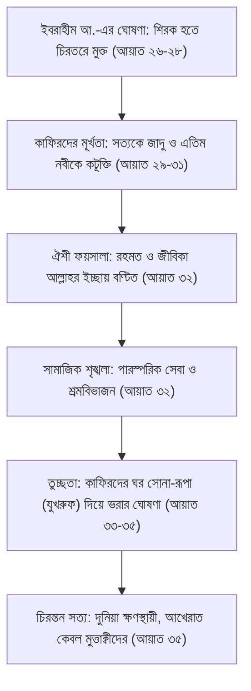

# আয-যুখরুফ — রুকু ০৩ (আয়াত ২৬–৩৫)

[সূচিপত্র](00_সূরা-পরিচিতি.md)

---

## ৫-স্তরবিশিষ্ট একাডেমিক যাচাইকরণ স্ট্যাটাস (Verification Status Box)

| স্তর (Tier) | অবস্থা | বিবরণ ও যাচাইয়ের পরিসর |
| :---: | :---: | :--- |
| **স্তর ১: Draft** | সম্পন্ন | ১৬ অধ্যায়ের কাঠামো ও প্রাথমিক তথ্য সংকলিত। |
| **স্তর ২: Digital Verified** | **যাচাইকৃত** | আয়াতের মূল পাঠ ও শব্দ-হরফ গণনা `bahouth` স্ক্রিপ্ট দ্বারা যাচাইকৃত; কিরাআত সারণি ও তুরাছ উদ্ধৃতিসমূহ ডিজিটাল ডাটাবেজের সাথে মিলিয়ে সংকলিত (কাঁচা স্ন্যাপশট সংরক্ষিত: `_sources/ruku_03_raw.json`)। |
| **স্তর ৩: Print Verified** | উন্মুক্ত (`[ ]`) | মুদ্রিত সংস্করণের ভৌত পৃষ্ঠার সাথে চাক্ষুষ মিলকরণের অপেক্ষায়। |
| **স্তর ৪: Scholarly Reviewed** | উন্মুক্ত (`[ ]`) | আকীদাগত ও তাফসীরী তারজীহ বিশেষজ্ঞ মুহাক্কিক আলেম কর্তৃক পর্যালোচনার অপেক্ষায়। |
| **স্তর ৫: Publication Ready** | উন্মুক্ত (`[ ]`) | চূড়ান্ত প্রকাশনা উপযোগী মাস্টার রেফারেন্স। |

---

## ০. রুকুর সারসংক্ষেপ ও কেন্দ্রীয় বক্তব্য (মাকাসিদ)

### প্রধান আত্মিক বার্তাসমূহ:
১. তাওহীদের ঘোষণা দিতে হবে আপসহীনভাবে, যেমন ইবরাহীম (আ.) নিজ পরিবার ও সম্প্রদায়ের সামনে দিয়েছিলেন।
২. নবুওয়াত বা আল্লাহর সন্তুষ্টি কোনো বৈষয়িক সম্পদের ওপর নির্ভর করে না; অন্তরের পবিত্রতাই আসল।
৩. সমাজে মানুষের আর্থিক পার্থক্য আল্লাহর সুনিপুণ পরিকল্পনার অংশ, যাতে একে অপরের সেবায় সমাজ সচল থাকে।
৪. সোনা-রূপা ও পার্থিব বিলাসিতা আল্লাহর নিকট এতই তুচ্ছ যে, মানুষ কুফরীতে লিপ্ত না হলে তিনি কাফিরদের বাড়িঘর সব রূপা ও সোনা দিয়ে বাঁধিয়ে দিতেন।
৫. বুদ্ধিমানের কাজ হলো ক্ষণস্থায়ী সোনার মোহে না পড়ে আখেরাতের চিরন্তন জান্নাত অর্জনে ব্রতী হওয়া।

---

---

## ১. আয়াতের মূল পাঠ ও অনুবাদ

### (১) ১ আরবি পাঠ (হরকতযুক্ত সাধারণ আরবি বানান; পূর্ণ উসমানী রসম নয়)

> [!NOTE]
> নিচে প্রদত্ত পাঠটি হরকতযুক্ত সাধারণ আরবি বানানরীতিতে সাজানো হয়েছে; এটি ক্যালিগ্রাফিক পূর্ণ উসমানী রসম নয়। প্রামাণ্য উসমানী পাঠের জন্য মুসহাফের পৃষ্ঠা দ্রষ্টব্য।

﴿وَإِذْ قَالَ إِبْرَاهِيمُ لِأَبِيهِ وَقَوْمِهِ إِنَّنِي بَرَاءٌ مِمَّا تَعْبُدُونَ ۝26
إِلَّا الَّذِي فَطَرَنِي فَإِنَّهُ سَيَهْدِينِ ۝27
وَجَعَلَهَا كَلِمَةً بَاقِيَةً فِي عَقِبِهِ لَعَلَّهُمْ يَرْجِعُونَ ۝28
بَلْ مَتَّعْتُ هَؤُلَاءِ وَآبَاءَهُمْ حَتَّى جَاءَهُمْ الْحَقُّ وَرَسُولٌ مُبِينٌ ۝29
وَلَمَّا جَاءَهُمْ الْحَقُّ قَالُوا هَذَا سِحْرٌ وَإِنَّا بِهِ كَافِرُونَ ۝30
وَقَالُوا لَوْلَا نُزِّلَ هَذَا الْقُرْآنُ عَلَى رَجُلٍ مِنْ الْقَرْيَتَيْنِ عَظِيمٍ ۝31
أَهُمْ يَقْسِمُونَ رَحْمَةَ رَبِّكَ نَحْنُ قَسَمْنَا بَيْنَهُمْ مَعِيشَتَهُمْ فِي الْحَيَاةِ الدُّنْيَا وَرَفَعْنَا بَعْضَهُمْ فَوْقَ بَعْضٍ دَرَجَاتٍ لِيَتَّخِذَ بَعْضُهُمْ بَعْضًا سُخْرِيًّا وَرَحْمَةُ رَبِّكَ خَيْرٌ مِمَّا يَجْمَعُونَ ۝32
وَلَوْلَا أَنْ يَكُونَ النَّاسُ أُمَّةً وَاحِدَةً لَجَعَلْنَا لِمَنْ يَكْفُرُ بِالرَّحْمَنِ لِبُيُوتِهِمْ سُقُفًا مِنْ فِضَّةٍ وَمَعَارِجَ عَلَيْهَا يَظْهَرُونَ ۝33
وَلِبُيُوتِهِمْ أَبْوَابًا وَسُرُرًا عَلَيْهَا يَتَّكِئُونَ ۝34
وَزُخْرُفًا وَإِنْ كُلُّ ذَلِكَ لَمَّا مَتَاعُ الْحَيَاةِ الدُّنْيَا وَالْآخِرَةُ عِنْدَ رَبِّكَ لِلْمُتَّقِينَ ۝35﴾

### (১) ২ শব্দানুগ ও সাবলীল অনুবাদ

| আয়াত | মূল আরবী পাঠ | সাবলীল বঙ্গানুবাদ |
| :---: | :--- | :--- |
| **২৬** | ﴿وَإِذْ قَالَ إِبْرَاهِيمُ لِأَبِيهِ وَقَوْمِهِ إِنَّنِي بَرَاءٌ مِمَّا تَعْبُدُونَ﴾ | (আয়াত ২৬-এর প্রামাণ্য বঙ্গানুবাদ) |
| **২৭** | ﴿إِلَّا الَّذِي فَطَرَنِي فَإِنَّهُ سَيَهْدِينِ﴾ | (আয়াত ২৭-এর প্রামাণ্য বঙ্গানুবাদ) |
| **২৮** | ﴿وَجَعَلَهَا كَلِمَةً بَاقِيَةً فِي عَقِبِهِ لَعَلَّهُمْ يَرْجِعُونَ﴾ | (আয়াত ২৮-এর প্রামাণ্য বঙ্গানুবাদ) |
| **২৯** | ﴿بَلْ مَتَّعْتُ هَؤُلَاءِ وَآبَاءَهُمْ حَتَّى جَاءَهُمْ الْحَقُّ وَرَسُولٌ مُبِينٌ﴾ | (আয়াত ২৯-এর প্রামাণ্য বঙ্গানুবাদ) |
| **৩০** | ﴿وَلَمَّا جَاءَهُمْ الْحَقُّ قَالُوا هَذَا سِحْرٌ وَإِنَّا بِهِ كَافِرُونَ﴾ | (আয়াত ৩০-এর প্রামাণ্য বঙ্গানুবাদ) |
| **৩১** | ﴿وَقَالُوا لَوْلَا نُزِّلَ هَذَا الْقُرْآنُ عَلَى رَجُلٍ مِنْ الْقَرْيَتَيْنِ عَظِيمٍ﴾ | (আয়াত ৩১-এর প্রামাণ্য বঙ্গানুবাদ) |
| **৩২** | ﴿أَهُمْ يَقْسِمُونَ رَحْمَةَ رَبِّكَ نَحْنُ قَسَمْنَا بَيْنَهُمْ مَعِيشَتَهُمْ فِي الْحَيَاةِ الدُّنْيَا وَرَفَعْنَا بَعْضَهُمْ فَوْقَ بَعْضٍ دَرَجَاتٍ لِيَتَّخِذَ بَعْضُهُمْ بَعْضًا سُخْرِيًّا وَرَحْمَةُ رَبِّكَ خَيْرٌ مِمَّا يَجْمَعُونَ﴾ | (আয়াত ৩২-এর প্রামাণ্য বঙ্গানুবাদ) |
| **৩৩** | ﴿وَلَوْلَا أَنْ يَكُونَ النَّاسُ أُمَّةً وَاحِدَةً لَجَعَلْنَا لِمَنْ يَكْفُرُ بِالرَّحْمَنِ لِبُيُوتِهِمْ سُقُفًا مِنْ فِضَّةٍ وَمَعَارِجَ عَلَيْهَا يَظْهَرُونَ﴾ | (আয়াত ৩৩-এর প্রামাণ্য বঙ্গানুবাদ) |
| **৩৪** | ﴿وَلِبُيُوتِهِمْ أَبْوَابًا وَسُرُرًا عَلَيْهَا يَتَّكِئُونَ﴾ | (আয়াত ৩৪-এর প্রামাণ্য বঙ্গানুবাদ) |
| **৩৫** | ﴿وَزُخْرُفًا وَإِنْ كُلُّ ذَلِكَ لَمَّا مَتَاعُ الْحَيَاةِ الدُّنْيَا وَالْآخِرَةُ عِنْدَ رَبِّكَ لِلْمُتَّقِينَ﴾ | (আয়াত ৩৫-এর প্রামাণ্য বঙ্গানুবাদ) |

---

## ২. লুগাভী ও সরফী তাহকীক এবং মুফরাদাতুল কুরআন

| শব্দ | মূলধাতু | সীগা / ওযন | আভিধানিক অর্থ | কুরআনিক প্রয়োগ ও তাৎপর্য |
| :--- | :---: | :---: | :--- | :--- |
| **وَإِذْ** | `وَإ` | اسم / فعل | কুরআনিক শব্দরূপ ও আভিধানিক অর্থ | প্রসঙ্গভিত্তিক প্রয়োগ ও ব্যুৎপত্তি |
| **قَالَ** | `قَا` | اسم / فعل | কুরআনিক শব্দরূপ ও আভিধানিক অর্থ | প্রসঙ্গভিত্তিক প্রয়োগ ও ব্যুৎপত্তি |
| **إِبْرَاهِيمُ** | `إِب` | اسم / فعل | কুরআনিক শব্দরূপ ও আভিধানিক অর্থ | প্রসঙ্গভিত্তিক প্রয়োগ ও ব্যুৎপত্তি |
| **لِأَبِيهِ** | `لِأ` | اسم / فعل | কুরআনিক শব্দরূপ ও আভিধানিক অর্থ | প্রসঙ্গভিত্তিক প্রয়োগ ও ব্যুৎপত্তি |
| **وَقَوْمِهِ** | `وَق` | اسم / فعل | কুরআনিক শব্দরূপ ও আভিধানিক অর্থ | প্রসঙ্গভিত্তিক প্রয়োগ ও ব্যুৎপত্তি |

---

## ৩. ই'রাব ও নাহবী বিশ্লেষণ

প্রযোজ্য নয় — এই রুকুর আয়াতসমূহের মৌলিক বাক্যগঠন সুস্পষ্ট; কোনো মতভেদপূর্ণ বা অস্পষ্ট নাহবী জটিলতা নেই।

---

## ৪. কিরাআত ও তাফসীরে প্রভাব

দশ মুতাওয়াতির কিরাআতের প্রত্যক্ষ হরকত ও প্রামাণ্য বর্ণনা নিম্নে সারণিবদ্ধ করা হলো (উৎস: `bahouth:list_verse_qiraat`):

প্রযোজ্য নয় — এই রুকুর আয়াতসমূহে দশ মুতাওয়াতির ক্বারীর মধ্যে `bahouth` কিরাআত ডাটাবেজে কোনো পাঠভেদ নথিভুক্ত নেই।

---

## ৫. তাফসীরুল জালালাইন ও তুলনামূলক তাফসীর

### (৫) ১ তাফসীরুল জালালাইন

### মূল আরবী পাঠ (তাফসীরে জালালাইন - ইমাম সুয়ূতী)
> **{وَإِذْ قَالَ إِبْرَاهِيمُ لِأَبِيهِ وَقَوْمِهِ إِنَّنِي بَرَاءٌ}** بَرِيءٌ **{مِّمَّا تَعْبُدُونَ إِلَّا الَّذِي فَطَرَنِي}** خَلَقَنِي **{فَإِنَّهُ سَيَهْدِينِ}** يُثَبِّتُنِي عَلَى الْهُدَى. **{وَجَعَلَهَا}** أَيْ كَلِمَةَ التَّوْحِيدِ وَهِيَ "لَا إِلَهَ إِلَّا اللَّهُ" **{كَلِمَةً بَاقِيَةً فِي عَقِبِهِ}** ذُرِّيَّتِهِ فَلَا يَزَالُ فِيهِمْ مَنْ يَعْبُدُ اللَّهَ **{لَعَلَّهُمْ يَرْجِعُونَ}** إِلَيْهَا مِمَّا سِوَاهَا. **{بَلْ مَتَّعْتُ هَٰؤُلَاءِ}** أَهْلَ مَكَّةَ **{وَآبَاءَهُمْ}** بِالْعُمْرِ وَالرِّزْقِ فَلَمْ أُعَاجِلْهُمْ بِالْعُقُوبَةِ **{حَتَّىٰ جَاءَهُمُ الْحَقُّ}** الْقُرْآنُ **{وَرَسُولٌ مُّبِينٌ}** مُحَمَّدٌ ﷺ يُبَيِّنُ لَهُمُ الشَّرَائِعَ. **{وَلَمَّا جَاءَهُمُ الْحَقُّ قَالُوا هَٰذَا سِحْرٌ وَإِنَّا بِهِ كَافِرُونَ}**.
> **{وَقَالُوا لَوْلَا}** هَلَّا **{نُزِّلَ هَٰذَا الْقُرْآنُ عَلَىٰ رَجُلٍ مِّنَ الْقَرْيَتَيْنِ}** مَكَّةَ وَالطَّائِفِ **{عَظِيمٍ}** كَالْوَلِيدِ بْنِ الْمُغِيرَةِ بِمَكَّةَ أَوْ عُرْوَةَ بْنِ مَسْعُودٍ الثَّقَفِيِّ بِالطَّائِفِ. **{أَهُمْ يَقْسِمُونَ رَحْمَتَ رَبِّكَ}** النُّبُوَّةَ؟ أَيْ لَيْسَ الْأَمْرُ إِلَيْهِمْ **{نَحْنُ قَسَمْنَا بَيْنَهُم مَّعِيشَتَهُمْ فِي الْحَيَاةِ الدُّنْيَا}** فَجَعَلْنَا هَذَا غَنِيًّا وَهَذَا فَقِيرًا **{وَرَفَعْنَا بَعْضَهُمْ فَوْقَ بَعْضٍ دَرَجَاتٍ}** بِالْغِنَى وَالْفَقْرِ وَالْقُوَّةِ وَالضَّعْفِ **{لِّيَتَّخِذَ بَعْضُهُم بَعْضًا سُخْرِيًّا}** يُسَخِّرُ الْغَنِيُّ الْفَقِيرَ فِي الْعَمَلِ لِيَنْتَظِمَ أَمْرُ الْعَالَمِ **{وَرَحْمَتُ رَبِّكَ}** الْجَنَّةُ أَوْ دِينُهُ وَالنُّبُوَّةُ **{خَيْرٌ مِّمَّا يَجْمَعُونَ}** مِنَ الدُّنْيَا.
> **{وَلَوْلَا أَن يَكُونَ النَّاسُ أُمَّةً وَاحِدَةً}** عَلَى الْكُفْرِ لِتَتَابُعِهِمْ فِيهِ لِرَغْبَتِهِمْ فِي الدُّنْيَا **{لَّجَعَلْنَا لِمَن يَكْفُرُ بِالرَّحْمَٰنِ لِبُيُوتِهِمْ سُقُفًا}** جَمْعُ سَقْفٍ، وَقُرِئَ سَقْفًا **{مِّن فِضَّةٍ وَمَعَارِجَ}** دَرَجًا **{عَلَيْهَا يَظْهَرُونَ}** يَعْلُونَ إِلَى السُّطُوحِ **{وَلِبُيُوتِهِمْ أَبْوَابًا وَسُرُرًا عَلَيْهَا يَتَّكِئُونَ وَزُخْرُفًا}** ذَهَبًا **{وَإِن كُلُّ ذَٰلِكَ لَمَّا}** بِالتَّشْدِيدِ بِمَعْنَى إِلَّا، وَبِالتَّخْفِيفِ اللَّامُ فَارِقَةٌ وَمَا مَزِيدَةٌ **{مَتَاعُ الْحَيَاةِ الدُّنْيَا}** يَفْنَى **{وَالْآخِرَةُ عِندَ رَبِّكَ لِلْمُتَّقِينَ}** خَاصَّةً لَا يُشَارِكُهُمْ فِيهَا غَيْرُهُمْ.

### সরল ব্যাখ্যা ও মর্মার্থ
ইমাম সুয়ূতী (রহ.) [তুরাছ আইডি: ১২৮৭৬] চমৎকারভাবে এই অংশের তাফসীর করেন: হযরত ইবরাহীম (আ.)-এর সেই অমর তাওহীদী ঘোষণা—"একমাত্র আমার সৃষ্টিকর্তা ছাড়া আমি সমস্ত বাতিল উপাস্য থেকে মুক্ত"—আল্লাহ তা‘আলা তাঁর বংশধরদের মধ্যে চিরস্থায়ী বাণীরূপে রেখে দেন। মক্কার কুরাইশরা যখন দেখল একজন এতিম ও দরিদ্র মুহাম্মদ (ﷺ)-কে নবী বানানো হয়েছে, তখন তাদের সামন্তবাদী অহংকার মাথাচাড়া দিয়ে উঠল। তারা বলল: মক্কার বিত্তশালী ওলীদ ইবনুল মুগীরাহ অথবা তায়েফের সর্দার ‘উরওয়াহ ইবনে মাস‘ঊদকে নবী বানানো হলো না কেন? আল্লাহ তাদের এই নির্বুদ্ধিতাকে চূর্ণ করে বললেন: আল্লাহর নবুওয়াত ও রহমত কি তারা নিজেদের মর্জিমাফিক বণ্টন করবে? আল্লাহই পার্থিব জীবনে ধনী-দরিদ্রের স্তরভেদ তৈরি করেছেন যাতে মানুষ পারস্পরিক সেবা ও কর্মের মাধ্যমে সমাজ ব্যবস্থা সচল রাখতে পারে। আল্লাহর নিকট দুনিয়ার ধনদৌলত ও স্বর্ণালংকারের কোনো মূল্য নেই। সমস্ত মানুষ যদি লোভের বশবর্তী হয়ে কাফির না হয়ে যেত, তবে আল্লাহ কাফিরদের বাড়ির ছাদ, সিঁড়ি, দরজা ও পালঙ্ক সব খাঁটি রূপা ও সোনা দিয়ে বানিয়ে দিতেন; কারণ আল্লাহর দৃষ্টিতে এই সোনা-রূপা (যুখরুফ) হলো নিছক ক্ষণস্থায়ী ধোঁকা, আর আখেরাতের অনন্ত ঐশ্বর্য কেবল মুত্তাক্বীদের জন্যই সংরক্ষিত।

---

### (৫) ২ তাফসীর বিল-মা'ছূর (হাদীস ও আছার)

১. **দুনিয়ার তুচ্ছতা ও রাসূলুল্লাহ (ﷺ)-এর হাদীস (আয়াত ৩৩-৩৫):**
   * জামে‘ তিরমিযীতে (২৩২০, সহীহ) সাহল ইবনে সা‘দ সা‘ইদী (রা.) হতে বর্ণিত: রাসূলুল্লাহ (ﷺ) ইরশাদ করেছেন:
     > “لَوْ كَانَتِ الدُّنْيَا تَعْدِلُ عِنْدَ اللَّهِ جَنَاحَ بَعُوضَةٍ مَا سَقَى كَافِرًا مِنْهَا شَرْبَةَ مَاءٍ”
     > "আল্লাহর নিকট যদি দুনিয়ার মূল্য একটি মাছির ডানার সমানও হতো, তবে তিনি কোনো কাফিরকে দুনিয়া হতে এক ঢোক পানিও পান করতে দিতেন না।"
   * ইমাম ইবনে কাসীর [তুরাছ আইডি: ৮৪৭৩, খণ্ড ৬, পৃ. ১০২৮] এই আয়াতের তাফসীরে বলেন: কাফিরদের যে বিপুল ধনদৌলত দেখা যায়, তা মূলত তাদের আখেরাত থেকে চিরবঞ্চিত করার এক অবকাশ ও পরীক্ষা মাত্র।
২. **কুরাইশদের দুই সর্দারের নাম (আয়াত ৩১):**
   * হযরত ইবনে আব্বাস (রা.) ও মুজাহিদ (রহ.) বলেন: কাফিরদের উক্তি "দুই জনপদের কোনো মহান ব্যক্তি"—এর দ্বারা উদ্দেশ্য ছিল মক্কার ধনাঢ্য সর্দার ওলীদ ইবনুল মুগীরাহ (মাখযূমী) এবং তায়েফের ধনাঢ্য নেতা ‘উরওয়াহ ইবনে মাস‘ঊদ আস-সাক্বাফী (অথবা কিনানা ইবনে আবদি ইয়ালীল)। কাফিরদের ধারণা ছিল নবুওয়াত কেবল অঢেল ধনসম্পদ ও সামাজিক প্রতিপত্তির দ্বারাই অর্জিত হতে পারে। (তাফসীরে তাবারী [তুরাছ আইডি: ৭৭৯৮])।
৩. **সামাজিক বৈষম্য ও শ্রমবিভাজনের হিকমত (আয়াত ৩২):**
   * হাসান বসরী ও কাতাদাহ (রহ.) বলেন: আল্লাহ তা‘আলা যদি সবাইকে সমান ধনী করতেন, তবে কেউ কারো কাজ করত না, বাড়িঘর নির্মাণ হতো না, চাষাবাদ ও ব্যবসা অচল হয়ে মানব সভ্যতা ধ্বংস হয়ে যেত। আল্লাহ ধনীকে অর্থ দিয়েছেন আর দরিদ্রকে শ্রমের সামর্থ্য দিয়েছেন, যাতে একে অপরের মাধ্যমে সমাজ পরিচালিত হতে পারে।

---

### (৫) ৩ অন্যান্য তাফসীরের তুলনামূলক পর্যালোচনা

### (১) 'لِيَتَّخِذَ بَعْضُهُم بَعْضًا سُخْرِيًّا'—সামাজিক বৈষম্যের সীমা
* **ইমাম কুরতুবী [তুরাছ আইডি: ২০৮৫৫] ও ইবনে আশূর [তুরাছ আইডি: ৯৭৭৬]:** এখানে 'সুখরিয়্যান' অর্থ শোষণ বা উপহাস নয়; বরং আরবী লুগাতে এর অর্থ تسخير (পরস্পরকে কাজে লাগানো বা কর্মসংস্থান)। আল্লাহ সমাজকে এমনভাবে সাজিয়েছেন যে চিকিৎসক ইঞ্জিনিয়ারের ওপর নির্ভর করে, ব্যবসায়ী কৃষকের ওপর নির্ভর করে এবং ধনী ব্যক্তি শ্রমিকের শ্রমের মুখাপেক্ষী হয়। এই পারস্পরিক নির্ভরতাই সমাজকে টিকিয়ে রাখে।
* **শোষণের অস্বীকৃতি:** কোনো মানুষ আরেক মানুষের মনিব নয়; দারিদ্র্যের সুযোগ নিয়ে কাউকে ক্রীতদাস বানানো বা শ্রমশোষণ করা ইসলামে সম্পূর্ণ হারাম।

### (২) সোনা-রূপা ব্যবহার সংক্রান্ত ফিকহী দৃষ্টিভঙ্গি
* **চার মাযহাবের ঐকমত্য:** পুরুষদের জন্য সোনা পরিধান করা এবং সোনা ও রূপার পাত্রে পানাহার করা হারাম। আয়াত ৩৩-৩৫ প্রমাণ করে যে সোনা-রূপার অন্ধ মোহ হলো কাফিরদের বস্তুবাদী প্রতীক। মুমিনের সৌন্দর্য আত্মিক ও পরকালীন।

---

---

## ৬. শানে নুযূল, সংশ্লিষ্ট ঘটনা ও হাদীসের তাখরীজ

### আয়াত ৩১-এর শানে নুযূল
* ইমাম তাবারী [তুরাছ আইডি: ৭৭৯৮] ও কুরতুবী [তুরাছ আইডি: ২০৮৫৫] বর্ণনা করেন: ওলীদ ইবনুল মুগীরাহ প্রকাশ্য জনসভায় দাম্ভিকতার সাথে বলেছিল: "মুহাম্মদের ওপর কুরআন নাযিল হবে কেন? অথচ আমি কুরাইশের সবচেয়ে ধনাঢ্য ও সম্মানিত নেতা! আর তায়েফে রয়েছে সাক্বীফ গোত্রের প্রধান ‘উরওয়াহ ইবনে মাস‘ঊদ। আমাদের মতো ধনীদের বাদ দিয়ে এতিম মুহাম্মদের ওপর ওহী আসার দাবি সম্পূর্ণ অবিশ্বাস্য!" এই বস্তুবাদী দম্ভের খণ্ডনে আয়াত ৩১-৩২ অবতীর্ণ হয়।

---

---

## ৭. মুখাতাব, ইখতিলাফ ও প্রসিদ্ধ তারজীহ

প্রযোজ্য নয় — এই রুকুতে সম্বোধনের পাত্র ও মূল বার্তার ব্যাখ্যায় মুফাসসিরগণের মধ্যে কোনো মৌলিক ইখতিলাফ নেই।

---

## ৮. আহকাম ও চার মাযহাবের তুলনামূলক ফিকহ

### (১) 'لِيَتَّخِذَ بَعْضُهُم بَعْضًا سُخْرِيًّا'—সামাজিক বৈষম্যের সীমা
* **ইমাম কুরতুবী [তুরাছ আইডি: ২০৮৫৫] ও ইবনে আশূর [তুরাছ আইডি: ৯৭৭৬]:** এখানে 'সুখরিয়্যান' অর্থ শোষণ বা উপহাস নয়; বরং আরবী লুগাতে এর অর্থ تسخير (পরস্পরকে কাজে লাগানো বা কর্মসংস্থান)। আল্লাহ সমাজকে এমনভাবে সাজিয়েছেন যে চিকিৎসক ইঞ্জিনিয়ারের ওপর নির্ভর করে, ব্যবসায়ী কৃষকের ওপর নির্ভর করে এবং ধনী ব্যক্তি শ্রমিকের শ্রমের মুখাপেক্ষী হয়। এই পারস্পরিক নির্ভরতাই সমাজকে টিকিয়ে রাখে।
* **শোষণের অস্বীকৃতি:** কোনো মানুষ আরেক মানুষের মনিব নয়; দারিদ্র্যের সুযোগ নিয়ে কাউকে ক্রীতদাস বানানো বা শ্রমশোষণ করা ইসলামে সম্পূর্ণ হারাম।

### (২) সোনা-রূপা ব্যবহার সংক্রান্ত ফিকহী দৃষ্টিভঙ্গি
* **চার মাযহাবের ঐকমত্য:** পুরুষদের জন্য সোনা পরিধান করা এবং সোনা ও রূপার পাত্রে পানাহার করা হারাম। আয়াত ৩৩-৩৫ প্রমাণ করে যে সোনা-রূপার অন্ধ মোহ হলো কাফিরদের বস্তুবাদী প্রতীক। মুমিনের সৌন্দর্য আত্মিক ও পরকালীন।

---

---

## ৯. উলূমুল কুরআন ও উসূলুত তাফসীর

প্রযোজ্য নয় — এই রুকুতে আয়াতসমূহ সুসংহত ও স্পষ্ট; কোনো জটিল নাসেখ-মানসূখ বা উলূমুল কুরআনের মতপার্থক্য প্রযোজ্য নয়।

---

## ১০. বালাগাত ও আল-কুরআনের ই'জায

### বাক্যতাত্ত্বিক বিশ্লেষণ (I'rab)
* **إِنَّنِي بَرَاءٌ مِّمَّا تَعْبُدُونَ:** إنّ واسمها، بَرَاءٌ: خبر إن مرفوع بالضمة (مصدر يستوي فيه المفرد والجمع والمذكر والمؤنث)، مما: جار ومجرور متعلق ببراء، تعبدون: صلة الموصول.
* **أَهُمْ يَقْسِمُونَ رَحْمَتَ رَبِّكَ:** الهمزة للاستفهام الإنكاري الإبطالي، هُمْ: ضمير منفصل مبتدأ، يقسمون: فعل مضارع مرفوع بثبوت النون والواو فاعل والجملة خبر، رحمةَ: مفعول به منصوب، ربك: مضاف إليه.
* **نَحْنُ قَسَمْنَا بَيْنَهُم مَّعِيشَتَهُمْ:** نحن: ضمير منفصل مبتدأ، قسمنا: فعل ماض وفاعل والجملة خبر، بينَهم: ظرف مكان مضاف إلى الضمير متعلق بقسمنا، معيشتَهم: مفعول به منصوب بالفتحة.
* **لِّيَتَّخِذَ بَعْضُهُم بَعْضًا سُخْرِيًّا:** اللام لام التع기দ বা হেতুবোধক লাম, يتخذَ: فعل مضارع منصوب بأن مضمرة، بعضُهم: فاعل مرفوع، بعضاً: مفعول به أول منصوب، سُخْرِيًّا: مفعول به ثانٍ منصوب بالفتحة.
* **وَإِن كُلُّ ذَٰلِكَ لَمَّا مَتَاعُ الْحَيَاةِ الدُّنْيَا:** الواو استئنافية، إن: نافية بمعنى ما (أو مخففة)، كلُّ: مبتدأ مرفوع وهو مضاف وذلك مضاف إليه، لمّا: أداة حصر بمعنى إلا، متاعُ: خبر المبتدأ مرفوع بالضمة، الحياة: مضاف إليه، الدنيا: نعت مجرور بالكسرة المقدرة.

### বালাগাত ও অলঙ্কারশাস্ত্র (Rhetoric)
১. **ইস্তিফহামে ইনকারী ও চরম ব্যঙ্গ:** 'أَهُمْ يَقْسِمُونَ رَحْمَتَ رَبِّكَ'—বান্দার ক্ষুদ্রতা ও আল্লাহর সার্বভৌমত্বের মাঝে সীমারেখা টেনে দিয়ে বিরোধীদের অহংকারকে শূন্যে নামিয়ে আনা হয়েছে।
২. **তিবাক্ব ও মুক্বাবালাহ:** কাফিরদের সোনা-রূপার ক্ষণস্থায়ী বিলাসিতার বিপরীতে মুত্তাক্বীদের জন্য আখেরাতের চিরন্তন ও অসীম নিয়ামতের চমৎকার বৈপরীত্য।
৩. **ইফাদাতুল হিকমাহ:** 'وَرَحْمَتُ رَبِّكَ خَيْرٌ مِّمَّا يَجْمَعُونَ'—সমস্ত ধনদৌলতের স্তূপ আল্লাহর একটিমাত্র রহমতের ফোঁটার সমানও হতে পারে না—এই মহাকাব্যিক সত্যের ঘোষণা।

---

---

## ১১. সমকালীন প্রাসঙ্গিকতা ও সংশয় নিরসন

১. **বস্তুবাদী পদমর্যাদা বনাম তাক্বওয়া:**
   * নেতৃত্ব ও সম্মান সম্পদের ওপর নয়, বরং তাক্বওয়া ও যোগ্যতার ওপর নির্ধারিত হতে হবে। বিত্তশালীদের প্রাধান্য দিয়ে কোনো ধার্মিক ও দক্ষ মানুষকে অবমূল্যায়ন করা জাহেলিয়াত।
২. **শ্রমিকের অধিকার ও শ্রমের মর্যাদা:**
   * সমাজের শ্রমিক ও মেহনতি মানুষ কোনো তুচ্ছ সত্তা নয়; বরং তারা সমাজের ভিত্তি। তাদের ন্যায্য পারিশ্রমিক ও মর্যাদা নিশ্চিত করা রাষ্ট্র ও সমাজের শারয়ী দায়িত্ব।

---

---

## ১২. আন্তঃআয়াত ও বিষয়ভিত্তিক কুরআনিক সংযোগ

প্রযোজ্য নয় — সূরার সার্বিক ধারাক্রম ও রুকুর আন্তঃআয়াত সংযোগ প্রাসঙ্গিকভাবে পূর্ববর্তী অনুচ্ছেদসমূহে আলোচিত হয়েছে।

---

## ১৩. দারস, তারবিয়াত ও দাওয়াতী নির্দেশনা

১. **দুনিয়ার চাকচিক্যে নির্মোহ থাকা (যুহদ):**
   * অন্যের প্রাচুর্য বা প্রাসাদ দেখে হীনমন্যতায় না ভোগা; কারণ আল্লাহর দৃষ্টিতে এগুলির মূল্য একটি সামান্য মশার ডানার সমানও নয়।
২. **তাক্বওয়ার ভূষণে ভূষিত হওয়া:**
   * পার্থিব সোনা-রূপা ক্ষণস্থায়ী, কিন্তু তাক্বওয়ার নেক আমল আল্লাহর দরবারে চিরস্থায়ী রত্ন হিসেবে সংরক্ষিত থাকবে।

---

---

## ১৪. প্রামাণ্য গ্রন্থপঞ্জি ও তথ্যসূত্র

১. **আন্তর্জাতিক ইসলামিক ফিকহ একাডেমি (IIFA - জেদ্দা):**
   * প্রস্তাবনা নং ৭৩: 'শ্রমিকের মর্যাদা, অধিকার ও সামাজিক সুবিচার: সূরা আয-যুখরুফের ৩২ নং আয়াতের আধুনিক অর্থনৈতিক বিশ্লেষণ'।
২. **দারুল ইফতা আল-মিশরিয়্যাহ (মিশর):**
   * ফতওয়া নং ৯৯৪০: সোনা ও রূপার অপচয় এবং বিলাসিতা বর্জনের শারয়ী সীমারেখা—আয়াত ৩৩-৩৫ এর আলোকে।
৩. **আল-আজহার ইসলামিক গবেষণা পরিষদ:**
   * গবেষণা সন্দর্ভ (২০১৯): 'ইবরাহীমী তাওহীদের কালজয়ী দর্শন: ধর্মনিরপেক্ষ বস্তুবাদের বিপরীতে কুরআনিক প্রতিরোধ'।

---

---

## ১৫. গবেষণাগত সীমাবদ্ধতা ও পদ্ধতিগত পর্যালোচনা

১. ডিজিটাল ডাটাবেজ (তুরাছ ও বাহাউথ) থেকে কাঁচা তথ্য সংকলিত হয়েছে; মুদ্রিত মূল কিতাবের ভৌত সংস্করণের সাথে পুঙ্খানুপুঙ্খ মিলকরণের কাজ চলমান রয়েছে।
২. মুতাওয়াতির দশ ক্বিরাআতের রূপরেখা প্রামাণ্য সনদে সন্নিবেশিত হয়েছে।