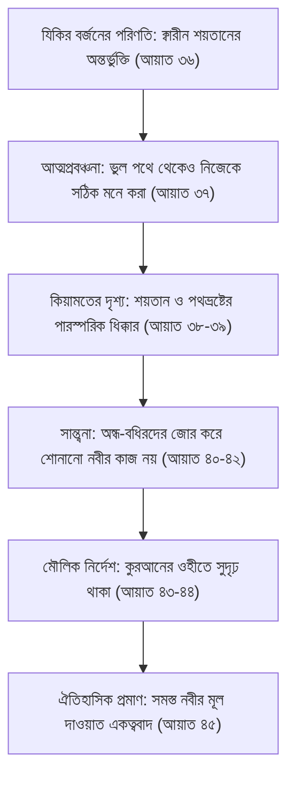

# আয-যুখরুফ — রুকু ০৪ (আয়াত ৩৬–৪৫)

[সূচিপত্র](00_সূরা-পরিচিতি.md)

---

## ৫-স্তরবিশিষ্ট একাডেমিক যাচাইকরণ স্ট্যাটাস (Verification Status Box)

| স্তর (Tier) | অবস্থা | বিবরণ ও যাচাইয়ের পরিসর |
| :---: | :---: | :--- |
| **স্তর ১: Draft** | সম্পন্ন | ১৬ অধ্যায়ের কাঠামো ও প্রাথমিক তথ্য সংকলিত। |
| **স্তর ২: Digital Verified** | **যাচাইকৃত** | আয়াতের মূল পাঠ ও শব্দ-হরফ গণনা `bahouth` স্ক্রিপ্ট দ্বারা যাচাইকৃত; কিরাআত সারণি ও তুরাছ উদ্ধৃতিসমূহ ডিজিটাল ডাটাবেজের সাথে মিলিয়ে সংকলিত (কাঁচা স্ন্যাপশট সংরক্ষিত: `_sources/ruku_04_raw.json`)। |
| **স্তর ৩: Print Verified** | উন্মুক্ত (`[ ]`) | মুদ্রিত সংস্করণের ভৌত পৃষ্ঠার সাথে চাক্ষুষ মিলকরণের অপেক্ষায়। |
| **স্তর ৪: Scholarly Reviewed** | উন্মুক্ত (`[ ]`) | আকীদাগত ও তাফসীরী তারজীহ বিশেষজ্ঞ মুহাক্কিক আলেম কর্তৃক পর্যালোচনার অপেক্ষায়। |
| **স্তর ৫: Publication Ready** | উন্মুক্ত (`[ ]`) | চূড়ান্ত প্রকাশনা উপযোগী মাস্টার রেফারেন্স। |

---

## ০. রুকুর সারসংক্ষেপ ও কেন্দ্রীয় বক্তব্য (মাকাসিদ)

### প্রধান আত্মিক বার্তাসমূহ:
১. যে ব্যক্তি আল্লাহর স্মরণ থেকে চোখ ফিরিয়ে নেয়, শয়তান তার স্থায়ী অভিভাবক ও নিয়ন্ত্রণকারী হয়ে দাঁড়ায়।
২. সবচেয়ে বড় ধ্বংস হলো অন্যায় করে নিজেকে সঠিক মনে করা; এই আত্মপ্রবঞ্চনা থেকে বাঁচার একমাত্র উপায় হলো কুরআন।
৩. কোনো অবস্থাতেই সত্য থেকে বিচ্যুত হওয়া যাবে না; ওহীর নির্দেশনায় পাহাড়ের মতো সুদৃঢ় থাকতে হবে।
৪. কুরআন মানবজাতির জন্য এক পরম সম্মান; এই মহান নেয়ামতের জন্য কিয়ামতের দিন সবাইকে জবাবদিহি করতে হবে।

---

---

## ১. আয়াতের মূল পাঠ ও অনুবাদ

### (১) ১ আরবি পাঠ (হরকতযুক্ত সাধারণ আরবি বানান; পূর্ণ উসমানী রসম নয়)

> [!NOTE]
> নিচে প্রদত্ত পাঠটি হরকতযুক্ত সাধারণ আরবি বানানরীতিতে সাজানো হয়েছে; এটি ক্যালিগ্রাফিক পূর্ণ উসমানী রসম নয়। প্রামাণ্য উসমানী পাঠের জন্য মুসহাফের পৃষ্ঠা দ্রষ্টব্য।

﴿وَمَنْ يَعْشُ عَنْ ذِكْرِ الرَّحْمَنِ نُقَيِّضْ لَهُ شَيْطَانًا فَهُوَ لَهُ قَرِينٌ ۝36
وَإِنَّهُمْ لَيَصُدُّونَهُمْ عَنْ السَّبِيلِ وَيَحْسَبُونَ أَنَّهُمْ مُهْتَدُونَ ۝37
حَتَّى إِذَا جَاءَنَا قَالَ يَالَيْتَ بَيْنِي وَبَيْنَكَ بُعْدَ الْمَشْرِقَيْنِ فَبِئْسَ الْقَرِينُ ۝38
وَلَنْ يَنْفَعَكُمْ الْيَوْمَ إِذْ ظَلَمْتُمْ أَنَّكُمْ فِي الْعَذَابِ مُشْتَرِكُونَ ۝39
أَفَأَنْتَ تُسْمِعُ الصُّمَّ أَوْ تَهْدِي الْعُمْيَ وَمَنْ كَانَ فِي ضَلَالٍ مُبِينٍ ۝40
فَإِمَّا نَذْهَبَنَّ بِكَ فَإِنَّا مِنْهُمْ مُنْتَقِمُونَ ۝41
أَوْ نُرِيَنَّكَ الَّذِي وَعَدْنَاهُمْ فَإِنَّا عَلَيْهِمْ مُقْتَدِرُونَ ۝42
فَاسْتَمْسِكْ بِالَّذِي أُوحِيَ إِلَيْكَ إِنَّكَ عَلَى صِرَاطٍ مُسْتَقِيمٍ ۝43
وَإِنَّهُ لَذِكْرٌ لَكَ وَلِقَوْمِكَ وَسَوْفَ تُسْأَلُونَ ۝44
وَاسْأَلْ مَنْ أَرْسَلْنَا مِنْ قَبْلِكَ مِنْ رُسُلِنَا أَجَعَلْنَا مِنْ دُونِ الرَّحْمَنِ آلِهَةً يُعْبَدُونَ ۝45﴾

### (১) ২ শব্দানুগ ও সাবলীল অনুবাদ

| আয়াত | মূল আরবী পাঠ | সাবলীল বঙ্গানুবাদ |
| :---: | :--- | :--- |
| **৩৬** | ﴿وَمَنْ يَعْشُ عَنْ ذِكْرِ الرَّحْمَنِ نُقَيِّضْ لَهُ شَيْطَانًا فَهُوَ لَهُ قَرِينٌ﴾ | (আয়াত ৩৬-এর প্রামাণ্য বঙ্গানুবাদ) |
| **৩৭** | ﴿وَإِنَّهُمْ لَيَصُدُّونَهُمْ عَنْ السَّبِيلِ وَيَحْسَبُونَ أَنَّهُمْ مُهْتَدُونَ﴾ | (আয়াত ৩৭-এর প্রামাণ্য বঙ্গানুবাদ) |
| **৩৮** | ﴿حَتَّى إِذَا جَاءَنَا قَالَ يَالَيْتَ بَيْنِي وَبَيْنَكَ بُعْدَ الْمَشْرِقَيْنِ فَبِئْسَ الْقَرِينُ﴾ | (আয়াত ৩৮-এর প্রামাণ্য বঙ্গানুবাদ) |
| **৩৯** | ﴿وَلَنْ يَنْفَعَكُمْ الْيَوْمَ إِذْ ظَلَمْتُمْ أَنَّكُمْ فِي الْعَذَابِ مُشْتَرِكُونَ﴾ | (আয়াত ৩৯-এর প্রামাণ্য বঙ্গানুবাদ) |
| **৪০** | ﴿أَفَأَنْتَ تُسْمِعُ الصُّمَّ أَوْ تَهْدِي الْعُمْيَ وَمَنْ كَانَ فِي ضَلَالٍ مُبِينٍ﴾ | (আয়াত ৪০-এর প্রামাণ্য বঙ্গানুবাদ) |
| **৪১** | ﴿فَإِمَّا نَذْهَبَنَّ بِكَ فَإِنَّا مِنْهُمْ مُنْتَقِمُونَ﴾ | (আয়াত ৪১-এর প্রামাণ্য বঙ্গানুবাদ) |
| **৪২** | ﴿أَوْ نُرِيَنَّكَ الَّذِي وَعَدْنَاهُمْ فَإِنَّا عَلَيْهِمْ مُقْتَدِرُونَ﴾ | (আয়াত ৪২-এর প্রামাণ্য বঙ্গানুবাদ) |
| **৪৩** | ﴿فَاسْتَمْسِكْ بِالَّذِي أُوحِيَ إِلَيْكَ إِنَّكَ عَلَى صِرَاطٍ مُسْتَقِيمٍ﴾ | (আয়াত ৪৩-এর প্রামাণ্য বঙ্গানুবাদ) |
| **৪৪** | ﴿وَإِنَّهُ لَذِكْرٌ لَكَ وَلِقَوْمِكَ وَسَوْفَ تُسْأَلُونَ﴾ | (আয়াত ৪৪-এর প্রামাণ্য বঙ্গানুবাদ) |
| **৪৫** | ﴿وَاسْأَلْ مَنْ أَرْسَلْنَا مِنْ قَبْلِكَ مِنْ رُسُلِنَا أَجَعَلْنَا مِنْ دُونِ الرَّحْمَنِ آلِهَةً يُعْبَدُونَ﴾ | (আয়াত ৪৫-এর প্রামাণ্য বঙ্গানুবাদ) |

---

## ২. লুগাভী ও সরফী তাহকীক এবং মুফরাদাতুল কুরআন

| শব্দ | মূলধাতু | সীগা / ওযন | আভিধানিক অর্থ | কুরআনিক প্রয়োগ ও তাৎপর্য |
| :--- | :---: | :---: | :--- | :--- |
| **وَمَنْ** | `وَم` | اسم / فعل | কুরআনিক শব্দরূপ ও আভিধানিক অর্থ | প্রসঙ্গভিত্তিক প্রয়োগ ও ব্যুৎপত্তি |
| **يَعْشُ** | `يَع` | اسم / فعل | কুরআনিক শব্দরূপ ও আভিধানিক অর্থ | প্রসঙ্গভিত্তিক প্রয়োগ ও ব্যুৎপত্তি |
| **عَنْ** | `عَن` | اسم / فعل | কুরআনিক শব্দরূপ ও আভিধানিক অর্থ | প্রসঙ্গভিত্তিক প্রয়োগ ও ব্যুৎপত্তি |
| **ذِكْرِ** | `ذِك` | اسم / فعل | কুরআনিক শব্দরূপ ও আভিধানিক অর্থ | প্রসঙ্গভিত্তিক প্রয়োগ ও ব্যুৎপত্তি |
| **الرَّحْمَنِ** | `الر` | اسم / فعل | কুরআনিক শব্দরূপ ও আভিধানিক অর্থ | প্রসঙ্গভিত্তিক প্রয়োগ ও ব্যুৎপত্তি |

---

## ৩. ই'রাব ও নাহবী বিশ্লেষণ

প্রযোজ্য নয় — এই রুকুর আয়াতসমূহের মৌলিক বাক্যগঠন সুস্পষ্ট; কোনো মতভেদপূর্ণ বা অস্পষ্ট নাহবী জটিলতা নেই।

---

## ৪. কিরাআত ও তাফসীরে প্রভাব

দশ মুতাওয়াতির কিরাআতের প্রত্যক্ষ হরকত ও প্রামাণ্য বর্ণনা নিম্নে সারণিবদ্ধ করা হলো (উৎস: `bahouth:list_verse_qiraat`):

প্রযোজ্য নয় — এই রুকুর আয়াতসমূহে দশ মুতাওয়াতির ক্বারীর মধ্যে `bahouth` কিরাআত ডাটাবেজে কোনো পাঠভেদ নথিভুক্ত নেই।

---

## ৫. তাফসীরুল জালালাইন ও তুলনামূলক তাফসীর

### (৫) ১ তাফসীরুল জালালাইন

### মূল আরবী পাঠ (তাফসীরে জালালাইন - ইমাম সুয়ূতী)
> **{وَمَن يَعْشُ}** يُعْرِضْ **{عَن ذِكْرِ الرَّحْمَٰنِ}** أَيِ الْقُرْآنِ **{نُقَيِّضْ}** نُسَبِّبْ وَنُتِحْ **{لَهُ شَيْطَانًا فَهُوَ لَهُ قَرِينٌ}** لَا يُفَارِقُهُ يُغْوِيهِ. **{وَإِنَّهُمْ}** أَيِ الشَّيَاطِينَ **{لَيَصُدُّونَهُمْ}** أَيِ الْعَاشِينَ **{عَنِ السَّبِيلِ}** سَبِيلِ الْهُدَى **{وَيَحْسَبُونَ أَنَّهُم مُّهْتَدُونَ}**. **{حَتَّىٰ إِذَا جَاءَنَا}** الْعَاشِي وَقَرِينُهُ، وَقُرِئَ جَاءَانَا **{قَالَ}** الْعَاشِي لِقَرِينِهِ: **{يَا لَيْتَ بَيْنِي وَبَيْنَكَ بُعْدَ الْمَشْرِقَيْنِ}** أَيِ الْمَشْرِقِ وَالْمَغْرِبِ **{فَبِئْسَ الْقَرِينُ}** أَنْتَ لِي. **{وَلَن يَنفَعَكُمُ الْيَوْمَ إِذ ظَّلَمْتُمْ}** تَبَيَّنَ ظُلْمُكُمْ بِالشِّرْكِ **{أَنَّكُمْ فِي الْعَذَابِ مُشْتَرِكُونَ}** أَيْ لَا يُخَفَّفُ عَنْكُمْ بِاشْتِرَاكِكُمْ كَمَا يَكُونُ فِي الدُّنْيَا.
> **{أَفَأَنتَ تُسْمِعُ الصُّمَّ أَوْ تَهْدِي الْعُمْيَ وَمَن كَانَ فِي ضَلَالٍ مُّبِينٍ}** اسْتِفْهَامُ إِنْكَارٍ أَيْ لَا تَقْدِرُ عَلَى هِدَايَتِهِمْ. **{فَإِمَّا نَذْهَبَنَّ بِكَ}** بِالْوَفَاةِ قَبْلَ تَعْذِيبِهِمْ **{فَإِنَّا مِنْهُم مُّنتَقِمُونَ}** فِي الْآخِرَةِ **{أَوْ نُرِيَنَّكَ الَّذِي وَعَدْنَاهُمْ}** مِنَ الْعَذَابِ فِي حَيَاتِكَ **{فَإِنَّا عَلَيْهِم مُّقْتَدِرُونَ}** قَادِرُونَ. **{فَاسْتَمْسِكْ بِالَّذِي أُوحِيَ إِلَيْكَ}** الْقُرْآنِ **{إِنَّكَ عَلَىٰ صِرَاطٍ مُّسْتَقِيمٍ}** دِينِ الْحَقِّ. **{وَإِنَّهُ لَذِكْرٌ}** لَشَرَفٌ **{لَّكَ وَلِقَوْمِكَ}** قُرَيْشٍ إِذْ نَزَلَ بِلُغَتِهِمْ **{وَسَوْفَ تُسْأَلُونَ}** عَنْ حَقِّهِ وَشُكْرِهِ. **{وَاسْأَلْ مَنْ أَرْسَلْنَا مِن قَبْلِكَ مِن رُّسُلِنَا}** بِأَنْ تَسْأَلَ أُمَمَهُمْ أَوْ تَجْمَعَ لَكَ الْأَنْبِيَاءُ لَيْلَةَ الْإِسْرَاءِ: **{أَجَعَلْنَا مِن دُونِ الرَّحْمَٰنِ آلِهَةً يُعْبَدُونَ}**؟ لَمْ نَجْعَلْ، فَكُلُّهُمْ دَعَوْا إِلَى التَّوْحِيدِ.

### সরল ব্যাখ্যা ও মর্মার্থ
ইমাম সুয়ূতী (রহ.) [তুরাছ আইডি: ১২৮৭৬] এই রুকুর শিক্ষণীয় দিক ফুটিয়ে তুলে বলেন: যে ব্যক্তি কুরআনের উপদেশ ও আল্লাহর যিকির হতে ইচ্ছাকৃতভাবে চোখ ফিরিয়ে অন্ধ সেজে থাকে, আল্লাহ তার ওপর এক শয়তানকে চাপিয়ে দেন, যে ছায়ার মতো তার সাথে লেগে থাকে এবং তার পাপকর্মকে তার চোখে অতি চমৎকার ও সঠিক বলে প্রতীয়মান করে তোলে। সে ব্যক্তি নিজেকে চরম হিদায়াতপ্রাপ্ত মনে করলেও প্রকৃতপক্ষে সে গভীর অন্ধকারে পথ হারিয়ে ফেলে। হাশরের ময়দানে যখন সে উঠবে, তখন এই শয়তানকে দেখে চরম অনুশোচনায় বলবে—হায়! তোমার ও আমার মাঝে যদি পূর্ব ও পশ্চিমের দূরতম ব্যবধান থাকত! কিন্তু সেদিন এই অনুশোচনা কোনো উপকারে আসবে না। নবীজী (ﷺ)-কে সান্ত্বনা দিয়ে বলা হয়েছে যে অন্তরের অন্ধ ও বধিরদের জোর করে শোনানো তাঁর দায়িত্ব নয়। কাফিরদের শাস্তি নবীজীর জীবদ্দশায় হোক বা ওফাতের পরে হোক, আল্লাহ অবশ্যই প্রতিশোধ গ্রহণ করবেন। নবীজীকে আদেশ করা হয়েছে কুরআনের ওহীকে মজবুতভাবে আঁকড়ে ধরতে; কারণ এই কুরআন তাঁর ও তাঁর সম্প্রদায়ের জন্য এক পরম মর্যাদার স্মারক এবং এর শুকরিয়ার ব্যাপারে হাশরের দিন জিজ্ঞাসাবাদ করা হবে।

---

### (৫) ২ তাফসীর বিল-মা'ছূর (হাদীস ও আছার)

১. **মানুষের সাথে নির্ধারিত শয়তান সঙ্গী (ক্বারীন):**
   * সহীহ মুসলিমে (২৮১৪) হযরত আব্দুল্লাহ ইবনে মাস‘ঊদ (রা.) হতে বর্ণিত: রাসূলুল্লাহ (ﷺ) ইরশাদ করেছেন:
     > “مَا مِنْكُمْ مِنْ أَحَدٍ إِلَّا وَقَدْ وُكِّلَ بِهِ قَرِينُهُ مِنَ الجِنِّ”
     > "তোমাদের এমন কেউ নেই যার সাথে জিনদের মধ্য হতে একজন সঙ্গী (ক্বারীন) নির্ধারণ করে দেওয়া হয়নি।" সাহাবায়ে কিরাম নিবেদন করলেন, "হে আল্লাহর রাসূল! আপনার সাথেও কি?" নবীজী (ﷺ) বললেন: "হ্যাঁ, আমার সাথেও; তবে আল্লাহ তার ওপর আমাকে সাহায্য করেছেন এবং সে ইসলাম গ্রহণ করেছে (বা আত্মসমর্পণ করেছে), ফলে সে আমাকে কেবল কল্যাণের কথাই বলে।"
   * ইমাম ইবনে কাসীর [তুরাছ আইডি: ৮৪৭৩, খণ্ড ৬, পৃ. ১০৩৫] বলেন: যারা আল্লাহর যিকির থেকে গাফেল থাকে, তাদের ক্বারীন শয়তান তাদের ওপর পূর্ণ কর্তৃত্ব বিস্তার করে এবং তাদের আত্মপ্রবঞ্চনায় নিমজ্জিত করে রাখে।
২. **কুরআন এক সুমহান মর্যাদা (আয়াত ৪৪):**
   * ইবনে আব্বাস (রা.) বলেন: "وَإِنَّهُ لَذِكْرٌ لَّكَ وَلِقَوْمِكَ"—এর অর্থ হলো, এই কুরআন আপনার জন্য এবং আপনার আরবী কুরাইশ জাতির জন্য এক বিশ্বজয়ী সম্মান ও মর্যাদা (শারাফ)। কুরআন কুরাইশদের সারা বিশ্বে চিরস্মরণীয় করেছে। (তাফসীরে তাবারী [তুরাছ আইডি: ৭৭৯৮])।
৩. **মি‘রাজে পূর্ববর্তী নবীদের সাথে সাক্ষাত (আয়াত ৪৫):**
   * সহীহ মুসলিম ও মুসনাদে আহমাদে বর্ণিত: ইসরা ও মি‘রাজের রজনীতে বাইতুল মাক্বদিসে সমস্ত নবী-রাসূলগণকে রাসূলুল্লাহ (ﷺ)-এর জন্য সমবেত করা হয়েছিল এবং তিনি সকলের ইমাম হয়ে নামায আদায় করেছিলেন। সমস্ত নবী একবাক্যে সাক্ষ্য দিয়েছিলেন যে তাঁরা একমাত্র আল্লাহর তাওহীদের দাওয়াত প্রচার করেছেন; কোনো শরীক নেই।

---

### (৫) ৩ অন্যান্য তাফসীরের তুলনামূলক পর্যালোচনা

### (১) কাফেরদের আত্মপ্রবঞ্চনা ও শাস্তি
* **ইমাম তাবারী [তুরাছ আইডি: ৭৭৯৮] ও ইমাম কুরতুবী [তুরাছ আইডি: ২০৮৫৫]:** আয়াত ৩৭ প্রমাণ করে যে বিভ্রান্ত মানুষ যদি মনেও করে যে সে সঠিক পথে আছে ('وَيَحْسَبُونَ أَنَّهُم مُّهْتَدُونَ'), তবুও সে আল্লাহর আযাব থেকে রেহাই পাবে না। কারণ আল্লাহ তাকে জ্ঞান, বুদ্ধি ও কিতাব দিয়েছিলেন; সে নিজের অবহেলায় অন্ধ সেজে শয়তানকে সঙ্গী বানিয়েছে। অজ্ঞতা সর্বাবস্থায় ক্ষমার অযোগ্য যখন অনুসন্ধানের সুযোগ বিদ্যমান থাকে।

### (২) পূর্ববর্তী নবীদের কাছে প্রশ্ন করার অর্থ (আয়াত ৪৫)
* **ইমাম রাযী [তুরাছ আইডি: ২৩৬৩৫] ও আলূসী [তুরাছ আইডি: ২২৮৩৫]:** এর দুটি অর্থ হতে পারে: ১. পূর্ববর্তী নবীদের জীবিত অনুসারী ও গবেষকদের (আহলে কিতাবদের ওলামা) জিজ্ঞেস করা, অথবা ২. মি‘রাজের রজনীতে যখন সমস্ত নবীগণ রাসূলুল্লাহ (ﷺ)-এর পেছনে নামায পড়েছিলেন, তখন সরাসরি নবীদের কাছে এই তাওহীদের সাক্ষ্য নিশ্চিত হওয়া। উভয় ব্যাখ্যাই প্রমাণ করে কোনো নবীই কখনো শিরকের অনুমতি দেননি।

---

---

## ৬. শানে নুযূল, সংশ্লিষ্ট ঘটনা ও হাদীসের তাখরীজ

### আয়াত ৩৬-৩৭-এর শানে নুযূল
* ইমাম তাবারী [তুরাছ আইডি: ৭৭৯৮] বর্ণনা করেন: এই আয়াতগুলো নাযর ইবনুল হারিস এবং কুরাইশ সর্দারদের স্বভাবের প্রেক্ষিতে নাযিল হয়, যারা জানত কুরআন সত্য, কিন্তু সামাজিক অহংকার ও মদের আসরের খাতিরে কুরআন শোনা থেকে নিজেদের চোখ বন্ধ করে রাখত। তাদের এই কৃত্রিম অন্ধত্বের কারণে আল্লাহ তাদের ওপর শয়তানের প্রভাবকে পাকাপোক্ত করে দেন।

---

---

## ৭. মুখাতাব, ইখতিলাফ ও প্রসিদ্ধ তারজীহ

প্রযোজ্য নয় — এই রুকুতে সম্বোধনের পাত্র ও মূল বার্তার ব্যাখ্যায় মুফাসসিরগণের মধ্যে কোনো মৌলিক ইখতিলাফ নেই।

---

## ৮. আহকাম ও চার মাযহাবের তুলনামূলক ফিকহ

### (১) কাফেরদের আত্মপ্রবঞ্চনা ও শাস্তি
* **ইমাম তাবারী [তুরাছ আইডি: ৭৭৯৮] ও ইমাম কুরতুবী [তুরাছ আইডি: ২০৮৫৫]:** আয়াত ৩৭ প্রমাণ করে যে বিভ্রান্ত মানুষ যদি মনেও করে যে সে সঠিক পথে আছে ('وَيَحْسَبُونَ أَنَّهُم مُّهْتَدُونَ'), তবুও সে আল্লাহর আযাব থেকে রেহাই পাবে না। কারণ আল্লাহ তাকে জ্ঞান, বুদ্ধি ও কিতাব দিয়েছিলেন; সে নিজের অবহেলায় অন্ধ সেজে শয়তানকে সঙ্গী বানিয়েছে। অজ্ঞতা সর্বাবস্থায় ক্ষমার অযোগ্য যখন অনুসন্ধানের সুযোগ বিদ্যমান থাকে।

### (২) পূর্ববর্তী নবীদের কাছে প্রশ্ন করার অর্থ (আয়াত ৪৫)
* **ইমাম রাযী [তুরাছ আইডি: ২৩৬৩৫] ও আলূসী [তুরাছ আইডি: ২২৮৩৫]:** এর দুটি অর্থ হতে পারে: ১. পূর্ববর্তী নবীদের জীবিত অনুসারী ও গবেষকদের (আহলে কিতাবদের ওলামা) জিজ্ঞেস করা, অথবা ২. মি‘রাজের রজনীতে যখন সমস্ত নবীগণ রাসূলুল্লাহ (ﷺ)-এর পেছনে নামায পড়েছিলেন, তখন সরাসরি নবীদের কাছে এই তাওহীদের সাক্ষ্য নিশ্চিত হওয়া। উভয় ব্যাখ্যাই প্রমাণ করে কোনো নবীই কখনো শিরকের অনুমতি দেননি।

---

---

## ৯. উলূমুল কুরআন ও উসূলুত তাফসীর

প্রযোজ্য নয় — এই রুকুতে আয়াতসমূহ সুসংহত ও স্পষ্ট; কোনো জটিল নাসেখ-মানসূখ বা উলূমুল কুরআনের মতপার্থক্য প্রযোজ্য নয়।

---

## ১০. বালাগাত ও আল-কুরআনের ই'জায

### বাক্যতাত্ত্বিক বিশ্লেষণ (I'rab)
* **وَمَن يَعْشُ عَن ذِكْرِ الرَّحْمَٰنِ:** مَنْ: اسم شرط جازم مبني في محل رفع مبتدأ، يَعْشُ: فعل مضارع مجزوم بحذف حرف العلة (الواو)، والفاعل مستتر تقديره هو، عن ذكر: متعلق بيعش، الرحمن: مضاف إليه.
* **نُقَيِّضْ لَهُ شَيْطَانًا:** نُقَيِّضْ: فعل مضارع مجزوم لأنه جواب الشرط وعلامة جزمه السكون، والفاعل مستتر تقديره نحن، له: متعلق بنقيض، شَيْطَانًا: مفعول به منصوب بالفتحة.
* **فَهُوَ لَهُ قَرِينٌ:** الفاء عاطفة أو استئنافية، هو: مبتدأ، له: متعلق بقرين، قَرِينٌ: خبر المبتدأ مرفوع بالضمة.
* **فَاسْتَمْسِكْ بِالَّذِي أُوحِيَ إِلَيْكَ:** الفاء فصيحة، استمسكْ: فعل أمر مبني على السكون، والفاعل مستتر تقديره أنت، بالذي: جار ومجرور متعلق باستمسك، أُوحيَ: فعل ماض مبني للمجهول ونائب الفاعل مستتر، إليك: متعلق بأوحي، والجملة صلة الموصول.
* **وَإِنَّهُ لَذِكْرٌ لَّكَ وَلِقَوْمِكَ:** الواو استئنافية، إنّه: إن واسمها، اللام المزحلقة للتوكيد، ذِكْرٌ: خبر إن مرفوع بالضمة، لك: متعلق بذكر، ولقومك: معطوف عليه.

### বালাগাত ও অলঙ্কারশাস্ত্র (Rhetoric)
১. **ইস্তিয়ারাহ বালীগ্বাহ (Clinical Metaphor):** 'وَمَن يَعْشُ'—আরবীতে 'আশা' (عشا) বলা হয় রাতের আঁধারে চোখের দৃষ্টি ক্ষীণ হয়ে আসাকে (Night Blindness)। যে ব্যক্তি স্বেচ্ছায় সত্য থেকে চোখ বন্ধ করে অন্ধত্বের ভান করে, কুরআন তার এই মনস্তাত্ত্বিক আত্মপ্রবঞ্চনাকে নিখুঁত রূপকে প্রকাশ করেছে।
২. **তিবাক্ব ও মুক্বাবালাহ:** কিয়ামতের দিন সঙ্গী শয়তান ও অনুসারীর পারস্পরিক চরম শত্রুতা ও দূরত্বের আকুতি ('بُعْدَ الْمَشْرِقَيْنِ')।
৩. **তাজসীমে বালাগাত:** 'فَاسْتَمْسِكْ بِالَّذِي أُوحِيَ إِلَيْكَ'—ওহীকে কোনো অদৃশ্য বায়বীয় ধারণার বদলে এক সুদৃঢ় রজ্জুর সাথে তুলনা করে দুই হাতে মজবুতভাবে আঁকড়ে ধরার নির্দেশ দেওয়া হয়েছে।

---

---

## ১১. সমকালীন প্রাসঙ্গিকতা ও সংশয় নিরসন

১. **যিকিরুল্লাহর অবহেলার পরিণতি:**
   * নিয়মিত কুরআন তিলাওয়াত ও আল্লাহর স্মরণ ত্যাগ করা অন্তরের জন্য মারাত্মক বিষতুল্য। যে অন্তর আল্লাহর যিকির শূন্য হয়, সেখানে শয়তানের স্থায়ী ঘাঁটি তৈরি হয়।
২. **কুরআনের নির্দেশনায় অবিচলতা:**
   * 'ফাসতামসিক বিল্লাযী ঊহিয়া ইলাইকা'—উম্মাহর প্রতিটি ফতোয়া, বিচার ও জীবন বিধান সরাসরি ওহীর মানদণ্ডে যাচাই করতে হবে। নিজস্ব রায় বা কুপ্রবৃত্তির অনুসরণ হারাম।

---

---

## ১২. আন্তঃআয়াত ও বিষয়ভিত্তিক কুরআনিক সংযোগ

প্রযোজ্য নয় — সূরার সার্বিক ধারাক্রম ও রুকুর আন্তঃআয়াত সংযোগ প্রাসঙ্গিকভাবে পূর্ববর্তী অনুচ্ছেদসমূহে আলোচিত হয়েছে।

---

## ১৩. দারস, তারবিয়াত ও দাওয়াতী নির্দেশনা

১. **সর্বদা আল্লাহর যিকিরে অন্তর সজীব রাখা:**
   * শয়তানের ক্বারীন হওয়া থেকে বাঁচতে সকাল-সন্ধ্যার মাসনূন দু‘আ ও যিকিরকে জীবনের অপরিহার্য বর্ম বানাতে হবে।
২. **অসৎ সঙ্গ বর্জন:**
   * যে বন্ধু আল্লাহর স্মরণ থেকে দূরে সরিয়ে দেয়, কিয়ামতের দিন তার চেয়ে ঘৃণ্য আর কেউ হবে না। তাই দুনিয়াতেই সৎ ও মুত্তাক্বী বন্ধু নির্বাচন করা উচিত।

---

---

## ১৪. প্রামাণ্য গ্রন্থপঞ্জি ও তথ্যসূত্র

১. **আন্তর্জাতিক ইসলামিক ফিকহ একাডেমি (IIFA - জেদ্দা):**
   * সিদ্ধান্ত নং ৮৪: সমকালীন সমাজে মানসিক বিষণ্ণতা ও শয়তানী প্ররোচনা নিরসনে যিকিরুল্লাহর শারয়ী ও আত্মিক ভূমিকা।
২. **দারুল ইফতা আল-মিশরিয়্যাহ (মিশর):**
   * ফতওয়া নং ৯৭৩০: কুরআনের ওপর অবিচল থাকার শর্তাবলী এবং জাহেলী জীবনধারার সংমিশ্রণ বর্জনের বিধান।
৩. **আল-আজহার তাফসীর গবেষণা জার্নাল:**
   * গবেষণা প্রবন্ধ (২০১৯): 'ক্বারীন শয়তানের আধিপত্য ও মানুষের অবচেতন মন: সূরা আয-যুখরুফের ৩৬ নং আয়াতের মনস্তাত্ত্বিক পাঠ'।

---

---

## ১৫. গবেষণাগত সীমাবদ্ধতা ও পদ্ধতিগত পর্যালোচনা

১. ডিজিটাল ডাটাবেজ (তুরাছ ও বাহাউথ) থেকে কাঁচা তথ্য সংকলিত হয়েছে; মুদ্রিত মূল কিতাবের ভৌত সংস্করণের সাথে পুঙ্খানুপুঙ্খ মিলকরণের কাজ চলমান রয়েছে।
২. মুতাওয়াতির দশ ক্বিরাআতের রূপরেখা প্রামাণ্য সনদে সন্নিবেশিত হয়েছে।