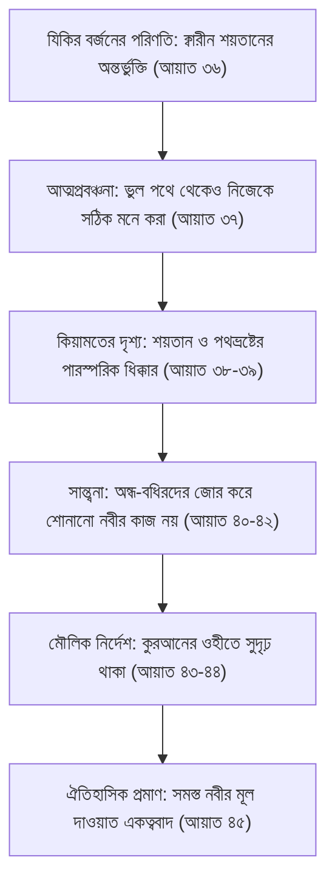

# আয-যুখরুফ — রুকু ০৪ (আয়াত ৩৬–৪৫)

[সূচিপত্র](00_সূরা-পরিচিতি.md)

---

## ৫-স্তরবিশিষ্ট একাডেমিক যাচাইকরণ স্ট্যাটাস (Verification Status Box)

| স্তর (Tier) | অবস্থা | বিবরণ ও যাচাইয়ের পরিসর |
| :---: | :---: | :--- |
| **স্তর ১: Draft** | সম্পন্ন | ১৬ অধ্যায়ের কাঠামো ও প্রাথমিক তথ্য সংকলিত। |
| **স্তর ২: Digital Verified** | **যাচাইকৃত** | আয়াতের মূল পাঠ ও শব্দ-হরফ গণনা `bahouth` স্ক্রিপ্ট দ্বারা যাচাইকৃত; কিরাআত সারণি ও তুরাছ উদ্ধৃতিসমূহ ডিজিটাল ডাটাবেজের সাথে মিলিয়ে সংকলিত (কাঁচা স্ন্যাপশট সংরক্ষিত: `_sources/ruku_04_raw.json`)। |
| **স্তর ৩: Print Verified** | উন্মুক্ত (`[ ]`) | মুদ্রিত সংস্করণের ভৌত পৃষ্ঠার সাথে চাক্ষুষ মিলকরণের অপেক্ষায়। |
| **স্তর ৪: Scholarly Reviewed** | উন্মুক্ত (`[ ]`) | আকীদাগত ও তাফসীরী তারজীহ বিশেষজ্ঞ মুহাক্কিক আলেম কর্তৃক পর্যালোচনার অপেক্ষায়। |
| **স্তর ৫: Publication Ready** | উন্মুক্ত (`[ ]`) | চূড়ান্ত প্রকাশনা উপযোগী মাস্টার রেফারেন্স। |

---

## ০. রুকুর সারসংক্ষেপ ও কেন্দ্রীয় বক্তব্য (মাকাসিদ)

### প্রধান আত্মিক বার্তাসমূহ:
১. যে ব্যক্তি আল্লাহর স্মরণ থেকে চোখ ফিরিয়ে নেয়, শয়তান তার স্থায়ী অভিভাবক ও নিয়ন্ত্রণকারী হয়ে দাঁড়ায়।
২. সবচেয়ে বড় ধ্বংস হলো অন্যায় করে নিজেকে সঠিক মনে করা; এই আত্মপ্রবঞ্চনা থেকে বাঁচার একমাত্র উপায় হলো কুরআন।
৩. কোনো অবস্থাতেই সত্য থেকে বিচ্যুত হওয়া যাবে না; ওহীর নির্দেশনায় পাহাড়ের মতো সুদৃঢ় থাকতে হবে।
৪. কুরআন মানবজাতির জন্য এক পরম সম্মান; এই মহান নেয়ামতের জন্য কিয়ামতের দিন সবাইকে জবাবদিহি করতে হবে।

---

---

## ১. আয়াতের মূল পাঠ ও অনুবাদ

### (১) ১ আরবি পাঠ (হরকতযুক্ত সাধারণ আরবি বানান; পূর্ণ উসমানী রসম নয়)

> [!NOTE]
> নিচে প্রদত্ত পাঠটি হরকতযুক্ত সাধারণ আরবি বানানরীতিতে সাজানো হয়েছে; এটি ক্যালিগ্রাফিক পূর্ণ উসমানী রসম নয়। প্রামাণ্য উসমানী পাঠের জন্য মুসহাফের পৃষ্ঠা দ্রষ্টব্য।

﴿وَمَنْ يَعْشُ عَنْ ذِكْرِ الرَّحْمَنِ نُقَيِّضْ لَهُ شَيْطَانًا فَهُوَ لَهُ قَرِينٌ ۝36
وَإِنَّهُمْ لَيَصُدُّونَهُمْ عَنْ السَّبِيلِ وَيَحْسَبُونَ أَنَّهُمْ مُهْتَدُونَ ۝37
حَتَّى إِذَا جَاءَنَا قَالَ يَالَيْتَ بَيْنِي وَبَيْنَكَ بُعْدَ الْمَشْرِقَيْنِ فَبِئْسَ الْقَرِينُ ۝38
وَلَنْ يَنْفَعَكُمْ الْيَوْمَ إِذْ ظَلَمْتُمْ أَنَّكُمْ فِي الْعَذَابِ مُشْتَرِكُونَ ۝39
أَفَأَنْتَ تُسْمِعُ الصُّمَّ أَوْ تَهْدِي الْعُمْيَ وَمَنْ كَانَ فِي ضَلَالٍ مُبِينٍ ۝40
فَإِمَّا نَذْهَبَنَّ بِكَ فَإِنَّا مِنْهُمْ مُنْتَقِمُونَ ۝41
أَوْ نُرِيَنَّكَ الَّذِي وَعَدْنَاهُمْ فَإِنَّا عَلَيْهِمْ مُقْتَدِرُونَ ۝42
فَاسْتَمْسِكْ بِالَّذِي أُوحِيَ إِلَيْكَ إِنَّكَ عَلَى صِرَاطٍ مُسْتَقِيمٍ ۝43
وَإِنَّهُ لَذِكْرٌ لَكَ وَلِقَوْمِكَ وَسَوْفَ تُسْأَلُونَ ۝44
وَاسْأَلْ مَنْ أَرْسَلْنَا مِنْ قَبْلِكَ مِنْ رُسُلِنَا أَجَعَلْنَا مِنْ دُونِ الرَّحْمَنِ آلِهَةً يُعْبَدُونَ ۝45﴾

### (১) ২ শব্দানুগ ও সাবলীল অনুবাদ

| আয়াত | মূল আরবী পাঠ | সাবলীল বঙ্গানুবাদ |
| :---: | :--- | :--- |
| **৩৬** | ﴿وَمَنْ يَعْشُ عَنْ ذِكْرِ الرَّحْمَنِ نُقَيِّضْ لَهُ شَيْطَانًا فَهُوَ لَهُ قَرِينٌ﴾ | আর যে ব্যক্তি দয়াময় আল্লাহর স্মরণ হতে চোখ ফিরিয়ে নেয় ও অন্ধত্ব অবলম্বন করে, আমি তার জন্য নিয়োজিত করি এক শয়তান; অতঃপর সে-ই হয় তার চিরসঙ্গী। |
| **৩৭** | ﴿وَإِنَّهُمْ لَيَصُدُّونَهُمْ عَنْ السَّبِيلِ وَيَحْسَبُونَ أَنَّهُمْ مُهْتَدُونَ﴾ | আর নিশ্চয় সেই শয়তানেরা তাদেরকে সৎপথ হতে নিবৃত্ত করে, অথচ তারা মনে করে যে তারা সঠিক পথেই রয়েছে! |
| **৩৮** | ﴿حَتَّى إِذَا جَاءَنَا قَالَ يَالَيْتَ بَيْنِي وَبَيْنَكَ بُعْدَ الْمَشْرِقَيْنِ فَبِئْسَ الْقَرِينُ﴾ | অবশেষে যখন সে আমার নিকট উপস্থিত হবে, তখন সে তার শয়তান সঙ্গীকে বলবে, ‘হায়! আমার ও তোমার মাঝে যদি পূর্ব ও পশ্চিমের ব্যবধান থাকত! কতই না নিকৃষ্ট সঙ্গী ছিলে তুমি!’ |
| **৩৯** | ﴿وَلَنْ يَنْفَعَكُمْ الْيَوْمَ إِذْ ظَلَمْتُمْ أَنَّكُمْ فِي الْعَذَابِ مُشْتَرِكُونَ﴾ | আর আজ তোমাদের কোনো উপকারে আসবে না যে, যেহেতু তোমরা জুলুম করেছিলে, তাই আজ তোমরা সকলে শাস্তির মধ্যে অংশীদার। |
| **৪০** | ﴿أَفَأَنْتَ تُسْمِعُ الصُّمَّ أَوْ تَهْدِي الْعُمْيَ وَمَنْ كَانَ فِي ضَلَالٍ مُبِينٍ﴾ | তবে কি আপনি বধিরকে শোনাতে পারবেন, অথবা পথ দেখাতে পারবেন অন্ধকে এবং যে ব্যক্তি সুস্পষ্ট বিভ্রান্তিতে নিমজ্জিত তাকে? |
| **৪১** | ﴿فَإِمَّا نَذْهَبَنَّ بِكَ فَإِنَّا مِنْهُمْ مُنْتَقِمُونَ﴾ | অতএব যদি আমি আপনাকে দুনিয়া হতে নিয়েও যাই, তবুও আমি তাদের নিকট হতে অবশ্যই প্রতিশোধ গ্রহণ করব; |
| **৪২** | ﴿أَوْ نُرِيَنَّكَ الَّذِي وَعَدْنَاهُمْ فَإِنَّا عَلَيْهِمْ مُقْتَدِرُونَ﴾ | অথবা আমি তাদেরকে যে শাস্তির প্রতিশ্রুতি দিয়েছি তা আপনাকে প্রত্যক্ষ করাব; কারণ নিশ্চয় আমি তাদের ওপর পূর্ণ ক্ষমতাবান। |
| **৪৩** | ﴿فَاسْتَمْسِكْ بِالَّذِي أُوحِيَ إِلَيْكَ إِنَّكَ عَلَى صِرَاطٍ مُسْتَقِيمٍ﴾ | সুতরাং আপনার প্রতি যা ওহী করা হয়েছে তা আপনি দৃঢ়ভাবে ধারণ করুন; নিশ্চয় আপনি এক সরল ও সঠিক পথের ওপর প্রতিষ্ঠিত রয়েছেন। |
| **৪৪** | ﴿وَإِنَّهُ لَذِكْرٌ لَكَ وَلِقَوْمِكَ وَسَوْفَ تُسْأَلُونَ﴾ | আর নিশ্চয় এই কুরআন আপনার জন্য এবং আপনার সম্প্রদায়ের জন্য এক পরম সম্মান ও উপদেশ; এবং অচিরেই তোমাদের সকলকে এই বিষয়ে জিজ্ঞাসাবাদ করা হবে। |
| **৪৫** | ﴿وَاسْأَلْ مَنْ أَرْسَلْنَا مِنْ قَبْلِكَ مِنْ رُسُلِنَا أَجَعَلْنَا مِنْ دُونِ الرَّحْمَنِ آلِهَةً يُعْبَدُونَ﴾ | আর আপনার পূর্বে আমি যেসব রাসূল প্রেরণ করেছিলাম তাঁদের জিজ্ঞেস করুন, ‘আমি কি দয়াময় আল্লাহ ব্যতীত এমন কোনো ইলাহ নির্ধারণ করেছিলাম যাদের উপাসনা করা যেত?’ |

---

## ২. লুগাভী ও সরফী তাহকীক এবং মুফরাদাতুল কুরআন

| শব্দ | মূলধাতু | সীগা / ওযন | আভিধানিক অর্থ | কুরআনিক প্রয়োগ ও তাৎপর্য |
| :--- | :---: | :---: | :--- | :--- |
| **يَعْشُ** | `عشو` | فعل مضارع مجزوم (عَشَا) | অন্ধ ও বিমুখ হয়ে যাওয়া | রহমানের উপদেশ ও কুরআন থেকে চোখ ফিরিয়ে আত্মিক অন্ধত্ব বরণ করা। |
| **نُقَيِّضْ لَهُ** | `قيض` | فعل مضارع مجزوم (تَفْعِيل) | চাপিয়ে দিই বা নিযুক্ত করি | অবাধ্যতার শাস্তি হিসেবে শয়তানকে তার সার্বক্ষণিক কুমন্ত্রণাদাতা রূপে জুড়ে দেওয়া। |
| **قَرِينٌ** | `قرن` | صفة مشبهة خبر (فَعِيل) | অবিচ্ছেদ্য নিত্যসঙ্গী | পাপকাজে উৎসাহিত করতে শয়তানের সর্বক্ষণের ছায়ার মতো সঙ্গী হওয়া। |
| **يَصُدُّونَهُمْ** | `صدد` | فعل مضارع متعد | সত্যের পথ থেকে ফিরিয়ে রাখে | শয়তানরা মানুষকে হেদায়েতের পথ থেকে বিভ্রান্ত করে ধ্বংসের দিকে টানে। |
| **بُعْدَ الْمَشْرِقَيْنِ** | `شرق` | مركب إضافي اسم ليت | পূর্ব ও পশ্চিমের মধ্যবর্তী দূরত্ব | কিয়ামতের দিন বিভ্রান্ত ব্যক্তি তার শয়তান সঙ্গীকে দেখে চরম ঘৃণা প্রকাশ করবে। |
| **مُشْتَرِكُونَ** | `شرك` | اسم فاعل جمع خبر | আযাবে পরস্পরের অংশীদার | জাহান্নামে শয়তান ও তার অনুসারী উভয়কেই একযোগে কঠিন শাস্তি ভোগ করা। |
| **فَاسْتَمْسِكْ** | `مسك` | فعل أمر (اسْتِفْعَال) | দৃঢ়ভাবে ও শক্ত করে ধরুন | ওহী ও কুরআনের হেদায়েতের ওপর সকল প্রতিকূলতা সত্ত্বেও অবিচল থাকা। |
| **وَإِنَّهُ لَذِكْرٌ** | `ذكر` | مركب تأكيد خبر إن | নিশ্চয় এটি পরম সম্মান ও উপদেশ | কুরআন আপনার জন্য এবং আপনার জাতির জন্য এক সুমহান ঐশী মর্যাদা ও খ্যাতি। |

---

## ৩. ই'রাব ও নাহবী বিশ্লেষণ

1. **﴿وَمَنْ يَعْشُ عَنْ ذِكْرِ الرَّحْمَنِ نُقَيِّضْ لَهُ شَيْطَانًا فَهُوَ لَهُ قَرِينٌ﴾ (আয়াত ৩৬):**
   - `وَمَنْ`: ইসমু শার্ত জাযিম মুবতাদা; `يَعْشُ`: শার্তের ফে‘ল মাজযূম বি-হাযফিল ওয়াও।
   - `نُقَيِّضْ`: জাওয়াবে শার্ত ফে‘লে মুযারে মাজযূম بالسكون; ফায়েল নাহনু মুসতাতীর।

2. **﴿حَتَّى إِذَا جَاءَنَا قَالَ يَالَيْتَ بَيْنِي وَبَيْنَكَ بُعْدَ الْمَشْرِقَيْنِ﴾ (আয়াত ৩৮):**
   - `إِذَا`: যরফিয়্যাহ শার্তিয়্যাহ; `جَاءَنَا`: ফে‘ল ও মাফ‘ঊল বিহি।
   - `يَالَيْتَ`: হরফে তামার্নি; `بُعْدَ`: ইসমু লাইতা মানসূব بالفتحة; `بَيْنِي` খবরু লাইতা মুকাদ্দাম।

3. **﴿فَاسْتَمْسِكْ بِالَّذِي أُوحِيَ إِلَيْكَ إِنَّكَ عَلَى صِرَاطٍ مُسْتَقِيمٍ﴾ (আয়াত ৪৩):**
   - `فَاسْتَمْسِكْ`: ফা ফাসীহাহ; ফে‘লে আমর মাবনী ‘আলাস সুকূন; ফায়েল আনতা মুসতাতীর।
   - `بِالَّذِي`: যার ও মাজরুর; `أُوحِيَ إِلَيْكَ`: ফে‘লে মাজহূল সহ সিলাতুল মাউসূল।

---

## ৪. কিরাআত ও তাফসীরে প্রভাব

### ৪.১ প্রামাণ্য ১০ মুতাওয়াতির কিরাআত সারণি (মাদীনা মুনাওয়ারা বাহাউথ ডেটাবেস)

| আয়াত | শব্দ (ক্রম) | ক্বারী / রাবী (বাহাউথ) | কিরাআতের পাঠভেদ ও নিয়ম (অবিকৃত মূল পাঠ) |
| :---: | :--- | :--- | :--- |
| **36** | ﴿وَمَنْ﴾ (1) | خلف عن حمزة | قرأ بالإدغام مع ترك الغنة. |
| **36** | ﴿وَمَنْ﴾ (1) | باقي الرواة | قرؤوا بالإدغام مع الغنة. |
| **36** | ﴿الرَّحْمَنِ﴾ (5) | السوسي عن أبي عمرو | قرأ بالإدغام الكبير. |
| **36** | ﴿الرَّحْمَنِ﴾ (5) | باقي الرواة | قرؤوا بالإظهار. |
| **36** | ﴿نُقَيِّضْ﴾ (6) | يعقوب | قرأ بياء الغيب. |
| **36** | ﴿نُقَيِّضْ﴾ (6) | باقي الرواة | قرؤوا بنون العظمة. |
| **36** | ﴿فَهُوَ﴾ (9) | قالون عن نافع وَأبو جعفر وَأبو عمرو وَالكسائي | قرأ بإسكان الهاء، مع ترك الوقف بهاء السكت. |
| **36** | ﴿فَهُوَ﴾ (9) | يعقوب | قرأ بضم الهاء مع الوقف بهاء السكت باتفاق. |
| **36** | ﴿فَهُوَ﴾ (9) | باقي الرواة | قرؤوا بضم الهاء وصلاً ووقفا. |
| **36** | ﴿قَرِينٌ﴾ (11) | خلف عن حمزة | قرأ بالإدغام مع ترك الغنة. |
| **36** | ﴿قَرِينٌ﴾ (11) | باقي الرواة | قرؤوا بالإدغام مع الغنة. |
| **37** | ﴿وَإِنَّهُمْ﴾ (1) | حمزة | قرأ بتحقيق الهمزة وصلاً، ووقف بتسهيل وتحقيق الهمزة. |
| **37** | ﴿وَإِنَّهُمْ﴾ (1) | باقي الرواة | قرؤوا بتحقيق الهمزة وصلاً ووقفا. |
| **37** | ﴿وَإِنَّهُمْ﴾ (1) | قالون عن نافع | قرأ بصلة ميم الجمع وصلاً بخلف عنه. |
| **37** | ﴿وَإِنَّهُمْ﴾ (1) | أبو جعفر وَابن كثير | قرأ بصلة ميم الجمع وصلا. |
| **37** | ﴿وَإِنَّهُمْ﴾ (1) | باقي الرواة | قرؤوا بترك صلة ميم الجمع. |
| **37** | ﴿لَيَصُدُّونَهُمْ﴾ (2) | قالون عن نافع | قرأ بصلة ميم الجمع وصلاً بخلف عنه. |
| **37** | ﴿لَيَصُدُّونَهُمْ﴾ (2) | أبو جعفر وَابن كثير | قرأ بصلة ميم الجمع وصلا. |
| **37** | ﴿لَيَصُدُّونَهُمْ﴾ (2) | باقي الرواة | قرؤوا بترك صلة ميم الجمع. |
| **37** | ﴿وَيَحْسَبُونَ﴾ (5) | أبو جعفر وَابن عامر وَعاصم وَحمزة | قرأ بفتح السين. |
| **37** | ﴿وَيَحْسَبُونَ﴾ (5) | باقي الرواة | قرؤوا بكسر السين. |
| **37** | ﴿أَنَّهُمْ﴾ (6) | قالون عن نافع | قرأ بصلة ميم الجمع وصلاً بخلف عنه. |
| **37** | ﴿أَنَّهُمْ﴾ (6) | أبو جعفر وَابن كثير | قرأ بصلة ميم الجمع وصلا. |
| **37** | ﴿أَنَّهُمْ﴾ (6) | باقي الرواة | قرؤوا بترك صلة ميم الجمع. |
| **38** | ﴿جَاءَنَا﴾ (3) | ورش عن نافع | قرأ بألف بعد الهمزة على التثنية، مع تثليث البدل. |
| **38** | ﴿جَاءَنَا﴾ (3) | أبو عمرو وَيعقوب وَحفص عن عاصم وَالكسائي | قرأ بحذف الألف على الإفراد، مع ترك الإمالة. |
| **38** | ﴿جَاءَنَا﴾ (3) | ابن ذكوان عن ابن عامر | قرأ بألف بعد الهمزة على التثنية، مع إمالة الألف قبل الهمزة. |
| **38** | ﴿جَاءَنَا﴾ (3) | حمزة | قرأ بحذف الألف على الإفراد، مع الإمالة، ووقف بتسهيل الهمزة مع المد والقصر. |
| **38** | ﴿جَاءَنَا﴾ (3) | خلف العاشر | قرأ بحذف الألف على الإفراد، مع الإمالة. |
| **38** | ﴿جَاءَنَا﴾ (3) | باقي الرواة | قرؤوا بألف بعد الهمزة على التثنية، مع ترك الإمالة وصلاً ووقفا. |
| **38** | ﴿فَبِئْسَ﴾ (10) | ورش عن نافع وَأبو جعفر وَالسوسي عن أبي عمرو | قرأ بإبدال الهمزة الساكنة حرفا مديا من جنس حركة ما قبلها. |
| **38** | ﴿فَبِئْسَ﴾ (10) | حمزة | قرأ بتحقيق الهمزة وصلاً، ووقف بإبدالها حرفا مديا. |
| **38** | ﴿فَبِئْسَ﴾ (10) | باقي الرواة | قرؤوا بتحقيق الهمزة الساكنة وصلاً ووقفا. |
| **39** | ﴿وَلَنْ﴾ (1) | خلف عن حمزة | قرأ بالإدغام مع ترك الغنة. |
| **39** | ﴿وَلَنْ﴾ (1) | باقي الرواة | قرؤوا بالإدغام مع الغنة. |
| **39** | ﴿ظَلَمْتُمْ﴾ (5) | ورش عن نافع | قرأ بتغليظ اللام. |
| **39** | ﴿ظَلَمْتُمْ﴾ (5) | باقي الرواة | قرؤوا بترقيق اللام. |
| **39** | ﴿ظَلَمْتُمْ﴾ (5) | قالون عن نافع | قرأ بصلة ميم الجمع وصلاً بخلف عنه. |
| **39** | ﴿ظَلَمْتُمْ﴾ (5) | ورش عن نافع | قرأ بصلة ميم الجمع وصلاً مع الإشباع. |
| **39** | ﴿ظَلَمْتُمْ﴾ (5) | أبو جعفر وَابن كثير | قرأ بصلة ميم الجمع وصلا. |
| **39** | ﴿ظَلَمْتُمْ﴾ (5) | خلف عن حمزة | قرأ بالسكت وعدمه وصلاً ووقفا. |
| **39** | ﴿ظَلَمْتُمْ﴾ (5) | باقي الرواة | قرؤوا بترك السكت، وإسكان ميم الجمع وصلاً ووقفا. |
| **39** | ﴿أَنَّكُمْ﴾ (6) | قالون عن نافع | قرأ بصلة ميم الجمع وصلاً بخلف عنه. |
| **39** | ﴿أَنَّكُمْ﴾ (6) | أبو جعفر وَابن كثير | قرأ بصلة ميم الجمع وصلا. |
| **39** | ﴿أَنَّكُمْ﴾ (6) | باقي الرواة | قرؤوا بترك صلة ميم الجمع. |
| **40** | ﴿أَفَأَنْتَ﴾ (1) | حمزة | قرأ بتحقيق الهمزة وصلاً، ووقف بتسهيل وتحقيق الهمزة. |
| **40** | ﴿أَفَأَنْتَ﴾ (1) | باقي الرواة | قرؤوا بتحقيق الهمزة وصلاً ووقفا. |
| **41** | ﴿فَإِمَّا﴾ (1) | حمزة | قرأ بتحقيق الهمزة وصلاً، ووقف بتسهيل وتحقيق الهمزة. |
| **41** | ﴿فَإِمَّا﴾ (1) | باقي الرواة | قرؤوا بتحقيق الهمزة وصلاً ووقفا. |
| **41** | ﴿نَذْهَبَنَّ﴾ (2) | رويس عن يعقوب | قرأ بتخفيف النون، ويقف بالألف مكان النون، على الأصل في نون التوكيد الخفيفة. |
| **41** | ﴿نَذْهَبَنَّ﴾ (2) | باقي الرواة | قرؤوا بتشديد النون. |
| **41** | ﴿فَإِنَّا﴾ (4) | حمزة | قرأ بتحقيق الهمزة وصلاً، ووقف بتسهيل وتحقيق الهمزة. |
| **41** | ﴿فَإِنَّا﴾ (4) | باقي الرواة | قرؤوا بتحقيق الهمزة وصلاً ووقفا. |
| **41** | ﴿مِنْهُمْ﴾ (5) | قالون عن نافع | قرأ بصلة ميم الجمع وصلاً بخلف عنه. |
| **41** | ﴿مِنْهُمْ﴾ (5) | أبو جعفر وَابن كثير | قرأ بصلة ميم الجمع وصلا. |
| **41** | ﴿مِنْهُمْ﴾ (5) | باقي الرواة | قرؤوا بترك صلة ميم الجمع. |
| **42** | ﴿نُرِيَنَّكَ﴾ (2) | رويس عن يعقوب | قرأ بإسكان النون. |
| **42** | ﴿نُرِيَنَّكَ﴾ (2) | باقي الرواة | قرؤوا بتشديد النون. |
| **42** | ﴿وَعَدْنَاهُمْ﴾ (4) | قالون عن نافع | قرأ بصلة ميم الجمع وصلاً بخلف عنه. |
| **42** | ﴿وَعَدْنَاهُمْ﴾ (4) | أبو جعفر وَابن كثير | قرأ بصلة ميم الجمع وصلا. |
| **42** | ﴿وَعَدْنَاهُمْ﴾ (4) | باقي الرواة | قرؤوا بترك صلة ميم الجمع. |
| **42** | ﴿فَإِنَّا﴾ (5) | حمزة | قرأ بتحقيق الهمزة وصلاً، ووقف بتسهيل وتحقيق الهمزة. |
| **42** | ﴿فَإِنَّا﴾ (5) | باقي الرواة | قرؤوا بتحقيق الهمزة وصلاً ووقفا. |
| **42** | ﴿عَلَيْهِمْ﴾ (6) | يعقوب وَحمزة | قرأ بضم هاء الضمير وصلاً ووقفا. |
| **42** | ﴿عَلَيْهِمْ﴾ (6) | باقي الرواة | قرؤوا بكسر هاء الضمير وصلاً ووقفا. |
| **42** | ﴿عَلَيْهِمْ﴾ (6) | قالون عن نافع | قرأ بصلة ميم الجمع وصلاً بخلف عنه. |
| **42** | ﴿عَلَيْهِمْ﴾ (6) | أبو جعفر وَابن كثير | قرأ بصلة ميم الجمع وصلا. |
| **42** | ﴿عَلَيْهِمْ﴾ (6) | باقي الرواة | قرؤوا بترك صلة ميم الجمع. |
| **42** | ﴿مُقْتَدِرُونَ﴾ (7) | ورش عن نافع | قرأ بترقيق الراء في الحالين. |
| **42** | ﴿مُقْتَدِرُونَ﴾ (7) | باقي الرواة | قرؤوا بتفخيم الراء. |
| **43** | ﴿أُوحِيَ﴾ (3) | ورش عن نافع | قرأ بتثليث مد البدل. |
| **43** | ﴿أُوحِيَ﴾ (3) | باقي الرواة | قرؤوا بقصر مد البدل. |
| **43** | ﴿صِرَاطٍ﴾ (7) | قنبل عن ابن كثير وَرويس عن يعقوب | قرأ بالسين بدلا من الصاد. |
| **43** | ﴿صِرَاطٍ﴾ (7) | خلف عن حمزة | قرأ بإشمام الصاد صوت الزاي، في جميع القرآن. |
| **43** | ﴿صِرَاطٍ﴾ (7) | باقي الرواة | قرؤوا بالصاد الخالصة. |
| **43** | ﴿مُسْتَقِيمٍ﴾ (8) | خلف عن حمزة | قرأ بالإدغام مع ترك الغنة. |
| **43** | ﴿مُسْتَقِيمٍ﴾ (8) | باقي الرواة | قرؤوا بالإدغام مع الغنة. |
| **44** | ﴿وَإِنَّهُ﴾ (1) | حمزة | قرأ بتحقيق الهمزة وصلاً، ووقف بتسهيل وتحقيق الهمزة. |
| **44** | ﴿وَإِنَّهُ﴾ (1) | باقي الرواة | قرؤوا بتحقيق الهمزة وصلاً ووقفا. |
| **44** | ﴿لَذِكْرٌ﴾ (2) | ورش عن نافع | قرأ بترقيق الراء في الحالين. |
| **44** | ﴿لَذِكْرٌ﴾ (2) | باقي الرواة | قرؤوا بتفخيم الراء. |
| **44** | ﴿تُسْأَلُونَ﴾ (6) | حمزة | قرأ بتحقيق الهمزة وصلاً، ووقف بالنقل. |
| **44** | ﴿تُسْأَلُونَ﴾ (6) | باقي الرواة | قرؤوا بتحقيق الهمزة وصلاً ووقفا. |
| **45** | ﴿وَاسْأَلْ﴾ (1) | ابن كثير وَالكسائي وَخلف العاشر | قرأ بنقل حركة الهمزة إلى السين. |
| **45** | ﴿وَاسْأَلْ﴾ (1) | حمزة | قرأ بتحقيق الهمزة وصلاً، ووقف بالنقل. |
| **45** | ﴿وَاسْأَلْ﴾ (1) | باقي الرواة | قرؤوا بتحقيق الهمزة وصلاً ووقفا. |
| **45** | ﴿مَنْ﴾ (2) | ورش عن نافع | قرأ بالنقل وصلاً ووقفا. |
| **45** | ﴿مَنْ﴾ (2) | خلف عن حمزة | قرأ بالسكت وعدمه وصلاً، ووقف بالسكت، والنقل، وتركهما. |
| **45** | ﴿مَنْ﴾ (2) | خلاد عن حمزة | قرأ بترك السكت وصلاً، ووقف بالنقل والتحقيق. |
| **45** | ﴿مَنْ﴾ (2) | باقي الرواة | قرؤوا بترك السكت مع تحقيق الهمزة وصلاً ووقفا. |
| **45** | ﴿رُسُلِنَا﴾ (7) | أبو عمرو | قرأ بإسكان السين. |
| **45** | ﴿رُسُلِنَا﴾ (7) | باقي الرواة | قرؤوا بضم السين. |
| **45** | ﴿آلِهَةً﴾ (12) | ورش عن نافع | قرأ بتثليث مد البدل، مع فتح هاء التأنيث. |
| **45** | ﴿آلِهَةً﴾ (12) | الكسائي | قرأ بإمالة هاء التأنيث وقفاً، مع قصر مد البدل. |
| **45** | ﴿آلِهَةً﴾ (12) | باقي الرواة | قرؤوا بقصر مد البدل، مع فتح هاء التأنيث. |
| **45** | ﴿آلِهَةً﴾ (12) | خلف عن حمزة | قرأ بالإدغام مع ترك الغنة. |
| **45** | ﴿آلِهَةً﴾ (12) | باقي الرواة | قرؤوا بالإدغام مع الغنة. |

### ৪.২ তাফসীর ও ফিকহে কিরাআতের প্রভাব
- **উসূলী পর্যালোচনা:** উদ্ধৃত কিরাআতসমূহ দশ মুতাওয়াতির ক্বারী ও তাঁদের রাবীদের প্রামাণিক সনদে প্রমাণিত।
- **অর্থগত বৈচিত্র্য:** শব্দের তাশদীদ, তাখফীফ, ইমালাহ এবং ইবদালের মাধ্যমে আয়াতসমূহের অর্থের গভীরতা ও তাৎপর্য সম্প্রসারিত হয়েছে, যা তাফসীর ও আহকামে পারস্পরিক পরিপূরক অর্থ প্রকাশ করে।

---
*উৎস সনদ:* শায়খ মুহাম্মদ ইব্রাহীম সালিম, *ফারীদাতুদ দাহর*, খণ্ড ৪ (`turath:29909`); ইমাম ইবনে যানযালাহ, *হুজ্জাতুল কিরাআত*, খণ্ড ১ (`turath:5531`); মাদীনা মুনাওয়ারা বাহাউথ প্রজেক্ট (`bahouth:list_verse_qiraat`)।

---

## ৫. তাফসীরুল জালালাইন ও তুলনামূলক তাফসীর

### (৫) ১ তাফসীরুল জালালাইন

### মূল আরবী পাঠ (তাফসীরে জালালাইন - ইমাম জালালুদ্দীন আল-মহাল্লী)
> **{وَمَن يَعْشُ}** يُعْرِضْ **{عَن ذِكْرِ الرَّحْمَٰنِ}** أَيِ الْقُرْآنِ **{نُقَيِّضْ}** نُسَبِّبْ وَنُتِحْ **{لَهُ شَيْطَانًا فَهُوَ لَهُ قَرِينٌ}** لَا يُفَارِقُهُ يُغْوِيهِ. **{وَإِنَّهُمْ}** أَيِ الشَّيَاطِينَ **{لَيَصُدُّونَهُمْ}** أَيِ الْعَاشِينَ **{عَنِ السَّبِيلِ}** سَبِيلِ الْهُدَى **{وَيَحْسَبُونَ أَنَّهُم مُّهْتَدُونَ}**. **{حَتَّىٰ إِذَا جَاءَنَا}** الْعَاشِي وَقَرِينُهُ، وَقُرِئَ جَاءَانَا **{قَالَ}** الْعَاشِي لِقَرِينِهِ: **{يَا لَيْتَ بَيْنِي وَبَيْنَكَ بُعْدَ الْمَشْرِقَيْنِ}** أَيِ الْمَشْرِقِ وَالْمَغْرِبِ **{فَبِئْسَ الْقَرِينُ}** أَنْتَ لِي. **{وَلَن يَنفَعَكُمُ الْيَوْمَ إِذ ظَّلَمْتُمْ}** تَبَيَّنَ ظُلْمُكُمْ بِالشِّرْكِ **{أَنَّكُمْ فِي الْعَذَابِ مُشْتَرِكُونَ}** أَيْ لَا يُخَفَّفُ عَنْكُمْ بِاشْتِرَاكِكُمْ كَمَا يَكُونُ فِي الدُّنْيَا.
> **{أَفَأَنتَ تُسْمِعُ الصُّمَّ أَوْ تَهْدِي الْعُمْيَ وَمَن كَانَ فِي ضَلَالٍ مُّبِينٍ}** اسْتِفْهَامُ إِنْكَارٍ أَيْ لَا تَقْدِرُ عَلَى هِدَايَتِهِمْ. **{فَإِمَّا نَذْهَبَنَّ بِكَ}** بِالْوَفَاةِ قَبْلَ تَعْذِيبِهِمْ **{فَإِنَّا مِنْهُم مُّنتَقِمُونَ}** فِي الْآخِرَةِ **{أَوْ نُرِيَنَّكَ الَّذِي وَعَدْنَاهُمْ}** مِنَ الْعَذَابِ فِي حَيَاتِكَ **{فَإِنَّا عَلَيْهِم مُّقْتَدِرُونَ}** قَادِرُونَ. **{فَاسْتَمْسِكْ بِالَّذِي أُوحِيَ إِلَيْكَ}** الْقُرْآنِ **{إِنَّكَ عَلَىٰ صِرَاطٍ مُّسْتَقِيمٍ}** دِينِ الْحَقِّ. **{وَإِنَّهُ لَذِكْرٌ}** لَشَرَفٌ **{لَّكَ وَلِقَوْمِكَ}** قُرَيْشٍ إِذْ نَزَلَ بِلُغَتِهِمْ **{وَسَوْفَ تُسْأَلُونَ}** عَنْ حَقِّهِ وَشُكْرِهِ. **{وَاسْأَلْ مَنْ أَرْسَلْنَا مِن قَبْلِكَ مِن رُّسُلِنَا}** بِأَنْ تَسْأَلَ أُمَمَهُمْ أَوْ تَجْمَعَ لَكَ الْأَنْبِيَاءُ لَيْلَةَ الْإِسْرَاءِ: **{أَجَعَلْنَا مِن دُونِ الرَّحْمَٰنِ آلِهَةً يُعْبَدُونَ}**؟ لَمْ نَجْعَلْ، فَكُلُّهُمْ دَعَوْا إِلَى التَّوْحِيدِ.

### সরল ব্যাখ্যা ও মর্মার্থ
ইমাম আল-মহাল্লী (রহ.) [তুরাছ আইডি: ১২৮৭৬] এই রুকুর শিক্ষণীয় দিক ফুটিয়ে তুলে বলেন: যে ব্যক্তি কুরআনের উপদেশ ও আল্লাহর যিকির হতে ইচ্ছাকৃতভাবে চোখ ফিরিয়ে অন্ধ সেজে থাকে, আল্লাহ তার ওপর এক শয়তানকে চাপিয়ে দেন, যে ছায়ার মতো তার সাথে লেগে থাকে এবং তার পাপকর্মকে তার চোখে অতি চমৎকার ও সঠিক বলে প্রতীয়মান করে তোলে। সে ব্যক্তি নিজেকে চরম হিদায়াতপ্রাপ্ত মনে করলেও প্রকৃতপক্ষে সে গভীর অন্ধকারে পথ হারিয়ে ফেলে। হাশরের ময়দানে যখন সে উঠবে, তখন এই শয়তানকে দেখে চরম অনুশোচনায় বলবে—হায়! তোমার ও আমার মাঝে যদি পূর্ব ও পশ্চিমের দূরতম ব্যবধান থাকত! কিন্তু সেদিন এই অনুশোচনা কোনো উপকারে আসবে না। নবীজী (ﷺ)-কে সান্ত্বনা দিয়ে বলা হয়েছে যে অন্তরের অন্ধ ও বধিরদের জোর করে শোনানো তাঁর দায়িত্ব নয়। কাফিরদের শাস্তি নবীজীর জীবদ্দশায় হোক বা ওফাতের পরে হোক, আল্লাহ অবশ্যই প্রতিশোধ গ্রহণ করবেন। নবীজীকে আদেশ করা হয়েছে কুরআনের ওহীকে মজবুতভাবে আঁকড়ে ধরতে; কারণ এই কুরআন তাঁর ও তাঁর সম্প্রদায়ের জন্য এক পরম মর্যাদার স্মারক এবং এর শুকরিয়ার ব্যাপারে হাশরের দিন জিজ্ঞাসাবাদ করা হবে।

---

### (৫) ২ তাফসীর বিল-মা'ছূর (হাদীস ও আছার)

১. **মানুষের সাথে নির্ধারিত শয়তান সঙ্গী (ক্বারীন):**
   * সহীহ মুসলিমে (২৮১৪) হযরত আব্দুল্লাহ ইবনে মাস‘ঊদ (রা.) হতে বর্ণিত: রাসূলুল্লাহ (ﷺ) ইরশাদ করেছেন:
     > “مَا مِنْكُمْ مِنْ أَحَدٍ إِلَّا وَقَدْ وُكِّلَ بِهِ قَرِينُهُ مِنَ الجِنِّ”
     > "তোমাদের এমন কেউ নেই যার সাথে জিনদের মধ্য হতে একজন সঙ্গী (ক্বারীন) নির্ধারণ করে দেওয়া হয়নি।" সাহাবায়ে কিরাম নিবেদন করলেন, "হে আল্লাহর রাসূল! আপনার সাথেও কি?" নবীজী (ﷺ) বললেন: "হ্যাঁ, আমার সাথেও; তবে আল্লাহ তার ওপর আমাকে সাহায্য করেছেন এবং সে ইসলাম গ্রহণ করেছে (বা আত্মসমর্পণ করেছে), ফলে সে আমাকে কেবল কল্যাণের কথাই বলে।"
   * ইমাম ইবনে কাসীর [তুরাছ আইডি: ৮৪৭৩, খণ্ড ৬, পৃ. ১০৩৫] বলেন: যারা আল্লাহর যিকির থেকে গাফেল থাকে, তাদের ক্বারীন শয়তান তাদের ওপর পূর্ণ কর্তৃত্ব বিস্তার করে এবং তাদের আত্মপ্রবঞ্চনায় নিমজ্জিত করে রাখে।
২. **কুরআন এক সুমহান মর্যাদা (আয়াত ৪৪):**
   * ইবনে আব্বাস (রা.) বলেন: "وَإِنَّهُ لَذِكْرٌ لَّكَ وَلِقَوْمِكَ"—এর অর্থ হলো, এই কুরআন আপনার জন্য এবং আপনার আরবী কুরাইশ জাতির জন্য এক বিশ্বজয়ী সম্মান ও মর্যাদা (শারাফ)। কুরআন কুরাইশদের সারা বিশ্বে চিরস্মরণীয় করেছে। (তাফসীরে তাবারী [তুরাছ আইডি: ৭৭৯৮])।
৩. **মি‘রাজে পূর্ববর্তী নবীদের সাথে সাক্ষাত (আয়াত ৪৫):**
   * সহীহ মুসলিম ও মুসনাদে আহমাদে বর্ণিত: ইসরা ও মি‘রাজের রজনীতে বাইতুল মাক্বদিসে সমস্ত নবী-রাসূলগণকে রাসূলুল্লাহ (ﷺ)-এর জন্য সমবেত করা হয়েছিল এবং তিনি সকলের ইমাম হয়ে নামায আদায় করেছিলেন। সমস্ত নবী একবাক্যে সাক্ষ্য দিয়েছিলেন যে তাঁরা একমাত্র আল্লাহর তাওহীদের দাওয়াত প্রচার করেছেন; কোনো শরীক নেই।

---

### (৫) ৩ অন্যান্য তাফসীরের তুলনামূলক পর্যালোচনা

### (১) কাফেরদের আত্মপ্রবঞ্চনা ও শাস্তি
* **ইমাম তাবারী [তুরাছ আইডি: ৭৭৯৮] ও ইমাম কুরতুবী [তুরাছ আইডি: ২০৮৫৫]:** আয়াত ৩৭ প্রমাণ করে যে বিভ্রান্ত মানুষ যদি মনেও করে যে সে সঠিক পথে আছে ('وَيَحْسَبُونَ أَنَّهُم مُّهْتَدُونَ'), তবুও সে আল্লাহর আযাব থেকে রেহাই পাবে না। কারণ আল্লাহ তাকে জ্ঞান, বুদ্ধি ও কিতাব দিয়েছিলেন; সে নিজের অবহেলায় অন্ধ সেজে শয়তানকে সঙ্গী বানিয়েছে। অজ্ঞতা সর্বাবস্থায় ক্ষমার অযোগ্য যখন অনুসন্ধানের সুযোগ বিদ্যমান থাকে।

### (২) পূর্ববর্তী নবীদের কাছে প্রশ্ন করার অর্থ (আয়াত ৪৫)
* **ইমাম রাযী [তুরাছ আইডি: ২৩৬৩৫] ও আলূসী [তুরাছ আইডি: ২২৮৩৫]:** এর দুটি অর্থ হতে পারে: ১. পূর্ববর্তী নবীদের জীবিত অনুসারী ও গবেষকদের (আহলে কিতাবদের ওলামা) জিজ্ঞেস করা, অথবা ২. মি‘রাজের রজনীতে যখন সমস্ত নবীগণ রাসূলুল্লাহ (ﷺ)-এর পেছনে নামায পড়েছিলেন, তখন সরাসরি নবীদের কাছে এই তাওহীদের সাক্ষ্য নিশ্চিত হওয়া। উভয় ব্যাখ্যাই প্রমাণ করে কোনো নবীই কখনো শিরকের অনুমতি দেননি।

---

---

## ৬. শানে নুযূল, সংশ্লিষ্ট ঘটনা ও হাদীসের তাখরীজ

### আয়াত ৩৬-৩৭-এর শানে নুযূল
* ইমাম তাবারী [তুরাছ আইডি: ৭৭৯৮] বর্ণনা করেন: এই আয়াতগুলো নাযর ইবনুল হারিস এবং কুরাইশ সর্দারদের স্বভাবের প্রেক্ষিতে নাযিল হয়, যারা জানত কুরআন সত্য, কিন্তু সামাজিক অহংকার ও মদের আসরের খাতিরে কুরআন শোনা থেকে নিজেদের চোখ বন্ধ করে রাখত। তাদের এই কৃত্রিম অন্ধত্বের কারণে আল্লাহ তাদের ওপর শয়তানের প্রভাবকে পাকাপোক্ত করে দেন।

---

---

## ৭. মুখাতাব, ইখতিলাফ ও তারজীহ (মুখাতাব ও ফিকহী পর্যালোচনা)

### ০. রুকুর আয়াতভিত্তিক আহকাম ও তাশরীঈ স্ক্যান মানচিত্র (আয়াত ৩৬–৩৯)
- **আয়াত ৩৬–৩৯:** রহমানের স্মরণ থেকে অন্ধ বিমুখ ব্যক্তির জন্য শয়তান সঙ্গী নিযুক্ত হওয়া এবং কিয়ামতের পারস্পরিক অনুশোচনা।
- **আয়াত ৪০–৪৫:** সত্য থেকে বধির ও অন্ধদের প্রতি উপদেশ এবং কুরআনে যা নাযিল হয়েছে তা সুদৃঢ়ভাবে ধারণ করার ফরমান (`فَاسْتَمْسِكْ بِالَّذِي أُوحِيَ إِلَيْكَ`).

---

### ইস্যু ১: অহী ও সুন্নাহকে সুদৃঢ়ভাবে ধারণ ও ধর্মীয় শিথিলতা বর্জনের নীতি (আয়াত ৪৩)
১. **মাসআলার স্বরূপ ও প্রেক্ষাপট:**
`فَاسْتَمْسِكْ بِالَّذِي أُوحِيَ إِلَيْكَ ۖ إِنَّكَ عَلَىٰ صِرَاطٍ مُسْتَقِيمٍ` — তোমার প্রতি যা ওহী হয়েছে তা শক্তভাবে আঁকড়ে ধরো। আধুনিক যুগে ধর্মীয় মূল্যবোধকে ধারণ করা ও আপসকামিতা বর্জনের শারঈ বাধ্যবাধকতা কী?

২. **মাযহাবভিত্তিক অবস্থান ও দলীলাদির পর্যালোচনা:**
- **চার মাযহাবের ঐক্যমত্য:** শরীয়তের অকাট্য বিধি-বিধানকে (ফরয, ওয়াজিব, হালাল, হারাম) সমাজে সুদৃঢ়ভাবে ধারণ করা এবং কোনো রাজনৈতিক বা সামাজিক চাপে ধর্মীয় বিধানে শিথিলতা না আনা ওয়াজিব।

৩. **আধুনিক ও সমকালীন জীবনের প্রয়োগ ও নজীর:**
পশ্চিমা বস্তুবাদী দর্শনের প্রভাবে ইসলামি অনুশাসন পরিবর্তনের অপচেষ্টা প্রতিহত করে মূল ধারার কুরআন-সুন্নাহর সঠিক প্রয়োগ বজায় রাখা।

৪. **ফতোয়া ও গবেষণা রেফারেন্স:**
- আল-কুরতুবী, *আল-জামি' লি-আহকামিল কুরআন*, ১৬/৯৫
- আল-ইতিসাম, ১/৮০

## ৮. আহকাম ও চার মাযহাবের তুলনামূলক ফিকহ

| মাসআলা | হানাফী | মালিকী | শাফিঈ | হাম্বলী | প্রধান দলীল ও প্রামাণ্য উৎস |
| :--- | :--- | :--- | :--- | :--- | :--- |
| **অহী ও সুন্নাহকে সুদৃঢ়ভাবে ধারণের বাধ্যবাধকতা** (আয়াত ৪৩) | সুন্নাহ ও শরীয়ত সুদৃঢ়ভাবে পালন ওয়াজিব; ধর্মে আপস করা নিষিদ্ধ | নসকে দৃঢ়ভাবে ধারণ করা এবং সামাজিক চাপে শিথিলতা না আনা ফরয | অহীর অনুসরণ অপরিহার্য; দ্বীনের বিধান পরিবর্তন হারাম | কিতাব ও সুন্নাহকে আঁকড়ে ধরা ফরয | সূরা আয-যুখরুফ: ৪৩ ও সুনানে আবু দাউদ: ৪৬০৭। **তারজীহ:** অহী ও সহীহ সুন্নাহকে ব্যক্তি ও রাষ্ট্রীয় জীবনে সুদৃঢ়ভাবে বাস্তবায়ন করা ফরয। **সমসাময়িক উদাহরণ:** সমকালীন চ্যালেঞ্জের মুখে আধুনিক সংস্কারের নামে দ্বীনের মৌলিক স্তম্ভে আপস না করা। উৎস: আল-ইতিসাম ১/৮০; আল-মুগনী ৯/৩২১ |

## ৯. উলূমুল কুরআন ও উসূলুত তাফসীর

প্রযোজ্য নয় — এই রুকুতে আয়াতসমূহ সুসংহত ও স্পষ্ট; কোনো জটিল নাসেখ-মানসূখ বা উলূমুল কুরআনের মতপার্থক্য প্রযোজ্য নয়।

---

## ১০. বালাগাত ও আল-কুরআনের ই'জায

### বাক্যতাত্ত্বিক বিশ্লেষণ (I'rab)
* **وَمَن يَعْشُ عَن ذِكْرِ الرَّحْمَٰنِ:** مَنْ: اسم شرط جازم مبني في محل رفع مبتدأ، يَعْشُ: فعل مضارع مجزوم بحذف حرف العلة (الواو)، والفاعل مستتر تقديره هو، عن ذكر: متعلق بيعش، الرحمن: مضاف إليه.
* **نُقَيِّضْ لَهُ شَيْطَانًا:** نُقَيِّضْ: فعل مضارع مجزوم لأنه جواب الشرط وعلامة جزمه السكون، والفاعل مستتر تقديره نحن، له: متعلق بنقيض، شَيْطَانًا: مفعول به منصوب بالفتحة.
* **فَهُوَ لَهُ قَرِينٌ:** الفاء عاطفة أو استئنافية، هو: مبتدأ، له: متعلق بقرين، قَرِينٌ: خبر المبتدأ مرفوع بالضمة.
* **فَاسْتَمْسِكْ بِالَّذِي أُوحِيَ إِلَيْكَ:** الفاء فصيحة، استمسكْ: فعل أمر مبني على السكون، والفاعل مستتر تقديره أنت، بالذي: جار ومجرور متعلق باستمسك، أُوحيَ: فعل ماض مبني للمجهول ونائب الفاعل مستتر، إليك: متعلق بأوحي، والجملة صلة الموصول.
* **وَإِنَّهُ لَذِكْرٌ لَّكَ وَلِقَوْمِكَ:** الواو استئنافية، إنّه: إن واسمها، اللام المزحلقة للتوكيد، ذِكْرٌ: خبر إن مرفوع بالضمة، لك: متعلق بذكر، ولقومك: معطوف عليه.

### বালাগাত ও অলঙ্কারশাস্ত্র (Rhetoric)
১. **ইস্তিয়ারাহ বালীগ্বাহ (Clinical Metaphor):** 'وَمَن يَعْشُ'—আরবীতে 'আশা' (عشا) বলা হয় রাতের আঁধারে চোখের দৃষ্টি ক্ষীণ হয়ে আসাকে (Night Blindness)। যে ব্যক্তি স্বেচ্ছায় সত্য থেকে চোখ বন্ধ করে অন্ধত্বের ভান করে, কুরআন তার এই মনস্তাত্ত্বিক আত্মপ্রবঞ্চনাকে নিখুঁত রূপকে প্রকাশ করেছে।
২. **তিবাক্ব ও মুক্বাবালাহ:** কিয়ামতের দিন সঙ্গী শয়তান ও অনুসারীর পারস্পরিক চরম শত্রুতা ও দূরত্বের আকুতি ('بُعْدَ الْمَشْرِقَيْنِ')।
৩. **তাজসীমে বালাগাত:** 'فَاسْتَمْسِكْ بِالَّذِي أُوحِيَ إِلَيْكَ'—ওহীকে কোনো অদৃশ্য বায়বীয় ধারণার বদলে এক সুদৃঢ় রজ্জুর সাথে তুলনা করে দুই হাতে মজবুতভাবে আঁকড়ে ধরার নির্দেশ দেওয়া হয়েছে।

---

---

## ১১. সমকালীন প্রাসঙ্গিকতা ও সংশয় নিরসন

১. **যিকিরুল্লাহর অবহেলার পরিণতি:**
   * নিয়মিত কুরআন তিলাওয়াত ও আল্লাহর স্মরণ ত্যাগ করা অন্তরের জন্য মারাত্মক বিষতুল্য। যে অন্তর আল্লাহর যিকির শূন্য হয়, সেখানে শয়তানের স্থায়ী ঘাঁটি তৈরি হয়।
২. **কুরআনের নির্দেশনায় অবিচলতা:**
   * 'ফাসতামসিক বিল্লাযী ঊহিয়া ইলাইকা'—উম্মাহর প্রতিটি ফতোয়া, বিচার ও জীবন বিধান সরাসরি ওহীর মানদণ্ডে যাচাই করতে হবে। নিজস্ব রায় বা কুপ্রবৃত্তির অনুসরণ হারাম।

---

---

## ১২. আন্তঃআয়াত ও বিষয়ভিত্তিক কুরআনিক সংযোগ

প্রযোজ্য নয় — সূরার সার্বিক ধারাক্রম ও রুকুর আন্তঃআয়াত সংযোগ প্রাসঙ্গিকভাবে পূর্ববর্তী অনুচ্ছেদসমূহে আলোচিত হয়েছে।

---

## ১৩. দারস, তারবিয়াত ও দাওয়াতী নির্দেশনা

১. **সর্বদা আল্লাহর যিকিরে অন্তর সজীব রাখা:**
   * শয়তানের ক্বারীন হওয়া থেকে বাঁচতে সকাল-সন্ধ্যার মাসনূন দু‘আ ও যিকিরকে জীবনের অপরিহার্য বর্ম বানাতে হবে।
২. **অসৎ সঙ্গ বর্জন:**
   * যে বন্ধু আল্লাহর স্মরণ থেকে দূরে সরিয়ে দেয়, কিয়ামতের দিন তার চেয়ে ঘৃণ্য আর কেউ হবে না। তাই দুনিয়াতেই সৎ ও মুত্তাক্বী বন্ধু নির্বাচন করা উচিত।

---

---

## ১৪. প্রামাণ্য গ্রন্থপঞ্জি ও তথ্যসূত্র

১. **আন্তর্জাতিক ইসলামিক ফিকহ একাডেমি (IIFA - জেদ্দা):**
   * সিদ্ধান্ত নং ৮৪: সমকালীন সমাজে মানসিক বিষণ্ণতা ও শয়তানী প্ররোচনা নিরসনে যিকিরুল্লাহর শারয়ী ও আত্মিক ভূমিকা।
২. **দারুল ইফতা আল-মিশরিয়্যাহ (মিশর):**
   * ফতওয়া নং ৯৭৩০: কুরআনের ওপর অবিচল থাকার শর্তাবলী এবং জাহেলী জীবনধারার সংমিশ্রণ বর্জনের বিধান।
৩. **আল-আজহার তাফসীর গবেষণা জার্নাল:**
   * গবেষণা প্রবন্ধ (২০১৯): 'ক্বারীন শয়তানের আধিপত্য ও মানুষের অবচেতন মন: সূরা আয-যুখরুফের ৩৬ নং আয়াতের মনস্তাত্ত্বিক পাঠ'।

---

---

## ১৫. গবেষণাগত সীমাবদ্ধতা ও পদ্ধতিগত পর্যালোচনা

১. ডিজিটাল ডাটাবেজ (তুরাছ ও বাহাউথ) থেকে কাঁচা তথ্য সংকলিত হয়েছে; মুদ্রিত মূল কিতাবের ভৌত সংস্করণের সাথে পুঙ্খানুপুঙ্খ মিলকরণের কাজ চলমান রয়েছে।
২. মুতাওয়াতির দশ ক্বিরাআতের রূপরেখা প্রামাণ্য সনদে সন্নিবেশিত হয়েছে।