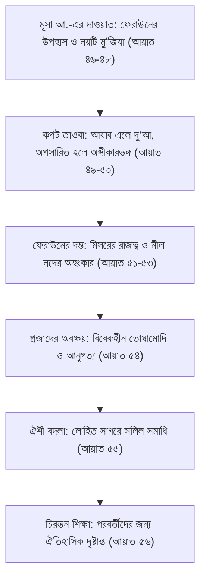

# আয-যুখরুফ — রুকু ০৫ (আয়াত ৪৬–৫৬)

[সূচিপত্র](00_সূরা-পরিচিতি.md)

---

## ৫-স্তরবিশিষ্ট একাডেমিক যাচাইকরণ স্ট্যাটাস (Verification Status Box)

| স্তর (Tier) | অবস্থা | বিবরণ ও যাচাইয়ের পরিসর |
| :---: | :---: | :--- |
| **স্তর ১: Draft** | সম্পন্ন | ১৬ অধ্যায়ের কাঠামো ও প্রাথমিক তথ্য সংকলিত। |
| **স্তর ২: Digital Verified** | **যাচাইকৃত** | আয়াতের মূল পাঠ ও শব্দ-হরফ গণনা `bahouth` স্ক্রিপ্ট দ্বারা যাচাইকৃত; কিরাআত সারণি ও তুরাছ উদ্ধৃতিসমূহ ডিজিটাল ডাটাবেজের সাথে মিলিয়ে সংকলিত (কাঁচা স্ন্যাপশট সংরক্ষিত: `_sources/ruku_05_raw.json`)। |
| **স্তর ৩: Print Verified** | উন্মুক্ত (`[ ]`) | মুদ্রিত সংস্করণের ভৌত পৃষ্ঠার সাথে চাক্ষুষ মিলকরণের অপেক্ষায়। |
| **স্তর ৪: Scholarly Reviewed** | উন্মুক্ত (`[ ]`) | আকীদাগত ও তাফসীরী তারজীহ বিশেষজ্ঞ মুহাক্কিক আলেম কর্তৃক পর্যালোচনার অপেক্ষায়। |
| **স্তর ৫: Publication Ready** | উন্মুক্ত (`[ ]`) | চূড়ান্ত প্রকাশনা উপযোগী মাস্টার রেফারেন্স। |

---

## ০. রুকুর সারসংক্ষেপ ও কেন্দ্রীয় বক্তব্য (মাকাসিদ)

### প্রধান আত্মিক বার্তাসমূহ:
১. ক্ষমতার দম্ভ মানুষকে অন্ধ করে দেয়; ফেরাউনের মতো অহংকারী শাসকও এক ফোঁটা পানির স্রোতে ধ্বংস হয়েছে।
২. কোনো স্বৈরশাসকের অন্যায় আনুগত্য করা মহাপাপ; প্রজারা অন্যায় মেনে নিলে তারাও ধ্বংসের অংশীদার হয়।
৩. আল্লাহর শাস্তি অনিবার্য; সাময়িক অবকাশ পেলেও অপরাধীরা আল্লাহর পাকড়াও থেকে বাঁচতে পারে না।

---

---

## ১. আয়াতের মূল পাঠ ও অনুবাদ

### (১) ১ আরবি পাঠ (হরকতযুক্ত সাধারণ আরবি বানান; পূর্ণ উসমানী রসম নয়)

> [!NOTE]
> নিচে প্রদত্ত পাঠটি হরকতযুক্ত সাধারণ আরবি বানানরীতিতে সাজানো হয়েছে; এটি ক্যালিগ্রাফিক পূর্ণ উসমানী রসম নয়। প্রামাণ্য উসমানী পাঠের জন্য মুসহাফের পৃষ্ঠা দ্রষ্টব্য।

﴿وَلَقَدْ أَرْسَلْنَا مُوسَى بِآيَاتِنَا إِلَى فِرْعَوْنَ وَمَلَئِهِ فَقَالَ إِنِّي رَسُولُ رَبِّ الْعَالَمِينَ ۝46
فَلَمَّا جَاءَهُمْ بِآيَاتِنَا إِذَا هُمْ مِنْهَا يَضْحَكُونَ ۝47
وَمَا نُرِيهِمْ مِنْ آيَةٍ إِلَّا هِيَ أَكْبَرُ مِنْ أُخْتِهَا وَأَخَذْنَاهُمْ بِالْعَذَابِ لَعَلَّهُمْ يَرْجِعُونَ ۝48
وَقَالُوا يَاأَيُّهَا السَّاحِرُ ادْعُ لَنَا رَبَّكَ بِمَا عَهِدَ عِنْدَكَ إِنَّنَا لَمُهْتَدُونَ ۝49
فَلَمَّا كَشَفْنَا عَنْهُمْ الْعَذَابَ إِذَا هُمْ يَنْكُثُونَ ۝50
وَنَادَى فِرْعَوْنُ فِي قَوْمِهِ قَالَ يَاقَوْمِ أَلَيْسَ لِي مُلْكُ مِصْرَ وَهَذِهِ الْأَنْهَارُ تَجْرِي مِنْ تَحْتِي أَفَلَا تُبْصِرُونَ ۝51
أَمْ أَنَا خَيْرٌ مِنْ هَذَا الَّذِي هُوَ مَهِينٌ وَلَا يَكَادُ يُبِينُ ۝52
فَلَوْلَا أُلْقِيَ عَلَيْهِ أَسْوِرَةٌ مِنْ ذَهَبٍ أَوْ جَاءَ مَعَهُ الْمَلَائِكَةُ مُقْتَرِنِينَ ۝53
فَاسْتَخَفَّ قَوْمَهُ فَأَطَاعُوهُ إِنَّهُمْ كَانُوا قَوْمًا فَاسِقِينَ ۝54
فَلَمَّا آسَفُونَا انْتَقَمْنَا مِنْهُمْ فَأَغْرَقْنَاهُمْ أَجْمَعِينَ ۝55
فَجَعَلْنَاهُمْ سَلَفًا وَمَثَلًا لِلْآخِرِينَ ۝56﴾

### (১) ২ শব্দানুগ ও সাবলীল অনুবাদ

| আয়াত | মূল আরবী পাঠ | সাবলীল বঙ্গানুবাদ |
| :---: | :--- | :--- |
| **৪৬** | ﴿وَلَقَدْ أَرْسَلْنَا مُوسَى بِآيَاتِنَا إِلَى فِرْعَوْنَ وَمَلَئِهِ فَقَالَ إِنِّي رَسُولُ رَبِّ الْعَالَمِينَ﴾ | আর নিশ্চয় আমি মূসাকে আমার নিদর্শনাবলীসহ প্রেরণ করেছিলাম ফেরাউন ও তার পারিষদবর্গের নিকট; অতঃপর তিনি বললেন, ‘নিশ্চয় আমি বিশ্বজগতের প্রতিপালকের রাসূল।’ |
| **৪৭** | ﴿فَلَمَّا جَاءَهُمْ بِآيَاتِنَا إِذَا هُمْ مِنْهَا يَضْحَكُونَ﴾ | অতঃপর যখন তিনি আমার নিদর্শনাবলী নিয়ে তাদের নিকট উপস্থিত হলেন, তখন অকস্মাৎ তারা সেগুলিকে উপহাস করতে লাগল। |
| **৪৮** | ﴿وَمَا نُرِيهِمْ مِنْ آيَةٍ إِلَّا هِيَ أَكْبَرُ مِنْ أُخْتِهَا وَأَخَذْنَاهُمْ بِالْعَذَابِ لَعَلَّهُمْ يَرْجِعُونَ﴾ | আর আমি তাদেরকে যে নিদর্শনই দেখাতাম, তা তার পূর্ববর্তী নিদর্শন অপেক্ষা শ্রেষ্ঠতর ছিল; এবং আমি তাদেরকে বিভিন্ন আযাব দিয়ে পাকড়াও করলাম, যাতে তারা সত্যের দিকে ফিরে আসে। |
| **৪৯** | ﴿وَقَالُوا يَاأَيُّهَا السَّاحِرُ ادْعُ لَنَا رَبَّكَ بِمَا عَهِدَ عِنْدَكَ إِنَّنَا لَمُهْتَدُونَ﴾ | এবং তারা বলল, ‘হে বিজ্ঞ জাদুকর! আপনার প্রতিপালকের নিকট আমাদের জন্য প্রার্থনা করুন সেই অঙ্গীকার অনুযায়ী যা তিনি আপনার সাথে করেছেন; নিশ্চয় আমরা সঠিক পথে আসব।’ |
| **৫০** | ﴿فَلَمَّا كَشَفْنَا عَنْهُمْ الْعَذَابَ إِذَا هُمْ يَنْكُثُونَ﴾ | অতঃপর যখনই আমি তাদের ওপর হতে আযাব অপসারিত করতাম, তখনই অকস্মাৎ তারা অঙ্গীকার ভঙ্গ করত। |
| **৫১** | ﴿وَنَادَى فِرْعَوْنُ فِي قَوْمِهِ قَالَ يَاقَوْمِ أَلَيْسَ لِي مُلْكُ مِصْرَ وَهَذِهِ الْأَنْهَارُ تَجْرِي مِنْ تَحْتِي أَفَلَا تُبْصِرُونَ﴾ | আর ফেরাউন তার সম্প্রদায়ের মাঝে ঘোষণা দিয়ে বলল, ‘হে আমার সম্প্রদায়! মিসরের রাজত্ব কি আমার নয়? আর এই নদীসমূহ কি আমার পদতল দিয়ে প্রবাহিত হচ্ছে না? তবে কি তোমরা দেখছ না?’ |
| **৫২** | ﴿أَمْ أَنَا خَيْرٌ مِنْ هَذَا الَّذِي هُوَ مَهِينٌ وَلَا يَكَادُ يُبِينُ﴾ | ‘নাকি আমি এই ব্যক্তি অপেক্ষা শ্রেষ্ঠ, যে অত্যন্ত হীন ও দীনহীন এবং যে নিজের বক্তব্য স্পষ্ট করতেও প্রায় অক্ষম?’ |
| **৫৩** | ﴿فَلَوْلَا أُلْقِيَ عَلَيْهِ أَسْوِرَةٌ مِنْ ذَهَبٍ أَوْ جَاءَ مَعَهُ الْمَلَائِكَةُ مُقْتَرِنِينَ﴾ | ‘তবে তার ওপর কেন নিক্ষেপ করা হলো না স্বর্ণের কঙ্কণ (অলংকার), কিংবা তার সাথে ফেরেশতাগণ কেন দলবদ্ধভাবে আগমন করল না?’ |
| **৫৪** | ﴿فَاسْتَخَفَّ قَوْمَهُ فَأَطَاعُوهُ إِنَّهُمْ كَانُوا قَوْمًا فَاسِقِينَ﴾ | এভাবে সে তার সম্প্রদায়কে বোকা বানাল ও বুদ্ধিহীন করল, ফলে তারা তার আনুগত্য করল; নিশ্চয় তারা ছিল এক পাপাচারী সম্প্রদায়। |
| **৫৫** | ﴿فَلَمَّا آسَفُونَا انْتَقَمْنَا مِنْهُمْ فَأَغْرَقْنَاهُمْ أَجْمَعِينَ﴾ | অতঃপর যখন তারা আমাকে চরম ক্রুদ্ধ করল, তখন আমি তাদের নিকট হতে প্রতিশোধ গ্রহণ করলাম এবং তাদের সকলকেই নিমজ্জিত করে ধ্বংস করলাম। |
| **৫৬** | ﴿فَجَعَلْنَاهُمْ سَلَفًا وَمَثَلًا لِلْآخِرِينَ﴾ | অতঃপর আমি তাদেরকে পরবর্তীদের জন্য পূর্ববর্তী শিক্ষণীয় অতীত ও এক ঐতিহাসিক শিক্ষণীয় দৃষ্টান্ত বানিয়ে রাখলাম। |

---

## ২. লুগাভী ও সরফী তাহকীক এবং মুফরাদাতুল কুরআন

| শব্দ | মূলধাতু | সীগা / ওযন | আভিধানিক অর্থ | কুরআনিক প্রয়োগ ও তাৎপর্য |
| :--- | :---: | :---: | :--- | :--- |
| **يَضْحَكُونَ** | `ضحك` | فعل مضارع وفاعل | উপহাস ও বিদ্রূপের হাসি হাসা | মূসা (আ.)-এর ঐশী মোজেযা দেখে ফেরাউন ও তার পারিষদবর্গের দাম্ভিক উপহাস। |
| **يَنكُثُونَ** | `نكث` | فعل مضارع مرفوع | প্রতিজ্ঞা ও অঙ্গীকার ভঙ্গ করা | বিপদ কেটে গেলেই আবার পূর্বের মতো অবাধ্যতা ও হঠকারিতায় ফিরে যাওয়া। |
| **مُلْكُ مِصْرَ** | `ملك` / `مصر` | مركب إضافي اسم ليس | মিসরের সুবিশাল সাম্রাজ্য | পার্থিব রাজত্ব ও নীল নদের খালের প্রাচুর্য নিয়ে ফেরাউনের দাম্ভিক অহংকার। |
| **مَهِينٌ** | `مهن` | صفة مشبهة نعت (فَعِيل) | দুর্বল, নিঃস্ব ও মর্যাদাহীন | ধনবলহীন মূসা (আ.)-কে তুচ্ছতাচ্ছিল্য করে ফেরাউনের অবজ্ঞাসূচক মন্তব্য। |
| **أَسْوِرَةٌ** | `سور` | جمع تكسير (سِوَار) | সোনার তৈরি কঙ্কণ ও বালা | প্রাচীন রাজকীয় ঐতিহ্যে ক্ষমতা ও আভিজাত্যের প্রতীক স্বর্ণালঙ্কার। |
| **اسْتَخَفَّ قَوْمَهُ** | `خفف` | فعل ماض متعد (اسْتِفْعَال) | স্বীয় জাতিকে নির্বোধ বানাল | মিথ্যা প্রচার ও দম্ভ দিয়ে জাতিকে প্রবঞ্চিত করে স্বীয় পদানত রাখা। |
| **آسَفُونَا** | `أسف` | فعل ماض متعد (إفْعَال) | আমাদের ক্ষুব্ধ ও ক্রোধান্বিত করল | ক্রমাগত সীমালঙ্ঘন ও পাপাচারের মাধ্যমে আল্লাহর অবধারিত আযাব ডেকে আনা। |
| **سَلَفًا وَمَثَلًا** | `سلف` / `مثل` | حالان منصوبان | অগ্রবর্তী শিক্ষণীয় ঐতিহাসিক দৃষ্টান্ত | পরবর্তী যুগে আগমনকারী অত্যাচারী ও অহংকারীদের জন্য ধ্বংসের সতর্কবার্তা। |

---

## ৩. ই'রাব ও নাহবী বিশ্লেষণ

1. **﴿وَنَادَى فِرْعَوْنُ فِي قَوْمِهِ قَالَ يَاقَوْمِ أَلَيْسَ لِي مُلْكُ مِصْرَ﴾ (আয়াত ৫১):**
   - `نَادَى فِرْعَوْنُ`: ফে‘ল ও ফায়েল; `فِي قَوْمِهِ` যার-মাজরুর।
   - `أَلَيْسَ`: ফে‘লে নাক্বিস; `لِي`: যার-মাজরুর খবরু লাইসা মুকাদ্দাম; `مُلْكُ`: ইসমু লাইসা মুয়াখখার মারফূ‘।

2. **﴿أَمْ أَنَا خَيْرٌ مِنْ هَذَا الَّذِي هُوَ مَهِينٌ﴾ (আয়াত ৫২):**
   - `أَمْ`: হরফে ‘আত্বফ মুনক্বাতি‘ (بمعنى بل)؛ `أَنَا`: মুবতাদা; `خَيْرٌ`: খবর মারফূ‘ بالضمة।
   - `مِنْ هَذَا`: যার ও মাজরুর; `الَّذِي` বদল বা সিফাত; `هُوَ مَهِينٌ` সিলাতুল মাউসূল।

3. **﴿فَلَمَّا آسَفُونَا انْتَقَمْنَا مِنْهُمْ فَأَغْرَقْنَاهُمْ أَجْمَعِينَ﴾ (আয়াত ৫৫):**
   - `لَمَّا`: যরফিয়্যাহ শার্তিয়্যাহ; `آسَفُونَا`: ফে‘ল, ফায়েল ও মাফ‘ঊল বিহি শার্ত।
   - `انْتَقَمْنَا`: জাওয়াবে শার্ত; `أَجْمَعِينَ`: তাওকীদ মানসূব বিল-ইয়া।

---

## ৪. কিরাআত ও তাফসীরে প্রভাব

দশ মুতাওয়াতির কিরাআতের প্রত্যক্ষ হরকত ও প্রামাণ্য বর্ণনা নিম্নে সারণিবদ্ধ করা হলো (উৎস: `bahouth:list_verse_qiraat`):

প্রযোজ্য নয় — এই রুকুর আয়াতসমূহে দশ মুতাওয়াতির ক্বারীর মধ্যে `bahouth` কিরাআত ডাটাবেজে কোনো পাঠভেদ নথিভুক্ত নেই।

---

## ৫. তাফসীরুল জালালাইন ও তুলনামূলক তাফসীর

### (৫) ১ তাফসীরুল জালালাইন

### মূল আরবী পাঠ (তাফসীরে জালালাইন - ইমাম সুয়ূতী)
> **{وَلَقَدْ أَرْسَلْنَا مُوسَىٰ بِآيَاتِنَا}** التِّسْعِ **{إِلَىٰ فِرْعَوْنَ وَمَلَئِهِ فَقَالَ إِنِّي رَسُولُ رَبِّ الْعَالَمِينَ فَلَمَّا جَاءَهُم بِآيَاتِنَا إِذَا هُم مِّنْهَا يَضْحَكُونَ}** يَسْتَهْزِئُونَ. **{وَمَا نُرِيهِم مِّنْ آيَةٍ إِلَّا هِيَ أَكْبَرُ مِنْ أُخْتِهَا}** قَرِينَتِهَا الَّتِي قَبْلَهَا فِي الدَّلَالَةِ **{وَأَخَذْنَاهُم بِالْعَذَابِ}** كَالطُّوفَانِ وَالْجَرَادِ وَالْقُمَّلِ وَالضَّفَادِعِ وَالدَّمِ **{لَعَلَّهُمْ يَرْجِعُونَ}** عَنِ الْكُفْرِ. **{وَقَالُوا}** لَمَّا عَايَنُوا الْعَذَابَ: **{يَا أَيُّهَ السَّاحِرُ}** أَيِ الْعَالِمُ الْحَاذِقُ كَانَ السِّحْرُ عِنْدَهُمْ عِلْمًا مَحْمُودًا فَنَادَوْهُ بِهِ تَعْظِيمًا أَوْ أَرَادُوا التَّهَكُّمَ **{ادْعُ لَنَا رَبَّكَ بِمَا عَهِدَ عِندَكَ}** مِنْ كَشْفِ الْعَذَابِ عَنَّا إِنْ آمَنَّا **{إِنَّنَا لَمُهْتَدُونَ فَلَمَّا كَشَفْنَا عَنْهُمُ الْعَذَابَ إِذَا هُمْ يَنكُثُونَ}** يَنْقُضُونَ عَهْدَهُمْ وَيُقِيمُونَ عَلَى كُفْرِهِمْ.
> **{وَنَادَىٰ فِرْعَوْنُ فِي قَوْمِهِ قَالَ يَا قَوْمِ أَلَيْسَ لِي مُلْكُ مِصْرَ وَهَٰذِهِ الْأَنْهَارُ}** أَنْهَارُ النِّيلِ **{تَجْرِي مِن تَحْتِي}** تَحْتَ قُصُورِي **{أَفَلَا تُبْصِرُونَ}** عَظَمَتِي وَفَقْرَ مُوسَى؟ **{أَمْ}** بَلْ **{أَنَا خَيْرٌ مِّنْ هَٰذَا الَّذِي هُوَ مَهِينٌ}** حَقِيرٌ وَهُوَ مُوسَى **{وَلَا يَكَادُ يُبِينُ}** يُفْصِحُ بِكَلَامِهِ لِلُّثْغَةٍ كَانَتْ فِي لِسَانِهِ. **{فَلَوْلَا}** هَلَّا **{أُلْقِيَ عَلَيْهِ أَسْوِرَةٌ}** جَمْعُ سِوَارٍ، وَقُرِئَ أَسَاوِرُ **{مِّن ذَهَبٍ}** كَمَا كَانَ يُلْقَى عَلَى مَنْ يُسَوَّدُ عِنْدَهُمْ **{أَوْ جَاءَ مَعَهُ الْمَلَائِكَةُ مُقْتَرِنِينَ}** مُتَتَابِعِينَ يَشْهَدُونَ لَهُ بِرِسَالَتِهِ. **{فَاسْتَخَفَّ قَوْمَهُ}** اسْتَجْهَلَهُمْ وَحَمَلَهُمْ عَلَى الْخِفَّةِ **{فَأَطَاعُوهُ إِنَّهُمْ كَانُوا قَوْمًا فَاسِقِينَ}**. **{فَلَمَّا آسَفُونَا}** أَغْضَبُونَا بِمُعَانَدَتِهِمْ **{انتَقَمْنَا مِنْهُمْ فَأَغْرَقْنَاهُمْ أَجْمَعِينَ فَجَعَلْنَاهُمْ سَلَفًا}** قُدْوَةً لِمَنْ يَعْمَلُ عَمَلَهُمْ فِي دُخُولِ النَّارِ **{وَمَثَلًا}** عِبْرَةً **{لِّلْآخِرِينَ}**.

### সরল ব্যাখ্যা ও মর্মার্থ
ইমাম সুয়ূতী (রহ.) [তুরাছ আইডি: ১২৮৭৬] চমৎকারভাবে বর্ণনা করেন: মূসা (আ.) যখন ৯টি উজ্জ্বল মু‘জিযাসহ মিসরের দাম্ভিক রাজা ফেরাউনের দরবারে উপস্থিত হলেন, তখন ফেরাউন ও তার সভাসদরা বিদ্রূপের হাসি হাসল। আল্লাহ তাদের ওপর একের পর এক মহামারী ও আযাব (পঙ্গপাল, উকুন, রক্ত, ব্যাঙ) পাঠালেন। বিপদে পড়লে তারা মূসা (আ.)-কে বিনীতভাবে বলত—আমাদের ওপর থেকে আযাব তুলে দিন, আমরা ঈমান আনব। কিন্তু আযাব অপসারিত হলেই তারা প্রতিশ্রুতি ভঙ্গ করত। এরপর ফেরাউন তার ক্ষমতার দম্ভ প্রকাশ করে বলল: মিসরের রাজত্ব ও নীল নদের সুশীতল ধারা তো আমার পদতলে প্রবাহিত; আমি কি এই দুর্বল ও তোতলা মূসা অপেক্ষা শ্রেষ্ঠ নই? তার সাথে সোনার অলংকার ও ফেরেশতাদের বাহিনী আসেনি কেন? এভাবে সে মিথ্যা যুক্তি দিয়ে তার প্রজাদের ব্রেনওয়াশ করে বুদ্ধিহীন করল এবং প্রজারাও অন্ধভাবে তার আনুগত্য করল। অবশেষে যখন তাদের অবাধ্যতা আল্লাহর ক্রোধের কারণ হলো, তখন আল্লাহ লোহিত সাগরে ফেরাউন ও তার সমগ্র বাহিনীকে ডুবিয়ে ধ্বংস করে কিয়ামত পর্যন্ত মানবজাতির জন্য এক ঐতিহাসিক শিক্ষণীয় দৃষ্টান্ত বানিয়ে রাখলেন।

---

### (৫) ২ তাফসীর বিল-মা'ছূর (হাদীস ও আছার)

১. **স্বৈরাচারী শাসকদের ব্রেনওয়াশ নীতি (আয়াত ৫৪):**
   * ইমাম ইবনে কাসীর [তুরাছ আইডি: ৮৪৭৩, খণ্ড ৬, পৃ. ১০৪২] উল্লেখ করেন: "فَاسْتَخَفَّ قَوْمَهُ فَأَطَاعُوهُ"—এর অর্থ হলো ফেরাউন প্রজাদের বিবেক-বুদ্ধিকে ভোঁতা করে দিয়েছিল এবং তাদের ভেতর দাসত্বসুলভ আনুগত্যের বিষবাষ্প ঢুকিয়ে দিয়েছিল। কোনো সমাজে যখন বিবেকহীন আনুগত্য তৈরি হয়, তখনই সেখানে স্বৈরতন্ত্র প্রতিষ্ঠিত হয়।
২. **আল্লাহর ক্রোধ ও প্রতিশোধ (আয়াত ৫৫):**
   * হযরত ইবনে আব্বাস (রা.) বলেন: "فَلَمَّا آسَفُونَا"—এর অর্থ হলো, যখন তারা আমার অবাধ্য হয়ে আমাকে অত্যন্ত অসন্তুষ্ট ও ক্রুদ্ধ করল। মহান আল্লাহ যখন কারো ওপর গযব নাযিল করেন, তখন কোনো সাম্রাজ্য বা সৈন্যবাহিনী তাঁর পাকড়াও ঠেকাতে পারে না। (তাফসীরে তাবারী [তুরাছ আইডি: ৭৭৯৮])।

---

### (৫) ৩ অন্যান্য তাফসীরের তুলনামূলক পর্যালোচনা

### (১) 'يَا أَيُّهَ السَّاحِرُ' সম্বোধনের অর্থ
* **ইমাম তাবারী [তুরাছ আইডি: ৭৭৯৮] ও কুরতুবী [তুরাছ আইডি: ২০৮৫৫]:** তৎকালীন মিসরে জাদুকে এক অত্যন্ত মর্যাদাপূর্ণ ও প্রাজ্ঞ বিজ্ঞান মনে করা হতো; ফলে তারা মূসা (আ.)-কে শ্রদ্ধা জানানোর উদ্দেশ্যেই 'বিজ্ঞ পণ্ডিত বা জাদুকর' বলে ডেকেছিল।
* **অন্য মত:** এটি কাফিরদের বিদ্রূপাত্মক উক্তি ছিল, অর্থাৎ তুমি আমাদের ওপর জাদুর প্রভাব দিয়ে আযাব এনেছ, এবার তা সরিয়ে দাও।

### (২) স্বৈরাচারের মানসিক ফাঁদ (ইস্তিফাফ)
* **মুফাসসিরদের ঐকমত্য:** শাসক যখন জনগণকে মূর্খ ও সুবিধাবাদী হিসেবে তৈরি করে, তখন সেই সমাজে অন্যায় আইন মানা সহজ হয়। কুরআনের দৃষ্টিতে এই অন্ধ আনুগত্যও সমান অপরাধ।

---

---

## ৬. শানে নুযূল, সংশ্লিষ্ট ঘটনা ও হাদীসের তাখরীজ

### আয়াত ৫১-৫৩-এর প্রেক্ষাপট
* প্রাচীন মিসরের রাজকীয় প্রথা ছিল, যখন কোনো ব্যক্তিকে প্রধান সেনাপতি বা বিশেষ নেতা নিযুক্ত করা হতো, তখন রাজা তাকে সোনার তৈরি কঙ্কণ (বালা) পরিয়ে দিত এবং তার সাথে দেহরক্ষীদের একটি দল থাকত। ফেরাউন এই প্রাচীন বস্তুবাদী প্রথাকে মূসা (আ.)-এর নবুওয়াতের বিরুদ্ধে যুক্তি হিসেবে পেশ করেছিল যে মূসার হাতে কেন সোনার কঙ্কণ নেই?

---

---

## ৭. মুখাতাব, ইখতিলাফ ও প্রসিদ্ধ তারজীহ

প্রযোজ্য নয় — এই রুকুতে সম্বোধনের পাত্র ও মূল বার্তার ব্যাখ্যায় মুফাসসিরগণের মধ্যে কোনো মৌলিক ইখতিলাফ নেই।

---

## ৮. আহকাম ও চার মাযহাবের তুলনামূলক ফিকহ

### (১) 'يَا أَيُّهَ السَّاحِرُ' সম্বোধনের অর্থ
* **ইমাম তাবারী [তুরাছ আইডি: ৭৭৯৮] ও কুরতুবী [তুরাছ আইডি: ২০৮৫৫]:** তৎকালীন মিসরে জাদুকে এক অত্যন্ত মর্যাদাপূর্ণ ও প্রাজ্ঞ বিজ্ঞান মনে করা হতো; ফলে তারা মূসা (আ.)-কে শ্রদ্ধা জানানোর উদ্দেশ্যেই 'বিজ্ঞ পণ্ডিত বা জাদুকর' বলে ডেকেছিল।
* **অন্য মত:** এটি কাফিরদের বিদ্রূপাত্মক উক্তি ছিল, অর্থাৎ তুমি আমাদের ওপর জাদুর প্রভাব দিয়ে আযাব এনেছ, এবার তা সরিয়ে দাও।

### (২) স্বৈরাচারের মানসিক ফাঁদ (ইস্তিফাফ)
* **মুফাসসিরদের ঐকমত্য:** শাসক যখন জনগণকে মূর্খ ও সুবিধাবাদী হিসেবে তৈরি করে, তখন সেই সমাজে অন্যায় আইন মানা সহজ হয়। কুরআনের দৃষ্টিতে এই অন্ধ আনুগত্যও সমান অপরাধ।

---

---

## ৯. উলূমুল কুরআন ও উসূলুত তাফসীর

প্রযোজ্য নয় — এই রুকুতে আয়াতসমূহ সুসংহত ও স্পষ্ট; কোনো জটিল নাসেখ-মানসূখ বা উলূমুল কুরআনের মতপার্থক্য প্রযোজ্য নয়।

---

## ১০. বালাগাত ও আল-কুরআনের ই'জায

### বাক্যতাত্ত্বিক বিশ্লেষণ (I'rab)
* **وَنَادَىٰ فِرْعَوْنُ فِي قَوْمِهِ:** نادى: فعل ماض مبني على الفتح المقدر، فرعونُ: فاعل مرفوع بالضمة، في قومه: جار ومجرور متعلق بنادى.
* **أَلَيْسَ لِي مُلْكُ مِصْرَ:** الهمزة للاستفهام التقريري الفخري، ليس: فعل ماض ناقص، لي: جار ومجرور خبر ليس مقدم، مُلْكُ: اسم ليس مؤخر مرفوع بالضمة، مصرَ: مضاف إليه مجرور بالفتحة لمنعه من الصرف للعلمية والتأنيث.
* **فَاسْتَخَفَّ قَوْمَهُ فَأَطَاعُوهُ:** الفاء عاطفة سببية، استخفّ: فعل ماض والفاعل مستتر تقديره هو، قومَه: مفعول به منصوب، الفاء عاطفة، أطاعوه: فعل ماض والواو فاعل والهاء مفعول به.
* **فَلَمَّا آسَفُونَا انتَقَمْنَا مِنْهُمْ:** الفاء عاطفة، لما: ظرفية زمانية شرطية غير جازمة، آسفونا: فعل ماض وفاعل ومفعول به، انتقمنا: جواب شرط لما، منهم: متعلق بانتقمنا.

### বালাগাত ও অলঙ্কারশাস্ত্র (Rhetoric)
১. **তাফাক্কুহ ও আত্মগরিমা (Hubris):** 'أَلَيْسَ لِي مُلْكُ مِصْرَ وَهَٰذِهِ الْأَنْهَارُ تَجْرِي مِن تَحْتِي'—নিজের সার্বভৌমত্ব প্রকাশ করতে গিয়ে নীল নদের প্রবাহকে নিজের অধীন দাবি করা অহংকারের চরম বালাগাতপূর্ণ রূপায়ন। যার পরিণতিতে সেই পানিতেই আল্লাহ তাকে ডুবিয়ে মারলেন!
২. **তিবাক্ব ও আল-জাযা মিন জিনসিল ‘আমল:** যে পানিকে ফেরাউন পদতলে বশীভূত বলে গর্ব করেছিল, সেই পানিই তার মাথার ওপর দিয়ে প্রবাহিত হয়ে তাকে গ্রাস করল।
৩. **ইজাযে বালাগাত:** 'فَجَعَلْنَاهُمْ سَلَفًا وَمَثَلًا لِّلْآخِرِينَ'—ইতিহাসের সমস্ত উদ্ধত শাসকের শিক্ষণীয় পরিণতিকে এক বাক্যে সংক্ষেপিত করা হয়েছে।

---

---

## ১১. সমকালীন প্রাসঙ্গিকতা ও সংশয় নিরসন

১. **অন্যায় আদেশে আনুগত্য নিষিদ্ধ:**
   * 'লা তা‘আতা লি-মাখলূক্বিন ফী মা‘সিয়াতিল খালিক্ব' (স্রষ্টার অবাধ্য হয়ে কোনো সৃষ্টির আনুগত্য করা যাবে না)। ফেরাউনের প্রজারা তার অন্যায় আনুগত্য করায় আল্লাহ তাদেরকেও ফেরাউনের সাথে ডুবিয়ে মেরেছেন।
২. **অঙ্গীকার রক্ষার আবশ্যকতা:**
   * সংকটে পড়ে তাওবা বা অঙ্গীকার করে সংকট কাটলে তা ভেঙে দেওয়া মুনাফেক্বীর লক্ষণ।

---

---

## ১২. আন্তঃআয়াত ও বিষয়ভিত্তিক কুরআনিক সংযোগ

প্রযোজ্য নয় — সূরার সার্বিক ধারাক্রম ও রুকুর আন্তঃআয়াত সংযোগ প্রাসঙ্গিকভাবে পূর্ববর্তী অনুচ্ছেদসমূহে আলোচিত হয়েছে।

---

## ১৩. দারস, তারবিয়াত ও দাওয়াতী নির্দেশনা

১. **সম্পদ ও পদের অহংকার বর্জন:**
   * মিসরের চেয়ে বড় রাজত্ব কারও নেই, অথচ তা ধ্বংস হয়ে গেছে। পার্থিব ক্ষমতা পেয়ে অহংকার না করাই মুমিনের শিক্ষা।
২. **বিপদে তাওবার সততা:**
   * বিপদে পড়ে আল্লাহর কাছে দু‘আ করা এবং সুখে থাকলে ভুলে যাওয়া মুনাফেক্বের নীতি; মুমিন সর্বাবস্থায় একনিষ্ঠ থাকে।

---

---

## ১৪. প্রামাণ্য গ্রন্থপঞ্জি ও তথ্যসূত্র

১. **আন্তর্জাতিক ইসলামিক ফিকহ একাডেমি (IIFA - জেদ্দা):**
   * সনদ নং ৯৩: স্বৈরাচারী শাসকদের অন্যায় আইন প্রত্যাখ্যান এবং সামাজিক দায়িত্ববোধের শারয়ী সীমানা।
২. **দারুল ইফতা আল-মিশরিয়্যাহ (মিশর):**
   * ফতওয়া নং ৯৭৮০: ফেরাউনের ঐতিহাসিক পরিণতি ও নীল নদের ভৌগোলিক নিদর্শনাবলির আধ্যাত্মিক শিক্ষা।
৩. **আল-আজহার গবেষণা একাডেমি:**
   * প্রবন্ধ (২০২১): 'কুরআনে রাজনৈতিক কর্তৃত্ব ও প্রজা শোষণের মনস্তত্ত্ব: ফেরাউনের শাসন কাঠামো পর্যালোচনা'।

---

---

## ১৫. গবেষণাগত সীমাবদ্ধতা ও পদ্ধতিগত পর্যালোচনা

১. ডিজিটাল ডাটাবেজ (তুরাছ ও বাহাউথ) থেকে কাঁচা তথ্য সংকলিত হয়েছে; মুদ্রিত মূল কিতাবের ভৌত সংস্করণের সাথে পুঙ্খানুপুঙ্খ মিলকরণের কাজ চলমান রয়েছে।
২. মুতাওয়াতির দশ ক্বিরাআতের রূপরেখা প্রামাণ্য সনদে সন্নিবেশিত হয়েছে।