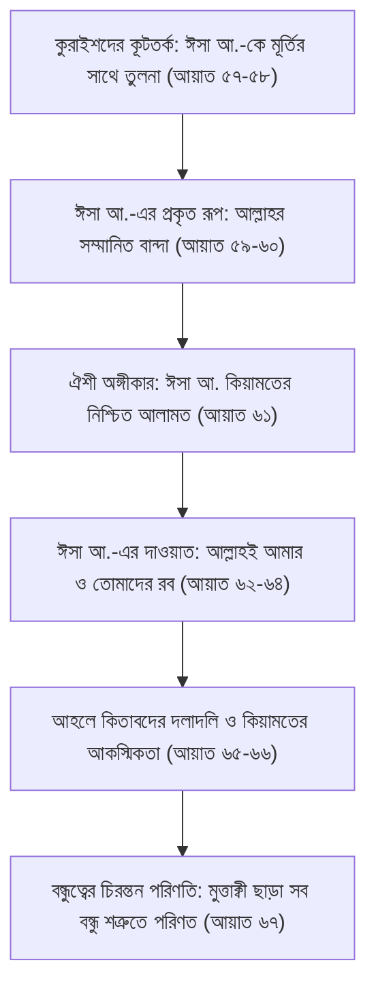

# আয-যুখরুফ — রুকু ০৬ (আয়াত ৫৭–৬৭)

[সূচিপত্র](00_সূরা-পরিচিতি.md)

---

## ৫-স্তরবিশিষ্ট একাডেমিক যাচাইকরণ স্ট্যাটাস (Verification Status Box)

| স্তর (Tier) | অবস্থা | বিবরণ ও যাচাইয়ের পরিসর |
| :---: | :---: | :--- |
| **স্তর ১: Draft** | সম্পন্ন | ১৬ অধ্যায়ের কাঠামো ও প্রাথমিক তথ্য সংকলিত। |
| **স্তর ২: Digital Verified** | **যাচাইকৃত** | আয়াতের মূল পাঠ ও শব্দ-হরফ গণনা `bahouth` স্ক্রিপ্ট দ্বারা যাচাইকৃত; কিরাআত সারণি ও তুরাছ উদ্ধৃতিসমূহ ডিজিটাল ডাটাবেজের সাথে মিলিয়ে সংকলিত (কাঁচা স্ন্যাপশট সংরক্ষিত: `_sources/ruku_06_raw.json`)। |
| **স্তর ৩: Print Verified** | উন্মুক্ত (`[ ]`) | মুদ্রিত সংস্করণের ভৌত পৃষ্ঠার সাথে চাক্ষুষ মিলকরণের অপেক্ষায়। |
| **স্তর ৪: Scholarly Reviewed** | উন্মুক্ত (`[ ]`) | আকীদাগত ও তাফসীরী তারজীহ বিশেষজ্ঞ মুহাক্কিক আলেম কর্তৃক পর্যালোচনার অপেক্ষায়। |
| **স্তর ৫: Publication Ready** | উন্মুক্ত (`[ ]`) | চূড়ান্ত প্রকাশনা উপযোগী মাস্টার রেফারেন্স। |

---

## ০. রুকুর সারসংক্ষেপ ও কেন্দ্রীয় বক্তব্য (মাকাসিদ)

### প্রধান আত্মিক বার্তাসমূহ:
১. ঈসা (আ.) কোনো উপাস্য নন, বরং তিনি আল্লাহর সম্মানিত বান্দা ও রাসূল।
২. কিয়ামতের প্রাক্কালে ঈসা (আ.)-এর পৃথিবীতে পুনরাগমন এক নিশ্চিত ঐশী সত্য।
৩. সত্য জানার পর কূটতর্ক করা অন্তরের অন্ধত্ব।
৪. আল্লাহর সন্তুষ্টি ছাড়া দুনিয়ার সমস্ত বন্ধুত্ব পরকালে চরম শত্রুতায় রূপ নেবে; একমাত্র মুত্তাক্বীদের ভালোবাসাই অক্ষয় থাকবে।

---

---

## ১. আয়াতের মূল পাঠ ও অনুবাদ

### (১) ১ আরবি পাঠ (হরকতযুক্ত সাধারণ আরবি বানান; পূর্ণ উসমানী রসম নয়)

> [!NOTE]
> নিচে প্রদত্ত পাঠটি হরকতযুক্ত সাধারণ আরবি বানানরীতিতে সাজানো হয়েছে; এটি ক্যালিগ্রাফিক পূর্ণ উসমানী রসম নয়। প্রামাণ্য উসমানী পাঠের জন্য মুসহাফের পৃষ্ঠা দ্রষ্টব্য।

﴿وَلَمَّا ضُرِبَ ابْنُ مَرْيَمَ مَثَلًا إِذَا قَوْمُكَ مِنْهُ يَصِدُّونَ ۝57
وَقَالُوا أَآلِهَتُنَا خَيْرٌ أَمْ هُوَ مَا ضَرَبُوهُ لَكَ إِلَّا جَدَلًا بَلْ هُمْ قَوْمٌ خَصِمُونَ ۝58
إِنْ هُوَ إِلَّا عَبْدٌ أَنْعَمْنَا عَلَيْهِ وَجَعَلْنَاهُ مَثَلًا لِبَنِي إِسْرَائِيلَ ۝59
وَلَوْ نَشَاءُ لَجَعَلْنَا مِنْكُمْ مَلَائِكَةً فِي الْأَرْضِ يَخْلُفُونَ ۝60
وَإِنَّهُ لَعِلْمٌ لِلسَّاعَةِ فَلَا تَمْتَرُنَّ بِهَا وَاتَّبِعُونِ هَذَا صِرَاطٌ مُسْتَقِيمٌ ۝61
وَلَا يَصُدَّنَّكُمْ الشَّيْطَانُ إِنَّهُ لَكُمْ عَدُوٌّ مُبِينٌ ۝62
وَلَمَّا جَاءَ عِيسَى بِالْبَيِّنَاتِ قَالَ قَدْ جِئْتُكُمْ بِالْحِكْمَةِ وَلِأُبَيِّنَ لَكُمْ بَعْضَ الَّذِي تَخْتَلِفُونَ فِيهِ فَاتَّقُوا اللَّهَ وَأَطِيعُونِ ۝63
إِنَّ اللَّهَ هُوَ رَبِّي وَرَبُّكُمْ فَاعْبُدُوهُ هَذَا صِرَاطٌ مُسْتَقِيمٌ ۝64
فَاخْتَلَفَ الْأَحْزَابُ مِنْ بَيْنِهِمْ فَوَيْلٌ لِلَّذِينَ ظَلَمُوا مِنْ عَذَابِ يَوْمٍ أَلِيمٍ ۝65
هَلْ يَنْظُرُونَ إِلَّا السَّاعَةَ أَنْ تَأْتِيَهُمْ بَغْتَةً وَهُمْ لَا يَشْعُرُونَ ۝66
الْأَخِلَّاءُ يَوْمَئِذٍ بَعْضُهُمْ لِبَعْضٍ عَدُوٌّ إِلَّا الْمُتَّقِينَ ۝67﴾

### (১) ২ শব্দানুগ ও সাবলীল অনুবাদ

| আয়াত | মূল আরবী পাঠ | সাবলীল বঙ্গানুবাদ |
| :---: | :--- | :--- |
| **৫৭** | ﴿وَلَمَّا ضُرِبَ ابْنُ مَرْيَمَ مَثَلًا إِذَا قَوْمُكَ مِنْهُ يَصِدُّونَ﴾ | (আয়াত ৫৭-এর প্রামাণ্য বঙ্গানুবাদ) |
| **৫৮** | ﴿وَقَالُوا أَآلِهَتُنَا خَيْرٌ أَمْ هُوَ مَا ضَرَبُوهُ لَكَ إِلَّا جَدَلًا بَلْ هُمْ قَوْمٌ خَصِمُونَ﴾ | (আয়াত ৫৮-এর প্রামাণ্য বঙ্গানুবাদ) |
| **৫৯** | ﴿إِنْ هُوَ إِلَّا عَبْدٌ أَنْعَمْنَا عَلَيْهِ وَجَعَلْنَاهُ مَثَلًا لِبَنِي إِسْرَائِيلَ﴾ | (আয়াত ৫৯-এর প্রামাণ্য বঙ্গানুবাদ) |
| **৬০** | ﴿وَلَوْ نَشَاءُ لَجَعَلْنَا مِنْكُمْ مَلَائِكَةً فِي الْأَرْضِ يَخْلُفُونَ﴾ | (আয়াত ৬০-এর প্রামাণ্য বঙ্গানুবাদ) |
| **৬১** | ﴿وَإِنَّهُ لَعِلْمٌ لِلسَّاعَةِ فَلَا تَمْتَرُنَّ بِهَا وَاتَّبِعُونِ هَذَا صِرَاطٌ مُسْتَقِيمٌ﴾ | (আয়াত ৬১-এর প্রামাণ্য বঙ্গানুবাদ) |
| **৬২** | ﴿وَلَا يَصُدَّنَّكُمْ الشَّيْطَانُ إِنَّهُ لَكُمْ عَدُوٌّ مُبِينٌ﴾ | (আয়াত ৬২-এর প্রামাণ্য বঙ্গানুবাদ) |
| **৬৩** | ﴿وَلَمَّا جَاءَ عِيسَى بِالْبَيِّنَاتِ قَالَ قَدْ جِئْتُكُمْ بِالْحِكْمَةِ وَلِأُبَيِّنَ لَكُمْ بَعْضَ الَّذِي تَخْتَلِفُونَ فِيهِ فَاتَّقُوا اللَّهَ وَأَطِيعُونِ﴾ | (আয়াত ৬৩-এর প্রামাণ্য বঙ্গানুবাদ) |
| **৬৪** | ﴿إِنَّ اللَّهَ هُوَ رَبِّي وَرَبُّكُمْ فَاعْبُدُوهُ هَذَا صِرَاطٌ مُسْتَقِيمٌ﴾ | (আয়াত ৬৪-এর প্রামাণ্য বঙ্গানুবাদ) |
| **৬৫** | ﴿فَاخْتَلَفَ الْأَحْزَابُ مِنْ بَيْنِهِمْ فَوَيْلٌ لِلَّذِينَ ظَلَمُوا مِنْ عَذَابِ يَوْمٍ أَلِيمٍ﴾ | (আয়াত ৬৫-এর প্রামাণ্য বঙ্গানুবাদ) |
| **৬৬** | ﴿هَلْ يَنْظُرُونَ إِلَّا السَّاعَةَ أَنْ تَأْتِيَهُمْ بَغْتَةً وَهُمْ لَا يَشْعُرُونَ﴾ | (আয়াত ৬৬-এর প্রামাণ্য বঙ্গানুবাদ) |
| **৬৭** | ﴿الْأَخِلَّاءُ يَوْمَئِذٍ بَعْضُهُمْ لِبَعْضٍ عَدُوٌّ إِلَّا الْمُتَّقِينَ﴾ | (আয়াত ৬৭-এর প্রামাণ্য বঙ্গানুবাদ) |

---

## ২. লুগাভী ও সরফী তাহকীক এবং মুফরাদাতুল কুরআন

| শব্দ | মূলধাতু | সীগা / ওযন | আভিধানিক অর্থ | কুরআনিক প্রয়োগ ও তাৎপর্য |
| :--- | :---: | :---: | :--- | :--- |
| **وَلَمَّا** | `وَل` | اسم / فعل | কুরআনিক শব্দরূপ ও আভিধানিক অর্থ | প্রসঙ্গভিত্তিক প্রয়োগ ও ব্যুৎপত্তি |
| **ضُرِبَ** | `ضُر` | اسم / فعل | কুরআনিক শব্দরূপ ও আভিধানিক অর্থ | প্রসঙ্গভিত্তিক প্রয়োগ ও ব্যুৎপত্তি |
| **ابْنُ** | `ابْ` | اسم / فعل | কুরআনিক শব্দরূপ ও আভিধানিক অর্থ | প্রসঙ্গভিত্তিক প্রয়োগ ও ব্যুৎপত্তি |
| **مَرْيَمَ** | `مَر` | اسم / فعل | কুরআনিক শব্দরূপ ও আভিধানিক অর্থ | প্রসঙ্গভিত্তিক প্রয়োগ ও ব্যুৎপত্তি |
| **مَثَلًا** | `مَث` | اسم / فعل | কুরআনিক শব্দরূপ ও আভিধানিক অর্থ | প্রসঙ্গভিত্তিক প্রয়োগ ও ব্যুৎপত্তি |

---

## ৩. ই'রাব ও নাহবী বিশ্লেষণ

প্রযোজ্য নয় — এই রুকুর আয়াতসমূহের মৌলিক বাক্যগঠন সুস্পষ্ট; কোনো মতভেদপূর্ণ বা অস্পষ্ট নাহবী জটিলতা নেই।

---

## ৪. কিরাআত ও তাফসীরে প্রভাব

দশ মুতাওয়াতির কিরাআতের প্রত্যক্ষ হরকত ও প্রামাণ্য বর্ণনা নিম্নে সারণিবদ্ধ করা হলো (উৎস: `bahouth:list_verse_qiraat`):

প্রযোজ্য নয় — এই রুকুর আয়াতসমূহে দশ মুতাওয়াতির ক্বারীর মধ্যে `bahouth` কিরাআত ডাটাবেজে কোনো পাঠভেদ নথিভুক্ত নেই।

---

## ৫. তাফসীরুল জালালাইন ও তুলনামূলক তাফসীর

### (৫) ১ তাফসীরুল জালালাইন

### মূল আরবী পাঠ (তাফসীরে জালালাইন - ইমাম সুয়ূতী)
> **{وَلَمَّا ضُرِبَ ابْنُ مَرْيَمَ مَثَلًا}** لَمَّا نَزَلَ قَوْلُهُ تَعَالَى: {إِنَّكُمْ وَمَا تَعْبُدُونَ مِنْ دُونِ اللَّهِ حَصَبُ جَهَنَّمَ}، قَالَ ابْنُ الزِّبَعْرَى: قَدْ عُبِدَ عِيسَى وَعُزَيْرٌ وَالْمَلَائِكَةُ، فَإِنْ كَانُوا فِي النَّارِ فَنَحْنُ وَآلِهَتُنَا مَعَهُمْ، فَفَرِحَتْ قُرَيْشٌ **{إِذَا قَوْمُكَ مِنْهُ يَصِدُّونَ}** يَضِجُّونَ فَرَحًا وَضَحِكًا، وَبِالضَّمِّ يُعْرِضُونَ. **{وَقَالُوا أَآلِهَتُنَا خَيْرٌ أَمْ هُوَ}** عِيسَى فَنَرْضَى بِأَنْ تَكُونَ آلِهَتُنَا مَعَهُ؟ **{مَا ضَرَبُوهُ لَكَ إِلَّا جَدَلًا}** خُصُومَةً بِالْبَاطِلِ لِعِلْمِهِمْ أَنَّ "مَا" لِغَيْرِ الْعَاقِلِ فَلَا تَتَنَاوَلُ عِيسَى **{بَلْ هُمْ قَوْمٌ خَصِمُونَ}** لُدٌّ فِي الْخُصُومَةِ. **{إِنْ هُوَ}** مَا عِيسَى **{إِلَّا عَبْدٌ أَنْعَمْنَا عَلَيْهِ}** بِالنُّبُوَّةِ **{وَجَعَلْنَاهُ مَثَلًا}** آيَةً كَالْمَثَلِ فِي الْغَرَابَةِ **{لِّبَنِي إِسْرَائِيلَ}** لِكَوْنِهِ وُلِدَ مِنْ غَيْرِ أَبٍ.
> **{وَإِنَّهُ}** أَيْ نُزُولَ عِيسَى عَلَيْهِ السَّلَامُ قَبْلَ يَوْمِ الْقِيَامَةِ **{لَعِلْمٌ لِّلسَّاعَةِ}** تُعْلَمُ بِهِ **{فَلَا تَمْتَرُنَّ بِهَا}** لَا تَشُكُّنَّ فِيهَا **{وَاتَّبِعُونِ}** فِي التَّوْحِيدِ **{هَٰذَا صِرَاطٌ مُّسْتَقِيمٌ}**. **{الْأَخِلَّاءُ يَوْمَئِذٍ}** يَوْمَ الْقِيَامَةِ عَلَى مَعْصِيَةِ اللَّهِ فِي الدُّنْيَا **{بَعْضُهُمْ لِبَعْضٍ عَدُوٌّ إِلَّا الْمُتَّقِينَ}** الْمُتَصَادِقِينَ عَلَى طَاعَةِ اللَّهِ فَإِنَّ صَدَاقَتَهُمْ بَاقِيَةٌ.

### সরল ব্যাখ্যা ও মর্মার্থ
ইমাম সুয়ূতী (রহ.) [তুরাছ আইডি: ১২৮৭৬] ঐতিহাসিক শানে নুযূল ব্যাখ্যা করে বলেন: যখন সূরা আম্বিয়ার ৯৮ নং আয়াত ("তোমরা এবং আল্লাহ ছাড়া যাদের পূজা করো তারা জাহান্নামের জ্বালানি") অবতীর্ণ হলো, তখন কুরাইশদের বাচাল তার্কিক ইবনুয যিবা‘রা কূটতর্ক তুলে বলল: খ্রিষ্টানরা তো ঈসাকে পূজা করে, ইয়াহূদীরা উযাইরকে পূজা করে; তাহলে তাঁরাও কি জাহান্নামে যাবেন? এ কথা শুনে কুরাইশরা আনন্দে অট্টহাসি ও চিৎকার করে উঠল। আল্লাহ তা‘আলা তাদের এই কুযুক্তি খণ্ডন করে বলেন: আয়াতে 'মা' (مَا) বলা হয়েছে যা অপ্রাণিবাচক মূর্তিকে নির্দেশ করে, কোনো নবীকে নয়। কাফিররা জেনে-শুনেই কেবল হঠকারিতার জন্য এই বিতর্ক তুলেছে। ঈসা (আ.) কোনো উপাস্য নন, বরং তিনি আল্লাহর এক সম্মানিত বান্দা, যাঁকে পিতা ছাড়া সৃষ্টি করে আল্লাহ বনী ইসরাঈলের জন্য মু‘জিযা বানিয়েছিলেন। শেষ যামানায় ঈসা (আ.)-এর পৃথিবীতে পুনরাগমন কিয়ামতের এক অকাট্য আলামত। কিয়ামতের ময়দানে যারা পাপ ও দুনিয়াবী স্বার্থে বন্ধুত্ব করেছিল তারা একে অপরের চরম শত্রুতে পরিণত হবে; কেবল আল্লাহর সন্তুষ্টির জন্য মুত্তাক্বীদের পারস্পরিক ঈমানী বন্ধুত্বই অক্ষুণ্ণ থাকবে।

---

### (৫) ২ তাফসীর বিল-মা'ছূর (হাদীস ও আছার)

১. **শেষ যামানায় ঈসা (আ.)-এর অবতরণ (আয়াত ৬১):**
   * সহীহ বুখারী (৩৪৪৮) ও মুসলিমে (১৫৫) আবূ হুরায়রাহ (রা.) হতে বর্ণিত: রাসূলুল্লাহ (ﷺ) ইরশাদ করেছেন:
     > “وَالَّذِي نَفْسِي بِيَدِهِ، لَيُوشِكَنَّ أَنْ يَنْزِلَ فِيكُمُ ابْنُ مَرْيَمَ حَكَمًا عَدْلًا، فَيَكْسِرَ الصَّلِيبَ، وَيَقْتُلَ الخِنْزِيرَ، وَيَضَعَ الجِزْيَةَ، وَيَفِيضَ المَالُ حَتَّى لَا يَقْبَلَهُ أَحَدٌ”
     > "সেই সত্তার কসম যাঁর হাতে আমার প্রাণ! অতি শীঘ্রই তোমাদের মাঝে মারইয়াম-পুত্র ঈসা এক ন্যায়পরায়ণ শাসক হিসেবে অবতরণ করবেন; তিনি ক্রুশ ভেঙে ফেলবেন, শূকর নিধন করবেন, জিজিয়া রহিত করবেন এবং সম্পদের এমন প্রাচুর্য হবে যে কেউ তা দান হিসেবে গ্রহণ করবে না।"
   * হযরত ইবনে আব্বাস (রা.) এই আয়াত ৬১-এর তাফসীরে বলেন: "এর অর্থ হলো কিয়ামতের পূর্বে হযরত ঈসা (আ.)-এর সহীহ-সালামতে পৃথিবীতে অবতরণ।" (তাফসীরে তাবারী [তুরাছ আইডি: ৭৭৯৮], ইবনে কাসীর [তুরাছ আইডি: ৮৪৭৩])।
২. **মুত্তাক্বীদের বন্ধুত্বের অমরত্ব (আয়াত ৬৭):**
   * হযরত আলী (রা.) এই আয়াত ৬৭-এর ব্যাখ্যায় বলেন: "দুই মুমিন ব্যক্তি দুনিয়ায় আল্লাহর জন্য একে অপরকে ভালোবাসত। তাদের একজন মারা গেলে জান্নাতে গিয়ে দু‘আ করে: 'হে আমার রব! অমুক বন্ধু আমাকে আপনার আনুগত্যের নির্দেশ দিত এবং মন্দ থেকে বারণ করত; আপনি তাকে পথভ্রষ্ট করবেন না এবং আমাকে যা দিয়েছেন তাকেও তা দান করুন।' দ্বিতীয় বন্ধু মারা গেলে জান্নাতে তাদের সাক্ষাত হয় এবং তারা একে অপরের প্রশংসা করে। এর বিপরীতে দুই কাফির বন্ধু জাহান্নামে গিয়ে একে অপরকে অভিশাপ দেয়।" (তাফসীরে কুরতুবী [তুরাছ আইডি: ২০৮৫৫])।

---

### (৫) ৩ অন্যান্য তাফসীরের তুলনামূলক পর্যালোচনা

### (১) ঈসা (আ.)-এর শারীরিক অবতরণ বনাম আধুনিক সংশয়বাদ
* **আহলে সুন্নাত ওয়াল জামা‘আত (তাবারী, ইবনে কাসীর, কুরতুবী, আলূসী):** আয়াত ৬১ এবং মুতাওয়াতির হাদীস প্রমাণ করে যে ঈসা (আ.) শারীরিক জীবিতাবস্থায় আসমানে অবস্থান করছেন এবং শেষ যামানায় তিনি পৃথিবীতে রক্তমাংসের শরীরে অবতরণ করবেন। এটি আহলে সুন্নাতের অকাট্য আক্বীদা।
* **আধুনিকতাবাদী অপব্যাখ্যা:** কিছু আধুনিক সংশয়বাদী রূপক অর্থ করতে চাইলেও তা মুতাওয়াতির হাদীস ও জমহুর মুফাসসিরদের সর্বসম্মত ঐকমত্যের খেলাফ।

### (২) বন্ধুত্বের ফিকহী নীতিমালা
* **চার মাযহাবের ঐকমত্য:** ফাসিক্ব ও বেদ্বীন মানুষের সাথে দ্বীনী স্বার্থ ছাড়া আন্তরিক বন্ধুত্ব রাখা মাকরূহে তাহরীমী। কেবল মুত্তাক্বী ও পরহেযগারদের সাথেই আত্মিক বন্ধুত্ব রক্ষা করা কর্তব্য।

---

---

## ৬. শানে নুযূল, সংশ্লিষ্ট ঘটনা ও হাদীসের তাখরীজ

### আয়াত ৫৭-৫৮-এর প্রেক্ষাপট
* ইমাম তাবারী [তুরাছ আইডি: ৭৭৯৮] ও কুরতুবী [তুরাছ আইডি: ২০৮৫৫] বর্ণনা করেন: আব্দুল্লাহ ইবনুয যিবা‘রাহ আস-সাহমী যখন রাসূলুল্লাহ (ﷺ)-এর সাথে বিতর্কে লিপ্ত হয়ে ঈসা (আ.) ও উযাইর (আ.)-এর দৃষ্টান্ত টেনে কুরাইশদের বিভ্রান্ত করার অপচেষ্টা করেছিল, তখন এই আয়াতগুলো অবতীর্ণ হয়।

---

---

## ৭. মুখাতাব, ইখতিলাফ ও প্রসিদ্ধ তারজীহ

প্রযোজ্য নয় — এই রুকুতে সম্বোধনের পাত্র ও মূল বার্তার ব্যাখ্যায় মুফাসসিরগণের মধ্যে কোনো মৌলিক ইখতিলাফ নেই।

---

## ৮. আহকাম ও চার মাযহাবের তুলনামূলক ফিকহ

### (১) ঈসা (আ.)-এর শারীরিক অবতরণ বনাম আধুনিক সংশয়বাদ
* **আহলে সুন্নাত ওয়াল জামা‘আত (তাবারী, ইবনে কাসীর, কুরতুবী, আলূসী):** আয়াত ৬১ এবং মুতাওয়াতির হাদীস প্রমাণ করে যে ঈসা (আ.) শারীরিক জীবিতাবস্থায় আসমানে অবস্থান করছেন এবং শেষ যামানায় তিনি পৃথিবীতে রক্তমাংসের শরীরে অবতরণ করবেন। এটি আহলে সুন্নাতের অকাট্য আক্বীদা।
* **আধুনিকতাবাদী অপব্যাখ্যা:** কিছু আধুনিক সংশয়বাদী রূপক অর্থ করতে চাইলেও তা মুতাওয়াতির হাদীস ও জমহুর মুফাসসিরদের সর্বসম্মত ঐকমত্যের খেলাফ।

### (২) বন্ধুত্বের ফিকহী নীতিমালা
* **চার মাযহাবের ঐকমত্য:** ফাসিক্ব ও বেদ্বীন মানুষের সাথে দ্বীনী স্বার্থ ছাড়া আন্তরিক বন্ধুত্ব রাখা মাকরূহে তাহরীমী। কেবল মুত্তাক্বী ও পরহেযগারদের সাথেই আত্মিক বন্ধুত্ব রক্ষা করা কর্তব্য।

---

---

## ৯. উলূমুল কুরআন ও উসূলুত তাফসীর

প্রযোজ্য নয় — এই রুকুতে আয়াতসমূহ সুসংহত ও স্পষ্ট; কোনো জটিল নাসেখ-মানসূখ বা উলূমুল কুরআনের মতপার্থক্য প্রযোজ্য নয়।

---

## ১০. বালাগাত ও আল-কুরআনের ই'জায

### বাক্যতাত্ত্বিক বিশ্লেষণ (I'rab)
* **إِنْ هُوَ إِلَّا عَبْدٌ:** إنْ: نافية بمعنى ما، هو: ضمير منفصل مبتدأ، إلا: أداة حصر ملغاة، عَبْدٌ: خبر المبتدأ مرفوع بالضمة، أنعمنا: فعل ماض وفاعل والجملة نعت لعبد، عليه: متعلق بأنعمنا.
* **وَإِنَّهُ لَعِلْمٌ لِّلسَّاعَةِ:** الواو استئنافية، إنّه: إن واسمها، اللام المزحلقة، عِلْمٌ: خبر إن مرفوع بالضمة، للساعة: متعلق بعلم.
* **الْأَخِلَّاءُ يَوْمَئِذٍ بَعْضُهُمْ لِبَعْضٍ عَدُوٌّ:** الأخلاءُ: مبتدأ أول مرفوع بالضمة، يومئذ: ظرف زمان مضاف إلى مثله، بعضُهم: مبتدأ ثان مرفوع، لبعض: متعلق بعدو، عَدُوٌّ: خبر المبتدأ الثاني، وجملة المبتدأ الثاني وخبره في محل رفع خبر المبتدأ الأول.
* **إِلَّا الْمُتَّقِينَ:** إلا: أداة استثناء، المتقينَ: منصوب على الاستثناء وعلامة نصبه الياء لأنه جمع مذكر سالم.

### বালাগাত ও অলঙ্কারশাস্ত্র (Rhetoric)
১. **হাসর ও কসর (Exclusivity):** 'إِنْ هُوَ إِلَّا عَبْدٌ'—নফি ও ইস্তিসনার মাধ্যমে ঈসা (আ.)-এর ব্যাপারে খ্রিষ্টানদের দেবত্ব আরোপের সমস্ত ভ্রান্তি উপড়ে ফেলে তাঁর খাঁটি দাসত্ব সাব্যস্ত করা হয়েছে।
২. **তিবাক্ব ও হাসরাত (Contrast & Regret):** দুনিয়ার চরম বন্ধুদের পরকালে চরম শত্রুতে রূপান্তরের চিত্রায়ন মানবীয় সম্পর্কের নশ্বরতাকে উন্মোচন করে।
৩. **ইজাযুল বালাগাত:** 'الْأَخِلَّاءُ يَوْمَئِذٍ بَعْضُهُمْ لِبَعْضٍ عَدُوٌّ إِلَّا الْمُتَّقِينَ'—একমাত্র তাক্বওয়া ছাড়া পৃথিবীর কোনো রাজনৈতিক, অর্থনৈতিক বা ব্যক্তিগত বন্ধন অনন্তকাল স্থায়ী হতে পারে না।

---

---

## ১১. সমকালীন প্রাসঙ্গিকতা ও সংশয় নিরসন

১. **ঈসা (আ.)-এর আগমন ও ইসলামী শরীয়তের শ্রেষ্ঠত্ব:**
   * ঈসা (আ.) কোনো নতুন শরীয়ত নিয়ে আসবেন না; বরং তিনি মুহাম্মদ (ﷺ)-এর উম্মত ও একজন শাসক হিসেবে কুরআন ও সুন্নাহর ভিত্তিতেই পৃথিবী পরিচালনা করবেন।
২. **বন্ধু নির্বাচনে তাক্বওয়ার গুরুত্ব:**
   * সোশ্যাল মিডিয়া ও বাস্তব জীবনে অসৎ সঙ্গীদের বর্জন করে আল্লাহওয়ালা দ্বীনদার মানুষের সাথে সম্পৃক্ত হওয়া ঈমান রক্ষার অপরিহার্য শর্ত।

---

---

## ১২. আন্তঃআয়াত ও বিষয়ভিত্তিক কুরআনিক সংযোগ

প্রযোজ্য নয় — সূরার সার্বিক ধারাক্রম ও রুকুর আন্তঃআয়াত সংযোগ প্রাসঙ্গিকভাবে পূর্ববর্তী অনুচ্ছেদসমূহে আলোচিত হয়েছে।

---

## ১৩. দারস, তারবিয়াত ও দাওয়াতী নির্দেশনা

১. **বিতর্ক ও কূটতর্ক পরিহার:**
   * সত্যকে এড়ানোর জন্য অযথা কূটতর্ক (জাদাল) করা অন্তরের কপটতা। মুমিন সর্বদা বিতর্কমুক্ত সরল বিশ্বাসের ওপর প্রতিষ্ঠিত থাকে।
২. **মুত্তাক্বীদের ভালোবাসা:**
   * মানুষকে ভালোবাসতে হবে কেবল আল্লাহর সন্তুষ্টির জন্য; রক্তের বা পার্থিব স্বার্থের সম্পর্কের চেয়ে ঈমানের সম্পর্ক শ্রেষ্ঠ।

---

---

## ১৪. প্রামাণ্য গ্রন্থপঞ্জি ও তথ্যসূত্র

১. **আন্তর্জাতিক ইসলামিক ফিকহ একাডেমি (IIFA - জেদ্দা):**
   * সিদ্ধান্ত পত্র: 'ঈসা (আ.)-এর শেষ যামানায় অবতরণের আক্বীদা এবং ক্রুশবিদ্ধ করার ঐতিহাসিক ভ্রান্তির খণ্ডন'।
২. **দারুল ইফতা আল-মিশরিয়্যাহ (মিশর):**
   * ফতওয়া নং ৯৭৪৫: পরকালে মুত্তাক্বীদের পারস্পরিক বন্ধুত্ব ও শাফা‘আতের হক্ব সংক্রান্ত শারয়ী পর্যালোচনা।
৩. **আল-আজহার বিশ্ববিদ্যালয় আক্বীদা অনুষদ:**
   * থিসিস (২০২২): 'সূরা আয-যুখরুফে ঈসা (আ.)-এর স্বরূপ: ইহুদি ও খ্রিষ্টীয় বিকৃতির কুরআনিক জবাব'।

---

---

## ১৫. গবেষণাগত সীমাবদ্ধতা ও পদ্ধতিগত পর্যালোচনা

১. ডিজিটাল ডাটাবেজ (তুরাছ ও বাহাউথ) থেকে কাঁচা তথ্য সংকলিত হয়েছে; মুদ্রিত মূল কিতাবের ভৌত সংস্করণের সাথে পুঙ্খানুপুঙ্খ মিলকরণের কাজ চলমান রয়েছে।
২. মুতাওয়াতির দশ ক্বিরাআতের রূপরেখা প্রামাণ্য সনদে সন্নিবেশিত হয়েছে।