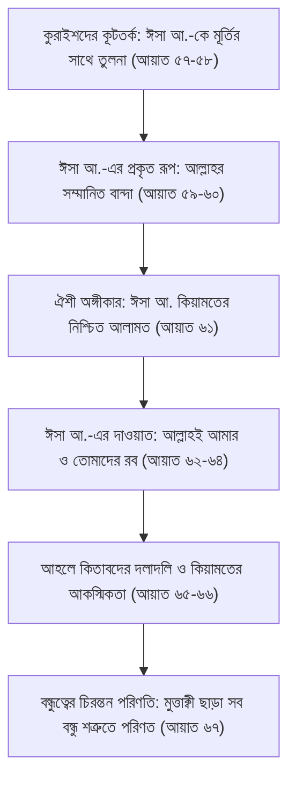

# আয-যুখরুফ — রুকু ০৬ (আয়াত ৫৭–৬৭)

[সূচিপত্র](00_সূরা-পরিচিতি.md)

---

## ৫-স্তরবিশিষ্ট একাডেমিক যাচাইকরণ স্ট্যাটাস (Verification Status Box)

| স্তর (Tier) | অবস্থা | বিবরণ ও যাচাইয়ের পরিসর |
| :---: | :---: | :--- |
| **স্তর ১: Draft** | সম্পন্ন | ১৬ অধ্যায়ের কাঠামো ও প্রাথমিক তথ্য সংকলিত। |
| **স্তর ২: Digital Verified** | **যাচাইকৃত** | আয়াতের মূল পাঠ ও শব্দ-হরফ গণনা `bahouth` স্ক্রিপ্ট দ্বারা যাচাইকৃত; কিরাআত সারণি ও তুরাছ উদ্ধৃতিসমূহ ডিজিটাল ডাটাবেজের সাথে মিলিয়ে সংকলিত (কাঁচা স্ন্যাপশট সংরক্ষিত: `_sources/ruku_06_raw.json`)। |
| **স্তর ৩: Print Verified** | উন্মুক্ত (`[ ]`) | মুদ্রিত সংস্করণের ভৌত পৃষ্ঠার সাথে চাক্ষুষ মিলকরণের অপেক্ষায়। |
| **স্তর ৪: Scholarly Reviewed** | উন্মুক্ত (`[ ]`) | আকীদাগত ও তাফসীরী তারজীহ বিশেষজ্ঞ মুহাক্কিক আলেম কর্তৃক পর্যালোচনার অপেক্ষায়। |
| **স্তর ৫: Publication Ready** | উন্মুক্ত (`[ ]`) | চূড়ান্ত প্রকাশনা উপযোগী মাস্টার রেফারেন্স। |

---

## ০. রুকুর সারসংক্ষেপ ও কেন্দ্রীয় বক্তব্য (মাকাসিদ)

### প্রধান আত্মিক বার্তাসমূহ:
১. ঈসা (আ.) কোনো উপাস্য নন, বরং তিনি আল্লাহর সম্মানিত বান্দা ও রাসূল।
২. কিয়ামতের প্রাক্কালে ঈসা (আ.)-এর পৃথিবীতে পুনরাগমন এক নিশ্চিত ঐশী সত্য।
৩. সত্য জানার পর কূটতর্ক করা অন্তরের অন্ধত্ব।
৪. আল্লাহর সন্তুষ্টি ছাড়া দুনিয়ার সমস্ত বন্ধুত্ব পরকালে চরম শত্রুতায় রূপ নেবে; একমাত্র মুত্তাক্বীদের ভালোবাসাই অক্ষয় থাকবে।

---

---

## ১. আয়াতের মূল পাঠ ও অনুবাদ

### (১) ১ আরবি পাঠ (হরকতযুক্ত সাধারণ আরবি বানান; পূর্ণ উসমানী রসম নয়)

> [!NOTE]
> নিচে প্রদত্ত পাঠটি হরকতযুক্ত সাধারণ আরবি বানানরীতিতে সাজানো হয়েছে; এটি ক্যালিগ্রাফিক পূর্ণ উসমানী রসম নয়। প্রামাণ্য উসমানী পাঠের জন্য মুসহাফের পৃষ্ঠা দ্রষ্টব্য।

﴿وَلَمَّا ضُرِبَ ابْنُ مَرْيَمَ مَثَلًا إِذَا قَوْمُكَ مِنْهُ يَصِدُّونَ ۝57
وَقَالُوا أَآلِهَتُنَا خَيْرٌ أَمْ هُوَ مَا ضَرَبُوهُ لَكَ إِلَّا جَدَلًا بَلْ هُمْ قَوْمٌ خَصِمُونَ ۝58
إِنْ هُوَ إِلَّا عَبْدٌ أَنْعَمْنَا عَلَيْهِ وَجَعَلْنَاهُ مَثَلًا لِبَنِي إِسْرَائِيلَ ۝59
وَلَوْ نَشَاءُ لَجَعَلْنَا مِنْكُمْ مَلَائِكَةً فِي الْأَرْضِ يَخْلُفُونَ ۝60
وَإِنَّهُ لَعِلْمٌ لِلسَّاعَةِ فَلَا تَمْتَرُنَّ بِهَا وَاتَّبِعُونِ هَذَا صِرَاطٌ مُسْتَقِيمٌ ۝61
وَلَا يَصُدَّنَّكُمْ الشَّيْطَانُ إِنَّهُ لَكُمْ عَدُوٌّ مُبِينٌ ۝62
وَلَمَّا جَاءَ عِيسَى بِالْبَيِّنَاتِ قَالَ قَدْ جِئْتُكُمْ بِالْحِكْمَةِ وَلِأُبَيِّنَ لَكُمْ بَعْضَ الَّذِي تَخْتَلِفُونَ فِيهِ فَاتَّقُوا اللَّهَ وَأَطِيعُونِ ۝63
إِنَّ اللَّهَ هُوَ رَبِّي وَرَبُّكُمْ فَاعْبُدُوهُ هَذَا صِرَاطٌ مُسْتَقِيمٌ ۝64
فَاخْتَلَفَ الْأَحْزَابُ مِنْ بَيْنِهِمْ فَوَيْلٌ لِلَّذِينَ ظَلَمُوا مِنْ عَذَابِ يَوْمٍ أَلِيمٍ ۝65
هَلْ يَنْظُرُونَ إِلَّا السَّاعَةَ أَنْ تَأْتِيَهُمْ بَغْتَةً وَهُمْ لَا يَشْعُرُونَ ۝66
الْأَخِلَّاءُ يَوْمَئِذٍ بَعْضُهُمْ لِبَعْضٍ عَدُوٌّ إِلَّا الْمُتَّقِينَ ۝67﴾

### (১) ২ শব্দানুগ ও সাবলীল অনুবাদ

| আয়াত | মূল আরবী পাঠ | সাবলীল বঙ্গানুবাদ |
| :---: | :--- | :--- |
| **৫৭** | ﴿وَلَمَّا ضُرِبَ ابْنُ مَرْيَمَ مَثَلًا إِذَا قَوْمُكَ مِنْهُ يَصِدُّونَ﴾ | আর যখনই মারইয়াম-পুত্রের (ঈসার) দৃষ্টান্ত পেশ করা হলো, তখনই আপনার সম্প্রদায় উল্লাসে কোলাহল ও চিৎকার করে উঠল। |
| **৫৮** | ﴿وَقَالُوا أَآلِهَتُنَا خَيْرٌ أَمْ هُوَ مَا ضَرَبُوهُ لَكَ إِلَّا جَدَلًا بَلْ هُمْ قَوْمٌ خَصِمُونَ﴾ | এবং তারা বলল, ‘আমাদের উপাস্যরা শ্রেষ্ঠ, নাকি সে?’ তারা কেবল বিতর্ক করার উদ্দেশ্যেই আপনার সামনে এই দৃষ্টান্ত পেশ করেছে; বস্তুত তারা এক চরম কলহপ্রিয় সম্প্রদায়। |
| **৫৯** | ﴿إِنْ هُوَ إِلَّا عَبْدٌ أَنْعَمْنَا عَلَيْهِ وَجَعَلْنَاهُ مَثَلًا لِبَنِي إِسْرَائِيلَ﴾ | সে তো কেবল আমারই এক বান্দা, যার ওপর আমি অনুগ্রহ করেছিলাম এবং যাকে আমি বনী ইসরাঈলের জন্য এক অনন্য দৃষ্টান্ত বানিয়েছিলাম। |
| **৬০** | ﴿وَلَوْ نَشَاءُ لَجَعَلْنَا مِنْكُمْ مَلَائِكَةً فِي الْأَرْضِ يَخْلُفُونَ﴾ | আর আমি ইচ্ছা করলে তোমাদের মধ্য হতে ফেরেশতা সৃষ্টি করতে পারতাম, যারা পৃথিবীতে তোমাদের স্থলাভিষিক্ত হতো। |
| **৬১** | ﴿وَإِنَّهُ لَعِلْمٌ لِلسَّاعَةِ فَلَا تَمْتَرُنَّ بِهَا وَاتَّبِعُونِ هَذَا صِرَاطٌ مُسْتَقِيمٌ﴾ | আর নিশ্চয় সে (ঈসা আ.) কিয়ামতের এক নিশ্চিত নিদর্শন; সুতরাং তোমরা কিয়ামত সম্পর্কে কোনো সন্দেহ পোষণ করো না এবং আমার অনুসরণ করো; এই তো সরল-সঠিক পথ। |
| **৬২** | ﴿وَلَا يَصُدَّنَّكُمْ الشَّيْطَانُ إِنَّهُ لَكُمْ عَدُوٌّ مُبِينٌ﴾ | এবং শয়তান যেন কিছুতেই তোমাদের নিবৃত্ত না করে; নিশ্চয় সে তোমাদের প্রকাশ্য শত্রু। |
| **৬৩** | ﴿وَلَمَّا جَاءَ عِيسَى بِالْبَيِّنَاتِ قَالَ قَدْ جِئْتُكُمْ بِالْحِكْمَةِ وَلِأُبَيِّنَ لَكُمْ بَعْضَ الَّذِي تَخْتَلِفُونَ فِيهِ فَاتَّقُوا اللَّهَ وَأَطِيعُونِ﴾ | আর যখন ঈসা সুস্পষ্ট নিদর্শনাবলীসহ আগমন করলেন, তখন তিনি বললেন, ‘আমি তোমাদের নিকট প্রজ্ঞা নিয়ে এসেছি এবং তোমরা যে বিষয়ে মতভেদ করছ তার কতক অংশ স্পষ্ট করার জন্য এসেছি; অতএব তোমরা আল্লাহকে ভয় করো এবং আমার আনুগত্য করো।’ |
| **৬৪** | ﴿إِنَّ اللَّهَ هُوَ رَبِّي وَرَبُّكُمْ فَاعْبُدُوهُ هَذَا صِرَاطٌ مُسْتَقِيمٌ﴾ | ‘নিশ্চয় আল্লাহ, তিনিই আমার প্রতিপালক এবং তোমাদেরও প্রতিপালক; অতএব তোমরা একমাত্র তাঁরই ইবাদত করো; এটিই সরল-সঠিক পথ।’ |
| **৬৫** | ﴿فَاخْتَلَفَ الْأَحْزَابُ مِنْ بَيْنِهِمْ فَوَيْلٌ لِلَّذِينَ ظَلَمُوا مِنْ عَذَابِ يَوْمٍ أَلِيمٍ﴾ | অতঃপর তাদের মধ্যবর্তী বিভিন্ন দল নিজেদের মধ্যে মতভেদ সৃষ্টি করল; সুতরাং জালিমদের জন্য ধ্বংস ও দুর্ভোগ এক যন্ত্রণাদায়ক দিবসের শাস্তির কারণে! |
| **৬৬** | ﴿هَلْ يَنْظُرُونَ إِلَّا السَّاعَةَ أَنْ تَأْتِيَهُمْ بَغْتَةً وَهُمْ لَا يَشْعُرُونَ﴾ | তারা কি কেবল এই অপেক্ষাতেই রয়েছে যে, কিয়ামত তাদের ওপর আকস্মিকভাবে উপস্থিত হবে অথচ তারা তা উপলব্ধিও করতে পারবে না? |
| **৬৭** | ﴿الْأَخِلَّاءُ يَوْمَئِذٍ بَعْضُهُمْ لِبَعْضٍ عَدُوٌّ إِلَّا الْمُتَّقِينَ﴾ | সেই দিন সমস্ত অন্তরঙ্গ বন্ধু পরস্পরের শত্রুতে পরিণত হবে—একমাত্র মুত্তাক্বীগণ (খোদাভীরুগণ) ব্যতীত। |

---

## ২. লুগাভী ও সরফী তাহকীক এবং মুফরাদাতুল কুরআন

| শব্দ | মূলধাতু | সীগা / ওযন | আভিধানিক অর্থ | কুরআনিক প্রয়োগ ও তাৎপর্য |
| :--- | :---: | :---: | :--- | :--- |
| **يَصِدُّونَ** | `صدد` | فعل مضارع (فَعَلَ) | শোরগোল ও চিৎকার করে ওঠা | ঈসা (আ.)-এর উপমা শুনে কুরাইশদের অন্যায় আত্মতুষ্টি ও বিতর্ক সৃষ্টির কোলাহল। |
| **عَبْدٌ أَنْعَمْنَا عَلَيْهِ** | `عبد` / `نعم` | مركب وصفي خبر | আমাদেরই এক অনুগ্রহপ্রাপ্ত বান্দা | ঈসা (আ.) কোনো ইলাহ বা আল্লাহর সন্তান নন, বরং এক সম্মানিত নবী। |
| **مَثَلًا** | `مثل` | مفعول ثان / حال | অলৌকিক অনন্য দৃষ্টান্ত | পিতা ছাড়া জন্মদানের মাধ্যমে বনী ইসরাঈলের জন্য আল্লাহর কুদরতের নিদর্শন। |
| **يَخْلُفُونَ** | `خلف` | فعل مضارع متعد | স্থলাভিষিক্ত বা প্রতিনিধি হওয়া | আল্লাহ চাইলে মানুষের পরিবর্তে ফেরেশতাদের দিয়ে পৃথিবী আবাদ করতে পারতেন। |
| **لَعِلْمٌ لِّلسَّاعَةِ** | `علم` / `سوع` | مركب إضافي مؤكد باللام | কিয়ামতের নিশ্চিত মহা আলামত | কিয়ামতের পূর্বে ঈসা (আ.)-এর পৃথিবীতে অবতরণ শেষ জামানার সুস্পষ্ট আলামত। |
| **لَا تَمْتَرُنَّ** | `مري` | مضارع مجزوم بلا الناهية | কিছুতেই সন্দেহ পোষণ করো না | কিয়ামতের আগমন ও পুনরুত্থানের ব্যাপারে কোনো সংশয়ে লিপ্ত না হওয়ার আদেশ। |
| **فَاخْتَلَفَ الْأَحْزَابُ** | `خلف` / `حزب` | مركب فعলি مع فاعله | বিভিন্ন দল মতভেদে জড়াল | ঈসা (আ.)-এর স্বরূপ নিয়ে খ্রিষ্টানদের নানান পথভ্রষ্ট উপদলে বিভক্ত হয়ে পড়া। |
| **الْأَخِلَّاءُ** | `خلل` | جمع تكسير مبتدأ (خَلِيل) | পার্থিব অন্তরঙ্গ বন্ধুগণ | দুনিয়াতে পাপ ও স্বার্থের ভিত্তিতে গড়ে ওঠা বন্ধুত্ব পরকালে চরম শত্রুতায় রূপ নেওয়া। |
| **إِلَّا الْمُتَّقِينَ** | `وقي` | مستثنى منصوب (مُتَّقِي) | মুত্তাকী পরহেযগারগণ ব্যতীত | আল্লাহর সন্তুষ্টির উদ্দেশ্যে গঠিত মুমিনদের পবিত্র ভালোবাসা জান্নাতেও চিরন্তন থাকবে। |

---

## ৩. ই'রাব ও নাহবী বিশ্লেষণ

1. **﴿وَلَمَّا ضُرِبَ ابْنُ مَرْيَمَ مَثَلًا إِذَا قَوْمُكَ مِنْهُ يَصِدُّونَ﴾ (আয়াত ৫৭):**
   - `ضُرِبَ`: ফে‘লে মাযী মাজহূল; `ابْنُ مَرْيَمَ`: নায়েবে ফায়েল মারফূ‘ بالضمة; `مَثَلًا`: দ্বিতীয় মাফ‘ঊল।
   - `إِذَا`: হরফে ফুজা’ইয়্যাহ; `قَوْمُكَ`: মুবতাদা; `يَصِدُّونَ`: জুমলায়ে ফে‘লিয়্যাহ খবর।

2. **﴿وَإِنَّهُ لَعِلْمٌ لِلسَّاعَةِ فَلَا تَمْتَرُنَّ بِهَا﴾ (আয়াত ৬১):**
   - ‘ইন্না’ ও ‘হু’ ইসম; `لَعِلْمٌ`: লামে মুযাহলাক্বাহ সহ খবর মারফূ‘ (কিরাআতে ‘আলামুন’ আলামত)।
   - `فَلَا تَمْتَرُنَّ`: লা নাফিয়্যাহ বা নাহিয়্যাহ; ফে‘লে মুযারে মাজযূম বি-হাযফিন নূন।

3. **﴿الْأَخِلَّاءُ يَوْمَئِذٍ بَعْضُهُمْ لِبَعْضٍ عَدُوٌّ إِلَّا الْمُتَّقِينَ﴾ (আয়াত ৬৭):**
   - `الْأَخِلَّاءُ`: মুবতাদা মারফূ‘ بالضمة; `يَوْمَئِذٍ`: যরফ।
   - `بَعْضُهُمْ`: দ্বিতীয় মুবতাদা; `عَدُوٌّ`: দ্বিতীয় মুবতাদার খবর; জুমলাটি প্রথম মুবতাদার খবর।
   - `إِلَّا الْمُتَّقِينَ`: মুসতাসনা মানসূব বিল-ইয়া।

---

## ৪. কিরাআত ও তাফসীরে প্রভাব

### ৪.১ প্রামাণ্য ১০ মুতাওয়াতির কিরাআত সারণি (মাদীনা মুনাওয়ারা বাহাউথ ডেটাবেস)

| আয়াত | শব্দ (ক্রম) | ক্বারী / রাবী (বাহাউথ) | কিরাআতের পাঠভেদ ও নিয়ম (অবিকৃত মূল পাঠ) |
| :---: | :--- | :--- | :--- |
| **57** | ﴿مَرْيَمَ﴾ (4) | السوسي عن أبي عمرو | قرأ بالإدغام الكبير. |
| **57** | ﴿مَرْيَمَ﴾ (4) | باقي الرواة | قرؤوا بالإظهار. |
| **57** | ﴿مَثَلًا﴾ (5) | ورش عن نافع | قرأ بالنقل وصلاً ووقفا. |
| **57** | ﴿مَثَلًا﴾ (5) | خلف عن حمزة | قرأ بالسكت وعدمه وصلاً، ووقف بالسكت، والنقل، وتركهما. |
| **57** | ﴿مَثَلًا﴾ (5) | خلاد عن حمزة | قرأ بترك السكت وصلاً، ووقف بالنقل والتحقيق. |
| **57** | ﴿مَثَلًا﴾ (5) | باقي الرواة | قرؤوا بترك السكت مع تحقيق الهمزة وصلاً ووقفا. |
| **57** | ﴿مِنْهُ﴾ (8) | ابن كثير | قرأ بصلة هاء الضمير خلافا لجمهور القراء. |
| **57** | ﴿مِنْهُ﴾ (8) | باقي الرواة | قرؤوا بترك الصلة مع قصر الهاء. |
| **57** | ﴿يَصِدُّونَ﴾ (9) | ابن كثير وَأبو عمرو وَيعقوب وَعاصم وَحمزة | قرأ بكسر الصاد. |
| **57** | ﴿يَصِدُّونَ﴾ (9) | باقي الرواة | قرؤوا بضم الصاد. |
| **58** | ﴿أَآلِهَتُنَا﴾ (2) | ورش عن نافع | قرأ بتسهيل الهمزة الثانية، مع ثلاثة البدل. |
| **58** | ﴿أَآلِهَتُنَا﴾ (2) | روح عن يعقوب وَعاصم وَالكسائي وَخلف العاشر | قرأ بتحقيق الهمزتين بلا إدخال. |
| **58** | ﴿أَآلِهَتُنَا﴾ (2) | حمزة | قرأ بتحقيق الهمزتين وصلاً، ووقف بتحقيق الأولى وتسهيل وتحقيق الثانية. |
| **58** | ﴿أَآلِهَتُنَا﴾ (2) | باقي الرواة | قرؤوا بتسهيل الهمزة الثانية، بلا إدخال. |
| **58** | ﴿خَيْرٌ﴾ (3) | ورش عن نافع | قرأ بترقيق الراء في الحالين. |
| **58** | ﴿خَيْرٌ﴾ (3) | باقي الرواة | قرؤوا بتفخيم الراء. |
| **58** | ﴿خَيْرٌ﴾ (3) | ورش عن نافع | قرأ بالنقل وصلاً ووقفا. |
| **58** | ﴿خَيْرٌ﴾ (3) | خلف عن حمزة | قرأ بالسكت وعدمه وصلاً، ووقف بالسكت، والنقل، وتركهما. |
| **58** | ﴿خَيْرٌ﴾ (3) | خلاد عن حمزة | قرأ بترك السكت وصلاً، ووقف بالنقل والتحقيق. |
| **58** | ﴿خَيْرٌ﴾ (3) | باقي الرواة | قرؤوا بترك السكت مع تحقيق الهمزة وصلاً ووقفا. |
| **58** | ﴿هُوَ﴾ (5) | يعقوب | وقف بهاء السكت باتفاق. |
| **58** | ﴿هُوَ﴾ (5) | باقي الرواة | وقف بترك هاء السكت. |
| **58** | ﴿ضَرَبُوهُ﴾ (7) | ابن كثير | قرأ بصلة هاء الضمير خلافا لجمهور القراء. |
| **58** | ﴿ضَرَبُوهُ﴾ (7) | باقي الرواة | قرؤوا بترك الصلة مع قصر الهاء. |
| **58** | ﴿هُمْ﴾ (12) | قالون عن نافع | قرأ بصلة ميم الجمع وصلاً بخلف عنه. |
| **58** | ﴿هُمْ﴾ (12) | أبو جعفر وَابن كثير | قرأ بصلة ميم الجمع وصلا. |
| **58** | ﴿هُمْ﴾ (12) | باقي الرواة | قرؤوا بترك صلة ميم الجمع. |
| **58** | ﴿قَوْمٌ﴾ (13) | أبو جعفر | قرأ بالإخفاء عند الغين والخاء مع الغنة. |
| **58** | ﴿قَوْمٌ﴾ (13) | باقي الرواة | قرؤوا بالإظهار مع ترك الغنة. |
| **59** | ﴿هُوَ﴾ (2) | يعقوب | وقف بهاء السكت باتفاق. |
| **59** | ﴿هُوَ﴾ (2) | باقي الرواة | وقف بترك هاء السكت. |
| **59** | ﴿عَبْدٌ﴾ (4) | ورش عن نافع | قرأ بالنقل وصلاً ووقفا. |
| **59** | ﴿عَبْدٌ﴾ (4) | خلف عن حمزة | قرأ بالسكت وعدمه وصلاً، ووقف بالسكت، والنقل، وتركهما. |
| **59** | ﴿عَبْدٌ﴾ (4) | خلاد عن حمزة | قرأ بترك السكت وصلاً، ووقف بالنقل والتحقيق. |
| **59** | ﴿عَبْدٌ﴾ (4) | باقي الرواة | قرؤوا بترك السكت مع تحقيق الهمزة وصلاً ووقفا. |
| **59** | ﴿عَلَيْهِ﴾ (6) | ابن كثير | قرأ بصلة هاء الضمير خلافا لجمهور القراء. |
| **59** | ﴿عَلَيْهِ﴾ (6) | باقي الرواة | قرؤوا بترك الصلة مع قصر الهاء. |
| **59** | ﴿وَجَعَلْنَاهُ﴾ (7) | ابن كثير | قرأ بصلة هاء الضمير خلافا لجمهور القراء. |
| **59** | ﴿وَجَعَلْنَاهُ﴾ (7) | باقي الرواة | قرؤوا بترك الصلة مع قصر الهاء. |
| **59** | ﴿إِسْرَائِيلَ﴾ (10) | أبو جعفر | قرأ بتسهيل الهمزة، مع المد والقصر في الحالين. |
| **59** | ﴿إِسْرَائِيلَ﴾ (10) | حمزة | قرأ بتحقيق الهمزة وصلاً، ووقف بتسهيل الهمزة مع المد والقصر. |
| **59** | ﴿إِسْرَائِيلَ﴾ (10) | باقي الرواة | قرؤوا بتحقيق الهمزة وصلاً ووقفا. |
| **60** | ﴿نَشَاءُ﴾ (2) | هشام عن ابن عامر وَحمزة | قرأ بتحقيق الهمزة المتطرفة وصلاً، ووقف بالإبدال مع القصر والتوسط والطول، وتسهيل الهمزة بالروم على المد والقصر. |
| **60** | ﴿نَشَاءُ﴾ (2) | باقي الرواة | قرؤوا بتحقيق الهمزة المتطرفة وصلاً ووقفا. |
| **60** | ﴿مِنْكُمْ﴾ (4) | قالون عن نافع | قرأ بصلة ميم الجمع وصلاً بخلف عنه. |
| **60** | ﴿مِنْكُمْ﴾ (4) | أبو جعفر وَابن كثير | قرأ بصلة ميم الجمع وصلا. |
| **60** | ﴿مِنْكُمْ﴾ (4) | باقي الرواة | قرؤوا بترك صلة ميم الجمع. |
| **60** | ﴿مَلَائِكَةً﴾ (5) | حمزة | قرأ بتحقيق الهمزة وصلاً، ووقف بتسهيل الهمزة مع المد والقصر، مع فتح هاء التأنيث وقفا. |
| **60** | ﴿مَلَائِكَةً﴾ (5) | الكسائي | قرأ بتحقيق الهمزة في الحالين، مع إمالة هاء التأنيث وقفا. |
| **60** | ﴿مَلَائِكَةً﴾ (5) | باقي الرواة | قرؤوا بتحقيق الهمزة في الحالين، مع فتح هاء التأنيث. |
| **60** | ﴿الْأَرْضِ﴾ (7) | ورش عن نافع | قرأ بالنقل مع ترك السكت. |
| **60** | ﴿الْأَرْضِ﴾ (7) | خلف عن حمزة | قرأ بالسكت وصلاً، ووقف بالسكت والنقل. |
| **60** | ﴿الْأَرْضِ﴾ (7) | خلاد عن حمزة | قرأ بالسكت وعدمه وصلاً، ووقف بالسكت والنقل. |
| **60** | ﴿الْأَرْضِ﴾ (7) | باقي الرواة | قرؤوا بترك السكت مع تحقيق الهمزة وصلاً ووقفا. |
| **61** | ﴿وَإِنَّهُ﴾ (1) | حمزة | قرأ بتحقيق الهمزة وصلاً، ووقف بتسهيل وتحقيق الهمزة. |
| **61** | ﴿وَإِنَّهُ﴾ (1) | باقي الرواة | قرؤوا بتحقيق الهمزة وصلاً ووقفا. |
| **61** | ﴿لِلسَّاعَةِ﴾ (3) | الكسائي | قرأ بإمالة هاء التأنيث بخلف عنه وقفا. |
| **61** | ﴿لِلسَّاعَةِ﴾ (3) | باقي الرواة | قرؤوا بفتح هاء التأنيث. |
| **61** | ﴿وَاتَّبِعُونِ﴾ (7) | يعقوب | قرأ بإثبات الياء الزائدة في الحالين. |
| **61** | ﴿وَاتَّبِعُونِ﴾ (7) | باقي الرواة | قرؤوا بحذف الياء الزائدة في الحالين. |
| **61** | ﴿وَاتَّبِعُونِ﴾ (7) | أبو جعفر وَأبو عمرو | قرأ بإثبات الياء الزائدة وصلاً وحذفها وقفا. |
| **61** | ﴿وَاتَّبِعُونِ﴾ (7) | يعقوب | قرأ بإثبات الياء الزائدة في الحالين. |
| **61** | ﴿وَاتَّبِعُونِ﴾ (7) | باقي الرواة | قرؤوا بحذف الياء الزائدة في الحالين. |
| **61** | ﴿صِرَاطٌ﴾ (9) | قنبل عن ابن كثير وَرويس عن يعقوب | قرأ بالسين بدلا من الصاد. |
| **61** | ﴿صِرَاطٌ﴾ (9) | خلف عن حمزة | قرأ بإشمام الصاد صوت الزاي، في جميع القرآن. |
| **61** | ﴿صِرَاطٌ﴾ (9) | باقي الرواة | قرؤوا بالصاد الخالصة. |
| **61** | ﴿مُسْتَقِيمٌ﴾ (10) | خلف عن حمزة | قرأ بالإدغام مع ترك الغنة. |
| **61** | ﴿مُسْتَقِيمٌ﴾ (10) | باقي الرواة | قرؤوا بالإدغام مع الغنة. |
| **62** | ﴿لَكُمْ﴾ (5) | قالون عن نافع | قرأ بصلة ميم الجمع وصلاً بخلف عنه. |
| **62** | ﴿لَكُمْ﴾ (5) | أبو جعفر وَابن كثير | قرأ بصلة ميم الجمع وصلا. |
| **62** | ﴿لَكُمْ﴾ (5) | باقي الرواة | قرؤوا بترك صلة ميم الجمع. |
| **62** | ﴿مُبِينٌ﴾ (7) | خلف عن حمزة | قرأ بالإدغام مع ترك الغنة. |
| **62** | ﴿مُبِينٌ﴾ (7) | باقي الرواة | قرؤوا بالإدغام مع الغنة. |
| **63** | ﴿جَاءَ﴾ (2) | هشام عن ابن عامر | قرأ بتحقيق الهمزة وصلاً، ووقف بإبدال الهمزة ألفاً مع القصر والتوسط والطول. |
| **63** | ﴿جَاءَ﴾ (2) | ابن ذكوان عن ابن عامر وَخلف العاشر | قرأ بالإمالة، مع تحقيق الهمزة. |
| **63** | ﴿جَاءَ﴾ (2) | حمزة | قرأ بالإمالة مع تحقيق الهمزة وصلاً، ووقف بإبدال الهمزة ألفاً مع القصر والتوسط والطول. |
| **63** | ﴿جَاءَ﴾ (2) | باقي الرواة | قرؤوا بالفتح مع تحقيق الهمزة وصلاً ووقفا. |
| **63** | ﴿عِيسَى﴾ (3) | ورش عن نافع | قرأ بالتقليل بخلف عنه. |
| **63** | ﴿عِيسَى﴾ (3) | أبو عمرو | قرأ بالتقليل بلا خلاف عنه. |
| **63** | ﴿عِيسَى﴾ (3) | حمزة وَالكسائي وَخلف العاشر | قرأ بالإمالة وصلاً ووقفا. |
| **63** | ﴿عِيسَى﴾ (3) | باقي الرواة | قرؤوا بالفتح وصلاً ووقفا. |
| **63** | ﴿قَدْ﴾ (6) | أبو عمرو وَهشام عن ابن عامر وَحمزة وَالكسائي وَخلف العاشر | أدغم الدال في الجيم. |
| **63** | ﴿قَدْ﴾ (6) | باقي الرواة | أظهر الدال عند الجيم. |
| **63** | ﴿جِئْتُكُمْ﴾ (7) | أبو جعفر وَالسوسي عن أبي عمرو | قرأ بإبدال الهمزة الساكنة حرفا مديا من جنس حركة ما قبلها. |
| **63** | ﴿جِئْتُكُمْ﴾ (7) | حمزة | قرأ بتحقيق الهمزة وصلاً، ووقف بإبدالها حرفا مديا. |
| **63** | ﴿جِئْتُكُمْ﴾ (7) | باقي الرواة | قرؤوا بتحقيق الهمزة الساكنة وصلاً ووقفا. |
| **63** | ﴿جِئْتُكُمْ﴾ (7) | قالون عن نافع | قرأ بصلة ميم الجمع وصلاً بخلف عنه. |
| **63** | ﴿جِئْتُكُمْ﴾ (7) | أبو جعفر وَابن كثير | قرأ بصلة ميم الجمع وصلا. |
| **63** | ﴿جِئْتُكُمْ﴾ (7) | باقي الرواة | قرؤوا بترك صلة ميم الجمع. |
| **63** | ﴿بِالْحِكْمَةِ﴾ (8) | الكسائي | قرأ بإمالة هاء التأنيث وقفا. |
| **63** | ﴿بِالْحِكْمَةِ﴾ (8) | باقي الرواة | قرؤوا بفتح هاء التأنيث. |
| **63** | ﴿وَلِأُبَيِّنَ﴾ (9) | حمزة | قرأ بتحقيق الهمزة وصلاً، ووقف بتسهيل وتحقيق وإبدال الهمزة ياء مضمومة. |
| **63** | ﴿وَلِأُبَيِّنَ﴾ (9) | باقي الرواة | قرؤوا بتحقيق الهمزة وصلاً ووقفا. |
| **63** | ﴿وَلِأُبَيِّنَ﴾ (9) | السوسي عن أبي عمرو | قرأ بالإدغام الكبير. |
| **63** | ﴿وَلِأُبَيِّنَ﴾ (9) | باقي الرواة | قرؤوا بالإظهار. |
| **63** | ﴿لَكُمْ﴾ (10) | قالون عن نافع | قرأ بصلة ميم الجمع وصلاً بخلف عنه. |
| **63** | ﴿لَكُمْ﴾ (10) | أبو جعفر وَابن كثير | قرأ بصلة ميم الجمع وصلا. |
| **63** | ﴿لَكُمْ﴾ (10) | باقي الرواة | قرؤوا بترك صلة ميم الجمع. |
| **63** | ﴿فِيهِ﴾ (14) | ابن كثير | قرأ بصلة هاء الضمير خلافا لجمهور القراء. |
| **63** | ﴿فِيهِ﴾ (14) | باقي الرواة | قرؤوا بترك الصلة مع قصر الهاء. |
| **63** | ﴿وَأَطِيعُونِ﴾ (17) | يعقوب | قرأ بتحقيق الهمزة، وأثبت الياء في الحالين. |
| **63** | ﴿وَأَطِيعُونِ﴾ (17) | حمزة | قرأ بتحقيق الهمزة وصلاً، ووقف بالتسهيل والتحقيق، مع حذف الياء في الحالين. |
| **63** | ﴿وَأَطِيعُونِ﴾ (17) | باقي الرواة | قرؤوا بتحقيق الهمزة وحذف الياء. |
| **63** | ﴿وَأَطِيعُونِ﴾ (17) | يعقوب | قرأ بإثبات الياء الزائدة في الحالين. |
| **63** | ﴿وَأَطِيعُونِ﴾ (17) | باقي الرواة | قرؤوا بحذف الياء الزائدة في الحالين. |
| **64** | ﴿اللَّهَ﴾ (2) | السوسي عن أبي عمرو | قرأ بالإدغام الكبير. |
| **64** | ﴿اللَّهَ﴾ (2) | باقي الرواة | قرؤوا بالإظهار. |
| **64** | ﴿هُوَ﴾ (3) | يعقوب | وقف بهاء السكت باتفاق. |
| **64** | ﴿هُوَ﴾ (3) | باقي الرواة | وقف بترك هاء السكت. |
| **64** | ﴿وَرَبُّكُمْ﴾ (5) | قالون عن نافع | قرأ بصلة ميم الجمع وصلاً بخلف عنه. |
| **64** | ﴿وَرَبُّكُمْ﴾ (5) | أبو جعفر وَابن كثير | قرأ بصلة ميم الجمع وصلا. |
| **64** | ﴿وَرَبُّكُمْ﴾ (5) | باقي الرواة | قرؤوا بترك صلة ميم الجمع. |
| **64** | ﴿فَاعْبُدُوهُ﴾ (6) | ابن كثير | قرأ بصلة هاء الضمير خلافا لجمهور القراء. |
| **64** | ﴿فَاعْبُدُوهُ﴾ (6) | السوسي عن أبي عمرو | قرأ بالإدغام الكبير. |
| **64** | ﴿فَاعْبُدُوهُ﴾ (6) | باقي الرواة | قرؤوا بقصر الصلة، مع ترك الإدغام. |
| **64** | ﴿صِرَاطٌ﴾ (8) | قنبل عن ابن كثير وَرويس عن يعقوب | قرأ بالسين بدلا من الصاد. |
| **64** | ﴿صِرَاطٌ﴾ (8) | خلف عن حمزة | قرأ بإشمام الصاد صوت الزاي، في جميع القرآن. |
| **64** | ﴿صِرَاطٌ﴾ (8) | باقي الرواة | قرؤوا بالصاد الخالصة. |
| **65** | ﴿الْأَحْزَابُ﴾ (2) | ورش عن نافع | قرأ بالنقل مع ترك السكت. |
| **65** | ﴿الْأَحْزَابُ﴾ (2) | خلف عن حمزة | قرأ بالسكت وصلاً، ووقف بالسكت والنقل. |
| **65** | ﴿الْأَحْزَابُ﴾ (2) | خلاد عن حمزة | قرأ بالسكت وعدمه وصلاً، ووقف بالسكت والنقل. |
| **65** | ﴿الْأَحْزَابُ﴾ (2) | باقي الرواة | قرؤوا بترك السكت مع تحقيق الهمزة وصلاً ووقفا. |
| **65** | ﴿بَيْنِهِمْ﴾ (4) | قالون عن نافع | قرأ بصلة ميم الجمع وصلاً بخلف عنه. |
| **65** | ﴿بَيْنِهِمْ﴾ (4) | أبو جعفر وَابن كثير | قرأ بصلة ميم الجمع وصلا. |
| **65** | ﴿بَيْنِهِمْ﴾ (4) | باقي الرواة | قرؤوا بترك صلة ميم الجمع. |
| **65** | ﴿ظَلَمُوا﴾ (7) | ورش عن نافع | قرأ بتغليظ اللام. |
| **65** | ﴿ظَلَمُوا﴾ (7) | باقي الرواة | قرؤوا بترقيق اللام. |
| **65** | ﴿يَوْمٍ﴾ (10) | ورش عن نافع | قرأ بالنقل وصلاً ووقفا. |
| **65** | ﴿يَوْمٍ﴾ (10) | خلف عن حمزة | قرأ بالسكت وعدمه وصلاً، ووقف بالسكت، والنقل، وتركهما. |
| **65** | ﴿يَوْمٍ﴾ (10) | خلاد عن حمزة | قرأ بترك السكت وصلاً، ووقف بالنقل والتحقيق. |
| **65** | ﴿يَوْمٍ﴾ (10) | باقي الرواة | قرؤوا بترك السكت مع تحقيق الهمزة وصلاً ووقفا. |
| **66** | ﴿السَّاعَةَ﴾ (4) | الكسائي | قرأ بإمالة هاء التأنيث بخلف عنه وقفا. |
| **66** | ﴿السَّاعَةَ﴾ (4) | باقي الرواة | قرؤوا بفتح هاء التأنيث. |
| **66** | ﴿تَأْتِيَهُمْ﴾ (6) | ورش عن نافع وَأبو جعفر وَالسوسي عن أبي عمرو | قرأ بإبدال الهمزة الساكنة حرفا مديا من جنس حركة ما قبلها. |
| **66** | ﴿تَأْتِيَهُمْ﴾ (6) | حمزة | قرأ بتحقيق الهمزة وصلاً، ووقف بإبدالها حرفا مديا. |
| **66** | ﴿تَأْتِيَهُمْ﴾ (6) | باقي الرواة | قرؤوا بتحقيق الهمزة الساكنة وصلاً ووقفا. |
| **66** | ﴿تَأْتِيَهُمْ﴾ (6) | قالون عن نافع | قرأ بصلة ميم الجمع وصلاً بخلف عنه. |
| **66** | ﴿تَأْتِيَهُمْ﴾ (6) | أبو جعفر وَابن كثير | قرأ بصلة ميم الجمع وصلا. |
| **66** | ﴿تَأْتِيَهُمْ﴾ (6) | باقي الرواة | قرؤوا بترك صلة ميم الجمع. |
| **66** | ﴿بَغْتَةً﴾ (7) | الكسائي | قرأ بإمالة هاء التأنيث وقفا. |
| **66** | ﴿بَغْتَةً﴾ (7) | باقي الرواة | قرؤوا بفتح هاء التأنيث. |
| **66** | ﴿بَغْتَةً﴾ (7) | خلف عن حمزة | قرأ بالإدغام مع ترك الغنة. |
| **66** | ﴿بَغْتَةً﴾ (7) | باقي الرواة | قرؤوا بالإدغام مع الغنة. |
| **66** | ﴿وَهُمْ﴾ (8) | قالون عن نافع | قرأ بصلة ميم الجمع وصلاً بخلف عنه. |
| **66** | ﴿وَهُمْ﴾ (8) | أبو جعفر وَابن كثير | قرأ بصلة ميم الجمع وصلا. |
| **66** | ﴿وَهُمْ﴾ (8) | باقي الرواة | قرؤوا بترك صلة ميم الجمع. |
| **67** | ﴿الْأَخِلَّاءُ﴾ (1) | ورش عن نافع | قرأ بالنقل مع ترك السكت، مع تحقيق الهمزة المتطرفة. |
| **67** | ﴿الْأَخِلَّاءُ﴾ (1) | هشام عن ابن عامر | قرأ بتحقيق الهمزتين وصلاً، ووقف بتحقيق الهمزة الأولى، وله في الثانية الإبدال مع القصر والتوسط والطول، وتسهيل الهمزة بالروم على المد والقصر. |
| **67** | ﴿الْأَخِلَّاءُ﴾ (1) | خلف عن حمزة | قرأ بالسكت وصلاً، وله حال الوقف في الهمزة الأولى السكت والنقل، وله في الثانية الإبدال ألفاً مع القصر والتوسط والمد، وله التسهيل بالروم مع المد والقصر. |
| **67** | ﴿الْأَخِلَّاءُ﴾ (1) | خلاد عن حمزة | قرأ بالسكت وعدمه، وله حال الوقف في الهمزة الأولى السكت والنقل، وله في الثانية الإبدال ألفاً مع القصر والتوسط والمد، وله التسهيل بالروم مع المد والقصر. |
| **67** | ﴿الْأَخِلَّاءُ﴾ (1) | باقي الرواة | قرؤوا بتحقيق الهمزة، مع ترك السكت وصلاً ووقفا. |
| **67** | ﴿يَوْمَئِذٍ﴾ (2) | حمزة | قرأ بتحقيق الهمزة وصلاً، ووقف بتسهيل الهمزة. |
| **67** | ﴿يَوْمَئِذٍ﴾ (2) | باقي الرواة | قرؤوا بتحقيق الهمزة وصلاً ووقفا. |
| **67** | ﴿بَعْضُهُمْ﴾ (3) | قالون عن نافع | قرأ بصلة ميم الجمع وصلاً بخلف عنه. |
| **67** | ﴿بَعْضُهُمْ﴾ (3) | أبو جعفر وَابن كثير | قرأ بصلة ميم الجمع وصلا. |
| **67** | ﴿بَعْضُهُمْ﴾ (3) | باقي الرواة | قرؤوا بترك صلة ميم الجمع. |
| **67** | ﴿عَدُوٌّ﴾ (5) | ورش عن نافع | قرأ بالنقل وصلاً ووقفا. |
| **67** | ﴿عَدُوٌّ﴾ (5) | خلف عن حمزة | قرأ بالسكت وعدمه وصلاً، ووقف بالسكت، والنقل، وتركهما. |
| **67** | ﴿عَدُوٌّ﴾ (5) | خلاد عن حمزة | قرأ بترك السكت وصلاً، ووقف بالنقل والتحقيق. |
| **67** | ﴿عَدُوٌّ﴾ (5) | باقي الرواة | قرؤوا بترك السكت مع تحقيق الهمزة وصلاً ووقفا. |

### ৪.২ তাফসীর ও ফিকহে কিরাআতের প্রভাব
- **উসূলী পর্যালোচনা:** উদ্ধৃত কিরাআতসমূহ দশ মুতাওয়াতির ক্বারী ও তাঁদের রাবীদের প্রামাণিক সনদে প্রমাণিত।
- **অর্থগত বৈচিত্র্য:** শব্দের তাশদীদ, তাখফীফ, ইমালাহ এবং ইবদালের মাধ্যমে আয়াতসমূহের অর্থের গভীরতা ও তাৎপর্য সম্প্রসারিত হয়েছে, যা তাফসীর ও আহকামে পারস্পরিক পরিপূরক অর্থ প্রকাশ করে।

---
*উৎস সনদ:* শায়খ মুহাম্মদ ইব্রাহীম সালিম, *ফারীদাতুদ দাহর*, খণ্ড ৪ (`turath:29909`); ইমাম ইবনে যানযালাহ, *হুজ্জাতুল কিরাআত*, খণ্ড ১ (`turath:5531`); মাদীনা মুনাওয়ারা বাহাউথ প্রজেক্ট (`bahouth:list_verse_qiraat`)।

---

## ৫. তাফসীরুল জালালাইন ও তুলনামূলক তাফসীর

### (৫) ১ তাফসীরুল জালালাইন

### মূল আরবী পাঠ (তাফসীরে জালালাইন - ইমাম জালালুদ্দীন আল-মহাল্লী)
> **{وَلَمَّا ضُرِبَ ابْنُ مَرْيَمَ مَثَلًا}** لَمَّا نَزَلَ قَوْلُهُ تَعَالَى: {إِنَّكُمْ وَمَا تَعْبُدُونَ مِنْ دُونِ اللَّهِ حَصَبُ جَهَنَّمَ}، قَالَ ابْنُ الزِّبَعْرَى: قَدْ عُبِدَ عِيسَى وَعُزَيْرٌ وَالْمَلَائِكَةُ، فَإِنْ كَانُوا فِي النَّارِ فَنَحْنُ وَآلِهَتُنَا مَعَهُمْ، فَفَرِحَتْ قُرَيْشٌ **{إِذَا قَوْمُكَ مِنْهُ يَصِدُّونَ}** يَضِجُّونَ فَرَحًا وَضَحِكًا، وَبِالضَّمِّ يُعْرِضُونَ. **{وَقَالُوا أَآلِهَتُنَا خَيْرٌ أَمْ هُوَ}** عِيسَى فَنَرْضَى بِأَنْ تَكُونَ آلِهَتُنَا مَعَهُ؟ **{مَا ضَرَبُوهُ لَكَ إِلَّا جَدَلًا}** خُصُومَةً بِالْبَاطِلِ لِعِلْمِهِمْ أَنَّ "مَا" لِغَيْرِ الْعَاقِلِ فَلَا تَتَنَاوَلُ عِيسَى **{بَلْ هُمْ قَوْمٌ خَصِمُونَ}** لُدٌّ فِي الْخُصُومَةِ. **{إِنْ هُوَ}** مَا عِيسَى **{إِلَّا عَبْدٌ أَنْعَمْنَا عَلَيْهِ}** بِالنُّبُوَّةِ **{وَجَعَلْنَاهُ مَثَلًا}** آيَةً كَالْمَثَلِ فِي الْغَرَابَةِ **{لِّبَنِي إِسْرَائِيلَ}** لِكَوْنِهِ وُلِدَ مِنْ غَيْرِ أَبٍ.
> **{وَإِنَّهُ}** أَيْ نُزُولَ عِيسَى عَلَيْهِ السَّلَامُ قَبْلَ يَوْمِ الْقِيَامَةِ **{لَعِلْمٌ لِّلسَّاعَةِ}** تُعْلَمُ بِهِ **{فَلَا تَمْتَرُنَّ بِهَا}** لَا تَشُكُّنَّ فِيهَا **{وَاتَّبِعُونِ}** فِي التَّوْحِيدِ **{هَٰذَا صِرَاطٌ مُّسْتَقِيمٌ}**. **{الْأَخِلَّاءُ يَوْمَئِذٍ}** يَوْمَ الْقِيَامَةِ عَلَى مَعْصِيَةِ اللَّهِ فِي الدُّنْيَا **{بَعْضُهُمْ لِبَعْضٍ عَدُوٌّ إِلَّا الْمُتَّقِينَ}** الْمُتَصَادِقِينَ عَلَى طَاعَةِ اللَّهِ فَإِنَّ صَدَاقَتَهُمْ بَاقِيَةٌ.

### সরল ব্যাখ্যা ও মর্মার্থ
ইমাম আল-মহাল্লী (রহ.) [তুরাছ আইডি: ১২৮৭৬] ঐতিহাসিক শানে নুযূল ব্যাখ্যা করে বলেন: যখন সূরা আম্বিয়ার ৯৮ নং আয়াত ("তোমরা এবং আল্লাহ ছাড়া যাদের পূজা করো তারা জাহান্নামের জ্বালানি") অবতীর্ণ হলো, তখন কুরাইশদের বাচাল তার্কিক ইবনুয যিবা‘রা কূটতর্ক তুলে বলল: খ্রিষ্টানরা তো ঈসাকে পূজা করে, ইয়াহূদীরা উযাইরকে পূজা করে; তাহলে তাঁরাও কি জাহান্নামে যাবেন? এ কথা শুনে কুরাইশরা আনন্দে অট্টহাসি ও চিৎকার করে উঠল। আল্লাহ তা‘আলা তাদের এই কুযুক্তি খণ্ডন করে বলেন: আয়াতে 'মা' (مَا) বলা হয়েছে যা অপ্রাণিবাচক মূর্তিকে নির্দেশ করে, কোনো নবীকে নয়। কাফিররা জেনে-শুনেই কেবল হঠকারিতার জন্য এই বিতর্ক তুলেছে। ঈসা (আ.) কোনো উপাস্য নন, বরং তিনি আল্লাহর এক সম্মানিত বান্দা, যাঁকে পিতা ছাড়া সৃষ্টি করে আল্লাহ বনী ইসরাঈলের জন্য মু‘জিযা বানিয়েছিলেন। শেষ যামানায় ঈসা (আ.)-এর পৃথিবীতে পুনরাগমন কিয়ামতের এক অকাট্য আলামত। কিয়ামতের ময়দানে যারা পাপ ও দুনিয়াবী স্বার্থে বন্ধুত্ব করেছিল তারা একে অপরের চরম শত্রুতে পরিণত হবে; কেবল আল্লাহর সন্তুষ্টির জন্য মুত্তাক্বীদের পারস্পরিক ঈমানী বন্ধুত্বই অক্ষুণ্ণ থাকবে।

---

### (৫) ২ তাফসীর বিল-মা'ছূর (হাদীস ও আছার)

১. **শেষ যামানায় ঈসা (আ.)-এর অবতরণ (আয়াত ৬১):**
   * সহীহ বুখারী (৩৪৪৮) ও মুসলিমে (১৫৫) আবূ হুরায়রাহ (রা.) হতে বর্ণিত: রাসূলুল্লাহ (ﷺ) ইরশাদ করেছেন:
     > “وَالَّذِي نَفْسِي بِيَدِهِ، لَيُوشِكَنَّ أَنْ يَنْزِلَ فِيكُمُ ابْنُ مَرْيَمَ حَكَمًا عَدْلًا، فَيَكْسِرَ الصَّلِيبَ، وَيَقْتُلَ الخِنْزِيرَ، وَيَضَعَ الجِزْيَةَ، وَيَفِيضَ المَالُ حَتَّى لَا يَقْبَلَهُ أَحَدٌ”
     > "সেই সত্তার কসম যাঁর হাতে আমার প্রাণ! অতি শীঘ্রই তোমাদের মাঝে মারইয়াম-পুত্র ঈসা এক ন্যায়পরায়ণ শাসক হিসেবে অবতরণ করবেন; তিনি ক্রুশ ভেঙে ফেলবেন, শূকর নিধন করবেন, জিজিয়া রহিত করবেন এবং সম্পদের এমন প্রাচুর্য হবে যে কেউ তা দান হিসেবে গ্রহণ করবে না।"
   * হযরত ইবনে আব্বাস (রা.) এই আয়াত ৬১-এর তাফসীরে বলেন: "এর অর্থ হলো কিয়ামতের পূর্বে হযরত ঈসা (আ.)-এর সহীহ-সালামতে পৃথিবীতে অবতরণ।" (তাফসীরে তাবারী [তুরাছ আইডি: ৭৭৯৮], ইবনে কাসীর [তুরাছ আইডি: ৮৪৭৩])।
২. **মুত্তাক্বীদের বন্ধুত্বের অমরত্ব (আয়াত ৬৭):**
   * হযরত আলী (রা.) এই আয়াত ৬৭-এর ব্যাখ্যায় বলেন: "দুই মুমিন ব্যক্তি দুনিয়ায় আল্লাহর জন্য একে অপরকে ভালোবাসত। তাদের একজন মারা গেলে জান্নাতে গিয়ে দু‘আ করে: 'হে আমার রব! অমুক বন্ধু আমাকে আপনার আনুগত্যের নির্দেশ দিত এবং মন্দ থেকে বারণ করত; আপনি তাকে পথভ্রষ্ট করবেন না এবং আমাকে যা দিয়েছেন তাকেও তা দান করুন।' দ্বিতীয় বন্ধু মারা গেলে জান্নাতে তাদের সাক্ষাত হয় এবং তারা একে অপরের প্রশংসা করে। এর বিপরীতে দুই কাফির বন্ধু জাহান্নামে গিয়ে একে অপরকে অভিশাপ দেয়।" (তাফসীরে কুরতুবী [তুরাছ আইডি: ২০৮৫৫])।

---

### (৫) ৩ অন্যান্য তাফসীরের তুলনামূলক পর্যালোচনা

### (১) ঈসা (আ.)-এর শারীরিক অবতরণ বনাম আধুনিক সংশয়বাদ
* **আহলে সুন্নাত ওয়াল জামা‘আত (তাবারী, ইবনে কাসীর, কুরতুবী, আলূসী):** আয়াত ৬১ এবং মুতাওয়াতির হাদীস প্রমাণ করে যে ঈসা (আ.) শারীরিক জীবিতাবস্থায় আসমানে অবস্থান করছেন এবং শেষ যামানায় তিনি পৃথিবীতে রক্তমাংসের শরীরে অবতরণ করবেন। এটি আহলে সুন্নাতের অকাট্য আক্বীদা।
* **আধুনিকতাবাদী অপব্যাখ্যা:** কিছু আধুনিক সংশয়বাদী রূপক অর্থ করতে চাইলেও তা মুতাওয়াতির হাদীস ও জমহুর মুফাসসিরদের সর্বসম্মত ঐকমত্যের খেলাফ।

### (২) বন্ধুত্বের ফিকহী নীতিমালা
* **চার মাযহাবের ঐকমত্য:** ফাসিক্ব ও বেদ্বীন মানুষের সাথে দ্বীনী স্বার্থ ছাড়া আন্তরিক বন্ধুত্ব রাখা মাকরূহে তাহরীমী। কেবল মুত্তাক্বী ও পরহেযগারদের সাথেই আত্মিক বন্ধুত্ব রক্ষা করা কর্তব্য।

---

---

## ৬. শানে নুযূল, সংশ্লিষ্ট ঘটনা ও হাদীসের তাখরীজ

### আয়াত ৫৭-৫৮-এর প্রেক্ষাপট
* ইমাম তাবারী [তুরাছ আইডি: ৭৭৯৮] ও কুরতুবী [তুরাছ আইডি: ২০৮৫৫] বর্ণনা করেন: আব্দুল্লাহ ইবনুয যিবা‘রাহ আস-সাহমী যখন রাসূলুল্লাহ (ﷺ)-এর সাথে বিতর্কে লিপ্ত হয়ে ঈসা (আ.) ও উযাইর (আ.)-এর দৃষ্টান্ত টেনে কুরাইশদের বিভ্রান্ত করার অপচেষ্টা করেছিল, তখন এই আয়াতগুলো অবতীর্ণ হয়।

---

---

## ৭. মুখাতাব, ইখতিলাফ ও প্রসিদ্ধ তারজীহ

প্রযোজ্য নয় — এই রুকুতে সম্বোধনের পাত্র ও মূল বার্তার ব্যাখ্যায় মুফাসসিরগণের মধ্যে কোনো মৌলিক ইখতিলাফ নেই।

---

## ৮. আহকাম ও চার মাযহাবের তুলনামূলক ফিকহ

### (১) ঈসা (আ.)-এর শারীরিক অবতরণ বনাম আধুনিক সংশয়বাদ
* **আহলে সুন্নাত ওয়াল জামা‘আত (তাবারী, ইবনে কাসীর, কুরতুবী, আলূসী):** আয়াত ৬১ এবং মুতাওয়াতির হাদীস প্রমাণ করে যে ঈসা (আ.) শারীরিক জীবিতাবস্থায় আসমানে অবস্থান করছেন এবং শেষ যামানায় তিনি পৃথিবীতে রক্তমাংসের শরীরে অবতরণ করবেন। এটি আহলে সুন্নাতের অকাট্য আক্বীদা।
* **আধুনিকতাবাদী অপব্যাখ্যা:** কিছু আধুনিক সংশয়বাদী রূপক অর্থ করতে চাইলেও তা মুতাওয়াতির হাদীস ও জমহুর মুফাসসিরদের সর্বসম্মত ঐকমত্যের খেলাফ।

### (২) বন্ধুত্বের ফিকহী নীতিমালা
* **চার মাযহাবের ঐকমত্য:** ফাসিক্ব ও বেদ্বীন মানুষের সাথে দ্বীনী স্বার্থ ছাড়া আন্তরিক বন্ধুত্ব রাখা মাকরূহে তাহরীমী। কেবল মুত্তাক্বী ও পরহেযগারদের সাথেই আত্মিক বন্ধুত্ব রক্ষা করা কর্তব্য।

---

---

## ৯. উলূমুল কুরআন ও উসূলুত তাফসীর

প্রযোজ্য নয় — এই রুকুতে আয়াতসমূহ সুসংহত ও স্পষ্ট; কোনো জটিল নাসেখ-মানসূখ বা উলূমুল কুরআনের মতপার্থক্য প্রযোজ্য নয়।

---

## ১০. বালাগাত ও আল-কুরআনের ই'জায

### বাক্যতাত্ত্বিক বিশ্লেষণ (I'rab)
* **إِنْ هُوَ إِلَّا عَبْدٌ:** إنْ: نافية بمعنى ما، هو: ضمير منفصل مبتدأ، إلا: أداة حصر ملغاة، عَبْدٌ: خبر المبتدأ مرفوع بالضمة، أنعمنا: فعل ماض وفاعل والجملة نعت لعبد، عليه: متعلق بأنعمنا.
* **وَإِنَّهُ لَعِلْمٌ لِّلسَّاعَةِ:** الواو استئنافية، إنّه: إن واسمها، اللام المزحلقة، عِلْمٌ: خبر إن مرفوع بالضمة، للساعة: متعلق بعلم.
* **الْأَخِلَّاءُ يَوْمَئِذٍ بَعْضُهُمْ لِبَعْضٍ عَدُوٌّ:** الأخلاءُ: مبتدأ أول مرفوع بالضمة، يومئذ: ظرف زمان مضاف إلى مثله، بعضُهم: مبتدأ ثان مرفوع، لبعض: متعلق بعدو، عَدُوٌّ: خبر المبتدأ الثاني، وجملة المبتدأ الثاني وخبره في محل رفع خبر المبتدأ الأول.
* **إِلَّا الْمُتَّقِينَ:** إلا: أداة استثناء، المتقينَ: منصوب على الاستثناء وعلامة نصبه الياء لأنه جمع مذكر سالم.

### বালাগাত ও অলঙ্কারশাস্ত্র (Rhetoric)
১. **হাসর ও কসর (Exclusivity):** 'إِنْ هُوَ إِلَّا عَبْدٌ'—নফি ও ইস্তিসনার মাধ্যমে ঈসা (আ.)-এর ব্যাপারে খ্রিষ্টানদের দেবত্ব আরোপের সমস্ত ভ্রান্তি উপড়ে ফেলে তাঁর খাঁটি দাসত্ব সাব্যস্ত করা হয়েছে।
২. **তিবাক্ব ও হাসরাত (Contrast & Regret):** দুনিয়ার চরম বন্ধুদের পরকালে চরম শত্রুতে রূপান্তরের চিত্রায়ন মানবীয় সম্পর্কের নশ্বরতাকে উন্মোচন করে।
৩. **ইজাযুল বালাগাত:** 'الْأَخِلَّاءُ يَوْمَئِذٍ بَعْضُهُمْ لِبَعْضٍ عَدُوٌّ إِلَّا الْمُتَّقِينَ'—একমাত্র তাক্বওয়া ছাড়া পৃথিবীর কোনো রাজনৈতিক, অর্থনৈতিক বা ব্যক্তিগত বন্ধন অনন্তকাল স্থায়ী হতে পারে না।

---

---

## ১১. সমকালীন প্রাসঙ্গিকতা ও সংশয় নিরসন

১. **ঈসা (আ.)-এর আগমন ও ইসলামী শরীয়তের শ্রেষ্ঠত্ব:**
   * ঈসা (আ.) কোনো নতুন শরীয়ত নিয়ে আসবেন না; বরং তিনি মুহাম্মদ (ﷺ)-এর উম্মত ও একজন শাসক হিসেবে কুরআন ও সুন্নাহর ভিত্তিতেই পৃথিবী পরিচালনা করবেন।
২. **বন্ধু নির্বাচনে তাক্বওয়ার গুরুত্ব:**
   * সোশ্যাল মিডিয়া ও বাস্তব জীবনে অসৎ সঙ্গীদের বর্জন করে আল্লাহওয়ালা দ্বীনদার মানুষের সাথে সম্পৃক্ত হওয়া ঈমান রক্ষার অপরিহার্য শর্ত।

---

---

## ১২. আন্তঃআয়াত ও বিষয়ভিত্তিক কুরআনিক সংযোগ

প্রযোজ্য নয় — সূরার সার্বিক ধারাক্রম ও রুকুর আন্তঃআয়াত সংযোগ প্রাসঙ্গিকভাবে পূর্ববর্তী অনুচ্ছেদসমূহে আলোচিত হয়েছে।

---

## ১৩. দারস, তারবিয়াত ও দাওয়াতী নির্দেশনা

১. **বিতর্ক ও কূটতর্ক পরিহার:**
   * সত্যকে এড়ানোর জন্য অযথা কূটতর্ক (জাদাল) করা অন্তরের কপটতা। মুমিন সর্বদা বিতর্কমুক্ত সরল বিশ্বাসের ওপর প্রতিষ্ঠিত থাকে।
২. **মুত্তাক্বীদের ভালোবাসা:**
   * মানুষকে ভালোবাসতে হবে কেবল আল্লাহর সন্তুষ্টির জন্য; রক্তের বা পার্থিব স্বার্থের সম্পর্কের চেয়ে ঈমানের সম্পর্ক শ্রেষ্ঠ।

---

---

## ১৪. প্রামাণ্য গ্রন্থপঞ্জি ও তথ্যসূত্র

১. **আন্তর্জাতিক ইসলামিক ফিকহ একাডেমি (IIFA - জেদ্দা):**
   * সিদ্ধান্ত পত্র: 'ঈসা (আ.)-এর শেষ যামানায় অবতরণের আক্বীদা এবং ক্রুশবিদ্ধ করার ঐতিহাসিক ভ্রান্তির খণ্ডন'।
২. **দারুল ইফতা আল-মিশরিয়্যাহ (মিশর):**
   * ফতওয়া নং ৯৭৪৫: পরকালে মুত্তাক্বীদের পারস্পরিক বন্ধুত্ব ও শাফা‘আতের হক্ব সংক্রান্ত শারয়ী পর্যালোচনা।
৩. **আল-আজহার বিশ্ববিদ্যালয় আক্বীদা অনুষদ:**
   * থিসিস (২০২২): 'সূরা আয-যুখরুফে ঈসা (আ.)-এর স্বরূপ: ইহুদি ও খ্রিষ্টীয় বিকৃতির কুরআনিক জবাব'।

---

---

## ১৫. গবেষণাগত সীমাবদ্ধতা ও পদ্ধতিগত পর্যালোচনা

১. ডিজিটাল ডাটাবেজ (তুরাছ ও বাহাউথ) থেকে কাঁচা তথ্য সংকলিত হয়েছে; মুদ্রিত মূল কিতাবের ভৌত সংস্করণের সাথে পুঙ্খানুপুঙ্খ মিলকরণের কাজ চলমান রয়েছে।
২. মুতাওয়াতির দশ ক্বিরাআতের রূপরেখা প্রামাণ্য সনদে সন্নিবেশিত হয়েছে।