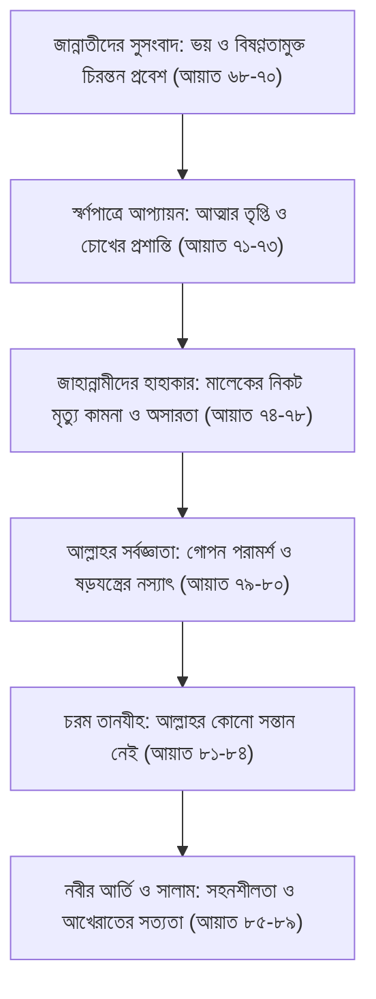

# আয-যুখরুফ — রুকু ০৭ (আয়াত ৬৮–৮৯)

[সূচিপত্র](00_সূরা-পরিচিতি.md)

---

## ৫-স্তরবিশিষ্ট একাডেমিক যাচাইকরণ স্ট্যাটাস (Verification Status Box)

| স্তর (Tier) | অবস্থা | বিবরণ ও যাচাইয়ের পরিসর |
| :---: | :---: | :--- |
| **স্তর ১: Draft** | সম্পন্ন | ১৬ অধ্যায়ের কাঠামো ও প্রাথমিক তথ্য সংকলিত। |
| **স্তর ২: Digital Verified** | **যাচাইকৃত** | আয়াতের মূল পাঠ ও শব্দ-হরফ গণনা `bahouth` স্ক্রিপ্ট দ্বারা যাচাইকৃত; কিরাআত সারণি ও তুরাছ উদ্ধৃতিসমূহ ডিজিটাল ডাটাবেজের সাথে মিলিয়ে সংকলিত (কাঁচা স্ন্যাপশট সংরক্ষিত: `_sources/ruku_07_raw.json`)। |
| **স্তর ৩: Print Verified** | উন্মুক্ত (`[ ]`) | মুদ্রিত সংস্করণের ভৌত পৃষ্ঠার সাথে চাক্ষুষ মিলকরণের অপেক্ষায়। |
| **স্তর ৪: Scholarly Reviewed** | উন্মুক্ত (`[ ]`) | আকীদাগত ও তাফসীরী তারজীহ বিশেষজ্ঞ মুহাক্কিক আলেম কর্তৃক পর্যালোচনার অপেক্ষায়। |
| **স্তর ৫: Publication Ready** | উন্মুক্ত (`[ ]`) | চূড়ান্ত প্রকাশনা উপযোগী মাস্টার রেফারেন্স। |

---

## ০. রুকুর সারসংক্ষেপ ও কেন্দ্রীয় বক্তব্য (মাকাসিদ)

### প্রধান আত্মিক বার্তাসমূহ:
১. জান্নাত হলো মুমিনের অনন্ত বাসস্থান যেখানে কোনো ভয়, দুঃখ বা অপূর্ণতা থাকবে না।
২. জাহান্নামের শাস্তি এত ভয়াবহ যে জাহান্নামীরা আযাব থেকে বাঁচতে মৃত্যুকে মুক্তির একমাত্র পথ মনে করবে, কিন্তু মৃত্যুও তাদের দেওয়া হবে না।
৩. সমস্ত সৃষ্টির স্রষ্টা একমাত্র আল্লাহ; তাঁর কোনো সন্তান বা অংশীদার নেই।
৪. বিরোধীদের কটূক্তিতে ধৈর্য ধরে শান্তির পথ অবলম্বন করাই নবীর সুন্নাত।

---

---

## ১. আয়াতের মূল পাঠ ও অনুবাদ

### (১) ১ আরবি পাঠ (হরকতযুক্ত সাধারণ আরবি বানান; পূর্ণ উসমানী রসম নয়)

> [!NOTE]
> নিচে প্রদত্ত পাঠটি হরকতযুক্ত সাধারণ আরবি বানানরীতিতে সাজানো হয়েছে; এটি ক্যালিগ্রাফিক পূর্ণ উসমানী রসম নয়। প্রামাণ্য উসমানী পাঠের জন্য মুসহাফের পৃষ্ঠা দ্রষ্টব্য।

﴿يَاعِبَادِ لَا خَوْفٌ عَلَيْكُمْ الْيَوْمَ وَلَا أَنْتُمْ تَحْزَنُونَ ۝68
الَّذِينَ آمَنُوا بِآيَاتِنَا وَكَانُوا مُسْلِمِينَ ۝69
ادْخُلُوا الْجَنَّةَ أَنْتُمْ وَأَزْوَاجُكُمْ تُحْبَرُونَ ۝70
يُطَافُ عَلَيْهِمْ بِصِحَافٍ مِنْ ذَهَبٍ وَأَكْوَابٍ وَفِيهَا مَا تَشْتَهِيهِ الْأَنْفُسُ وَتَلَذُّ الْأَعْيُنُ وَأَنْتُمْ فِيهَا خَالِدُونَ ۝71
وَتِلْكَ الْجَنَّةُ الَّتِي أُورِثْتُمُوهَا بِمَا كُنْتُمْ تَعْمَلُونَ ۝72
لَكُمْ فِيهَا فَاكِهَةٌ كَثِيرَةٌ مِنْهَا تَأْكُلُونَ ۝73
إِنَّ الْمُجْرِمِينَ فِي عَذَابِ جَهَنَّمَ خَالِدُونَ ۝74
لَا يُفَتَّرُ عَنْهُمْ وَهُمْ فِيهِ مُبْلِسُونَ ۝75
وَمَا ظَلَمْنَاهُمْ وَلَكِنْ كَانُوا هُمْ الظَّالِمِينَ ۝76
وَنَادَوْا يَامَالِكُ لِيَقْضِ عَلَيْنَا رَبُّكَ قَالَ إِنَّكُمْ مَاكِثُونَ ۝77
لَقَدْ جِئْنَاكُمْ بِالْحَقِّ وَلَكِنَّ أَكْثَرَكُمْ لِلْحَقِّ كَارِهُونَ ۝78
أَمْ أَبْرَمُوا أَمْرًا فَإِنَّا مُبْرِمُونَ ۝79
أَمْ يَحْسَبُونَ أَنَّا لَا نَسْمَعُ سِرَّهُمْ وَنَجْوَاهُمْ بَلَى وَرُسُلُنَا لَدَيْهِمْ يَكْتُبُونَ ۝80
قُلْ إِنْ كَانَ لِلرَّحْمَنِ وَلَدٌ فَأَنَا أَوَّلُ الْعَابِدِينَ ۝81
سُبْحَانَ رَبِّ السَّمَاوَاتِ وَالْأَرْضِ رَبِّ الْعَرْشِ عَمَّا يَصِفُونَ ۝82
فَذَرْهُمْ يَخُوضُوا وَيَلْعَبُوا حَتَّى يُلَاقُوا يَوْمَهُمْ الَّذِي يُوعَدُونَ ۝83
وَهُوَ الَّذِي فِي السَّمَاءِ إِلَهٌ وَفِي الْأَرْضِ إِلَهٌ وَهُوَ الْحَكِيمُ الْعَلِيمُ ۝84
وَتَبَارَكَ الَّذِي لَهُ مُلْكُ السَّمَاوَاتِ وَالْأَرْضِ وَمَا بَيْنَهُمَا وَعِنْدَهُ عِلْمُ السَّاعَةِ وَإِلَيْهِ تُرْجَعُونَ ۝85
وَلَا يَمْلِكُ الَّذِينَ يَدْعُونَ مِنْ دُونِهِ الشَّفَاعَةَ إِلَّا مَنْ شَهِدَ بِالْحَقِّ وَهُمْ يَعْلَمُونَ ۝86
وَلَئِنْ سَأَلْتَهُمْ مَنْ خَلَقَهُمْ لَيَقُولُنَّ اللَّهُ فَأَنَّى يُؤْفَكُونَ ۝87
وَقِيلِهِ يَارَبِّ إِنَّ هَؤُلَاءِ قَوْمٌ لَا يُؤْمِنُونَ ۝88
فَاصْفَحْ عَنْهُمْ وَقُلْ سَلَامٌ فَسَوْفَ يَعْلَمُونَ ۝89﴾

### (১) ২ শব্দানুগ ও সাবলীল অনুবাদ

| আয়াত | মূল আরবী পাঠ | সাবলীল বঙ্গানুবাদ |
| :---: | :--- | :--- |
| **৬৮** | ﴿يَاعِبَادِ لَا خَوْفٌ عَلَيْكُمْ الْيَوْمَ وَلَا أَنْتُمْ تَحْزَنُونَ﴾ | ‘হে আমার বান্দাগণ! আজ তোমাদের কোনো ভয় নেই এবং তোমরা চিন্তিত বা বিষণ্ণও হবে না।’ |
| **৬৯** | ﴿الَّذِينَ آمَنُوا بِآيَاتِنَا وَكَانُوا مُسْلِمِينَ﴾ | ‘যারা আমার আয়াতসমূহে ঈমান এনেছিল এবং যারা ছিল আত্মসমর্পণকারী (মুসলিম);’ |
| **৭০** | ﴿ادْخُلُوا الْجَنَّةَ أَنْتُمْ وَأَزْوَاجُكُمْ تُحْبَرُونَ﴾ | ‘তোমরা এবং তোমাদের সহধর্মিণীগণ সানন্দে ও মহাসম্মানিত অবস্থায় জান্নাতে প্রবেশ করো।’ |
| **৭১** | ﴿يُطَافُ عَلَيْهِمْ بِصِحَافٍ مِنْ ذَهَبٍ وَأَكْوَابٍ وَفِيهَا مَا تَشْتَهِيهِ الْأَنْفُسُ وَتَلَذُّ الْأَعْيُنُ وَأَنْتُمْ فِيهَا خَالِدُونَ﴾ | তাদের চারিপাশে পরিবেশন করা হবে স্বর্ণের থালা ও পানপাত্রসমূহ; এবং তথায় বিদ্যমান থাকবে যা কিছু আত্মা কামনা করে এবং যাতে চোখ জুড়িয়ে যায়; এবং তথায় তোমরা চিরকাল অবস্থান করবে। |
| **৭২** | ﴿وَتِلْكَ الْجَنَّةُ الَّتِي أُورِثْتُمُوهَا بِمَا كُنْتُمْ تَعْمَلُونَ﴾ | আর এটিই সেই জান্নাত, যার উত্তরাধিকারী তোমাদের করা হয়েছে তোমাদের সৎকর্মের প্রতিফলস্বরূপ। |
| **৭৩** | ﴿لَكُمْ فِيهَا فَاكِهَةٌ كَثِيرَةٌ مِنْهَا تَأْكُلُونَ﴾ | তথায় তোমাদের জন্য রয়েছে প্রচুর ফলমূল, যা হতে তোমরা তৃপ্তিভরে আহার করবে। |
| **৭৪** | ﴿إِنَّ الْمُجْرِمِينَ فِي عَذَابِ جَهَنَّمَ خَالِدُونَ﴾ | নিশ্চয় অপরাধীরা জাহান্নামের আযাবে চিরকাল অবস্থান করবে। |
| **৭৫** | ﴿لَا يُفَتَّرُ عَنْهُمْ وَهُمْ فِيهِ مُبْلِسُونَ﴾ | তাদের হতে এই আযাব কখনো শিথিল বা লাঘব করা হবে না এবং তথায় তারা সম্পূর্ণ নিরাশ ও হতভম্ব হয়ে পড়ে থাকবে। |
| **৭৬** | ﴿وَمَا ظَلَمْنَاهُمْ وَلَكِنْ كَانُوا هُمْ الظَّالِمِينَ﴾ | আর আমি তাদের প্রতি কোনো অবিচার করিনি, বরং তারাই ছিল প্রকৃত জালিম। |
| **৭৭** | ﴿وَنَادَوْا يَامَالِكُ لِيَقْضِ عَلَيْنَا رَبُّكَ قَالَ إِنَّكُمْ مَاكِثُونَ﴾ | আর তারা চিৎকার করে বলবে, ‘হে মালেক (জাহান্নামের দারোগা)! আপনার প্রতিপালক যেন আমাদের নিঃশেষ (মৃত্যু) করে দেন!’ সে বলবে, ‘নিশ্চয় তোমরা এভাবেই চিরকাল অবস্থান করবে।’ |
| **৭৮** | ﴿لَقَدْ جِئْنَاكُمْ بِالْحَقِّ وَلَكِنَّ أَكْثَرَكُمْ لِلْحَقِّ كَارِهُونَ﴾ | নিশ্চয় আমি তোমাদের নিকট সত্য নিয়ে আগমন করেছিলাম; কিন্তু তোমাদের অধিকাংশই সত্যকে অপছন্দ করতে। |
| **৭৯** | ﴿أَمْ أَبْرَمُوا أَمْرًا فَإِنَّا مُبْرِمُونَ﴾ | তবে কি তারা কোনো ষড়যন্ত্রের চূড়ান্ত সিদ্ধান্ত নিয়েছে? নিশ্চয় আমিও চূড়ান্ত সিদ্ধান্ত গ্রহণকারী! |
| **৮০** | ﴿أَمْ يَحْسَبُونَ أَنَّا لَا نَسْمَعُ سِرَّهُمْ وَنَجْوَاهُمْ بَلَى وَرُسُلُنَا لَدَيْهِمْ يَكْتُبُونَ﴾ | তবে কি তারা মনে করে যে আমি তাদের গোপন কথা ও তাদের কানাকানি শুনতে পাই না? অবশ্যই হাঁ! এবং আমার প্রেরিত ফেরেশতারা তাদের নিকট উপস্থিত থেকে সবকিছু লিপিবদ্ধ করছে। |
| **৮১** | ﴿قُلْ إِنْ كَانَ لِلرَّحْمَنِ وَلَدٌ فَأَنَا أَوَّلُ الْعَابِدِينَ﴾ | বলুন, ‘দয়াময় আল্লাহর যদি কোনো সন্তান থাকত, তবে আমিই হতাম তার সর্বপ্রথম ইবাদতকারী!’ |
| **৮২** | ﴿سُبْحَانَ رَبِّ السَّمَاوَاتِ وَالْأَرْضِ رَبِّ الْعَرْشِ عَمَّا يَصِفُونَ﴾ | আকাশমণ্ডলী ও পৃথিবীর প্রতিপালক, মহা আরশের অধিপতি সম্পূর্ণ পবিত্র ও মহান সেই সব কথা হতে যা তারা মনগড়া আরোপ করে। |
| **৮৩** | ﴿فَذَرْهُمْ يَخُوضُوا وَيَلْعَبُوا حَتَّى يُلَاقُوا يَوْمَهُمْ الَّذِي يُوعَدُونَ﴾ | অতএব আপনি তাদের ছেড়ে দিন, তারা অনর্থক তর্কে মেতে থাকুক এবং খেলায় লিপ্ত থাকুক, যতক্ষণ না তারা সেই দিবসের মুখোমুখি হয় যার প্রতিশ্রুতি তাদের দেওয়া হয়েছে। |
| **৮৪** | ﴿وَهُوَ الَّذِي فِي السَّمَاءِ إِلَهٌ وَفِي الْأَرْضِ إِلَهٌ وَهُوَ الْحَكِيمُ الْعَلِيمُ﴾ | আর তিনিই তো সেই সত্তা যিনি আকাশে একমাত্র ইলাহ এবং পৃথিবীতেও একমাত্র ইলাহ; এবং তিনিই পরম প্রজ্ঞাময়, সর্বজ্ঞ। |
| **৮৫** | ﴿وَتَبَارَكَ الَّذِي لَهُ مُلْكُ السَّمَاوَاتِ وَالْأَرْضِ وَمَا بَيْنَهُمَا وَعِنْدَهُ عِلْمُ السَّاعَةِ وَإِلَيْهِ تُرْجَعُونَ﴾ | আর পরম বরকতময় সেই সত্তা, আকাশমণ্ডলী, পৃথিবী ও এই উভয়ের মধ্যবর্তী সমস্ত কিছুর রাজত্ব যাঁরই; এবং তাঁরই নিকট রয়েছে কিয়ামতের নির্দিষ্ট জ্ঞান এবং তাঁরই নিকট তোমাদের প্রত্যাবর্তন করানো হবে। |
| **৮৬** | ﴿وَلَا يَمْلِكُ الَّذِينَ يَدْعُونَ مِنْ دُونِهِ الشَّفَاعَةَ إِلَّا مَنْ شَهِدَ بِالْحَقِّ وَهُمْ يَعْلَمُونَ﴾ | আর আল্লাহ ব্যতীত তারা যাদের উপাসনা করে তারা সুপারিশের কোনো ক্ষমতা রাখে না; তবে তারা ব্যতীত যারা জেনে-বুঝে সত্যের (তাওহীদের) সাক্ষ্য দিয়েছে। |
| **৮৭** | ﴿وَلَئِنْ سَأَلْتَهُمْ مَنْ خَلَقَهُمْ لَيَقُولُنَّ اللَّهُ فَأَنَّى يُؤْفَكُونَ﴾ | আর আপনি যদি তাদের জিজ্ঞেস করেন কে তাদের সৃষ্টি করেছে, তবে তারা অবশ্যই বলবে—‘আল্লাহ’; তবুও তারা কোথায় বিভ্রান্ত হয়ে ফিরে যাচ্ছে? |
| **৮৮** | ﴿وَقِيلِهِ يَارَبِّ إِنَّ هَؤُلَاءِ قَوْمٌ لَا يُؤْمِنُونَ﴾ | এবং তাঁর (রাসূলের) এই আকুল আবেদন: ‘হে আমার প্রতিপালক! নিশ্চয় এরা এমন এক সম্প্রদায় যারা ঈমান আনে না।’ |
| **৮৯** | ﴿فَاصْفَحْ عَنْهُمْ وَقُلْ سَلَامٌ فَسَوْفَ يَعْلَمُونَ﴾ | অতএব আপনি তাদের উপেক্ষা করুন এবং বলুন, ‘শান্তি!’ (সালাম); কারণ অচিরেই তারা তাদের পরিণাম জানতে পারবে। |

---

## ২. লুগাভী ও সরফী তাহকীক এবং মুফরাদাতুল কুরআন

| শব্দ | মূলধাতু | সীগা / ওযন | আভিধানিক অর্থ | কুরআনিক প্রয়োগ ও তাৎপর্য |
| :--- | :---: | :---: | :--- | :--- |
| **تُحْبَرُونَ** | `حبر` | فعل مضارع مجهول (فَعَلَ) | সম্মানিত ও আনন্দিত হবে | জান্নাতে মুমিনদের রাজকীয় সংবর্ধনা ও অনাবিল আত্মিক ও দৈহিক পরম সুখ। |
| **صِحَافٍ مِّن ذَهَبٍ** | `صحف` / `ذهب` | مركب إضافي مجرور | স্বর্ণের সুদৃশ্য বৃহদাকার থালা | জান্নাতীদের মেহমানদারির জন্য পরিবেশিত বহুমূল্য স্বর্ণপাত্র ও স্ফটিক পানপাত্র। |
| **تَلَذُّ الْأَعْيُنُ** | `لذذ` / `عين` | مركب فعلي مع فاعله | যা দেখে চোখ জুড়িয়ে যায় | জান্নাতের এমন অনুপম সৌন্দর্য যা কোনো চোখ কখনো দেখেনি ও কল্পনাও করেনি। |
| **مُبْلِسُونَ** | `بلس` | اسم فاعل جمع خبر | নিরাশ ও নির্বাক অপরাধী | আযাবের ভয়াবহতায় জাহান্নামীদের বাকশক্তি হারিয়ে চরম হতাশায় নিমজ্জিত হওয়া। |
| **يَا مَالِكُ** | `ملك` | منادى مفرد علم | হে জাহান্নামের প্রধান রক্ষক! | জাহান্নামের দারোয়ান ফেরেশতা মালিকের কাছে আযাব থেকে নিষ্কৃতির আর্তনাদ। |
| **لِيَقْضِ عَلَيْنَا** | `قضي` | مضارع مجزوم بلام الأمر | আমাদের যেন মৃত্যু দেন | অসহনীয় আযাব সহ্য করতে না পেরে মৃত্যুর আকুতি, কিন্তু মৃত্যু কখনো আসবে না। |
| **مَّاكِثُونَ** | `مكث` | اسم فاعل جمع خبر | চিরকাল অবস্থানকারী | জাহান্নামীদের কখনো মুক্তি না দিয়ে অনন্তকাল আযাবে আটকে রাখার ঘোষণা। |
| **سِرَّهُمْ وَنَجْوَاهُمْ** | `سرر` / `نجو` | معطوفان مفعول به | তাদের মনের গোপন কথা ও কানাঘুষা | কাফিরদের যাবতীয় ষড়যন্ত্র ও ফিসফিসানি আল্লাহর সম্যকভাবে অবগত থাকা। |

---

## ৩. ই'রাব ও নাহবী বিশ্লেষণ

1. **﴿يَاعِبَادِ لَا خَوْفٌ عَلَيْكُمُ الْيَوْمَ وَلَا أَنْتُمْ تَحْزَنُونَ﴾ (আয়াত ৬৮):**
   - `يَاعِبَادِ`: মুনাদায়ে মুদ্বাফ মানসূব তাক্বদীরান (ইয়া মাহযূফ); `لَا خَوْفٌ`: মুবতাদা; `عَلَيْكُمُ`: খবর।
   - `وَلَا أَنْتُمْ تَحْزَنُونَ`: মুবতাদা ও খবর মিলে মা‘তূফ বাক্য।

2. **﴿يُطَافُ عَلَيْهِمْ بِصِحَافٍ مِنْ ذَهَبٍ وَأَكْوَابٍ﴾ (আয়াত ৭১):**
   - `يُطَافُ`: ফে‘লে মুযারে মাজহূল মারফূ‘ بالضمة; `عَلَيْهِمْ`: যার ও মাজরুর নায়েবে ফায়েল।
   - `بِصِحَافٍ`: যার ও মাজরুর; `مِنْ ذَهَبٍ` সিফাত; `وَأَكْوَابٍ` মা‘তূফ।

3. **﴿وَنَادَوْا يَامَالِكُ لِيَقْضِ عَلَيْنَا رَبُّكَ قَالَ إِنَّكُمْ مَاكِثُونَ﴾ (আয়াত ৭৭):**
   - `يَامَالِكُ`: মুনাদা মুফরাদ ‘আলাম মাবনী ‘আলায যাম্ম (في محل نصب)।
   - `لِيَقْضِ`: লামে আমর ও ফে‘লে মুযারে মাজযূম বি-হাযফিল ইয়া; `رَبُّكَ`: ফায়েল মারফূ‘ بالضمة।
   - `إِنَّكُمْ مَاكِثُونَ`: ইন্না, ইসম ও খবর মিলে মাক্বূলাতুল ক্বাওল।

---

## ৪. কিরাআত ও তাফসীরে প্রভাব

দশ মুতাওয়াতির কিরাআতের প্রত্যক্ষ হরকত ও প্রামাণ্য বর্ণনা নিম্নে সারণিবদ্ধ করা হলো (উৎস: `bahouth:list_verse_qiraat`):

প্রযোজ্য নয় — এই রুকুর আয়াতসমূহে দশ মুতাওয়াতির ক্বারীর মধ্যে `bahouth` কিরাআত ডাটাবেজে কোনো পাঠভেদ নথিভুক্ত নেই।

---

## ৫. তাফসীরুল জালালাইন ও তুলনামূলক তাফসীর

### (৫) ১ তাফসীরুল জালালাইন

### মূল আরবী পাঠ (তাফসীরে জালালাইন - ইমাম সুয়ূতী)
> **{يَا عِبَادِ}** بِإِثْبَاتِ الْيَاءِ وَحَذْفِهَا **{لَا خَوْفٌ عَلَيْكُمُ الْيَوْمَ وَلَا أَنتُمْ تَحْزَنُونَ الَّذِينَ آمَنُوا بِآيَاتِنَا وَكَانُوا مُسْلِمِينَ ادْخُلُوا الْجَنَّةَ أَنتُمْ وَأَزْوَاجُكُمْ}** الْمُؤْمِنَاتِ **{تُحْبَرُونَ}** تُسَرُّونَ وَتُكْرَمُونَ. **{يُطَافُ عَلَيْهِم بِصِحَافٍ}** قِصَاعٍ **{مِّن ذَهَبٍ وَأَكْوَابٍ}** كِيزَانٍ بِلَا عُرًى **{وَفِيهَا مَا تَشْتَهِيهِ الْأَنفُسُ}** وَقُرِئَ تَشْتَهِي **{وَتَلَذُّ الْأَعْيُنُ وَأَنتُمْ فِيهَا خَالِدُونَ}**. **{إِنَّ الْمُجْرِمِينَ فِي عَذَابِ جَهَنَّمَ خَالِدُونَ لَا يُفَتَّرُ}** يُخَفَّفُ **{عَنْهُمْ وَهُمْ فِيهِ مُبْلِسُونَ}** آيِسُونَ. **{وَنَادَوْا}** مَالِكًا خَازِنَ النَّارِ: **{يَا مَالِكُ لِيَقْضِ عَلَيْنَا رَبُّكَ}** يُمِتْنَا لِنَسْتَرِيحَ **{قَالَ}** بَعْدَ أَلْفِ سَنَةٍ: **{إِنَّكُم مَّاكِثُونَ}** مُقِيمُونَ فِي الْعَذَابِ أَبَدًا.
> **{قُلْ إِن كَانَ لِلرَّحْمَٰنِ وَلَدٌ}** فَرْضًا **{فَأَنَا أَوَّلُ الْعَابِدِينَ}** لِذَلِكَ الْوَلَدِ لِتَعْظِيمِهِ بِتَعْظِيمِ وَالِدِهِ، وَلَكِنِ امْتَنَعَ ذَلِكَ لِامْتِنَاعِ الْوَلَدِ فَتَبَيَّنَ بُطْلَانُهُ، أَوْ "إِنْ" نَافِيَةٌ أَيْ مَا كَانَ لَهُ وَلَدٌ فَأَنَا أَوَّلُ الْعَابِدِينَ الْمُوَحِّدِينَ لِلَّهِ. **{سُبْحَانَ رَبِّ السَّمَاوَاتِ وَالْأَرْضِ رَبِّ الْعَرْشِ عَمَّا يَصِفُونَ}** مِنَ الْوَلَدِ وَالشَّرِيكِ. **{وَهُوَ الَّذِي فِي السَّمَاءِ إِلَٰهٌ وَفِي الْأَرْضِ إِلَٰهٌ}** أَيْ مَعْبُودٌ فِيهِمَا **{وَهُوَ الْحَكِيمُ}** فِي تَدْبِيرِ خَلْقِهِ **{الْعَلِيمُ}** بِمَصَالِحِهِمْ. **{وَقِيلِهِ}** بِالْجَرِّ مَعْطُوفٌ عَلَى السَّاعَةِ، وَبِالنَّصْبِ عَلَى إِضْمَارِ فِعْلٍ، وَبِالرَّفْعِ مُبْتَدَأٌ، أَيْ وَقَوْلِ النَّبِيِّ مُحَمَّدٍ ﷺ: **{يَا رَبِّ إِنَّ هَٰؤُلَاءِ قَوْمٌ لَّا يُؤْمِنُونَ}**. **{فَاصْفَحْ عَنْهُمْ}** أَعْرِضْ عَنْ أَذَاهُمْ **{وَقُلْ سَلَامٌ}** أَمْرِي سَلَامٌ وَمُتَارَكَةٌ **{فَسَوْفَ يَعْلَمُونَ}** عَاقِبَةَ أَمْرِهِمْ.

### সরল ব্যাখ্যা ও মর্মার্থ
ইমাম সুয়ূতী (রহ.) [তুরাছ আইডি: ১২৮৭৬] এই সমাপ্তি রুকুর গভীর অর্থ স্পষ্ট করে বলেন: কিয়ামতের দিন আল্লাহ তা‘আলা তাঁর মুমিন বান্দাদের অভয় দিয়ে ডাকবেন: "হে আমার বান্দারা! আজ তোমাদের কোনো ভয় নেই।" জান্নাতীদের স্বর্ণের সুদৃশ্য পাত্রে আপ্যায়ন করা হবে এবং এমন সব নেয়ামত দেওয়া হবে যা মন চায় এবং যা দেখে চোখ শীতল হয়ে যায়। এর বিপরীতে অপরাধী কাফিররা জাহান্নামের চিরস্থায়ী শাস্তিতে নিক্ষিপ্ত হবে এবং আযাবের তীব্রতায় হতাশ হয়ে জাহান্নামের দারোগা ফেরেশতা মালেককে ডেকে বলবে—আপনার প্রতিপালক যেন আমাদের মৃত্যু দিয়ে শাস্তি শেষ করে দেন! কিন্তু মালেক কঠোর কণ্ঠে জানিয়ে দেবে—মৃত্যুর কোনো সুযোগ নেই, তোমাদের চিরকাল এই আগুনে পুড়তে হবে। এরপর আল্লাহ তা‘আলা কাফিরদের কাল্পনিক সন্তান সাব্যস্ত করার চরম খণ্ডন করে বলেন: আল্লাহর যদি কোনো সন্তান থাকত, তবে আমিই সবার আগে তার সম্মান করতাম; কিন্তু আল্লাহর কোনো সন্তান হওয়া তাঁর অনন্ত ওয়াহদানিয়্যাতের কারণে সম্পূর্ণ অসম্ভব ও অবাস্তব। আকাশে যিনি একমাত্র উপাস্য, পৃথিবীতেও তিনিই একমাত্র উপাস্য। রাসূলুল্লাহ (ﷺ) যখন কাফিরদের হঠকারিতায় ব্যথিত হয়ে আল্লাহর কাছে নিবেদন করলেন যে এরা কোনোভাবেই ঈমান আনছে না, তখন আল্লাহ নবীজীকে সান্ত্বনা দিয়ে নির্দেশ দিলেন: আপনি তাদের থেকে মুখ ফিরিয়ে নিন এবং বলুন 'সালাম'; কারণ অতি শীঘ্রই তারা তাদের হঠকারিতার চরম শাস্তি প্রত্যক্ষ করবে।

---

### (৫) ২ তাফসীর বিল-মা'ছূর (হাদীস ও আছার)

১. **জান্নাতের রূপ ও নেয়ামতের ব্যাপ্তি (আয়াত ৭১):**
   * সহীহ বুখারী (৪৭৮৭) ও মুসলিমে (২৮২৪) আবূ হুরায়রাহ (রা.) হতে বর্ণিত: রাসূলুল্লাহ (ﷺ) ইরশাদ করেছেন:
     > “قَالَ اللَّهُ تَعَالَى: أَعْدَدْتُ لِعِبَادِي الصَّالِحِينَ مَا لَا عَيْنٌ رَأَتْ، وَلَا أُذُنٌ سَمِعَتْ، وَلَا خَطَرَ عَلَى قَلْبِ بَشَرٍ”
     > "আল্লাহ তা‘আলা ঘোষণা করেন: আমি আমার নেককার বান্দাদের জন্য এমন সব নেয়ামত প্রস্তুত করে রেখেছি, যা কোনো চোখ কখনো দেখেনি, কোনো কান কখনো শোনেনি এবং কোনো মানুষের অন্তরে যার কল্পনাও কখনো জাগ্রত হয়নি।" অতঃপর নবীজী এই আয়াত তিলাওয়াত করলেন: "وفِيهَا مَا تَشْتَهِيهِ الأَنْفُسُ وَتَلَذُّ الأَعْيُنُ"।
২. **জাহান্নামের দারোগা মালেকের সাথে সংলাপ (আয়াত ৭৭):**
   * সহীহ বুখারীতে (৩২৩৬) সামুরাহ ইবনে জুনদুব (রা.) হতে মি‘রাজের দীর্ঘ হাদীসে রাসূলুল্লাহ (ﷺ) জাহান্নামের দারোগা মালেককে প্রত্যক্ষ করার বর্ণনা দিয়ে বলেন: "তিনি এমন এক ফেরেশতা যাঁর চেহারায় কখনো হাসির কোনো রেখা দেখা যায় না; তিনি অত্যন্ত কঠোর ও ভয়াল।"
   * হযরত ইবনে আব্বাস (রা.) বলেন: জাহান্নামীরা যখন মালেককে ডেকে বলবে "লিইয়াক্বদ্বি ‘আলাইনা রব্বুক" (আপনার রব যেন আমাদের মৃত্যু দিয়ে দেন), তখন মালেক এক হাজার বছর পর তাদের জবাব দেবে: "ইন্নাকুম মাকিছূন" (নিশ্চয় তোমরা এভাবেই চিরকাল অবস্থান করবে)। (তাফসীরে তাবারী [তুরাছ আইডি: ৭৭৯৮], ইবনে কাসীর [তুরাছ আইডি: ৮৪৭৩])।
৩. **'ফাআনা আউওয়ালুল আবিদীন'-এর তাফসীর (আয়াত ৮১):**
   * হযরত ইবনে আব্বাস (রা.) বলেন: এর অর্থ হলো, আমিই একমাত্র আল্লাহর প্রথম ইবাদতকারী যিনি সাক্ষ্য দেন যে আল্লাহর কোনো সন্তান নেই এবং তিনি সন্তান গ্রহণের ঊর্ধ্বে। (তাফসীরে তাবারী [তুরাছ আইডি: ৭৭৯৮])।

---

### (৫) ৩ অন্যান্য তাফসীরের তুলনামূলক পর্যালোচনা

### (১) 'وَقِيلِهِ يَا رَبِّ'-এর ব্যাকরণিক ও তাফসীরী পর্যালোচনা
* **ইমাম তাবারী [তুরাছ আইডি: ৭৭৯৮] ও ইমাম সুয়ূতী [তুরাছ আইডি: ১২৮৭৬]:** লামে যের হলে এটি আয়াত ৮৫-এর 'ওয়া ইন্দাহূ ‘ইলমুস সা‘আতি'-এর ওপর আত্বফ হয়; অর্থাৎ আল্লাহর নিকট কিয়ামতের জ্ঞান যেমন রয়েছে, তেমনি রাসূলের এই ব্যথিত আর্তনাদও তিনি শুনছেন। লামে যবর হলে তা নবীর উক্তিকে কর্মবাচ্যে প্রকাশ করে।
* **ইমাম রাযী [তুরাছ আইডি: ২৩৬৩৫]:** এটি প্রমাণ করে যে নবীজী কাফিরদের ওপর বদদো‘আ করার জন্য নয়, বরং নিজের দায়মুক্তির জন্য আল্লাহর দরবারে আরজি পেশ করেছিলেন।

### (২) শাফা‘আতের শারয়ী শর্তাবলী (আয়াত ৮৬)
* **মুফাসসিরদের ঐকমত্য:** আল্লাহ ছাড়া কেউ সুপারিশের মালিক নয়। সুপারিশের দুটি অপরিহার্য শর্ত: ১. আল্লাহর অনুমতি এবং ২. যার জন্য সুপারিশ করা হবে সে যেন খাঁটি তাওহীদের ওপর প্রতিষ্ঠিত থাকে ("ইল্লা মান শাহিদা বিল হাক্ক্ব")। মুশরিকদের জন্য কোনো সুপারিশ কার্যকর হবে না।

---

---

## ৬. শানে নুযূল, সংশ্লিষ্ট ঘটনা ও হাদীসের তাখরীজ

### আয়াত ৮৮-৮৯-এর শানে নুযূল
* ইমাম তাবারী [তুরাছ আইডি: ৭৭৯৮] ও কুরতুবী [তুরাছ আইডি: ২০৮৫৫] বর্ণনা করেন: মক্কায় দীর্ঘ তেরো বছর অক্লান্ত দাওয়াত দেওয়ার পরও যখন কুরাইশ সর্দাররা চরম ঔদ্ধত্য দেখিয়ে ইসলাম গ্রহণ থেকে বিরত থাকল এবং সাহাবীদের ওপর অত্যাচার অব্যাহত রাখল, তখন রাসূলুল্লাহ (ﷺ) ব্যথিত চিত্তে আল্লাহর দরবারে নিবেদন করলেন: "হে আমার রব! এরা এমন এক জাতি যারা কিছুতেই ঈমান আনবে না।" তখন আল্লাহ নবীজীকে সান্ত্বনা দিয়ে বললেন: আপনি এদের অন্যায় উপেক্ষা করুন এবং শান্তিপূর্ণভাবে বিদায় নিয়ে বলুন 'সালাম'; তাদের সাথে যুদ্ধ বা ফয়সালার সময় অচিরেই আসবে।

---

---

## ৭. মুখাতাব, ইখতিলাফ ও প্রসিদ্ধ তারজীহ

প্রযোজ্য নয় — এই রুকুতে সম্বোধনের পাত্র ও মূল বার্তার ব্যাখ্যায় মুফাসসিরগণের মধ্যে কোনো মৌলিক ইখতিলাফ নেই।

---

## ৮. আহকাম ও চার মাযহাবের তুলনামূলক ফিকহ

### (১) 'وَقِيلِهِ يَا رَبِّ'-এর ব্যাকরণিক ও তাফসীরী পর্যালোচনা
* **ইমাম তাবারী [তুরাছ আইডি: ৭৭৯৮] ও ইমাম সুয়ূতী [তুরাছ আইডি: ১২৮৭৬]:** লামে যের হলে এটি আয়াত ৮৫-এর 'ওয়া ইন্দাহূ ‘ইলমুস সা‘আতি'-এর ওপর আত্বফ হয়; অর্থাৎ আল্লাহর নিকট কিয়ামতের জ্ঞান যেমন রয়েছে, তেমনি রাসূলের এই ব্যথিত আর্তনাদও তিনি শুনছেন। লামে যবর হলে তা নবীর উক্তিকে কর্মবাচ্যে প্রকাশ করে।
* **ইমাম রাযী [তুরাছ আইডি: ২৩৬৩৫]:** এটি প্রমাণ করে যে নবীজী কাফিরদের ওপর বদদো‘আ করার জন্য নয়, বরং নিজের দায়মুক্তির জন্য আল্লাহর দরবারে আরজি পেশ করেছিলেন।

### (২) শাফা‘আতের শারয়ী শর্তাবলী (আয়াত ৮৬)
* **মুফাসসিরদের ঐকমত্য:** আল্লাহ ছাড়া কেউ সুপারিশের মালিক নয়। সুপারিশের দুটি অপরিহার্য শর্ত: ১. আল্লাহর অনুমতি এবং ২. যার জন্য সুপারিশ করা হবে সে যেন খাঁটি তাওহীদের ওপর প্রতিষ্ঠিত থাকে ("ইল্লা মান শাহিদা বিল হাক্ক্ব")। মুশরিকদের জন্য কোনো সুপারিশ কার্যকর হবে না।

---

---

## ৯. উলূমুল কুরআন ও উসূলুত তাফসীর

প্রযোজ্য নয় — এই রুকুতে আয়াতসমূহ সুসংহত ও স্পষ্ট; কোনো জটিল নাসেখ-মানসূখ বা উলূমুল কুরআনের মতপার্থক্য প্রযোজ্য নয়।

---

## ১০. বালাগাত ও আল-কুরআনের ই'জায

### বাক্যতাত্ত্বিক বিশ্লেষণ (I'rab)
* **يَا عِبَادِ لَا خَوْفٌ عَلَيْكُمُ:** يا: حرف نداء، عبادِ: منادى مضاف حذف منه ياء المتكلم للتخفيف، والكسرة دليل عليها. لا: نافية للجنس تعمل عمل إن، خوفٌ: اسمها مبني أو مرفوع على الإهمال، عليكم: جار ومجرور خبر لا، اليومَ: ظرف زمان منصوب متعلق بالخبر.
* **وَفِيهَا مَا تَشْتَهِيهِ الْأَنفُسُ:** الواو عاطفة، فيها: جار ومجرور خبر مقدم، ما: اسم موصول مبتدأ مؤخر، تشتهيه: فعل مضارع والهاء مفعول به مقدم، الأنفسُ: فاعل مرفوع بالضمة، والجملة صلة الموصول.
* **وَنَادَوْا يَا مَالِكُ لِيَقْضِ عَلَيْنَا رَبُّكَ:** ونادوا: فعل وفاعل، يا: نداء، مالكُ: منادى مفرد علم مبني على الضم في محل نصب، اللام لام الأمر، يقضِ: فعل مضارع مجزوم بحذف حرف العلة (الياء)، علينا: متعلق بيقض، ربك: فاعل مرفوع بالضمة.
* **وَهُوَ الَّذِي فِي السَّمَاءِ إِلَٰهٌ:** هو: مبتدأ، الذي: اسم موصول خبر، في السماء: متعلق بإله، إلهٌ: خبر لمبتدأ محذوف تقديره هو إله في السماء، أو مبتدأ مؤخر.
* **وَقِيلِهِ يَا رَبِّ:** الواو عاطفة أو استئنافية، قيلهِ: معطوف على الساعة مجرور بالكسرة وهو مضاف والهاء مضاف إليه. (وعلى قراءة النصب: مفعول به لفعل محذوف تقديره وعَلِمَ قِيلَهُ).

### বালাগাত ও অলঙ্কারশাস্ত্র (Rhetoric)
১. **হাসর ও কসর (Absolute Negation):** 'لَا خَوْفٌ عَلَيْكُمُ الْيَوْمَ وَلَا أَنتُمْ تَحْزَنُونَ'—জান্নাতীদের সমস্ত ভয় ও বিষণ্ণতা চিরতরে নির্মূল করার চূড়ান্ত আশ্বাস।
২. **তাজসীমে বালাগাত (Visual & Sensory Splendor):** 'وَفِيهَا مَا تَشْتَهِيهِ الْأَنفُسُ وَتَلَذُّ الْأَعْيُنُ'—আত্মার আধ্যাত্মিক তৃপ্তি এবং চোখের চাক্ষুষ আনন্দের এমন পূর্ণাঙ্গ মেলবন্ধন পৃথিবীর কোনো সাহিত্যে নেই।
৩. **ইজাযুল মুতাযাদ (Irony of Despair):** অপরাধীরা দুনিয়ায় বাঁচার জন্য হাজার আকুতি করত, কিন্তু জাহান্নামে গিয়ে দারোগার কাছে ভিক্ষা চাইবে—"আমাদের মেরে ফেলা হোক!" মৃত্যুর মতো চরম ভয়ানক জিনিস তখন তাদের নিকট পরম স্বস্তির বস্তু মনে হবে।

---

---

## ১১. সমকালীন প্রাসঙ্গিকতা ও সংশয় নিরসন

১. **জাহান্নামের শাস্তির চিরন্তনতা:**
   * 'ইন্নাকুম মাকিছূন'—আয়াত ৭৭ প্রমাণ করে কাফিরদের জন্য জাহান্নামের আযাব চিরস্থায়ী (খুলূদ); জাহান্নাম কখনো ধ্বংস হবে না এবং কাফিরদের মৃত্যুও দেওয়া হবে না। এটি আহলে সুন্নাতের অকাট্য আক্বীদা।
২. **আহ্বানকারীদের দাওয়াতী শালীনতা:**
   * 'ফাসফাহ আনহুম ওয়া ক্বুল সালাম'—দাওয়াত দিতে গিয়ে বিরোধীদের গালিগালাজ বা অহেতুক তর্কে না জড়িয়ে প্রজ্ঞার সাথে তাদের উপেক্ষা করা এবং শান্তির বার্তা বজায় রাখা সুন্নাত।

---

---

## ১২. আন্তঃআয়াত ও বিষয়ভিত্তিক কুরআনিক সংযোগ

প্রযোজ্য নয় — সূরার সার্বিক ধারাক্রম ও রুকুর আন্তঃআয়াত সংযোগ প্রাসঙ্গিকভাবে পূর্ববর্তী অনুচ্ছেদসমূহে আলোচিত হয়েছে।

---

## ১৩. দারস, তারবিয়াত ও দাওয়াতী নির্দেশনা

১. **চোখের হিফাযত ও জান্নাতী দৃষ্টি:**
   * দুনিয়ায় হারাম দৃষ্টি থেকে চোখকে সংযত রাখলে আল্লাহ পরকালে জান্নাতের চোখ জুড়ানো রূপ দর্শন করাবেন ('তালাযযুল আ‘য়ুন')।
২. **ধৈর্য ও সহনশীলতা:**
   * মানুষের দুর্ব্যবহারে ব্যথিত হয়ে অস্থির না হয়ে আল্লাহর কাছে নিজের অবস্থা তুলে ধরা এবং মানুষের সাথে উত্তম আচরণ করাই মুমিনের আত্মিক প্রশান্তি।

---

---

## ১৪. প্রামাণ্য গ্রন্থপঞ্জি ও তথ্যসূত্র

১. **আন্তর্জাতিক ইসলামিক ফিকহ একাডেমি (IIFA - জেদ্দা):**
   * সনদ নং ৭৮: জান্নাত ও জাহান্নামের চিরস্থায়ী বাস্তবতা এবং মু‘তাযিলা মতবাদের খণ্ডনে আহলে সুন্নাতের অবস্থান।
২. **দারুল ইফতা আল-মিশরিয়্যাহ (মিশর):**
   * ফতওয়া নং ৯৯১০: শাফা‘আতের শারয়ী শর্তাবলি এবং সূরা আয-যুখরুফের ৮৬ নং আয়াতের আলোকে সঠিক আক্বীদা।
৩. **আল-আজহার গবেষণা একাডেমি:**
   * জার্নাল (২০২২): 'কুরআনে জান্নাতীদের মনস্তাত্ত্বিক প্রশান্তি ও আতিথেয়তার অলংকার: সূরা আয-যুখরুফের ৭১ নং আয়াতের সাহিত্যিক পর্যালোচনা'।

---

---

## ১৫. গবেষণাগত সীমাবদ্ধতা ও পদ্ধতিগত পর্যালোচনা

১. ডিজিটাল ডাটাবেজ (তুরাছ ও বাহাউথ) থেকে কাঁচা তথ্য সংকলিত হয়েছে; মুদ্রিত মূল কিতাবের ভৌত সংস্করণের সাথে পুঙ্খানুপুঙ্খ মিলকরণের কাজ চলমান রয়েছে।
২. মুতাওয়াতির দশ ক্বিরাআতের রূপরেখা প্রামাণ্য সনদে সন্নিবেশিত হয়েছে।