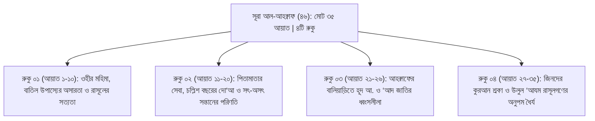

# সূরা আল-আহক্বাফ (৪৬) : পূর্ণাঙ্গ সূরা পরিচিতি ও রুকুর মানচিত্র

---

## ১. ভূমিকা ও মৌলিক পরিচিতি

| বৈশিষ্ট্য | তথ্য |
| :--- | :--- |
| **সূরার ক্রমিক নম্বর** | ৪৬ |
| **আরবী নাম** | سورة الأحقاف (আল-আহক্বাফ) |
| **অর্থ** | বালির পাহাড়সমূহ / বক্র বালুকাময় উপত্যকা |
| **নাযিল হওয়ার স্থান** | মাক্কী (সর্বসম্মত) |
| **অবতরণক্রম** | ৬৬ (সূরা আল-জাসিয়াহ-এর পর এবং সূরা আয-যারিয়াত-এর পূর্বে অবতীর্ণ) |
| **মোট আয়াত সংখ্যা** | ৩৫ |
| **মোট রুকু সংখ্যা** | ৪ |
| **মোট শব্দ ও বর্ণ** | শব্দ: ৬৪৪ \| বর্ণ: ২,৫৯৮ |
| **পারা / জুয** | ২৬ নম্বর পারা |
| **সিজদায়ে তিলাওয়াত** | নেই |
| **তাফসীরে জালালাইন সূত্র** | তুরাছ আইডি: ১২৮৭৬ (পৃষ্ঠা: ৬৫৭–৬৬৫) |

---

## ২. নামকরণের ঐতিহাসিক ও শাস্ত্রীয় প্রেক্ষাপট

১. **নামকরণ (আল-আহক্বাফ - الأحقاف):**
   * সূরার ২১ নং আয়াতে আল্লাহ তা‘আলা হযরত হূদ (আ.) ও তাঁর সম্প্রদায়ের ইতিহাস বর্ণনা করে ইরশাদ করেছেন: **"وَاذْكُرْ أَخَا عَادٍ إِذْ أَنذَرَ قَوْمَهُ بِالْأَحْقَافِ"** (আর স্মরণ করুন ‘আদ সম্প্রদায়ের ভাই হূদকে, যখন তিনি তার জাতিকে বালির পাহাড়ে [আহক্বাফে] সতর্ক করেছিলেন)। 'আহক্বাফ' হলো 'হিক্বফ' (حِقْف)-এর বহুবচন, যার অর্থ বালির উঁচু-নিচু বক্র পাহাড় বা বালুকাময় উপত্যকা। দক্ষিণ আরবের ওমান ও হাদরামাউতের মধ্যবর্তী যে বিস্তীর্ণ বালুকাময় অঞ্চলে পরাক্রমশালী ‘আদ জাতি বাস করত, সেই ঐতিহাসিক ভৌগোলিক স্থানের নামানুসারেই এই সূরার নামকরণ করা হয়েছে।
২. **হাওয়া-মীম (حواميم) পরিবারের সপ্তম ও সর্বশেষ সূরা:**
   * 'হা-মীম' দিয়ে শুরু হওয়া সাতটি বিশেষ মোবারক সূরার (সূরা ৪০ থেকে ৪৬) গৌরবোজ্জ্বল ধারার সমাপ্তি ঘটেছে সূরা আল-আহক্বাফের মাধ্যমে। এই সূরায় তাওহীদের যৌক্তিক প্রমাণ, পিতামাতার অধিকার, জিনজাতির কুরআন শ্রবণ এবং উলুল ‘আযম রাসূলগণের অনুপম ধৈর্যের নির্দেশ দিয়ে এই মহিমান্বিত সূরাগুচ্ছের চূড়ান্ত পরিসমাপ্তি টানা হয়েছে।

---

## ৩. সূরার কেন্দ্রীয় বার্তা ও প্রধান আলোচ্য বিষয়সমূহ

১. **আসমান-জমিনের উদ্দেশ্যপূর্ণ সৃষ্টি ও নির্ধারিত আয়ুষ্কাল:**
   * আকাশ ও পৃথিবী চিরস্থায়ী নয়; বরং এক সুনির্দিষ্ট পরম সত্যের ওপর একটি নির্ধারিত মেয়াদের (আজালিন মুসাম্মা) জন্য সৃষ্টি করা হয়েছে।
২. **মিথ্যা উপাস্যদের অক্ষমতা ও ওহীর প্রামাণিকতা:**
   * মূর্তিপূজারীদের প্রতি চ্যালেঞ্জ ছুড়ে দেওয়া হয়েছে—তারা আসমান বা জমিনে কী সৃষ্টি করেছে তা দেখাক! অতীত আসমানী কিতাব বা ইলমের কোনো অবশিষ্টাংশ থাকলে তা উপস্থিত করুক। ওহীর বিরুদ্ধে তাদের "এটি প্রাচীনকালের মনগড়া মিথ্যা" দাবি সম্পূর্ণ ভিত্তিহীন।
৩. **পিতামাতার প্রতি সদ্ব্যবহার ও চল্লিশ বছরের দোয়া:**
   * গর্ভধারণ ও দুগ্ধপানের কষ্টকর ত্রিশ মাসের কথা স্মরণ করিয়ে দিয়ে পিতামাতার প্রতি আজীবন কৃতজ্ঞ থাকার তাগিদ দেওয়া হয়েছে। বিশেষ করে মানবজীবনের পূর্ণতার প্রতীক হিসেবে চল্লিশ বছর বয়সে উপনীত হলে পঠিতব্য ঐতিহাসিক ও আধ্যাত্মিক দোয়া শিক্ষা দেওয়া হয়েছে।
৪. **‘আদ জাতির ধ্বংসলীলা:**
   * বালির পাহাড়ের বাসিন্দা অতি শক্তিশালী ‘আদ জাতি যখন ওহী প্রত্যাখ্যান করেছিল, তখন দিগন্ত বিস্তৃত মেঘ দেখে ভেবেছিল তা বৃষ্টির মেঘ; কিন্তু প্রকৃতপক্ষে তা ছিল সর্বগ্রাসী প্রলয়ংকরী ঘূর্ণিঝড়, যা তাদের ধ্বংস করে বিরান প্রান্তরে পরিণত করেছিল।
৫. **জিনজাতির ঈমান আনয়ন:**
   * রাসূলুল্লাহ (সা.) যখন তায়েফ থেকে প্রত্যাবর্তনের পথে নাখলা প্রান্তরে কুরআন তিলাওয়াত করছিলেন, তখন একদল জিন গভীর মনোযোগ দিয়ে কুরআন শ্রবণ করে এবং নিজ সম্প্রদায়ের নিকট দা‘ঈ ও সতর্ককারী হিসেবে ফিরে যায়।
৬. **উলুল ‘আযম রাসূলগণের মতো অবিচল ধৈর্য:**
   * দ্বীনের পথে চরম প্রতিকূলতার মুখেও নুহু, ইবরাহীম, মূসা ও ঈসা (আ.)-এর মতো উলুল ‘আযম রাসূলগণের পথ অনুসরণ করে অটল ধৈর্য ধারণের নির্দেশ দেওয়া হয়েছে।

---

## ৪. রুকুর মানচিত্র (Structure & Ayat Distribution)

| রুকু নং | আয়াত পরিসর | মোট আয়াত | মূল প্রতিপাদ্য বিষয় |
| :---: | :---: | :---: | :--- |
| **রুকু ০১** | ১ – ১০ | ১০ | হরূফে মুকাত্তা‘আত (حم); আসমান-জমিনের নির্ধারিত মেয়াদ; উপাস্যদের সৃষ্টিগত অক্ষমতা; অতীত কিতাব বা শাস্ত্রীয় দলীল প্রদর্শনের চ্যালেঞ্জ; কুরআনকে 'প্রাচীন মিথ্যা' (إِفْكٌ قَدِيمٌ) বলার কুফরি খণ্ডন; আমি কোনো নতুন রাসূল নই (مَا كُنتُ بِدْعًا مِّنَ الرُّسُلِ)। |
| **রুকু ০২** | ১১ – ২০ | ১০ | কাফিরদের অহংকার ("আমরা আগে গ্রহণ করতাম"); পিতামাতার প্রতি সদ্ব্যবহার; গর্ভধারণ ও স্তন্যদানের ৩০ মাস; **চল্লিশ বছর বয়সের ঐতিহাসিক দোয়া** (رَبِّ أَوْزِعْنِي أَنْ أَشْكُرَ نِعْمَتَكَ); সুসন্তান ও কুলাঙ্গার সন্তানের বৈপরীত্য; দুনিয়ার ভোগে আখেরাত বিনষ্টকারীদের জাহান্নামের আযাব। |
| **রুকু ০৩** | ২১ – ২৬ | ৬ | বালির পাহাড়ে (আল-আহক্বাফ) হূদ (আ.)-এর দাওয়াত; মেঘমালা দেখে বৃষ্টির আনন্দ ও আযাবের বাস্তবতা; প্রলয়ংকরী ঝড়ে ‘আদ জাতির ধ্বংসলীলা এবং তাদের বাসস্থান ব্যতীত আর কিছুই অবশিষ্ট না থাকা; দৈহিক ও বস্তুগত শক্তি খোদায়ী আযাবের সামনে অচল। |
| **রুকু ০৪** | ২৭ – ৩৫ | ৯ | পূর্ববর্তী ধ্বংসপ্রাপ্ত জাতিসমূহের শিক্ষা; একদল জিনের নিঃশব্দে কুরআন শ্রবণ এবং নিজ সম্প্রদায়ের নিকট ফিরে যেয়ে ইসলামের দাওয়াত প্রদান; উলুল ‘আযম রাসূলগণের মতো অবিচল সবরের নির্দেশ এবং কাফিরদের জন্য পার্থিব জীবনের ক্ষণস্থায়িত্বের অনুভূতি। |

---

## ৫. প্রধান তাফসীর সূত্র ও নিরীক্ষা ফ্রেমওয়ার্ক

প্রকল্পের নীতিমালা অনুযায়ী নিম্নোক্ত শাস্ত্রীয় সূত্রসমূহ কঠোরভাবে অনুসরণ করা হয়েছে:
1. **তাফসীরে জালালাইন** [তুরাছ আইডি: ১২৮৭৬] — মূল ভিত্তি ও পাঠ বিশ্লেষণ।
2. **তাফসীরে তাবারী [তুরাছ আইডি: ৭৭৯৮]** — তাফসীর বিল-মা'ছূর ও আছার সংকলন।
3. **তাফসীরে ইবনে কাসীর [তুরাছ আইডি: ৮৪৭৩]** — কুরআন ও সুন্নাহর প্রাসঙ্গিক ব্যাখ্যা।
4. **তাফসীরে কুরতুবী [তুরাছ আইডি: ২০৮৫৫]** — আহকাম, ভাষা ও শাস্ত্রীয় ফিক্বহ।
5. **তাফসীরে রাযী (মাফাতীহুল গায়ব) [তুরাছ আইডি: ২৩৬৩৫]** — আকলী ও কালামীয় তাহলীল।
6. **তাফসীরে রূহুল মা‘আনী (আলূসী) [তুরাছ আইডি: ২২৮৩৫]** — বালাগাত ও সূক্ষ্ম ব্যাখ্যা।
7. **তাফসীরে তাহরীর ওয়াত তানওয়ীর (ইবনে আশূর) [তুরাছ আইডি: ৯৭৭৬]** — ভাষাতাত্ত্বিক সৌন্দর্য ও সাহিত্যের উচ্চমার্গ।
8. **তাফসীরে মুনীর (ড. ওয়াহবাহ যুহাইলী) [তুরাছ আইডি: ২২৯১৫]** — আধুনিক জীবনঘনিষ্ঠ বিশ্লেষণ।
9. **ফারীদাতুদ দাহর [তুরাছ আইডি: ২৯৯০৯]** ও **হুজ্জাতুল ক্বিরাআত [তুরাছ আইডি: ৫৫৩১]** — ১০ মুতাওয়াতির কিরাআতের প্রামাণ্য বিশ্লেষণ।

> [!CAUTION]
> প্রকল্পের বিধিমোতাবেক কোনো অননুমোদিত উৎস ব্যবহার করা হয়নি এবং নিষিদ্ধ আইডি ২১৫৪৩ শতভাগ বর্জন করা হয়েছে।

---

## ৬. সংকলন ও পাঠ নির্দেশিকা

* **আরবী পাঠ:** এখানে প্রদর্শিত আরবী পাঠ হরকতযুক্ত সাধারণ বানান; পূর্ণ উসমানী রসম নয়।
* **ক্বিরাআত কাঠামো:** ১০টি মুতাওয়াতির ক্বিরাআতের নির্ভরযোগ্য সনদের পাঠসমূহ পৃথক সারণিতে সুবিন্যস্ত করা হয়েছে এবং শায ক্বিরাআত সম্পূর্ণ পৃথক রাখা হয়েছে।
* **যাচাই স্তর:** প্রতিটি রুকু ৫-স্তরবিশিষ্ট একাডেমিক যাচাই ব্যবস্থার অধীনে ডিজিটাল ভেরিফিকেশন (Tier 2 আংশিক) সম্পন্ন করে অন্তর্ভুক্তি লাভ করেছে।
